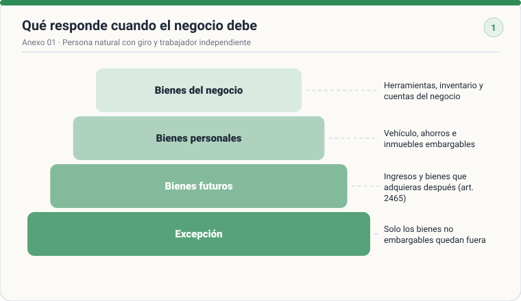

# Anexo 01 · Persona natural con giro y trabajador independiente

> **Fecha de consulta de las fuentes:** 2026-11-25. **Naturaleza:** material educativo; no es asesoría
> legal ni tributaria. Las normas cambian: confirma cada dato en la fuente oficial citada al final
> antes de actuar. Este anexo separa **obligación legal**, **recomendación profesional** y **medida
> voluntaria**. La persona natural **no es una forma societaria**: es la persona misma actuando
> económicamente. Por eso este anexo describe cómo se **formaliza** y qué riesgos asume.

<!-- anexos:nav-inicio -->

**Navegación:** — · [Índice de anexos](README.md) · [02. Empresa Individual de Responsabilidad Limitada (EIRL) →](02-empresa-individual-de-responsabilidad-limitada-eirl.md)

## En 60 segundos

- No es una persona jurídica: tu patrimonio y el del negocio son uno solo (art. 2465 del Código Civil).
- Debes declarar el inicio de actividades al SII dentro de dos meses (art. 68 del Código Tributario).
- Los honorarios tributan en Segunda Categoría; las ventas con giro, en Primera Categoría.
- Los profesionales pagan una patente única de una UTM, válida en todo el país.
- Es buena para partir; cuando crecen el riesgo o el tamaño, conviene una EIRL o una sociedad.

<!-- anexos:nav-fin -->

## 1. Ficha rápida

| Pregunta | Respuesta |
|---|---|
| ¿Qué es? | Una persona natural que **ejerce una actividad económica por cuenta propia**, sin crear una persona jurídica: puede ser un **trabajador independiente** (honorarios) o un **empresario individual** (comercio, industria, servicios con giro). |
| ¿Hay persona jurídica? | **No.** No existe separación entre el patrimonio del negocio y el personal. |
| ¿Quién responde por las deudas? | La propia persona, **con todos sus bienes, presentes y futuros**, salvo los no embargables (art. 2465 del Código Civil). |
| ¿Se constituye en el Registro de Empresas y Sociedades? | **No.** La Ley 20.659 solo enumera personas jurídicas; la persona natural no necesita constituirse. |
| ¿Qué trámite se necesita? | Inscripción en el **RUT** y **declaración de inicio de actividades** ante el SII cuando se inician negocios o labores susceptibles de producir rentas gravadas: dentro de **dos meses** (arts. 66 y 68 del Código Tributario). |
| ¿Cómo tributa? | Como **empresario individual** en **Primera Categoría** (rentas de la industria, el comercio y otras actividades; art. 20 N.º 3 de la Ley de la Renta) o como **profesional o trabajador independiente** en **Segunda Categoría** (honorarios; art. 42 N.º 2). |
| ¿Y la patente? | Rige la patente municipal: profesionales pagan una **patente única de 1 UTM** en la comuna de su consulta, y la **microempresa familiar** tiene reglas especiales (arts. 26 y 32 del DL 3.063). |
| ¿Para quién suele servir? | Quien parte solo, con bajo riesgo, quiere simplicidad y no necesita socios ni inversionistas todavía. |
| ¿Para quién no? | Quien asume riesgos altos (deudas, daños a terceros), quiere separar patrimonios, incorporar socios o dar una imagen institucional. |

## 2. Historia y evolución

### 2.1. El punto de partida del derecho

La persona natural es el **sujeto básico del derecho**: puede contratar, endeudarse y ejercer actividades sin
necesidad de crear una entidad. Las leyes tributarias reconocen desde hace décadas a quienes trabajan por
cuenta propia: la **Ley de la Renta (Decreto Ley 824, de 1974)** distingue las rentas de la industria y el
comercio (Primera Categoría) de los ingresos de las profesiones liberales y de otras ocupaciones lucrativas
(Segunda Categoría), y el **Decreto Ley 825 (1974)** regula el IVA para quienes venden bienes o prestan
servicios.

### 2.2. La limitación del modelo y las respuestas del derecho

Operar como persona natural tiene un problema: **todo el patrimonio queda expuesto**. El derecho chileno fue
agregando formas para limitarlo: la **sociedad de responsabilidad limitada** (Ley 3.918, 1923), la **EIRL**
(Ley 19.857, 2003, Anexo 02) y la **SpA** (Ley 20.190, 2007, Anexo 06), que puede ser unipersonal. En 2013, la
Ley 20.659 permitió constituirlas en línea (Anexo 15). Para la persona natural, la Ley 20.416 (Estatuto Pyme,
2010; Anexo 13) y el DL 3.063 agregaron beneficios para microempresas, como la **microempresa familiar** y la
patente provisoria.

### 2.3. Por qué sigue siendo la puerta de entrada

Aun con esas alternativas, la persona natural sigue siendo el **primer paso** para muchos emprendimientos:
cuesta menos, exige menos formalidades y permite **probar un negocio** antes de crear una estructura. La clave
es **saber cuándo dejarla**: este anexo termina con las señales para pasar a una EIRL o una sociedad.

## 3. Marco legal

### 3.1. Mapa de normas

| Norma | Qué aporta |
|---|---|
| Código Civil, arts. 2465 a 2470 | Responsabilidad con todos los bienes; prorrata y causas de preferencia |
| Código Tributario, arts. 66 y 68 | RUT e inicio de actividades |
| Ley de la Renta (DL 824), arts. 20 N.º 3, 21, 22, 42 N.º 2 y 74 N.º 2 | Categorías, honorarios y retención |
| Ley del IVA (DL 825) | IVA, documentos y Registro de Compras y Ventas |
| DL 3.063, arts. 23 a 34 | Patente municipal, profesionales y microempresa familiar |
| Ley 20.416 | Estatuto Pyme: tramos, permisos y sanciones graduadas |
| Código del Trabajo | Contratación de trabajadores y clasificación por tamaño |

### 3.2. Obligación, recomendación, opción

| Materia | Tipo | Detalle |
|---|---|---|
| Inscribirse en el RUT | Obligación | Art. 66 Código Tributario |
| Declarar inicio de actividades en dos meses | Obligación | Art. 68 Código Tributario |
| Emitir documentos tributarios electrónicos | Obligación | Arts. 52 y 54 DL 825 (si estás afecto) |
| Patente municipal | Obligación | Art. 23 DL 3.063 |
| Separar cuentas personal y del negocio | Recomendación profesional | Aunque la ley no lo exija |
| Seguros de responsabilidad y de bienes | Medida voluntaria | Reduce el riesgo patrimonial |
| Evaluar EIRL o sociedad | Recomendación profesional | Si el riesgo o el tamaño crecen |

## 4. Cómo se constituye

La persona natural **no se constituye**: se **formaliza** ante el SII y la municipalidad. Esta sección explica cómo.

### 4.1. Dos caminos: independiente o empresario

| Rasgo | Trabajador independiente (honorarios) | Empresario individual (giro) |
|---|---|---|
| Ejemplo | Psicóloga, diseñador, abogada, consultor | Tienda, taller, restaurante, transporte |
| Categoría tributaria | Segunda Categoría (art. 42 N.º 2) | Primera Categoría (art. 20 N.º 3) |
| Documento | Boleta de honorarios | Factura o boleta de ventas y servicios |
| Contabilidad | Más simple | Según régimen y tamaño |
| Patente | Patente única de profesional (1 UTM) | Patente según capital propio |

La frontera entre ambos **no depende del nombre que elijas**, sino de la naturaleza de tu actividad. Un
profesional que además vende productos o contrata personal con un giro comercial puede quedar en Primera
Categoría. Consulta a tu contador cómo se clasifica tu actividad.

### 4.2. Paso a paso

1. **Define la actividad** y su categoría tributaria con un contador.
2. **Inscríbete en el RUT** (como persona natural ya lo tienes) y **declara el inicio de actividades** ante el
   SII por la carpeta tributaria electrónica, **dentro de los dos meses** de comenzar (arts. 66 y 68 del Código
   Tributario). No esperes el plazo: lo necesitas para emitir documentos.
3. **Elige los códigos de actividad** que reflejen lo que realmente harás (Anexo 16).
4. **Define el documento** que emitirás (boleta de honorarios, factura, boleta) y el sistema para hacerlo.
5. **Tramita la patente municipal**, si corresponde: profesionales con consulta, microempresa familiar o local
   comercial (Anexo 17).
6. **Obtén permisos sectoriales** de tu actividad y revisa la [matriz de permisos](../docs/06_PERMITS_MATRIX.md).
7. **Abre una cuenta bancaria separada** para el negocio, aunque sea a tu nombre.
8. **Define tu previsión y tu salud** como independiente: tu seguridad social no la paga un empleador.
9. **Contrata un seguro** si tu actividad puede causar daños a terceros.

### 4.3. El inicio de actividades: detalles del art. 68

La declaración de iniciación debe presentarse **dentro de los dos meses siguientes** a aquel en que comiencen
las actividades. El Director del SII puede, por norma general, **eximir** o **sustituir** la exigencia para
ciertos contribuyentes de escasos recursos o sin la preparación necesaria, por procedimientos simplificados
(art. 68). Revisa en el SII si existe un procedimiento simplificado para tu caso.

### 4.4. Término de actividades

Si dejas el negocio, debes **avisar el término de giro** y pagar el impuesto correspondiente dentro de los dos
meses (art. 69 del Código Tributario). Cerrar «de hecho» no termina tus obligaciones. Ver el Anexo 16.

## 5. Capital, aportes y propiedad

### 5.1. No hay capital social

La persona natural **no tiene capital social**: usas tus propios bienes. Lo que importa es llevar un registro
claro de qué bienes se usan en el negocio (herramientas, vehículo, inventario) y de su valor, porque eso
afecta tu contabilidad, tu patente (capital propio) y tu eventual venta o transformación.

### 5.2. La patente y el capital propio

La patente municipal se calcula sobre el **capital propio**: entre el 2,5 y el 5 por mil, con un mínimo de una
UTM y un máximo de 8.000 UTM; quienes **no están obligados a llevar balance** pagan una UTM al año (art. 24 del
DL 3.063). Los profesionales del art. 32 pagan una **patente única anual de una UTM** en la comuna de su
consulta, válida en todo el país. Ver el Anexo 17.

### 5.3. Cuando el negocio es familiar

La **microempresa familiar** es la que ejerce su giro en la **casa habitación familiar**, con **no más de cinco
trabajadores ajenos a la familia** y **activos productivos no superiores a 1.000 UF** (sin contar el inmueble),
excluidas las actividades peligrosas, contaminantes o molestas (art. 26 del DL 3.063). Se inscribe en la
municipalidad con una declaración jurada. Si el negocio crece, revisa si sigues cumpliendo los requisitos.

### 5.4. Bienes del negocio y bienes personales

Como no hay separación jurídica, **todos tus bienes responden** igualmente. Separar en la práctica tus gastos y
bienes personales y los del negocio no cambia la responsabilidad frente a terceros, pero **ordena tu
contabilidad**, facilita tu defensa ante el SII y prepara una futura transformación en EIRL o sociedad.

### 5.5. Si vas a aportar el negocio a una sociedad

Cuando constituyas una sociedad, el negocio se **aporta**: el inventario, las herramientas, los contratos y los
derechos. Para los bienes con formalidades (inmuebles, vehículos), el aporte debe cumplir esas formalidades
(art. 8 de la Ley 20.659). Prepara un inventario valorado desde el inicio.

## 6. Administración y gobierno

### 6.1. Una sola persona decide

En la persona natural **tú eres el administrador, el titular y el responsable**. No hay órganos ni quórums. La
ventaja es la velocidad; el riesgo, la falta de control. Algunas prácticas que compensan:

- **Registrar las decisiones relevantes** (precios, endeudamiento, contratos) en un cuaderno o archivo.
- **Pedir una segunda opinión** (contador, mentor, abogado) antes de decisiones grandes.
- **Separar tareas** cuando contrates ayuda: quien cobra no debería ser quien concilia.

### 6.2. Poderes y representación

Si das un **poder** a un tercero para actuar por ti (cobrar, firmar, administrar), tú respondes por sus actos
dentro del poder. Define el alcance por escrito, con montos y plazos, y revócalo cuando termine su función.

### 6.3. Contratar personas

Si contratas trabajadores, serás **empleador** con todas las obligaciones laborales y previsionales. La
clasificación por número de trabajadores del Código del Trabajo (micro: 1 a 9; pequeña: 10 a 49) determina,
entre otros, el rango de multas (Anexo 13). Ver el [flujo laboral](../docs/08_EMPLOYMENT_FLOW_CHILE.md). Una
relación se califica por los **hechos** (subordinación y dependencia), no por el nombre del contrato.

### 6.4. Cuando el cliente te trata como empleado

Si trabajas para un solo cliente, bajo sus órdenes y horario, puede configurarse una relación laboral
encubierta. Consulta a un abogado laboral **antes** de firmar contratos de honorarios con esas características.

## 7. Responsabilidad

### 7.1. La regla: todos tus bienes

El artículo 2465 del Código Civil dispone que **toda obligación personal da al acreedor el derecho de perseguir
su ejecución sobre todos los bienes raíces o muebles del deudor, presentes o futuros**, exceptuando solo los no
embargables. Los acreedores pueden exigir la venta de todos los bienes del deudor hasta concurrencia de sus
créditos, incluidos intereses y costos de cobranza; si no alcanzan, se paga **a prorrata**, salvo las causas
de preferencia, que son **solamente el privilegio y la hipoteca** (arts. 2469 y 2470).

### 7.2. Qué significa en la práctica

- Una **deuda del negocio** puede cobrarse sobre tu casa, tu vehículo o tus ahorros, si son embargables.
- Una **demanda por un daño** causado en tu actividad puede afectar tu patrimonio personal.
- **No hay protección** por el hecho de llevar contabilidad separada.
- Una deuda tributaria o laboral también compromete tus bienes.

### 7.3. Responsabilidades especiales

| Área | Qué debes considerar |
|---|---|
| Tributaria | Eres el contribuyente: si no declaras o pagas, respondes con tu patrimonio |
| Laboral | Si contratas, respondes por remuneraciones y cotizaciones |
| Consumo | Respondes frente a tus clientes como proveedor (Ley 19.496) |
| Penal | Respondes personalmente por tus actos |
| Contractual | Respondes de tus contratos con todos tus bienes |

### 7.4. Cómo reducir el riesgo sin cambiar de forma

1. **Seguros** de responsabilidad civil y de bienes.
2. **Contratos claros**, con límites de responsabilidad y cláusulas de fuerza mayor.
3. **Reservas de caja** para imprevistos.
4. **No firmar avales** si no es indispensable.
5. **Evaluar el cambio** a EIRL o sociedad cuando el riesgo supere tu tolerancia.

## 8. Tributación

### 8.1. Primera Categoría: empresario individual

Las **rentas de la industria, del comercio, de la minería** y de otras actividades enumeradas, y todas las
rentas no gravadas en otra categoría, tributan en **Primera Categoría** (art. 20 N.º 3 y N.º 5 de la Ley de la
Renta). El artículo 21 incluye expresamente a los **empresarios individuales** que declaran sus rentas
efectivas de acuerdo con un balance general según contabilidad completa. Los **empresarios individuales** pueden
acogerse, si cumplen los requisitos de cada uno, a los regímenes que el SII presenta para la Operación Renta 2026: **Pro Pyme General, Pro
Pyme Transparente y Régimen General semi integrado**. Ver el [flujo tributario](../docs/02_SII_TAX_FLOW.md).

### 8.2. Segunda Categoría: profesionales y honorarios

Los **ingresos provenientes del ejercicio de las profesiones liberales** o de cualquier otra profesión u
ocupación lucrativa no comprendida en otra categoría tributan en **Segunda Categoría** (art. 42 N.º 2). Quien
paga honorarios y está obligado a llevar contabilidad (personas jurídicas, instituciones, personas de Primera
Categoría con contabilidad, entre otros) **retiene una parte** a cuenta del impuesto: el texto consultado fija
una tasa provisional de **17 %** (art. 74 N.º 2). **La tasa de retención ha tenido un calendario transitorio:
verifica la tasa vigente en el SII.** La retención se imputa a tu impuesto anual.

### 8.3. Pequeños contribuyentes de impuesto único

La ley contempla regímenes de **impuesto único anual** para ciertas actividades pequeñas (por ejemplo, pequeños
comerciantes que desarrollan actividades en la vía pública, según calificación del permiso municipal, art. 22).
Si te encuentras en una de esas categorías, consulta el SII; no extrapoles la regla a otras actividades.

### 8.4. IVA

Si vendes bienes o prestas servicios afectos, estás sujeto a **IVA con tasa de 19 %** y debes emitir documentos
electrónicos y declarar mensualmente (arts. 14, 52 y 54 del DL 825). Hay servicios y operaciones **exentas**
(art. 12): consulta al SII cómo se trata tu actividad. Ver el Anexo 16.

### 8.5. Tasas recientes

La **Ley 21.850** fija la tasa de Primera Categoría en 27 % para 2026, 25,5 % para 2027, 24 % para 2028 y 23 %
desde 2029, sin perjuicio del art. 25 de la Ley 21.755 (12,5 % transitoria para Pro Pyme en 2025, 2026 y 2027,
con condiciones). **Verifica en el SII.** Ver la [guía de la Ley 21.850](../docs/20_LEY_21850_RECONSTRUCCION_NACIONAL.md).

### 8.6. Decisión práctica

1. ¿Tus ingresos son por **honorarios** o por **ventas**? Eso define tu categoría.
2. ¿Cuánto retienen tus clientes y cómo afecta tu caja?
3. ¿Te conviene un régimen distinto en Primera Categoría?
4. ¿Cuánto pagarías como EIRL o SpA? **Simula cuatro años.**

**Ejemplo ilustrativo.** Una diseñadora factura 2.000.000 de pesos al mes por honorarios a empresas que
retienen una parte. Su ingreso líquido mensual es menor que lo facturado, y al declarar su renta anual puede
tener un saldo a favor o en contra según su situación. Si en cambio opera como empresa con giro, deberá
considerar IVA, documentos y un régimen de Primera Categoría. El efecto neto depende de las cifras y de su
situación; consulta a un contador. Los números son ilustrativos.

### 8.7. Tres escenarios para comparar (todos ilustrativos)

Los números siguientes **no son tasas ni cálculos oficiales**: sirven para ver cómo cambian las preguntas
según tu situación. Todos suponen un ingreso bruto anual de 24.000.000 de pesos.

| Escenario | Qué cambia | Qué debes preguntar a tu contador |
|---|---|---|
| A. Honorarios a empresas | Tus clientes retienen una parte; tú declaras en Segunda Categoría | ¿Cuánto retienen hoy y cuánto me devolverán o pagaré en abril? |
| B. Ventas con giro | Emites facturas, cobras IVA y pagas patente según capital propio | ¿Qué régimen me conviene y cómo provisiono el IVA? |
| C. Mixto | Parte de tus ingresos son honorarios y parte ventas | ¿Cómo se separan ambas actividades y qué documentos uso en cada caso? |

La conclusión práctica no es «cuál paga menos», sino **«cuál es coherente con lo que realmente hago»**. Un
negocio que mezcla actividades sin ordenarlas es el que más sorpresas recibe en la declaración anual.

## 9. Obligaciones laborales, contables y sectoriales

### 9.1. Contabilidad

Aunque los regímenes simplificados exigen menos, **lleva siempre** un registro ordenado de ingresos, gastos,
documentos y pagos. Para IVA, el SII registra tus documentos electrónicos en el Registro de Compras y Ventas
(art. 59 del DL 825): revísalo cada mes.

### 9.2. Previsión y salud como independiente

Como independiente, **tu protección social depende de tus cotizaciones y de tu planificación**. No están
detalladas en los artículos revisados para este anexo; consulta a un asesor previsional y revisa las normas
vigentes sobre cotización de trabajadores independientes antes de definir tus ingresos.

### 9.3. Patente y permisos

Revisa el Anexo 17 (Municipalidades) y la [matriz de permisos](../docs/06_PERMITS_MATRIX.md). Los profesionales
con patente única no necesitan permisos adicionales para la patente (art. 26 DL 3.063), pero su actividad puede
tener regulación sectorial propia.

### 9.4. Datos, consumo y cumplimiento

Como proveedor, aplican las normas de consumo y de protección de datos. Ver
[cumplimiento y riesgo](../docs/13_COMPLIANCE_RISK.md).

### 9.5. Estatuto Pyme

Si tus ingresos del año anterior no superan **2.400 UF** eres **microempresa** según la Ley 20.416, y puedes
acceder a sus beneficios (permisos provisorios, declaración jurada sanitaria, sanciones graduadas), con las
exclusiones del art. 2. Ver el Anexo 13.

### 9.6. Una rutina administrativa sencilla

Quien trabaja solo suele dejar la administración para «cuando haya tiempo», y ese es el origen de la mayoría de
los problemas con el SII y con los clientes. Una rutina corta evita acumular atrasos:

| Cuándo | Qué hacer | Tiempo aproximado |
|---|---|---|
| Cada semana | Guardar boletas y facturas, anotar ingresos y gastos y apartar una parte para impuestos | 30 minutos |
| Cada mes | Revisar el Registro de Compras y Ventas, emitir lo pendiente, declarar y pagar en el calendario del SII | 2 horas |
| Cada trimestre | Revisar ingresos frente al año anterior, el tramo de tamaño y la necesidad de seguros | 1 hora |
| Cada año | Preparar la declaración de renta con tu contador y renovar la patente en los meses que corresponda | Media jornada |
| Cada vez que cambien tus datos | Actualizar domicilio, giros o representantes ante el SII y la municipalidad | 30 minutos |

El tiempo indicado es ilustrativo. Lo importante es la **regularidad**: una hora ordenada cada semana vale
más que un fin de semana de reconstrucción al final del año.

## 10. Antes de construir: lista de verificación

### 10.1. Decisiones previas

1. ¿Mi actividad es de honorarios (Segunda Categoría) o de giro (Primera Categoría)?
2. ¿Cuál es el riesgo de deudas o daños a terceros? Si es alto, evalúa EIRL o sociedad desde el inicio.
3. ¿Tendré socios o inversión en los próximos veinticuatro meses? Si sí, evalúa SpA.
4. ¿Qué documento emitiré y qué retención aplicarán mis clientes?
5. ¿Qué patente necesito (profesional, microempresa familiar, local comercial)?
6. ¿Qué permisos sectoriales exige mi actividad?
7. ¿Cómo separaré mis cuentas y llevaré mi registro?
8. ¿Qué seguros contrataré?
9. ¿Cómo cotizaré para mi previsión y salud?
10. ¿En qué momento daré el paso a una estructura con responsabilidad limitada?

### 10.2. Documentos

| Documento | Para qué |
|---|---|
| Cédula de identidad y RUT | Identificación |
| Inicio de actividades | Declaración al SII |
| Título o contrato del local | Domicilio y patente |
| Permisos y autorizaciones sectoriales | Operación |
| Seguros | Cobertura de riesgo |
| Registro de ingresos y gastos | Contabilidad y defensa ante el SII |

### 10.3. Errores frecuentes

- **Creer que declarar un negocio «protege» el patrimonio:** no hay separación jurídica.
- **Mezclar gastos personales y del negocio.**
- **No declarar el inicio de actividades** y vender sin documentos.
- **Aceptar contratos de honorarios que esconden una relación laboral.**
- **No considerar la retención** y descubrir tarde que el flujo es menor.
- **No contratar seguros** en actividades con riesgo.
- **Firmar avales sin evaluar** que comprometen todo tu patrimonio.
- **Postergar el paso a EIRL o sociedad** hasta que ya hay una deuda grande.

### 10.4. Caso ilustrado: un taller de reparación de bicicletas

**Caso ilustrativo.** Mateo repara bicicletas desde su cochera. Los números son ilustrativos.

1. **Inicio.** Declara el inicio de actividades en Primera Categoría con un código de reparación de bicicletas y
   vende repuestos. Consulta si su casa cumple los requisitos de microempresa familiar y se inscribe en la
   municipalidad con una declaración jurada.
2. **Primer año.** Vende 18.000.000 de pesos (unas 470 UF con una UF ilustrativa de 38.000 pesos): es
   microempresa. Su patente es de una UTM, por no estar obligado a balance.
3. **Riesgo.** Un cliente cae de una bicicleta mal reparada y reclama una indemnización de 6.000.000 de pesos.
   Mateo responde con todo su patrimonio; su seguro de responsabilidad, que contrató en el segundo mes,
   cubre una parte.
4. **Decisión.** Evalúa seguir como persona natural o crear una EIRL (Anexo 02). Como piensa contratar un
   ayudante y su riesgo es medio, decide constituir una EIRL en el año tres, con un contrato escrito de
   traspaso del negocio y de los bienes.
5. **Qué aprende.** La persona natural es buena para empezar, pero **requiere seguros y un plan de salida
   hacia una estructura** cuando crecen el riesgo o el tamaño.

### 10.6. Plan de transición hacia una EIRL o una sociedad (en diez pasos)

Si decides dar el salto, hazlo con un plan. Esta secuencia es una **recomendación profesional** basada en las
formalidades que revisan los Anexos 02, 06 y 15:

1. **Define el motivo** (riesgo, socios, imagen, contratación) y escríbelo.
2. **Elige la forma** (EIRL, SpA unipersonal u otra) comparando responsabilidad, costo y flexibilidad.
3. **Prepara el inventario del negocio**: bienes, contratos, cuentas por cobrar y por pagar, trabajadores.
4. **Valora los bienes** que aportarás y decide cuáles quedarán a tu nombre (por ejemplo, la vivienda).
5. **Redacta el estatuto** con giro amplio, capital y administración.
6. **Constituye** la persona jurídica por el Registro de Empresas y Sociedades o por escritura.
7. **Traspasa contratos y relaciones**: avisa a clientes y proveedores y firma los nuevos contratos a nombre de
   la empresa.
8. **Actualiza el SII, la patente y los permisos** a nombre de la nueva persona jurídica.
9. **Cierra o termina** tu actividad como persona natural con el aviso de término de giro, si corresponde.
10. **Separa las cuentas** y registra el contrato de aporte o los préstamos entre ti y la empresa.

Hacerlo **antes** de una deuda grande protege mejor; hacerlo **después** puede ser cuestionado si parece un
traspaso para evitar pagos. Las deudas existentes se mantienen contigo y, según el caso, también pueden
alcanzar a la nueva empresa. Consulta a un abogado antes de mover bienes.

### 10.5. Mini glosario

| Término | Significado |
|---|---|
| Persona natural con giro | Persona que ejerce una actividad económica sin crear una persona jurídica. |
| Empresario individual | Persona natural que explota un negocio y tributa en Primera Categoría. |
| Honorarios | Ingresos de profesiones liberales u ocupaciones lucrativas de Segunda Categoría. |
| Retención | Parte del pago que el pagador descuenta y entrega al SII a cuenta del impuesto. |
| Microempresa familiar | Actividad en la casa habitación, con hasta cinco trabajadores ajenos y activos hasta 1.000 UF. |
| Patente única | Patente anual de una UTM de los profesionales, válida en todo el país. |
| Prorrata | Reparto proporcional entre acreedores cuando los bienes no alcanzan. |
| Término de giro | Aviso al SII del cese de actividades. |

## 11. Cuándo conviene y cuándo no

### 11.1. Comparación con alternativas

| Criterio | Persona natural | EIRL | SpA unipersonal | Sociedad limitada |
|---|---|---|---|---|
| Persona jurídica | No | Sí | Sí | Sí |
| Responsabilidad | Todos los bienes | Limitada al patrimonio de la empresa (con excepciones) | Limitada a aportes | Limitada a aportes |
| Constitución | Inicio de actividades | Escritura o Registro en línea | Registro en línea o escritura | Escritura o Registro en línea |
| Socios | No | No | Posible después | Dos o más |
| Costo y formalidad | Mínimos | Bajos | Medios | Medios |
| Imagen frente a grandes clientes | Menor | Media | Alta | Alta |

### 11.2. Señales a favor

- Probar una idea con bajo riesgo y bajo costo.
- Actividad profesional o de servicios sin gran exposición a daños.
- Ingresos pequeños o irregulares al inicio.
- Necesidad de rapidez y simplicidad.

### 11.3. Señales de que debes cambiar

- Deudas relevantes con proveedores o bancos.
- Riesgo de daños a terceros.
- Contratación de personal.
- Llegada de socios o inversionistas.
- Clientes grandes que exigen una persona jurídica.
- Venta futura del negocio como activo separado.

## 12. Cuándo llamar a un profesional

| Situación | Profesional | Por qué |
|---|---|---|
| Elegir categoría y régimen | Contador | Efectos tributarios a varios años |
| Contratos con riesgo laboral | Abogado laboral | Evitar relación encubierta |
| Seguros y riesgos | Corredor de seguros | Cobertura adecuada |
| Transformar a EIRL o sociedad | Abogado | Traspaso de bienes y contratos |
| Deudas elevadas | Abogado | Prelación y opciones |
| Previsión como independiente | Asesor previsional | Cotizaciones y cobertura |

Consulta la [guía de cuándo llamar a un profesional](../docs/18_WHEN_TO_CALL_A_PROFESSIONAL.md).

## 13. Escenarios resueltos

Los escenarios siguientes aplican lo visto en las secciones anteriores. Son **casos ilustrativos**: los
nombres y los números son inventados y sirven para practicar el razonamiento, no para fijar cifras.

### Escenario 1: la diseñadora que factura a empresas

**Situación.** Valentina es diseñadora gráfica. Trabaja desde su casa para cuatro empresas y emite boletas de
honorarios por unos 2.000.000 de pesos al mes. Una de las empresas le propone un contrato por un año con
exclusividad parcial.

**Preguntas que debe hacerse.**

1. ¿Su ingreso es por honorarios (profesión u ocupación lucrativa) o tiene un giro comercial? Como presta un
   servicio personal, hoy tributa en Segunda Categoría (art. 42 N.º 2 de la Ley de la Renta).
2. ¿Quién retiene? Las empresas obligadas a llevar contabilidad retienen a cuenta del impuesto (art. 74 N.º 2);
   el texto consultado fija una tasa provisional de 17 %, pero la tasa tiene calendario transitorio.
3. ¿Qué pasa si crece? Si empieza a contratar ayudantes o a vender productos (por ejemplo, plantillas con
   licencia), su actividad puede pasar a tener giro y a quedar en Primera Categoría.

**Análisis.** Valentina no necesita constituir una empresa para seguir facturando honorarios. Lo que sí debe
hacer es **ordenar su situación**: declarar el inicio de actividades dentro de dos meses desde que empezó a
ejercer (art. 68 del Código Tributario), pagar la patente única de profesional de una UTM en la comuna donde
tiene su estudio (art. 32 del DL 3.063) y separar sus cuentas.

**Decisión recomendada.** Mantenerse como persona natural, **contratar un seguro de responsabilidad
profesional** si sus trabajos pueden causar daños económicos a sus clientes, y fijar en sus contratos un tope
de responsabilidad por escrito. Evaluar una EIRL o una SpA unipersonal **cuando** contrate personal, emita
facturas por ventas de productos o su riesgo contractual supere su tolerancia.

**Errores a evitar.** Aceptar la exclusividad sin pagar por ella (puede configurar subordinación), no registrar
la retención de cada cliente (afecta su declaración anual) y firmar contratos que la hagan responsable de
perjuicios ilimitados.

**Cifras ilustrativas.** Con 24.000.000 de pesos de ingresos brutos al año y una retención del 17 %, sus
clientes retienen 4.080.000 pesos a cuenta de su impuesto anual. Si su impuesto anual resulta menor, tendrá
devolución; si resulta mayor, deberá pagar la diferencia. El resultado depende de sus gastos aceptados y de su
situación personal: lo calcula su contador.

### Escenario 2: la tienda desde la casa

**Situación.** Rodrigo vende conservas artesanales desde el living de su casa, con ayuda de su pareja y de una
persona externa a la familia que trabaja medio día. Sus ventas anuales son de unos 18.000.000 de pesos y sus
activos productivos (cocina, envases, balanza) no pasan de 1.500.000 pesos.

**Preguntas.**

1. ¿Es una microempresa familiar? El art. 26 del DL 3.063 exige tres cosas: actividad en la casa habitación
   familiar, no más de cinco trabajadores ajenos a la familia y activos productivos sin contar el inmueble que
   no excedan de 1.000 UF. Rodrigo cumple las tres con holgura.
2. ¿Qué actividades quedan excluidas? Las peligrosas, contaminantes o molestas. Una cocina doméstica de
   conservas puede ser sanitariamente sensible: debe respetar el Reglamento Sanitario de los Alimentos, que el
   propio art. 26 menciona.
3. ¿Qué debe presentar? Inscripción en la municipalidad con una declaración jurada de que es legítimo ocupante
   de la vivienda y de que su actividad no produce contaminación. Si vive en un condominio, necesita la
   autorización del Comité de Administración.

**Análisis.** Rodrigo puede beneficiarse del régimen de microempresa familiar, pero **no queda libre de
obligaciones sanitarias ni tributarias**. Debe declarar el inicio de actividades, emitir documentos y declarar
IVA si sus ventas están afectas. Además, es **microempresa según la Ley 20.416** (menos de 2.400 UF de
ingresos anuales), lo que le abre otros beneficios (Anexo 13).

**Decisión recomendada.** Formalizar como persona natural con giro, inscribirse como microempresa familiar y
**pedir una asesoría sanitaria** antes de crecer. Si su volumen o su riesgo aumentan (por ejemplo, venta a
supermercados), conviene una EIRL o una SpA y un local con permisos completos.

**Errores a evitar.** Vender sin boleta, dar por hecho que «microempresa familiar» exime de lo sanitario, y
mezclar el dinero del hogar con el del negocio.

### Escenario 3: el «independiente» que trabaja para un solo cliente

**Situación.** Matías es programador. Firma un contrato de honorarios con una empresa, trabaja en sus oficinas
de lunes a viernes de 9 a 18, usa su correo corporativo, recibe instrucciones de un jefe y no puede atender a
otros clientes. Lleva dieciocho meses así.

**Análisis.** La ley laboral califica la relación por los **hechos** (subordinación y dependencia), no por el
nombre del contrato. Si los hechos muestran subordinación, la relación podría ser laboral aunque el papel diga
«honorarios». Para Matías hay un riesgo doble: si es empleado encubierto, pierde cotizaciones, vacaciones e
indemnizaciones; para la empresa, el riesgo es de sanciones y cobros. Este anexo **no resuelve** el caso
(requiere análisis laboral), pero sí enseña la **alerta temprana**.

**Señales de alerta** (marca las que apliquen): horario fijo impuesto; jefe que da órdenes; herramientas de la
empresa; exclusividad; pago periódico fijo como sueldo; imposibilidad de subcontratar a otro.

**Decisión recomendada.** Consultar a un abogado laboral **antes** de firmar o renovar. Alternativas: (a)
convertir la relación en un contrato de trabajo, (b) rediseñar el servicio por entregables con autonomía real,
(c) constituir una persona jurídica que preste el servicio con sus propios medios, si los hechos lo permiten.

**Errores a evitar.** Firmar «por conveniencia tributaria» sin entender el riesgo; no guardar evidencia de
autonomía (correos, entregables, facturación a otros clientes).

### Escenario 4: la deuda que llega a la casa

**Situación.** Carolina tiene un taller de costura como persona natural. Una proveedora le demanda por
8.000.000 de pesos. Carolina tiene un vehículo, ahorros de 3.000.000 y una vivienda.

**Análisis.** Según el art. 2465 del Código Civil, la obligación personal da al acreedor el derecho de
perseguir **todos los bienes raíces o muebles del deudor**, presentes o futuros, salvo los no embargables. Si
los bienes no alcanzan para todos los acreedores, se paga **a prorrata**, salvo las causas de preferencia, que
son solo el privilegio y la hipoteca (arts. 2469 y 2470). Por eso **no importa** que la deuda sea «del taller»:
todo su patrimonio embargable queda expuesto.

**Preguntas útiles.** ¿Qué bienes son inembargables según la ley (consulta a un abogado, la lista es técnica)?
¿Existe una hipoteca anterior sobre su vivienda que tendría preferencia? ¿Cuáles son los plazos del juicio?

**Decisión recomendada.** Buscar un **acuerdo de pago** antes de la ejecución, con asesoría. A futuro, evaluar
una estructura con responsabilidad limitada **sin mover bienes para eludir deudas existentes**: un traspaso
dirigido a evitar el pago puede ser impugnado.

**Errores a evitar.** Vender bienes a familiares «para protegerlos» una vez iniciada la demanda; ignorar las
notificaciones; firmar nuevos avales.

### Escenario 5: de persona natural a EIRL, paso a paso

**Situación.** Pablo repara computadores como persona natural hace tres años, tiene dos empleados y quiere
firmar un contrato con una cadena de tiendas que le exige estar constituido como empresa.

**Ruta.** Pablo evalúa EIRL y SpA unipersonal (Anexos 02 y 06). Elige EIRL por simplicidad. Sigue la secuencia
de la sección 10.6: inventario de bienes con valor, redacción del giro amplio, constitución por el Registro
de Empresas y Sociedades (Anexo 15), traspaso de contratos, actualización ante el SII y la municipalidad,
término de giro como persona natural y separación de cuentas.

**Puntos finos.**

- El **aporte** de las herramientas debe ser efectivo y con valor documentado (art. 8 de la Ley 19.857).
- Los **contratos entre Pablo y su EIRL** (por ejemplo, arriendo de una bodega que es suya) deben constar por
  escrito y protocolizarse (art. 10 de la Ley 19.857).
- Los **trabajadores** deben recibir un traspaso formal del empleador: pregunta a un abogado laboral cómo
  hacerlo sin perder antigüedad.
- La **patente** y los permisos se solicitan a nombre de la EIRL (Anexo 17).

**Resultado esperado.** Una empresa con patrimonio separado, contratos a su nombre y contabilidad propia.

### Escenario 6: el profesional que también vende productos

**Situación.** Ignacio es kinesiólogo (honorarios) y comienza a vender suplementos y aparatos de ejercicio en
su consulta.

**Análisis.** Sus honorarios siguen siendo de Segunda Categoría; la venta de productos es una actividad de
comercio que puede quedar en Primera Categoría y afecta a IVA (arts. 8 y 14 del DL 825). Mezclar ambas sin
orden genera problemas: ¿qué documento emite en cada caso?, ¿cómo separa costos?, ¿cómo declara?

**Decisión recomendada.** Consultar a su contador si conviene **separar las actividades** (por ejemplo, una
sociedad para la venta de productos y mantener los honorarios como persona natural) y emitir el documento
correcto en cada operación. Revisar además las normas sanitarias de venta de dispositivos.

## 14. Catálogo de errores y cómo corregirlos

La tabla ordena los errores por **causa**, **consecuencia** y **corrección**. La columna «Dónde ver más» remite
al anexo o a la sección que lo desarrolla.

| N.º | Error | Causa típica | Consecuencia | Cómo corregirlo | Dónde ver más |
|---:|---|---|---|---|---|
| 1 | Vender sin declarar el inicio de actividades | «Es solo al comienzo» | No puedes emitir documentos; riesgo de sanciones | Declarar de inmediato y consultar a un contador cómo regularizar | Sección 4.3; Anexo 16 |
| 2 | Elegir códigos de actividad por aproximación | Prisa | Documentos limitados o régimen equivocado | Revisar giros con el contador y actualizar ante el SII | Anexo 16 |
| 3 | Mezclar cuentas personales y del negocio | Comodidad | Contabilidad confusa; defensa débil ante el SII | Abrir una cuenta separada y registrar traspasos | Sección 6.1 |
| 4 | No considerar la retención de honorarios | No lo calculó en el flujo | Caja menor a la esperada | Proyectar ingreso líquido y declaración anual | Sección 8.2 |
| 5 | Contrato de honorarios con subordinación | Conveniencia | Posible relación laboral encubierta | Asesoría laboral y rediseño del contrato | Escenario 3 |
| 6 | No pagar patente o pagarla en la comuna equivocada | Desconocimiento | Multas y clausura | Consultar a la municipalidad y regularizar | Anexo 17 |
| 7 | Firmar avales sin evaluar | Presión del banco o del cliente | Compromete todo el patrimonio | Negociar alternativas y límites | Sección 7.4 |
| 8 | No contratar seguros | Costo percibido | Daños no cubiertos | Cotizar responsabilidad civil y bienes | Sección 7.4 |
| 9 | Cerrar «de hecho» | Falta de ventas | Obligaciones tributarias continúan | Aviso de término de giro con balance | Anexo 16 |
| 10 | Mover bienes tras una demanda | Miedo | Impugnación del traspaso | Acuerdo de pago con asesoría | Escenario 4 |
| 11 | No llevar registros | «Es un negocio pequeño» | Imposible respaldar gastos | Rutina semanal de registro | Sección 9.6 |
| 12 | Superar tramos sin recalcular el tamaño | Falta de control | Pérdida de beneficios o exclusión | Recalcular cada año | Anexo 13 |
| 13 | Ignorar normas sanitarias en alimentos | Creer que «microempresa» exime | Clausura o multas | Autorización sanitaria y asesoría | Escenario 2 |
| 14 | Operar con socio sin constituir sociedad | Informalidad | Sociedad de hecho con responsabilidad solidaria | Constituir la sociedad | Anexos 03, 06 y 15 |
| 15 | Postergar el paso a una persona jurídica | Costo percibido | Una deuda grande llega tarde | Plan de transición en diez pasos | Sección 10.6 |

**Cómo usar el catálogo.** Antes de cada trimestre, recorre la tabla y marca los errores que podrías estar
cometiendo. Los que marques tres veces seguidas son candidatos a un cambio de estructura.

## 15. Alternativas y variantes de diseño

### Variante 1: persona natural «pura»

Sin sociedad, con las obligaciones tributarias que correspondan. **Ventajas:** costo mínimo, velocidad.
**Desventajas:** responsabilidad ilimitada, menor imagen frente a clientes grandes. **Ideal para:** pruebas de
negocio y servicios de bajo riesgo.

### Variante 2: persona natural con seguros y contratos robustos

La misma forma, más una estrategia de protección: seguro de responsabilidad, contratos con topes de
responsabilidad, reservas de caja. **Ventajas:** reduce el riesgo sin crear una persona jurídica.
**Desventajas:** los seguros no cubren todo y los topes contractuales no obligan a terceros ajenos al
contrato. **Ideal para:** profesionales con riesgo medio.

### Variante 3: persona natural + microempresa familiar

Cuando la actividad se ejerce en la casa y cumple los tres requisitos del art. 26 del DL 3.063. **Ventajas:**
trámites municipales simplificados. **Desventajas:** límites de trabajadores y de activos; no aplica a
actividades peligrosas, contaminantes o molestas. **Ideal para:** producción artesanal y servicios caseros
sin riesgo.

### Variante 4: persona natural como socio de una sociedad

Quien presta servicios por su cuenta y, además, participa en una sociedad con otros. **Ventajas:** separa
proyectos. **Desventajas:** confusión de roles y de documentos. Revisa los Anexos 03, 06 y 11.

### Variante 5: pequeños contribuyentes de impuesto único

La Ley de la Renta contempla regímenes de impuesto único para ciertas actividades pequeñas (por ejemplo,
comerciantes en la vía pública calificados por su permiso municipal, art. 22). **Ventajas:** simplicidad.
**Desventajas:** limitada a ciertas actividades. Consulta al SII antes de asumirlo.

### Variante 6: pasar a EIRL

Ver Anexo 02. **Ventajas:** patrimonio separado, imagen institucional. **Desventajas:** formalidades (art. 10),
responsabilidad ilimitada en los casos del art. 12.

### Variante 7: pasar a SpA unipersonal

Ver Anexo 06. **Ventajas:** flexibilidad para socios futuros, series de acciones. **Desventajas:** estatuto que
exige diseño y reglas supletorias de la anónima.

### Cuadro de decisión por tipo de riesgo

| Riesgo principal | Primera respuesta | Segunda respuesta |
|---|---|---|
| Deudas con proveedores | EIRL o SpA | Condiciones de pago y seguros de crédito |
| Daños a clientes | Seguro de responsabilidad civil | Estructura con responsabilidad limitada |
| Reclamo laboral | Contrato correcto y asesoría | Persona jurídica con trabajadores propios |
| Reclamo tributario | Contabilidad y respaldo | Asesor tributario |
| Competencia desleal o propiedad intelectual | Contratos y registro de marca | Asesoría especializada |

### Cláusulas útiles, en lenguaje llano

Estas **ideas de cláusulas** no son un contrato listo para usar: sirven para conversar con tu abogado.

1. **Alcance.** «El servicio incluye exclusivamente lo descrito en la propuesta; todo trabajo adicional se
   cotiza aparte.»
2. **Plazos y aceptación.** «Si el cliente no responde en cinco días hábiles a un entregable, se entiende
   recibido sin observaciones.»
3. **Tope de responsabilidad.** «La responsabilidad total del prestador no excederá el monto pagado en los
   doce meses anteriores.» (Su validez depende del caso y de la ley aplicable; consulta.)
4. **Propiedad intelectual.** «Los derechos sobre el entregable pasan al cliente una vez pagado el precio
   total.»
5. **Confidencialidad.** «Ambas partes guardarán reserva de la información no pública.»
6. **Término.** «Cualquiera de las partes puede terminar el contrato con treinta días de aviso por escrito.»
7. **Autonomía.** «El prestador define sus horarios y medios; no existe exclusividad.» (Solo sirve si es
   cierto en los hechos.)

## 16. Vinculación con otros anexos y con las clases

### D.1. ¿Cuándo salto a otro anexo?

| Evento en tu negocio | Qué cambia | Anexo que debes leer |
|---|---|---|
| Llega un socio | Ya no puedes operar solo como persona natural | 03, 06, 11 |
| Quieres inversión | Necesitas acciones y pacto | 06, 07 |
| Contratas personas | Eres empleador | 13 y la [guía laboral](../docs/08_EMPLOYMENT_FLOW_CHILE.md) |
| Subes de tamaño | Cambian beneficios y sanciones | 13 |
| Abres un local | Patente y zonificación | 17 |
| Recibes una citación del SII | Defensa y plazos | 16 |
| Quieres limitar tu riesgo | Cambias de forma | 02, 06 |
| Quieres vender el negocio | Debe ser transferible | 02, 06 |
| Quieres cerrar | Término de giro | 16 |
| Operarás con el exterior | Importación o exportación | [Guía de comercio exterior](../docs/12_EXPORT_IMPORT_FLOW.md) |

### D.2. Obligaciones por organismo (resumen)

| Organismo | Qué le debes como persona natural |
|---|---|
| SII | RUT, inicio de actividades, documentos, declaraciones y término de giro |
| Municipalidad | Patente y permisos de funcionamiento |
| Dirección del Trabajo y previsión | Obligaciones de empleador si contratas |
| Autoridad sanitaria | Autorización si tu actividad lo exige |
| Registro Civil y notarías | Firmas y poderes cuando corresponda |

### D.3. Clases del programa que profundizan este anexo

- [Clase 1 de la parte 5: persona natural versus persona jurídica](../curriculum/part-05-diseno-societario-y-gobierno-inicial/class-01-persona-natural-versus-persona-juridica/README.md)
- [Clase 2 de la parte 5: EIRL, cuándo sirve y cuándo limita](../curriculum/part-05-diseno-societario-y-gobierno-inicial/class-02-eirl-cuando-sirve-y-cuando-limita/README.md)
- [Clase 2 de la parte 7: inicio de actividades en el SII](../curriculum/part-07-sii-y-ciclo-tributario-de-principio-a-fin/class-02-inicio-de-actividades-en-sii/README.md)
- [Clase 3 de la parte 7: actividades económicas, giros y códigos](../curriculum/part-07-sii-y-ciclo-tributario-de-principio-a-fin/class-03-actividades-economicas-giros-y-codigos/README.md)
- [Clase 1 de la parte 17: patente municipal, flujo y evidencia](../curriculum/part-17-permisos-patentes-y-regulacion-sectorial/class-01-patente-municipal-flujo-y-evidencia/README.md)
- [Clase 1 de la parte 12: cuándo contratar versus externalizar](../curriculum/part-12-personas-relaciones-laborales-y-seguridad-y-salud/class-01-cuando-contratar-versus-externalizar/README.md)

### D.4. Cómo se conectan las obligaciones entre sí

La persona natural tiene cuatro «hilos» que se tocan entre sí. Si tiras de uno, mueves los otros:

1. **Hilo tributario:** el inicio de actividades define tu categoría y tus documentos.
2. **Hilo municipal:** la patente usa tu capital propio, que el SII informa a la municipalidad (Anexo 17).
3. **Hilo laboral:** contratar te vuelve empleador y cambia tu clasificación por tamaño (Anexo 13).
4. **Hilo patrimonial:** todos tus bienes responden; separar la actividad en una persona jurídica corta ese
   hilo hacia el futuro, no hacia el pasado (Anexo 02).

## 17. Plantillas y listas de trabajo

### E.1. Plan de 30, 60 y 90 días para quien parte como persona natural

| Plazo | Tareas | Responsable | Evidencia |
|---|---|---|---|
| Días 1 a 7 | Definir actividad, categoría y documento; reunir cédula y título del domicilio | Tú | Nota de decisión |
| Días 8 a 15 | Declarar el inicio de actividades; elegir giros; abrir cuenta separada | Tú y contador | Comprobante de inicio |
| Días 16 a 30 | Tramitar patente y permisos; contratar un seguro si corresponde | Tú | Patente o solicitud |
| Días 31 a 60 | Primera declaración mensual; conciliar ingresos; revisar el Registro de Compras y Ventas | Contador | Conciliación |
| Días 61 a 90 | Revisar tamaño y riesgo; decidir si pasas a EIRL o sociedad | Tú y asesores | Memo de decisión |

### E.2. Ficha mensual de control (para imprimir)

| Ítem | Sí | No | Observación |
|---|---|---|---|
| Registré todos los ingresos del mes | | | |
| Guardé todas las boletas y facturas | | | |
| Revisé el Registro de Compras y Ventas | | | |
| Aparté dinero para impuestos | | | |
| Revisé retenciones de mis clientes | | | |
| Pagué la patente cuando correspondía | | | |
| Revisé mis seguros y mi previsión | | | |
| Registré decisiones relevantes del mes | | | |

### E.3. Registro de decisiones (modelo)

| Fecha | Decisión | Motivo | Alternativas consideradas | Riesgo | Quién la revisó |
|---|---|---|---|---|---|
| | | | | | |

### E.4. Lista para evaluar el paso a una persona jurídica

1. ¿Tengo deudas o contratos que me exponen a más de lo que puedo perder?
2. ¿He contratado o contrataré personal en los próximos doce meses?
3. ¿Un cliente grande me exige estar constituido?
4. ¿Voy a incorporar un socio o un inversionista?
5. ¿Quiero vender el negocio como un activo separado?
6. ¿Tengo un inventario valorado de bienes, contratos y obligaciones?
7. ¿Entiendo cómo se traspasa cada contrato y cada permiso?
8. ¿Cuánto cuesta la contabilidad adicional y quién la llevará?

Si respondes «sí» a las preguntas 1 a 5, el cambio es probablemente conveniente. Las preguntas 6 a 8 miden tu
preparación.

### E.5. Esquema de carpeta documental

| Carpeta | Contenido |
|---|---|
| 01 Identidad y SII | RUT, inicio de actividades, carpeta tributaria |
| 02 Municipalidad | Patente, permisos y comprobantes de pago |
| 03 Contratos | Clientes, proveedores y trabajadores |
| 04 Ingresos y gastos | Documentos y conciliaciones por mes |
| 05 Seguros y garantías | Pólizas y avales |
| 06 Decisiones | Registro de decisiones y correos relevantes |

## 18. Autoevaluación

Responde primero sin mirar; luego compara con las respuestas.

1. ¿Una persona natural con giro tiene patrimonio separado del de su negocio?
2. ¿En cuánto tiempo debe declarar el inicio de actividades?
3. ¿Qué artículo del Código Civil expone todos sus bienes a los acreedores?
4. ¿Qué categoría tributaria corresponde a honorarios profesionales?
5. ¿Cuánto paga de patente un profesional con consulta propia?
6. ¿Qué tres requisitos define la microempresa familiar?
7. ¿Qué señales sugieren una relación laboral encubierta?
8. ¿Qué puede pasar si traspasas bienes a un familiar después de que te demanden?
9. ¿Cuándo conviene pasar a una EIRL?
10. ¿Qué debes hacer antes de cerrar tu negocio?
11. ¿Puedes ser microempresa según la Ley 20.416 y estar sujeto a IVA? Explica.
12. ¿Qué hilo conecta tu capital propio con la municipalidad?

**Respuestas.**

1. No. Todos sus bienes responden (art. 2465 del Código Civil).
2. Dentro de dos meses desde que comienza las actividades (art. 68 del Código Tributario).
3. El artículo 2465.
4. Segunda Categoría (art. 42 N.º 2 de la Ley de la Renta).
5. Una UTM al año, en la comuna de su consulta, válida en todo el país (art. 32 del DL 3.063).
6. Actividad en la casa habitación familiar; no más de cinco trabajadores ajenos a la familia; activos
   productivos sin contar el inmueble que no excedan de 1.000 UF (art. 26 del DL 3.063).
7. Horario impuesto, órdenes de un jefe, herramientas de la empresa, exclusividad y pago como sueldo.
8. Puede ser impugnado; además puede constituir conductas sancionadas. Consulta a un abogado.
9. Cuando crece el riesgo, contratas personal, llegan socios o un cliente exige una persona jurídica.
10. Avisar el término de giro con balance y pagar el impuesto dentro de dos meses (art. 69 del Código
    Tributario).
11. Sí. La clasificación por tamaño depende de los ingresos; el IVA, del tipo de operaciones. Son criterios
    distintos.
12. El SII informa a las municipalidades, cada mayo, el capital propio, el RUT y el código de actividad
    (art. 24 del DL 3.063).

**Cómo puntuarte.** Diez o más aciertos: dominas lo esencial. Entre seis y nueve: repasa las secciones 5, 7 y
8. Menos de seis: vuelve a leer el anexo completo y los escenarios.

## 19. Calendario anual y glosario ampliado

### H.1. Calendario anual de una persona natural con giro

Las fechas exactas de vencimiento las publica el SII cada año; las que siguen vienen de las leyes leídas (patente) o
son **tareas internas** que sugiere este anexo.

| Cuándo | Tarea | Base |
|---|---|---|
| Cada semana | Registrar ingresos y gastos; apartar impuestos | Recomendación profesional |
| Cada mes | Revisar el Registro de Compras y Ventas; declarar y pagar según el calendario del SII | DL 825, art. 59; calendario SII |
| Mayo | Si tienes sucursales, presentar la declaración de trabajadores por unidad; el SII informa tu capital propio a las municipalidades | DL 3.063, arts. 24 y 25 |
| Julio | Pagar la patente (al contado o primera cuota) | DL 3.063, art. 29 |
| Enero | Pagar la segunda cuota de la patente | DL 3.063, art. 29 |
| Mes de la Operación Renta | Declarar la renta anual con tu contador, imputando retenciones de honorarios | Calendario SII |
| Cada trimestre | Revisar tamaño, riesgo, seguros y necesidad de pasar a una persona jurídica | Recomendación profesional |
| Al cambiar tus datos | Actualizar domicilio, giros y representantes ante el SII y la municipalidad | Código Tributario, art. 68; DL 3.063, art. 29 |
| Al cerrar | Término de giro con balance y pago en dos meses | Código Tributario, art. 69 |

### H.2. Glosario ampliado

| Término | Significado |
|---|---|
| Asiento de los negocios | Lugar donde se desarrolla efectivamente la administración o la actividad; base del domicilio tributario |
| Boleta de honorarios | Documento que respalda ingresos por profesiones u ocupaciones lucrativas |
| Capital propio | Base de cálculo de la patente municipal |
| Carpeta tributaria electrónica | Conjunto de información tributaria disponible para terceros |
| Causa de preferencia | Privilegio o hipoteca: los únicos motivos legales para pagar primero a un acreedor |
| Contribuyente | Persona obligada a pagar un impuesto |
| Débito fiscal | IVA cobrado en las ventas del período |
| Crédito fiscal | IVA soportado en compras que dan derecho a rebaja |
| Empresario individual | Persona natural que explota un negocio en Primera Categoría |
| Giro | Actividad económica declarada al SII |
| Honorarios | Ingresos de Segunda Categoría por trabajo independiente |
| Inembargable | Bien que la ley protege de la ejecución |
| Microempresa familiar | Actividad en la casa habitación con las condiciones del art. 26 del DL 3.063 |
| Patente única | Patente anual de una UTM de los profesionales |
| Prorrata | Reparto proporcional cuando los bienes no alcanzan |
| Retención | Descuento a cuenta del impuesto que hace quien paga honorarios |
| Rol de avalúo | Identificador del bien raíz ante el SII |
| Segunda Categoría | Rentas del trabajo y de profesiones |
| Término de giro | Aviso formal del cese de actividades |
| UTM | Unidad Tributaria Mensual; su valor lo fija el SII |

## 20. Preguntas frecuentes

**1. ¿Necesito constituir una empresa para vender?**
No. Puedes operar como persona natural, declarando el inicio de actividades ante el SII.

**2. ¿Cuánto tiempo tengo para declarar el inicio de actividades?**
Dos meses desde que comienzas las actividades (art. 68 del Código Tributario).

**3. ¿Mis bienes personales están protegidos?**
No. La obligación personal da al acreedor derecho a perseguir todos tus bienes presentes y futuros, salvo los
no embargables (art. 2465 del Código Civil).

**4. ¿Qué diferencia hay entre honorarios y factura?**
Los honorarios corresponden a profesiones liberales u ocupaciones lucrativas de Segunda Categoría; la factura
es el documento de quienes tienen giro afecto a IVA. La clasificación depende de tu actividad.

**5. ¿Me retienen impuestos en los honorarios?**
Sí, cuando el pagador está obligado a retener; el texto consultado fija una tasa provisional de 17 %, pero su
calendario ha cambiado: verifica en el SII (art. 74 N.º 2).

**6. ¿Pago IVA?**
Si tu actividad está afecta, sí: 19 % sobre la base imponible (art. 14 DL 825). Hay operaciones exentas
(art. 12). Consulta al SII.

**7. ¿Debo pagar patente?**
En general, sí. Los profesionales pagan una patente única de una UTM en la comuna de su consulta, válida en
todo el país (art. 32 DL 3.063); otros giros pagan según su capital propio (art. 24).

**8. ¿Qué es una microempresa familiar?**
La que ejerce su giro en la casa habitación familiar, con hasta cinco trabajadores ajenos a la familia y
activos productivos hasta 1.000 UF (art. 26 DL 3.063).

**9. ¿Puedo contratar trabajadores?**
Sí; pasarás a ser empleador con todas las obligaciones laborales y previsionales.

**10. ¿Puedo pasar a EIRL o SpA después?**
Sí. Debes aportar el negocio a la nueva persona jurídica, con las formalidades de cada bien (art. 8 Ley
20.659) y actualizar tu situación ante el SII.

**11. ¿Qué pasa si cierro mi negocio?**
Debes avisar el término de giro y pagar el impuesto dentro de dos meses (art. 69 Código Tributario).

**12. ¿Una deuda del negocio afecta a mi familia?**
Puede afectar tus bienes embargables; las reglas de familia y régimen matrimonial pueden modificar el alcance.
Consulta a un abogado.

**13. ¿Qué seguros conviene tener?**
Depende de tu actividad: responsabilidad civil, incendio y robo de equipos, entre otros. Consulta a un corredor.

**14. ¿Puedo emitir boleta de honorarios si vendo productos?**
No necesariamente. Si vendes bienes o tienes un giro comercial, tu documento y categoría pueden ser otros;
consulta al SII.

**15. ¿Qué pasa si no declaro el inicio de actividades?**
Podrías operar sin poder emitir documentos y quedar expuesto a sanciones tributarias; regulariza cuanto antes
con asesoría.

**16. ¿Soy microempresa según la Ley 20.416?**
Si tus ingresos del año anterior (sin IVA) no superan 2.400 UF, sí, con las exclusiones del art. 2.

**17. ¿Puedo tener un socio sin constituir una sociedad?**
Si dos personas se asocian sin constituir una sociedad, pueden configurar una sociedad de hecho o comunidad,
con responsabilidad solidaria frente al SII (art. 3 DL 825). Evítalo: constituye la sociedad.

**18. ¿Me conviene más la persona natural o la EIRL?**
Si el riesgo es bajo y partes, la persona natural; si el riesgo o el tamaño crecen, la EIRL u otra forma con
responsabilidad limitada.

**19. ¿La contabilidad es obligatoria?**
Depende del régimen. Lleva siempre un registro ordenado; tu contador te indicará los libros exigidos.

**20. ¿Quién me ayuda a elegir?**
Un contador y un abogado. Este anexo no sustituye esa asesoría.

**21. ¿Puedo tener dos actividades distintas como persona natural?**
Sí. Puedes declarar más de un giro. Cada actividad puede tener un tratamiento tributario distinto (por ejemplo,
honorarios y ventas), así que conviene ordenar los documentos y los costos por actividad con tu contador.

**22. ¿Necesito contador desde el primer día?**
Los artículos revisados no lo exigen. Aun así, una consulta inicial para elegir categoría, giros y documentos
evita errores difíciles de corregir. Después, la frecuencia depende de tu complejidad.

**23. ¿Qué diferencia hay entre «giro» y «actividad económica»?**
En la práctica, el giro es la actividad que declaras al SII, identificada con uno o más códigos de actividad. Elige
códigos que reflejen lo que realmente haces: cada uno puede habilitar o limitar documentos y beneficios.

**24. ¿Puedo emitir factura si soy profesional con honorarios?**
Depende de tu actividad y de cómo estés inscrito ante el SII. Los honorarios se documentan, por regla, con boleta
de honorarios; las ventas afectas, con factura o boleta de ventas. Consulta al SII y a tu contador.

**25. ¿Qué pasa si mis ingresos suben mucho?**
Tu tamaño según la Ley 20.416 se recalcula cada año con los ingresos del año calendario anterior (art. 2). Si
superas los tramos, pierdes los beneficios correspondientes; revisa además si te conviene otro régimen o forma.

**26. ¿Puedo poner el negocio a nombre de mi pareja para «protegerme»?**
Cambiar el titular no elimina el riesgo, solo lo traslada a otra persona, y puede generar problemas tributarios y
de prueba si los hechos muestran que tú lo administras. Si buscas limitar el riesgo, la herramienta es una
persona jurídica constituida con asesoría.

**27. ¿Puedo contratar a un familiar?**
Sí, pero debe haber una relación real y documentada (contrato, labores, pago). Un contrato ficticio puede traer
sanciones. Consulta a un abogado laboral.

**28. ¿Qué es la boleta de honorarios electrónica?**
Es el documento con que quienes ejercen profesiones u ocupaciones lucrativas respaldan sus ingresos de Segunda
Categoría. Su emisión se hace por los canales del SII; el detalle operativo no está en los artículos revisados.

**29. ¿Debo cotizar como independiente?**
La previsión de los trabajadores independientes tiene reglas propias que cambian con las reformas; este anexo no las
detalla. Consulta a un asesor previsional y al SII para saber cómo se declara y paga.

**30. ¿Qué es el capital propio y por qué me preguntan por él?**
Es la base con que se calcula la patente municipal: el capital inicial declarado si es una actividad nueva, o el que
muestra el balance al 31 de diciembre anterior (art. 24 del DL 3.063). Quien no está obligado a llevar balance paga
una UTM al año.

**31. ¿Puedo arrendar mi casa para mi negocio?**
Si usarás la vivienda para una actividad, revisa la zonificación, el reglamento de copropiedad y la microempresa
familiar. En un condominio necesitas la autorización del Comité de Administración si te acoges al régimen de
microempresa familiar (art. 26 del DL 3.063).

**32. ¿Qué pasa con mi negocio si fallezco?**
Los herederos reciben tu patrimonio con sus deudas y obligaciones según el derecho sucesorio. Una persona
jurídica con estatutos claros facilita la continuidad. Consulta a un abogado sobre planificación sucesoria.

**33. ¿Cómo separo mis gastos personales de los del negocio?**
Abre una cuenta separada, paga los gastos del negocio solo desde ella, guarda documentos a nombre del
contribuyente y define un retiro mensual fijo para tus gastos personales.

**34. ¿Es obligatorio emitir boleta por cada venta?**
Quien celebra contratos o convenciones afectos a las leyes de ventas y servicios debe emitir facturas o boletas
según el caso, aunque la operación sea exenta (art. 52 del DL 825).

**35. ¿Qué pasa si un cliente no me paga?**
La deuda es un derecho tuyo que puedes cobrar judicialmente; el costo y el tiempo dependen del monto y del
deudor. Conviene tener contratos claros, anticipos y condiciones de pago por escrito, y considerar la cobranza
temprana.

**36. ¿Puedo usar mi vehículo personal para el negocio?**
Puedes usarlo, pero el tratamiento tributario de los gastos asociados depende de las reglas del SII y de que sean
necesarios para producir la renta. Lleva un registro y consulta a tu contador.

**37. ¿Debo tener un reglamento interno si contrato a una persona?**
Las obligaciones de reglamento interno dependen del número de trabajadores y de otras normas laborales no
detalladas en este anexo. Consulta la [guía laboral](../docs/08_EMPLOYMENT_FLOW_CHILE.md).

**38. ¿Puedo cobrar en moneda extranjera?**
Puedes pactarlo en tus contratos, pero la contabilidad y los impuestos tienen reglas de conversión y documentos
específicos. Consulta a tu contador antes de firmar.

**39. ¿Qué diferencia hay entre dejar de trabajar y terminar el giro?**
Dejar de vender no termina tus obligaciones. El término de giro es un trámite formal ante el SII, con balance y pago
de impuestos (art. 69 del Código Tributario).

**40. ¿Cuándo debo pedir ayuda profesional?**
Cuando recibas una citación, firmes contratos de alto monto, contrates personal, cambies de forma jurídica, tengas
operaciones con el exterior o dudes entre categorías tributarias. Ver la sección 12.

## 21. Fuentes y vigencia

| Fuente | Qué se usó | Dónde consultarla |
|---|---|---|
| Código Civil (DFL 1 de 2000), arts. 2465 a 2470 | Responsabilidad con todos los bienes | [BCN, Código Civil](https://www.bcn.cl/leychile/navegar?idNorma=172986) |
| Código Tributario, arts. 66, 68 y 69 | RUT, inicio de actividades y término de giro | [BCN, Código Tributario](https://www.bcn.cl/leychile/navegar?idNorma=6374) |
| Ley de la Renta (DL 824), arts. 20, 21, 22, 42 y 74 | Categorías y retención de honorarios | [BCN, DL 824](https://www.bcn.cl/leychile/navegar?idNorma=6368) |
| Ley del IVA (DL 825) | IVA, documentos y Registro de Compras y Ventas | [BCN, DL 825](https://www.bcn.cl/leychile/navegar?idNorma=6369) |
| Rentas municipales (Decreto 2.385 de 1996), arts. 23 a 34 | Patente y microempresa familiar | [BCN, rentas municipales](https://www.bcn.cl/leychile/navegar?idNorma=18967) |
| Ley 20.416 | Estatuto Pyme | [BCN, Ley 20.416](https://www.bcn.cl/leychile/navegar?idNorma=1010668) |
| SII, regímenes tributarios | Rutas de Operación Renta | [SII](https://www.sii.cl/destacados/renta/2026/intermediarios/regimenes_tributarios/) |
| Ley 21.850 y Ley 21.755 | Tasas recientes | [Guía del programa](../docs/20_LEY_21850_RECONSTRUCCION_NACIONAL.md) |

**Vigencia.** Los artículos citados se leyeron en la versión publicada por la Biblioteca del Congreso
Nacional el 2026-11-25. La tasa de retención de honorarios, las cotizaciones de independientes y los
procedimientos simplificados del SII cambian y deben verificarse en las fuentes oficiales.

**Límites.** Este anexo no reproduce el texto íntegro de las leyes, no determina la categoría tributaria de una
actividad concreta, no describe en detalle la previsión de independientes y sus ejemplos numéricos son
ilustrativos. No sustituye la asesoría de un contador ni de un abogado.

<!-- anexos:cierre-inicio -->

## Para seguir leyendo

- [Anexo 02. Empresa Individual de Responsabilidad Limitada (EIRL)](02-empresa-individual-de-responsabilidad-limitada-eirl.md): la primera forma con patrimonio separado.
- [Anexo 06. Sociedad por Acciones (SpA)](06-sociedad-por-acciones-spa.md): si habrá socios o inversión.
- [Anexo 16. Servicio de Impuestos Internos (SII): lo que una empresa debe saber](16-servicio-de-impuestos-internos-sii.md): inicio de actividades, IVA y término de giro.
- [Anexo 17. Municipalidades: patente comercial, zonificación y permisos locales](17-municipalidades-patentes-y-permisos-locales.md): patente y microempresa familiar.

**Navegación:** — · [Índice de anexos](README.md) · [02. Empresa Individual de Responsabilidad Limitada (EIRL) →](02-empresa-individual-de-responsabilidad-limitada-eirl.md)

<!-- anexos:cierre-fin -->
