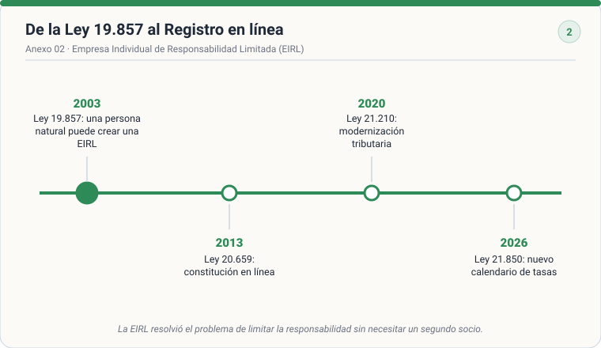
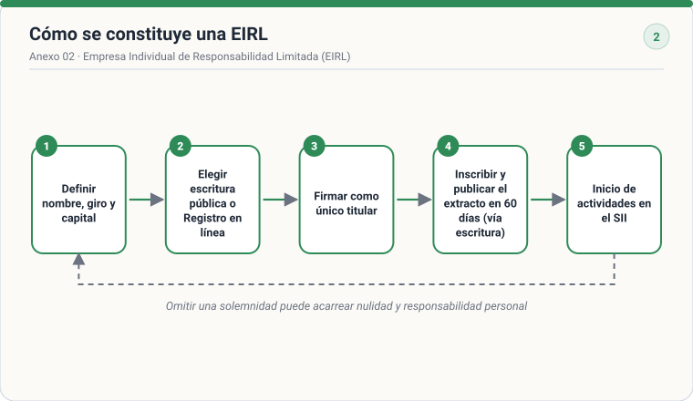
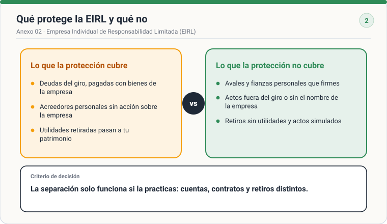
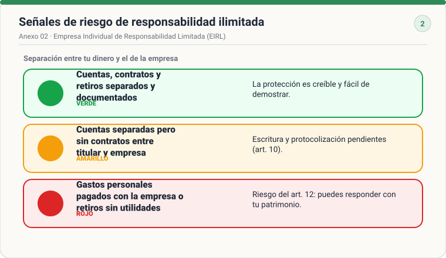

# Anexo 02 · Empresa Individual de Responsabilidad Limitada (EIRL)

> **Fecha de consulta de las fuentes:** 2026-11-25. **Naturaleza:** material educativo; no es asesoría
> legal ni tributaria. Las normas cambian: confirma cada dato en la fuente oficial citada al final
> antes de actuar. Este anexo separa **obligación legal**, **recomendación profesional** y **medida
> voluntaria**.

## 1. Ficha rápida

| Pregunta | Respuesta |
|---|---|
| ¿Qué es? | Una persona jurídica con patrimonio propio, distinto del de su titular, creada por **una sola persona natural** (arts. 1 y 2 de la Ley 19.857). |
| ¿Quién puede ser titular? | Toda persona natural (art. 1). Una sociedad no puede constituir una EIRL. |
| ¿Cuántos dueños? | Uno solo. Si necesitas socios, debes transformarla en sociedad (art. 14). |
| ¿Quién responde por las deudas? | La empresa, con todos sus bienes, por las obligaciones contraídas dentro de su giro. El titular responde solo del pago efectivo de su aporte (art. 8), salvo los casos de responsabilidad ilimitada del art. 12. |
| ¿Cómo se llama? | El nombre incluye al menos nombre y apellido del titular, puede sumar un nombre de fantasía y las actividades del giro, y termina con «empresa individual de responsabilidad limitada» o «E.I.R.L.» (art. 4 letra b). |
| ¿Es civil o comercial? | Siempre comercial, sometida al Código de Comercio cualquiera sea su objeto (art. 2). |
| ¿Qué no puede hacer? | Las operaciones que la ley reserva a las sociedades anónimas (art. 2). |
| ¿Se puede constituir en línea? | Sí. La Ley 20.659 la incluye entre las personas jurídicas que pueden acogerse al Registro de Empresas y Sociedades (art. 2 N.º 1). |
| ¿Para quién suele servir? | Quien trabaja solo, quiere separar su patrimonio personal del negocio y no necesita socios ni inversionistas por ahora. |

## 2. Historia y evolución

### 2.1. Por qué se creó

Hasta comienzos de los años 2000, quien quería emprender solo y limitar su responsabilidad tenía un
problema de diseño legal: la limitación de responsabilidad se asociaba a las sociedades, y una sociedad
exige al menos dos socios. Según la explicación habitual en la doctrina (la ley no la consigna), en la práctica se recurría a «socios de paja»: una persona figuraba con una
participación mínima para poder constituir una sociedad de responsabilidad limitada, sin participar
realmente en el negocio. Eso generaba conflictos, riesgos para el verdadero dueño y dificultades
probatorias.

La **Ley 19.857**, promulgada el 24 de enero de 2003 y publicada en el Diario Oficial el 11 de febrero
de 2003, resolvió el problema con una figura nueva: autorizar a «toda persona natural» el establecimiento
de empresas individuales de responsabilidad limitada (art. 1). Es una persona jurídica con patrimonio
propio, distinto del de su titular (art. 2). Su gran novedad fue permitir que una sola persona separara
legalmente el patrimonio del negocio del suyo personal.

### 2.2. El diseño legal: corto y específico

La ley tiene dieciocho artículos. Esa brevedad explica dos rasgos: es sencilla de entender, y deja muchos
aspectos a las normas supletorias. El artículo 18 dispone que, en lo demás, se aplican a la EIRL las
disposiciones legales y tributarias de las **sociedades comerciales de responsabilidad limitada**,
incluidas las normas de saneamiento de nulidades de la Ley 19.499. Por eso, para entender cómo funciona
una EIRL en la práctica hay que mirar también el Anexo 03 (sociedad de responsabilidad limitada).

### 2.3. Evolución posterior

- La **Ley 20.659** (promulgada el 31 de enero de 2013 y publicada el 8 de febrero de 2013) incluyó a
  la EIRL entre las personas jurídicas que pueden constituirse, modificarse, transformarse y terminarse
  mediante el Registro de Empresas y Sociedades. Desde entonces, no es necesario ir a una notaría ni
  inscribir en el Conservador para constituirla, si optas por la vía electrónica.
- La **Ley 21.210** (2020) modernizó el sistema tributario y los regímenes de renta, lo que afecta a
  la EIRL como contribuyente de Primera Categoría.
- Las **leyes 21.755 y 21.850** (2025 y 2026) modificaron tasas y beneficios; sus fechas están en la
  [guía de la Ley 21.850](../docs/20_LEY_21850_RECONSTRUCCION_NACIONAL.md).

## 3. Marco legal

### 3.1. Las normas que la rigen

| Norma | Qué aporta |
|---|---|
| Ley 19.857 (2003) | Estatuto propio de la EIRL: 18 artículos. |
| Código de Comercio | La EIRL es siempre comercial (art. 2 de la Ley 19.857). |
| Ley 20.659 | Constitución, modificación, transformación y término en línea. |
| Ley 3.918 y normas sobre sociedades de responsabilidad limitada | Aplicación supletoria, vía art. 18 de la Ley 19.857. |
| Ley 19.499 | Saneamiento de vicios de nulidad. |
| Decreto Ley 824 y Decreto Ley 825 | Impuesto a la renta e IVA. |
| Código Penal, art. 471 N.º 2 | Su pena se aumenta en un grado si el delito lo comete el titular de una EIRL (art. 10 inc. 2 de la Ley 19.857). |

### 3.2. Obligación, recomendación, opción

| Materia | Tipo | Detalle |
|---|---|---|
| Constituir por escritura pública, inscribir y publicar | Obligación legal | Arts. 3, 4 y 5, salvo que uses el Registro de la Ley 20.659. |
| Plazo de 60 días para inscribir y publicar el extracto | Obligación legal | Art. 5. |
| Nombre con la expresión «E.I.R.L.» | Obligación legal | Art. 4 letra b. |
| Separar cuentas bancarias personal y de la empresa | Recomendación profesional | Evita las causales del art. 12. |
| Escriturar los contratos entre el titular y la empresa | Obligación legal | Art. 10: valen solo si constan por escrito y se protocolizan. |
| Designar un gerente general | Opción | Art. 9 inc. 2. |
| Pactar un seguro o una garantía personal | Medida voluntaria | Depende del acreedor. |

## 4. Cómo se constituye

### 4.1. Contenido de la constitución

El artículo 4 exige que el constituyente exprese, a lo menos:

1. nombre, apellidos, nacionalidad, estado civil, edad y domicilio del constituyente;
2. nombre de la empresa, con el nombre y apellido del titular, eventual nombre de fantasía, las
   actividades del giro y la expresión «E.I.R.L.» o su forma completa;
3. monto del capital que se transfiere a la empresa, si se aporta en dinero o especies y, en este
   último caso, el valor asignado;
4. actividad económica que constituye el objeto o giro y el ramo o rubro específico;
5. domicilio de la empresa;
6. plazo de duración, que si nada se dice se entiende indefinido.

### 4.2. Dos caminos

**Camino 1: escritura pública (régimen de la Ley 19.857).** La constitución se hace por escritura pública
(art. 3). Un extracto, autorizado por el notario, debe inscribirse en el registro de comercio del
domicilio de la empresa y publicarse una vez en el Diario Oficial **dentro de los sesenta días
siguientes** a la fecha de la escritura (art. 5).

**Camino 2: Registro de Empresas y Sociedades (Ley 20.659).** El titular completa y firma un formulario
electrónico con firma electrónica avanzada, o ante notario. Con la incorporación del formulario al Registro,
se entiende informado el Servicio de Impuestos Internos y se asigna el RUT (art. 13 de la Ley 20.659).
En el mismo formulario se puede solicitar el inicio de actividades y el timbraje de documentos, según
determine el Reglamento. Para el titular único, no hay que coordinar firmas de varios socios: el plazo
de sesenta días del art. 10 de esa ley pesa menos, aunque la regla se mantiene.

### 4.3. Modificaciones y término

- **Modificar** cualquiera de las menciones del art. 4 exige las mismas solemnidades que constituir (art. 6),
  y el extracto debe referirse al contenido específico de la modificación.
- **Omitir solemnidades** de los arts. 4, 5 y 6 importa **nulidad absoluta** del acto respectivo. Si la
  nulidad afecta al acto constitutivo, el titular responde **personal e ilimitadamente** de las
  obligaciones que contraiga en el giro, sin perjuicio del saneamiento (art. 7). Es una de las razones
  prácticas para constituir con cuidado y revisar que la inscripción y la publicación se completen.
- **Terminar:** el art. 15 enumera cinco causas: voluntad del empresario, llegada del plazo, aporte del
  capital de la EIRL a una sociedad, resolución de liquidación y muerte del titular. Cualquiera sea la
  causa, debe declararse por escritura pública, inscribirse y publicarse.
- **Muerte del titular:** los herederos pueden designar un gerente común para continuar el giro hasta
  por **un año**, vencido el cual termina la responsabilidad limitada (art. 15). Los legados sobre bienes
  singulares valen y siguen el derecho común.

### 4.4. Transformaciones

El artículo 14 contempla dos direcciones:

- **De sociedad a EIRL:** si todas las acciones, derechos o participaciones de una sociedad se reúnen en
  una sola persona, la sociedad puede transformarse en EIRL cumpliendo las formalidades de constitución.
  La escritura debe extenderse **dentro de los treinta días** siguientes a la fecha en que se produzca
  la reunión, y el extracto debe inscribirse y publicarse dentro del plazo legal.
- **De EIRL a sociedad:** puede transformarse en una sociedad de cualquier tipo, cumpliendo los
  requisitos del tipo elegido. Es el camino natural cuando llegan socios o inversionistas.

## 5. Capital, aportes y propiedad

### 5.1. El aporte inicial

El constituyente indica el monto del capital que transfiere a la empresa, si se aporta en dinero o en
especies y, en este último caso, su valor (art. 4 letra c). La ley no fija un capital mínimo ni máximo.
Lo importante es la **efectividad del pago**: el titular responde con su patrimonio del pago efectivo del
aporte que se hubiere comprometido (art. 8). Declarar un capital que no se aporta es un error con
consecuencias.

**Ejemplo ilustrativo.** Una diseñadora declara un capital de 3.000.000 de pesos: 1.000.000 en dinero y
2.000.000 en un computador y mobiliario valorados por ella. Si la empresa se endeuda y no existen esos
bienes, o si el valor asignado fue ficticio, un acreedor puede cuestionar la efectividad del aporte. Los
números son ilustrativos.

### 5.2. Dos patrimonios distintos

La EIRL tiene un patrimonio propio y el titular conserva el suyo. Esto produce tres reglas que dibujan
la frontera entre ambos:

| Regla | Artículo | Qué significa |
|---|---|---|
| Los acreedores de la empresa cobran de los bienes de la empresa | 8 | La empresa responde con todos sus bienes por las deudas de su giro. |
| Los acreedores personales del titular no cobran de los bienes de la empresa | 13 | Solo pueden accionar contra utilidades y el remanente tras liquidar. |
| Las utilidades retiradas pasan al patrimonio personal | 11 | Una vez retiradas, no hay acción contra ellas por deudas de la empresa. |

### 5.3. Contratos entre el titular y su empresa

El artículo 10 es una de las normas más importantes y menos conocidas: los actos y contratos que el
titular celebre con su patrimonio personal, por una parte, y con el patrimonio de la empresa, por la
otra, **solo tienen valor si constan por escrito y desde que se protocolizan ante notario**. Además,
deben anotarse al margen de la inscripción estatutaria dentro de sesenta días desde su otorgamiento.
Un préstamo del titular a la empresa, un arriendo de un bien personal usado por el negocio o una compra
entre ambos patrimonios son ejemplos. Sin esa formalidad, el acto carece de valor.

### 5.4. Retiros de utilidades

El titular puede retirar utilidades **líquidas y realizables**. El art. 12 letra d) establece que
responde ilimitadamente si «percibiere rentas de la empresa que no guarden relación con la importancia
de su giro, o efectuare retiros que no correspondieren a utilidades líquidas y realizables». Es una
alerta clara: sacar dinero de la empresa sin utilidades que lo justifiquen abre la puerta a perder la
protección de la responsabilidad limitada.

## 6. Administración y gobierno

### 6.1. La regla general

La administración corresponde al **titular**, quien representa a la empresa judicial y extrajudicialmente
para el cumplimiento del objeto, con todas las facultades de administración y disposición (art. 9).
Son actos de la empresa los ejecutados bajo el nombre y representación de ella por su administrador.

### 6.2. Delegar

El titular, o su mandatario debidamente facultado, puede:

- **designar un gerente general**, con todas las facultades del administrador excepto las que se excluyan
  expresamente, por escritura pública inscrita en el registro de comercio y anotada al margen de la
  inscripción estatutaria;
- **conferir mandatos generales o especiales**, por escritura pública inscrita y anotada en la misma forma.

Si te acoges al Registro de la Ley 20.659, los poderes pueden registrarse en el **Registro de Poderes**
(art. 13 ter): son de acceso público, se entienden vigentes mientras no se incorpore su modificación o
revocación, y basta el certificado de la Subsecretaría de Economía y Empresas de Menor Tamaño para
acreditarlos.

### 6.3. Notificaciones

Las notificaciones judiciales pueden practicarse indistintamente al titular o a quien este hubiere
conferido poder para administrar, sin perjuicio de las facultades de recibirlas de gerentes o mandatarios
(art. 9).

### 6.4. Gobierno cuando hay un solo dueño

No existen juntas ni directorio. Esto simplifica, pero elimina un control: nadie más revisa las
decisiones. **Recomendación profesional:** lleva un libro de decisiones relevantes, un registro de
préstamos entre titular y empresa, y un calendario de obligaciones. Las empresas con un solo dueño que no
dejan trazas suelen tener problemas para demostrar separación de patrimonios cuando hay una discusión.

## 7. Responsabilidad

### 7.1. La regla: responde la empresa

El artículo 8 fija el principio: la empresa responde **exclusivamente** por las obligaciones contraídas
dentro de su giro, con todos sus bienes. El titular responde con su patrimonio solo del pago efectivo de
su aporte.

### 7.2. Las cinco excepciones del artículo 12

El titular responde **ilimitadamente con sus bienes** en estos casos:

| Letra | Caso | Cómo evitarlo |
|---|---|---|
| a | Actos y contratos fuera del objeto de la empresa | Definir un giro amplio y actuar dentro de él |
| b | Actos sin el nombre o representación de la empresa | Firmar siempre «E.I.R.L.» o con poder de la empresa |
| c | Actos simulados, ocultamiento de bienes o reconocimiento de deudas supuestas | No simular; mantener contabilidad real |
| d | Rentas o retiros que no guardan relación con el giro o con utilidades líquidas y realizables | Retirar solo utilidades documentadas |
| e | Condena del titular, administradores o representantes por delitos concursales (Párrafo 7, Título IX, Libro II, Código Penal) | Cumplir las normas de quiebra y liquidación |

### 7.3. Otras fuentes de responsabilidad personal

- **Avales y fianzas.** Un banco o proveedor puede pedirte un aval personal. Eso es una decisión
  contractual: firmarlo reintroduce tu patrimonio personal como garantía para esa deuda. Es una **medida
  voluntaria** que debes evaluar con cuidado.
- **Responsabilidad tributaria y laboral.** La empresa es el contribuyente y empleador, pero ciertas
  infracciones y delitos tributarios o laborales pueden recaer en el titular como persona.
- **Nulidad de la constitución.** Si se omiten las solemnidades de los arts. 4, 5 y 6 y el acto
  constitutivo es nulo, responderás personalmente por las obligaciones que contraigas (art. 7).
- **Responsabilidad penal.** La Ley 19.857 agrava la pena del delito del art. 471 N.º 2 del Código Penal
  cuando lo comete el titular de una EIRL. Más allá de esa norma, el titular responde penalmente por sus
  actos como cualquier persona.

## 8. Tributación

### 8.1. Cómo tributa

La EIRL es una persona jurídica y **contribuyente de Primera Categoría**, con RUT propio. El artículo 18
de la Ley 19.857 la somete a las normas tributarias aplicables a las sociedades de responsabilidad
limitada. El titular, como persona natural, tributa después por los retiros, según el régimen. Las rutas
empresariales que el SII presenta en la Operación Renta 2026 son Pro Pyme General, Pro Pyme Transparente y
Régimen General semi integrado. La [guía tributaria](../docs/02_SII_TAX_FLOW.md) del programa detalla el
flujo.

### 8.2. Leyes recientes

La **Ley 21.850** fija la tasa de Primera Categoría en 27 % para el año comercial 2026, 25,5 % para 2027,
24 % para 2028 y 23 % desde 2029, sin perjuicio del artículo 25 de la Ley 21.755. Ese artículo estableció
una disminución transitoria a 12,5 % para empresas Pro Pyme en 2025, 2026 y 2027, sujeta a condiciones.
**Trata estas tasas como datos dinámicos y verifícalas en el SII.** Consulta la
[guía de la Ley 21.850](../docs/20_LEY_21850_RECONSTRUCCION_NACIONAL.md).

### 8.3. IVA, documentos y contabilidad

Si vendes bienes o prestas servicios afectos a IVA debes iniciar actividades, emitir documentos
tributarios electrónicos y declarar mensualmente. Ver el Anexo 16 (Servicio de Impuestos Internos).

### 8.4. Decisiones prácticas

1. ¿Conviene un régimen Pro Pyme o el general? Simula cuatro años, no uno.
2. ¿Cuánto retirarás? Planifica retiros sobre utilidades reales, no sobre necesidades personales.
3. ¿Qué gastos son de la empresa y cuáles son personales? Sepáralos desde el primer día.
4. ¿Cuándo es mejor transformar a sociedad? Si habrá socios o inversión externa.

**Ejemplo ilustrativo.** Un maestro carpintero factura 2.500.000 pesos mensuales y retira 1.200.000 como
sueldo. Si no hay utilidades contables que lo justifiquen, el retiro puede ser cuestionado. Una práctica
más sana es fijar un retiro mensual estable después de provisionar IVA, PPM y capital de trabajo. Cifras
ilustrativas.

## 9. Obligaciones laborales, contables y sectoriales

### 9.1. Contabilidad y registros

Debes llevar contabilidad ajustada a la normativa del SII, el registro de compras y ventas electrónico y,
si tienes trabajadores, los libros de remuneraciones. Guarda también el registro de los contratos entre el
titular y la empresa exigido por el art. 10.

### 9.2. Laboral

Si contratas personas, la EIRL es el empleador: contrato escrito, cotizaciones, seguro de accidentes y
demás obligaciones del Código del Trabajo. Revisa el [flujo laboral](../docs/08_EMPLOYMENT_FLOW_CHILE.md).
Una relación se califica por los hechos (subordinación y dependencia), no por el nombre del contrato.

### 9.3. Permisos

La forma jurídica no reemplaza la patente municipal ni los permisos sectoriales. Ver el Anexo 17
(Municipalidades) y la [matriz de permisos](../docs/06_PERMITS_MATRIX.md).

### 9.4. Datos, consumo y cumplimiento

La EIRL que vende a consumidores o trata datos personales debe cumplir las normas de protección del
consumidor y de datos personales. Ver [cumplimiento y riesgo](../docs/13_COMPLIANCE_RISK.md).

## 10. Antes de construir: lista de verificación

### 10.1. Decisiones previas

1. ¿Trabajarás realmente solo, hoy y en los próximos dos años?
2. ¿Qué parte de tu patrimonio personal quieres proteger y de qué riesgos concretos?
3. ¿Qué capital declararás y cómo lo aportarás (dinero o especies valoradas)?
4. ¿Qué nombre usarás y está disponible? Verifica en el Registro y busca marcas en INAPI.
5. ¿Qué giro cubre lo que harás ahora y lo que podrías hacer pronto? Un giro demasiado estrecho abre
   la puerta al art. 12 letra a.
6. ¿Dónde tendrás el domicilio y qué documento lo respalda?
7. ¿Qué cuentas bancarias separarás para la empresa?
8. ¿Qué régimen tributario conviene según una simulación a cuatro años?
9. ¿Cuándo planeas transformarla en sociedad si llegan socios?

### 10.2. Documentos y datos

| Documento | Para qué |
|---|---|
| Cédula de identidad y RUT del titular | Identificación |
| Firma electrónica avanzada o notario | Suscribir el formulario o la escritura |
| Contrato o título del domicilio | Dirección para el RUT |
| Detalle del aporte (dinero y especies con valor) | Capital |
| Listado de actividades del giro | Inicio de actividades |
| Contrato escrito y protocolizado de cualquier acto con tu patrimonio personal | Art. 10 |

### 10.3. Errores frecuentes

- **Mezclar cuentas.** Pagar gastos personales con la cuenta de la empresa es la vía más rápida a las
  causales del art. 12.
- **Firmar sin nombre de la empresa** (art. 12 letra b).
- **Giro demasiado estrecho** y actuar fuera de él (art. 12 letra a).
- **No escriturar los préstamos** entre el titular y la empresa (art. 10).
- **No completar inscripción y publicación** en el plazo de 60 días en la vía de escritura.
- **Capital aportado solo en papel** (art. 8).
- **Retirar más de lo que permiten las utilidades** (art. 12 letra d).
- **Creer que la EIRL elimina avales:** el aval personal que firmes vuelve a comprometer tu patrimonio.

### 10.4. Orden sugerido

Primero define el giro y el capital; después elige el camino de constitución; antes de operar abre la
cuenta bancaria y simula el régimen; apenas empieces, separa los flujos y registra los contratos con
tu patrimonio. Cada paso evita un error del siguiente.

### 10.5. Un caso completo, de la idea a la operación

**Caso ilustrativo.** Camila es técnica en mantención de bicicletas eléctricas y quiere abrir un taller
sola. Tiene herramientas por un valor aproximado de 2.400.000 pesos y ahorros de 1.600.000. Todos los
números de este caso son ilustrativos.

1. **Decide la forma.** Trabajará sola durante al menos dos años y no tendrá inversionistas. Su riesgo
   principal es la deuda con proveedores y el arriendo del local. Elige EIRL en lugar de operar como
   persona natural, para separar su patrimonio.
2. **Define el capital.** Declara 4.000.000 de pesos: 1.600.000 en dinero y 2.400.000 en herramientas,
   con una lista valorada y fotografías de los bienes. Guarda las facturas de compra o una tasación
   simple. Así el aporte es efectivo y demostrable (art. 8).
3. **Redacta el giro.** En lugar de «reparación de bicicletas eléctricas», escribe un objeto más
   amplio: «mantención, reparación, comercialización de repuestos y servicios relacionados con
   vehículos de movilidad eléctrica personal». Un giro razonablemente amplio reduce el riesgo del art. 12
   letra a), que sanciona los actos fuera del objeto.
4. **Elige el nombre.** Incluye su nombre y apellido, un nombre de fantasía y la expresión «E.I.R.L.»
   (art. 4 letra b). Verifica antes que no exista otra sociedad con nombre idéntico o semejante y revisa
   marcas en INAPI.
5. **Constituye.** Usa el Registro de Empresas y Sociedades con su firma electrónica avanzada. Con la
   incorporación del formulario obtiene el RUT y, si lo solicitó, el inicio de actividades.
6. **Abre cuentas separadas.** Abre una cuenta bancaria a nombre de la EIRL. Desde ese día, todo ingreso
   del taller entra a esa cuenta y todo gasto del negocio sale de ella.
7. **Registra sus contratos con la empresa.** Camila le presta 500.000 pesos a la EIRL para comprar
   repuestos. Como es un acto entre su patrimonio personal y el de la empresa, lo escritura y lo
   protocoliza ante notario, y lo anota al margen dentro de sesenta días (art. 10). Si no lo hace, el
   préstamo carece de valor frente a terceros.
8. **Planifica sus retiros.** Calcula sus utilidades mensuales después de IVA, PPM y capital de trabajo
   y fija un retiro estable. Evita sacar dinero «cuando hace falta», que es la forma más común de
   caer en la causal del art. 12 letra d).
9. **Prepara el crecimiento.** Anota en su calendario que, si en dieciocho meses aparece un socio o
   un inversionista, transformará la EIRL en SpA (art. 14), y que desde ahora conviene llevar registros
   ordenados para facilitar esa transformación.

**Qué aprendemos del caso.** La EIRL no protege por existir: protege si se practica la separación. Las
cuatro prácticas que sostienen la protección son capital efectivo, giro adecuado, cuentas separadas y
contratos escritos con el titular. Si Camila las abandona, el nombre «E.I.R.L.» no la protegerá.

### 10.6. Mini glosario del anexo

| Término | Significado |
|---|---|
| Titular | La persona natural que constituye y es dueña de la EIRL. |
| Giro u objeto | La actividad económica que la empresa declara realizar. |
| Patrimonio de afectación | Conjunto de bienes de la empresa, separado del patrimonio personal del titular. |
| Extracto | Resumen de la escritura que se inscribe y publica. |
| Registro de comercio | Registro del Conservador de Bienes Raíces donde se inscribe el extracto en la vía tradicional. |
| Retiro de utilidades | Dinero que el titular saca de la empresa y que pasa a su patrimonio personal. |
| Gerente común | Persona que designan los herederos para continuar el giro hasta por un año tras la muerte del titular. |
| Saneamiento | Mecanismo de la Ley 19.499 para corregir vicios de nulidad. |

## 11. Cuándo conviene y cuándo no

### 11.1. Comparación con alternativas cercanas

| Criterio | Persona natural con giro | EIRL | SpA unipersonal | Sociedad limitada |
|---|---|---|---|---|
| Dueños | Uno | Uno | Uno o más | Dos o más |
| Patrimonio separado | No | Sí | Sí | Sí |
| Entrada de socios | No aplica | Requiere transformar | Muy fácil | Requiere modificar |
| Flexibilidad del pacto | No aplica | Baja | Muy alta | Media |
| Formalidad | Mínima | Baja | Media | Media |
| Requisitos de nombre | Libre | Debe incluir nombre del titular | Debe terminar en «SpA» | Debe terminar en «Limitada» o «Ltda.» |

### 11.2. Señales a favor

- Trabajas solo y quieres limitar la responsabilidad a los bienes de la empresa.
- Tu negocio tiene riesgos de deuda con terceros (arriendos, proveedores, clientes).
- No tendrás inversionistas en el corto plazo.
- Prefieres una estructura simple, con una sola persona que decide.

### 11.3. Señales en contra

- Hay más de una persona que aportará y decidirá: una EIRL no admite socios.
- Probablemente entrará un inversionista: tendrás que transformar, con costo y tiempo.
- No separarás efectivamente el dinero de la empresa y el personal: la protección se debilita.
- Necesitas estatutos con series de acciones o pactos complejos.

## 12. Cuándo llamar a un profesional

| Situación | Profesional | Por qué |
|---|---|---|
| Redactar la constitución y el giro | Abogado | Un giro estrecho o mal redactado abre causales del art. 12 |
| Régimen tributario y retiros | Contador | Planificar impuestos y retiros sobre utilidades reales |
| Contratos entre titular y empresa | Abogado y notario | Art. 10 exige escritura y protocolización |
| Transformación a sociedad | Abogado | Formalidades y plazos del art. 14 |
| Término por muerte del titular | Abogado | Gerente común por un año y herederos |
| Deudas que superan los bienes de la empresa | Abogado concursal | Liquidación y riesgos del art. 12 letra e |

Consulta la [guía de cuándo llamar a un profesional](../docs/18_WHEN_TO_CALL_A_PROFESSIONAL.md).

## 13. Preguntas frecuentes

**1. ¿Una EIRL puede tener socios?**
No. Es una empresa de un solo titular, persona natural (arts. 1 y 2). Si quieres socios, debes
transformarla en una sociedad (art. 14).

**2. ¿Una sociedad puede crear una EIRL?**
No. La ley autoriza el establecimiento «a toda persona natural» (art. 1).

**3. ¿Mi patrimonio personal está a salvo?**
En principio sí: la empresa responde por las deudas de su giro con sus bienes y tú solo respondes del
pago efectivo de tu aporte (art. 8). La protección se pierde en los cinco casos del art. 12 y por los
avales o fianzas personales que firmes.

**4. ¿Cuál es el capital mínimo?**
La ley no fija uno. Debes declarar el capital que aportas y asegurarte de que sea efectivo (art. 8).

**5. ¿Puedo aportar bienes en vez de dinero?**
Sí, y debes indicar el valor que les asignas (art. 4 letra c). Si el bien exige formalidades especiales
para su traspaso, esas se aplican al enterar el aporte.

**6. ¿Cuánto tiempo tengo para inscribir y publicar el extracto?**
Sesenta días desde la fecha de la escritura (art. 5), si usas la vía tradicional.

**7. ¿Qué pasa si omito la inscripción o la publicación?**
La omisión de solemnidades importa nulidad absoluta del acto; si afecta al acto constitutivo, el titular
responde personal e ilimitadamente de lo que contraiga en el giro, sin perjuicio del saneamiento (art. 7).

**8. ¿Puedo prestarle dinero a mi EIRL?**
Sí, pero el contrato solo vale si consta por escrito y se protocoliza ante notario, y debe anotarse al
margen de la inscripción dentro de sesenta días (art. 10).

**9. ¿Puedo sacar dinero de la empresa cuando quiera?**
Solo utilidades líquidas y realizables. Retiros que no corresponden a utilidades o rentas desproporcionadas
al giro pueden hacerte responder ilimitadamente (art. 12 letra d).

**10. ¿Qué pasa si firmo un contrato a mi nombre en vez del de la EIRL?**
Si ejecutas actos sin el nombre o representación de la empresa, respondes ilimitadamente de esas
obligaciones (art. 12 letra b).

**11. ¿Mis acreedores personales pueden cobrarse de los bienes de la EIRL?**
No. Solo pueden accionar contra las utilidades o beneficios que te correspondan y sobre el remanente
tras satisfacer a los acreedores de la empresa (art. 13).

**12. ¿Puedo contratar un gerente?**
Sí. Puedes designar un gerente general por escritura pública inscrita en el registro de comercio y
anotada al margen (art. 9).

**13. ¿Qué pasa si el titular fallece?**
Termina la empresa, pero los herederos pueden designar un gerente común para continuar el giro hasta por
un año; después termina la responsabilidad limitada (art. 15).

**14. ¿Puedo transformar mi EIRL en SpA o sociedad limitada?**
Sí. El art. 14 permite transformarla en una sociedad de cualquier tipo, cumpliendo sus requisitos.

**15. ¿Una sociedad con un solo socio puede pasar a EIRL?**
Sí, si todas las participaciones se reúnen en una persona natural; la escritura debe extenderse dentro de
los treinta días siguientes a la reunión (art. 14).

**16. ¿La EIRL paga IVA y renta?**
Sí. Es contribuyente de Primera Categoría y sujeto de IVA si realiza operaciones afectas. Elige régimen
con apoyo de un contador.

**17. ¿Puedo tener más de una EIRL?**
La Ley 19.857 no contiene una prohibición expresa en el texto revisado. Cada una exige su propia
constitución y contabilidad. Consulta a un abogado ante cualquier combinación con otras sociedades.

**18. ¿Cuánto cuesta constituirla?**
El Registro de la Ley 20.659 es público y gratuito; pueden existir costos de notaría y de asesoría. Las
tarifas cambian: verifícalas en la fuente oficial.

**19. ¿Puedo ser a la vez titular y empleado de la EIRL?**
Es un tema delicado: el retiro de utilidades y una remuneración tienen tratamientos distintos. Consulta a
un contador y a un abogado laboral.

**20. ¿Qué pasa si la empresa quiebra?**
Se aplican las normas de liquidación. La resolución de liquidación es causa de término (art. 15 letra d),
y el adjudicatario único puede continuar como titular con las formalidades del art. 6 (art. 17).

## 14. Fuentes y vigencia

| Fuente | Qué se usó | Dónde consultarla |
|---|---|---|
| Ley 19.857 (texto íntegro, 18 artículos) | Régimen de la EIRL | [BCN, Ley 19.857](https://www.bcn.cl/leychile/navegar?idNorma=207588) |
| Ley 20.659 | Registro de Empresas y Sociedades | [BCN, Ley 20.659](https://www.bcn.cl/leychile/navegar?idNorma=1048718) |
| Ley 19.499 | Saneamiento de nulidades | [BCN, Ley 19.499](https://www.bcn.cl/leychile/navegar?idNorma=70549) |
| Código de Comercio | Carácter comercial | [BCN, Código de Comercio](https://www.bcn.cl/leychile/navegar?idNorma=1974) |
| Registro de Empresas y Sociedades | Trámite en línea | [Sitio oficial](https://www.registrodeempresasysociedades.cl) |
| ChileAtiende, ficha «Tu empresa» | Formas societarias | [ChileAtiende](https://www.chileatiende.gob.cl/fichas/21409-tu-empresa) |
| SII, regímenes tributarios | Rutas de Operación Renta | [SII](https://www.sii.cl/destacados/renta/2026/intermediarios/regimenes_tributarios/) |
| Ley 21.850 y Ley 21.755 | Tasas recientes | [Guía del programa](../docs/20_LEY_21850_RECONSTRUCCION_NACIONAL.md) |

**Vigencia.** El texto de la Ley 19.857 se leyó íntegro en la versión publicada por la Biblioteca del
Congreso Nacional el 2026-11-25. Las tasas y créditos tributarios se citan como referencia del programa y
deben verificarse en el SII.

**Límites.** Este anexo no reproduce el texto completo de las leyes, no incluye tarifas ni plazos de
trámites de terceros, y sus ejemplos numéricos son ilustrativos. No sustituye la asesoría de un abogado
ni de un contador.
