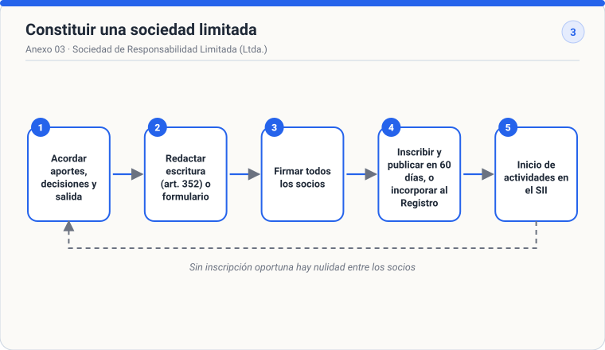
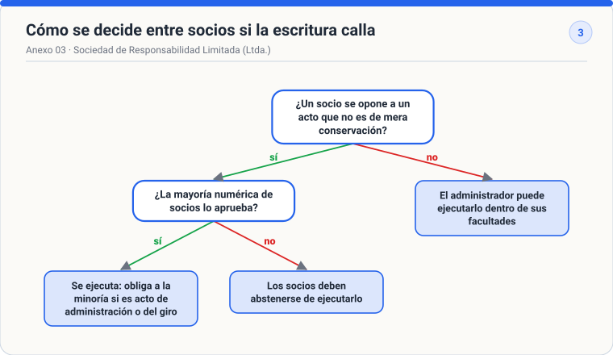
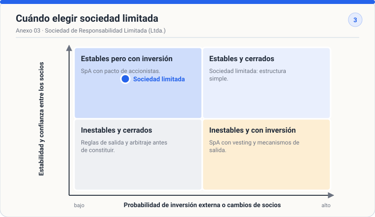

# Anexo 03 · Sociedad de Responsabilidad Limitada (Ltda.)

> **Fecha de consulta de las fuentes:** 2026-11-25. **Naturaleza:** material educativo; no es asesoría
> legal ni tributaria. Las normas cambian: confirma cada dato en la fuente oficial citada al final
> antes de actuar. Este anexo separa **obligación legal**, **recomendación profesional** y **medida
> voluntaria**.

<!-- anexos:nav-inicio -->

**Navegación:** [← 02. Empresa Individual de Responsabilidad Limitada (EIRL)](02-empresa-individual-de-responsabilidad-limitada-eirl.md) · [Índice de anexos](README.md) · [04. Sociedad Colectiva Comercial →](04-sociedad-colectiva-comercial.md)

## En 60 segundos

- La responsabilidad se limita a los aportes, pero el nombre debe terminar en «limitada» o los socios responden solidariamente (Ley 3.918, art. 4).
- Máximo cincuenta socios y no puede tener objeto bancario (art. 2).
- Supletoriamente se aplican las reglas de la colectiva: administran todos y decide la mayoría numérica.
- Entrar o salir un socio exige modificar la escritura, con inscripción y extracto.
- Sin pacto de salida y de decisión, los bloqueos son frecuentes.

<!-- anexos:nav-fin -->

## 1. Ficha rápida

| Pregunta | Respuesta |
|---|---|
| ¿Qué es? | Una sociedad, civil o comercial, en que la responsabilidad personal de los socios queda limitada a sus aportes o a la suma adicional que se indique en la escritura (arts. 1 y 2 de la Ley 3.918). |
| ¿Cuántos socios? | Dos o más, con un tope de **cincuenta** (art. 2). |
| ¿Qué la regula? | La Ley 3.918, de 1923, y, en lo no previsto, las reglas de la **sociedad colectiva** del Código de Comercio (art. 4). |
| ¿Cómo se llama? | La razón social puede contener el nombre de uno o más socios o una referencia al objeto, y **debe terminar con la palabra «limitada»**; si no, todos los socios responden solidariamente (art. 4). |
| ¿Qué no puede hacer? | No puede tener por objeto negocios bancarios (art. 2). |
| ¿Se puede constituir en línea? | Sí. La Ley 20.659 la incluye entre las personas jurídicas que pueden acogerse al Registro de Empresas y Sociedades (art. 2 N.º 2). |
| ¿Quién administra? | Los socios, salvo que la escritura delegue (arts. 384 a 395 del Código de Comercio, por aplicación supletoria). |
| ¿Para quién suele servir? | Socios que se conocen, quieren una estructura estable, cerrada y poco costosa, como empresas familiares o de profesionales. |
| ¿Para quién no? | Quien espera inversión externa frecuente, series de acciones o salida rápida de socios. |

## 2. Historia y evolución

### 2.1. Una ley de 1923

La sociedad de responsabilidad limitada llegó a Chile con la **Ley 3.918**, promulgada el 7 de marzo de
1923 y publicada el 14 de marzo de 1923, bajo el gobierno de Arturo Alessandri. Su artículo 1 es una
frase breve que cambió las opciones de los empresarios: «se autoriza el establecimiento de sociedades
civiles y comerciales con responsabilidad limitada de los socios, distintas de las sociedades anónimas o
en comandita».

Antes de esa ley, quien quería limitar su responsabilidad personal tenía dos vías: la sociedad anónima
(con las exigencias de un tipo pensado para empresas de gran tamaño) o la comandita (con socios gestores
que sí respondían sin límite). La responsabilidad limitada ofreció un punto intermedio para empresas
pequeñas y medianas: una estructura cerrada, regida por una escritura y por las reglas de la sociedad
colectiva, pero con la protección patrimonial de los socios.

### 2.2. Un texto antiguo que sigue vivo

La ley tiene cinco artículos y conserva giros de su época (por ejemplo, «lei» y «rejir»). Dos de sus
disposiciones muestran la huella de su tiempo. El inciso final del artículo 4 trata del régimen aplicable
a la mujer casada para celebrar sociedades, y remite al artículo 349 del Código de Comercio. Esas
referencias deben leerse junto con las reformas posteriores sobre capacidad y régimen matrimonial; en la
práctica, hoy rigen las reglas generales de capacidad para contratar. Para saber qué dice la versión
vigente de cada artículo, consulta siempre el texto actualizado de la Biblioteca del Congreso Nacional.

### 2.3. Hitos posteriores

- **1997.** La Ley 19.499 reguló el saneamiento de vicios de nulidad de sociedades. Sirve para corregir
  defectos de constitución o de modificación.
- **2013.** La Ley 20.659, promulgada el 31 de enero de 2013 y publicada el 8 de febrero de 2013,
  permitió constituir, modificar, transformar, fusionar, dividir y disolver sociedades limitadas mediante
  un formulario electrónico en el Registro de Empresas y Sociedades.
- **2020 en adelante.** La Ley 21.210, la Ley 21.755 y la Ley 21.850 modificaron regímenes y tasas del
  impuesto a la renta que afectan a toda sociedad, incluida la limitada.

## 3. Marco legal

### 3.1. Las normas que la rigen

| Norma | Qué aporta |
|---|---|
| Ley 3.918 (1923) | Autoriza el tipo; fija el tope de cincuenta socios, la prohibición bancaria y la regla del nombre. |
| Código de Comercio, arts. 348 a 361 | Formación, prueba, escritura, extracto, inscripción y nulidades de la sociedad colectiva, aplicables a la limitada. |
| Código de Comercio, arts. 370 a 395 y siguientes | Fondo social, reparto de utilidades y administración, aplicables supletoriamente. |
| Código Civil, art. 2104 | Mencionado expresamente por el art. 4 de la Ley 3.918. |
| Código de Comercio, arts. 455 y 456 | También mencionados por el art. 4. |
| Ley 20.659 | Constitución y modificaciones en línea. |
| Ley 19.499 | Saneamiento de nulidades. |

### 3.2. Cómo se leen las normas supletorias

El artículo 4 dice que, en lo no previsto por la ley o la escritura, la sociedad se rige por las reglas
de la **sociedad colectiva**. Eso significa que mucho de lo que parece una ausencia de norma tiene una
respuesta en los artículos 348 a 395 del Código de Comercio. Algunos ejemplos que importan:

| Tema | Regla supletoria | Artículo |
|---|---|---|
| Quién administra si la escritura calla | Todos y cada uno de los socios | 385 y 386 |
| Qué puede hacer cada socio | Los actos del giro ordinario o necesarios para sus fines | 387 |
| Oposición de un socio a un acto de otro | Cada socio puede oponerse; se suspende el acto hasta que decida la mayoría numérica | 388 y 389 |
| Si hay empate o pareceres sin mayoría absoluta | Los socios deben abstenerse de ejecutar el acto | 390 |
| Reparto de utilidades y pérdidas | Según lo estipulado; si no, a prorrata de los aportes | 382 |
| Socio industrial | Cuota igual al aporte más módico en ganancias, sin soportar pérdidas | 383 |
| Aportes en mora | Pueden excluir al socio moroso o cobrarle ejecutivamente | 379 |
| Restitución de aportes | No antes de concluir la liquidación | 381 |

### 3.3. Obligación, recomendación y opción

| Materia | Tipo | Detalle |
|---|---|---|
| Escritura pública con las menciones del art. 352 del Código de Comercio | Obligación | Art. 2 Ley 3.918 |
| Declaración de que la responsabilidad queda limitada | Obligación | Art. 2 Ley 3.918 |
| Extracto inscrito y publicado dentro de sesenta días | Obligación | Art. 3 Ley 3.918 y art. 354 Código de Comercio |
| Nombre terminado en «limitada» | Obligación | Art. 4 |
| Máximo cincuenta socios | Obligación (límite) | Art. 2 |
| Arbitraje de diferencias | Opción pactada en la escritura | Art. 352 N.º 10 |
| Pacto de socios adicional | Recomendación profesional | Evita bloqueos |
| Responsabilidad por una suma adicional a los aportes | Opción | Art. 2 |

## 4. Cómo se constituye

### 4.1. Contenido de la escritura

La escritura debe contener las enunciaciones del artículo 352 del Código de Comercio:

1. nombres, apellidos y domicilios de los socios;
2. la razón o firma social;
3. los socios encargados de la administración y del uso de la razón social;
4. el capital que introduce cada socio, sea dinero, créditos u otros bienes; el valor asignado a los
   aportes en muebles o inmuebles; y la forma de justipreciarlos si no se les asignó valor;
5. las negociaciones sobre que deba versar el giro;
6. la parte de beneficios o pérdidas de cada socio capitalista o industrial;
7. la época en que la sociedad debe principiar y disolverse;
8. la cantidad que cada socio puede tomar anualmente para sus gastos particulares;
9. la forma de liquidación y división del haber social;
10. si las diferencias se someten o no a arbitradores y cómo se nombran;
11. el domicilio de la sociedad;
12. los demás pactos que acuerden los socios.

Además debe contener la declaración de que la responsabilidad personal de los socios queda limitada a
sus aportes o a la suma que, además de esto, se indique (art. 2 de la Ley 3.918).

### 4.2. Los dos caminos

**Camino 1: escritura pública, extracto, inscripción y publicación.** Se otorga la escritura. Un extracto
se inscribe en el registro de comercio del domicilio social dentro de **sesenta días** desde la fecha de
la escritura (art. 354 del Código de Comercio) y se publica por una vez en el Diario Oficial dentro del
mismo plazo (art. 3 de la Ley 3.918). El cumplimiento oportuno produce efectos retroactivos a la fecha de
la escritura.

**Camino 2: Registro de Empresas y Sociedades.** Los socios completan y firman un formulario electrónico
con firma electrónica avanzada o ante notario. La ley dispone que el formulario se incorpora
automáticamente cuando lo firman todos quienes deben concurrir, que el Servicio de Impuestos Internos se
entiende informado y que asigna el RUT sin más trámite (art. 13 de la Ley 20.659). Todos deben firmar
dentro de sesenta días desde la primera firma, o el formulario se tiene por no suscrito (art. 10).

### 4.3. Si algo sale mal: nulidades y sociedad de hecho

Los artículos del Código de Comercio sobre las nulidades son severos y conviene conocerlos:

- La omisión de la escritura pública de constitución o de su inscripción oportuna produce **nulidad
  absoluta entre los socios** (art. 355 A).
- Una sociedad que no consta de escritura pública ni de instrumento reducido a escritura o protocolizado
  es **nula de pleno derecho y no puede sanearse**; si existe de hecho, da lugar a una **comunidad**, y
  sus miembros responden solidariamente a los terceros (art. 356).
- La sociedad que adolece de nulidad por incumplir el art. 350 goza de personalidad jurídica y se
  liquida como sociedad si consta de escritura pública, sin perjuicio del saneamiento (art. 357).
- La ejecución voluntaria del contrato **no purga** la nulidad (art. 358).
- Quien contrata con una sociedad no legalmente constituida **no puede sustraerse** de sus obligaciones
  por esa razón (art. 359).
- Una modificación cuyo extracto no se inscribió oportunamente **no produce efectos** ni entre los socios
  ni frente a terceros, salvo saneamiento (art. 361).

**Recomendación profesional:** antes de operar, verifica que la inscripción y la publicación estén
completas y guarda los certificados.

### 4.4. Modificaciones

Según el artículo 350 del Código de Comercio, la prórroga, el cambio, retiro o muerte de un socio, la
alteración de la razón social y, en general, toda reforma o ampliación del contrato deben reducirse a
escritura pública con las mismas solemnidades. Esto es clave: **entrar o salir de la sociedad exige
modificar la escritura**, con su extracto y su inscripción. Es mucho menos ágil que transferir acciones.
En el Registro de Empresas y Sociedades, el formulario de modificación reemplaza la escritura (art. 14 de
la Ley 20.659).

## 5. Capital, aportes y propiedad

### 5.1. Qué se puede aportar

El Código de Comercio permite aportar dinero, créditos, muebles e inmuebles, derechos como privilegios de
invención, trabajo manual, la mera industria y, en general, toda cosa comerciable capaz de prestar alguna
utilidad (art. 376). No pueden aportarse ciertos oficios públicos (art. 377). El fondo social se compone
de los aportes que cada socio entrega o promete entregar (art. 375).

### 5.2. Entregar los aportes

Los socios deben entregar sus aportes en la época y forma estipuladas; a falta de estipulación, en el
domicilio social luego que la escritura esté firmada (art. 378). El retardo, sea cual fuere la causa,
autoriza a los demás para **excluir al socio moroso** o proceder ejecutivamente contra su persona y bienes,
y el moroso responde de los daños que la tardanza ocasione (art. 379).

**Ejemplo ilustrativo.** Tres socios constituyen una sociedad con capital de 12.000.000 de pesos, 4.000.000
cada uno, pagaderos a los treinta días. Uno de ellos no paga. Los otros dos pueden excluirlo o demandarlo
ejecutivamente, y él responde por los perjuicios. Sin una cláusula clara sobre cómo valorar su cuota de
salida, la exclusión se vuelve una discusión larga. Los números son ilustrativos.

### 5.3. Distribución de utilidades y pérdidas

Los socios capitalistas dividen ganancias y pérdidas como lo hayan estipulado; a falta de estipulación,
a prorrata de sus aportes (art. 382). El socio industrial, que aporta trabajo, lleva una cuota igual al
aporte más módico en las ganancias y no soporta pérdidas, salvo pacto distinto (art. 383).

### 5.4. Los acreedores personales de un socio

Los acreedores personales de un socio **no pueden embargar** el aporte que introdujo durante la sociedad;
pueden pedir la retención de su parte de interés para percibirla al tiempo de la división (art. 380). Esto
protege a la sociedad de las deudas privadas de uno de sus socios.

### 5.5. Restitución de aportes

Los socios no pueden exigir la restitución de sus aportes antes de concluir la liquidación, salvo que
consistan en el usufructo de objetos introducidos al fondo común (art. 381). Un socio que quiere salir
necesita, por tanto, un acuerdo de retiro o una cláusula de salida en la escritura.

### 5.6. Responsabilidad limitada por aportes o por una suma adicional

La escritura puede limitar la responsabilidad a los aportes «o a la suma que a más de esto se indique»
(art. 2). Esa suma adicional, si se pacta, funciona como un colchón frente a terceros. Es una **medida
voluntaria** que algunos acreedores valoran y que los socios deben pesar con cuidado.

## 6. Administración y gobierno

### 6.1. Quién administra

Por regla supletoria, la administración corresponde a todos y cada uno de los socios, quienes pueden
ejercerla por sí mismos o por delegados, sean socios o extraños (art. 385). Si el contrato no designa al
administrador, los socios se confieren recíprocamente la facultad de administrar y de obligar
solidariamente la responsabilidad de todos (art. 386). Cada socio puede hacer los actos y contratos del
giro ordinario o necesarios para sus fines (art. 387).

### 6.2. Oposición y mayoría

Cada socio tiene derecho a oponerse a la consumación de los actos proyectados por otro, salvo los de mera
conservación (art. 388). La oposición suspende el acto hasta que la **mayoría numérica** de los socios
califique su conveniencia (art. 389). El acuerdo de la mayoría solo obliga a la minoría cuando recae sobre
actos de simple administración o sobre actos comprendidos en las operaciones designadas en el contrato
(art. 390). Si hay dos o más pareceres sin mayoría absoluta, los socios deben abstenerse de ejecutar el
acto. Esta última regla es una fuente de bloqueos.

**Mayoría numérica significa un voto por socio**, no por capital, salvo que la escritura lo cambie. Un socio con el 5 % del capital pesa
igual que uno con el 70 %. Si no quieres eso, **debes pactarlo**.

### 6.3. Delegación

Delegada la administración en uno o más socios, los demás quedan inhibidos de toda injerencia (art. 392).
La facultad de administrar trae el uso de la firma social (art. 393). El delegado solo tiene las
facultades de su título, y su exceso hace responsable a la sociedad de los daños (art. 394). Los
administradores representan a la sociedad judicial y extrajudicialmente, pero sin poder especial no
pueden, por ejemplo, vender ni hipotecar bienes raíces (art. 395).

### 6.4. Actos de un socio sin facultad

Si un socio no autorizado usa la firma social, la sociedad no responde de las obligaciones que él
suscribió, salvo que se hayan convertido en provecho de la sociedad, y entonces solo hasta el monto del
beneficio (art. 373). Si, a pesar de la oposición, un socio ejecuta el acto con terceros de buena fe, los
socios quedan obligados solidariamente a cumplirlo, con derecho a indemnización contra el que actuó
(art. 391).

### 6.5. Poderes en el Registro

Si te acoges a la Ley 20.659, los poderes se pueden incorporar al **Registro de Poderes** (art. 13 ter):
acceso público, vigencia mientras no se registre la modificación o revocación, y certificado de la
Subsecretaría de Economía y Empresas de Menor Tamaño como prueba.

### 6.6. Diagrama de decisiones entre socios

## 7. Responsabilidad

### 7.1. La regla y su condición

La responsabilidad personal de los socios queda limitada a sus aportes, o a la suma adicional pactada
(art. 2). **La condición es el nombre:** la razón social debe terminar con la palabra «limitada»; sin eso,
todos los socios son **solidariamente responsables** de las obligaciones sociales (art. 4). Un error de
rotulación en contratos, facturas o firmas puede tener un costo patrimonial.

### 7.2. Qué no limita

- **Avales y fianzas personales.** La limitación protege contra las deudas de la sociedad, no contra
  garantías que el socio firme.
- **Actos propios con dolo o culpa.** Un socio administrador responde por los perjuicios que cause.
- **Obligaciones del socio hacia la sociedad**, como la entrega de su aporte (art. 379).
- **Sociedad no constituida legalmente.** Si hay nulidad o sociedad de hecho, los socios responden
  solidariamente a los terceros (arts. 356 y 357).
- **Responsabilidades tributarias, laborales y penales** que recaigan en personas determinadas.

### 7.3. Razón social y firma

El uso de la razón social corresponde a quienes la escritura designe; en defecto de designación, a todos
(art. 371). El uso puede conferirse a un extraño, que debe indicar que firma por poder, so pena de pagar
los efectos de comercio que haya puesto en circulación si su omisión indujo a error (art. 372). La
sociedad no responde de documentos suscritos con la razón social cuando las obligaciones no le
conciernen y el tercero los aceptó sabiéndolo (art. 374).

## 8. Tributación

### 8.1. Cómo tributa

La sociedad limitada es una persona jurídica que tributa en **Primera Categoría**. Sus socios tributan
después por las utilidades que retiran o les son atribuidas, según el régimen. Las rutas empresariales del
SII para la Operación Renta 2026 son Pro Pyme General, Pro Pyme Transparente y Régimen General semi
integrado. Ver el [flujo tributario del programa](../docs/02_SII_TAX_FLOW.md).

### 8.2. Tasas recientes

La **Ley 21.850** (Diario Oficial, 17 de octubre de 2026) fija la tasa de Primera Categoría en 27 % para
2026, 25,5 % para 2027, 24 % para 2028 y 23 % desde 2029, sin perjuicio del artículo 25 de la Ley 21.755,
que estableció una disminución transitoria a 12,5 % para Pro Pyme en 2025, 2026 y 2027, con condiciones.
**Verifica estas tasas en el SII antes de cerrar un ejercicio.** Detalles en la
[guía de la Ley 21.850](../docs/20_LEY_21850_RECONSTRUCCION_NACIONAL.md).

### 8.3. IVA, documentos y contabilidad

Ver el Anexo 16 (Servicio de Impuestos Internos): inicio de actividades, documentos tributarios
electrónicos, registro de compras y ventas y declaraciones mensuales.

### 8.4. Cómo decidir el régimen

1. ¿Los socios son personas naturales, personas jurídicas o ambos?
2. ¿Se retirarán utilidades o se reinvertirán?
3. ¿Cuál es el nivel de ingresos de los dos primeros años?
4. ¿Cuánto cuesta la contabilidad completa frente a la simplificada?
5. Simula **cuatro años**, no uno, por el calendario de tasas.

**Ejemplo ilustrativo.** Una sociedad de dos socios con utilidad anual de 18.000.000 de pesos puede
repartirla o reinvertirla. Si la reinvierte, posterga el impuesto final de los socios; si la reparte, los
socios tributan según su situación personal. No hay un resultado único; modela ambos escenarios con tus
cifras. Los números son ilustrativos.

## 9. Obligaciones laborales, contables y sectoriales

### 9.1. Contabilidad y libros

Lleva contabilidad ajustada a la normativa del SII, registro de compras y ventas electrónico, libros de
remuneraciones y un **libro de decisiones** de los socios, aunque la ley no lo exija para este tipo: sirve
como prueba de acuerdos cuando hay conflictos.

### 9.2. Laboral

Si contratas trabajadores, la sociedad es el empleador. Revisa el
[flujo laboral](../docs/08_EMPLOYMENT_FLOW_CHILE.md). Un socio que trabaja en la sociedad debe definir
si su aporte es capital, trabajo (socio industrial) o una relación laboral separada, porque cada una
tiene efectos distintos.

### 9.3. Permisos

La forma societaria no sustituye patente ni permisos sectoriales. Ver el Anexo 17 (Municipalidades) y la
[matriz de permisos](../docs/06_PERMITS_MATRIX.md).

### 9.4. Consumo, datos y cumplimiento

Ver [cumplimiento y riesgo](../docs/13_COMPLIANCE_RISK.md).

## 10. Antes de construir: lista de verificación

### 10.1. Decisiones previas

1. ¿Cuántos socios son y cuánto aporta cada uno (dinero, bienes, trabajo)?
2. ¿Habrá socio industrial? ¿Qué cuota de utilidades tendrá?
3. ¿Cómo se decide: por cabeza o por capital? Escríbelo.
4. ¿Quién administra, con qué límites y quién puede firmar?
5. ¿Qué ocurre si un socio quiere salir, fallece o no paga su aporte?
6. ¿Cómo se valora la salida? Fija un método.
7. ¿Habrá arbitraje? ¿Quién designa al árbitro?
8. ¿Se pactará una suma adicional de responsabilidad?
9. ¿Qué nombre se usará y termina en «limitada» o «Ltda.»?
10. ¿Qué régimen tributario conviene, simulando cuatro años?

### 10.2. Documentos

| Documento | Para qué |
|---|---|
| Cédula y RUT de cada socio | Identificación |
| Firma electrónica avanzada de cada socio, o notario | Suscribir el formulario |
| Título del domicilio | Dirección del RUT |
| Detalle de aportes y valorización de bienes | Capital |
| Texto de escritura o formulario con las menciones del art. 352 | Constitución |
| Pacto adicional de socios | Reglas de salida y bloqueo |

### 10.3. Errores frecuentes

- **Olvidar la palabra «limitada»** en el nombre o en la firma: riesgo de responsabilidad solidaria.
- **No definir quién administra:** por defecto administran todos y pueden obligar a todos.
- **No definir cómo se decide:** gobierna la mayoría numérica y los empates bloquean.
- **No prever la salida de un socio:** cada entrada o salida exige modificar la escritura.
- **No inscribir ni publicar a tiempo:** nulidad entre los socios, y modificaciones sin efectos.
- **Aportes mal valorados o en mora:** discusión y exclusión.
- **Superar el tope de cincuenta socios.**
- **Pactos verbales:** la escritura prima; no se admite prueba contra su tenor (art. 353).

### 10.4. Caso ilustrado: un estudio de ingeniería

**Caso ilustrativo.** Tres ingenieros, Ana, Bruno y Carla, forman un estudio. Ana aporta 6.000.000 en
dinero; Bruno aporta equipos por 4.000.000; Carla aporta su trabajo como socia industrial. Los
números son ilustrativos.

1. **Forma y nombre.** Eligen sociedad limitada porque son pocos, se conocen y quieren una estructura
   cerrada. La razón social será «Estudio Rojas y Asociados Limitada».
2. **Reparto.** Pactan que Ana y Bruno participan según sus aportes, 60 % y 40 %, sobre el 80 % de las
   utilidades, y Carla recibe el 20 % por su trabajo. Escriben que Carla no soporta pérdidas, como permite
   el art. 383.
3. **Decisión.** Notan que, por defecto, decide la mayoría numérica, así que Carla pesaría lo mismo que
   Ana con una cuota menor. Pactan que las decisiones ordinarias se toman por mayoría de capital y las
   extraordinarias, por unanimidad. Dejan constancia en la escritura.
4. **Administración.** Designan a Ana y a Carla como administradoras con firma conjunta para actos sobre
   100.000 pesos, y firma individual para los menores. Excluyen la venta o hipoteca de bienes raíces
   sin acuerdo unánime.
5. **Salida.** Pactan que un socio que quiera salir avisa con noventa días, que la cuota se valora por
   un método acordado y que los demás tienen preferencia para comprarla.
6. **Arbitraje.** Eligen un tribunal arbitral de un integrante, designado por un centro de arbitraje.
7. **Constitución.** Usan el Registro de Empresas y Sociedades. Cada uno firma electrónicamente dentro
   del plazo de sesenta días, y verifican la incorporación y la asignación del RUT.
8. **Operación.** Abren cuenta a nombre de la sociedad, emiten documentos con el nombre completo,
   incluido «Limitada», y simulan el régimen a cuatro años.

**Qué aprendemos.** La limitación de responsabilidad es la parte fácil. Lo difícil es diseñar el
gobierno: quién decide, cómo se sale y cómo se valora la salida. Todo eso se escribe antes de que haya
conflicto.

### 10.5. Mini glosario

| Término | Significado |
|---|---|
| Razón social | Nombre bajo el cual la sociedad actúa y firma. |
| Socio capitalista | El que aporta dinero o bienes. |
| Socio industrial | El que aporta trabajo o industria. |
| Extracto | Resumen de la escritura que se inscribe y publica. |
| Mayoría numérica | Mayoría por número de socios, no por capital. |
| Suma adicional | Monto, además del aporte, hasta el cual se limita la responsabilidad. |
| Saneamiento | Corrección de vicios de nulidad según la Ley 19.499. |
| Sociedad de hecho | Sociedad que existe en los hechos pero no cumplió las solemnidades. |

## 11. Cuándo conviene y cuándo no

### 11.1. Comparación

| Criterio | Sociedad limitada | SpA | Sociedad anónima cerrada | Sociedad colectiva |
|---|---|---|---|---|
| Responsabilidad | Limitada a aportes (o suma adicional) | Limitada a aportes | Limitada a aportes | Solidaria e ilimitada |
| Socios | 2 a 50 | 1 o más | 2 o más | 2 o más |
| Salida o entrada | Modifica la escritura | Transferencia de acciones | Transferencia de acciones | Modifica la escritura |
| Decisiones | Mayoría numérica supletoria | Libre por estatuto | Directorio y juntas | Mayoría numérica supletoria |
| Formalidad | Baja a media | Media | Alta | Baja |
| Inversión externa | Difícil | Fácil | Fácil | No aplica |

### 11.2. Señales a favor

- Pocos socios que se conocen y desean una estructura estable y cerrada.
- Negocio familiar o profesional con baja rotación de socios.
- Menos necesidad de series de acciones o inversión institucional.

### 11.3. Señales en contra

- Esperas inversionistas: entrar exige modificar la escritura y no hay acciones.
- Quieres que un socio salga o entre con facilidad.
- Necesitas pactos sofisticados de voto por serie.
- Superarías los cincuenta socios.

## 12. Cuándo llamar a un profesional

| Situación | Profesional | Por qué |
|---|---|---|
| Redactar escritura y pacto de socios | Abogado societario | Las reglas supletorias pueden no convenirte |
| Valorar aportes en bienes | Contador o tasador | Respaldo y efectos tributarios |
| Salida o exclusión de un socio | Abogado | Modificación de escritura y valoración |
| Régimen tributario | Contador | Tasas y créditos cambian |
| Nulidad o sociedad de hecho | Abogado | Saneamiento de la Ley 19.499 |
| Entrada de inversión | Abogado | Puede convenir transformar en SpA |

Consulta la [guía de cuándo llamar a un profesional](../docs/18_WHEN_TO_CALL_A_PROFESSIONAL.md).

## 13. Escenarios resueltos

Todos los casos son **ilustrativos**: nombres y cifras inventados para practicar el razonamiento sobre la Ley
3.918 y las reglas supletorias de la sociedad colectiva (arts. 348 a 423 del Código de Comercio).

### Escenario 1: dos socios 50/50 que no se ponen de acuerdo

**Situación.** Ana y Boris son socios al 50 % de una sociedad limitada de venta de repuestos. La escritura no
dice cómo se decide ni quién administra. Ana quiere abrir una segunda sucursal; Boris se opone.

**Análisis.** Por regla supletoria, la administración corresponde a todos y cada uno de los socios (art. 385) y
cada uno puede oponerse a los actos proyectados por otro (art. 388). La oposición suspende el acto hasta que la
mayoría numérica califique su conveniencia (art. 389). Con dos socios no hay mayoría: si hay pareceres sin mayoría
absoluta, los socios deben abstenerse de ejecutar el acto (art. 390). El resultado es un **bloqueo**.

**Salidas posibles.**

1. **Negociación con mediador:** una tercera persona de confianza propone una solución.
2. **Modificación de la escritura:** definir un administrador con límites de monto y un mecanismo de desempate (por
   ejemplo, un árbitro o un tercero con voto dirimente). Exige el acuerdo de ambos (art. 350).
3. **Cláusula de salida (buy-sell):** si no se pactó, solo se puede proponer. Uno ofrece comprar la cuota del otro a
   un precio y el otro decide si compra o vende.
4. **Disolución:** por el consentimiento unánime o por las causales legales; es la salida más costosa.

**Lección.** Con dos socios iguales, **el pacto de desempate no es un lujo**: es parte del diseño.

### Escenario 2: entra un tercer socio

**Situación.** Cecilia, socia de una pequeña consultora, quiere vender la mitad de su participación a un nuevo
socio, Diego.

**Análisis.** En la sociedad limitada, entrar o salir exige **modificar la escritura** con las solemnidades de la
constitución, e inscribir y publicar el extracto en 60 días (arts. 350 y 354; art. 3 de la Ley 3.918). Además, si la
escritura no lo permite, los demás socios deben consentir. Si el cambio no se inscribe oportunamente, **no produce
efectos** ni entre los socios ni frente a terceros (art. 361).

**Pasos.** (1) Acordar el precio y las condiciones; (2) obtener el consentimiento de los demás socios; (3) redactar
la modificación con la nueva distribución del capital; (4) firmar y registrar por el Registro de Empresas y
Sociedades (art. 14 de la Ley 20.659) o por escritura; (5) actualizar SII, bancos y contratos.

**Puntos finos.** Revisar si Diego asume deudas anteriores; valorar la cuota con un método objetivo; actualizar el
pacto de socios; informar al SII el cambio de socios.

### Escenario 3: el socio que no paga su aporte

**Situación.** Tres socios acuerdan aportes de 4.000.000 de pesos cada uno, pagaderos a 30 días. Eduardo no paga.

**Análisis.** El retardo en la entrega del aporte autoriza a los demás para **excluir al socio moroso** o proceder
ejecutivamente contra su persona y bienes, con indemnización de los perjuicios (art. 379). El camino de la
exclusión exige respetar la escritura y el procedimiento de modificación; el camino ejecutivo implica un juicio.

**Recomendación.** Antes de excluir, enviar una carta de requerimiento con plazo, documentar la mora y revisar si la
escritura establece una cláusula penal o un procedimiento. Después, formalizar la salida y recomponer el capital.

**Lección.** El plazo y la forma de pago de los aportes deben estar escritos; sin plazo, el aporte se debe en el
domicilio social apenas firmada la escritura (art. 378).

### Escenario 4: la empresa familiar y la herencia

**Situación.** Un matrimonio fundó una sociedad limitada con dos socios. Uno de ellos fallece.

**Análisis.** La muerte de un socio es un hecho que debe reducirse a escritura pública con las solemnidades del art.
350. La continuación con los herederos depende de lo que diga la escritura y del derecho sucesorio; si no se
pactó, la sociedad puede quedar en una situación incierta. En el caso de las limitadas, el art. 4 de la Ley 3.918
remite a las reglas de la colectiva, y estas contemplan que la facultad de administrar **no se transmite a los
herederos** (art. 401).

**Recomendación.** Incluir en la escritura una cláusula de continuación con los herederos, la forma de valorar la
cuota y quién administra durante la sucesión. Consultar a un abogado de familia y sucesiones.

### Escenario 5: el nombre sin la palabra «limitada»

**Situación.** «Constructora Los Álamos» firma contratos y facturas sin la palabra «limitada». Un cliente no paga y
un proveedor demanda a los socios.

**Análisis.** Según el art. 4 de la Ley 3.918, la razón social debe terminar con la palabra «limitada»; **si no, todos
los socios son solidariamente responsables** de las obligaciones sociales. Los acreedores podrían invocarlo para
cobrar a los socios con su patrimonio personal.

**Corrección.** Corregir de inmediato documentos, firmas, sitios web y facturas; revisar los contratos firmados sin
la expresión; y consultar a un abogado sobre el riesgo de las obligaciones ya contraídas.

### Escenario 6: el socio industrial que quiere más

**Situación.** Fabiola aporta su trabajo como socia industrial; Gustavo y Helena aportan capital. Nada se pactó
sobre reparto. Fabiola cree que le corresponde un tercio.

**Análisis.** Los socios capitalistas reparten ganancias y pérdidas como lo hayan estipulado; a falta de pacto, a
prorrata de sus aportes (art. 382). El socio industrial lleva, salvo pacto, una cuota igual a la del aporte más
módico, sin soportar pérdidas (art. 383). Si los aportes en dinero son de 6.000.000 (Gustavo) y 4.000.000
(Helena), la cuota de Fabiola equivale a 4.000.000 en las ganancias.

**Reparto ilustrativo de una utilidad de 14.000.000.** Proporciones 6, 4 y 4 sobre 14: Gustavo 6.000.000, Helena
4.000.000 y Fabiola 4.000.000. Las pérdidas las soportan solo los socios capitalistas, salvo pacto.

**Lección.** Pactar el reparto antes de que haya utilidades evita sorpresas.

## 14. Catálogo de errores y cómo corregirlos

| N.º | Error | Causa típica | Consecuencia | Cómo corregirlo | Dónde ver más |
|---:|---|---|---|---|---|
| 1 | Omitir «limitada» en el nombre | Costumbre | Responsabilidad solidaria (art. 4 Ley 3.918) | Corregir documentos y consultar | Escenario 5 |
| 2 | No fijar quién administra | Confianza entre socios | Todos administran y pueden obligar a todos | Designar administrador con límites | Sección 6 |
| 3 | No definir cómo se decide | Informalidad | Mayoría numérica; bloqueos con dos socios | Pacto de decisión y desempate | Escenario 1 |
| 4 | No inscribir ni publicar en 60 días | Olvido | Nulidad entre socios (art. 355 A) | Controlar el plazo o usar el Registro | Sección 4.3 |
| 5 | Modificar sin inscribir | Apuro | Sin efectos (art. 361) | Inscribir oportunamente | Escenario 2 |
| 6 | Pactos verbales | Confianza | No se admite prueba contra la escritura (art. 353) | Todo por escrito | Sección 4.2 |
| 7 | No prever la salida de un socio | Optimismo | Disputas y valoraciones | Cláusula de salida y método de valor | Escenario 2 |
| 8 | No prever la muerte de un socio | Tabú | Incertidumbre | Cláusula de continuación | Escenario 4 |
| 9 | Aportes sin plazo ni forma | Informalidad | Mora y conflictos | Plazos escritos y cláusula penal | Escenario 3 |
| 10 | Superar los cincuenta socios | Crecimiento | Incumplimiento del tope (art. 2) | Transformar en SpA o anónima | Sección 1 |
| 11 | Ignorar la mayoría numérica | Suponer voto por capital | Un socio pequeño frena al grande | Pactar voto por capital | Sección 6.2 |
| 12 | Socio industrial sin pacto de reparto | Omisión | Reparto supletorio inesperado | Fijar cuotas por escrito | Escenario 6 |
| 13 | Actuar como sociedad de hecho | No constituir | Solidaridad y comunidad (art. 356) | Constituir y sanear | Anexo 15 |
| 14 | Firmar sin poder | Descuido | Obligaciones personales | Poderes escritos y registro | Sección 6.5 |
| 15 | No simular el efecto tributario de retiros | No consultó | Sorpresas en renta | Simulación a cuatro años | Anexo 16 |

**Uso del catálogo.** Antes de firmar la escritura, marca los errores que tus socios podrían cometer y decide cómo
evitarlos en el texto.

## 15. Alternativas y variantes de diseño

### C.1. Cuatro modelos de gobierno para una sociedad limitada

| Modelo | Descripción | Cuándo sirve | Riesgo |
|---|---|---|---|
| Administración por todos (supletoria) | Cada socio puede obligar a todos | Dos o tres socios de máxima confianza | Actos no coordinados |
| Administrador único designado | Un socio con poderes y límites | Cuando uno lidera la operación | Concentración de poder |
| Administración conjunta | Dos firmas para actos de monto alto | Equilibrio entre socios | Lentitud |
| Gerente externo | Un tercero con mandato | Empresas que crecen | Control de la gestión |

### C.2. Reglas de decisión posibles

| Regla | Efecto | Observación |
|---|---|---|
| Mayoría numérica (supletoria) | Un voto por socio | Puede no reflejar el capital |
| Mayoría por capital | Peso según aporte | Debe pactarse |
| Unanimidad para materias críticas | Protege a las minorías | Riesgo de bloqueo |
| Mayoría calificada para ciertos actos | Equilibrio | Definir cuáles |
| Árbitro o tercero dirimente | Rompe empates | Costo y plazos |

### C.3. Cuándo cambiar a otro tipo

| Señal | Alternativa |
|---|---|
| Llegará inversión externa | SpA (Anexo 06) |
| Habrá más de cincuenta socios | Anónima (Anexo 07) |
| Quieres gobierno institucional | Anónima cerrada |
| Un solo dueño | EIRL o SpA unipersonal |
| Una persona solo aportará capital pasivo | Comandita o SpA con series |

### C.4. Ideas de cláusulas (para conversar con tu abogado)

1. **Administración.** «La administración y el uso de la razón social corresponden a [nombre], con facultades hasta
   [monto]; actos superiores requieren la firma de dos socios.»
2. **Decisión.** «Las decisiones ordinarias se adoptan por mayoría de capital; las materias del [listado] requieren
   unanimidad.»
3. **Desempate.** «Si no hay acuerdo sobre una materia por sesenta días, las partes designarán a [árbitro o mediador].»
4. **Salida.** «El socio que quiera salir avisará con noventa días; los demás tendrán preferencia para comprar su cuota
   al valor calculado por [método].»
5. **Continuación.** «Si fallece un socio, la sociedad continuará con sus herederos, que designarán un
   representante común.»
6. **Aportes.** «Cada socio enterará su aporte dentro de [plazo]; el retardo devengará [interés] y autorizará la
   exclusión.»
7. **Competencia.** «Los socios no podrán explotar por cuenta propia el mismo giro mientras sean socios.»
8. **Arbitraje.** «Las diferencias se resolverán por arbitraje con [reglas] y [sede].»

## 16. Vinculación con otros anexos y con las clases

### D.1. ¿Cuándo salto a otro anexo?

| Evento | Qué cambia | Anexo |
|---|---|---|
| Quieres constituirla en línea | Formulario y firma | 15 |
| Necesitas entender las reglas supletorias | Administración, mayoría, aportes | 04 |
| Llega inversión | Cambio de tipo | 06 y 07 |
| Entra o sale un socio | Modificación | 15 y esta sección |
| Eliges domicilio | Dirección y oficina virtual | 18 |
| Eliges régimen tributario | Retiros y tasas | 16 |
| Abres un local | Patente | 17 |
| Eres pyme | Estatuto Pyme | 13 |

### D.2. Obligaciones por organismo

| Organismo | Obligación | Sección |
|---|---|---|
| Registro o notaría | Constitución y modificaciones | 4 |
| SII | RUT, inicio de actividades, documentos | 8 |
| Municipalidad | Patente | 9 |
| Dirección del Trabajo | Obligaciones de empleador | 9 |
| Tribunales o árbitro | Conflictos entre socios | 6 y 7 |

### D.3. Clases del programa

- [Parte 5, clase 3: sociedad de responsabilidad limitada](../curriculum/part-05-diseno-societario-y-gobierno-inicial/class-03-sociedad-de-responsabilidad-limitada/README.md)
- [Parte 5, clase 6: sociedades colectivas y comanditarias](../curriculum/part-05-diseno-societario-y-gobierno-inicial/class-06-sociedades-colectivas-y-comanditarias/README.md)
- [Parte 5, clase 11: pactos de accionistas y acuerdos de fundadores](../curriculum/part-05-diseno-societario-y-gobierno-inicial/class-11-pactos-de-accionistas-y-acuerdos-de-fundadores/README.md)
- [Parte 5, clase 8: socios, porcentajes y control](../curriculum/part-05-diseno-societario-y-gobierno-inicial/class-08-socios-accionistas-porcentajes-y-control/README.md)
- [Parte 6, clase 11: modificaciones, saneamientos y rectificaciones](../curriculum/part-06-constitucion-formal-de-la-empresa-en-chile/class-11-modificaciones-saneamientos-y-rectificaciones/README.md)
- [Parte 22, clase 10: disolución societaria](../curriculum/part-22-venta-sucesion-transformacion-y-cierre/class-10-disolucion-societaria/README.md)

### D.4. Hilos que se conectan en una limitada

1. **Escritura y prueba:** no se admite prueba contra su tenor (art. 353): lo que importa es lo escrito.
2. **Entrada y salida:** modificar la escritura conecta a los socios con el Registro y el SII.
3. **Nombre y responsabilidad:** la palabra «limitada» conecta el nombre con la protección patrimonial.
4. **Decisión y administración:** la mayoría numérica supletoria conecta el gobierno con los desempates.

## 17. Plantillas y listas de trabajo

### E.1. Plan de 30, 60 y 90 días para una sociedad limitada nueva

| Plazo | Tareas | Responsable | Evidencia |
|---|---|---|---|
| Días 1 a 10 | Acordar aportes, administración, decisión y salida; elegir nombre | Socios y abogado | Borrador de escritura |
| Días 11 a 20 | Firmar (todos dentro de 60 días en el Registro); obtener RUT | Socios | Certificado de constitución |
| Días 21 a 30 | Cuenta bancaria, poderes y seguros | Administrador | Poderes registrados |
| Días 31 a 60 | Pacto de socios complementario; régimen tributario | Abogado y contador | Pacto firmado |
| Días 61 a 90 | Primera revisión de decisiones, retiros y cumplimiento | Socios | Acta de revisión |

### E.2. Lista de control del gobierno

| Ítem | Sí | No |
|---|---|---|
| La escritura designa administrador y límites | | |
| La regla de decisión está escrita (por cabeza o por capital) | | |
| Hay mecanismo de desempate | | |
| Hay cláusula de salida y valoración | | |
| Hay cláusula de continuación con herederos | | |
| Los aportes tienen plazo y forma | | |
| El nombre termina en «limitada» | | |
| Los poderes están registrados | | |

### E.3. Acta de decisión entre socios (modelo)

| Campo | Contenido |
|---|---|
| Fecha y lugar | |
| Socios presentes | |
| Materia | |
| Votos a favor y en contra | |
| Decisión | |
| Responsable de ejecutar | |
| Firmas | |

### E.4. Cuadro de reparto ilustrativo

Sin pacto, los socios capitalistas reparten a prorrata de sus aportes y el socio industrial lleva una cuota igual
al aporte más módico (arts. 382 y 383). Con una utilidad de 20.000.000 de pesos (cifras ilustrativas):

| Socio | Aporte computable | Tipo | Proporción | Reparto |
|---|---:|---|---:|---:|
| Gustavo | 8.000.000 | Capitalista | 8/16 | 10.000.000 |
| Helena | 4.000.000 | Capitalista | 4/16 | 5.000.000 |
| Fabiola | 4.000.000 (igual al aporte más módico) | Industrial | 4/16 | 5.000.000 |
| Total | 16.000.000 | | 16/16 | 20.000.000 |

La tabla muestra que el socio industrial puede llevar una parte importante aun sin aportar dinero; por eso conviene
**pactar el reparto** en la escritura.

### E.5. Lista para un cambio de socios

1. Acuerdo de los socios según la escritura.
2. Valoración de la cuota.
3. Redacción de la modificación.
4. Firma por el Registro o por escritura.
5. Inscripción del extracto y publicación o incorporación al Registro.
6. Actualización del SII, bancos, contratos y poderes.
7. Registro del cambio en el libro de decisiones.

## 18. Autoevaluación

1. ¿Cuántos socios puede tener una sociedad limitada?
2. ¿Qué pasa si el nombre no termina en «limitada»?
3. ¿Quién administra si la escritura calla?
4. ¿Qué regla supletoria decide entre socios en desacuerdo?
5. ¿Qué puede hacerse con un socio moroso?
6. ¿Qué exige entrar o salir un socio?
7. ¿Qué plazo hay para inscribir y publicar el extracto?
8. ¿Qué efecto tiene una modificación no inscrita oportunamente?
9. ¿Qué cuota lleva el socio industrial si nada se pactó?
10. ¿Se admite prueba contra la escritura?
11. ¿Qué tipo conviene si llegará inversión?
12. ¿Se puede constituir en línea?

**Respuestas.**

1. Hasta cincuenta (art. 2 de la Ley 3.918).
2. Todos los socios responden solidariamente (art. 4).
3. Todos y cada uno de los socios (arts. 385 y 386).
4. La mayoría numérica; si hay pareceres sin mayoría absoluta, los socios deben abstenerse (arts. 389 y 390).
5. Excluirlo o cobrarle ejecutivamente, con indemnización (art. 379).
6. Modificar la escritura con sus solemnidades (art. 350).
7. Sesenta días desde la escritura (art. 354).
8. No produce efectos entre socios ni frente a terceros (art. 361).
9. Una cuota igual a la del aporte más módico en ganancias, sin soportar pérdidas (art. 383).
10. No: no se admite prueba contra el tenor de las escrituras (art. 353).
11. Una SpA, por la flexibilidad de las acciones (Anexo 06).
12. Sí, por el Registro de Empresas y Sociedades (art. 2 N.º 2 de la Ley 20.659).

**Puntaje.** Diez o más: dominas el tipo. Seis a nueve: repasa las secciones 5 y 6. Menos de seis: relee el anexo
y los escenarios.

## 19. Mapa de artículos de la Ley 3.918 y de las reglas supletorias clave

| Norma | Contenido | Pregunta práctica |
|---|---|---|
| Ley 3.918, art. 1 | Autoriza sociedades civiles y comerciales con responsabilidad limitada | ¿Existe la sociedad limitada? Sí, desde 1923 |
| Art. 2 | Escritura con las menciones del art. 352; tope de cincuenta socios; sin negocios bancarios | ¿Qué límites tiene? |
| Art. 3 | Extracto inscrito y publicado en el plazo del art. 354 | ¿Cuánto tengo para inscribir? |
| Art. 4 | Razón social terminada en «limitada»; supletoriedad de las colectivas | ¿Qué pasa si olvido la palabra? |
| Código de Comercio, art. 350 | Forma y modificaciones | ¿Cómo cambio la escritura? |
| Art. 352 | Menciones de la escritura | ¿Qué debo decidir? |
| Art. 353 | Sin prueba contra la escritura | ¿Valen los pactos verbales? |
| Art. 354 | Extracto en 60 días | ¿Cuándo vence el plazo? |
| Art. 355 A a 361 | Nulidades y saneamiento | ¿Qué riesgo corro si omito un trámite? |
| Art. 378 a 383 | Aportes, mora, restitución y reparto | ¿Cómo se pagan y reparten aportes? |
| Art. 385 a 395 | Administración, oposición, mayoría y delegación | ¿Quién decide y cómo? |
| Art. 399 a 401 | Varios administradores; intransmisibilidad | ¿Qué pasa con los herederos del gestor? |
| Ley 20.659, arts. 2, 10 y 14 | Constitución, plazo de firma y modificaciones | ¿Cómo lo hago en línea? |

**Cómo usar el mapa.** Para cada duda, localiza el artículo, lee el texto actualizado en la Biblioteca del Congreso
Nacional y compáralo con este anexo.

## 20. Calendario anual y glosario ampliado

### H.1. Calendario anual de una sociedad limitada

Los vencimientos tributarios los publica el SII cada año. Lo siguiente se basa en las leyes leídas o son tareas internas.

| Cuándo | Tarea | Base |
|---|---|---|
| Cada mes | Revisar el Registro de Compras y Ventas; declarar y pagar | DL 825, art. 59; calendario SII |
| Cada mes | Revisar retiros de los socios contra lo permitido por la escritura | Código de Comercio, arts. 352 N.º 8 y 404 |
| Mayo | Declaración de trabajadores por unidad; el SII informa tu capital propio | DL 3.063, arts. 24 y 25 |
| Julio y enero | Pagar la patente | DL 3.063, art. 29 |
| Mes de la Operación Renta | Declaración anual y atribución o retiro de utilidades según régimen | Calendario SII |
| Cada año | Reunión de socios para revisar cuentas, administración, poderes y pacto | Recomendación profesional |
| Cada vez que entra o sale un socio | Modificación de la escritura y extracto en 60 días | Arts. 350 y 354; Ley 3.918, art. 3 |
| Cada vez que cambie el domicilio | Actualizar SII y municipalidad; modificar la escritura si cambia el domicilio social | DL 3.063, art. 29; Ley 20.659, art. 14 |
| Al disolver | Liquidador, inventario y cuenta final | Código de Comercio, arts. 407 a 418 |

### H.2. Glosario ampliado

| Término | Significado |
|---|---|
| Acervo común | Patrimonio social al que se llevan ganancias de operaciones prohibidas |
| Administrador delegado | Socio o tercero a quien se confía la administración |
| Aporte moroso | Aporte no entregado a tiempo |
| Comunidad | Situación de quienes operan sin escritura válida |
| Compromiso | Sometimiento a arbitraje |
| Derechos sociales | Participación de cada socio en el capital de una sociedad limitada |
| Escritura social | Contrato de sociedad otorgado en escritura pública |
| Extracto | Resumen inscrito y publicado de la escritura |
| Fondo social | Conjunto de aportes de los socios |
| Interés social | Participación de cada socio en la sociedad |
| Liquidador | Mandatario que liquida la sociedad disuelta |
| Mayoría numérica | Un voto por socio |
| Nulidad absoluta entre socios | Sanción por falta de escritura o inscripción oportuna |
| Oposición | Derecho de un socio a frenar un acto de otro |
| Razón social | Nombre bajo el cual la sociedad actúa y firma |
| Socio capitalista | Aporta dinero o bienes |
| Socio industrial | Aporta trabajo o industria |
| Suma adicional | Monto, además del aporte, hasta el cual se limita la responsabilidad |
| Supletorio | Regla que rige solo si los socios no pactaron otra |
| Uso de la razón social | Facultad de firmar por la sociedad |

## 21. Preguntas frecuentes

**1. ¿Cuántos socios puede tener una sociedad limitada?**
Hasta cincuenta (art. 2 de la Ley 3.918). Con una sola persona no existe sociedad; para un dueño único
existen la EIRL y la SpA.

**2. ¿Qué pasa si olvido «limitada» en el nombre?**
Todos los socios responden solidariamente de las obligaciones sociales (art. 4).

**3. ¿Puede una sociedad limitada hacer negocios bancarios?**
No. La ley lo prohíbe (art. 2).

**4. ¿Puede ser civil y no comercial?**
Sí. La ley autoriza sociedades civiles y comerciales con responsabilidad limitada (art. 1).

**5. ¿Quién administra si la escritura no lo dice?**
Todos y cada uno de los socios, y pueden obligarse unos a otros (arts. 385 y 386 del Código de Comercio,
aplicables por el art. 4 de la Ley 3.918).

**6. ¿Cómo se decide si hay desacuerdo?**
La oposición de un socio suspende el acto hasta que decida la mayoría numérica (arts. 388 y 389); si no
hay mayoría absoluta, deben abstenerse (art. 390).

**7. ¿Puedo entrar o salir fácilmente de la sociedad?**
Cada cambio de socio exige modificar la escritura con sus solemnidades (art. 350). Pacta un mecanismo de
entrada y salida desde el inicio.

**8. ¿Qué pasa si un socio no paga su aporte?**
Los demás pueden excluirlo o cobrarle ejecutivamente, y responde por los daños (art. 379).

**9. ¿Puedo pactar que un socio solo aporte trabajo?**
Sí, como socio industrial. Salvo pacto, lleva en las ganancias una cuota igual al aporte más módico y
no soporta pérdidas (art. 383).

**10. ¿Los acreedores personales de un socio pueden quedarse con el aporte?**
No pueden embargar el aporte durante la sociedad; pueden pedir retención de su parte para cuando se
divida (art. 380).

**11. ¿Qué plazo tengo para inscribir y publicar?**
Sesenta días desde la escritura (art. 354 del Código de Comercio y art. 3 de la Ley 3.918).

**12. ¿Qué pasa si no inscribo a tiempo?**
La omisión produce nulidad absoluta entre los socios (art. 355 A) y una modificación no inscrita no
produce efectos (art. 361). Existe saneamiento según la Ley 19.499.

**13. ¿Puedo constituirla en línea?**
Sí, por el Registro de Empresas y Sociedades (Ley 20.659, art. 2 N.º 2).

**14. ¿Se puede probar un pacto que no está en la escritura?**
No se admite prueba contra el tenor de las escrituras ni para justificar pactos no expresados en ellas
(art. 353).

**15. ¿Puedo limitar mi responsabilidad a más que mi aporte?**
Sí, la ley permite limitarla a los aportes o a la suma adicional que se indique (art. 2).

**16. ¿Qué pasa si un socio usa la firma social sin autorización?**
La sociedad no responde, salvo hasta el beneficio que haya recibido (art. 373).

**17. ¿Puede una persona jurídica ser socia?**
La ley no lo prohíbe. Revisa los efectos tributarios y de control.

**18. ¿Cómo se liquida?**
Según lo pactado en la escritura (art. 352 N.º 9) y, en lo no previsto, las reglas supletorias. Los
aportes se restituyen al terminar la liquidación (art. 381).

**19. ¿Conviene una sociedad limitada o una SpA?**
Si no habrá inversión ni cambios frecuentes de socios, la limitada puede bastar. Si habrá inversión,
series de acciones o ingreso y salida de socios, la SpA suele ser más cómoda.

**20. ¿Qué pasa si falleció un socio?**
La muerte de un socio es un hecho que debe reducirse a escritura pública con las solemnidades del
art. 350. Lo que ocurra con su cuota depende de la escritura y de la sucesión; consulta a un abogado.

**21. ¿Puedo ser socio de varias sociedades limitadas?**
La ley no lo prohíbe en los artículos revisados. Pero si una sociedad explota el mismo ramo que otra de la que eres
socio, revisa las cláusulas de no competencia y la regla supletoria que prohíbe explotar por cuenta propia el ramo de
la sociedad (art. 404 del Código de Comercio).

**22. ¿Puedo ceder mis derechos a un tercero?**
Depende de lo que diga la escritura. Por regla supletoria de la colectiva, ceder el interés sin autorización de todos
los socios es nulo (art. 404 N.º 3), y cualquier cambio de socios exige modificar la escritura (art. 350).

**23. ¿Puede una sociedad limitada tener un solo socio?**
No como sociedad: la limitada necesita al menos dos socios. Para un único dueño existen la EIRL y la SpA.

**24. ¿Qué pasa si se reúnen todas las participaciones en una sola persona?**
La sociedad queda con un solo socio; conviene transformarla o reorganizarla con asesoría (Anexo 02, art. 14 de la Ley
19.857, para pasar a EIRL).

**25. ¿Puedo pactar que un socio no responda por pérdidas?**
Sí, y el socio industrial no soporta pérdidas salvo pacto (art. 383). Para los capitalistas, las pérdidas se reparten
como lo disponga la escritura o a prorrata de los aportes (art. 382).

**26. ¿Puedo retirar dinero cuando quiero?**
La escritura debe indicar la cantidad que cada socio puede tomar anualmente para gastos particulares (art. 352 N.º 8).
Extraer más autoriza a los demás a exigir reintegro o a extraer proporcionalmente (art. 404 N.º 1).

**27. ¿Cómo se liquida una sociedad limitada?**
Según lo pactado en la escritura (art. 352 N.º 9) y, en lo no previsto, las reglas supletorias de la colectiva
(arts. 407 a 418): liquidador nombrado, inventario, cobro de créditos, pago de deudas y cuenta final.

**28. ¿Qué es un liquidador?**
Un mandatario de la sociedad disuelta que debe ceñirse a su título y responder de sus actos dolosos o culpables
(art. 410).

**29. ¿Cuánto tiempo tienen los acreedores para demandar a un socio que se fue?**
Las reglas de prescripción de las colectivas dependen de la disolución y de la inscripción; consulta a un abogado
antes de dar por terminada una responsabilidad.

**30. ¿La sociedad limitada puede emitir acciones?**
No. Su capital se divide en derechos sociales, no en acciones. Para acciones, usa una SpA o una anónima.

**31. ¿Puedo tener directorio?**
La limitada no lo exige; puedes crear órganos de consulta por pacto, pero la administración sigue las reglas de la
escritura y las supletorias.

**32. ¿Qué es la razón social?**
El nombre bajo el cual la sociedad actúa y firma; puede contener el nombre de uno o más socios o una referencia al
objeto y debe terminar en «limitada» (art. 4 de la Ley 3.918).

**33. ¿Puedo cambiar el objeto?**
Sí, modificando la escritura con las solemnidades del art. 350, o con el formulario de modificación en el Registro.

**34. ¿Qué pasa con las deudas si un socio se va?**
Las deudas sociales siguen siendo de la sociedad; el socio saliente debe acordar con los demás su liquidación de
cuenta, y conviene pactar un finiquito societario por escrito.

**35. ¿Los socios pueden ser también trabajadores?**
Sí, pero conviene definir si lo hacen como aporte (socio industrial) o como trabajadores con contrato, porque los
efectos laborales y tributarios son distintos.

**36. ¿Se puede pactar un valor de salida?**
Sí, y es muy recomendable: fija un método (por ejemplo, múltiplo de utilidades o valor libro) y un plazo de pago.

**37. ¿Qué pasa si un socio se declara en insolvencia?**
Los acreedores personales no pueden embargar el aporte durante la sociedad, pero pueden pedir retener su parte para
cuando se divida (art. 380). Consulta a un abogado concursal.

**38. ¿Puedo usar la limitada para actividades civiles?**
Sí, la Ley 3.918 autoriza sociedades civiles y comerciales con responsabilidad limitada (art. 1).

**39. ¿Puedo pactar una suma adicional a mis aportes como límite?**
Sí, la escritura puede limitar la responsabilidad a los aportes o a la suma que se indique además (art. 2).

**40. ¿Cuándo debo pedir ayuda profesional?**
Al redactar la escritura, cuando entran o salen socios, ante conflictos, al elegir régimen tributario y siempre que
quieras transformar la sociedad. Ver la sección 12.

## 22. Fuentes y vigencia

| Fuente | Qué se usó | Dónde consultarla |
|---|---|---|
| Ley 3.918 (texto íntegro, cinco artículos) | Régimen de la limitada | [BCN, Ley 3.918](https://www.bcn.cl/leychile/navegar?idNorma=24349) |
| Código de Comercio, arts. 348 a 395 | Reglas de la sociedad colectiva, aplicables | [BCN, Código de Comercio](https://www.bcn.cl/leychile/navegar?idNorma=1974) |
| Ley 20.659 | Registro de Empresas y Sociedades | [BCN, Ley 20.659](https://www.bcn.cl/leychile/navegar?idNorma=1048718) |
| Ley 19.499 | Saneamiento de nulidades | [BCN, Ley 19.499](https://www.bcn.cl/leychile/navegar?idNorma=70549) |
| Registro de Empresas y Sociedades | Trámite en línea | [Sitio oficial](https://www.registrodeempresasysociedades.cl) |
| ChileAtiende, ficha «Tu empresa» | Formas societarias | [ChileAtiende](https://www.chileatiende.gob.cl/fichas/21409-tu-empresa) |
| SII, regímenes tributarios | Rutas de Operación Renta | [SII](https://www.sii.cl/destacados/renta/2026/intermediarios/regimenes_tributarios/) |
| Ley 21.850 y Ley 21.755 | Tasas recientes | [Guía del programa](../docs/20_LEY_21850_RECONSTRUCCION_NACIONAL.md) |

**Vigencia.** Los textos de la Ley 3.918 y de los artículos citados del Código de Comercio se leyeron en
la versión publicada por la Biblioteca del Congreso Nacional el 2026-11-25. Las tasas y créditos
tributarios se citan como referencia del programa y deben verificarse en el SII.

**Límites.** Este anexo no reproduce todo el texto de las leyes, no incluye tarifas ni plazos de trámites
de terceros y sus ejemplos numéricos son ilustrativos. No sustituye la asesoría de un abogado ni de un
contador.

<!-- anexos:cierre-inicio -->

## Para seguir leyendo

- [Anexo 04. Sociedad Colectiva Comercial](04-sociedad-colectiva-comercial.md): el derecho supletorio que hereda.
- [Anexo 06. Sociedad por Acciones (SpA)](06-sociedad-por-acciones-spa.md): la alternativa flexible.
- [Anexo 15. Empresa en un Día: el Registro de Empresas y Sociedades](15-empresa-en-un-dia-registro-de-empresas-y-sociedades.md): constituirla en línea.
- [Anexo 11. Sociedad Civil (Código Civil)](11-sociedad-civil.md): la versión civil.

**Navegación:** [← 02. Empresa Individual de Responsabilidad Limitada (EIRL)](02-empresa-individual-de-responsabilidad-limitada-eirl.md) · [Índice de anexos](README.md) · [04. Sociedad Colectiva Comercial →](04-sociedad-colectiva-comercial.md)

<!-- anexos:cierre-fin -->
