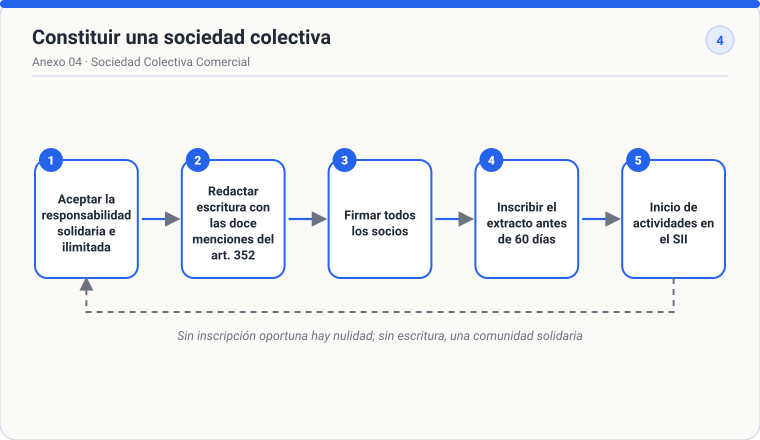
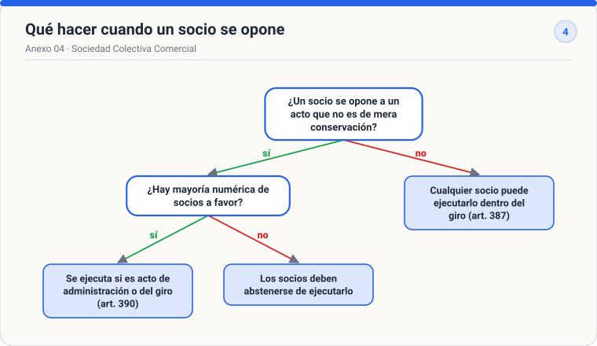
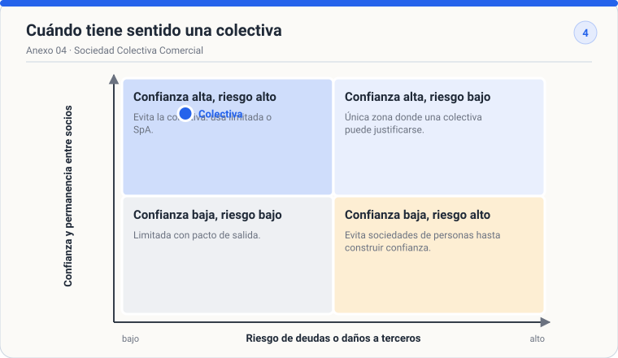

# Anexo 04 · Sociedad Colectiva Comercial

> **Fecha de consulta de las fuentes:** 2026-11-25. **Naturaleza:** material educativo; no es asesoría
> legal ni tributaria. Las normas cambian: confirma cada dato en la fuente oficial citada al final
> antes de actuar. Este anexo separa **obligación legal**, **recomendación profesional** y **medida
> voluntaria**.

## 1. Ficha rápida

| Pregunta | Respuesta |
|---|---|
| ¿Qué es? | La sociedad de personas más antigua del Código de Comercio: sus socios la forman, la administran y responden por ella con todo su patrimonio. |
| ¿Cuántos socios? | Dos o más. |
| ¿Quién responde por las deudas? | Los socios colectivos indicados en la escritura responden **solidariamente** de todas las obligaciones contraídas bajo la razón social; **no pueden derogar la solidaridad por pacto** (art. 370). |
| ¿Qué la regula? | Párrafos 1 a 7 del Título VII del Libro II del Código de Comercio, artículos 348 a 423. |
| ¿Se puede constituir en línea? | Sí. La Ley 20.659 la incluye (art. 2 N.º 5). |
| ¿Quién administra? | De derecho, todos y cada uno de los socios, salvo delegación en la escritura (art. 385). |
| ¿Se puede ceder la participación? | No sin autorización de todos los socios; la cesión sin autorización es nula (art. 404 N.º 3). |
| ¿Para quién suele servir? | Socios con confianza total y proyectos acotados, que aceptan responder con todo su patrimonio. |
| ¿Para quién no? | Casi cualquier emprendimiento que busque limitar el riesgo personal: la sociedad limitada, la SpA o la EIRL ofrecen protección que esta no da. |

## 2. Historia y evolución

### 2.1. El tipo madre

La sociedad colectiva es la figura base del derecho societario comercial chileno. El **Código de
Comercio**, promulgado el 23 de noviembre de 1865, la reguló en su Título VII como la primera de las
especies de sociedad que enumera hoy su artículo 348: «colectiva», «por acciones» y «en comandita». Su diseño responde a una lógica de comerciantes que se
conocen: la persona jurídica es una forma de organizar el trabajo común, pero la confianza personal y la
responsabilidad ilimitada son el verdadero respaldo ante los acreedores.

Esa lógica explica rasgos que hoy sorprenden: la administración compartida «de derecho» entre todos los
socios (art. 385), el derecho de cada socio a oponerse a los actos de otro (art. 388), la prohibición de
ceder el interés sin autorización unánime (art. 404 N.º 3) y la solidaridad que no puede pactarse en
contrario (art. 370).

### 2.2. El tipo que inspiró a los demás

Las reglas de la colectiva funcionan como **derecho supletorio** de otros tipos. La Ley 3.918, de 1923,
dispone que las sociedades de responsabilidad limitada se rigen, en lo no previsto, por las reglas de las
colectivas. Por eso entender la colectiva ayuda a entender la limitada (Anexo 03) y, en parte, la
comandita simple (Anexo 05).

### 2.3. Evolución reciente

- **Ley 19.499 (1997):** saneamiento de vicios de nulidad. Los arts. 355 A a 361 del Código de Comercio
  reflejan ese régimen.
- **Ley 20.659 (2013):** permite constituir, modificar, transformar, fusionar, dividir, terminar y disolver
  sociedades colectivas comerciales en línea, mediante el Registro de Empresas y Sociedades.
- **Reformas tributarias recientes** (Leyes 21.210, 21.755 y 21.850) cambiaron regímenes y tasas que
  afectan a estas sociedades.

Hoy la colectiva es **poco usada** en la práctica: su responsabilidad ilimitada la hace poco atractiva
frente a tipos que ofrecen limitación de riesgo con costos parecidos. Se la estudia porque define el
vocabulario jurídico de las sociedades de personas y porque aparece como régimen supletorio.

## 3. Marco legal

### 3.1. Mapa de normas

| Norma | Contenido |
|---|---|
| Código de Comercio, arts. 348 a 364 | Formación y prueba de la sociedad colectiva: escritura, extracto, inscripción y nulidades |
| Arts. 365 a 374 | Razón social, solidaridad, uso de la firma y límites |
| Arts. 375 a 383 | Fondo social: aportes, entrega, mora, reparto de ganancias y pérdidas |
| Arts. 384 a 403 | Administración: derecho de cada socio, oposición, mayoría, delegación y libros |
| Arts. 404 a 406 | Prohibiciones a los socios |
| Arts. 407 a 418 | Disolución y liquidación |
| Arts. 419 a 423 | Prescripción de acciones |
| Ley 20.659 | Constitución y modificaciones en línea (art. 2 N.º 5) |
| Ley 19.499 | Saneamiento de nulidades |

### 3.2. Obligación, recomendación, opción

| Materia | Tipo | Detalle |
|---|---|---|
| Escritura pública inscrita | Obligación | Art. 350 |
| Contenido mínimo de la escritura | Obligación | Art. 352, doce materias |
| Inscripción del extracto en 60 días | Obligación | Art. 354 |
| Solidaridad de los socios | Obligación (no pactable en contrario) | Art. 370 |
| Reglas de administración | Supletorias; las pactadas prevalecen | Art. 384 |
| Cláusula arbitral | Opción; si se omite, las cuestiones van a compromiso | Arts. 352 N.º 10 y 415 |
| Pacto de socios complementario | Recomendación profesional | Evita bloqueos |

## 4. Cómo se constituye

### 4.1. Contenido de la escritura

Según el artículo 352, la escritura debe expresar: nombres, apellidos y domicilios de los socios; la razón
o firma social; los socios encargados de la administración y del uso de la razón social; el capital que
introduce cada socio y el valor asignado a los aportes en bienes; las negociaciones del giro; la parte de
beneficios o pérdidas de cada socio capitalista o industrial; la época de inicio y disolución; la cantidad
que cada socio puede tomar anualmente para sus gastos particulares; la forma de liquidación y división
del haber social; si las diferencias se someten a arbitradores y cómo se nombran; el domicilio; y los
demás pactos.

**Una cláusula que merece atención:** la cantidad que cada socio puede tomar anualmente para gastos
particulares (art. 352 N.º 8). Si un socio extrae más de lo asignado, los demás pueden exigir el reintegro
o extraer una cantidad proporcional (art. 404 N.º 1).

### 4.2. Escritura pública, extracto, inscripción

La sociedad colectiva «se forma y prueba por escritura pública inscrita en los términos del artículo
354» (art. 350). Un extracto debe inscribirse en el registro de comercio del domicilio social **antes de
expirar los sesenta días** desde la fecha de la escritura (art. 354). El extracto contiene las
indicaciones de los números 1, 2, 3, 4, 5 y 7 del art. 352, la fecha de las escrituras y el nombre y
domicilio del notario.

Un contrato en documento privado solo obliga a los socios a otorgar la escritura pública antes de que la
sociedad dé principio a sus operaciones (art. 351). Además, **no se admite prueba contra el tenor de las
escrituras ni para justificar pactos no expresados en ellas** (art. 353). Todo acuerdo importante debe
estar escrito.

### 4.3. Vía del Registro de Empresas y Sociedades

La Ley 20.659 permite reemplazar la escritura por el formulario electrónico firmado con firma electrónica
avanzada o ante notario. Se incorpora automáticamente cuando todos firman, el SII se entiende informado y
asigna el RUT (art. 13). Todos deben firmar dentro de sesenta días desde la primera firma (art. 10).

### 4.4. Nulidades y sociedad de hecho

| Situación | Efecto | Artículo |
|---|---|---|
| No hay escritura ni inscripción oportuna | Nulidad absoluta entre los socios | 355 A |
| No consta de escritura pública ni instrumento reducido o protocolizado | Nula de pleno derecho, no puede sanearse; si existe de hecho, hay una **comunidad** y los miembros responden solidariamente | 356 |
| Nulidad por incumplir el art. 350, pero consta de escritura | Goza de personalidad jurídica y se liquida; socios solidarios con terceros | 357 |
| Ejecución voluntaria | No purga la nulidad | 358 |
| Tercero que contrata con sociedad mal constituida | No puede sustraerse por ello a sus obligaciones | 359 |
| Modificación sin inscripción oportuna | Sin efectos entre socios y frente a terceros | 361 |

### 4.5. Modificaciones

La disolución anticipada, la prórroga, el cambio, retiro o muerte de un socio, la alteración de la razón
social y toda reforma deben reducirse a escritura pública con las mismas solemnidades (art. 350). Los
hechos del inciso segundo del art. 350 solo producen efecto contra terceros desde que se deja constancia
en la forma indicada (art. 360). Excepción: la simple prórroga que deba producirse según el contrato no
exige solemnidades, salvo que un socio manifieste por escritura pública su voluntad de poner término.

## 5. Capital, aportes y propiedad

### 5.1. El fondo social

El fondo social se compone de los aportes que cada socio entrega o promete entregar (art. 375). Pueden ser
dinero, créditos, muebles, inmuebles, derechos, trabajo manual, mera industria y, en general, toda cosa
comerciable capaz de prestar alguna utilidad (art. 376).

### 5.2. Entrega y mora

Los aportes se entregan en la época y forma pactadas; si no, en el domicilio social luego de firmada la
escritura (art. 378). El retardo autoriza a los socios a **excluir al moroso** o a proceder ejecutivamente
contra su persona y bienes, con indemnización de perjuicios (art. 379).

### 5.3. Aportes protegidos

Los acreedores personales de un socio no pueden embargar el aporte durante la sociedad; pueden solicitar
la retención del interés que le corresponda al tiempo de la división (art. 380). Tampoco pueden concurrir
con los acreedores sociales a la liquidación; solo persiguen la parte del deudor en el residuo. Los socios
no pueden exigir la restitución de sus aportes antes de concluir la liquidación (art. 381).

### 5.4. Ganancias y pérdidas

Los socios capitalistas reparten ganancias y pérdidas según lo estipulado; si no hay pacto, a prorrata de
sus aportes (art. 382). El socio industrial lleva, salvo pacto, una cuota igual a la del aporte más
módico, sin soportar pérdidas (art. 383).

**Ejemplo ilustrativo.** Dos socios capitalistas aportan 5.000.000 y 3.000.000 de pesos y un socio
industrial aporta su trabajo. Sin pacto, el industrial recibe una cuota igual a la del aporte más módico
(3.000.000) en las ganancias y no soporta pérdidas. Si la utilidad es de 11.000.000, el reparto sería
proporcional a 5, 3 y 3, es decir, 5/11, 3/11 y 3/11: 5.000.000, 3.000.000 y 3.000.000. Los números son
ilustrativos.

### 5.5. Prohibición de ceder la participación

El artículo 404 N.º 3 prohíbe ceder a cualquier título el interés en la sociedad y hacerse sustituir en
las funciones de administración; **la cesión o sustitución sin autorización de todos los socios es nula**.
Es la diferencia más práctica con las acciones de una SpA: aquí, entrar o salir exige el consentimiento de
todos y la modificación de la escritura.

## 6. Administración y gobierno

### 6.1. La regla de partida

El régimen de la colectiva se ajusta a los pactos de la escritura; en lo no previsto, a las reglas legales
(art. 384). Por ley, la administración corresponde a todos y cada uno de los socios, directamente o por
delegados (art. 385). Si la escritura no designa administrador, los socios se confieren recíprocamente
la facultad de administrar y de **obligar solidariamente la responsabilidad de todos sin su noticia y
consentimiento** (art. 386). Cada socio puede realizar todos los actos del giro ordinario o necesarios
para sus fines (art. 387).

### 6.2. Oposición y mayoría

Cada socio puede oponerse a los actos proyectados por otro, salvo los de mera conservación (art. 388). La
oposición suspende el acto hasta que la **mayoría numérica** califique su conveniencia (art. 389). El
acuerdo de la mayoría obliga a la minoría solo para actos de simple administración o comprendidos en las
operaciones del contrato; si hay dos o más pareceres sin mayoría absoluta, deben abstenerse (art. 390).
Si, a pesar de la oposición, se ejecuta un acto con terceros de buena fe, todos los socios quedan
obligados solidariamente, con acción de indemnización contra el que lo ejecutó (art. 391).

### 6.3. Administrador designado

Delegada la administración en uno o más socios, los demás quedan inhibidos de toda injerencia (art. 392) y
el delegado usa la firma social (art. 393). Tiene solo las facultades de su título, y su exceso hace
responsable a la sociedad de los daños (art. 394).

**Facultades que requieren poder especial.** Sin poder especial, los administradores delegados no pueden
vender ni hipotecar inmuebles ni alterar su forma, ni transigir ni comprometer negocios sociales
(art. 395). No lo necesitan para vender inmuebles si ello está dentro del giro ordinario, ni para tomar
en mutuo lo estrictamente necesario para poner en movimiento los negocios, hacer reparaciones
indispensables, alzar hipotecas o satisfacer otras necesidades urgentes (art. 397).

### 6.4. Reglas de varios administradores

Si hay dos administradores que deben obrar de consuno, la oposición de uno impide el acto del otro; si
son tres o más, se obra por mayoría y deben abstenerse de actuar sin ella. Si se ejecuta igualmente, el
acto surte efecto respecto de terceros de buena fe y el administrador responde por perjuicios (art. 399).

El administrador nombrado por cláusula especial de la escritura puede ejecutar actos a pesar de la
oposición de socios excluidos, con tal que no haya fraude; si sus gestiones producen perjuicios
manifiestos, la mayoría puede nombrarle un coadministrador o pedir la disolución (art. 400). La facultad
de administrar **no se transmite a los herederos** del gestor (art. 401).

### 6.5. Libros y rendición

Los administradores deben llevar los libros que debe tener todo comerciante y exhibirlos a cualquier
socio que lo pida (art. 403). El acceso a los libros es un derecho de cada socio: úsalo.

### 6.6. Prohibiciones a los socios

El artículo 404 prohíbe a los socios:

1. extraer del fondo común más de lo asignado para gastos particulares;
2. aplicar fondos comunes a negocios propios y usar en ellos la firma social, caso en que lleva a la masa
   las ganancias y soporta solo las pérdidas, y puede ser excluido;
3. ceder su interés o hacerse sustituir en la administración sin autorización de todos;
4. explotar por cuenta propia el ramo en que opera la sociedad, o hacer operaciones particulares sin
   consentimiento de todos cuando la sociedad no tiene un género determinado.

Los demás socios no pueden negar la autorización para una operación mercantil sin acreditar perjuicio
cierto y manifiesto (art. 405). El socio industrial no puede emprender negocios que lo distraigan de sus
atenciones sociales, so pena de perder las ganancias adquiridas hasta la violación (art. 406).

## 7. Responsabilidad

### 7.1. Solidaria e ilimitada

La responsabilidad es el rasgo definitorio. Según el artículo 370, los socios colectivos indicados en la
escritura **responden solidariamente de todas las obligaciones legalmente contraídas bajo la razón
social**, y **en ningún caso pueden derogar por pacto la solidaridad**. Solidaria significa que el
acreedor puede cobrar el total a cualquiera de ellos; ilimitada, que responden con todo su patrimonio.

Un pacto interno puede repartir la carga entre socios (derecho de repetición), pero no cambia lo que
puede exigir el acreedor.

### 7.2. Actos de un socio sin facultad

Si un socio no autorizado usa la firma social, la sociedad no responde de lo que él suscribió, salvo que la
obligación se haya convertido en provecho de la sociedad y entonces solo hasta el beneficio (art. 373).
La sociedad no responde de documentos suscritos con la razón social cuando las obligaciones no le
conciernen y el tercero los aceptó con conocimiento de ello (art. 374).

### 7.3. Uso de la razón social por un tercero

El uso de la razón social puede conferirse a una persona extraña, que debe indicar que firma por poder,
so pena de pagar los efectos de comercio que hubiere puesto en circulación si su omisión indujo a error
(art. 372).

### 7.4. Prescripción de acciones

Las acciones contra los socios no liquidadores, sus herederos o causahabientes **prescriben en cuatro
años** desde la disolución, siempre que la escritura haya fijado la duración o la escritura de disolución
haya sido inscrita conforme al art. 354 (art. 419). La prescripción corre incluso contra menores y no se
interrumpe sino por gestiones judiciales dentro de los cuatro años (art. 420). No tiene lugar cuando
los socios liquidan por sí mismos o cuando la sociedad es deudora en un procedimiento concursal de
liquidación (art. 422). Esta es una protección relevante para quien se retira, pero exige que la escritura
de disolución esté inscrita.

### 7.5. Responsabilidad penal, tributaria y laboral

La sociedad es contribuyente y empleadora. Las responsabilidades personales por delitos o infracciones
siguen las normas generales. Ver [cumplimiento y riesgo](../docs/13_COMPLIANCE_RISK.md).

### 7.6. La disolución y la liquidación, paso a paso

La colectiva se disuelve por los modos que determina el Código Civil (art. 407). Disuelta, se procede a
la liquidación por la persona nombrada en la escritura social o en la de disolución (art. 408). Si se
acordó nombrar un liquidador sin determinar cómo, el nombramiento se hace **por unanimidad** de los
socios y, en caso de desacuerdo, por el juzgado de comercio; puede recaer en un socio o en un extraño, y
solo si todos están conformes pueden los socios liquidar colectivamente (art. 409).

El liquidador es un **mandatario** de la sociedad. Debe ceñirse a las reglas de su título y responde a los
socios por los perjuicios de sus operaciones dolosas o culpables (art. 410). Si sus facultades no están
determinadas, solo puede ejecutar actos que tiendan directamente al cumplimiento de su encargo; no puede
constituir hipotecas, prendas o anticresis, tomar dinero a préstamo, comprar mercaderías para revender,
endosar efectos de comercio ni transigir o comprometer derechos sociales (art. 411).

Sus obligaciones mínimas son ocho (art. 413):

1. formar inventario al tomar posesión del cargo;
2. continuar y concluir las operaciones pendientes;
3. exigir cuenta a los gerentes u otros que hayan manejado intereses sociales;
4. liquidar y cancelar las cuentas con terceros y con cada socio;
5. cobrar los créditos y otorgar finiquitos;
6. vender mercaderías, muebles e inmuebles, salvo los que los socios destinen a dividirse en especie;
7. presentar estados de la liquidación cuando los socios lo exijan;
8. rendir una cuenta general al final.

Las cuestiones sobre la cuenta del socio gerente o del liquidador se someten **precisamente a compromiso**
(art. 414). Si los socios liquidan por sí mismos, aplican las reglas anteriores y las de deliberación de
los arts. 387 a 391 (art. 418).

**Para quien se retira:** inscribe la escritura de disolución conforme al art. 354. El art. 419 hace
correr la prescripción de cuatro años solo si la escritura social fijó la duración o la de disolución fue
inscrita; si ninguna de las dos condiciones se cumple, el plazo no corre en tu favor.

**Ejemplo ilustrativo.** Dos socios deciden disolver su sociedad de tapicería el 30 de junio. Nombran
liquidador a un contador externo en la escritura de disolución, con facultades para vender las
existencias. Inventario: máquinas por 3.200.000 de pesos, mercadería por 1.100.000 y deudas con
proveedores por 2.700.000. Tras vender y pagar, el remanente se divide según lo pactado. Si la escritura
social no fijó duración y no inscriben la disolución, la prescripción de cuatro años no corre a su favor. Cifras
ilustrativas.

## 8. Tributación

### 8.1. Cómo tributa

La sociedad colectiva comercial es una persona jurídica contribuyente de Primera Categoría. Los socios, si
son personas naturales, tributan por las utilidades según el régimen. Las rutas empresariales que el SII
presenta para la Operación Renta 2026 son Pro Pyme General, Pro Pyme Transparente y Régimen General semi
integrado. Para sociedades de personas con socios personas naturales, el régimen Pro Pyme Transparente
suele evaluarse; la decisión debe respaldarse con una simulación. Ver el
[flujo tributario](../docs/02_SII_TAX_FLOW.md).

### 8.2. Tasas recientes

La **Ley 21.850** fija la tasa de Primera Categoría en 27 % para 2026, 25,5 % para 2027, 24 % para 2028 y
23 % desde 2029, sin perjuicio del artículo 25 de la Ley 21.755, que estableció una disminución
transitoria a 12,5 % para Pro Pyme en 2025, 2026 y 2027, con condiciones. **Trata estos valores como
datos dinámicos y verifícalos en el SII.** Ver la
[guía de la Ley 21.850](../docs/20_LEY_21850_RECONSTRUCCION_NACIONAL.md).

### 8.3. IVA y obligaciones

Ver el Anexo 16 (Servicio de Impuestos Internos).

### 8.4. Decisión práctica

Antes de constituir, pregúntate: ¿existe una razón para que todos los socios acepten responder con todo
su patrimonio? Si la respuesta es «ahorro de costos», probablemente una sociedad limitada o una SpA
logren lo mismo con protección patrimonial.

**Ejemplo ilustrativo.** Tres socios de un taller de cerrajería firman un contrato de arriendo de 1.800.000
pesos mensuales a nombre de la sociedad. A los diez meses cierran con deudas por 15.000.000 de pesos.
En una colectiva, el arrendador puede demandar el total a cualquiera de los tres. Si hubieran usado una
sociedad limitada, solo habrían respondido hasta sus aportes. Los números son ilustrativos.

## 9. Obligaciones laborales, contables y sectoriales

### 9.1. Contabilidad

Lleva los libros del comerciante y exhíbelos a cualquier socio (art. 403). Contabilidad ajustada al SII.

### 9.2. Laboral

Si hay trabajadores, la sociedad es el empleador. Ver el [flujo laboral](../docs/08_EMPLOYMENT_FLOW_CHILE.md).
Un socio industrial que trabaja para la sociedad debe aclarar si lo hace como aporte o como trabajador.

### 9.3. Permisos

Ver el Anexo 17 (Municipalidades) y la [matriz de permisos](../docs/06_PERMITS_MATRIX.md).

## 10. Antes de construir: lista de verificación

### 10.1. Decisiones previas

1. ¿Por qué esta forma y no una limitada o una SpA? Escribe la razón.
2. ¿Todos aceptan responder con todo su patrimonio, y su pareja o familia está informada?
3. ¿Quién administra y con qué límites de monto y materia?
4. ¿Cuánto puede retirar cada socio al año para gastos particulares?
5. ¿Qué pasa si un socio quiere salir, fallece o no paga su aporte?
6. ¿Cómo se valoran los aportes en bienes?
7. ¿Habrá arbitraje y cómo se designa al árbitro?
8. ¿Qué pasa con la prohibición de competir y con los negocios paralelos de cada socio?

### 10.2. Documentos

| Documento | Para qué |
|---|---|
| Cédulas y RUT de los socios | Identificación |
| Firma electrónica avanzada o notario | Formulario o escritura |
| Título del domicilio | RUT |
| Detalle y valorización de los aportes | Capital |
| Pacto de socios complementario | Reglas de salida y bloqueo |
| Calendario de renovación de poderes y delegaciones | Control de administración |

### 10.3. Errores frecuentes

- **Elegirla por costo sin entender la solidaridad ilimitada.**
- **No designar administrador:** cualquier socio obliga a todos sin su noticia.
- **No inscribir a tiempo:** nulidad entre socios y modificaciones sin efecto.
- **Pactos verbales:** no se admite prueba contra la escritura (art. 353).
- **Operar con una sociedad no inscrita:** es una comunidad, con responsabilidad solidaria (art. 356).
- **Sacar dinero por encima de lo asignado** (art. 404 N.º 1).
- **Competir con la sociedad** (art. 404 N.º 4).
- **Olvidar inscribir la disolución:** la prescripción de cuatro años exige esa inscripción (art. 419).

### 10.4. Caso ilustrado: una sociedad familiar de transporte

**Caso ilustrativo.** Tres hermanos, Luis, Marta y Nora, heredan dos camiones y deciden operar juntos. Los
números son ilustrativos.

1. **Primera pregunta.** ¿Colectiva o limitada? Luis dice que la colectiva es «más simple». Marta pide
   revisar el art. 370: responderían con todo su patrimonio, incluidas sus viviendas.
2. **Decisión.** Evalúan una sociedad limitada y una SpA. Eligen la limitada porque son pocos, se conocen
   y la operación es estable.
3. **Cómo habría sido en una colectiva.** Un camión choca y la víctima demanda 40.000.000 de pesos
   por daños no cubiertos por el seguro. Si fueran colectiva, el demandante podría ir contra cualquiera de
   los tres por el total.
4. **Lección.** La colectiva solo tiene sentido cuando todos los socios aceptan expresamente responder
   con todo su patrimonio y confían plenamente entre sí.
5. **Qué pactan de todos modos.** Aun siendo limitada, pactan lo que la colectiva enseña: quién
   administra, cuánto retira cada uno, prohibición de competir, reglas de salida y arbitraje.

**Qué aprendemos.** Estudiar la colectiva sirve para entender qué reglas supletorias heredan otros tipos
y para valorar la limitación de responsabilidad que ofrecen.

### 10.5. Mini glosario

| Término | Significado |
|---|---|
| Solidaridad | El acreedor puede exigir la deuda completa a cualquiera de los socios. |
| Razón social | Nombre bajo el cual la sociedad actúa y firma. |
| Socio capitalista | Aporta dinero o bienes. |
| Socio industrial | Aporta trabajo o industria. |
| Extracto | Resumen de la escritura que se inscribe. |
| Compromiso | Sometimiento a arbitraje. |
| Mayoría numérica | Un voto por socio. |
| Liquidador | Mandatario de la sociedad que la liquida tras su disolución. |

## 11. Cuándo conviene y cuándo no

### 11.1. Comparación

| Criterio | Colectiva | Sociedad limitada | SpA | Comandita simple |
|---|---|---|---|---|
| Responsabilidad de los socios | Solidaria e ilimitada | Limitada a aportes | Limitada a aportes | Gestores ilimitados; comanditarios limitados |
| Cesión de la participación | Requiere autorización de todos | Modificación de escritura | Libre por estatuto | Reglas de comandita |
| Administración | Todos, salvo delegación | Todos, salvo delegación | Libre por estatuto | Gestores |
| Uso actual | Poco frecuente | Muy frecuente | Muy frecuente | Poco frecuente |

### 11.2. Señales a favor

- Existe una razón estratégica para aceptar la responsabilidad ilimitada, por ejemplo, un acreedor o un
  cliente que lo exige.
- Socios con confianza plena, relación duradera y proyecto de bajo riesgo.
- Estudio académico o régimen supletorio de otras sociedades.

### 11.3. Señales en contra

- La actividad puede generar deudas altas o daños a terceros.
- Hay socios que no se conocen bien.
- Se prevé entrada de socios nuevos o inversionistas.
- Los socios no aceptan arriesgar su patrimonio familiar.

## 12. Cuándo llamar a un profesional

| Situación | Profesional | Por qué |
|---|---|---|
| Decidir el tipo social | Abogado | La solidaridad ilimitada pesa más que el ahorro de costos |
| Redactar escritura y pactos | Abogado societario | Reglas supletorias de administración y mayoría |
| Retiro o muerte de un socio | Abogado | Modificar la escritura y fijar la prescripción |
| Liquidación | Abogado | Liquidador y rendición de cuenta |
| Régimen tributario | Contador | Pro Pyme Transparente y otros |

Consulta la [guía de cuándo llamar a un profesional](../docs/18_WHEN_TO_CALL_A_PROFESSIONAL.md).

## 13. Preguntas frecuentes

**1. ¿Qué es una sociedad colectiva comercial?**
Es una sociedad de personas, regulada en los arts. 348 a 423 del Código de Comercio, en la que los
socios administran y responden solidariamente por las obligaciones sociales.

**2. ¿Puedo limitar mi responsabilidad en una colectiva?**
No. Los socios no pueden derogar por pacto la solidaridad (art. 370). Para limitar la responsabilidad
existen otros tipos.

**3. ¿Cuántos socios necesita?**
Dos o más, porque es una sociedad. Con un solo dueño existen la EIRL, la SpA y la persona natural.

**4. ¿Quién administra si la escritura no lo dice?**
Todos y cada uno de los socios, y pueden obligar a todos sin su noticia (arts. 385 y 386).

**5. ¿Puedo vender mi parte a un tercero?**
No sin autorización de todos los socios: la cesión sin ella es nula (art. 404 N.º 3).

**6. ¿Qué pasa si un socio compite con la sociedad?**
Debe llevar al acervo común las ganancias y soporta individualmente las pérdidas (art. 404 N.º 4).

**7. ¿Puedo sacar dinero de la sociedad cuando quiera?**
Solo hasta la cantidad asignada para gastos particulares; si extrae más, los demás pueden exigir el
reintegro (art. 404 N.º 1).

**8. ¿Qué plazo tengo para inscribir el extracto?**
Antes de expirar sesenta días desde la fecha de la escritura (art. 354).

**9. ¿Qué pasa si la sociedad no consta en escritura pública?**
Es nula de pleno derecho y no puede sanearse; si existe de hecho, hay una comunidad cuyos miembros
responden solidariamente (art. 356).

**10. ¿Puedo probar un pacto que no está escrito?**
No. No se admite prueba contra el tenor de las escrituras ni para justificar pactos no expresados (art. 353).

**11. ¿Puede una persona ajena usar la firma social?**
Sí, si se le confiere, pero debe indicar que firma por poder (art. 372).

**12. ¿Qué pasa si un socio firma sin autorización?**
La sociedad no responde salvo hasta el beneficio que haya recibido (art. 373).

**13. ¿La facultad de administrar pasa a los herederos?**
No. Es intransmisible a los herederos del gestor (art. 401).

**14. ¿Cómo se disuelve?**
Por los modos que determina el Código Civil (art. 407). La liquidación la hace la persona nombrada en la
escritura o en la disolución (art. 408).

**15. ¿Cuánto tiempo tienen los acreedores para demandar a un socio que se fue?**
Las acciones contra los socios no liquidadores prescriben en cuatro años desde la disolución, si la
escritura fijó la duración o la disolución se inscribió (art. 419).

**16. ¿Qué pasa con las diferencias entre socios?**
Si la escritura no designa árbitros, las cuestiones se someten a compromiso (art. 415).

**17. ¿Se puede constituir en línea?**
Sí, por el Registro de Empresas y Sociedades (Ley 20.659, art. 2 N.º 5).

**18. ¿Qué es el socio industrial?**
El que aporta su trabajo o industria. Salvo pacto, lleva una cuota igual al aporte más módico y no
soporta pérdidas (art. 383).

**19. ¿Los acreedores personales de un socio pueden cobrar a la sociedad?**
No pueden embargar su aporte durante la sociedad; solo pueden pedir retención de su parte para la
división (art. 380).

**20. ¿Conviene hoy una colectiva?**
Rara vez. Casi siempre una sociedad limitada o una SpA logran fines parecidos con limitación de
responsabilidad. Decide con asesoría legal.

## 14. Fuentes y vigencia

| Fuente | Qué se usó | Dónde consultarla |
|---|---|---|
| Código de Comercio, arts. 348 a 423 | Régimen completo de la colectiva | [BCN, Código de Comercio](https://www.bcn.cl/leychile/navegar?idNorma=1974) |
| Ley 20.659 | Registro de Empresas y Sociedades | [BCN, Ley 20.659](https://www.bcn.cl/leychile/navegar?idNorma=1048718) |
| Ley 3.918 | Supletoriedad para la limitada | [BCN, Ley 3.918](https://www.bcn.cl/leychile/navegar?idNorma=24349) |
| Ley 19.499 | Saneamiento de nulidades | [BCN, Ley 19.499](https://www.bcn.cl/leychile/navegar?idNorma=70549) |
| Registro de Empresas y Sociedades | Trámite en línea | [Sitio oficial](https://www.registrodeempresasysociedades.cl) |
| ChileAtiende, ficha «Tu empresa» | Formas societarias | [ChileAtiende](https://www.chileatiende.gob.cl/fichas/21409-tu-empresa) |
| SII, regímenes tributarios | Rutas de Operación Renta | [SII](https://www.sii.cl/destacados/renta/2026/intermediarios/regimenes_tributarios/) |
| Ley 21.850 y Ley 21.755 | Tasas recientes | [Guía del programa](../docs/20_LEY_21850_RECONSTRUCCION_NACIONAL.md) |

**Vigencia.** Los artículos citados del Código de Comercio se leyeron en la versión publicada por la
Biblioteca del Congreso Nacional el 2026-11-25. Las tasas y créditos tributarios se citan como referencia
del programa y deben verificarse en el SII.

**Límites.** Este anexo no reproduce todo el texto del Código de Comercio, no incluye tarifas ni plazos
de trámites de terceros y sus ejemplos numéricos son ilustrativos. No sustituye la asesoría de un abogado
ni de un contador.
