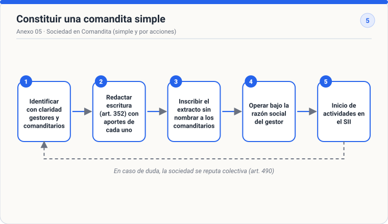
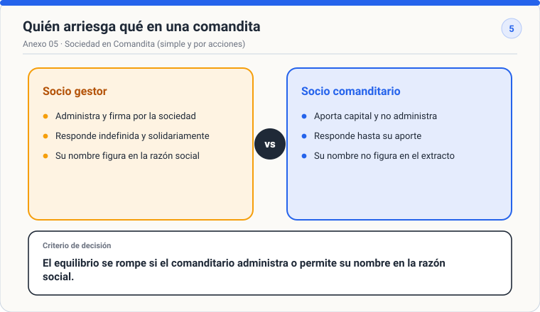
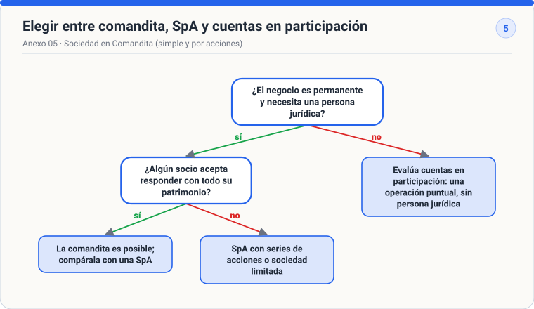

# Anexo 05 · Sociedad en Comandita (simple y por acciones)

> **Fecha de consulta de las fuentes:** 2026-11-25. **Naturaleza:** material educativo; no es asesoría
> legal ni tributaria. Las normas cambian: confirma cada dato en la fuente oficial citada al final
> antes de actuar. Este anexo separa **obligación legal**, **recomendación profesional** y **medida
> voluntaria**.

## 1. Ficha rápida

| Pregunta | Respuesta |
|---|---|
| ¿Qué es? | Una sociedad entre **socios comanditarios**, que aportan capital y no administran, y **socios gestores**, que administran exclusivamente y responden sin límite (arts. 470 y 483 del Código de Comercio). |
| ¿Cuántas especies hay? | Dos: la **comandita simple** y la **comandita por acciones** (art. 471). |
| ¿Quién responde por las deudas? | Los gestores, indefinida y solidariamente. Los comanditarios, solo hasta sus aportes prometidos o entregados (art. 483). |
| ¿Quién administra? | Solo los gestores. Al comanditario le está prohibido ejecutar actos de administración, incluso como apoderado (art. 484). |
| ¿Cómo se llama? | La razón social incluye el nombre del gestor, o de uno o más gestores si son varios. **El nombre de un comanditario no puede incluirse** (art. 476). |
| ¿Se puede constituir en línea? | Sí. La Ley 20.659 incluye la comandita simple y la comandita por acciones (art. 2 N.º 7 y 8). |
| ¿Qué la regula? | Párrafos 10, 11 y 12 del Título VII del Libro II del Código de Comercio, arts. 470 a 506; supletoriamente, las reglas de la colectiva. |
| ¿Para quién suele servir? | Un empresario que busca capital de personas que no quieren participar en la gestión ni responder más allá de lo aportado. |
| ¿Para quién no? | Quien no quiere que algún socio responda ilimitadamente, o quien busca un vehículo moderno de inversión: la SpA suele ser más práctica. |

## 2. Historia y evolución

### 2.1. Una idea de comerciantes medievales

Según la explicación histórica habitual, la comandita es una de las formas societarias más antiguas del comercio europeo: un socio con experiencia
y reputación gestiona un negocio, y otros ponen dinero sin figurar y sin responder más de lo que aportan.
El Código de Comercio chileno de 1865 la recogió en dos especies, la **simple** y la **por acciones**, y
sus reglas conservan el lenguaje y las ideas de ese origen.

El rastro de ese pasado es visible en el texto. El artículo 492 fija el valor mínimo de las acciones en
«escudos», una unidad monetaria que ya no existe, y el artículo 503 sanciona con multas de «medio a un
escudo». Son disposiciones históricamente interesantes, pero una lectura práctica exige apoyarse en el
resto del sistema y en la asesoría de un abogado.

### 2.2. La comandita en el sistema actual

Con la aparición de la sociedad anónima moderna, de la sociedad de responsabilidad limitada (Ley 3.918,
1923) y de la sociedad por acciones (Ley 20.190, 2007), la comandita dejó de ser la vía natural para
combinar gestión y capital. Cada una de esas figuras ofrece limitación de responsabilidad para todos los
socios, no solo para los inversionistas.

Aun así, la comandita permanece en la ley y en el Registro de Empresas y Sociedades: la **Ley 20.659** la
incluye entre las personas jurídicas que pueden constituirse y modificarse en línea, tanto la comandita
simple (Párrafos 10 y 11) como la comandita por acciones (Párrafos 10 y 12).

### 2.3. Una regla moderna dentro de un texto antiguo

El artículo 507 bis, agregado en una reforma posterior, dispone que la comandita que durante **doce meses
consecutivos** cumpla las condiciones que obligan a una sociedad anónima cerrada a inscribir sus acciones
en el Registro de Valores se **transforma por el solo ministerio de la ley en sociedad anónima**, y le
serán aplicables las disposiciones de la Ley 18.046, que prevalecen sobre el estatuto. Es la misma regla
que el artículo 430 aplica a la SpA.

## 3. Marco legal

### 3.1. Mapa de normas

| Norma | Contenido |
|---|---|
| Código de Comercio, arts. 470 a 473 | Definición, dos especies |
| Arts. 474 a 490 | Comandita simple |
| Arts. 491 a 506 | Comandita por acciones |
| Art. 507 bis | Transformación por ley en sociedad anónima |
| Arts. 348 a 423 | Reglas de la colectiva, aplicables a la simple en lo compatible (art. 474) |
| Ley 20.659 | Constitución y modificación en línea (art. 2 N.º 7 y 8) |
| Ley 19.499 | Saneamiento de nulidades |

### 3.2. Obligación, recomendación, opción

| Materia | Tipo | Detalle |
|---|---|---|
| Constituir como la colectiva: escritura, extracto y inscripción | Obligación | Art. 474 |
| Que el nombre del comanditario no figure en el extracto ni en la razón social | Obligación | Arts. 475 y 476 |
| Que el comanditario no ejecute actos de administración | Obligación (prohibición) | Art. 484 |
| Junta de vigilancia de al menos tres accionistas en la comandita por acciones | Obligación | Art. 498 |
| Capital totalmente suscrito y un cuarto pagado en la comandita por acciones | Obligación | Art. 493 |
| Pacto de socios que defina funciones de vigilancia | Recomendación profesional | Evita que el comanditario pierda su protección |
| Cláusula arbitral | Opción | Aplicación supletoria del art. 352 N.º 10 |

## 4. Cómo se constituye

### 4.1. Comandita simple

La comandita simple «se forma y prueba como la sociedad colectiva» y se somete a las reglas de los siete
primeros párrafos del Título VII, en cuanto no se opongan a su naturaleza (art. 474). Eso significa
escritura pública con las menciones del art. 352, extracto inscrito dentro de sesenta días (art. 354) y
las consecuencias de nulidad ya descritas en el Anexo 04.

Tres reglas específicas la distinguen:

1. **El nombre de los comanditarios no figura en el extracto** (art. 475). Es la contrapartida de su
   papel pasivo: su identidad no aparece en el registro público.
2. **La razón social incluye al gestor**, no al comanditario (art. 476).
3. **En caso de duda, la sociedad se reputa colectiva** (art. 490). Si el contrato no deja claro quién es
   gestor y quién comanditario, todos responden como socios colectivos.

### 4.2. Comandita por acciones

La comandita por acciones se constituye por la reunión de un capital dividido en acciones o cupones de
acción, suministrado por socios **cuyo nombre no figura en la escritura social** (art. 473). Sus reglas
específicas, comparadas con la simple, son más exigentes:

| Regla | Artículo | Contenido |
|---|---|---|
| Acciones nominativas | 494 | Las acciones son nominativas |
| Capital suscrito y entero parcial | 493 | Se constituye solo cuando todo el capital está suscrito y cada accionista ha pagado al menos **la cuarta parte** del importe de sus acciones, con escritura de declaración del gerente |
| Responsabilidad del suscriptor | 495 | Responde del monto total de las acciones tomadas, aunque se pacte lo contrario |
| Negociación de acciones | 495 | No son negociables hasta haber pagado **dos quintas partes** de su valor |
| Aportes en especie y ventajas | 496 | La asamblea debe verificar y estimar su valor; sin aprobación ulterior la sociedad no queda definitivamente constituida |
| Junta de vigilancia | 498 | Al menos tres accionistas, nombrados tras la constitución y antes de toda operación; la primera por un año y las demás por cinco |
| Nulidad | 497 | Es nula si se constituye contra los artículos anteriores, sin perjuicio del saneamiento |

### 4.3. Vía del Registro de Empresas y Sociedades

La Ley 20.659 permite constituir y modificar ambas comanditas con el formulario electrónico. Para la
comandita por acciones, el artículo 14 menciona expresamente a los **socios gestores**, que deben firmar
junto con los accionistas para las modificaciones sin escritura de acta.

### 4.4. Nulidades y saneamiento

Se aplican las reglas de nulidad de las colectivas: nulidad absoluta entre socios por falta de escritura
o inscripción oportuna (art. 355 A), nulidad de pleno derecho y comunidad si no hay instrumento (art. 356),
y modificaciones sin efectos si no se inscriben (art. 361). El saneamiento se rige por la Ley 19.499.

## 5. Capital, aportes y propiedad

### 5.1. Aportes del comanditario

El comanditario **no puede aportar su capacidad, crédito o industria personal**. Su aporte puede, con todo,
consistir en la comunicación de un secreto de arte o ciencia, siempre que no lo aplique por sí mismo ni
coopere diariamente a su aplicación (art. 478). Si el aporte consiste en el mero goce o usufructo, no
soporta otra pérdida que la de los productos de la cosa; y en ningún caso debe restituir los beneficios
recibidos de buena fe (art. 479).

La razón de la regla es lógica: si el comanditario pone trabajo diario, deja de ser un socio pasivo y
comienza a comportarse como gestor.

### 5.2. Aportes del gestor

El gestor puede aportar dinero, bienes y también trabajo, porque administra. La comandita simple se forma
con un fondo suministrado en su totalidad por uno o más comanditarios, o por estos y los gestores a la
vez (art. 472).

### 5.3. Cesión de derechos

El comanditario puede ceder sus derechos, pero **no puede transferir la facultad de examinar los libros y
papeles** de la sociedad mientras esta no haya dado punto a sus operaciones (art. 482). En la comandita por
acciones, las acciones son nominativas y circulan después de pagadas las dos quintas partes (arts. 494 y
495).

### 5.4. Un ejemplo numérico

**Ejemplo ilustrativo.** Un chef, socio gestor, abre un restaurante con 6.000.000 de pesos propios (en
equipamiento y trabajo). Dos comanditarios aportan 9.000.000 en dinero. La sociedad pierde 20.000.000 en
dos años por una crisis. Los comanditarios responden hasta sus aportes: 9.000.000 entre ambos. El gestor
responde ilimitadamente con su patrimonio por el saldo. Si en lugar de eso uno de los comanditarios
hubiera administrado el local, habría quedado solidariamente responsable con los gestores de todas las
pérdidas y obligaciones (art. 485). Los números son ilustrativos.

### 5.5. Utilidades

Salvo pacto en contrario, se aplican las reglas de la colectiva: a prorrata de los aportes (art. 382).
Conviene pactar expresamente cuánto retira el gestor por su trabajo, porque el comanditario aporta dinero
pero no recibe remuneración por gestión.

## 6. Administración y gobierno

### 6.1. El gestor administra, el comanditario vigila

Los gestores administran exclusivamente la sociedad, por sí o por delegados y en su propio nombre (art.
470). El comanditario puede **asistir a las asambleas con voto consultivo** sin perder su carácter (art.
481). La ley le permite además:

| Actividad permitida (no es administración) | Artículo |
|---|---|
| Celebrar contratos, por cuenta propia o ajena, con los socios gestores | 487 N.º 1 |
| Desempeñar una comisión en una plaza distinta del domicilio de la sociedad | 487 N.º 2 |
| Dar consejo, examinar, inspeccionar y vigilar, siempre que no trabe la libre y espontánea acción de los gestores | 487 N.º 3 |
| Actuar como comunero tras la disolución | 487 N.º 4 |

### 6.2. La prohibición clave

El artículo 484 prohíbe al comanditario **ejecutar acto alguno de administración social, aun en calidad de
apoderado de los gestores**. Si lo hace, queda **solidariamente responsable** con los gestores de todas
las pérdidas y obligaciones de la sociedad, **anteriores o posteriores** a la contravención (art. 485).
Esa responsabilidad ilimitada es la sanción por romper el equilibrio del tipo.

El comanditario que pagó a los acreedores por haber permitido la inserción de su nombre en la razón
social (art. 477) o por violar la prohibición del art. 484 tiene derecho a exigir a los gestores la
restitución del exceso sobre su aporte, y los gestores no pueden reclamarle indemnización por el mero
hecho de la contravención (art. 486).

### 6.3. Derecho a examinar los libros

El comanditario puede examinar los libros, pero **pierde ese derecho** si forma un establecimiento de la
misma naturaleza que el social, o participa como socio colectivo o comanditario en uno formado por otra
persona, salvo que los intereses de ese establecimiento no se opongan a los de la sociedad (art. 488).

### 6.4. Varios socios

Si hay comanditarios y varios colectivos que administran de consuno o por todos, la sociedad es **a la
vez comanditaria respecto de los primeros y colectiva respecto de los segundos** (art. 489).

### 6.5. La junta de vigilancia en la comandita por acciones

Como los accionistas no administran, la ley exige una **junta de vigilancia** de al menos tres accionistas
(art. 498). Sus funciones (art. 499):

- examinar si la sociedad se constituyó legalmente;
- inspeccionar los libros;
- comprobar la existencia de los valores sociales;
- presentar cada año a la asamblea una memoria sobre los inventarios y la propuesta de dividendos.

La junta puede convocar la asamblea general y provocar la disolución (art. 500). Sus miembros pueden ser
declarados solidariamente responsables con los gerentes si la sociedad se anula por infracción de las
reglas de constitución (art. 501), o si permitieron a sabiendas inexactitudes graves en los inventarios o
dividendos no justificados (art. 502). Es un órgano con **responsabilidad real**, no un cargo decorativo.

### 6.6. Pleitos de los accionistas contra gerentes o junta

Los accionistas que deban litigar colectivamente contra los gerentes o los miembros de la junta se
representan por apoderados elegidos por la asamblea general; si no puede hacerse, el juzgado de comercio
los designa (art. 506).

### 6.7. Tres escenarios para practicar: ¿quién responde?

Aplica los artículos 477, 483, 484 y 485 a estos tres casos ilustrativos. En todos, la sociedad queda
debiendo 30.000.000 de pesos a un proveedor y sus bienes alcanzan para pagar solo 8.000.000. Los números
son ilustrativos.

| Escenario | Qué hizo el comanditario | Resultado | Fundamento |
|---|---|---|---|
| A | Aportó 10.000.000 y asistió a una reunión con voto consultivo | Responde hasta su aporte; ya lo perdió con la pérdida del negocio | Arts. 481 y 483 |
| B | Aportó 10.000.000 y firmó una orden de compra «por poder» de los gestores | Queda solidariamente responsable de las deudas, anteriores y posteriores a su firma | Arts. 484 y 485 |
| C | Aportó 10.000.000 y permitió que la razón social dijera «Fabián y Compañía» con su nombre | Responde como gestor por todas las obligaciones y pérdidas | Art. 477 |

En el escenario B, si el comanditario paga más allá de su aporte, tiene derecho a pedir a los gestores la
restitución del exceso, y estos no pueden reclamarle indemnización por el mero hecho de haber violado la
prohibición (art. 486). En el escenario C, el art. 476 recuerda que agregar solo la palabra «compañía» al
nombre del gestor no incluye al comanditario; la diferencia está en incluir **su nombre**.

La conclusión práctica es simple: la limitación de responsabilidad del comanditario es el premio por su
pasividad. Cada vez que una persona con aporte de comanditario quiere «ayudar un poco» firmando,
negociando o dando instrucciones, conviene revisar si no está cruzando la línea del artículo 484.

## 7. Responsabilidad

### 7.1. Gestores

Los socios gestores son **indefinida y solidariamente responsables** de todas las obligaciones y pérdidas
de la sociedad (art. 483). Responden con todo su patrimonio, sin límite.

### 7.2. Comanditarios

Los comanditarios **solo responden hasta concurrencia de sus aportes prometidos o entregados** (art. 483).
La protección tiene tres condiciones:

| Condición | Consecuencia si se rompe | Artículo |
|---|---|---|
| Que su nombre no figure en la razón social | Responde como gestor por todas las obligaciones y pérdidas | 477 |
| Que no ejecute actos de administración | Responde solidariamente con los gestores, antes y después | 484 y 485 |
| Que su aporte no sea capacidad, crédito o industria personal | El aporte no vale como tal | 478 |

El artículo 476 aclara que agregar «y compañía» al nombre del gestor **no incluye** el nombre del
comanditario en la razón social ni le impone responsabilidades distintas.

### 7.3. Una referencia a revisar

El artículo 480 dispone que los comanditarios tienen la responsabilidad y los derechos que el artículo 456
otorga a los accionistas de sociedades anónimas. **Ese artículo 456 figura hoy derogado** en el texto
consultado (arts. 451 a 469 están derogados). Es un ejemplo de por qué el texto debe leerse con
asesoría: la remisión sobrevive, pero su destino cambió. No la uses como fundamento sin consultar a un
abogado.

### 7.4. Suscriptores de la comandita por acciones

Los suscriptores responden del monto total de sus acciones, aunque se estipule lo contrario (art. 495).
Quien suscribe 1.000.000 de pesos y paga un cuarto sigue debiendo el saldo, aunque un pacto diga otra
cosa.

### 7.5. Delitos y multas del texto histórico

Los artículos 503 a 505 contienen multas y remisiones al Código Penal por irregularidades en la emisión y
negociación de acciones de comanditas, y por engaños para obtener suscripciones. Las multas están
expresadas en escudos; su aplicación práctica requiere asesoría. Lo que importa para el lector es que
**simular suscripciones o publicar de mala fe nombres de personas relacionadas con la sociedad** es una
conducta castigada con arreglo al Código Penal (art. 505).

## 8. Tributación

### 8.1. Cómo tributa

La comandita es una persona jurídica contribuyente de Primera Categoría. Los socios tributan después según
el régimen y su calidad. Las rutas que el SII presenta para la Operación Renta 2026 son Pro Pyme General,
Pro Pyme Transparente y Régimen General semi integrado. Ver el [flujo tributario](../docs/02_SII_TAX_FLOW.md).

### 8.2. Efectos propios de la comandita

- Las utilidades que corresponden a un **comanditario** persona natural o jurídica se atribuyen o retiran
  según el régimen; la calidad de comanditario no cambia el tratamiento por sí misma.
- Cuando el comanditario es una persona jurídica, hay que revisar el régimen para saber si impide una
  alternativa como Pro Pyme Transparente.
- Para el gestor, la remuneración por la gestión tiene un tratamiento distinto de las utilidades: consulta
  a un contador.

### 8.3. Tasas

La **Ley 21.850** fija la tasa de Primera Categoría en 27 % para 2026, 25,5 % para 2027, 24 % para 2028 y
23 % desde 2029, sin perjuicio del art. 25 de la Ley 21.755 (12,5 % transitoria para Pro Pyme en 2025,
2026 y 2027, con condiciones). **Verifica en el SII.** Ver la
[guía de la Ley 21.850](../docs/20_LEY_21850_RECONSTRUCCION_NACIONAL.md).

### 8.4. Decisión práctica

Antes de elegir comandita, compara tres caminos: (1) una SpA en la que el inversionista tenga acciones de
una serie sin voto; (2) una sociedad limitada con pacto de inversión; (3) un contrato de **cuentas en
participación**, que se explica a continuación. Pregunta a tu contador cuál ofrece mejor tratamiento
tributario en tu caso.

**Ejemplo ilustrativo.** Un inversionista aporta 15.000.000 de pesos a un negocio de 30.000.000. En una
comandita, el inversionista queda como comanditario con responsabilidad limitada y sin voz en la gestión.
En una SpA, puede recibir acciones preferentes y voto limitado, además de derechos de información y salida
pactados. Muchas veces esta última alternativa es más flexible. Cifras ilustrativas.

## 9. Obligaciones laborales, contables y sectoriales

### 9.1. Contabilidad

Debes llevar los libros del comerciante, que los gestores deben exhibir a cualquier socio que los requiera
(art. 403, aplicable supletoriamente). En la comandita por acciones, la junta de vigilancia revisa
libros e inventarios cada año (art. 499).

### 9.2. Laboral

Ver el [flujo laboral](../docs/08_EMPLOYMENT_FLOW_CHILE.md). El gestor que trabaja para la sociedad debe
definir si lo hace como aporte, como gestor remunerado o como trabajador.

### 9.3. Permisos

Ver el Anexo 17 (Municipalidades) y la [matriz de permisos](../docs/06_PERMITS_MATRIX.md).

### 9.4. Un vecino a conocer: la asociación o cuentas en participación

El Código de Comercio regula, en el Párrafo 13, un contrato distinto: la **participación**. Dos o más
comerciantes toman interés en una o más operaciones mercantiles que **uno de ellos ejecuta en su solo
nombre y bajo su crédito personal**, con la obligación de rendir cuenta y dividir ganancias o pérdidas
(art. 507). Sus rasgos:

| Rasgo | Artículo |
|---|---|
| No está sujeta a las solemnidades de la constitución de las sociedades | 508 |
| Es esencialmente privada: **no constituye persona jurídica** ni tiene razón social, patrimonio colectivo ni domicilio | 509 |
| El gestor es reputado único dueño del negocio en las relaciones externas; los terceros solo tienen acción contra él | 510 |
| Entre los partícipes produce los mismos derechos y obligaciones que entre socios | 511 |

Es útil para operaciones puntuales entre comerciantes, pero **no crea una persona jurídica** y expone al
gestor frente a terceros. No es sustituto de una sociedad para un negocio permanente.

## 10. Antes de construir: lista de verificación

### 10.1. Decisiones previas

1. ¿Existe un gestor dispuesto a responder con todo su patrimonio, y su familia lo sabe?
2. ¿Los inversionistas entienden que no pueden administrar ni firmar por la sociedad?
3. ¿Quién figura en la razón social? Solo el gestor, nunca el comanditario.
4. ¿Qué aportes hace cada uno y cómo se valoran?
5. ¿Qué derechos de información y vigilancia tendrá el comanditario, dentro de los límites del art. 487?
6. ¿Cuándo y cómo puede salir un comanditario?
7. ¿Hay una alternativa más simple, como una SpA con series de acciones?
8. En la comandita por acciones: ¿quiénes integrarán la junta de vigilancia y con qué responsabilidad?

### 10.2. Documentos

| Documento | Para qué |
|---|---|
| Escritura o formulario con las menciones del art. 352 | Constitución |
| Identificación clara de gestores y comanditarios | Evita que se reputen colectivos (art. 490) |
| Pacto de inversión y salida | Reglas entre socios |
| Respaldo de los aportes | Capital |
| Acta de verificación de aportes en especie (comandita por acciones) | Art. 496 |
| Lista de suscriptores y estado de entregas (comandita por acciones) | Art. 493 |

### 10.3. Errores frecuentes

- **Poner el nombre del comanditario en la razón social:** responde como gestor (art. 477).
- **Darle un poder al comanditario para operar:** queda solidariamente responsable (arts. 484 y 485).
- **No dejar claro quién es gestor:** en caso de duda, la sociedad se reputa colectiva (art. 490).
- **Aporte de «trabajo» del comanditario:** no vale como aporte (art. 478).
- **Constituir la comandita por acciones sin capital suscrito y un cuarto pagado:** nulidad (arts. 493 y 497).
- **No constituir la junta de vigilancia antes de operar:** infracción de la ley (art. 498).
- **No prever qué pasa si el negocio crece:** la comandita puede transformarse en anónima por ley (art. 507 bis).

### 10.4. Caso ilustrado: un restaurante con inversionistas pasivos

**Caso ilustrativo.** Mateo, cocinero, quiere abrir un restaurante. Dos amigos, Elisa y Fabián, ofrecen
capital pero no quieren trabajar en el local. Los números son ilustrativos.

1. **Primer diseño.** Mateo propone una comandita simple: él, gestor; ellos, comanditarios. Aportan
   10.000.000 cada uno, Mateo aporta 5.000.000 más su trabajo.
2. **Advertencia.** Su abogado le recuerda que Mateo responderá con todo su patrimonio por las deudas,
   y que si Elisa o Fabián firman un contrato por la sociedad, o administran, responderán
   ilimitadamente.
3. **Reglas de convivencia.** Acuerdan que Elisa y Fabián pueden recibir informes mensuales, asistir a
   reuniones con voto consultivo, aconsejar e inspeccionar, pero no firmar ni dar instrucciones al
   personal (art. 487 N.º 3).
4. **Alternativa.** El abogado les muestra una SpA donde Mateo tiene acciones ordinarias y los inversionistas
   acciones preferentes sin voto. Mateo limita su responsabilidad al aporte y los inversionistas conservan
   derechos económicos y de información. Mateo prefiere esa alternativa.
5. **Lección.** La comandita es una buena herramienta para comprender los límites entre gestión y
   capital, pero en la práctica actual suele haber vehículos más flexibles y que no obligan a un socio a
   responder ilimitadamente.

### 10.5. Mini glosario

| Término | Significado |
|---|---|
| Gestor | Socio que administra y responde sin límite. |
| Comanditario | Socio que aporta capital, no administra y responde hasta su aporte. |
| Razón social | Nombre bajo el cual la sociedad actúa; incluye al gestor. |
| Junta de vigilancia | Órgano de al menos tres accionistas que controla la comandita por acciones. |
| Cupón de acción | Título de participación en la comandita por acciones. |
| Participación | Contrato privado en que un partícipe ejecuta operaciones en su nombre y rinde cuenta a otros. |
| Voto consultivo | Voz sin voto decisorio, que el comanditario puede tener en asambleas. |
| Transformación por ley | Paso automático a sociedad anónima tras doce meses de cumplir ciertas condiciones. |

## 11. Cuándo conviene y cuándo no

### 11.1. Comparación

| Criterio | Comandita simple | Comandita por acciones | SpA | Sociedad limitada |
|---|---|---|---|---|
| Responsabilidad | Gestor ilimitado; comanditario limitado | Gestor ilimitado; accionistas limitados | Limitada a aportes | Limitada a aportes |
| Administración | Solo gestores | Gerentes y junta de vigilancia | Libre por estatuto | Socios o delegados |
| Entrada de capital pasivo | Sí | Sí, con acciones | Sí, con series | Con modificación de escritura |
| Organización obligatoria | Ninguna | Junta de vigilancia | Ninguna | Ninguna |
| Frecuencia de uso | Muy baja | Muy baja | Muy alta | Muy alta |

### 11.2. Señales a favor

- Hay un gestor con experiencia que acepta responder sin límite y confianza total del grupo.
- Los inversionistas quieren absoluta pasividad y no figurar en el extracto.
- Hay una razón estratégica o histórica para usar el tipo.

### 11.3. Señales en contra

- Ningún socio quiere asumir responsabilidad ilimitada.
- Los inversionistas quieren participar en decisiones.
- Se espera crecer con inversión institucional: conviene una SpA.
- Se prefiere un vehículo con menos riesgo de reclasificación por violar la prohibición del art. 484.

## 12. Cuándo llamar a un profesional

| Situación | Profesional | Por qué |
|---|---|---|
| Definir gestor y comanditarios | Abogado societario | El rótulo de los socios determina la responsabilidad |
| Redactar derechos de vigilancia | Abogado | Debe respetar los límites del art. 487 |
| Comandita por acciones | Abogado | Capital, junta de vigilancia, verificación de aportes |
| Cuentas en participación | Abogado y contador | Efectos tributarios y frente a terceros |
| Transformación o crecimiento | Abogado | Art. 507 bis y alternativas como SpA |

Consulta la [guía de cuándo llamar a un profesional](../docs/18_WHEN_TO_CALL_A_PROFESSIONAL.md).

## 13. Preguntas frecuentes

**1. ¿Cuál es la diferencia entre gestor y comanditario?**
El gestor administra y responde indefinida y solidariamente; el comanditario aporta y responde solo hasta
su aporte (arts. 470 y 483).

**2. ¿Puede el comanditario firmar por la sociedad?**
No. Tiene prohibido ejecutar actos de administración, incluso como apoderado de los gestores (art. 484).

**3. ¿Qué pasa si lo hace?**
Queda solidariamente responsable con los gestores de todas las pérdidas y obligaciones, anteriores o
posteriores (art. 485).

**4. ¿Puede aparecer el nombre del comanditario en el nombre de la sociedad?**
No. Si lo permite o tolera, responde como gestor (arts. 476 y 477).

**5. ¿Aparece el comanditario en el extracto?**
No. Su nombre no figura en el extracto que se inscribe (art. 475).

**6. ¿Puede el comanditario aportar su trabajo?**
No. No puede aportar su capacidad, crédito o industria personal (art. 478), salvo la comunicación de un
secreto de arte o ciencia sin aplicarlo por sí mismo.

**7. ¿Qué puede hacer el comanditario sin perder su protección?**
Asistir a las asambleas con voto consultivo (art. 481), contratar con los gestores, dar consejo,
examinar e inspeccionar sin trabar la acción de los gestores (art. 487).

**8. ¿Qué pasa si no se sabe quién es gestor?**
En caso de duda, la sociedad se reputa colectiva (art. 490).

**9. ¿Cuándo se constituye una comandita por acciones?**
Cuando está suscrito todo el capital y cada accionista ha entregado al menos un cuarto del importe de sus
acciones, con declaración del gerente en escritura pública (art. 493).

**10. ¿Cuándo pueden negociarse las acciones?**
Después de entregadas dos quintas partes de su valor (art. 495).

**11. ¿Es obligatoria una junta de vigilancia?**
Sí, en toda comandita por acciones, de al menos tres accionistas (art. 498).

**12. ¿Qué pasa si la comandita crece mucho?**
Si durante doce meses consecutivos cumple las condiciones que obligan a una anónima cerrada a inscribirse
en el Registro de Valores, se transforma por ley en sociedad anónima (art. 507 bis).

**13. ¿Se puede constituir en línea?**
Sí, tanto la simple como la por acciones, en el Registro de Empresas y Sociedades (Ley 20.659, art. 2
N.º 7 y 8).

**14. ¿El comanditario puede ceder sus derechos?**
Sí, pero no puede transferir la facultad de examinar los libros mientras la sociedad no haya dado punto a
sus operaciones (art. 482).

**15. ¿Qué pasa si un comanditario compite con la sociedad?**
Pierde el derecho a examinar los libros, salvo que los intereses de su establecimiento no se opongan a
los de la sociedad (art. 488).

**16. ¿Qué diferencia hay con las cuentas en participación?**
La participación no constituye persona jurídica, carece de razón social, patrimonio colectivo y domicilio,
y el gestor es reputado único dueño frente a terceros (arts. 509 y 510).

**17. ¿Sirve la comandita para atraer inversionistas hoy?**
Puede, pero muchas veces una SpA con series de acciones ofrece más flexibilidad sin exigir un socio con
responsabilidad ilimitada.

**18. ¿Qué es un «escudo» en los artículos 492 y 503?**
Una unidad monetaria histórica ya fuera de uso. Esas disposiciones deben leerse con asesoría; no sirven
como guía práctica.

**19. ¿Qué pasa si el comanditario pagó deudas por haber violado la prohibición?**
Tiene derecho a exigir a los gestores la restitución del exceso sobre su aporte (art. 486).

**20. ¿Quién responde por los inventarios en la comandita por acciones?**
Los miembros de la junta de vigilancia pueden ser responsables solidarios si permiten a sabiendas
inexactitudes graves o dividendos no justificados (art. 502).

## 14. Fuentes y vigencia

| Fuente | Qué se usó | Dónde consultarla |
|---|---|---|
| Código de Comercio, arts. 470 a 507 bis | Comandita simple y por acciones; participación | [BCN, Código de Comercio](https://www.bcn.cl/leychile/navegar?idNorma=1974) |
| Código de Comercio, arts. 348 a 423 | Reglas supletorias de la colectiva | [BCN, Código de Comercio](https://www.bcn.cl/leychile/navegar?idNorma=1974) |
| Ley 20.659 | Registro de Empresas y Sociedades | [BCN, Ley 20.659](https://www.bcn.cl/leychile/navegar?idNorma=1048718) |
| Ley 19.499 | Saneamiento de nulidades | [BCN, Ley 19.499](https://www.bcn.cl/leychile/navegar?idNorma=70549) |
| Registro de Empresas y Sociedades | Trámite en línea | [Sitio oficial](https://www.registrodeempresasysociedades.cl) |
| ChileAtiende, ficha «Tu empresa» | Formas societarias | [ChileAtiende](https://www.chileatiende.gob.cl/fichas/21409-tu-empresa) |
| SII, regímenes tributarios | Rutas de Operación Renta | [SII](https://www.sii.cl/destacados/renta/2026/intermediarios/regimenes_tributarios/) |
| Ley 21.850 y Ley 21.755 | Tasas recientes | [Guía del programa](../docs/20_LEY_21850_RECONSTRUCCION_NACIONAL.md) |

**Vigencia.** Los artículos del Código de Comercio se leyeron en la versión publicada por la Biblioteca
del Congreso Nacional el 2026-11-25. Las remisiones a artículos derogados (por ejemplo, el art. 456) y
las cuantías en escudos se señalan expresamente y requieren asesoría. Las tasas y créditos tributarios
se citan como referencia del programa y deben verificarse en el SII.

**Límites.** Este anexo no reproduce todo el texto del Código de Comercio, no incluye tarifas ni plazos
de trámites de terceros y sus ejemplos numéricos son ilustrativos. No sustituye la asesoría de un abogado
ni de un contador.
