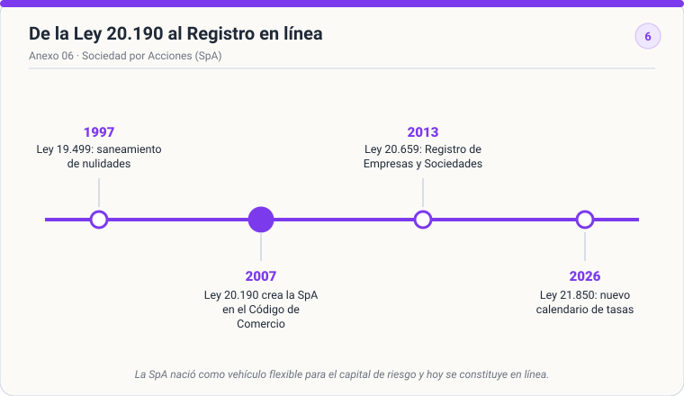
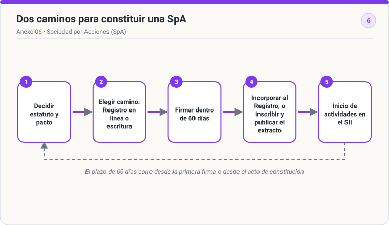
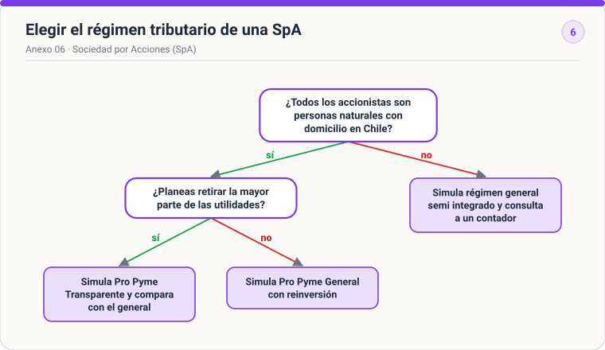
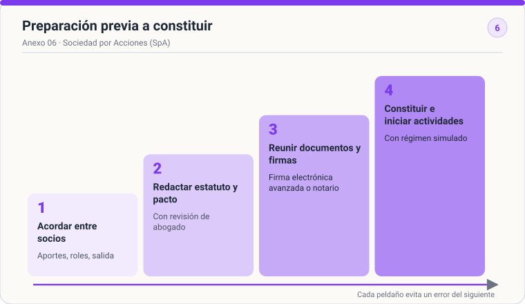

# Anexo 06 · Sociedad por Acciones (SpA)

> **Fecha de consulta de las fuentes:** 2026-11-25. **Naturaleza:** material educativo; no es asesoría
> legal ni tributaria. Las normas cambian: confirma cada dato en la fuente oficial citada al final
> antes de actuar. Este anexo separa tres cosas que suelen mezclarse: **obligación legal** (lo que la
> ley exige), **recomendación profesional** (lo que la práctica aconseja) y **medida voluntaria** (lo
> que tú decides pactar).

## 1. Ficha rápida

| Pregunta | Respuesta |
|---|---|
| ¿Qué es? | Una persona jurídica creada por una o más personas, cuyo capital está representado por acciones y cuyo estatuto puede pactarse con gran libertad (art. 424 del Código de Comercio). |
| ¿Cuántos dueños? | Uno o más. No se disuelve por reunirse todas las acciones en un solo accionista, salvo que el estatuto diga otra cosa (art. 444). |
| ¿Quién responde por las deudas? | La sociedad, con su patrimonio. Los accionistas responden solo hasta el monto de sus aportes (art. 429). |
| ¿Cómo se llama? | El nombre debe terminar con la expresión «SpA» (art. 425 N.º 1). |
| ¿Qué ley la regula? | Párrafo 8 del Título VII del Libro II del Código de Comercio, artículos 424 a 446; supletoriamente, las normas de la sociedad anónima cerrada. |
| ¿Puede constituirse en línea? | Sí, por el Registro de Empresas y Sociedades (Ley 20.659), o por el camino tradicional con escritura pública o instrumento privado autorizado por notario. |
| ¿Para quién suele servir? | Emprendimientos con uno o más socios que quieren flexibilidad: entrada de inversionistas, series de acciones, pactos a medida y crecimiento escalonado. |
| ¿Para quién no? | Para quien quiere la estructura más simple y barata posible sin pactos, o para quien necesita las reglas rígidas y conocidas de una sociedad de personas. |

## 2. Historia y evolución

### 2.1. Un tipo social joven

La SpA es una figura relativamente nueva en el derecho chileno. Fue incorporada al Código de Comercio
por la **Ley 20.190**, promulgada el 17 de mayo de 2007 y publicada en el Diario Oficial el 5 de junio de
2007. El título oficial de esa ley muestra su propósito: «introduce adecuaciones tributarias e
institucionales para el fomento de la industria de capital de riesgo». La idea de fondo era dotar al país
de un vehículo societario flexible, capaz de acomodar a inversionistas que aportan capital a empresas
nuevas, algo que la sociedad anónima, con su estructura rígida de directorio, juntas y quórums, resolvía
con más costo del necesario para una empresa pequeña.

Antes de 2007, quien quería limitar su responsabilidad a lo aportado tenía pocas opciones: la sociedad de
responsabilidad limitada (regida por la Ley 3.918 de 1923), la sociedad anónima (Ley 18.046) y la empresa
individual de responsabilidad limitada (Ley 19.857, de 2003). Cada una tenía una limitación que la hacía
incómoda para un emprendimiento con inversión externa: la sociedad limitada no emite acciones ni
distingue series con facilidad; la sociedad anónima exige directorio y formalidades; la empresa
individual admite un solo dueño.

### 2.2. Del papel al Registro en línea

El segundo hito es la **Ley 20.659**, promulgada el 31 de enero de 2013 y publicada el 8 de febrero de
2013, que simplificó el régimen de constitución, modificación y disolución de las sociedades
comerciales. Su artículo 2 enumera las personas jurídicas que pueden acogerse a ella, y entre ellas
figura expresamente «la sociedad por acciones, establecida en el Párrafo 8 del Título VII del Libro II
del Código de Comercio». Desde entonces, la forma práctica de constituir una SpA dejó de pasar
necesariamente por una notaría y por el Conservador de Bienes Raíces: basta suscribir un formulario
electrónico en el Registro de Empresas y Sociedades, administrado por el Ministerio de Economía.

### 2.3. Reformas posteriores que conviene conocer

- La **Ley 19.499** (1997) establece las normas de saneamiento de vicios de nulidad de sociedades. El
  artículo 428 del Código de Comercio la menciona expresamente para sanear nulidades de la
  constitución y modificación de una SpA.
- La **Ley 21.210** (2020) modernizó la legislación tributaria y reordenó los regímenes de impuesto a la
  renta. Para una SpA, la elección entre régimen general y Pro Pyme es una de las decisiones más
  relevantes después de constituirla.
- La **Ley 21.755** (2025) y la **Ley 21.850** (2026) movieron tasas y beneficios. Los detalles
  vigentes están en la [guía de la Ley 21.850](../docs/20_LEY_21850_RECONSTRUCCION_NACIONAL.md) y en el
  [flujo tributario](../docs/02_SII_TAX_FLOW.md) del programa.

## 3. Marco legal

### 3.1. Las normas que la rigen

| Norma | Qué aporta a la SpA |
|---|---|
| Código de Comercio, arts. 424 a 446 | Régimen propio: definición, constitución, capital, acciones, administración libre, arbitraje, dividendos. |
| Ley 18.046, sobre sociedades anónimas | Se aplica **supletoriamente** y solo en lo que no contradiga la naturaleza de la SpA (art. 424 inciso 2). |
| Ley 20.659 | Régimen simplificado y Registro de Empresas y Sociedades. |
| Ley 19.499 | Saneamiento de nulidades. |
| Decreto Ley 824 (Ley de la Renta) | Régimen tributario de la sociedad y de los accionistas. |
| Decreto Ley 825 (Ley del IVA) | Impuesto a las ventas y servicios. |
| Ley 19.799 | Documentos electrónicos y firma electrónica avanzada, necesaria para firmar en línea. |

### 3.2. La regla central: libertad con límites

El artículo 424 dice que el estatuto establece «los derechos y obligaciones de los accionistas, el
régimen de su administración y los demás pactos que, salvo por lo dispuesto en este Párrafo, podrán ser
establecidos libremente». Esa frase explica por qué la SpA es popular y también por qué es riesgosa
si se copia un estatuto ajeno: **todo lo que no escribes queda regido por las reglas supletorias de la
sociedad anónima cerrada**, que quizá no son las que querías.

Un ejemplo concreto: si el estatuto no dice cómo se reduce el capital, el artículo 440 exige la
**unanimidad** de los accionistas. Ese quórum es razonable entre dos socios de confianza; es un freno
serio cuando hay cinco accionistas con intereses distintos.

### 3.3. Qué es obligación y qué es opción

| Materia | Obligación legal | Opción o recomendación |
|---|---|---|
| Nombre con «SpA» | Obligación (art. 425 N.º 1) | — |
| Objeto, capital, administración, duración | Obligación de declararlos (art. 425) | Redactarlos con amplitud razonable (recomendación) |
| Registro de accionistas | Obligación (art. 431) | Llevarlo desde el día uno, aunque haya un solo accionista (recomendación) |
| Plazo para pagar el capital | Cinco años si el estatuto calla (art. 434) | Fijar un plazo corto y claro (recomendación) |
| Arbitraje | Obligación de resolver diferencias por arbitraje (art. 441) | Elegir el tipo de tribunal y la forma de designación (opción) |
| Pacto de accionistas | No es obligatorio | Muy recomendable desde dos accionistas |
| Series de acciones | No es obligatorio | Útil para inversionistas y empleados (opción) |

## 4. Cómo se constituye

### 4.1. Los dos caminos

**Camino 1: Registro de Empresas y Sociedades (Ley 20.659).** Los constituyentes completan un formulario
electrónico, lo firman con firma electrónica avanzada o ante notario, y el formulario se incorpora al
Registro. Según el artículo 13 de la ley, con la incorporación se entiende informado el Servicio de
Impuestos Internos y se asigna el Rol Único Tributario sin más trámite. El mismo formulario puede
solicitar el inicio de actividades y el timbraje de documentos, según determine el Reglamento.

**Camino 2: vía tradicional.** El artículo 425 exige un acto de constitución escrito, perfeccionado por
escritura pública o por instrumento privado cuyas firmas autorice un notario y que se protocoliza en su
registro. Luego, según el artículo 426, dentro de **sesenta días** desde el acto, un extracto autorizado
por el notario debe inscribirse en el Registro de Comercio del domicilio social y publicarse por una sola
vez en el Diario Oficial. El extracto menciona nombre, accionistas, objeto, capital suscrito y pagado, y
la identificación de la escritura.

### 4.2. Reglas de plazo que no debes olvidar

- En el Registro de Empresas y Sociedades, **todos los socios o accionistas deben firmar dentro de sesenta
  días** contados desde la firma del primero. Si no, el formulario se tiene por no suscrito (art. 10 de la
  Ley 20.659). Una vez firmado por el primero, el formulario no puede modificarse.
- En la vía tradicional, el extracto debe inscribirse y publicarse dentro de **sesenta días** del acto de
  constitución. Cumplir oportunamente produce efectos desde la fecha de la escritura o protocolización.
- Si se omitió algún requisito, rigen los artículos 6 y 6 A de la Ley 18.046 y el saneamiento de la Ley
  19.499 (art. 428).

### 4.3. Contenido mínimo del estatuto

El artículo 425 exige, a lo menos: nombre terminado en SpA; objeto (siempre considerado mercantil);
capital y número de acciones; forma de administración y designación de representantes, con indicación de
quiénes la ejercen provisionalmente; y duración (indefinida si nada se dice).

**Recomendación profesional:** un estatuto útil agrega, además, series de acciones, quórums de las
decisiones importantes, restricciones de transferencia, derecho de preferencia, arrastre (*drag along*) y
acompañamiento (*tag along*), cláusulas de salida, política de dividendos y reglas de reemplazo del
administrador. Esas cláusulas no son obligatorias; son las que evitan conflictos.

### 4.4. Modificar, transformar y disolver

Según el artículo 427, el estatuto se modifica por acuerdo de la junta de accionistas, reducido a acta
protocolizada o escritura pública. No se requiere junta si **todos** los accionistas suscriben la
modificación. En el Registro de Empresas y Sociedades, el artículo 14 de la Ley 20.659 permite modificar,
transformar, fusionar, dividir, terminar y disolver mediante la suscripción del formulario respectivo,
con reglas para cuando se requiere junta y acta.

Una regla particular: el artículo 430 establece que la SpA que, durante **doce meses consecutivos**,
cumpla las condiciones que obligan a una sociedad anónima cerrada a inscribir sus acciones en el Registro
de Valores, **se transforma por el solo ministerio de la ley en sociedad anónima**, y le serán aplicables
las normas de esa ley, que prevalecen sobre el estatuto. Es un punto que debe vigilar una SpA que crece
mucho en número de accionistas o en patrimonio.

## 5. Capital, aportes y propiedad

### 5.1. El capital se fija y se paga

El artículo 434 dispone que el capital se fije «de manera precisa en el estatuto» y se divida en un
número determinado de acciones nominativas. El estatuto puede establecer que las acciones se emitan sin
láminas físicas. Los aumentos de capital los acuerdan los accionistas, aunque el estatuto puede facultar a
la administración para aumentarlo en forma general o limitada para financiar la gestión ordinaria o fines
específicos.

El capital y sus aumentos deben quedar **totalmente suscritos y pagados** en el plazo que fije el
estatuto; si calla, el plazo es de **cinco años** desde la constitución o desde el aumento. Si no se paga
oportunamente, el capital queda reducido al monto efectivamente suscrito y pagado. Salvo disposición
contraria, las acciones no pagadas no gozan de derecho alguno.

**Ejemplo ilustrativo.** Dos socios constituyen una SpA con capital de 10.000.000 de pesos dividido en
10.000 acciones. Cada uno suscribe 5.000. Pagan 2.000.000 cada uno al constituir y el estatuto fija
dieciocho meses para el saldo. Si al mes diecinueve alguno no ha pagado, el capital de la sociedad se
reduce de pleno derecho al monto efectivamente pagado, y las acciones impagas no gozan de derechos. Los
números son ilustrativos.

### 5.2. Tipos de acciones

Las acciones pueden ser **ordinarias o preferidas** (art. 436). El estatuto debe establecer «en forma
precisa» las cargas, obligaciones, privilegios o derechos especiales de cada serie. Cada accionista
dispone de un voto por acción, pero el estatuto puede crear series sin voto, con voto limitado o con más
de un voto por acción, determinando cómo computarlas para los quórums (art. 437).

| Mecanismo | Base legal | Para qué sirve |
|---|---|---|
| Series preferidas | Art. 436 | Dar a inversionistas prioridad en dividendos o liquidación. |
| Voto múltiple o sin voto | Art. 437 | Separar el control económico del control político. |
| Dividendo fijo preferente | Art. 442 | Retorno predecible para una serie, con reglas si las utilidades no alcanzan. |
| Cuentas separadas de utilidades | Art. 443 | Pagar dividendos según el resultado de una unidad de negocio o activo específico. |
| Límites de control accionario | Art. 435 | Impedir que alguien concentre más de cierto porcentaje. |
| Venta forzosa de acciones | Art. 435 inc. 2 | Cláusulas de arrastre o de salida, con efectos regulados. |
| Acciones de propia emisión | Art. 438 | Recomprar acciones, con plazo de venta de un año si el estatuto calla. |

### 5.3. Aumentos y reducciones de capital

La sociedad puede emitir acciones de pago al precio que los accionistas o su delegado determinen
libremente, sin obligación de ofrecerlas primero a los accionistas, salvo que el estatuto establezca
derecho de preferencia (art. 439). Un acuerdo de reducción de capital se adopta por la mayoría que
fije el estatuto; si calla, se necesita **unanimidad** (art. 440), y no puede repartirse ni devolverse
capital hasta que se perfeccione la modificación estatutaria.

### 5.4. Registro de accionistas y transferencias

El artículo 431 obliga a llevar un registro con nombre, domicilio y cédula o RUT de cada accionista,
número de acciones, fecha de inscripción y, para acciones suscritas y no pagadas, la forma de pago.
También se inscriben los gravámenes y derechos reales distintos del dominio. El registro puede llevarse
por cualquier medio que dé seguridad contra intercalaciones o supresiones y esté siempre disponible para
cualquier accionista o administrador. **Los administradores y el gerente general responden
solidariamente** de los perjuicios por la falta de fidelidad o vigencia de la información.

Para las sociedades acogidas a la Ley 20.659, el registro de accionistas se lleva **exclusivamente** en el
Registro (art. 13 bis), con acceso restringido a accionistas, administradores y apoderados facultados.
Toda cesión de acciones o constitución de gravámenes debe inscribirse mediante el formulario
correspondiente.

Al transferir acciones, el artículo 446 exige que conste la declaración del cesionario de que conoce la
normativa del tipo social, el estatuto y las protecciones que existen o no existen. La omisión **no
invalida** el traspaso, pero hace responsable al cedente por los perjuicios.

### 5.5. Diagrama de la estructura de capital

## 6. Administración y gobierno

### 6.1. Libertad de diseño

La SpA no exige directorio. El estatuto define «la forma como se ejercerá la administración de la sociedad
y se designarán sus representantes» (art. 425 N.º 4). Las configuraciones habituales son tres.

| Modelo | Cuándo se usa | Riesgo típico |
|---|---|---|
| Un administrador único (a menudo el fundador) | Un fundador o equipo pequeño | Concentración de poder; falta de control. |
| Administración conjunta o por mandatarios con poderes distintos | Varios fundadores que quieren equilibrio | Bloqueos si no hay regla de desempate. |
| Directorio con gerente general | Inversión externa o más formalidad | Costos y formalidades adicionales. |

### 6.2. Reglas supletorias

En silencio del estatuto y de las reglas de la SpA, rigen **supletoriamente las normas de las
sociedades anónimas cerradas, solo en aquello que no se contraponga con su naturaleza** (art. 424).
Esto significa que si no regulas cómo se cita a junta, quién es el representante legal o cómo se votan
ciertas materias, el derecho aplicable puede ser el de la Ley 18.046. Conviene saber qué dice esa ley
antes de decidir qué se reemplaza.

### 6.3. Comunicaciones, juntas y arbitraje

- **Medios de comunicación:** el estatuto establece los medios entre la sociedad y los accionistas;
  si calla, se usa el correo certificado. Un envío deficiente no afecta la validez de la citación, pero
  la administración responde de los perjuicios (art. 445).
- **Arbitraje obligatorio:** las diferencias entre accionistas, entre ellos y la sociedad o sus
  administradores o liquidadores, y entre la sociedad y sus administradores deben resolverse por
  arbitraje (art. 441). El estatuto debe indicar el tipo de arbitraje, el número de integrantes del
  tribunal y la forma de designar árbitros. Si calla, resuelve un solo árbitro mixto en única instancia, y
  el tribunal de justicia del domicilio social lo designa.

**Recomendación profesional:** redactar la cláusula arbitral eligiendo una institución (por ejemplo, un
centro de arbitraje reconocido) y un plazo máximo evita meses de discusión sobre quién designa al árbitro.

### 6.4. Poderes y representación

Los poderes de los administradores pueden incorporarse al **Registro de Poderes** (art. 13 ter de la
Ley 20.659), que es de acceso público. Según la ley, los poderes incorporados se entienden vigentes
mientras no se incorpore su modificación o revocación, y revisten las solemnidades necesarias para
actos que normalmente exigirían escritura pública, bastando el certificado de la Subsecretaría de
Economía y Empresas de Menor Tamaño. Consecuencia práctica: al revocar un poder, **inscribe la revocación**;
de lo contrario, el poder sigue vigente frente a terceros.

## 7. Responsabilidad

### 7.1. De los accionistas

El artículo 429 es corto y decisivo: los accionistas **solo responden hasta el monto de sus aportes**.
Eso no es una coraza absoluta. La responsabilidad limitada protege el patrimonio personal de las
deudas de la sociedad, pero no protege de lo siguiente:

- las **obligaciones propias** del accionista (por ejemplo, un aval o una fianza personal que firmó);
- los **perjuicios que cause con dolo o culpa** en su actuación como administrador;
- las consecuencias del **levantamiento del velo** en casos de abuso o fraude, que dependen de la
  doctrina y la jurisprudencia y no de una norma general;
- las acciones **no pagadas**, que son una deuda con la sociedad.

**Medida voluntaria frecuente en bancos:** la garantía personal. Una pyme que pide un crédito suele
enfrentar una cláusula de aval personal del fundador. Eso es una decisión contractual, no un efecto de
la ley, y debe evaluarse con cuidado porque deja sin efecto, en la práctica, la limitación de
responsabilidad para esa deuda.

### 7.2. De los administradores

Los administradores responden por el cumplimiento de sus deberes. Dos ejemplos que aparecen en el texto
revisado: la **solidaridad** de administradores y gerente general por la falta de fidelidad del registro
de accionistas (art. 431) y la responsabilidad de la administración por citaciones defectuosas (art.
445). A ello se suman las responsabilidades tributarias, laborales y penales: por ejemplo, la Ley 20.393
establece la responsabilidad penal de las personas jurídicas por ciertos delitos, y es parte del mapa de
cumplimiento del programa.

### 7.3. Responsabilidad tributaria y laboral

La sociedad es el contribuyente y empleador. Sin embargo, la administración y representación tienen
obligaciones personales en casos puntuales de la normativa tributaria y laboral, por lo que conviene
revisar con un contador y un abogado qué deberes tienen quienes firman por la sociedad.

## 8. Tributación

### 8.1. El esquema general

Una SpA es una persona jurídica que **tributa por sí misma** en Primera Categoría, y sus accionistas
tributan después por las utilidades que retiran o reciben como dividendos. Las rutas empresariales
que presenta el SII para la Operación Renta 2026 son Pro Pyme General, Pro Pyme Transparente y Régimen
General semi integrado. La elección depende de los ingresos, de quiénes son los accionistas y de si hay
personas jurídicas entre ellos. La [guía tributaria del programa](../docs/02_SII_TAX_FLOW.md) detalla el flujo.

### 8.2. Qué cambia con las leyes recientes

- La **Ley 21.850** (Diario Oficial, 17 de octubre de 2026) fija la tasa de Primera Categoría en 27 %
  para el año comercial 2026, 25,5 % para 2027, 24 % para 2028 y 23 % desde 2029, sin perjuicio de lo
  que dispone el artículo 25 de la Ley 21.755.
- El artículo 25 de la **Ley 21.755** estableció una disminución transitoria a 12,5 % de la tasa para
  empresas Pro Pyme en los ejercicios 2025, 2026 y 2027, sujeta a condiciones previsionales. **Trátala
  como dato dinámico y verifica antes de cerrar el ejercicio.**
- La Ley 21.850 elimina la restitución del crédito por IDPC desde el 1 de enero de 2027, con
  porcentajes transitorios de 30 % y 20 %.

Todo esto está resumido, con fechas y estados, en la [guía de la Ley 21.850](../docs/20_LEY_21850_RECONSTRUCCION_NACIONAL.md).
Las circulares del SII que desarrollan algunas normas pueden estar pendientes; marca como pendiente
cualquier cálculo que dependa de ellas.

### 8.3. IVA y documentos

Una SpA que vende bienes o presta servicios afectos debe registrarse para IVA, emitir documentos
tributarios electrónicos, llevar contabilidad y declarar mensualmente. Ver el detalle en el Anexo 16
(Servicio de Impuestos Internos) y en el [flujo del SII](../docs/02_SII_TAX_FLOW.md).

### 8.4. Decisión práctica: antes de elegir régimen

Haz una simulación a **cuatro años**, no a uno, porque las tasas cambian por tramos. Considera:

1. cuántos accionistas son personas naturales y cuántas personas jurídicas;
2. si planeas retirar utilidades o reinvertirlas;
3. el nivel de ingresos del primer y segundo año;
4. el efecto del PPM, que es un anticipo mensual;
5. el costo de llevar contabilidad completa frente a una simplificada.

**Ejemplo ilustrativo.** Una SpA con una utilidad anual de 20.000.000 de pesos, si todo se retira, no
tributa igual que si todo se reinvierte. La diferencia depende del régimen, de los créditos y de los
impuestos finales de los accionistas. No existe un resultado único; por eso conviene que el contador
modele ambos escenarios con las cifras de la sociedad.

## 9. Obligaciones laborales, contables y sectoriales

### 9.1. Contabilidad y libros

Toda SpA que declare renta efectiva debe llevar contabilidad ajustada a la normativa del SII. El
régimen Pro Pyme permite contabilidad simplificada bajo condiciones. Los libros y registros típicos son
el de compras y ventas electrónico, el de remuneraciones, el de accionistas y el de actas de juntas.

### 9.2. Laboral

La SpA que contrate trabajadores asume obligaciones de empleador: contrato escrito, cotizaciones, seguro
de accidentes, reglamento interno cuando corresponda, y los controles de la Dirección del Trabajo. Revisa el
[flujo laboral](../docs/08_EMPLOYMENT_FLOW_CHILE.md) y, para un trabajador sin dependencia, la
calificación según los hechos reales y no según el nombre del contrato.

### 9.3. Permisos

El tipo societario no reemplaza permisos sectoriales ni municipales. La patente, las autorizaciones
sanitarias o eléctricas y los registros del sector dependen de la actividad. Ver el Anexo 17
(Municipalidades) y la [matriz de permisos](../docs/06_PERMITS_MATRIX.md).

### 9.4. Datos personales, consumo y prevención del delito

Las normas sobre protección de datos personales, derechos del consumidor y responsabilidad penal de
las personas jurídicas afectan a la SpA como a cualquier empresa. Su aplicación depende del tamaño y
de la actividad; ver [cumplimiento y riesgo](../docs/13_COMPLIANCE_RISK.md).

## 10. Antes de construir: lista de verificación

### 10.1. Decisiones previas (en este orden)

1. ¿Cuántos fundadores y qué aporta cada uno (dinero, trabajo, bienes, propiedad intelectual)?
2. ¿Entrará un inversionista en los próximos veinticuatro meses?
3. ¿Qué pasa si un fundador se va, no cumple o discrepa? (*vesting*, salida, no competencia).
4. ¿Cuánto capital se declara, cuánto se paga hoy y en qué plazo se paga el resto?
5. ¿Qué nombre usará y está disponible? (verifica en el Registro y busca anterioridades en INAPI).
6. ¿Qué objeto social cubre las líneas actuales y las del próximo año?
7. ¿Cuál será el domicilio y qué documento lo respalda?
8. ¿Quién administra, con qué poderes y qué límites de monto o materia?
9. ¿Qué tipo de arbitraje y qué reglas de designación?
10. ¿Qué régimen tributario conviene según una simulación a cuatro años?

### 10.2. Documentos que debes tener listos

| Documento | Para qué |
|---|---|
| Cédulas y RUT de los constituyentes | Identificación y firma |
| Firma electrónica avanzada de cada firmante, o notario | Suscribir el formulario (art. 9 Ley 20.659) |
| Contrato o título del domicilio | Dirección para el RUT |
| Estatuto redactado y revisado | Contenido del formulario |
| Pacto de accionistas (si hay más de uno) | Reglas entre socios |
| Comprobante de aportes | Respaldo del capital pagado |
| Listado de actividades económicas | Inicio de actividades en el SII |

### 10.3. Errores frecuentes

- **Copiar estatutos ajenos** sin entender qué reglas supletorias activan.
- **No fijar plazo de pago del capital** y descubrir tarde que el plazo supletorio es de cinco años.
- **No firmar todos dentro de sesenta días** y perder el formulario.
- **No llevar el registro de accionistas** o llevarlo sin fidelidad: responden administradores y gerente.
- **Dejar un solo administrador con poderes ilimitados** sin controles.
- **No pactar salida de fundadores**, lo que paraliza decisiones cuando hay conflicto.
- **Elegir régimen sin simular** y descubrir después el costo tributario o de caja.
- **Confundir persona jurídica con persona natural**: pagar gastos personales desde la cuenta de la
  sociedad sin registro y sin respaldo.

### 10.4. Línea de tiempo sugerida

## 11. Cuándo conviene y cuándo no

### 11.1. Comparación con las alternativas cercanas

| Criterio | SpA | Sociedad de responsabilidad limitada | Sociedad anónima cerrada | EIRL |
|---|---|---|---|---|
| Número de dueños | Uno o más | Dos o más (con límites legales) | Dos o más | Uno |
| Capital | Acciones | Derechos sociales | Acciones | Aporte del titular |
| Flexibilidad del estatuto | Muy alta | Media | Media | Baja |
| Entrada de inversionistas | Muy fácil | Difícil (modificar escritura) | Fácil | No aplica |
| Órganos obligatorios | Ninguno impuesto por ley | Ninguno fijo | Directorio y juntas | Ninguno |
| Formalidad | Media | Baja | Alta | Baja |
| Transformación posterior | Fácil | Posible | — | A sociedad |

### 11.2. Señales a favor

- Hay inversionistas o los habrá, y necesitarás series de acciones o *vesting*.
- Quieres un pacto de socios a medida y no depender del esquema rígido de una sociedad de personas.
- Un solo fundador quiere limitar su responsabilidad y dejar la puerta abierta a socios futuros.
- El negocio puede escalar y tener empleados con opciones sobre acciones.

### 11.3. Señales en contra

- No hay pacto posible porque los socios no se ponen de acuerdo en lo básico: la flexibilidad, sin
  claridad, es una fuente de conflictos.
- El proyecto es pequeño, familiar y estable, y los socios prefieren reglas conocidas y poco costosas.
- El sector exige una forma societaria específica (por ejemplo, ciertos negocios regulados exigen
  sociedad anónima).
- No habrá quién asuma la disciplina de llevar registros, actas y poderes al día.

### 11.4. Decisión

Si dudas entre SpA y sociedad de responsabilidad limitada, formula tres preguntas: ¿habrá inversión
externa?, ¿necesito series de acciones?, ¿quiero que mis pactos queden en el estatuto? Si la respuesta es
sí a alguna, la SpA suele ser la opción más cómoda.

## 12. Cuándo llamar a un profesional

| Situación | Profesional | Por qué |
|---|---|---|
| Redactar el estatuto y el pacto de accionistas | Abogado societario | Cada cláusula activa o desactiva reglas supletorias |
| Entrada de un inversionista, valoración y series | Abogado y contador | Términos de inversión y efectos tributarios |
| Elegir régimen, simular impuestos y provisionar | Contador | Tasas cambian y hay créditos |
| Conflicto entre accionistas | Abogado litigante o árbitro | Cláusula arbitral obligatoria |
| Transformación o fusión | Abogado | Formularios, juntas y plazos |
| Sectores regulados | Abogado del sector | Requisitos específicos |

Consulta la [guía de cuándo llamar a un profesional](../docs/18_WHEN_TO_CALL_A_PROFESSIONAL.md) del programa.

## 13. Preguntas frecuentes

**1. ¿Puedo constituir una SpA yo solo?**
Sí. El artículo 424 permite que la sociedad sea creada por una o más personas, y el artículo 444 aclara
que no se disuelve por reunirse todas las acciones en un solo accionista, salvo estatuto en contrario.

**2. ¿Tengo que pagar todo el capital al constituir?**
No necesariamente. El capital debe quedar suscrito y pagado en el plazo que fije el estatuto; si calla,
cinco años (art. 434). Pero si no se paga a tiempo, el capital se reduce al monto efectivamente pagado.

**3. ¿Es obligatorio tener directorio?**
No. La ley deja la forma de administración al estatuto. Si hay inversionistas, un directorio suele ser
parte del pacto, pero es una decisión contractual.

**4. ¿Mis bienes personales quedan protegidos?**
En general, los accionistas responden solo hasta el monto de sus aportes (art. 429). No quedan
protegidos frente a avales o fianzas personales que firmes, ni frente a perjuicios que causes con dolo o
culpa como administrador.

**5. ¿Cuánto cuesta constituir una SpA?**
Por el Registro de Empresas y Sociedades el uso del sitio es gratuito según la Ley 20.659 (el Registro es
«público, gratuito»). Pueden existir costos de notaría si alguien firma ante notario, y costos de
asesoría. Verifica las tarifas vigentes en las fuentes oficiales; no las doy aquí porque cambian.

**6. ¿Cuánto demora?**
Depende de que todos firmen. El plazo legal máximo para que todos suscriban es de sesenta días desde la
primera firma (art. 10 Ley 20.659). Con firmas electrónicas avanzadas listas, el trámite puede ser
rápido; no prometas fechas sin confirmar el estado del sistema.

**7. ¿Puedo cambiar el estatuto después?**
Sí. Se modifica por acuerdo de junta o, si todos los accionistas lo suscriben, sin junta (art. 427).
En el Registro se hace con el formulario de modificación (art. 14 Ley 20.659).

**8. ¿Puedo tener acciones con distinto poder de voto?**
Sí. El estatuto puede crear series sin voto, con voto limitado o con más de un voto por acción (art. 437),
y debe definir cómo computarlas en los quórums.

**9. ¿Qué pasa si un socio quiere vender sus acciones?**
Se puede transferir, salvo restricciones del estatuto. En el Registro hay formularios para inscribir la
cesión (art. 13 bis). El cesionario debe declarar que conoce la normativa y el estatuto (art. 446). Un
derecho de preferencia pactado en el estatuto es una buena práctica.

**10. ¿Qué es el arbitraje obligatorio?**
Las diferencias entre accionistas, con la sociedad o sus administradores deben resolverse por
arbitraje (art. 441). El estatuto debe indicar tipo, número de árbitros y forma de designación.

**11. ¿Se puede pagar un dividendo fijo a ciertos accionistas?**
Sí, a una serie específica, con prioridad sobre los demás (art. 442). Si las utilidades no alcanzan, el
accionista puede acumular el saldo en una cuenta de patrimonio o ejercer derecho a retiro.

**12. ¿Una SpA puede convertirse en sociedad anónima?**
Sí, por transformación voluntaria y, además, **por ley** si durante doce meses consecutivos cumple las
condiciones que obligan a una sociedad anónima cerrada a inscribirse en el Registro de Valores (art. 430).

**13. ¿Debo llevar un libro de accionistas?**
Sí. El artículo 431 exige un registro con nombre, domicilio, RUT, número de acciones y gravámenes.
Si te acoges al Registro de Empresas y Sociedades, se lleva allí (art. 13 bis Ley 20.659).

**14. ¿Qué pasa si el nombre es igual al de otra sociedad?**
La sociedad existente puede demandar la modificación del nombre en juicio sumario (art. 432). Verifica
antes de constituir y busca marcas en INAPI.

**15. ¿La SpA paga el mismo impuesto que una persona natural?**
No. La SpA tributa en Primera Categoría; los accionistas tributan por los retiros o dividendos. La tasa
y los créditos dependen del régimen y de las leyes vigentes (ver sección 8).

**16. ¿Puedo ser accionista y empleado a la vez?**
Sí, pero la relación laboral se califica por los hechos: subordinación y dependencia, jornada, pago. El
contrato debe reflejar la realidad.

**17. ¿Qué pasa si hay un conflicto grave entre socios?**
Si el estatuto o el pacto no lo previeron, el desbloqueo depende de la ley y del arbitraje obligatorio,
con costos y demora. Prevé desempate, salida y valoración en el pacto.

**18. ¿Puedo emitir acciones sin láminas físicas?**
Sí. El estatuto puede establecer que las acciones se emitan sin imprimir láminas (art. 434).

**19. ¿Una SpA puede tener otra sociedad como accionista?**
La ley no lo prohíbe. Los efectos tributarios y de control cambian según el régimen y deben revisarse.

**20. ¿Dónde veo qué sociedades existen?**
En el Registro de Empresas y Sociedades, que es público y gratuito (art. 11 Ley 20.659).

## 14. Fuentes y vigencia

| Fuente | Qué se usó | Dónde consultarla |
|---|---|---|
| Código de Comercio, arts. 424 a 446 | Régimen de la SpA | [Biblioteca del Congreso Nacional (BCN)](https://www.bcn.cl/leychile/navegar?idNorma=1974) |
| Ley 20.659 | Registro de Empresas y Sociedades; arts. 1 a 14 | [BCN, Ley 20.659](https://www.bcn.cl/leychile/navegar?idNorma=1048718) |
| Ley 20.190 | Origen de la SpA en 2007 | [BCN, Ley 20.190](https://www.bcn.cl/leychile/navegar?idNorma=261427) |
| Ley 19.499 | Saneamiento de nulidades | [BCN, Ley 19.499](https://www.bcn.cl/leychile/navegar?idNorma=70549) |
| Ley 18.046, sobre sociedades anónimas | Supletoriedad | [BCN, Ley 18.046](https://www.bcn.cl/leychile/navegar?idNorma=29473) |
| Registro de Empresas y Sociedades | Trámite en línea | [Sitio oficial](https://www.registrodeempresasysociedades.cl) |
| ChileAtiende, ficha «Tu empresa» | Formas societarias y trámite | [ChileAtiende](https://www.chileatiende.gob.cl/fichas/21409-tu-empresa) |
| SII, regímenes tributarios | Rutas de Operación Renta | [SII](https://www.sii.cl/destacados/renta/2026/intermediarios/regimenes_tributarios/) |
| Ley 21.850 y Ley 21.755 | Tasas y créditos recientes | Ver [guía del programa](../docs/20_LEY_21850_RECONSTRUCCION_NACIONAL.md) |

**Vigencia.** Los artículos del Código de Comercio y de la Ley 20.659 se leyeron en el texto publicado por
la Biblioteca del Congreso Nacional el 2026-11-25. Las tasas y los créditos tributarios cambian por ley y
circular; se citan como referencia del programa y deben verificarse en el SII antes de aplicarse.

**Límites.** Este anexo no reproduce el texto completo de las leyes, no sustituye un estatuto redactado
por un abogado y no incluye tarifas ni plazos de trámite que dependen del sistema o de terceros. Los
ejemplos numéricos son ilustrativos.
