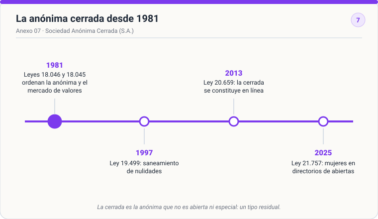
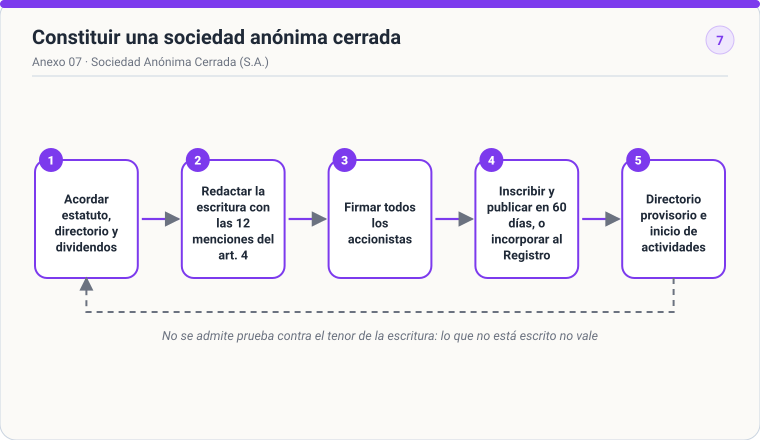
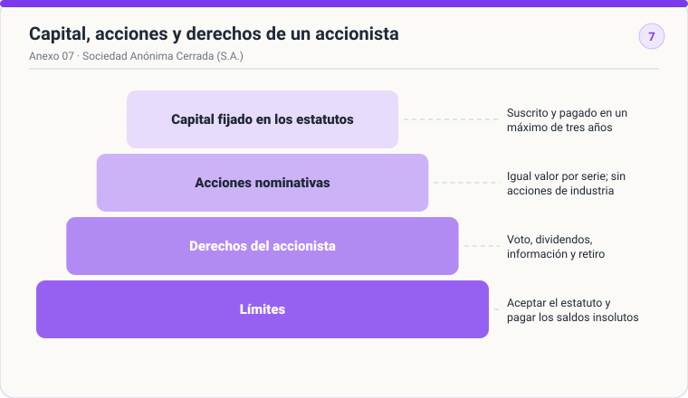
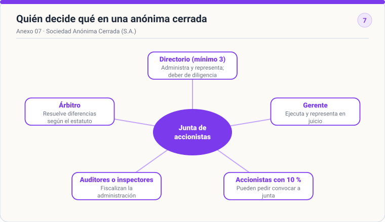
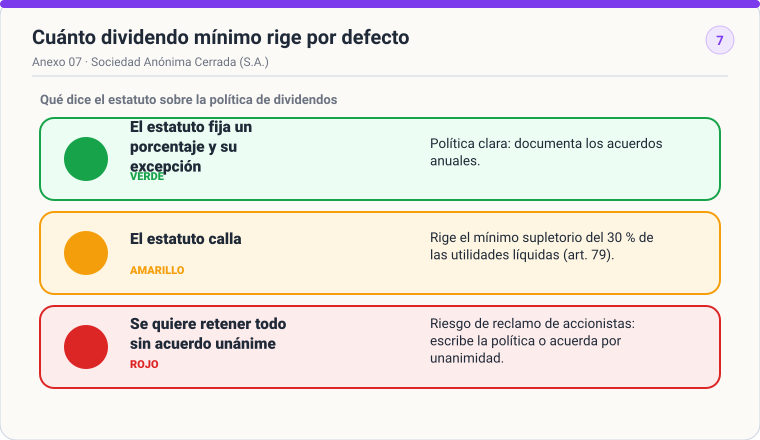

# Anexo 07 · Sociedad Anónima Cerrada (S.A.)

> **Fecha de consulta de las fuentes:** 2026-11-25. **Naturaleza:** material educativo; no es asesoría
> legal ni tributaria. Las normas cambian: confirma cada dato en la fuente oficial citada al final
> antes de actuar. Este anexo separa **obligación legal**, **recomendación profesional** y **medida
> voluntaria**.

## 1. Ficha rápida

| Pregunta | Respuesta |
|---|---|
| ¿Qué es? | Una persona jurídica formada por la reunión de un fondo común, suministrado por accionistas responsables solo por sus aportes y administrada por un directorio de miembros esencialmente revocables (art. 1 de la Ley 18.046). |
| ¿Qué la hace «cerrada»? | Es la sociedad anónima que **no califica como abierta ni como especial** (art. 2): no inscribe sus acciones en el Registro de Valores ni está sometida a normas especiales. |
| ¿Es civil o comercial? | Siempre mercantil, aunque se forme para negocios civiles (art. 1). |
| ¿Quién responde por las deudas? | La sociedad. Los accionistas, solo por sus aportes (art. 1). |
| ¿Cómo se llama? | Debe incluir «Sociedad Anónima» o «S.A.» (art. 8). |
| ¿Quién administra? | Un directorio de **al menos tres** directores, elegido por la junta, con gerente designado por el directorio (arts. 31 y 49). |
| ¿Se puede constituir en línea? | Sí. La Ley 20.659 incluye la sociedad anónima cerrada (art. 2 N.º 3). |
| ¿Para quién suele servir? | Empresas medianas o familiares con gobierno institucional, varios accionistas y necesidad de reglas de directorio y juntas. |
| ¿Para quién no? | Un fundador solo o un proyecto pequeño sin estructura de gobierno: la SpA ofrece más flexibilidad con menos formalidad. |

## 2. Historia y evolución

### 2.1. La ley de 1981

La **Ley 18.046** sobre sociedades anónimas fue promulgada el 21 de octubre de 1981 y publicada el 22 de
octubre de 1981. Se promulgó el mismo día que la **Ley 18.045**, de mercado de valores: ambas formaron
un paquete que ordenó el régimen de las sociedades anónimas y de la oferta pública de valores. Desde
entonces, la Ley 18.046 es el cuerpo legal central de la sociedad anónima chilena.

Esa ley distingue tres clases de sociedades anónimas: **abiertas, especiales y cerradas** (art. 2). Las
cerradas son las que no entran en las otras dos. Por eso la «cerrada» es un tipo residual: si no inscribes
tus acciones en el Registro de Valores y no estás en uno de los sectores regulados, eres cerrada.

### 2.2. Reformas relevantes

- La **Ley 19.499** (1997) reguló el saneamiento de vicios de nulidad de sociedades; la Ley 18.046
  contiene reglas propias en sus artículos 6 y 6 A.
- La **Ley 20.659** (2013) incluyó la sociedad anónima cerrada entre las personas jurídicas que pueden
  constituirse y modificarse en línea. No incluye a las abiertas ni a las especiales.
- La **Ley 21.757** (promulgada el 11 de agosto de 2025 y publicada el 19 de agosto de 2025) estableció un
  mecanismo para aumentar la participación de mujeres en directorios; su efecto principal recae en las
  sociedades abiertas y especiales fiscalizadas por la CMF (ver Anexo 08).

### 2.3. La relación con la SpA

La Ley 20.190 de 2007 creó la **SpA** y estableció que, en silencio del estatuto, se rige por las normas
de la sociedad anónima cerrada, en lo que no se contraponga con su naturaleza (art. 424 del Código de
Comercio). La anónima cerrada es, entonces, el **derecho supletorio de la SpA**. Estudiar sus reglas
ayuda a entender qué ocurre cuando una SpA no regula algo.

## 3. Marco legal

### 3.1. Las normas que la rigen

| Norma | Qué aporta |
|---|---|
| Ley 18.046 (sociedades anónimas) | Régimen completo: constitución, capital, acciones, directorio, juntas, dividendos, disolución |
| Reglamento de sociedades anónimas | Detalle operativo (citaciones, traspasos, registros); verifica su texto vigente |
| Ley 18.045 (mercado de valores) | Define cuándo una sociedad debe inscribir sus acciones y deja de ser cerrada |
| Ley 20.659 | Constitución y modificación en línea |
| Ley 19.499 | Saneamiento de nulidades |
| Decretos Leyes 824 y 825 | Impuesto a la renta e IVA |
| Ley 20.393 | Responsabilidad penal de las personas jurídicas |

### 3.2. Obligación, recomendación, opción

| Materia | Tipo | Detalle |
|---|---|---|
| Escritura pública inscrita y publicada | Obligación | Art. 3 |
| Contenido de la escritura (doce materias) | Obligación | Art. 4 |
| Inscripción y publicación en 60 días | Obligación | Art. 5 |
| Nombre con «S.A.» o «Sociedad Anónima» | Obligación | Art. 8 |
| Directorio de mínimo tres miembros | Obligación | Art. 31 |
| Junta ordinaria anual | Obligación | Art. 55 |
| Balance anual y memoria | Obligación | Art. 74 |
| Pacto de accionistas adicional | Recomendación profesional | Los estatutos no recogen todo |
| Directores suplentes | Opción del estatuto | Art. 32 |
| Remuneración de directores | Decisión del estatuto y la junta | Art. 33 |

## 4. Cómo se constituye

### 4.1. Contenido de la escritura

El artículo 4 exige que la escritura exprese:

1. nombre, profesión u oficio, domicilio y RUT de los accionistas que concurran;
2. nombre y domicilio de la sociedad;
3. el o los objetos específicos;
4. la duración, que es indefinida si nada se dice;
5. el capital, el número de acciones con series y preferencias, si tienen o no valor nominal, la forma y
   plazos de pago y la valoración de todo aporte que no sea dinero;
6. la organización de la administración y su fiscalización por los accionistas;
7. la fecha de cierre del ejercicio y la época de la junta ordinaria (si nada se dice: 31 de diciembre y
   primer cuatrimestre);
8. la forma de distribución de las utilidades;
9. la forma de liquidación;
10. la naturaleza del arbitraje (si nada se dice, un árbitro arbitrador);
11. los integrantes del directorio provisorio;
12. los demás pactos.

El artículo 3 agrega una regla decisiva: **no se admite prueba contra el tenor de las escrituras ni para
justificar pactos no expresados en ellas**. Lo que no está en el estatuto no vale frente a la sociedad.

### 4.2. Dos caminos

**Camino 1: escritura pública, extracto, inscripción y publicación.** Un extracto autorizado por el
notario se inscribe en el Registro de Comercio del domicilio y se publica una vez en el Diario Oficial
**dentro de sesenta días** desde la fecha de la escritura (art. 5). El cumplimiento oportuno produce
efectos retroactivos a la fecha de la escritura (art. 3). El extracto contiene, entre otros, los
accionistas, el nombre, objeto, domicilio y duración, el capital y las series, y el capital suscrito y
pagado con el plazo para enterarlo.

**Camino 2: Registro de Empresas y Sociedades (Ley 20.659).** Los accionistas completan y firman un
formulario con firma electrónica avanzada o ante notario; al firmar todos, el formulario se incorpora, el
SII se entiende informado y asigna el RUT. El plazo máximo para que todos suscriban es de sesenta días
desde la primera firma. El Registro de Accionistas se lleva exclusivamente en el Registro (art. 13 bis).

### 4.3. Nulidades y saneamiento

La sociedad anónima que no se constituye por escritura pública, o cuya escritura omite alguna mención de
los números 1, 2, 3, 4, 5 y 6 del artículo 4, se rige por los artículos 6 y 6 A. La sociedad que no consta
de escritura pública, ni de instrumento reducido a escritura o protocolizado, es **nula de pleno derecho
y no puede sanearse** (art. 6 A). La omisión de domicilio se suple con el lugar de otorgamiento (art. 5 A).
Los vicios formales se sanean según la Ley 19.499.

### 4.4. Modificaciones

Las actas de las juntas en que se acuerde modificar los estatutos o disolver la sociedad se reducen a
escritura pública con las mismas solemnidades (art. 3). La reforma de estatutos requiere junta
extraordinaria y la mayoría que fijen los estatutos, que en las cerradas **no puede ser inferior a la
mayoría absoluta de las acciones emitidas con derecho a voto** (art. 67 inc. 1).

## 5. Capital, aportes y propiedad

### 5.1. Capital y acciones

El capital se fija de manera precisa en los estatutos y solo puede aumentarse o disminuirse por reforma
estatutaria (art. 10). Está dividido en acciones de igual valor; en cada serie, las acciones tienen igual
valor (art. 11). Las acciones son **nominativas** (art. 12). **Se prohíbe crear acciones de industria y de
organización** (art. 13): el trabajo no es un aporte de capital en una sociedad anónima.

### 5.2. Plazo para pagar

El capital inicial debe quedar totalmente suscrito y pagado **en un plazo no superior a tres años**. Si no
ocurre, el capital se reduce al monto efectivamente suscrito y pagado (art. 11). Compara con la SpA, donde
el plazo supletorio es de cinco años.

### 5.3. Aportes en bienes

Las acciones pueden pagarse en dinero o en otros bienes; en silencio de los estatutos, en dinero efectivo
(art. 15). Los directores y el gerente que acepten una forma de pago distinta de la acordada responden
solidariamente del valor de colocación. Salvo acuerdo unánime de las acciones emitidas, los aportes no
consistentes en dinero deben ser **estimados por peritos**, y en los aumentos de capital la junta debe
aprobar aportes y estimaciones (art. 15).

### 5.4. Saldos impagos y mora

Los saldos insolutos se reajustan según la variación de la unidad de fomento (art. 16). Las acciones
parcialmente pagadas gozan de iguales derechos que las íntegramente pagadas, salvo en la participación en
beneficios y devoluciones de capital en proporción a lo pagado. Si un accionista no paga oportunamente, la
sociedad puede **vender en una Bolsa de Valores** las acciones necesarias para cobrarse, por cuenta y riesgo
del moroso (art. 17).

**Ejemplo ilustrativo.** Una sociedad con capital de 40.000.000 de pesos en 4.000 acciones fija un plazo de
dos años para pagar. Un accionista suscribió 1.000 acciones y pagó el 40 %. Su saldo se reajusta por UF;
si no paga al vencimiento, la sociedad puede vender parte de sus acciones para cobrarse. Los números son
ilustrativos.

### 5.5. Transferencia de acciones

La sociedad **no se pronuncia** sobre la transferencia de acciones y está obligada a inscribir sin más
trámite los traspasos que se le presenten y cumplan las formalidades mínimas del Reglamento (art. 12). Para
las sociedades cerradas, los estatutos pueden incluir limitaciones, y los accionistas pueden pactar
derechos de preferencia o restricciones. En cambio, la prohibición de limitar la libre disposición del art.
14 se refiere a las **abiertas**. Adquirir acciones implica aceptar los estatutos y los acuerdos de las
juntas (art. 22).

### 5.6. Acciones de propia emisión

La adquisición de acciones de propia emisión por sociedades cuyas acciones tienen transacción bursátil
tiene reglas especiales (arts. 27 A a 27 D). Para una cerrada, ese régimen no es el habitual. Cualquier
recompra debe revisarse con un abogado.

### 5.7. Derecho a retiro

Si la junta aprueba ciertas materias, el accionista disidente puede retirarse de la sociedad previo pago de
sus acciones: transformación, fusión, enajenaciones del art. 67 N.º 9, cauciones del art. 67 N.º 11,
creación o modificación de preferencias, saneamiento de ciertas nulidades y los casos que fijen la ley o los
estatutos (art. 69). **En las cerradas, el precio es el valor de libros de la acción** (art. 69). El plazo
para ejercer el derecho es de **treinta días** desde la fecha de la junta (art. 70), y el pago se hace
dentro de sesenta días desde la junta, con reajuste si se retrasa (art. 71).

## 6. Administración y gobierno

### 6.1. Los tres órganos

| Órgano | Quién lo integra | Qué hace | Artículo |
|---|---|---|---|
| Junta de accionistas | Todos los accionistas inscritos | Decide las materias que la ley y el estatuto le reservan | 55 a 62 |
| Directorio | Mínimo tres directores | Administra, representa judicial y extrajudicialmente | 31 y 40 |
| Gerente | Designado por el directorio | Ejecuta, representa judicialmente y tiene voz en el directorio | 49 |

### 6.2. El directorio

- El estatuto fija un **número invariable** de directores; el período no puede exceder de **tres años** y
  se renueva totalmente; pueden ser reelegidos indefinidamente (art. 31). Si el estatuto calla, el
  directorio se renueva cada año.
- Una cerrada no puede tener **menos de tres** directores (art. 31).
- Pueden existir **directores suplentes**, en igual número que los titulares (art. 32).
- El estatuto determina si los directores son remunerados; la cuantía la fija anualmente la junta ordinaria
  (art. 33).
- Las funciones de director **no son delegables** y se ejercen colectivamente, en sala legalmente
  constituida; cada director tiene derecho a ser informado plena y documentadamente (art. 39).
- El directorio representa a la sociedad judicial y extrajudicialmente y está investido de **todas las
  facultades de administración y disposición** que la ley o el estatuto no reserven a la junta, sin
  necesidad de poder especial (art. 40).
- Sesiona con mayoría absoluta de los directores y acuerda por mayoría absoluta de los asistentes con
  derecho a voto; en caso de empate decide, salvo estatuto en contrario, el voto del presidente (art. 47).

### 6.3. Deber de diligencia

Los directores deben emplear el cuidado y diligencia que los hombres emplean ordinariamente en sus propios
negocios y responden **solidariamente** de los perjuicios causados a la sociedad y a los accionistas por sus
actuaciones dolosas o culpables (art. 41). **Es nula** toda estipulación del estatuto o acuerdo de junta que
tienda a liberar o limitar esa responsabilidad. Aprobar la memoria y el balance no libera de responsabilidad.

### 6.3 bis. Operaciones con interés de directores

Una cerrada solo puede celebrar actos o contratos que involucren **montos relevantes** en los que uno o
más directores tengan interés, por sí o como representantes de otra persona, cuando sean conocidos y
aprobados previamente por el directorio y se ajusten a condiciones de equidad similares a las del mercado,
salvo que los estatutos autoricen otra cosa (art. 44). El director con interés se abstiene y debe quedar
constancia en el acta. Es una de las reglas más relevantes en empresas familiares.

### 6.4. El gerente

Las sociedades anónimas tienen uno o más gerentes designados por el directorio, que fija sus atribuciones y
puede sustituirlos a su arbitrio (art. 49). El gerente representa a la sociedad en juicio con las facultades
del art. 7 del Código de Procedimiento Civil y **responde con los directores de los acuerdos perjudiciales**
cuando no consta su opinión contraria en el acta. Se aplican a gerentes y ejecutivos principales las normas
de responsabilidad de los directores en lo que sean compatibles (art. 50).

### 6.5. Las juntas

- **Ordinarias:** una vez al año, en la época fija que determinen los estatutos, para decidir las materias
  propias sin necesidad de señalarlas en la citación (art. 55). Son materias de junta ordinaria: examen de la
  situación de la sociedad y aprobación de memoria y balance; distribución de utilidades y dividendos;
  elección o revocación de directores y fiscalizadores; y cualquier asunto de interés social que no sea de
  junta extraordinaria (art. 56).
- **Extraordinarias:** cuando lo exijan las necesidades sociales, solo sobre materias señaladas en la
  citación. Son materias de junta extraordinaria la disolución, la transformación, fusión o división y la
  reforma de estatutos, la emisión de bonos convertibles, la enajenación del activo en los términos del art.
  67 N.º 9 y el otorgamiento de garantías por obligaciones de terceros (art. 57).
- **Convocatoria:** la hace el directorio. Debe convocar a junta ordinaria dentro del cuatrimestre siguiente
  al balance y a junta cuando lo soliciten accionistas que representen **al menos el 10 %** de las acciones con
  derecho a voto (art. 58).
- **Citación:** aviso destacado publicado al menos tres veces en días distintos con anticipación mínima de
  diez días (art. 59), según las condiciones del Reglamento.
- **Quórum:** en primera citación, mayoría absoluta de las acciones con derecho a voto; en segunda,
  las presentes o representadas, cualquiera sea su número (art. 61). Solo participan los inscritos en el
  Registro de Accionistas; **en las cerradas, todos los que figuren al iniciarse la junta** (art. 62).
- **Mayorías especiales:** requieren **dos tercios** de las acciones con derecho a voto la transformación,
  división o fusión, el cambio de plazo de duración, la disolución anticipada, el cambio de domicilio, la
  disminución de capital, la aprobación de aportes no dinerarios, la reducción del directorio, la
  enajenación del 50 % o más del activo, cauciones por terceros sobre el 50 % del activo y otras materias
  (art. 67).
- **Actas:** se llevan en un libro, firmadas por presidente y secretario y por tres accionistas elegidos o
  por todos los asistentes si son menos de tres (art. 72).

## 7. Responsabilidad

### 7.1. Accionistas

Los accionistas responden solo por sus aportes (art. 1). Eso significa que lo que arriesgan es el valor de
las acciones suscritas y, si no las pagaron, el saldo impago (art. 16). La protección no cubre avales ni
fianzas personales.

### 7.2. Directores y gerentes

| Conducta | Responsabilidad | Artículo |
|---|---|---|
| Actuaciones dolosas o culpables | Solidaria por perjuicios a la sociedad y a accionistas | 41 |
| Aceptar una forma de pago de acciones no autorizada | Solidaria por el valor de colocación | 15 |
| Acuerdos perjudiciales sin constar oposición | Gerente responde con los directores | 49 |
| Pérdida patrimonial por infracción de la ley o de los estatutos | Reparación de la pérdida irrogada | 133 bis |
| Falta de fidelidad del registro de accionistas | Según las normas del tipo social | 13 bis Ley 20.659 |

### 7.3. Penal, tributaria y laboral

La Ley 20.393 establece la responsabilidad penal de la persona jurídica por ciertos delitos, con requisitos
de prevención. Ver el [mapa de cumplimiento](../docs/13_COMPLIANCE_RISK.md). Las obligaciones tributarias y
laborales siguen las normas generales.

### 7.4. Disolución

La sociedad se disuelve por vencimiento del plazo, por reunirse por **más de diez días ininterrumpidos**
todas las acciones en manos de una sola persona, por acuerdo de junta extraordinaria, por revocación de la
autorización (en las especiales), por sentencia judicial ejecutoriada en las cerradas y por las causales de
los estatutos (art. 103). **Diferencia con la SpA:** en la anónima, reunir todas las acciones en una sola
persona por más de diez días disuelve la sociedad; en la SpA no, salvo estatuto.

### 7.5. Arbitraje

Los estatutos establecen cómo se designan los árbitros, sin poder nombrar personas determinadas (art. 125).
El demandante puede preferir la justicia ordinaria, derecho que no pueden ejercer directores, gerentes,
administradores y ejecutivos principales.

## 8. Tributación

### 8.1. Cómo tributa

La sociedad anónima es una persona jurídica contribuyente de Primera Categoría. Sus accionistas tributan por
los dividendos o retiros según el régimen. Las rutas del SII para la Operación Renta 2026 son Pro Pyme
General, Pro Pyme Transparente y Régimen General semi integrado. Ver el
[flujo tributario](../docs/02_SII_TAX_FLOW.md).

### 8.2. Dividendos

Los dividendos se pagan exclusivamente de las utilidades líquidas del ejercicio o de las retenidas
provenientes de balances aprobados por junta; si hay pérdidas acumuladas, las utilidades se destinan
primero a absorberlas (art. 78). **En las cerradas, la distribución mínima la fijan los estatutos y, si
nada dicen, se aplica el mínimo del 30 % de las utilidades líquidas** de cada ejercicio que rige para las
abiertas, salvo acuerdo unánime distinto (art. 79). El pago de los dividendos mínimos es exigible a los
treinta días de la junta (art. 81) y, salvo acuerdo unánime, se paga en dinero (art. 82). Una copia
certificada del acta es **título ejecutivo** contra la sociedad (art. 83).

### 8.3. Tasas

La **Ley 21.850** fija la tasa de Primera Categoría en 27 % para 2026, 25,5 % para 2027, 24 % para 2028 y
23 % desde 2029, sin perjuicio del art. 25 de la Ley 21.755. **Verifica en el SII.** Ver la
[guía de la Ley 21.850](../docs/20_LEY_21850_RECONSTRUCCION_NACIONAL.md).

### 8.4. Decisión práctica

Un mínimo de dividendos del 30 % por defecto puede sorprender a quien pensaba reinvertir todo. **Escribe
la política de dividendos en el estatuto** o logra un acuerdo unánime distinto cada año.

**Ejemplo ilustrativo.** Una sociedad anónima cerrada obtiene una utilidad líquida de 50.000.000 de pesos y
sus estatutos no regulan dividendos. Por el art. 79, debe distribuir al menos 15.000.000 como dividendo en
dinero, salvo acuerdo unánime distinto. Si los accionistas querían reinvertir la totalidad, deben
documentarlo. Cifras ilustrativas.

## 9. Obligaciones laborales, contables y sectoriales

### 9.1. Contabilidad y documentos

Las sociedades anónimas confeccionan anualmente su balance general al 31 de diciembre o a la fecha que
fijen los estatutos, y el directorio presenta a la junta ordinaria una memoria razonada, el balance, el
estado de ganancias y pérdidas y el informe de auditores externos o inspectores de cuentas, en su caso
(art. 74). Los antecedentes están a disposición de los accionistas durante los quince días anteriores a la
junta (art. 54).

### 9.2. Libros y registros

Lleva el registro de accionistas, el libro de actas de juntas y de directorio, y los libros contables y
tributarios.

### 9.3. Laboral y permisos

Ver el [flujo laboral](../docs/08_EMPLOYMENT_FLOW_CHILE.md), el Anexo 17 (Municipalidades) y la
[matriz de permisos](../docs/06_PERMITS_MATRIX.md).

### 9.4. Datos, consumo y cumplimiento

Ver [cumplimiento y riesgo](../docs/13_COMPLIANCE_RISK.md).

## 10. Antes de construir: lista de verificación

### 10.1. Decisiones previas

1. ¿Por qué una anónima y no una SpA o una limitada? Escribe la razón.
2. ¿Cuántos directores y quiénes? ¿Habrá suplentes y remuneración?
3. ¿Qué capital y en qué plazo (máximo tres años)?
4. ¿Qué series de acciones y qué preferencias?
5. ¿Qué materias reservarás a la junta y qué quórums fijarás sobre los mínimos?
6. ¿Qué política de dividendos incluirás en el estatuto?
7. ¿Cómo manejarás operaciones con directores (art. 44)?
8. ¿Qué cláusulas de transferencia y preferencia pactarás?
9. ¿Cómo se designan los árbitros?
10. ¿Qué régimen tributario conviene, simulando cuatro años?

### 10.2. Documentos

| Documento | Para qué |
|---|---|
| Identificación y RUT de los accionistas | Escritura o formulario |
| Estatuto con las doce materias del art. 4 | Constitución |
| Firma electrónica avanzada o notario | Suscripción |
| Respaldo de aportes y peritaje si hay bienes | Capital |
| Acta de directorio provisorio | Primera administración |
| Pacto de accionistas | Reglas complementarias |

### 10.3. Errores frecuentes

- **No fijar política de dividendos:** rige el mínimo supletorio.
- **No fijar plazo de pago del capital:** el máximo legal es de tres años.
- **Olvidar «S.A.» en el nombre.**
- **Directorio de menos de tres directores.**
- **No llevar actas o hacerlo sin las firmas de ley.**
- **Operaciones con directores sin aprobación previa y constancia en el acta.**
- **Aportes en bienes sin peritaje o sin acuerdo unánime.**
- **No citar a junta ordinaria dentro del cuatrimestre.**
- **Reunir todas las acciones en una persona por más de diez días sin transformar:** disolución.

### 10.4. Caso ilustrado: una sociedad familiar de ferretería

**Caso ilustrativo.** La familia Soto decide convertir su ferretería en una sociedad anónima cerrada con tres
hermanos como accionistas y un gerente externo. Los números son ilustrativos.

1. **Motivo.** Quieren un gobierno institucional y reglas claras de sucesión, no depender de acuerdos
   informales.
2. **Capital.** 90.000.000 de pesos en 9.000 acciones. Pagan un tercio al constituir y el resto en dos
   años, dentro del máximo de tres.
3. **Directorio.** Tres directores titulares con suplentes, período de dos años. Los directores no son
   remunerados, salvo que la junta decida otra cosa.
4. **Dividendos.** El estatuto fija un mínimo de 20 % de las utilidades líquidas, con un acuerdo unánime
   para modificarlo.
5. **Interés de directores.** Uno de los hermanos arrienda el local a la sociedad. Aplican el art. 44:
   el contrato se aprueba previamente por el directorio, con abstención del hermano y a precio de mercado
   respaldado por una tasación, dejando constancia en el acta.
6. **Transferencias.** Pactan derecho de preferencia entre hermanos y valoración por un tasador
   independiente.
7. **Gerente.** Designan un gerente con atribuciones por monto y reportes trimestrales.
8. **Constitución.** Usan el Registro de Empresas y Sociedades.

**Qué aprendemos.** La anónima cerrada ordena la relación entre dueños y administradores. Su costo es una
formalidad mayor que la de una SpA; su beneficio, reglas supletorias probadas y un gobierno claro.

### 10.5. Mini glosario

| Término | Significado |
|---|---|
| Sociedad anónima cerrada | Anónima que no inscribe acciones en el Registro de Valores ni es especial. |
| Directorio | Órgano colegiado que administra y representa a la sociedad. |
| Junta ordinaria | Reunión anual de accionistas para memoria, balance, dividendos y elección de directores. |
| Junta extraordinaria | Reunión para materias reservadas, como reforma de estatutos. |
| Derecho a retiro | Facultad del accionista disidente de salir pagando la sociedad sus acciones. |
| Valor de libros | Patrimonio contable dividido por el número de acciones. |
| Dividendo mínimo obligatorio | Porcentaje de las utilidades que debe distribuirse salvo acuerdo unánime. |
| Parte relacionada | Persona cuyo interés puede afectar una operación con la sociedad. |

## 11. Cuándo conviene y cuándo no

### 11.1. Comparación

| Criterio | S.A. cerrada | SpA | Sociedad limitada | S.A. abierta |
|---|---|---|---|---|
| Órganos | Junta, directorio y gerente obligatorios | Libres | Libres | Igual que la cerrada, más fiscalización CMF |
| Flexibilidad | Media | Muy alta | Media | Baja |
| Acciones | Sí | Sí | No | Sí |
| Dividendos mínimos supletorios | 30 % | Libre por estatuto; en silencio, consulta si se aplica el art. 79 | Libre por escritura | 30 % |
| Disolución si una persona reúne todo | Sí, tras 10 días | No (salvo estatuto) | No aplica | Sí, tras 10 días |
| Mercado de valores | No | No | No | Sí |

### 11.2. Señales a favor

- Varios accionistas que quieren reglas institucionales de gobierno.
- Una empresa mediana con planes de sucesión y de profesionalización.
- Un sector o un cliente que exige una anónima.
- Un camino previsto hacia la apertura a bolsa.

### 11.3. Señales en contra

- Un solo fundador o una empresa pequeña: la SpA es más simple.
- No hay capacidad de sostener directorio, actas y juntas.
- Se espera flexibilidad extrema en el estatuto.

## 12. Cuándo llamar a un profesional

| Situación | Profesional | Por qué |
|---|---|---|
| Redactar el estatuto | Abogado societario | Cada cláusula cambia el gobierno |
| Aportes en bienes | Perito y abogado | Peritaje y aprobación de junta |
| Operaciones con directores | Abogado | Art. 44: aprobación y equidad |
| Política de dividendos y régimen | Contador | Efectos tributarios |
| Reforma, fusión o división | Abogado | Dos tercios y derecho a retiro |
| Crecimiento hacia el mercado de valores | Abogado y CMF | Registro de Valores |

Consulta la [guía de cuándo llamar a un profesional](../docs/18_WHEN_TO_CALL_A_PROFESSIONAL.md).

## 13. Preguntas frecuentes

**1. ¿Qué diferencia hay entre anónima cerrada y abierta?**
La abierta inscribe sus acciones en el Registro de Valores y está fiscalizada por la CMF; la cerrada no
(art. 2).

**2. ¿Cuántos accionistas necesita?**
La ley no fija un mínimo en el texto revisado, pero la anónima se disuelve si todas las acciones se reúnen
en una persona por más de diez días (art. 103 N.º 2).

**3. ¿Es obligatorio el directorio?**
Sí. Tiene mínimo tres directores (art. 31).

**4. ¿Cuánto dura el directorio?**
El período que fije el estatuto, que no puede exceder de tres años; si no dice nada, un año (art. 31).

**5. ¿Puedo tener directores suplentes?**
Sí, si el estatuto lo establece, en igual número que los titulares (art. 32).

**6. ¿Puedo aportar trabajo como capital?**
No. Se prohíben las acciones de industria y de organización (art. 13).

**7. ¿Cuánto tiempo tengo para pagar el capital?**
Hasta tres años; si no, el capital se reduce al monto efectivamente pagado (art. 11).

**8. ¿Qué pasa si un accionista no paga?**
La sociedad puede vender en bolsa acciones suficientes para cobrarse, por cuenta y riesgo del moroso
(art. 17).

**9. ¿Puedo vender mis acciones libremente?**
La sociedad debe inscribir los traspasos que cumplan el Reglamento (art. 12); el estatuto y los pactos
pueden contener restricciones en las cerradas.

**10. ¿Qué es el derecho a retiro?**
La facultad del accionista disidente de salir de la sociedad con el pago de sus acciones ante ciertas
decisiones; en las cerradas, al valor de libros (art. 69).

**11. ¿Qué dividendo mínimo debo repartir?**
El que fije el estatuto; si nada dice, el 30 % de las utilidades líquidas, salvo acuerdo unánime distinto
(art. 79).

**12. ¿Qué mayoría se necesita para reformar los estatutos?**
La que fijen los estatutos, no inferior en las cerradas a la mayoría absoluta de las acciones con derecho a
voto; ciertas materias exigen dos tercios (art. 67).

**13. ¿Puedo hacer un contrato entre la sociedad y un director?**
Solo si, siendo de monto relevante, el directorio lo conoce y aprueba previamente, a condiciones de
mercado, con abstención del director con interés (art. 44).

**14. ¿Puede convocar una junta un grupo de accionistas?**
Sí, quienes representen al menos el 10 % de las acciones con derecho a voto pueden solicitarla al
directorio (art. 58).

**15. ¿Con cuánta anticipación se cita a junta?**
Con un aviso publicado al menos tres veces, con anticipación mínima de diez días (art. 59).

**16. ¿Cuándo se disuelve?**
Por vencimiento del plazo, por reunirse todas las acciones en una persona por más de diez días, por
acuerdo de junta extraordinaria, por sentencia judicial y por las causales del estatuto (art. 103).

**17. ¿Se puede constituir en línea?**
Sí, por el Registro de Empresas y Sociedades (Ley 20.659, art. 2 N.º 3).

**18. ¿Qué pasa si la sociedad se hace grande?**
Si durante doce meses consecutivos tiene inscritos más de 2.000 accionistas (u otro número que fije la
CMF), debe inscribir sus acciones en el Registro de Valores y pasa a ser abierta (art. 2).

**19. ¿Los directores responden con su patrimonio?**
Responden solidariamente de los perjuicios por sus actuaciones dolosas o culpables (art. 41), y esa
responsabilidad no se puede limitar por estatuto.

**20. ¿Una SpA sin estatuto completo se rige por esta ley?**
Supletoriamente, en lo que no se contraponga con su naturaleza (art. 424 del Código de Comercio).

## 14. Fuentes y vigencia

| Fuente | Qué se usó | Dónde consultarla |
|---|---|---|
| Ley 18.046, sobre sociedades anónimas | Régimen de la S.A. | [BCN, Ley 18.046](https://www.bcn.cl/leychile/navegar?idNorma=29473) |
| Ley 18.045, de mercado de valores | Registro de Valores y oferta pública | [BCN, Ley 18.045](https://www.bcn.cl/leychile/navegar?idNorma=29472) |
| Código de Comercio, art. 424 | Supletoriedad para la SpA | [BCN, Código de Comercio](https://www.bcn.cl/leychile/navegar?idNorma=1974) |
| Ley 20.659 | Registro de Empresas y Sociedades | [BCN, Ley 20.659](https://www.bcn.cl/leychile/navegar?idNorma=1048718) |
| Ley 19.499 | Saneamiento de nulidades | [BCN, Ley 19.499](https://www.bcn.cl/leychile/navegar?idNorma=70549) |
| Ley 21.757 | Participación de mujeres en directorios | [BCN, Ley 21.757](https://www.bcn.cl/leychile/navegar?idNorma=1215887) |
| Comisión para el Mercado Financiero | Fiscalización de abiertas y especiales | [CMF](https://www.cmfchile.cl) |
| SII, regímenes tributarios | Rutas de Operación Renta | [SII](https://www.sii.cl/destacados/renta/2026/intermediarios/regimenes_tributarios/) |

**Vigencia.** Los artículos de la Ley 18.046 y de la Ley 18.045 se leyeron en la versión publicada por la
Biblioteca del Congreso Nacional el 2026-11-25. Las tasas y créditos tributarios se citan como referencia
del programa y deben verificarse en el SII. El Reglamento de sociedades anónimas no fue transcrito en este
anexo: confirma su texto vigente.

**Límites.** Este anexo no reproduce el texto íntegro de la ley, no incluye tarifas ni plazos de trámites de
terceros y sus ejemplos numéricos son ilustrativos. No sustituye la asesoría de un abogado ni de un
contador.
