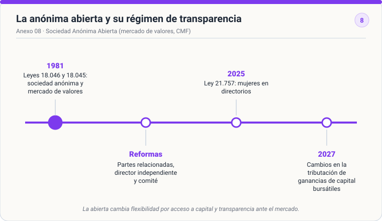
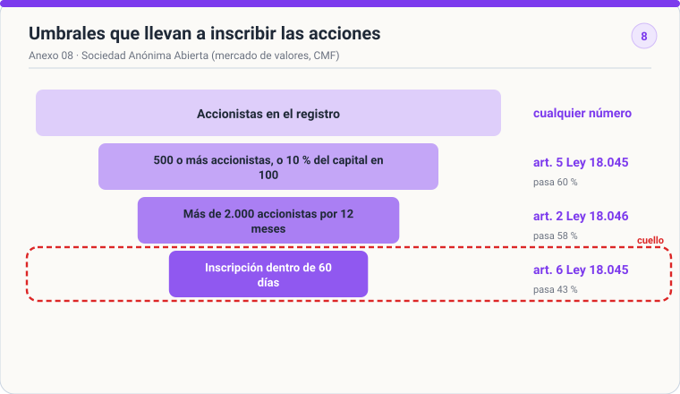
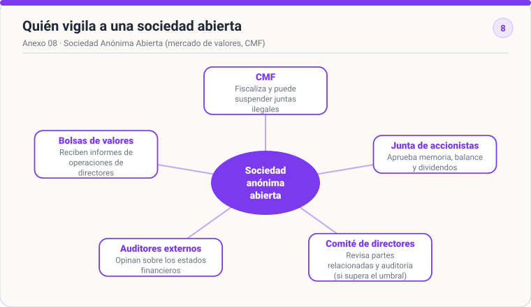

# Anexo 08 · Sociedad Anónima Abierta (mercado de valores, CMF)

> **Fecha de consulta de las fuentes:** 2026-11-25. **Naturaleza:** material educativo; no es asesoría
> legal ni financiera. Las normas cambian: confirma cada dato en la fuente oficial citada al final
> antes de actuar. Este anexo separa **obligación legal**, **recomendación profesional** y **medida
> voluntaria**. No contiene recomendaciones de inversión.

<!-- anexos:nav-inicio -->

**Navegación:** [← 07. Sociedad Anónima Cerrada (S.A.)](07-sociedad-anonima-cerrada.md) · [Índice de anexos](README.md) · [09. Cooperativa →](09-cooperativa.md)

## En 60 segundos

- Debe inscribirse si tuvo más de 2.000 accionistas por doce meses, o si cumple los umbrales del art. 5 de la Ley 18.045.
- Directorio de al menos cinco miembros, con límite del 60 % de un mismo sexo y reglas de independencia.
- Las operaciones con partes relacionadas exigen interés social, condiciones de mercado y aprobación sin los directores involucrados (Ley 18.046, arts. 146 y 147).
- Usar información privilegiada está prohibido (Ley 18.045, arts. 164 a 166).
- Los costos de cumplimiento son permanentes: conviene solo si el capital público los compensa.

<!-- anexos:nav-fin -->

## 1. Ficha rápida

| Pregunta | Respuesta |
|---|---|
| ¿Qué es? | La sociedad anónima que **inscribe sus acciones en el Registro de Valores** y queda sometida a la fiscalización de la Comisión para el Mercado Financiero (CMF) (art. 2 de la Ley 18.046). |
| ¿Cuándo es obligatorio? | Si durante doce meses consecutivos hubo **más de 2.000 accionistas** inscritos (u otro número superior fijado por la CMF), o si se cumple alguno de los umbrales de la letra c) del art. 5 de la Ley 18.045 (500 o más accionistas, o el 10 % del capital en manos de al menos 100 accionistas). |
| ¿Cuándo es voluntario? | Una sociedad puede solicitar inscribir sus acciones (art. 5 letra d) de la Ley 18.045). |
| ¿Quién la fiscaliza? | La CMF (art. 2 Ley 18.046 y art. 2 Ley 18.045). |
| ¿Cuántos directores? | Al menos cinco (art. 31). |
| ¿Se puede constituir en línea? | **No.** La Ley 20.659 solo incluye a la sociedad anónima cerrada. Una abierta nace como cerrada y luego pasa a abierta. |
| ¿Qué obliga a hacer? | Divulgar información veraz, suficiente y oportuna, comunicar las juntas a la CMF, publicar estados financieros, reportar operaciones de directores y accionistas relevantes, y cumplir normas de partes relacionadas. |
| ¿Para quién suele servir? | Empresas grandes que buscan capital en el mercado público o que ya superaron los umbrales legales. |
| ¿Para quién no? | Cualquier empresa pequeña o mediana sin plan de captar capital público. |

## 2. Historia y evolución

### 2.1. Un paquete de 1981

La **Ley 18.046**, de sociedades anónimas, y la **Ley 18.045**, de mercado de valores, fueron promulgadas
el 21 de octubre de 1981 y publicadas el 22 de octubre de 1981. Se complementan: la primera define cómo
funciona la sociedad anónima; la segunda regula la **oferta pública de valores**, sus mercados e
intermediarios, y las sociedades anónimas abiertas (art. 1 de la Ley 18.045).

El corazón de la Ley 18.045 es el **Registro de Valores**: solo puede hacerse oferta pública de valores
cuando estos y su emisor están inscritos (art. 6). Y su principio central es la **transparencia**: la
inscripción obliga al emisor a divulgar en forma veraz, suficiente y oportuna toda la información esencial,
entendida como la que «un hombre juicioso consideraría importante para sus decisiones sobre inversión»
(art. 9).

### 2.2. El regulador

El organismo que vigila el cumplimiento de la Ley 18.045 es hoy la **Comisión para el Mercado Financiero**
(CMF), según su texto vigente (art. 2). También fiscaliza a las sociedades anónimas abiertas y especiales
(art. 2 de la Ley 18.046). Antes de la CMF, esa función correspondía a otra institución que el propio
texto aún recuerda en algunas disposiciones históricas; para la práctica actual, la referencia es la CMF.

### 2.3. Reformas que marcaron el gobierno corporativo

El texto vigente de la Ley 18.046 incluye normas posteriores sobre gobierno corporativo: el título sobre
**operaciones con partes relacionadas** (arts. 146 a 149), la figura del **director independiente y el
comité de directores** (art. 50 bis), el derecho a información de los directores, la regla de **no más del
60 % de personas de un mismo sexo** en los directorios de abiertas y especiales (art. 31) y los
mecanismos de la **Ley 21.757** (promulgada el 11 de agosto de 2025 y publicada el 19 de agosto de 2025)
para aumentar la participación de mujeres en directorios. El art. 31 bis encarga a la CMF verificar cada
cuatro años si se han cumplido ciertas condiciones sobre esa participación.

## 3. Marco legal

### 3.1. Mapa de normas

| Norma | Qué aporta |
|---|---|
| Ley 18.046 | Régimen general de la sociedad anónima; reglas propias de las abiertas |
| Ley 18.045 | Registro de Valores, oferta pública, información, OPAs, información privilegiada |
| Normas de carácter general de la CMF | Detalle de información, forma y periodicidad |
| Reglamento de sociedades anónimas | Procedimientos de citación, traspasos, registros |
| Ley 20.393 | Responsabilidad penal de personas jurídicas |
| Decreto Ley 824 y Decreto Ley 825 | Impuestos |

### 3.2. Qué cambia respecto de la cerrada

| Materia | Cerrada | Abierta |
|---|---|---|
| Fiscalización | Sin CMF | CMF (art. 2) |
| Directorio mínimo | Tres | **Cinco** (art. 31) |
| Límite por sexo | No | Hasta el 60 % de un mismo sexo, con reporte y mecanismos (art. 31) |
| Libre disposición de acciones | Limitable por estatuto | **Los estatutos no pueden limitarla** (art. 14) |
| Comunicación de juntas | No a CMF | **Diez días antes a la CMF** (art. 63) |
| Estados financieros | A disposición de accionistas | Publicados en el sitio web con 10 días de anticipación a la junta (art. 76) |
| Precio del derecho a retiro | Valor de libros | **Valor de mercado** (art. 69) |
| Dividendo mínimo | Estatuto; si calla, 30 % | **Al menos 30 %**, salvo acuerdo unánime distinto (art. 79) |
| Partes relacionadas | Art. 44 (montos relevantes) | Título completo (arts. 146 a 149) |
| Director independiente y comité | No | Si superan el umbral del art. 50 bis |
| Información privilegiada | Normas generales | Título XXI Ley 18.045 |

## 4. Cómo se constituye

### 4.1. No se constituye así: se transforma o se inscribe

La sociedad anónima abierta **no se constituye directamente en el Registro de Empresas y Sociedades**,
porque la Ley 20.659 solo incluye a la anónima cerrada. En la práctica hay tres rutas:

1. **Obligación legal.** Una anónima cerrada que cumple los umbrales debe inscribir sus acciones. El art. 2
   de la Ley 18.046 dispone que las sociedades que durante doce meses consecutivos hayan tenido inscritos
   más de 2.000 accionistas (o el número superior que fije la CMF, si no se compromete la fe pública)
   están obligadas a inscribir sus acciones. El art. 5 de la Ley 18.045 exige además inscribir las acciones
   de sociedades con 500 o más accionistas o con el 10 % del capital suscrito en poder de al menos 100
   accionistas, excluidos quienes excedan individualmente ese porcentaje. La inscripción debe efectuarse
   **dentro de sesenta días** desde que se cumpla alguno de los requisitos (art. 6 Ley 18.045).
2. **Decisión voluntaria.** Una sociedad puede solicitar la inscripción de sus acciones aunque no esté
   obligada (art. 5 letra d).
3. **Transformación por ley de otras sociedades.** Una SpA o una comandita que durante doce meses
   consecutivos cumpla las condiciones que obligan a una anónima cerrada a inscribirse **se transforma por
   ley en sociedad anónima** (art. 430 y art. 507 bis del Código de Comercio).

### 4.2. La inscripción

La solicitud de inscripción del emisor debe ir acompañada de la solicitud de inscripción de los valores que
ofrecerá públicamente (art. 5 Ley 18.045). La CMF lleva el Registro de Valores, que está a disposición del
público. Para una oferta pública (acciones nuevas, bonos u otros valores) se requiere que emisor y valores
estén inscritos (art. 6).

### 4.3. Salir del registro

Las sociedades anónimas abiertas solo pueden solicitar la **cancelación** de sus acciones por acuerdo de
**dos tercios** de las acciones con derecho a voto en junta extraordinaria, y el accionista ausente o
disidente tiene **derecho a retiro** (art. 2 Ley 18.046). Si la cancelación fue consecuencia de un proceso
administrativo sancionatorio de la CMF, la sociedad sigue siendo abierta para efectos de la ley hasta que
una junta extraordinaria acuerde lo contrario por dos tercios.

## 5. Capital, aportes y propiedad

### 5.1. Capital y acciones

Rigen las reglas generales de la sociedad anónima: capital fijado en los estatutos, acciones nominativas de
igual valor por serie y prohibición de acciones de industria (arts. 10, 11, 12 y 13). El capital inicial se
suscribe y paga dentro de un máximo de tres años (art. 11).

### 5.2. Libre disposición de acciones

El art. 14 prohíbe que los estatutos de las abiertas incluyan **limitaciones a la libre disposición de las
acciones**. Los pactos particulares entre accionistas sobre cesión deben **depositarse en la compañía** a
disposición de los demás accionistas y terceros, con referencia en el Registro de Accionistas; si no se
hace, son **inoponibles a terceros**. Esta regla distingue radicalmente a la abierta: el inversionista
público necesita poder comprar y vender sin trabas estatutarias.

### 5.3. Acciones de propia emisión

Las sociedades cuyas acciones tienen transacción bursátil pueden adquirir y poseer acciones de su propia
emisión bajo condiciones copulativas (art. 27 A), con transacciones realizadas en bolsa mediante sistemas
que permitan la adquisición a prorrata (art. 27 B) y enajenación en un máximo de veinticuatro meses
(art. 27 C). Los bancos tienen normas adicionales (art. 27 D). La adquisición requiere acuerdo de junta
extraordinaria con dos tercios (art. 67 N.º 12).

### 5.4. Participación significativa

Quien posea directa o indirectamente el **10 % o más** del capital suscrito de una abierta, y los
directores, liquidadores, ejecutivos principales, administradores y gerentes, cualquiera sea su número de
acciones, deben informar a la CMF y a las bolsas **toda adquisición o enajenación** (art. 12 Ley 18.045).
El concepto de **controlador** (art. 97) y de **acuerdo de actuación conjunta** (art. 98) determinan quién
tiene el poder de asegurar la mayoría de votos y elegir a la mayoría de los directores.

### 5.5. Ofertas públicas de adquisición

La Ley 18.045 regula las **ofertas públicas de adquisición de acciones (OPA)**: las formuladas para adquirir
acciones de anónimas abiertas, o valores convertibles en ellas, ofreciendo a los accionistas comprar sus
títulos en condiciones que permitan al oferente alcanzar un cierto porcentaje en un plazo determinado
(art. 198). Se aplican tanto a ofertas voluntarias como a las que deban realizarse conforme a la ley.

### 5.6. Derecho a retiro

Los acuerdos del art. 69 (transformación, fusión, ciertas enajenaciones y cauciones, preferencias, etc.)
dan al accionista disidente el derecho a retirarse. En las abiertas, el precio es el **valor de mercado** de
la acción, determinado según el Reglamento. Debe ejercerse dentro de treinta días desde la junta (art. 70).

## 6. Administración y gobierno

### 6.1. Directorio

El directorio tiene mínimo **cinco** miembros (art. 31) y administra con las mismas facultades que en la
cerrada: representa judicial y extrajudicialmente a la sociedad y tiene todas las facultades de
administración y disposición no reservadas a la junta (art. 40). Los directores deben ejercer su cargo con el
cuidado y diligencia ordinarios y responden solidariamente de perjuicios por actuaciones dolosas o culpables
(art. 41). Sus funciones no son delegables (art. 39).

**Remuneraciones.** La memoria anual presentada a la junta debe indicar toda remuneración que los directores
hayan percibido, incluso por funciones o empleos distintos del cargo, gastos de representación, viáticos,
regalías y cualquier otro estipendio (art. 33).

**Información.** Cada director tiene derecho a ser informado plena y documentadamente y en cualquier tiempo
(art. 39), sin afectar la gestión social.

### 6.2. Composición por sexo

En las abiertas y en las especiales fiscalizadas por la CMF, las personas de un mismo sexo no pueden
exceder el **60 %** del total de miembros. Los estatutos deben contemplar mecanismos para alcanzar esa
proporción y las sociedades reportan a la CMF la identificación y sexo de cada director. La ley la describe
como una proporción de representación sugerida: cuando no se cumple, la sociedad reporta a la CMF las
razones, que esta publica sin pronunciarse sobre su mérito (art. 31). El art. 31 bis y la Ley 21.757
agregaron mecanismos de verificación periódica.

### 6.3. Director independiente y comité de directores

Las abiertas con **patrimonio bursátil igual o superior a 1.500.000 unidades de fomento** y con al menos un
**12,5 %** de las acciones con derecho a voto en manos de accionistas que individualmente controlen o posean
menos del 10 %, deben designar al menos **un director independiente** y un **comité de directores** (art.
50 bis). Si se alcanzan los umbrales durante el año, la obligación rige desde el año siguiente. La ley
define quién no puede considerarse independiente, por ejemplo, quienes en los últimos dieciocho meses hayan
tenido vínculos económicos, profesionales, crediticios o comerciales relevantes con la sociedad o su
controlador, parientes hasta el segundo grado y ciertos exdirectores o ejecutivos.

### 6.4. Partes relacionadas

Son operaciones con partes relacionadas toda negociación, acto, contrato u operación en que deba intervenir
la sociedad y, además, ciertas personas relacionadas, directores, gerentes, sus cónyuges o parientes hasta el
segundo grado o sociedades en que tengan el 10 % o más (art. 146). La sociedad **solo puede celebrarlas** si
persiguen el interés social, se ajustan a precio, términos y condiciones de mercado al tiempo de su
aprobación y cumplen el procedimiento legal (art. 147). Entre otros pasos: informar de inmediato al
directorio el interés o la participación en negociaciones, **bajo pena de responsabilidad solidaria**, y
obtener aprobación previa de la mayoría absoluta del directorio, con exclusión de los directores
involucrados, quienes deben hacer público su parecer.

### 6.5. Oportunidades comerciales

Ningún director, gerente, administrador, ejecutivo principal, liquidador, controlador ni sus personas
relacionadas puede **aprovechar para sí las oportunidades comerciales de la sociedad** de que hubiese tenido
conocimiento en su calidad de tal (art. 148). Los accionistas pueden aprovecharlas si el directorio las
desechó o si pasó un año sin desarrollarse. La infracción da derecho a pedir el reembolso, a favor de la
sociedad, de una suma equivalente a los beneficios obtenidos y otros perjuicios acreditados.

### 6.6. Información privilegiada

La Ley 18.045 define **información privilegiada** como cualquier información sobre emisores, sus negocios o
sus valores, no divulgada al mercado y capaz de influir en su cotización (art. 164). Quien la posee por su
cargo, posición, actividad o relación debe guardar reserva y **no puede utilizarla** en beneficio propio o
ajeno ni adquirir o enajenar los valores a que se refiere (art. 165). La ley presume que la poseen
directores, gerentes, administradores, ejecutivos principales y liquidadores del emisor, entre otros
(art. 166). Es una de las áreas de mayor riesgo penal y administrativo para quienes participan en una
abierta.

### 6.7. Juntas y la CMF

Las abiertas deben comunicar a la CMF cada junta con **al menos diez días de anticipación**; la CMF puede
suspender por resolución fundada la citación o la junta si fuere contraria a la ley, los reglamentos o los
estatutos, y puede hacerse representar en toda junta con derecho a voz (art. 63). Solo participan los
titulares inscritos en el Registro de Accionistas con **cinco días** de anticipación (art. 62). Las abiertas
publican en su sitio web los estados financieros y el informe de auditores con no menos de diez días de
anticipación a la junta (art. 76).

### 6.8. Un escenario para practicar: el arriendo a la empresa de un director

**Caso ilustrativo.** Una abierta de retail quiere arrendar una bodega de 900 metros cuadrados a una
sociedad cuyo dueño del 30 % es la hermana de uno de sus directores. Las cifras son ilustrativas: el arriendo
propuesto es de 2.400.000 pesos mensuales, y una tasación independiente fija el valor de mercado en
2.350.000 pesos.

| Paso | Qué exige la ley | Qué hacer |
|---|---|---|
| 1. Detectar | La hermana de un director es pariente hasta el segundo grado; la sociedad en que tiene el 30 % supera el 10 % (art. 146) | Clasificar la operación como con parte relacionada |
| 2. Informar | Quien tenga interés o participe en negociaciones debe informarlo de inmediato al directorio, bajo pena de responsabilidad solidaria (art. 147 N.º 1) | El director avisa por escrito antes de cualquier negociación |
| 3. Verificar condiciones | Debe contribuir al interés social y ajustarse a precio, términos y condiciones de mercado (art. 147) | Pedir una tasación independiente y comparar |
| 4. Aprobar | Mayoría absoluta del directorio, con exclusión del director involucrado, quien debe hacer público su parecer (art. 147 N.º 2) | Votar sin el director y dejar acta |
| 5. Documentar | Dejar evidencia para la CMF, auditores y accionistas | Guardar tasación, acta y contrato |

La diferencia de 50.000 pesos mensuales entre el arriendo propuesto y la tasación no es automáticamente
una infracción, pero debe explicarse: el art. 147 exige condiciones de mercado «al tiempo de su
aprobación». Si el directorio paga más sin justificación, expone a los directores a la responsabilidad
del art. 41 y a reclamos de accionistas.

**Lección.** En una abierta, la conducta correcta no es solo evitar el conflicto de interés; es
**demostrar** con documentos que se siguió el procedimiento.

## 7. Responsabilidad

### 7.1. Accionistas

Responden solo por sus aportes (art. 1).

### 7.2. Directores, gerentes y ejecutivos

| Conducta | Consecuencia | Artículo |
|---|---|---|
| Actuaciones dolosas o culpables | Responsabilidad solidaria por perjuicios | 41 Ley 18.046 |
| Infracción de la ley, reglamentos, estatutos o normas internas | Reparación de la pérdida irrogada al patrimonio | 133 bis Ley 18.046 |
| No informar interés en operaciones con partes relacionadas | Responsabilidad solidaria por los perjuicios | 147 Ley 18.046 |
| Aprovechar oportunidades comerciales de la sociedad | Reembolso de beneficios y perjuicios | 148 Ley 18.046 |
| Uso de información privilegiada | Reserva obligatoria, sanciones administrativas y penales según la ley | 164 a 166 Ley 18.045 |
| Falta de informar adquisiciones o enajenaciones | Infracción de deberes de información | 12 Ley 18.045 |

### 7.3. La CMF y las sanciones

La CMF fiscaliza el cumplimiento y puede aplicar sanciones según sus leyes. Las consecuencias penales de
ciertos delitos del mercado de valores y la responsabilidad penal de las personas jurídicas (Ley 20.393)
requieren asesoría especializada.

### 7.4. Controladores y personas relacionadas

El controlador y las personas relacionadas tienen deberes de información y límites en operaciones con la
sociedad. Los conceptos de los arts. 97, 98 y 100 de la Ley 18.045 determinan cuándo una persona es
controladora o relacionada.

## 8. Tributación

### 8.1. Cómo tributa

La sociedad anónima abierta es contribuyente de Primera Categoría. Sus accionistas tributan por los
dividendos. Las normas tributarias de venta de acciones con presencia bursátil tienen tratamiento
específico y han sido objeto de reforma: la guía de la Ley 21.850 señala que la ganancia de capital por
acciones con presencia bursátil cambia desde el 1 de enero de 2027. Ver la
[guía de la Ley 21.850](../docs/20_LEY_21850_RECONSTRUCCION_NACIONAL.md) y el
[flujo tributario](../docs/02_SII_TAX_FLOW.md).

### 8.2. Dividendos

Las abiertas deben distribuir anualmente como dividendo en dinero **al menos el 30 % de las utilidades
líquidas** de cada ejercicio, a prorrata de sus acciones, salvo acuerdo diferente adoptado en la junta por la
unanimidad de las acciones emitidas (art. 79). Los dividendos mínimos son exigibles a los treinta días de la
junta (art. 81). Las abiertas pueden ofrecer dividendo opcional en dinero, en acciones liberadas o en
acciones de otras abiertas respecto del exceso sobre el mínimo (art. 82).

### 8.3. Tasas

La **Ley 21.850** fija la tasa de Primera Categoría en 27 % para 2026, 25,5 % para 2027, 24 % para 2028 y
23 % desde 2029. **Verifica en el SII.**

### 8.4. Decisión práctica

Una abierta tiene costos de cumplimiento permanentes: auditoría externa, información continua, relaciones
con inversionistas, asesores legales y una estructura de gobierno. Antes de abrirse, evalúa si esos costos
se compensan con el acceso a capital.

**Ejemplo ilustrativo.** Una empresa necesita 3.000.000.000 de pesos para expandirse. Compara financiarse
con deuda bancaria, con un inversionista privado o con una apertura a bolsa. La apertura puede reducir el
costo de capital pero añade costos fijos anuales de cumplimiento, auditoría e información que, para una
empresa de ese tamaño, pueden ser relevantes. Las cifras son ilustrativas.

## 9. Obligaciones laborales, contables y sectoriales

### 9.1. Información continua y reservada

Las entidades inscritas deben proporcionar a la CMF y al público la información exigida por la ley y por
norma de carácter general, con forma, publicidad y periodicidad que fija la CMF y que, al menos, será anual
(art. 10 Ley 18.045). Esa norma debe exigir, como mínimo, información sobre impactos ambientales y de cambio
climático, incluidos riesgos y métricas.

### 9.2. Contabilidad y auditoría

Balance al 31 de diciembre o a la fecha estatutaria; memoria razonada, estado de ganancias y pérdidas e
informe de auditores externos (art. 74 Ley 18.046). Las abiertas designan auditores externos.

### 9.3. Cumplimiento y control interno

La Ley 20.393 sobre responsabilidad penal de personas jurídicas hace relevante un modelo de prevención de
delitos. Ver [cumplimiento y riesgo](../docs/13_COMPLIANCE_RISK.md).

### 9.4. Laboral y permisos

Ver el [flujo laboral](../docs/08_EMPLOYMENT_FLOW_CHILE.md) y el Anexo 17.

## 10. Antes de construir: lista de verificación

### 10.1. Decisiones previas

1. ¿Es obligatorio (más de 2.000 accionistas, o umbrales del art. 5 Ley 18.045) o voluntario?
2. ¿Qué necesita la empresa que no puede obtener con deuda o inversión privada?
3. ¿Hay un equipo para información continua, auditoría y relación con inversionistas?
4. ¿El directorio cumple el mínimo de cinco, la proporción por sexo y, si corresponde, el director
   independiente y el comité?
5. ¿Existen operaciones con partes relacionadas que deban ajustarse al art. 147?
6. ¿Qué pactos entre accionistas existen y están depositados en la compañía (art. 14)?
7. ¿Qué política de dividendos se aplicará, considerando el mínimo del 30 %?
8. ¿Hay un protocolo de información privilegiada y de reporte de operaciones de directores y ejecutivos?
9. ¿Qué plan de comunicación ante el mercado y ante la CMF?
10. ¿Qué asesores (abogados, auditores, bancos de inversión) acompañarán el proceso?

### 10.2. Documentos y capacidades

| Elemento | Para qué |
|---|---|
| Estatutos adecuados a una abierta | Sin limitaciones a la libre disposición (art. 14) |
| Registro de accionistas actualizado | Participación en juntas (art. 62) |
| Política de información y de operaciones con partes relacionadas | Arts. 146 a 149 |
| Protocolo de información privilegiada | Arts. 164 a 166 Ley 18.045 |
| Estados financieros auditados | Art. 74 y 76 |
| Calendario de juntas y comunicación a la CMF | Art. 63 |

### 10.3. Errores frecuentes

- **No inscribir a tiempo** cuando se superan los umbrales: la ley fija sesenta días.
- **Mantener limitaciones estatutarias a la transferencia** de acciones.
- **Aprobar operaciones con partes relacionadas sin procedimiento** ni condiciones de mercado.
- **Operar con información privilegiada** o no reportar adquisiciones de directores.
- **No considerar el mínimo de dividendos** del 30 %.
- **No comunicar la junta a la CMF** con diez días de anticipación.
- **Subestimar el costo permanente** de cumplimiento.

### 10.4. Caso ilustrado: una empresa familiar que crece

**Caso ilustrativo.** Una empresa de distribución de alimentos tiene 120 accionistas, mayoritariamente
familiares y empleados, y planea una ronda de capital. Los números son ilustrativos.

1. **Diagnóstico.** No supera los umbrales: 120 accionistas, lejos de 500 o 2.000. Es anónima cerrada.
2. **Opción.** Para captar capital, evalúa abrir una parte de sus acciones al público. Eso exigiría
   inscribirse en el Registro de Valores, mejorar su gobierno y asumir costos permanentes.
3. **Brecha.** Su directorio tiene tres miembros; necesitaría cinco, con composición por sexo y revisión de
   independencia. Sus contratos con empresas de los fundadores deben ajustarse al procedimiento de partes
   relacionadas.
4. **Decisión.** El directorio decide empezar por un año de «preparación»: actualizar estatutos,
   contratar auditoría, ordenar contratos con partes relacionadas y fijar una política de dividendos.
5. **Alternativa.** Evalúa también una ronda privada con un fondo. Elige según costo de capital, control y
   costos de cumplimiento.

**Qué aprendemos.** La apertura es una decisión estratégica, no un trámite. El primer paso suele ser
ordenar el gobierno interno.

### 10.5. Mini glosario

| Término | Significado |
|---|---|
| Registro de Valores | Registro público de la CMF donde se inscriben emisores y valores de oferta pública. |
| CMF | Comisión para el Mercado Financiero. |
| Información esencial | La que un hombre juicioso consideraría importante para decidir una inversión. |
| Información privilegiada | Información no divulgada capaz de influir en la cotización. |
| Director independiente | Director sin vínculos relevantes con la sociedad, su grupo o su controlador. |
| Comité de directores | Órgano del directorio que exigen los umbrales del art. 50 bis. |
| OPA | Oferta pública de adquisición de acciones. |
| Parte relacionada | Persona cuyo interés puede afectar una operación con la sociedad. |

## 11. Cuándo conviene y cuándo no

### 11.1. Comparación

| Criterio | Abierta | Cerrada | SpA | Sociedad limitada |
|---|---|---|---|---|
| Acceso a capital público | Sí | No | No | No |
| Fiscalización | CMF | No | No | No |
| Costo de cumplimiento | Alto | Medio | Bajo a medio | Bajo |
| Flexibilidad estatutaria | Baja | Media | Muy alta | Media |
| Transferencia de acciones | Libre | Restringible | Libre por estatuto | Modifica escritura |
| Información pública | Obligatoria | No | No | No |

### 11.2. Señales a favor

- Necesidad de capital en montos que el crédito o el capital privado no cubren.
- Base amplia de accionistas que ya obliga legalmente a inscribirse.
- Estructura de gobierno, auditoría y cumplimiento ya instalada.

### 11.3. Señales en contra

- Empresa pequeña o mediana sin plan de captar capital público.
- Resistencia a divulgar información o a ajustar gobierno.
- Control familiar que no tolera reglas de partes relacionadas.

## 12. Cuándo llamar a un profesional

| Situación | Profesional | Por qué |
|---|---|---|
| Inscripción en el Registro de Valores | Abogado de mercado de valores | Requisitos, información y plazos |
| Gobierno corporativo | Abogado y consultor | Directorio, comité, independencia |
| Operaciones con partes relacionadas | Abogado | Art. 147 |
| Información privilegiada | Abogado | Riesgo administrativo y penal |
| Estados financieros y auditoría | Contador y auditor externo | Art. 74 y 76 |
| OPA o cambio de control | Abogado y banco de inversión | Título de OPAs |

Consulta la [guía de cuándo llamar a un profesional](../docs/18_WHEN_TO_CALL_A_PROFESSIONAL.md).

## 13. Escenarios resueltos

Casos **ilustrativos** (nombres y cifras inventados) sobre la Ley 18.046 y la Ley 18.045. No constituyen asesoría de
inversión.

### Escenario 1: la cerrada que cruza el umbral

**Situación.** Una anónima cerrada de educación vendió acciones a empleados y a inversionistas privados. Hoy tiene
2.350 accionistas inscritos y los ha tenido durante catorce meses.

**Análisis.** Están obligadas a inscribir sus acciones en el Registro de Valores las sociedades que durante doce meses
consecutivos hayan tenido inscritos en el registro de accionistas **más de 2.000** accionistas o el número superior
que fije la CMF (art. 2 de la Ley 18.046). La inscripción debe efectuarse **dentro de sesenta días** desde que se
cumpla alguno de los requisitos (art. 6 de la Ley 18.045). La sociedad ya incumple: el plazo corrió.

**Pasos.** Contratar abogado de mercado de valores; preparar la solicitud de inscripción del emisor y de sus acciones
(art. 5); actualizar estatutos para eliminar restricciones a la libre disposición (art. 14); adecuar el directorio al
mínimo de cinco (art. 31); definir política de información y de partes relacionadas; comunicar las juntas a la CMF
(art. 63).

**Lección.** El conteo de accionistas es un indicador de gobierno que debe vigilarse trimestralmente.

### Escenario 2: el director que vende antes del anuncio

**Situación.** Un director sabe que la sociedad anunciará una pérdida inesperada la próxima semana. Vende todas sus
acciones esta semana.

**Análisis.** La información privilegiada es la no divulgada al mercado y capaz de influir en la cotización (art. 164 de
la Ley 18.045). Quien la posee por su cargo debe guardar reserva y **no puede utilizarla** en beneficio propio o ajeno ni
adquirir o enajenar los valores (art. 165). La ley presume que la poseen los directores, gerentes y ejecutivos
principales (art. 166). Además, los directores deben informar a la CMF y a las bolsas toda adquisición o enajenación
(art. 12).

**Consecuencias.** Riesgo administrativo y penal, y reparación de perjuicios. Este anexo no analiza las sanciones
concretas: requiere asesoría especializada.

**Lección.** Antes de operar con valores de tu sociedad, consulta a tu abogado y respeta los períodos de restricción
que fije la política interna.

### Escenario 3: el director independiente y el comité

**Situación.** Una sociedad con patrimonio bursátil de 2.000.000 de UF y 20 % de las acciones en manos de accionistas con
menos del 10 % cada uno no tiene director independiente.

**Análisis.** Debe designar al menos un director independiente y un comité de directores cuando tenga patrimonio
bursátil igual o superior a 1.500.000 UF y al menos un 12,5 % de las acciones con voto en poder de accionistas que
controlen o posean individualmente menos del 10 % (art. 50 bis). Si se alcanza durante el año, la obligación rige desde el
año siguiente. No se considera independiente a quien en los últimos dieciocho meses haya tenido vínculos económicos,
profesionales, crediticios o comerciales relevantes con la sociedad, su grupo o su controlador, entre otros supuestos.

**Decisión.** Elegir a un candidato sin esos vínculos, documentar la verificación y constituir el comité.

### Escenario 4: el préstamo a una empresa del controlador

**Situación.** El controlador propone que la sociedad preste 8.000.000.000 de pesos a otra empresa suya, a una tasa
ligeramente inferior a la de mercado.

**Análisis.** Es una operación con parte relacionada (art. 146). Solo puede celebrarse si contribuye al interés social,
se ajusta en precio, términos y condiciones a las de mercado y cumple el procedimiento: información inmediata del
interés y aprobación previa por la mayoría absoluta del directorio, excluidos los directores involucrados (art. 147).
Una tasa inferior a la de mercado, sin compensación, no cumple el estándar.

**Decisión.** Rechazar o renegociar con tasa de mercado, garantías y estudio independiente, y documentar.

### Escenario 5: la oportunidad comercial del gerente

**Situación.** Una cadena de gimnasios recibe una oferta exclusiva para abrir sucursales en una nueva ciudad. El gerente
general la deriva a una empresa propiedad de su cónyuge.

**Análisis.** Ningún director, gerente, administrador, ejecutivo principal, controlador ni sus personas relacionadas
puede aprovechar para sí las oportunidades comerciales de la sociedad de las que haya tenido conocimiento en su calidad
de tal; solo pueden usarlas los accionistas si el directorio las desechó previamente o si pasó un año sin desarrollo
(art. 148). La infracción da derecho a pedir el reembolso, a favor de la sociedad, de los beneficios y los perjuicios
acreditados.

**Decisión.** Informar al directorio, ofrecer la oportunidad a la sociedad y abstenerse de desviarla.

### Escenario 6: la cancelación voluntaria del registro

**Situación.** El controlador quiere que la sociedad deje de ser abierta para reducir costos.

**Análisis.** Las abiertas solo pueden solicitar la cancelación de sus acciones en el Registro de Valores por acuerdo
de **dos tercios** de las acciones con derecho a voto en junta extraordinaria; el accionista ausente o disidente tiene
derecho a retiro (art. 2 de la Ley 18.046). En el retiro, el precio es el valor de mercado de la acción (art. 69).

**Cifras ilustrativas.** Si el precio de mercado es de 1.200 pesos y hay disidentes con 2.000.000 de acciones, el costo
de retiro es de 2.400.000.000.

**Decisión.** Evaluar la caja necesaria, el efecto sobre los minoritarios y la reputación antes de proponerlo.

### Escenario 7: la junta que la CMF puede suspender

**Situación.** Una abierta cita a junta con menos de diez días de anticipación a la CMF y con un orden del día que
incluye materias propias de junta extraordinaria sin señalarlas.

**Análisis.** Las abiertas deben comunicar la celebración de toda junta a la CMF con una anticipación no inferior a diez
días; la CMF puede suspender por resolución fundada la citación o la junta si fuere contraria a la ley, los reglamentos o
los estatutos, y puede hacerse representar en la junta con voz (art. 63). Las materias de junta extraordinaria deben
señalarse en la citación (art. 55).

**Corrección.** Reprogramar la junta, corregir el aviso y comunicar a la CMF.

### Escenario 8: la composición del directorio por sexo

**Situación.** Un directorio de siete personas tiene cinco hombres y dos mujeres.

**Análisis.** En abiertas y especiales fiscalizadas por la CMF, las personas de un mismo sexo no pueden exceder el 60 % del
total de miembros; cinco de siete son el 71 %. La ley la describe como una proporción de representación sugerida con
reporte: la sociedad debe reportar a la CMF las razones, que esta publica sin pronunciarse sobre su mérito (art. 31). La
Ley 21.757 y el art. 31 bis agregaron mecanismos de verificación periódica.

**Decisión.** Diseñar un plan de renovación, incorporar mecanismos estatutarios y reportar con fundamentos.

## 14. Catálogo de errores y cómo corregirlos

| N.º | Error | Causa típica | Consecuencia | Cómo corregirlo | Dónde ver más |
|---:|---|---|---|---|---|
| 1 | No inscribir al superar umbrales | No monitorear | Incumplimiento (arts. 2 y 6) | Monitoreo trimestral | Escenario 1 |
| 2 | Limitar la libre disposición de acciones | Estatuto de cerrada | Prohibido (art. 14) | Eliminar restricciones | Sección 5.2 |
| 3 | Operar con información privilegiada | Desconocimiento | Responsabilidad grave | Política y capacitación | Escenario 2 |
| 4 | No reportar compras o ventas de directores | Descuido | Infracción (art. 12 Ley 18.045) | Protocolo de reporte | Sección 5.4 |
| 5 | Operaciones con relacionados sin procedimiento | Confianza | Responsabilidad solidaria (art. 147) | Procedimiento escrito | Escenario 4 |
| 6 | Desviar oportunidades comerciales | Conflicto | Reembolso (art. 148) | Ofrecerlas a la sociedad | Escenario 5 |
| 7 | No crear comité cuando corresponde | Falta de monitoreo | Incumple art. 50 bis | Umbrales anuales | Escenario 3 |
| 8 | No comunicar la junta a la CMF | Informalidad | Suspensión posible (art. 63) | Calendario | Escenario 7 |
| 9 | No publicar estados financieros a tiempo | Descuido | Incumple art. 76 | Calendario de publicación | Sección 6.7 |
| 10 | Ignorar el dividendo mínimo de 30 % | Políticas de reinversión | Reclamos de accionistas | Acuerdo unánime o política | Sección 8.2 |
| 11 | Directorio de menos de cinco | Informalidad | Incumple art. 31 | Completar | Sección 6.1 |
| 12 | No reportar la razón de la composición por sexo | Descuido | Incumple art. 31 | Reporte fundado | Escenario 8 |
| 13 | No evaluar el costo del retiro | Optimismo | Presión de caja | Provisión | Escenario 6 |
| 14 | Falta de política de comunicación al mercado | Desconocimiento | Riesgo reputacional | Protocolo | Sección 9.1 |
| 15 | No contar con asesoría especializada | Costo percibido | Errores caros | Contratar | Sección 12 |

## 15. Alternativas y variantes de diseño

### C.1. Cerrada, abierta o financiamiento privado

| Criterio | Cerrada | Abierta | Ronda privada | Deuda |
|---|---|---|---|---|
| Acceso a capital | Limitado | Amplio | Medio | Según garantía |
| Costo de cumplimiento | Medio | Alto | Bajo a medio | Bajo |
| Control | Concentrado | Diluido | Negociado | Sin dilución |
| Transparencia | Baja | Alta | Media | Baja |
| Liquidez para accionistas | Baja | Alta | Media | No aplica |

### C.2. Etapas de preparación para abrirse

| Etapa | Tareas |
|---|---|
| Diagnóstico | Gobierno, estatutos, contratos con relacionados |
| Ordenamiento | Directorio de cinco, políticas, auditoría |
| Estructura | Asesores, modelo de información, comité |
| Solicitud | Inscripción de emisor y valores |
| Operación | Información continua y relación con inversionistas |

### C.3. Opciones de gobierno corporativo adicionales

| Medida | Descripción | Obligatoria |
|---|---|---|
| Director independiente y comité | Art. 50 bis | Si se superan umbrales |
| Política de partes relacionadas | Procedimiento interno | Recomendada |
| Código de conducta y canal de denuncias | Cumplimiento | Recomendada; ver Ley 20.393 |
| Política de dividendos | Regla clara | Recomendada |

### C.4. Ideas de políticas internas

1. «Los directores y ejecutivos no operarán con acciones de la sociedad en las ventanas de restricción definidas por
   el comité.»
2. «Toda operación con parte relacionada requerirá informe independiente y aprobación previa del directorio.»
3. «El área legal mantendrá un calendario de comunicaciones a la CMF y de juntas.»
4. «Las oportunidades comerciales recibidas por ejecutivos serán derivadas al directorio.»

## 16. Vinculación con otros anexos y con las clases

### D.1. ¿Cuándo salto a otro anexo?

| Evento | Anexo |
|---|---|
| Entender la base de la anónima | 07 |
| Viene de una SpA o comandita que crece | 05 y 06 |
| Impuestos de dividendos y ganancias de capital | 16 |
| Constitución en línea (solo cerradas) | 15 |
| Domicilio y oficinas | 18 |
| Operaciones con el exterior | 14 |
| Cumplimiento y delitos económicos | Las clases de la parte 19 |

### D.2. Clases del programa

- [Parte 5, clase 5: sociedad anónima cerrada y abierta](../curriculum/part-05-diseno-societario-y-gobierno-inicial/class-05-sociedad-anonima-cerrada-y-abierta/README.md)
- [Parte 5, clase 12: conflictos de interés y partes relacionadas](../curriculum/part-05-diseno-societario-y-gobierno-inicial/class-12-conflictos-de-interes-y-partes-relacionadas/README.md)
- [Parte 19, clase 3: Ley 20.393 y responsabilidad penal de la persona jurídica](../curriculum/part-19-compliance-riesgos-y-responsabilidad-empresarial/class-03-ley-20-393-y-responsabilidad-penal-de-la-persona-juridica/README.md)
- [Parte 19, clase 4: Ley 21.595 de delitos económicos](../curriculum/part-19-compliance-riesgos-y-responsabilidad-empresarial/class-04-ley-21-595-de-delitos-economicos/README.md)
- [Parte 16, clase 10: venture capital y rondas](../curriculum/part-16-financiamiento-banca-fondos-e-inversion/class-10-venture-capital-y-rondas/README.md)

### D.3. Hilos que se conectan

1. **Umbrales y registro:** los arts. 2 y 6 conectan el número de accionistas con la inscripción.
2. **Libre disposición y estatuto:** el art. 14 conecta la apertura con la eliminación de restricciones.
3. **Relacionados y directorio:** el art. 147 conecta la aprobación con la responsabilidad solidaria.
4. **Información y mercado:** los arts. 164 a 166 conectan el cargo con la prohibición de operar.

## 17. Plantillas y listas de trabajo

### E.1. Plan de 30, 60 y 90 días para prepararse

| Plazo | Tareas | Responsable | Evidencia |
|---|---|---|---|
| Días 1 a 30 | Diagnóstico de umbrales, estatutos y relacionadas | Abogado y gerencia | Informe |
| Días 31 a 60 | Plan de adecuación del directorio y políticas | Directorio | Plan aprobado |
| Días 61 a 90 | Contrato con auditores y asesores; calendario CMF | Gerencia | Contratos y calendario |

### E.2. Calendario de información y juntas

| Hito | Plazo |
|---|---|
| Comunicar la junta a la CMF | Al menos diez días antes |
| Publicar estados financieros en el sitio web | Al menos diez días antes de la junta |
| Citación a junta | Con anticipación mínima de diez días |
| Convocar la junta ordinaria | Dentro del cuatrimestre siguiente al balance |
| Reportar operaciones de directores | Según norma de la CMF (consulta) |

### E.3. Lista de control de independencia

| Pregunta | Sí | No |
|---|---|---|
| ¿Vínculo económico, profesional, crediticio o comercial relevante en los últimos 18 meses? | | |
| ¿Parentesco hasta el segundo grado con las personas del N.º 1? | | |
| ¿Fue director o ejecutivo de organizaciones que recibieron aportes relevantes? | | |
| ¿Fue socio o accionista del 10 % o más? | | |

Si respondes «sí» a alguna, revisa con un abogado si el candidato puede considerarse independiente.

### E.4. Modelo de registro de operaciones con partes relacionadas

| Fecha | Contraparte | Relación | Monto | Condiciones de mercado verificadas | Aprobación | Directores excluidos |
|---|---|---|---:|---|---|---|
| | | | | | | |

### E.5. Lista de revisión para el comité de directores

1. Informe de auditores externos.
2. Operaciones con partes relacionadas del período.
3. Política de remuneraciones.
4. Riesgos y controles.
5. Cumplimiento de plazos de información.

## 18. Autoevaluación

1. ¿Cuándo debe una sociedad inscribirse en el Registro de Valores?
2. ¿Qué plazo hay para inscribir?
3. ¿Cuántos directores como mínimo?
4. ¿Qué proporción máxima de un mismo sexo se sugiere?
5. ¿Cuándo se exige comité de directores?
6. ¿Qué es información privilegiada?
7. ¿Qué exige una operación con parte relacionada?
8. ¿Qué es una OPA?
9. ¿Qué mayoría exige cancelar la inscripción?
10. ¿Qué precio tiene el derecho a retiro en una abierta?
11. ¿Se constituye en línea?
12. ¿Qué dividendo mínimo rige?

**Respuestas.**

1. Si tuvo más de 2.000 accionistas inscritos durante doce meses, o cumple los umbrales del art. 5 de la Ley 18.045, o lo
   decide voluntariamente.
2. Sesenta días desde que se cumpla el requisito (art. 6 Ley 18.045).
3. Cinco (art. 31).
4. Hasta el 60 % (art. 31).
5. Con patrimonio bursátil de al menos 1.500.000 UF y 12,5 % de acciones en manos de accionistas con menos del 10 % cada
   uno (art. 50 bis).
6. La no divulgada al mercado y capaz de influir en la cotización (art. 164 Ley 18.045).
7. Interés social, condiciones de mercado y aprobación del directorio sin los involucrados (art. 147).
8. Una oferta pública de adquisición de acciones de una abierta (art. 198 Ley 18.045).
9. Dos tercios de las acciones con voto (art. 2 Ley 18.046).
10. El valor de mercado (art. 69).
11. No: la Ley 20.659 solo incluye a las cerradas.
12. Al menos el 30 % de las utilidades líquidas, salvo acuerdo unánime distinto (art. 79).

**Puntaje.** Diez o más: dominas el tipo. Seis a nueve: repasa las secciones 5 y 6. Menos de seis: relee el anexo.

## 19. Calendario anual y glosario ampliado

### H.1. Calendario anual de una anónima abierta

| Cuándo | Tarea | Base |
|---|---|---|
| Cada mes | Registro de Compras y Ventas; declarar y pagar | DL 825, art. 59 |
| Según norma de la CMF | Información continua, periódica y esencial | Ley 18.045, arts. 9 y 10 |
| Trimestral | Sesión de directorio y comité; revisión de partes relacionadas | Ley 18.046, arts. 50 bis y 147 |
| Al producirse | Reporte de compras y ventas de directores, ejecutivos y accionistas del 10 % | Ley 18.045, art. 12 |
| 31 de diciembre | Balance | Ley 18.046, art. 74 |
| Al menos 10 días antes de la junta | Comunicación a la CMF y publicación de estados financieros | Arts. 63 y 76 |
| Dentro del cuatrimestre siguiente | Junta ordinaria | Art. 58 |
| Treinta días tras la junta | Dividendos mínimos exigibles | Art. 81 |
| Cada año | Revisión de umbrales del comité y de composición por sexo | Arts. 31 y 50 bis |
| Cada cuatro años | Verificación de la CMF sobre participación de mujeres | Art. 31 bis |

### H.2. Glosario ampliado

| Término | Significado |
|---|---|
| Acuerdo de actuación conjunta | Convención entre accionistas para participar con idéntico interés en la gestión |
| CMF | Comisión para el Mercado Financiero |
| Comité de directores | Órgano del directorio exigido al superar ciertos umbrales |
| Controlador | Quien tiene el poder de asegurar la mayoría de votos y elegir la mayoría de directores |
| Director independiente | Director sin vínculos relevantes con la sociedad o su controlador |
| Emisor | Entidad que ofrece valores al público |
| Información esencial | La que un hombre juicioso consideraría importante para decidir |
| Información privilegiada | Información no divulgada capaz de influir en la cotización |
| Oferta pública | Dirigida al público en general o a ciertos sectores |
| OPA | Oferta pública de adquisición de acciones |
| Parte relacionada | Persona cuyo interés puede afectar una operación |
| Patrimonio bursátil | Valor de mercado del patrimonio de la sociedad |
| Registro de Valores | Registro público de emisores y valores a cargo de la CMF |
| Valor de mercado | Precio de la acción en el mercado |

## 20. Preguntas frecuentes

**1. ¿Cuándo una sociedad anónima es abierta?**
Cuando inscribe sus acciones en el Registro de Valores, y debe hacerlo si durante doce meses consecutivos
tuvo más de 2.000 accionistas inscritos (o el número superior que fije la CMF) (art. 2 Ley 18.046).

**2. ¿Qué otros umbrales obligan a inscribir?**
500 o más accionistas, o el 10 % del capital suscrito en poder de al menos 100 accionistas, excluyendo a
quienes excedan individualmente ese porcentaje (art. 5 letra c Ley 18.045).

**3. ¿Qué plazo tengo para inscribir?**
Sesenta días desde que se cumpla alguno de los requisitos (art. 6 Ley 18.045).

**4. ¿Puedo constituir una abierta en línea?**
No. La Ley 20.659 solo incluye a la sociedad anónima cerrada.

**5. ¿Cuántos directores debe tener?**
Al menos cinco (art. 31).

**6. ¿Hay una proporción mínima por sexo en el directorio?**
La ley dispone que las personas de un mismo sexo no excedan el 60 %, con mecanismos estatutarios, reportes
a la CMF y verificación periódica (arts. 31 y 31 bis).

**7. ¿Qué es un director independiente?**
Un director sin ciertos vínculos relevantes con la sociedad, su grupo, su controlador o sus ejecutivos
en los últimos dieciocho meses (art. 50 bis).

**8. ¿Siempre se necesita comité de directores?**
Solo si la sociedad supera el umbral: patrimonio bursátil de al menos 1.500.000 UF y 12,5 % de las
acciones con voto en manos de accionistas con menos del 10 % cada uno (art. 50 bis).

**9. ¿Puedo limitar la transferencia de acciones en los estatutos?**
No en una abierta (art. 14).

**10. ¿Qué pasa con los pactos entre accionistas?**
Deben depositarse en la compañía y mencionarse en el Registro de Accionistas; si no, son inoponibles a
terceros (art. 14).

**11. ¿Qué dividendo mínimo se debe pagar?**
Al menos el 30 % de las utilidades líquidas de cada ejercicio, salvo acuerdo unánime distinto (art. 79).

**12. ¿Cuánto vale el derecho a retiro?**
En las abiertas, el valor de mercado de la acción (art. 69).

**13. ¿Qué es la información privilegiada?**
La no divulgada al mercado y capaz de influir en la cotización; quien la posee debe guardar reserva y no
usarla (arts. 164 y 165 Ley 18.045).

**14. ¿Quién se presume que posee información privilegiada?**
Entre otros, directores, gerentes, administradores, ejecutivos principales y liquidadores del emisor
(art. 166 Ley 18.045).

**15. ¿Qué es una operación con parte relacionada?**
Un acto en que interviene la sociedad y, además, personas relacionadas como directores, gerentes o sus
familiares, o empresas en que tengan el 10 % o más (art. 146).

**16. ¿Cómo se aprueba?**
Debe contribuir al interés social, ajustarse a condiciones de mercado y ser aprobada por la mayoría
absoluta del directorio sin los directores involucrados (art. 147).

**17. ¿Qué debo informar si tengo el 10 % de una abierta?**
Toda adquisición o enajenación de acciones, a la CMF y a las bolsas (art. 12 Ley 18.045).

**18. ¿Puedo dejar de ser abierta?**
Solo cancelando la inscripción por acuerdo de dos tercios en junta extraordinaria, con derecho a retiro
(art. 2 Ley 18.046).

**19. ¿Qué es una OPA?**
Una oferta pública de adquisición de acciones de una abierta o valores convertibles, para alcanzar un
cierto porcentaje en un plazo determinado (art. 198 Ley 18.045).

**20. ¿Una pyme debería ser abierta?**
En general no: los costos de cumplimiento y de información son altos. Evalúa alternativas como inversión
privada o una SpA con series de acciones.

**21. ¿Puedo invertir en acciones de una abierta sin ser accionista controlador?**
Sí; las reglas de este anexo se refieren a la sociedad y a sus administradores, no a asesoría de inversión.

**22. ¿Quién fiscaliza a las abiertas?**
La Comisión para el Mercado Financiero (art. 2 de la Ley 18.046 y art. 2 de la Ley 18.045).

**23. ¿Qué información debe entregar una emisora?**
La que exigen la ley y las normas de carácter general de la CMF; al menos anualmente, incluyendo información sobre
impactos ambientales y de cambio climático (art. 10 de la Ley 18.045).

**24. ¿Qué es información esencial?**
La que un hombre juicioso consideraría importante para sus decisiones de inversión (art. 9 de la Ley 18.045).

**25. ¿Quién es controlador?**
Quien, directa o indirectamente, puede asegurar la mayoría de votos en juntas y elegir a la mayoría de los directores, o
influir decisivamente en la administración (art. 97).

**26. ¿Qué es un acuerdo de actuación conjunta?**
Una convención entre dos o más accionistas para participar con idéntico interés en la gestión u obtener el control; la ley
presume ese acuerdo entre ciertas personas (art. 98).

**27. ¿Cuándo debo reportar mis acciones?**
Si tienes el 10 % o más del capital, o eres director, liquidador, ejecutivo principal, administrador o gerente,
debes informar toda adquisición o enajenación a la CMF y a las bolsas (art. 12).

**28. ¿Los accionistas pueden pactar la cesión de sus acciones?**
Sí, pero esos pactos deben depositarse en la compañía y mencionarse en el Registro de Accionistas, o serán inoponibles a
terceros (art. 14 de la Ley 18.046).

**29. ¿Qué pasa si no pago el dividendo mínimo?**
Es exigible a los treinta días de la junta y la copia certificada del acta es título ejecutivo (arts. 81 y 83).

**30. ¿Qué es el dividendo opcional?**
La posibilidad de recibir, en exceso del mínimo, el dividendo en dinero, en acciones liberadas o en acciones de otras
abiertas (art. 82).

**31. ¿Pueden las abiertas recomprar acciones?**
Las sociedades con transacción bursátil pueden hacerlo bajo las condiciones de los arts. 27 A a 27 D, con acuerdo de
dos tercios (art. 67 N.º 12).

**32. ¿Quién preside las juntas?**
Lo define el estatuto; la CMF puede hacerse representar en la junta con derecho a voz (art. 63).

**33. ¿Qué es el derecho a retiro?**
La facultad del accionista disidente de salir con pago del valor de mercado de sus acciones ante ciertos acuerdos
(art. 69).

**34. ¿Qué es una oportunidad comercial?**
Un plan, proyecto, oportunidad u oferta exclusiva dirigida a la sociedad para desarrollar una actividad lucrativa en
su giro o uno complementario (art. 148).

**35. ¿Qué responsabilidad tiene el gerente?**
Se le aplican las normas de los directores en lo compatible, entre ellas las de los arts. 35 a 37 y 41 a 46 (art. 50).

**36. ¿Cuánto cuesta ser abierta?**
Este anexo no fija costos: incluyen auditoría, información continua, asesores y relación con inversionistas. Evalúa con
un presupuesto propio.

**37. ¿Puedo volver a ser cerrada?**
Solo cancelando la inscripción por acuerdo de dos tercios, con derecho a retiro (art. 2).

**38. ¿Qué es el patrimonio bursátil?**
El valor de mercado del patrimonio de la sociedad; se usa para el umbral del comité de directores (art. 50 bis).

**39. ¿Las abiertas pueden tener pactos de accionistas?**
Sí, pero con las reglas de depósito y oponibilidad del art. 14.

**40. ¿Cuándo debo pedir ayuda profesional?**
Antes de abrirte, en cada operación con relacionados, ante información privilegiada, para las juntas y para cualquier
comunicación al mercado.

## 21. Fuentes y vigencia

| Fuente | Qué se usó | Dónde consultarla |
|---|---|---|
| Ley 18.046, sobre sociedades anónimas | Régimen general y de las abiertas | [BCN, Ley 18.046](https://www.bcn.cl/leychile/navegar?idNorma=29473) |
| Ley 18.045, de mercado de valores | Registro de Valores, información, OPAs, información privilegiada | [BCN, Ley 18.045](https://www.bcn.cl/leychile/navegar?idNorma=29472) |
| Ley 21.757 | Mujeres en directorios | [BCN, Ley 21.757](https://www.bcn.cl/leychile/navegar?idNorma=1215887) |
| Código de Comercio, arts. 430 y 507 bis | Transformación por ley en anónima | [BCN, Código de Comercio](https://www.bcn.cl/leychile/navegar?idNorma=1974) |
| Comisión para el Mercado Financiero | Registro de Valores y normas de carácter general | [CMF](https://www.cmfchile.cl) |
| SII, regímenes tributarios | Rutas de Operación Renta | [SII](https://www.sii.cl/destacados/renta/2026/intermediarios/regimenes_tributarios/) |
| Ley 21.850 | Ganancia de capital y tasas | [Guía del programa](../docs/20_LEY_21850_RECONSTRUCCION_NACIONAL.md) |

**Vigencia.** Los artículos citados se leyeron en la versión publicada por la Biblioteca del Congreso
Nacional el 2026-11-25. La Ley 18.045 muestra versiones con fechas de vigencia posteriores en parte de su
texto; verifica la vigencia de cada artículo antes de aplicarlo. Las normas de carácter general de la CMF
cambian con frecuencia y no se transcriben aquí.

**Límites.** Este anexo no reproduce el texto íntegro de las leyes, no contiene asesoría de inversión ni
interpreta normas de la CMF y sus ejemplos numéricos son ilustrativos. No sustituye la asesoría de un
abogado especializado.

<!-- anexos:cierre-inicio -->

## Para seguir leyendo

- [Anexo 07. Sociedad Anónima Cerrada (S.A.)](07-sociedad-anonima-cerrada.md): de donde parte una abierta.
- [Anexo 05. Sociedad en Comandita (simple y por acciones)](05-sociedad-en-comandita.md): la comandita que puede transformarse.
- [Anexo 16. Servicio de Impuestos Internos (SII): lo que una empresa debe saber](16-servicio-de-impuestos-internos-sii.md): impuestos sobre dividendos y ganancias de capital.

**Navegación:** [← 07. Sociedad Anónima Cerrada (S.A.)](07-sociedad-anonima-cerrada.md) · [Índice de anexos](README.md) · [09. Cooperativa →](09-cooperativa.md)

<!-- anexos:cierre-fin -->
