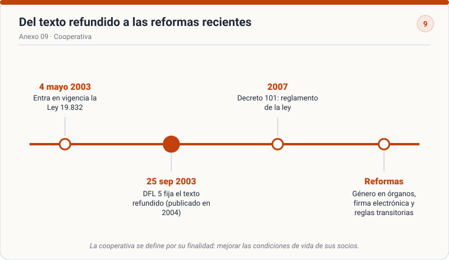
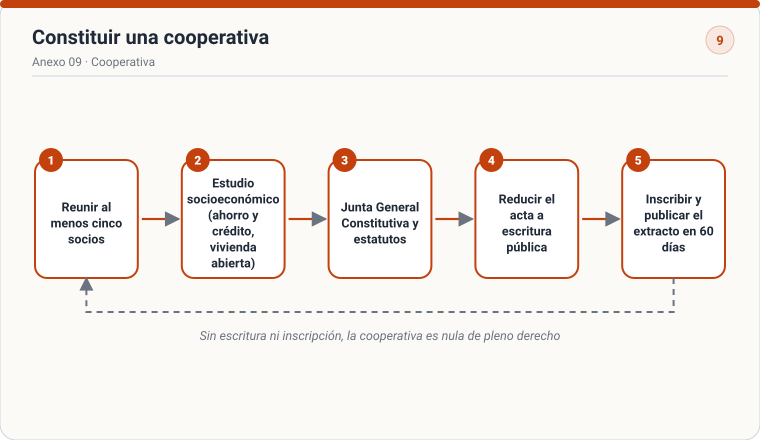
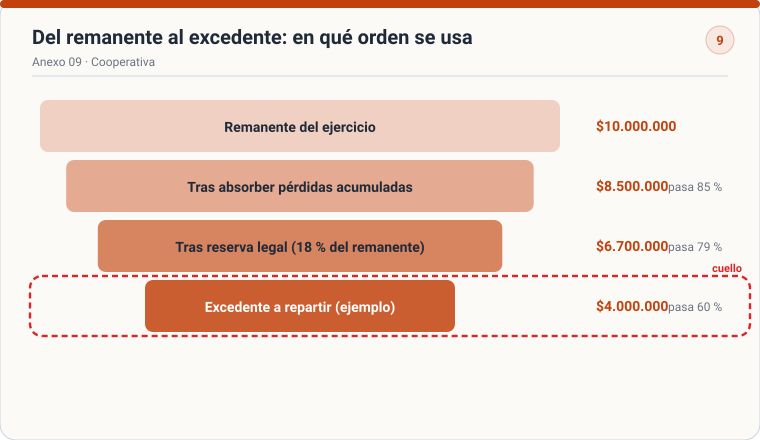
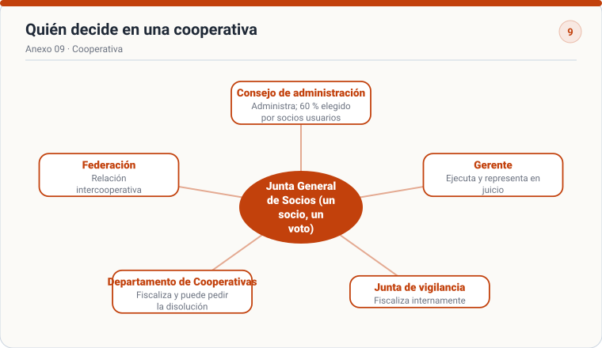
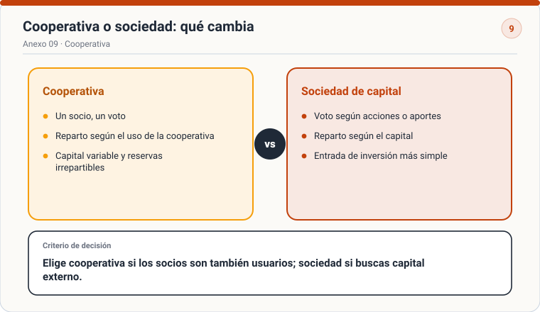

# Anexo 09 · Cooperativa

> **Fecha de consulta de las fuentes:** 2026-11-25. **Naturaleza:** material educativo; no es asesoría
> legal ni tributaria. Las normas cambian: confirma cada dato en la fuente oficial citada al final
> antes de actuar. Este anexo separa **obligación legal**, **recomendación profesional** y **medida
> voluntaria**.

<!-- anexos:nav-inicio -->

**Navegación:** [← 08. Sociedad Anónima Abierta (mercado de valores, CMF)](08-sociedad-anonima-abierta.md) · [Índice de anexos](README.md) · [10. Sociedad de Garantía Recíproca (SAGR y cooperativa de garantía recíproca) →](10-sociedad-de-garantia-reciproca-sagr.md)

## En 60 segundos

- Mínimo cinco socios; un voto por persona (DFL 5 de 2003, arts. 13 y 22).
- Ningún socio puede tener más del 20 % del capital (10 % en ahorro y crédito).
- Se constituye por junta constitutiva, escritura y extracto en 60 días; no por el Registro en línea.
- El remanente se destina primero a pérdidas y a la reserva legal del 18 %, con excepciones (art. 38).
- Tiene exenciones tributarias parciales, pero está afecta a IVA.

<!-- anexos:nav-fin -->

## 1. Ficha rápida

| Pregunta | Respuesta |
|---|---|
| ¿Qué es? | Una asociación que, conforme al principio de la ayuda mutua, tiene por objeto **mejorar las condiciones de vida de sus socios** (art. 1 del texto refundido de la Ley General de Cooperativas, DFL 5 de 2003). |
| ¿Quiénes la forman? | Personas naturales y personas jurídicas de derecho público o privado, con un **mínimo de cinco socios** y sin tope máximo, salvo casos especiales (art. 13). |
| ¿Cómo se vota? | **Un voto por persona**, sin importar cuántas cuotas tenga (arts. 1 y 22). |
| ¿Quién responde por las deudas? | La cooperativa. Los socios, **hasta el monto de sus cuotas de participación** (art. 32). |
| ¿Puede tener cualquier objeto? | Sí, cualquier actividad (art. 2), salvo ciertos tipos con objeto único, como las de vivienda abiertas y las de ahorro y crédito (art. 3). |
| ¿Quién la fiscaliza? | El Departamento de Cooperativas del Ministerio de Economía y, según el objeto, otros organismos; las de ahorro y crédito bajo supervisión, la Comisión para el Mercado Financiero. |
| ¿Se puede constituir en línea? | **No** por el Registro de Empresas y Sociedades: la Ley 20.659 no incluye a las cooperativas. Se constituye por junta general constitutiva, escritura pública, inscripción y publicación. |
| ¿Cómo tributa? | Tiene exenciones y reglas propias (arts. 49 a 53), pero **está afecta a IVA** y se rige por el art. 17 del DL 824 en renta. |
| ¿Para quién suele servir? | Grupos de productores, trabajadores, consumidores o usuarios que quieren organizarse bajo igualdad de derechos y distribución según uso. |
| ¿Para quién no? | Quien busca control proporcional al capital, inversión externa sin voto igual o libertad total de estatutos. |

## 2. Historia y evolución

### 2.1. Un movimiento antes que un tipo social

La cooperativa nace de una idea distinta a la de la sociedad de capital: las personas se unen para resolver
una necesidad común (vivienda, crédito, consumo, trabajo, comercialización) y el capital es un medio, no el
fin. Por eso la ley la define por su finalidad y no por el aporte: mejorar las condiciones de vida de los
socios (art. 1).

El cuerpo legal actual es el **texto refundido, concordado y sistematizado** fijado por el **DFL 5**,
promulgado el 25 de septiembre de 2003 y publicado en el Diario Oficial el 17 de febrero de 2004. Ese texto
integra las normas anteriores con las reformas de la **Ley 19.832**, que, según el propio texto, entró en
vigencia el **4 de mayo de 2003** (artículo transitorio). Su reglamento vigente es el **Decreto 101 de
2007**, del Ministerio de Economía.

### 2.2. Principios que la ley recoge

El artículo 1 enumera sus características fundamentales:

- los socios tienen **iguales derechos y obligaciones**, un solo voto por persona y su ingreso y retiro es
  **voluntario**;
- deben distribuir el excedente de las operaciones con sus socios **a prorrata de esas operaciones**;
- deben observar **neutralidad política y religiosa**;
- deben desarrollar **actividades de educación cooperativa** y procurar relaciones federativas e
  intercooperativas;
- deben tender a la **inclusión**, valorar la diversidad y promover la igualdad de derechos entre sus
  asociadas y asociados.

### 2.3. Reformas recientes visibles en el texto

El texto vigente incluye normas que muestran la evolución reciente: la representación proporcional por
género en los órganos colegiados (art. 24), la posibilidad de que trabajadores integren el consejo de
administración con fuero laboral, reglas de firma electrónica avanzada para poderes y actas, y normas
transitorias sobre distribución de excedentes de los ejercicios 2019 y 2020 y sobre juntas durante la
pandemia (arts. 12 a 14 transitorios). Son recordatorios de que la ley cambia por tramos y de que el texto
debe leerse completo.

## 3. Marco legal

### 3.1. Mapa de normas

| Norma | Qué aporta |
|---|---|
| DFL 5 de 2003, Ley General de Cooperativas | Definición, constitución, socios, órganos, capital, excedentes, disolución, exenciones y sanciones |
| Decreto 101 de 2007 | Reglamento de la ley |
| Ley 19.499 | Saneamiento de vicios de nulidad (art. 11 del DFL 5) |
| Ley 20.494 | Reglas de publicación de extractos (art. 8 bis) |
| Decreto Ley 824, art. 17 | Régimen de renta aplicable a cooperativas |
| Decreto Ley 825 | IVA: las cooperativas están afectas |
| Leyes sectoriales | Regulación del giro (por ejemplo, vivienda o servicios financieros) |

### 3.2. Obligación, recomendación, opción

| Materia | Tipo | Detalle |
|---|---|---|
| Mínimo de cinco socios | Obligación | Art. 13 |
| Junta general constitutiva con acta reducida a escritura pública | Obligación | Art. 6 |
| Inscripción y publicación del extracto en 60 días | Obligación | Art. 7 |
| Razón social con elementos que indiquen su naturaleza cooperativa | Obligación | Art. 5 |
| Fondo de reserva legal del 18 % del remanente anual | Obligación (con excepciones) | Art. 38 |
| Fondo de provisión del 2 % para devolución de cuotas | Obligación | Art. 19 |
| Educación cooperativa | Obligación como característica | Art. 1 |
| Estatutos más detallados que el mínimo legal | Recomendación profesional | Evita conflictos |
| Afiliación a una federación | Opción | Art. 1 |

## 4. Cómo se constituye

### 4.1. Paso a paso

1. **Reunir a los socios fundadores**, al menos cinco (art. 13).
2. **Estudio socioeconómico**, si se trata de cooperativas de ahorro y crédito o abiertas de vivienda: debe
   someterse a la aprobación del Departamento de Cooperativas antes de la junta constitutiva. El
   Departamento tiene sesenta días para formular observaciones; si no lo hace, se tiene por aprobado. En
   caso de rechazo se puede reclamar ante el Subsecretario de Economía y Empresas de Menor Tamaño dentro de
   quince días (art. 12).
3. **Junta General Constitutiva.** Su acta se reduce a escritura pública y expresa nombre, profesión o
   actividad, domicilio y cédula de los socios concurrentes, la aprobación de los estatutos y su texto
   íntegro (art. 6).
4. **Estatuto con menciones mínimas** (art. 6): razón social, domicilio y duración; objetos específicos;
   capital inicial suscrito y pagado, plazo, número de cuotas (múltiplos de cien) y valoración de aportes no
   dinerarios; financiamiento de gastos, reservas y política de excedentes; requisitos de admisión,
   derechos, obligaciones y causales de exclusión; periodicidad y convocatoria de juntas (al menos una vez
   al año, dentro del primer semestre); materias y quórums; composición, duración y funcionamiento del
   consejo; y las demás que fije el reglamento.
5. **Extracto, inscripción y publicación.** Un extracto autorizado por el notario se inscribe en el Registro
   de Comercio del Conservador de Bienes Raíces del domicilio y se publica una vez en el Diario Oficial,
   **dentro de sesenta días** desde la reducción a escritura pública del acta (art. 7). La publicación se
   rige por el art. 4 de la Ley 20.494 (art. 8 bis).
6. **RUT e inicio de actividades en el SII**, y los permisos sectoriales que correspondan.

### 4.2. Nombre y exclusividad

La razón social debe contener elementos indicativos de su naturaleza cooperativa, que pueden omitirse en la
sigla o nombre de fantasía. Ninguna cooperativa puede adoptar una razón social idéntica a la de otra
preexistente; la referencia al objeto **no basta** para considerar que no existe identidad (art. 5). **Solo
las entidades constituidas conforme a esta ley pueden usar la palabra «cooperativa» u otra semejante**
(art. 56); el Departamento de Cooperativas o cualquier persona puede pedir al Juzgado de Policía Local la
clausura de quien la use indebidamente (art. 57).

### 4.3. Nulidades y saneamiento

| Situación | Efecto | Artículo |
|---|---|---|
| Escritura sin los datos del inciso 1 del art. 6, o sin las menciones a), b) y c); extracto inscrito o publicado tarde o incompleto | La cooperativa es **nula**, sin perjuicio de saneamiento | 9 |
| Nulidad declarada | La cooperativa entra en liquidación y conserva personalidad para ello | 9 |
| Los otorgantes del pacto nulo | Responden solidariamente a los terceros | 9 |
| Nulidad por defectos de extracto, disconformidades o defectos de juntas | No puede invocarse después de **dos años** desde la escritura | 9 |
| No consta por escritura pública, o extracto no inscrito ni publicado | **Nula de pleno derecho y no puede sanearse**; si existe de hecho, hay una **comunidad** con responsabilidad solidaria frente a terceros | 10 |

La Ley 19.499 también se aplica a la constitución y modificación de cooperativas, con las normas de las
sociedades anónimas para los efectos de reforma, fusión, división, transformación o disolución (art. 11).

### 4.4. Modificaciones

La reforma del estatuto y la fusión, división, transformación o disolución se acuerdan en junta general,
se reducen a escritura pública y se extractan, inscriben y publican en la misma forma (art. 8).

## 5. Capital, aportes y propiedad

### 5.1. Capital variable e ilimitado

El capital de las cooperativas es **variable e ilimitado**, a partir del mínimo que fijen los estatutos, y se
forma con las sumas pagadas por los socios por la suscripción de **cuotas de participación** (art. 31). El
estatuto fija los aportes mínimos para incorporarse o mantener la calidad de socio. El patrimonio está
formado por aportes de capital, reservas legales y voluntarias y excedentes o pérdidas (art. 31).

El valor de la cuota es la suma de aportes de capital y reservas voluntarias, menos las pérdidas, dividida
por el total de cuotas emitidas al cierre. Se actualiza anualmente (art. 31).

### 5.2. Cuotas

Las cuotas son **nominativas**; su transferencia y rescate requieren aprobación del consejo de administración,
y se **prohíbe** crear cuotas de participación privilegiadas o de organización (art. 33). El estatuto puede
exigir que el capital inicial sea múltiplo de cien cuotas (art. 6). Quien no paga a tiempo sus cuotas suscritas
queda sujeto a cobro; una copia del acta del consejo que acuerda el cobro judicial, con el documento de
suscripción, es **título ejecutivo** (art. 36).

### 5.3. Límite de participación

**Ningún socio puede ser propietario de más del 20 % del capital** de una cooperativa; en las de ahorro y
crédito, el máximo es 10 % (art. 17).

### 5.4. Devolución de cuotas

Quien pierde la calidad de socio por renuncia o exclusión, y los herederos del socio fallecido, tienen
derecho a la devolución del monto **actualizado** de sus cuotas, condicionada a que se hayan enterado
nuevos aportes por una suma al menos equivalente y siguiendo el orden cronológico de las solicitudes. Si la
pérdida de calidad se debe a exclusión, el plazo de devolución no puede exceder de seis meses, salvo que la
causal sea incumplimiento pecuniario o contractual del socio con la cooperativa (art. 19). Las cooperativas
deben constituir cada año un **fondo de provisión del 2 % de sus remanentes** para devolver cuotas en casos
excepcionales definidos por la junta (art. 19).

**Ejemplo ilustrativo.** Una cooperativa de recolectores tiene 40 socios y cuotas por un total de
20.000.000 de pesos. Una socia renuncia con cuotas por 800.000. Si en el ejercicio posterior ingresan
nuevos aportes por al menos esa suma, se le devuelve el monto actualizado. Si el consejo debe devolver más
de lo que ingresó, las devoluciones se hacen por orden de fecha de solicitud. Los números son ilustrativos.

### 5.5. Derecho a retiro

La adopción de ciertos acuerdos (arts. 23 letras f, h, i, n y ñ) y la **modificación sustancial del objeto
social** dan al socio disidente el derecho a retirarse, sin que la cooperativa pueda rechazar la renuncia. Se
ejerce por escrito dentro de **treinta días** desde el acuerdo, y el pago del valor de las cuotas se hace
dentro de **noventa días** desde la solicitud, o en el plazo estatutario si fuere menor (art. 19).

### 5.6. Responsabilidad del socio nuevo

Quien adquiere la calidad de socio **responde con sus aportes de las obligaciones contraídas por la
cooperativa antes de su ingreso**; toda estipulación en contrario es nula (art. 18).

## 6. Administración y gobierno

### 6.1. Los cuatro órganos

| Órgano | Qué hace | Artículo |
|---|---|---|
| Junta General de Socios | Autoridad suprema | 20 y 21 |
| Consejo de Administración | Administración superior; representa judicial y extrajudicialmente | 24 |
| Gerente | Ejecución y representación según el art. 27 | 20 y 24 |
| Junta de Vigilancia | Fiscalización interna | 20 |

### 6.2. La Junta General

- **Un voto por socio** en elecciones y proposiciones (art. 22).
- Los poderes se otorgan por carta poder simple; **no pueden ser apoderados** consejeros, miembros de la
  Junta de Vigilancia, gerente ni trabajadores; los apoderados deben ser socios, salvo cónyuge o hijos del
  socio (con poder notarial o firma electrónica avanzada); y **ningún socio puede representar a más del
  5 %** de los socios presentes o representados (art. 22).
- El estatuto puede disponer asistencia personal, o juntas de **delegados** si la cooperativa actúa en
  distintos lugares del país o tiene más de dos mil socios (art. 22).
- Materias de junta: examen de la situación y aprobación de memoria y balance; distribución de excedentes;
  elección o revocación de consejeros y de la Junta de Vigilancia; disolución; transformación, fusión o
  división; reforma de estatutos; enajenación del 50 % o más del activo; garantías por obligaciones de
  terceros; aportes no dinerarios; cambio de domicilio a otra región; modificación del objeto; aumento
  obligatorio de capital; y remuneraciones de consejeros, entre otras (art. 23).
- **Dos tercios** de los socios presentes o representados, en juntas especialmente citadas, para las
  materias más graves (disolución, transformación, fusión o división, enajenación de activos, garantías,
  aportes no dinerarios, cambio de domicilio, objeto, integración de órganos y aumento de capital); las demás
  se acuerdan por mayoría simple (art. 23).
- **Citación:** aviso publicado en un medio de comunicación con una anticipación de no más de quince ni menos
  de cinco días, y citación a cada socio por correo regular o electrónico con al menos quince días de
  anticipación (art. 23).

### 6.3. El consejo de administración

- Lo elige la junta general y tiene la administración superior de los negocios (art. 24).
- Pueden existir consejeros suplentes, y los estatutos pueden dar a personas jurídicas socias el derecho a
  designar algunos consejeros, **siempre limitado a una minoría**; esas personas jurídicas no pueden obtener
  intereses superiores ni condiciones más ventajosas, ni tienen derecho a excedentes (art. 24).
- Los estatutos pueden contemplar la participación de trabajadores en el consejo, con **fuero laboral**
  desde la elección hasta seis meses después del cese (art. 24).
- **Al menos el 60 %** de los consejeros titulares y suplentes debe ser elegido por los socios usuarios de
  la cooperativa (art. 24).
- Los órganos colegiados deben reflejar proporcionalmente el porcentaje de cada género entre los asociados,
  cuando la inscripción de candidatos lo permita; el estatuto fija el mecanismo. El incumplimiento no afecta
  la validez de los actos, sin perjuicio de las sanciones (art. 24).
- Cooperativas de **20 socios o menos** pueden omitir el consejo y designar un **gerente administrador**,
  y omitir la Junta de Vigilancia designando un inspector de cuentas titular y suplente (art. 24).

### 6.4. Responsabilidad de consejeros y gerentes

Consejeros, gerentes, socios administradores, integrantes del comité organizador y liquidadores responden
**hasta de la culpa leve** y son responsables solidariamente de los perjuicios que causen por actuaciones
dolosas o culposas; la aprobación de la memoria y el balance por la junta no los libera (art. 25). Las actas
del consejo se llevan en un libro por un medio idóneo que asegure su fidelidad y se firman por los
consejeros concurrentes.

### 6.5. Operaciones con vinculados

La junta debe aprobar previamente toda adquisición onerosa de cuotas, acciones o derechos sociales por la
cual la cooperativa llegue a tener invertido al menos el 10 % de su patrimonio en una entidad (art. 41). Las
operaciones con esas entidades deben observar **condiciones de equidad** de mercado, y los administradores
responden de las pérdidas que causen por infringir esa regla; la norma se extiende a operaciones entre
sociedades cuyo capital pertenezca en al menos un 25 % a la misma cooperativa (art. 42).

## 7. Responsabilidad

### 7.1. De los socios

Su responsabilidad está **limitada al monto de sus cuotas de participación** (art. 32). Eso no cubre avales
personales que el socio firme por la cooperativa ni las obligaciones que contraiga directamente con ella.

### 7.2. De los administradores

| Conducta | Consecuencia | Artículo |
|---|---|---|
| Actuaciones dolosas o culposas | Responsabilidad solidaria por perjuicios a la cooperativa | 25 |
| No publicar ni subinscribir la disolución por quedar bajo cinco socios | Responsabilidad solidaria por perjuicios a terceros | 13 |
| Operaciones con vinculados sin equidad | Responden de pérdidas o perjuicios | 42 |
| Infracciones a la ley o a las instrucciones del Departamento | Multas a beneficio fiscal | 58 y 58 bis |

### 7.3. Sanciones

Constituyen infracción, entre otras: dificultar arbitrariamente los derechos de la ley, obstruir la
fiscalización del Departamento de Cooperativas, negar información a ese Departamento o a los socios, e
incumplir sus instrucciones (art. 58). Las multas pueden alcanzar **50 UTM** por cooperativa, hasta **100 UTM**
en infracción reiterada y **250 UTM** si se infringe de nuevo la misma obligación, con montos duplicados o
triplicados para cooperativas con patrimonio superior a 200.000 o 400.000 UF, y sin perjuicio de la
disolución por sentencia judicial por incumplimiento reiterado o contravención grave (arts. 43 y 58 bis).

### 7.4. Disolución

La cooperativa se disuelve por vencimiento del plazo, por acuerdo de la junta general, por las causales del
estatuto y por sentencia judicial ejecutoriada solicitada por los socios, el Departamento de Cooperativas o
el organismo fiscalizador (art. 43). **Si el número de socios cae bajo cinco**, tiene seis meses para
completarlo; si no, se disuelve por el solo ministerio de la ley y debe publicarse el hecho y subinscribirse
dentro de sesenta días (art. 13). La liquidación la hace una comisión de tres personas elegidas por la
junta y la cooperativa agrega a su razón social «en liquidación» (arts. 47 y 48). Se distribuyen, tras
pagar deudas y reembolsar las cuotas, las reservas legales y otros excedentes, a prorrata de las cuotas; la
parte del patrimonio originada en **donaciones** se destina al objeto que fijen los estatutos (art. 40).

## 8. Tributación

### 8.1. Qué dice la ley

El título de privilegios y exenciones establece, sin perjuicio de exenciones especiales:

- **exención del 50 %** de todas las contribuciones, impuestos, tasas y demás gravámenes impositivos a favor
  del Fisco, **salvo el IVA**, a que las cooperativas están afectas conforme al DL 825;
- exención total del impuesto de timbres y estampillas del DL 3.475 en actos de constitución, registro,
  funcionamiento interno y actuaciones judiciales;
- exención del **50 %** de contribuciones, derechos, impuestos y patentes municipales, salvo los relativos a
  elaboración o expendio de bebidas alcohólicas y tabaco (art. 49).

Las **cooperativas de consumo y de servicio** deben pagar todos los impuestos por las operaciones con quienes
no son socios. En materia de renta, las cooperativas se rigen por el **art. 17 del DL 824** (art. 49). Los
socios no pagan impuesto de primera categoría por el mayor valor de sus cuotas (art. 50). El aumento del
valor nominal de las cuotas y la devolución de excedentes de operaciones con socios están exentos de todo
impuesto (art. 51). Los socios cuyas operaciones con la cooperativa formen parte de su giro habitual deben
contabilizar los excedentes reconocidos (art. 52). Para todos los efectos legales se estima que estas
instituciones **no obtienen utilidades**, salvo para los arts. 46 a 52 del Código del Trabajo (art. 53).

### 8.2. Cautela

Este anexo describe lo que dice el texto de la ley a la fecha de consulta. **Las exenciones son específicas,
condicionadas y han sido interpretadas por el SII**; la aplicación al caso concreto, el tratamiento de los
excedentes en renta y las reformas de 2020 a 2026 requieren la opinión de un contador. Ver el
[flujo tributario](../docs/02_SII_TAX_FLOW.md) y la
[guía de la Ley 21.850](../docs/20_LEY_21850_RECONSTRUCCION_NACIONAL.md).

### 8.3. Remanente y excedente

El saldo favorable del ejercicio se llama **remanente** y se destina, en este orden (art. 38): absorber
pérdidas acumuladas; constituir o incrementar fondos de reserva (obligatorios) o reservas voluntarias y
pagar intereses al capital según el estatuto; y, por último, el saldo, llamado **excedente**, que se
distribuye en dinero entre los socios o da lugar a una emisión liberada de cuotas. Los excedentes de
operaciones **con los socios** se distribuyen a prorrata de esas operaciones; los de operaciones **con
terceros**, a prorrata de las cuotas. Debe constituirse un **fondo de reserva legal del 18 %** del remanente
anual, irrepartible mientras dure la cooperativa, con excepciones: las que tengan patrimonio superior a
200.000 UF con una razón patrimonio/pasivo igual o superior a 2; las de ahorro y crédito supervisadas por la
CMF; y las de trabajo, campesinas y de pescadores. Las cooperativas abiertas de vivienda deben destinar al
menos el 70 % del remanente a una reserva no repartible.

**Ejemplo ilustrativo.** Una cooperativa de consumo obtiene un remanente de 10.000.000 de pesos. Primero
absorbe pérdidas acumuladas de 1.500.000. Del saldo de 8.500.000, aparta la reserva legal del 18 % del
remanente anual (1.800.000), quedan 6.700.000 para reservas voluntarias, intereses al capital o excedente
según el estatuto. Si hay un excedente de 4.000.000, de los cuales 3.000.000 provienen de operaciones con
socios y 1.000.000 de operaciones con terceros, los primeros se reparten a prorrata de las compras de cada
socio y los segundos, a prorrata de las cuotas. Cifras ilustrativas.

## 9. Obligaciones laborales, contables y sectoriales

### 9.1. Contabilidad y balance

Las cooperativas practican **balance al 31 de diciembre** de cada año, con estados financieros periódicos
según estatutos y fiscalizador; las de ahorro y crédito y las abiertas de vivienda presentan además una
**memoria razonada** (art. 34). Para efectos tributarios deben corregir monetariamente activos y pasivos
conforme al art. 17 del DL 824, y el reglamento establece normas de ajuste a precios de mercado (art. 34).

### 9.2. Auditoría y vigilancia

La Junta General examina los informes de la Junta de Vigilancia y de auditores externos (art. 23). Las de
20 socios o menos pueden usar un inspector de cuentas (art. 24).

### 9.3. Laboral

Los descuentos por planilla a favor de cooperativas tienen reglas especiales: el límite de descuentos
voluntarios se incrementa hasta el **25 %** cuando son a favor de cooperativas de las que el trabajador es
socio, con tope conjunto de 45 % de la remuneración total; se aplican reglas equivalentes a funcionarios
públicos y pensionados, y quien descuente debe entregar lo descontado dentro de los diez primeros días del
mes siguiente (arts. 54 a 55). Ver el [flujo laboral](../docs/08_EMPLOYMENT_FLOW_CHILE.md).

### 9.4. Permisos y regulación del giro

Las cooperativas están sujetas, en las operaciones propias de su giro, a la regulación y fiscalización de
las leyes especiales que rijan la actividad (art. 2). Ver el Anexo 17 (Municipalidades) y la
[matriz de permisos](../docs/06_PERMITS_MATRIX.md).

### 9.5. Operar con terceros

Pueden operar con terceros, pero **no pueden hacerlos partícipes** de los beneficios tributarios o de otro
orden que la ley otorga a estas entidades (art. 4).

## 10. Antes de construir: lista de verificación

### 10.1. Decisiones previas

1. ¿Quiénes son los cinco o más socios y qué necesidad común los une?
2. ¿Es una cooperativa de trabajo, consumo, servicios, vivienda, ahorro y crédito, campesina o de pescadores?
   ¿Requiere estudio socioeconómico (art. 12)?
3. ¿Aceptan un voto por persona, sin importar el capital?
4. ¿Qué capital mínimo y qué aporte para incorporarse o mantenerse (art. 31)?
5. ¿Cómo se repartirá el excedente, y qué reservas y fondos se constituirán (arts. 19 y 38)?
6. ¿Cuántos consejeros, qué duración y qué mecanismo de representatividad por género (art. 24)?
7. ¿Habrá junta de vigilancia o inspector de cuentas?
8. ¿Qué requisitos de admisión y qué causales de exclusión (art. 6 letra e)?
9. ¿Cómo se devuelven las cuotas y cuánto tiempo toma?
10. ¿Qué parte de las operaciones será con terceros y cómo se separan en la contabilidad?

### 10.2. Documentos

| Documento | Para qué |
|---|---|
| Lista de socios fundadores con cédula | Acta constitutiva (art. 6) |
| Texto íntegro de los estatutos | Aprobación y escritura |
| Estudio socioeconómico (si corresponde) | Art. 12 |
| Escritura pública del acta | Constitución |
| Extracto inscrito y publicado | Art. 7 |
| Libro de socios y de actas | Operación |

### 10.3. Errores frecuentes

- **Pensar que es una sociedad más**: la voluntad de los socios no se mide en capital.
- **No inscribir ni publicar en sesenta días:** nulidad o comunidad.
- **No reponer socios bajo el mínimo:** disolución por ley.
- **Dar a un socio más del 20 % del capital.**
- **Confundir remanente y excedente.**
- **Repartir todo sin reserva legal** cuando no corresponde la excepción.
- **Usar «cooperativa» en el nombre sin constituirse conforme a la ley.**
- **Hacer partícipes a terceros de los beneficios tributarios.**
- **No llevar actas ni libros con fidelidad.**

### 10.4. Caso ilustrado: una cooperativa de trabajo de costureras

**Caso ilustrativo.** Ocho costureras de un barrio quieren trabajar juntas, compartir máquinas y negociar
con clientes grandes. Los números son ilustrativos.

1. **Forma.** Evalúan una sociedad limitada y una cooperativa de trabajo. Quieren decisiones por persona y
   no por capital, y que los ingresos se repartan según el trabajo aportado. Eligen la cooperativa.
2. **Socios.** Son ocho, por sobre el mínimo de cinco, con 20 % de límite de capital por socia; cada una
   suscribe el mismo número de cuotas.
3. **Gobierno.** Como tienen menos de 20 socias, pueden omitir el consejo y nombrar una gerente
   administradora, pero prefieren un consejo de tres integrantes con representación proporcional de
   género, aunque sea todas mujeres, para ordenar la toma de decisiones.
4. **Excedentes.** Fijan que los excedentes de trabajo se repartan a prorrata de horas aportadas y que el
   remanente, tras absorber pérdidas, se destine primero a reservas voluntarias y luego a intereses al
   capital.
5. **Salida.** Pactan que quien renuncie puede retirar sus cuotas actualizadas en el plazo legal, sujeto
   a nuevos aportes.
6. **Constitución.** Realizan la junta constitutiva, reducen el acta a escritura pública e inscriben y
   publican el extracto dentro de sesenta días. Se inscriben en el SII y consultan a un contador
   sobre IVA y renta.

**Qué aprendemos.** La cooperativa ordena la relación por igualdad y uso, no por capital. Su costo es el
formalismo de gobierno y la menor flexibilidad para captar inversión.

### 10.5. Mini glosario

| Término | Significado |
|---|---|
| Cuota de participación | Unidad de aporte de capital de un socio; nominativa y sin privilegios. |
| Remanente | Saldo favorable del ejercicio antes de absorber pérdidas y constituir reservas. |
| Excedente | Saldo final a distribuir entre los socios, tras pérdidas, reservas e intereses. |
| Reserva legal | Fondo del 18 % del remanente, irrepartible mientras dure la cooperativa. |
| Junta de Vigilancia | Órgano de fiscalización interna. |
| Consejo de administración | Órgano que administra y representa. |
| Federación | Agrupación de cooperativas que cumpla los requisitos legales. |
| Socio disidente | Socio que se opuso a un acuerdo que da derecho a retiro. |

## 11. Cuándo conviene y cuándo no

### 11.1. Comparación

| Criterio | Cooperativa | Sociedad limitada | SpA | Asociación sin fines de lucro |
|---|---|---|---|---|
| Voto | Una persona, un voto | Por socio salvo pacto | Por acción | Por socio |
| Capital | Variable e ilimitado | Fijo | Fijo | No aplica |
| Reparto de resultados | Según operaciones con la cooperativa | Según aportes | Según acciones | No reparte |
| Inversión externa | Difícil | Difícil | Fácil | No aplica |
| Fiscalización específica | Departamento de Cooperativas | No | No | Según el caso |
| Constitución | Junta, escritura, extracto | Escritura o Registro en línea | Registro en línea | Según su ley |

### 11.2. Señales a favor

- Los socios son también usuarios, trabajadores o proveedores de la organización.
- Quieren gobierno democrático y reparto según uso.
- Buscan acceder a programas de fomento y financiamiento cooperativo.

### 11.3. Señales en contra

- Se espera inversión externa con retorno proporcional al capital.
- No hay cohesión suficiente para sostener gobierno democrático.
- Se necesita libertad estatutaria total o rapidez de constitución.

## 12. Cuándo llamar a un profesional

| Situación | Profesional | Por qué |
|---|---|---|
| Redactar estatutos | Abogado especialista | Menciones mínimas y límites legales |
| Estudio socioeconómico | Economista o asesor cooperativo | Requisito para ahorro y crédito y vivienda |
| Tributación y excedentes | Contador | Art. 17 DL 824 y exenciones condicionadas |
| Conflictos entre socios o exclusiones | Abogado | Derecho a retiro y plazos |
| Operaciones con terceros | Contador y abogado | Beneficios tributarios no extensibles |

Consulta la [guía de cuándo llamar a un profesional](../docs/18_WHEN_TO_CALL_A_PROFESSIONAL.md).

## 13. Escenarios resueltos

Casos **ilustrativos** (nombres y cifras inventados) sobre el texto refundido de la Ley General de Cooperativas (DFL 5
de 2003).

### Escenario 1: la socia que renuncia y quiere sus cuotas

**Situación.** Carmen renuncia a una cooperativa de trabajo con cuotas por 1.500.000 de pesos actualizadas. Pide su
devolución inmediata.

**Análisis.** Quien pierde la calidad de socio por renuncia o exclusión, y los herederos del socio fallecido, tienen
derecho a la devolución del monto **actualizado** de sus cuotas, **condicionada** a que después del cierre del ejercicio
precedente se hayan enterado aportes de capital por una suma al menos equivalente al monto de las devoluciones
requeridas, y se efectúan en orden cronológico (art. 19). Si fue exclusión, el plazo no puede exceder de seis meses,
salvo que la causal sea incumplimiento pecuniario o contractual del socio. La cooperativa debe además constituir cada
año un fondo de provisión del 2 % de sus remanentes para devolver cuotas en casos excepcionales.

**Resultado.** Carmen no recibe el dinero de inmediato: queda en la fila cronológica, sujeta a nuevos aportes.

**Lección.** El capital variable protege a la cooperativa de retiros bruscos: informa esa regla antes de que alguien
ingrese.

### Escenario 2: el cambio de objeto y el derecho a retiro

**Situación.** Una cooperativa de ahorro entre vecinos aprueba dedicarse además a vender combustibles. Un socio vota en
contra.

**Análisis.** La modificación sustancial del objeto, por ejemplo con actividades no relacionadas con el original, da al
socio disidente derecho a retirarse, y la cooperativa no puede rechazar la renuncia (art. 19). El socio ejerce el
derecho dentro de **30 días** desde el acuerdo, por escrito; el pago de las cuotas se efectúa dentro de **90 días** desde
la solicitud, o en el plazo estatutario si fuere menor. El consejo puede convocar a una nueva junta para reconsiderar el
acuerdo dentro de 30 días tras vencer el plazo de retiro.

**Decisión.** Antes de cambiar el objeto, estimar cuántos socios podrían retirarse y provisionar el efecto en caja.

### Escenario 3: el reparto del remanente

**Situación.** Una cooperativa de consumo obtiene un remanente de 12.000.000 de pesos. Tiene pérdidas acumuladas de
2.000.000. El estatuto fija intereses al capital de 500.000.

**Análisis (art. 38).** Primero se absorben las pérdidas: quedan 10.000.000. La reserva legal es el 18 % del
remanente anual: 18 % de 12.000.000 = 2.160.000 (salvo que aplique alguna de las excepciones del artículo). Quedan
7.840.000. Se pagan los intereses al capital de 500.000: quedan 7.340.000 como **excedente**. Si 6.000.000 provienen de
operaciones con socios y 1.340.000 de operaciones con terceros, los primeros se reparten a prorrata de las operaciones
de cada socio y los segundos, a prorrata de las cuotas.

**Lección.** Remanente y excedente son conceptos distintos; el orden importa.

### Escenario 4: el socio que supera el 20 %

**Situación.** Un socio fundador adquirió cuotas hasta alcanzar el 24 % del capital.

**Análisis.** Ningún socio puede ser propietario de más del 20 % del capital de una cooperativa (10 % en las de ahorro y
crédito) (art. 17). Su participación excede el límite y debe regularizarse por los medios del estatuto y del
reglamento (rescate, transferencia a otros socios), con asesoría.

### Escenario 5: quedan cuatro socios

**Situación.** Una cooperativa de cinco socios pierde a uno por fallecimiento y a otro por renuncia: quedan tres.

**Análisis.** Si el número de socios se reduce por debajo del mínimo de cinco, se concede un plazo de **seis meses**
para completarlo; si no se logra, la cooperativa queda disuelta por el solo ministerio de la ley, y los directores o
el gerente deben publicar el hecho en el Diario Oficial y subinscribir la disolución dentro de sesenta días; si no lo
hacen, responden solidariamente de los perjuicios a terceros (art. 13).

**Decisión.** Incorporar nuevos socios dentro de los seis meses y llevar el control mensual de la nómina.

### Escenario 6: el consejo sin mujeres

**Situación.** El 40 % de las socias son mujeres, pero el consejo de administración, elegido por mayoría simple, no tiene
ninguna.

**Análisis.** Los órganos colegiados deben asegurar la representatividad de todos sus socios y socias: siempre que la
inscripción de candidatos lo permita, el porcentaje de cada género entre los asociados debe reflejarse
proporcionalmente en el órgano colegiado, según el mecanismo de ponderación que fije el estatuto; el incumplimiento no
afecta la validez de los actos, sin perjuicio de las sanciones de los arts. 58 y 58 bis (art. 24).

**Decisión.** Modificar el estatuto para incluir el mecanismo de ponderación y promover candidaturas.

### Escenario 7: los beneficios y los terceros

**Situación.** Una cooperativa de servicios factura el 30 % de sus ventas a terceros no socios y quiere extender a un
socio comercial las exenciones tributarias.

**Análisis.** Las cooperativas pueden operar con terceros, pero **no pueden establecer con ellos combinaciones o
acuerdos que los hagan participar directa o indirectamente de los beneficios tributarios o de otro orden** que la ley
otorga a estas entidades (art. 4). Las cooperativas de consumo y de servicio deben pagar todos los impuestos por las
operaciones con quienes no son socios (art. 49).

**Decisión.** Separar contablemente las operaciones con terceros y consultar a un contador el tratamiento.

### Escenario 8: el extracto defectuoso

**Situación.** Tres años después de constituirse, se advierte que el extracto inscrito omitió el capital suscrito y
pagado.

**Análisis.** La nulidad derivada de omisiones del extracto o de disconformidades esenciales con la escritura no puede
invocarse **después de dos años** desde el otorgamiento de la escritura, y esa prescripción corre contra toda persona
y no admite suspensión; vencido el plazo, las disposiciones de la escritura prevalecen sobre las del extracto (art. 9).

**Decisión.** Regularizar la inscripción por vía de modificación y documentar. Consultar a un abogado.

## 14. Catálogo de errores y cómo corregirlos

| N.º | Error | Causa típica | Consecuencia | Cómo corregirlo | Dónde ver más |
|---:|---|---|---|---|---|
| 1 | Usar «cooperativa» sin constituirse | Marketing | Clausura (arts. 56 y 57) | Constituirse | Sección 4.2 |
| 2 | No llegar a cinco socios | Informalidad | Disolución por ley (art. 13) | Nómina mínima | Escenario 5 |
| 3 | Socio sobre el 20 % | Concentración | Infracción (art. 17) | Regularizar | Escenario 4 |
| 4 | Confundir remanente y excedente | Contabilidad | Reparto incorrecto (art. 38) | Orden legal | Escenario 3 |
| 5 | No constituir la reserva legal | Omisión | Infracción | 18 % del remanente | Sección 8.3 |
| 6 | Devolver cuotas sin aportes nuevos | Presión de socios | Incumple art. 19 | Fila cronológica | Escenario 1 |
| 7 | No ofrecer retiro en los casos del art. 19 | Desconocimiento | Reclamos y sanciones | Procedimiento de retiro | Escenario 2 |
| 8 | Dar beneficios a terceros | Alianza comercial | Prohibido (art. 4) | Separar operaciones | Escenario 7 |
| 9 | Poderes de más del 5 % | Control | Infracción (art. 22) | Respetar el límite | Sección 6.2 |
| 10 | Apoderados prohibidos | Informalidad | Poder inválido | Revisar art. 22 | Sección 6.2 |
| 11 | No reflejar el género en los órganos | Falta de mecanismo | Sanciones (arts. 58 y 58 bis) | Mecanismo estatutario | Escenario 6 |
| 12 | No llevar libro de actas fiel | Descuido | Prueba débil | Libro idóneo | Sección 6.4 |
| 13 | Estatutos incompletos | Copiar modelos | Nulidad (art. 9) | Menciones del art. 6 | Sección 4.1 |
| 14 | No inscribir ni publicar en 60 días | Olvido | Nulidad o comunidad (arts. 9 y 10) | Controlar plazos | Sección 4.3 |
| 15 | Aplicar exenciones sin asesoría | Optimismo | Reclamos tributarios | Consulta al contador | Sección 8.2 |

## 15. Alternativas y variantes de diseño

### C.1. Tipos de cooperativa que aparecen en el texto

| Tipo | Nota |
|---|---|
| De trabajo | Socios trabajadores; excepción de reserva legal en ciertos casos (art. 38) |
| De consumo | Pagan todos los impuestos por operaciones con no socios (art. 49) |
| De servicios | Misma regla para operaciones con no socios |
| De vivienda (abiertas) | Objeto único y reserva no repartible del 70 % del remanente (art. 38) |
| De ahorro y crédito | Objeto único; supervisión de la CMF; límite del 10 % de capital (art. 17) |
| Campesinas y de pescadores | Excepción de reserva legal (art. 38) |
| De garantía recíproca | Anexo 10 |

### C.2. Cooperativa frente a otras formas

| Criterio | Cooperativa | Sociedad limitada | SpA | Asociación |
|---|---|---|---|---|
| Voto | Un socio, un voto | Por socio salvo pacto | Por acción | Por socio |
| Reparto | Según uso | Según capital | Según acciones | No reparte |
| Capital | Variable | Fijo | Fijo | No aplica |
| Fiscalización | Departamento de Cooperativas | No | No | Ministerio de Justicia |

### C.3. Opciones de gobierno

| Opción | Descripción | Cuándo sirve |
|---|---|---|
| Consejo de administración con gerente | Estructura completa | Cooperativas medianas |
| Gerente administrador (20 socios o menos) | Sin consejo | Cooperativas pequeñas |
| Delegados | Juntas por delegados (más de 2.000 socios o varios lugares) | Cooperativas grandes |
| Consejeros laborales | Trabajadores en el consejo | Cooperativas con empleados |

### C.4. Ideas de cláusulas estatutarias

1. «Para ser admitido se requiere [requisito] y suscribir [número] de cuotas.»
2. «El consejo calificará el ingreso de socios sin discriminar por razones políticas, religiosas o sociales.»
3. «La devolución de cuotas se efectuará en orden cronológico, sujeta a nuevos aportes, dentro de [plazo].»
4. «Los órganos colegiados aplicarán el siguiente mecanismo de ponderación por género: [detalle].»
5. «Los excedentes de operaciones con socios se distribuirán a prorrata de dichas operaciones.»

## 16. Vinculación con otros anexos y con las clases

### D.1. ¿Cuándo salto a otro anexo?

| Evento | Anexo |
|---|---|
| Quieres una cooperativa de garantía recíproca | 10 |
| Quieres un fin sin reparto | 12 |
| Evalúas una sociedad | 03 y 06 |
| IVA y renta | 16 |
| Patente y exención | 17 |
| Domicilio y oficina | 18 |

### D.2. Clases del programa

- [Parte 5, clase 7: comparación jurídica para elegir forma societaria](../curriculum/part-05-diseno-societario-y-gobierno-inicial/class-07-comparacion-juridica-para-elegir-forma-societaria/README.md)
- [Parte 16, clase 6: SERCOTEC y programas de fomento](../curriculum/part-16-financiamiento-banca-fondos-e-inversion/class-06-sercotec-y-programas-de-fomento/README.md)
- [Parte 16, clase 5: FOGAPE, garantías y evaluación bancaria](../curriculum/part-16-financiamiento-banca-fondos-e-inversion/class-05-fogape-garantias-y-evaluacion-bancaria/README.md)
- [Parte 5, clase 13: juntas, actas, libros y trazabilidad de decisiones](../curriculum/part-05-diseno-societario-y-gobierno-inicial/class-13-juntas-actas-libros-y-trazabilidad-de-decisiones/README.md)

### D.3. Hilos que se conectan

1. **Voto y capital:** un voto por persona conecta la gobernanza con el límite del 20 %.
2. **Capital variable y devolución:** el art. 19 conecta el retiro de socios con nuevos aportes.
3. **Excedentes y operaciones:** el art. 38 conecta el reparto con el uso de la cooperativa.
4. **Terceros y beneficios:** el art. 4 conecta la operación comercial con las exenciones.

## 17. Plantillas y listas de trabajo

### E.1. Plan de 30, 60 y 90 días

| Plazo | Tareas | Responsable | Evidencia |
|---|---|---|---|
| Días 1 a 15 | Reunir socios, definir objeto y estudio socioeconómico si corresponde | Comité organizador | Acta de fundadores |
| Días 16 a 45 | Junta constitutiva, escritura y extracto (60 días) | Socios y abogado | Escritura y extracto |
| Días 46 a 60 | RUT, cuenta bancaria y libros | Gerente | Certificados |
| Días 61 a 90 | Políticas de ingreso, retiro y excedentes; educación cooperativa | Consejo | Políticas aprobadas |

### E.2. Calendario anual de una cooperativa

| Cuándo | Tarea | Base |
|---|---|---|
| Cada mes | Verificar nómina mínima de cinco socios | Art. 13 |
| 31 de diciembre | Balance anual | Art. 34 |
| Primer semestre | Junta general ordinaria | Art. 6 letra f |
| Con 5 a 15 días de aviso | Citación a junta | Art. 23 |
| Tras el balance | Determinar remanente, reserva legal y excedente | Art. 38 |
| Cada año | Fondo de provisión del 2 % | Art. 19 |
| Cada año | Revisar mecanismo de representatividad por género | Art. 24 |

### E.3. Lista de control del consejo

| Ítem | Sí | No |
|---|---|---|
| 60 % del consejo elegido por socios usuarios | | |
| Mecanismo de ponderación por género | | |
| Libro de actas idóneo y firmado | | |
| Seguimiento de la devolución de cuotas | | |
| Control del límite del 20 % | | |

### E.4. Modelo de cálculo del remanente

| Concepto | Monto |
|---|---:|
| Remanente del ejercicio | |
| (−) Pérdidas acumuladas | |
| (−) Reserva legal (18 % del remanente) | |
| (−) Intereses al capital | |
| = Excedente | |
| De operaciones con socios (a prorrata de operaciones) | |
| De operaciones con terceros (a prorrata de cuotas) | |

### E.5. Lista para una devolución de cuotas

1. Registrar la fecha de la causal.
2. Verificar aportes nuevos del ejercicio.
3. Aplicar el orden cronológico.
4. Calcular el monto actualizado.
5. Pagar y dejar constancia.

## 18. Autoevaluación

1. ¿Cuántos socios mínimos?
2. ¿Cuántos votos tiene cada socio?
3. ¿Qué límite de capital por socio hay?
4. ¿Qué es el remanente?
5. ¿Qué es la reserva legal?
6. ¿Qué plazo hay para el retiro del disidente?
7. ¿Qué pasa si baja de cinco socios?
8. ¿Qué exigen los consejos respecto de los socios usuarios?
9. ¿Qué impuestos pagan las de consumo por operaciones con no socios?
10. ¿Qué requisitos de constitución hay?
11. ¿Se constituye en línea?
12. ¿Cuál es el plazo para anular por extracto defectuoso?

**Respuestas.**

1. Cinco (art. 13).
2. Uno (arts. 1 y 22).
3. 20 % (10 % en ahorro y crédito) (art. 17).
4. El saldo favorable del ejercicio (art. 38).
5. El fondo del 18 % del remanente, irrepartible mientras dure la cooperativa, con excepciones (art. 38).
6. Treinta días desde el acuerdo (art. 19).
7. Seis meses para completarlos; si no, disolución por ley (art. 13).
8. Al menos el 60 % de los consejeros debe ser elegido por socios usuarios (art. 24).
9. Todos los impuestos (art. 49).
10. Junta constitutiva con acta en escritura, estatuto con menciones mínimas, extracto inscrito y publicado en 60 días
    (arts. 6 y 7).
11. No.
12. Dos años desde la escritura (art. 9).

**Puntaje.** Diez o más: dominas el tipo. Seis a nueve: repasa las secciones 5 y 6. Menos de seis: relee el anexo.

## 19. Calendario y glosario ampliado

### H.1. Glosario ampliado

| Término | Significado |
|---|---|
| Ayuda mutua | Principio que inspira a las cooperativas |
| Capital variable | Capital que cambia con el ingreso y retiro de socios |
| Consejero laboral | Trabajador elegido en el consejo, con fuero |
| Consejo de administración | Órgano que administra y representa |
| Cuota de participación | Unidad de aporte de capital nominativa y sin privilegios |
| Delegado | Socio elegido para representar a otros en la junta |
| Departamento de Cooperativas | Organismo del Ministerio de Economía que fiscaliza |
| Excedente | Saldo final a distribuir entre los socios |
| Federación | Agrupación de cooperativas |
| Fondo de provisión | Fondo del 2 % del remanente para devolver cuotas |
| Gerente administrador | Reemplaza al consejo en cooperativas de 20 socios o menos |
| Inspector de cuentas | Reemplaza a la junta de vigilancia en cooperativas pequeñas |
| Junta de Vigilancia | Órgano de fiscalización interna |
| Remanente | Saldo favorable del ejercicio |
| Reserva legal | Fondo del 18 % del remanente |
| Socio disidente | Quien se opuso a un acuerdo que da derecho a retiro |
| Socio usuario | Socio que utiliza los servicios de la cooperativa |

## 20. Preguntas frecuentes

**1. ¿Cuántos socios necesita una cooperativa?**
Un mínimo de cinco; si baja de ese número, tiene seis meses para completarlo o se disuelve por ley (art. 13).

**2. ¿Pueden ser socios las empresas?**
Sí. Pueden serlo personas naturales y personas jurídicas de derecho público o privado (art. 13).

**3. ¿Cómo se vota?**
Un voto por socio, tanto en elecciones como en proposiciones (art. 22).

**4. ¿Puedo tener más de un 20 % del capital?**
No. El tope es 20 % (10 % en ahorro y crédito) (art. 17).

**5. ¿Responden los socios por las deudas?**
Hasta el monto de sus cuotas de participación (art. 32).

**6. ¿Puede una cooperativa tener cualquier actividad?**
Sí, aunque las de vivienda abiertas y de ahorro y crédito tienen objeto único (arts. 2 y 3).

**7. ¿Se constituye en línea?**
No por el Registro de Empresas y Sociedades. Requiere junta constitutiva, escritura pública, inscripción y
publicación del extracto en sesenta días (arts. 6 y 7).

**8. ¿Quién puede usar la palabra «cooperativa»?**
Solo las entidades constituidas conforme a la ley (art. 56).

**9. ¿Qué es el remanente y qué es el excedente?**
El remanente es el saldo favorable del ejercicio; el excedente es lo que queda para repartir tras absorber
pérdidas, reservas e intereses al capital (art. 38).

**10. ¿Cuánto debo reservar?**
El 18 % del remanente anual como reserva legal, salvo excepciones (art. 38).

**11. ¿Puedo retirarme cuando quiera?**
El retiro es voluntario, pero la devolución de cuotas está sujeta a plazos y condiciones; en ciertos
acuerdos, el socio disidente tiene derecho a retirarse (arts. 1 y 19).

**12. ¿Cuándo me devuelven mis cuotas?**
Condicionado a nuevos aportes; en exclusión, hasta seis meses salvo incumplimiento económico del socio
(art. 19).

**13. ¿Quién administra?**
El consejo de administración, elegido por la junta, y un gerente; las de 20 socios o menos pueden usar un
gerente administrador (art. 24).

**14. ¿Pueden participar trabajadores en el consejo?**
Sí, si lo contemplan los estatutos, con fuero laboral (art. 24).

**15. ¿Hay representación por género?**
Los órganos colegiados deben reflejar proporcionalmente el porcentaje de cada género entre los asociados,
según el mecanismo estatutario (art. 24).

**16. ¿Pagan impuestos?**
Están afectas a IVA y se rigen por el art. 17 del DL 824 en renta; tienen exenciones parciales y
condicionadas (arts. 49 a 53). Consulta a un contador.

**17. ¿Puedo operar con terceros?**
Sí, pero sin hacerlos partícipes de los beneficios tributarios o de otro orden (art. 4).

**18. ¿Qué pasa con las donaciones al disolverse?**
La parte del patrimonio originada en donaciones se destina al objeto que fijen los estatutos (art. 40).

**19. ¿Qué multas existen?**
Hasta 50 UTM, con aumento por reiteración y por patrimonio de la cooperativa (art. 58 bis).

**20. ¿Quién fiscaliza?**
El Departamento de Cooperativas del Ministerio de Economía, y organismos especiales según el giro; las de
ahorro y crédito supervisadas, la CMF.

**21. ¿Puede una persona jurídica ser socia?**
Sí: pueden ser socios las personas naturales y las personas jurídicas de derecho público o privado (art. 13).

**22. ¿Puedo pertenecer a más de una cooperativa?**
Sí, salvo que los estatutos lo prohíban; pero quien es socio de más de una de igual finalidad solo puede ocupar cargos
directivos en una (art. 14).

**23. ¿Pueden suceder los herederos en la calidad de socio?**
Siempre que sea compatible con el objeto, los estatutos pueden autorizar que los herederos continúen como comunidad
indivisa con un procurador común (art. 14).

**24. ¿Puede la cooperativa limitar el ingreso de socios?**
Puede suspender transitoriamente el ingreso si los recursos son insuficientes, pero no puede limitarlo por razones
políticas, religiosas o sociales (art. 16).

**25. ¿Qué responde un socio nuevo por deudas anteriores?**
Responde con sus aportes de las obligaciones contraídas antes de su ingreso; toda estipulación en contrario es nula
(art. 18).

**26. ¿Pueden las cuotas tener privilegios?**
No: se prohíbe crear cuotas de participación privilegiadas o de organización (art. 33).

**27. ¿Cómo se cobra una cuota impaga?**
Con la copia del acta del consejo que acuerda el cobro y el documento de suscripción, que son título ejecutivo (art. 36).

**28. ¿Qué es un fondo de reserva voluntaria?**
Una reserva que puede constituirse con parte del remanente según el estatuto, antes de determinar el excedente (art. 38).

**29. ¿Qué pasa con el excedente no retirado?**
La reserva legal se incrementa con los excedentes no retirados dentro de cinco años desde el acuerdo de pago (art. 38).

**30. ¿Pueden emitir valores de oferta pública?**
La junta general puede autorizar la emisión según la Ley de Mercado de Valores (art. 35).

**31. ¿Cómo se liquida?**
Por una comisión de tres personas elegidas por la junta (art. 47) y debe agregar «en liquidación» a su razón social
(art. 48).

**32. ¿Qué pasa con los bienes recibidos por donaciones al disolverse?**
Se destinan al objeto que señalen los estatutos o a instituciones de la ley (art. 40).

**33. ¿Pueden fusionarse?**
Sí, por creación o incorporación, aprobadas en junta general con balances auditados (art. 45).

**34. ¿Pueden transformarse en sociedad?**
Sí, por junta especialmente citada y con balance auditado (art. 46).

**35. ¿Qué multas hay?**
Hasta 50 UTM por cooperativa, con aumentos por reiteración y por patrimonio (art. 58 bis).

**36. ¿Cómo se citan las juntas?**
Con aviso en un medio de comunicación con no más de quince ni menos de cinco días de anticipación y citación a cada socio
con quince días (art. 23).

**37. ¿Puedo votar por poder?**
Con carta poder simple, con las prohibiciones y el límite del 5 % del art. 22, salvo que los estatutos exijan
asistencia personal.

**38. ¿Qué es la educación cooperativa?**
Una característica fundamental que la ley exige desarrollar (art. 1).

**39. ¿La cooperativa puede ser socia de otras sociedades?**
Con aprobación de la junta cuando se trate de ser socia de colectivas o gestora de comanditas o generar responsabilidad
por terceros, salvo filiales (art. 23 letra ñ).

**40. ¿Cuándo debo pedir ayuda profesional?**
Al redactar el estatuto, para el estudio socioeconómico, ante devoluciones de cuotas, cambios de objeto y cuestiones
tributarias.

## 21. Fuentes y vigencia

| Fuente | Qué se usó | Dónde consultarla |
|---|---|---|
| DFL 5 de 2003, Ley General de Cooperativas | Texto refundido | [BCN, DFL 5](https://www.bcn.cl/leychile/navegar?idNorma=221322) |
| Decreto 101 de 2007, reglamento | Reglamento de la ley | [BCN, Decreto 101](https://www.bcn.cl/leychile/navegar?idNorma=257826) |
| Ley 19.499 | Saneamiento de nulidades | [BCN, Ley 19.499](https://www.bcn.cl/leychile/navegar?idNorma=70549) |
| Decreto Ley 824 | Renta, art. 17 | [BCN, DL 824](https://www.bcn.cl/leychile/navegar?idNorma=6368) |
| Decreto Ley 825 | IVA | [BCN, DL 825](https://www.bcn.cl/leychile/navegar?idNorma=6369) |
| Ministerio de Economía, Departamento de Cooperativas | Fiscalización y registro | [Asociatividad Económica](https://asociatividad.economia.cl) |
| SII, regímenes tributarios | Rutas de Operación Renta | [SII](https://www.sii.cl/destacados/renta/2026/intermediarios/regimenes_tributarios/) |

**Vigencia.** El texto del DFL 5 se leyó en la versión publicada por la Biblioteca del Congreso Nacional el
2026-11-25; el texto incluye normas transitorias de ejercicios pasados. El reglamento no fue transcrito:
confirma su texto vigente. La interpretación tributaria del SII sobre cooperativas no está reproducida.

**Límites.** Este anexo no reproduce el texto íntegro de la ley ni del reglamento, no incluye tarifas ni
plazos de trámites de terceros y sus ejemplos numéricos son ilustrativos. No sustituye la asesoría de un
abogado ni de un contador.

<!-- anexos:cierre-inicio -->

## Para seguir leyendo

- [Anexo 10. Sociedad de Garantía Recíproca (SAGR y cooperativa de garantía recíproca)](10-sociedad-de-garantia-reciproca-sagr.md): cooperativas de garantía recíproca.
- [Anexo 12. Corporaciones, asociaciones y fundaciones](12-corporaciones-asociaciones-y-fundaciones.md): organizaciones sin fines de lucro.
- [Anexo 03. Sociedad de Responsabilidad Limitada (Ltda.)](03-sociedad-de-responsabilidad-limitada-ltda.md): alternativa de sociedad.

**Navegación:** [← 08. Sociedad Anónima Abierta (mercado de valores, CMF)](08-sociedad-anonima-abierta.md) · [Índice de anexos](README.md) · [10. Sociedad de Garantía Recíproca (SAGR y cooperativa de garantía recíproca) →](10-sociedad-de-garantia-reciproca-sagr.md)

<!-- anexos:cierre-fin -->
