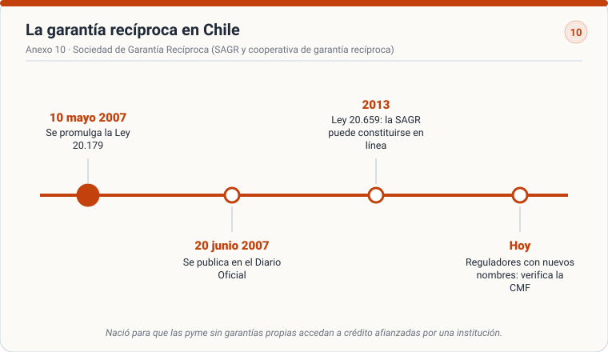
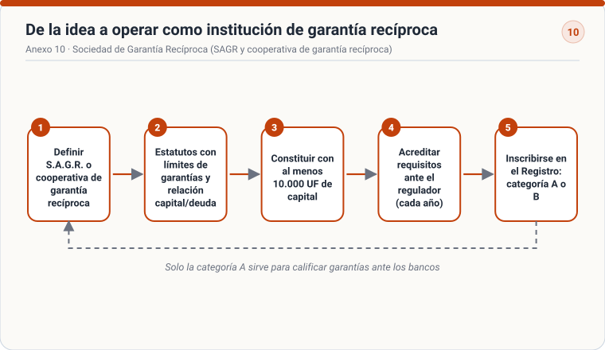
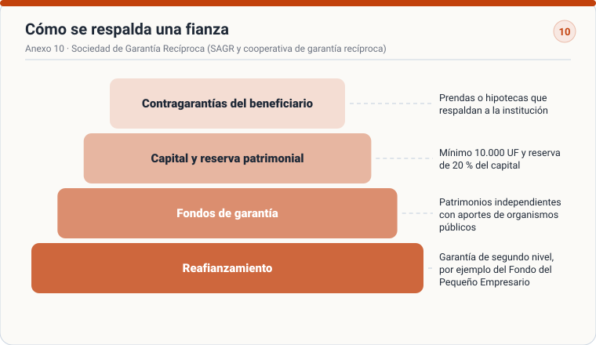
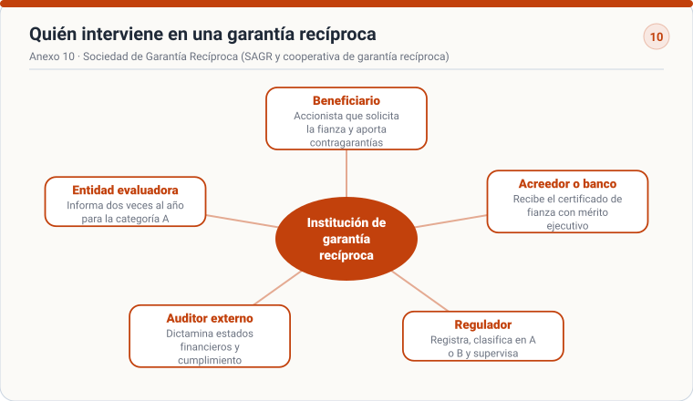
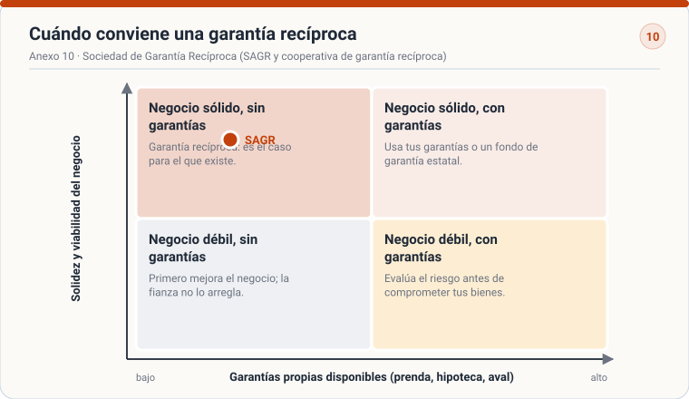

# Anexo 10 · Sociedad de Garantía Recíproca (SAGR y cooperativa de garantía recíproca)

> **Fecha de consulta de las fuentes:** 2026-11-25. **Naturaleza:** material educativo; no es asesoría
> legal, tributaria ni financiera. Las normas cambian: confirma cada dato en la fuente oficial citada al
> final antes de actuar. Este anexo separa **obligación legal**, **recomendación profesional** y **medida
> voluntaria**.

<!-- anexos:nav-inicio -->

**Navegación:** [← 09. Cooperativa](09-cooperativa.md) · [Índice de anexos](README.md) · [11. Sociedad Civil (Código Civil) →](11-sociedad-civil.md)

## En 60 segundos

- Su objeto exclusivo es otorgar fianzas; no puede dar créditos directos (Ley 20.179, arts. 3 y 4).
- Capital y patrimonio mínimo de 10.000 UF y reserva patrimonial del 20 % del capital.
- Solo las instituciones de categoría A sirven para calificar garantías ante los bancos.
- No goza del beneficio de excusión y se subroga en los derechos del acreedor al pagar.
- Si el acreedor renegocia sin su consentimiento, la fianza puede extinguirse.

<!-- anexos:nav-fin -->

## 1. Ficha rápida

| Pregunta | Respuesta |
|---|---|
| ¿Qué es? | Una institución cuyo **objeto exclusivo** es otorgar **garantías personales (fianzas)** a los acreedores de sus beneficiarios, para caucionar obligaciones ligadas a sus actividades empresariales, productivas, profesionales o comerciales (art. 3 de la Ley 20.179). |
| ¿Qué formas puede tomar? | La **Sociedad Anónima de Garantía Recíproca (S.A.G.R.)**, regida por la Ley 18.046, y la **Cooperativa de Garantía Recíproca (CGR)**, con autorización del Departamento de Cooperativas (art. 1). |
| ¿Quiénes son los accionistas? | Personas naturales o jurídicas que participan en el capital y pueden optar a ser **afianzados** por la sociedad (art. 1). |
| ¿Capital mínimo? | Una suma equivalente a **10.000 unidades de fomento**, y el patrimonio debe mantenerse siempre al menos en ese nivel (art. 3 letra c). |
| ¿Puede prestar dinero? | **No.** Está prohibida la concesión de créditos directos a accionistas o terceros (art. 4). |
| ¿Quién la regula y fiscaliza? | La Ley 20.179 asigna la regulación a la Superintendencia de Bancos e Instituciones Financieras; ver la nota de vigencia en la sección 2. |
| ¿Se puede constituir en línea? | La Ley 20.659 incluye a «la sociedad anónima de garantía recíproca» (art. 2 N.º 4). La constitución como institución habilitada exige además acreditar requisitos ante el regulador. |
| ¿Para quién suele servir? | Micro y pequeñas empresas que **no tienen garantías propias** suficientes para acceder a crédito, y que se asocian para respaldarse unas a otras. |
| ¿Para quién no? | Quien busca un vehículo para su propio negocio de producción o servicios: es una institución financiera de apoyo, no un tipo para operar un negocio común. |

## 2. Historia y evolución

### 2.1. El problema que resuelve

Muchas pequeñas empresas son viables, pero no pueden acceder a crédito porque no tienen **garantías
suficientes** para el acreedor: un banco pide una prenda, una hipoteca o un aval que la empresa no posee. La
idea de la garantía recíproca es que **varias empresas se asocien** para formar una institución que **afiance
sus obligaciones** ante los acreedores; cada empresa aporta al capital y, a cambio, puede solicitar fianzas.
La institución aprende a evaluar el riesgo de sus socios y a diversificarlo.

### 2.2. La ley de 2007

La **Ley 20.179** se promulgó el **10 de mayo de 2007** y se publicó el **20 de junio de 2007**, bajo el
título «establece un marco legal para la constitución y operación de sociedades de garantía recíproca». Su
artículo 1 «autoriza el establecimiento de Sociedades Anónimas de Garantía Recíproca o S.A.G.R.», que deben
regirse por la Ley 18.046, y admite que desarrollen el giro las cooperativas constituidas especialmente para
ese efecto.

### 2.3. Una nota sobre los nombres de los reguladores

El texto de la ley menciona a la **Superintendencia de Bancos e Instituciones Financieras** y a la
**Superintendencia de Valores y Seguros**. Esas instituciones fueron objeto de reformas posteriores en el
sistema de supervisión financiera, y hoy sus funciones están, en general, bajo la **Comisión para el Mercado
Financiero (CMF)**. Verifica en el texto actualizado y en el sitio de la CMF qué organismo ejerce cada
función y qué normas de carácter general están vigentes. Para el tema del reafianzamiento estatal, la ley
cita el **Fondo de Garantía del Pequeño Empresario** (Decreto Ley 3.472 de 1980), que opera hoy mediante los
instrumentos y programas de fomento vigentes; revisa su estado actual.

## 3. Marco legal

### 3.1. Mapa de normas

| Norma | Qué aporta |
|---|---|
| Ley 20.179 (2007) | Marco legal de las instituciones de garantía recíproca |
| Ley 18.046 | Rige a la S.A.G.R. como sociedad anónima (art. 1) |
| DFL 5 de 2003 (cooperativas) | Rige a las cooperativas de garantía recíproca (art. 1) |
| Ley 20.659 | Constitución y modificación en línea de la S.A.G.R. (art. 2 N.º 4) |
| Código Civil, título de la fianza | Rige la fianza en lo no previsto (art. 12) |
| Decreto Ley 3.472 de 1980 | Fondo de Garantía del Pequeño Empresario (art. 34) |
| Ley General de Bancos | Límites individuales de crédito (art. 19) |

### 3.2. Obligación, recomendación, opción

| Materia | Tipo | Detalle |
|---|---|---|
| Objeto exclusivo | Obligación | Art. 3 letra a |
| Nombre con «Sociedad Anónima de Garantía Recíproca» o «S.A.G.R.» | Obligación | Art. 3 letra b |
| Capital mínimo de 10.000 UF y patrimonio permanente igual o superior | Obligación | Art. 3 letra c |
| Prohibición de créditos directos | Obligación | Art. 4 |
| Fondo de reserva patrimonial de al menos 20 % del capital | Obligación | Art. 7 |
| Contrato de garantía recíproca con cada beneficiario | Obligación | Art. 11 |
| Estados financieros auditados por auditor independiente inscrito | Obligación | Art. 20 |
| Informes de evaluación independiente para la categoría A | Opción con consecuencias regulatorias | Art. 18 |
| Fondos de garantía con aportes de organismos públicos | Opción | Art. 33 |

## 4. Cómo se constituye

### 4.1. Pasos

1. **Definir la forma:** S.A.G.R. o cooperativa de garantía recíproca (art. 1).
2. **Estatutos** con las materias del art. 4 de la Ley 18.046 y las propias de la Ley 20.179 (art. 5):
   condiciones generales de las garantías y contragarantías; porcentajes máximos de garantías en relación con
   patrimonio, fondos de garantía o contragarantías; y la relación máxima entre el capital que aporta cada
   accionista beneficiario y el importe máximo de las deudas cuya garantía solicite. El estatuto puede fijar
   requisitos para ser accionista y beneficiario.
3. **Constituir** la sociedad anónima. La Ley 20.659 incluye a la S.A.G.R. entre las personas jurídicas que
   pueden constituirse y modificarse por el Registro de Empresas y Sociedades; también puede hacerse por la
   vía tradicional de escritura pública con inscripción y publicación en sesenta días.
4. **Acreditar ante el regulador**, previamente al ejercicio del giro: que está legalmente constituida y
   tiene giro exclusivo; que sus administradores **no han sido condenados por crimen o simple delito**; y que
   su patrimonio es igual o superior a **10.000 UF**. Debe acreditarse además **cada año** (art. 17).
5. **Inscripción en el Registro de Instituciones de Garantía Recíproca**, con clasificación en categoría
   **A** o **B** (art. 18).
6. **Operar** con contratos de garantía recíproca y certificados de fianza.

### 4.2. La categoría A y la categoría B

La categoría **A** incluye a las instituciones que, además de cumplir los requisitos, tienen un **informe
favorable de evaluación** de una entidad independiente especializada, emitido por lo menos en **dos épocas
distintas del año**; la categoría **B**, a las que no lo cumplen. Solo los certificados de fianza de las de
categoría A se consideran para calificar garantías de entidades bancarias y financieras y sirven para ampliar
el límite individual de crédito del art. 84 N.º 1 de la Ley General de Bancos (art. 19). Es decir: **la
categoría A es la que vuelve útil la fianza para el banco.**

### 4.3. Cooperativas de garantía recíproca

Las cooperativas que se constituyan especialmente para este giro requieren **autorización previa del
Departamento de Cooperativas**. Su constitución sigue las normas de las cooperativas de ahorro y crédito, y
su fiscalización, las de las cooperativas de importancia económica, sin perjuicio de las normas específicas
del Título V (art. 1). El nombre debe contener «Cooperativa de Garantía Recíproca» o «CGR» (art. 3 letra b).
Ver el Anexo 09.

### 4.4. Modificación y término

La disolución, liquidación, división, fusión y quiebra se rigen por las normas de las sociedades anónimas,
con excepciones (art. 27). **La disolución, división y fusión requieren la autorización previa y por escrito
de dos tercios de los acreedores del total de las deudas garantizadas** y estas instituciones **solo pueden
fusionarse entre sí** (art. 28). Las entidades surgidas de una fusión o división responden solidariamente
por las fianzas anteriores, salvo pacto en contrario (art. 29).

## 5. Capital, aportes y propiedad

### 5.1. Capital y accionistas beneficiarios

El capital mínimo inicial equivale a **10.000 UF** y debe mantenerse como patrimonio mínimo en todo momento
(art. 3 letra c). Los accionistas pueden ser personas naturales o jurídicas y **pueden optar a ser
afianzados** (art. 1). La relación entre el capital que cada accionista beneficiario aporta y el monto máximo
de las deudas que puede pedir afianzar con cargo a sus acciones se fija en el estatuto (art. 5 N.º 3).

**Ejemplo ilustrativo.** Una S.A.G.R. fija que cada accionista beneficiario puede pedir fianzas por hasta
veinte veces el capital que aportó. Un taller aporta 1.000.000 de pesos y puede solicitar fianzas hasta
20.000.000 con cargo a sus acciones; si necesita 30.000.000, debe aportar más capital o ofrecer
contragarantías adicionales. El múltiplo es ilustrativo: la ley no lo fija, lo define el estatuto.

### 5.2. Restricciones sobre las acciones

El accionista beneficiario **no puede gravar ni enajenar sus aportes de capital** mientras tenga
obligaciones vigentes o con saldo insoluto afianzadas por la entidad, salvo en beneficio de ella (art. 8).
Para acceder a una fianza, puede constituir **prenda sobre sus acciones** a favor de la entidad (art. 16).
La entidad puede adquirir acciones de su propia emisión, sin acuerdo de junta, en caso de ejecución de esa
garantía o de dación en pago (art. 16).

### 5.3. Dividendos y mora

Para tener derecho a dividendos, el accionista beneficiario **no puede estar en mora** en las obligaciones
que la entidad le caucionó; los dividendos que le corresponderían se aplican al pago del interés moratorio y
del capital adeudado (art. 9). Los demás derechos sociales se suspenden de pleno derecho en caso de mora o
simple retardo (art. 10).

### 5.4. Fondo de reserva patrimonial

La institución debe constituir un **fondo de reserva patrimonial** de al menos **20 % del capital**, con la
única finalidad de absorber pérdidas futuras del giro. Solo puede repartir dividendos si la reserva es igual
o superior al 20 % del capital pagado; una vez completa, se incrementa con a lo menos el 25 % de las
utilidades que correspondan a los accionistas beneficiarios. En caso de disolución, el saldo se distribuye
entre los accionistas o socios (art. 7).

### 5.5. Inversión de los recursos

Los recursos se invierten en los instrumentos que autorice el estatuto; salvo disposición en contrario, al
menos el **50 % de la reserva patrimonial** solo puede invertirse en ciertos instrumentos financieros de
bajo riesgo señalados en la ley (art. 6). La misma regla se aplica a los fondos de garantía administrados.

### 5.6. Fondos de garantía con aporte público

Los organismos públicos autorizados para fomentar y financiar a micro y pequeñas empresas pueden
proporcionar recursos a las instituciones mediante créditos cuyo reembolso puede quedar subordinado a una
condición (art. 32). Pueden además aportar a **fondos de garantía** con la única finalidad de afianzar las
obligaciones que la institución afiance. Esos fondos son **patrimonios independientes** del de la
institución: esta opera a nombre y por cuenta y riesgo de los fondos (art. 33).

## 6. Administración y gobierno

### 6.1. Reglas de la sociedad anónima

La S.A.G.R. se gobierna por la Ley 18.046: directorio, gerente y juntas. Las reglas de ese cuerpo legal se
resumen en el Anexo 07 (cerrada) y en el Anexo 08 (abierta). Una particularidad: la institución **no requiere
acuerdo de junta de accionistas** para garantizar obligaciones de terceros cuando la garantía se otorga en
cumplimiento de su objeto social, aunque los estatutos pueden establecer prohibiciones y exigencias
especiales para ciertos casos (art. 3 letra d).

### 6.2. Qué puede garantizar

Puede garantizar obligaciones de dar, hacer o no hacer en que el beneficiario sea **deudor principal** y cuyo
origen esté dentro del giro de sus actividades empresariales, productivas, profesionales o comerciales. Puede
también garantizar actos o contratos por los cuales el beneficiario transfiera créditos que posea contra
terceros, de los que deriven obligaciones subsidiarias o solidarias, aun cuando no sea deudor principal
(art. 3).

### 6.3. Servicios adicionales

Además de afianzar, puede prestar asesoramiento técnico, económico, legal y financiero a los beneficiarios y
administrar los fondos de garantía y las contragarantías (art. 3 letra a).

### 6.4. Auditoría y supervisión

Los estados financieros anuales deben ser auditados por **auditores externos independientes** inscritos en el
registro de auditores del regulador, que deben emitir un juicio razonado sobre el cumplimiento de las normas
de regulación (art. 20). Los bancos, instituciones financieras y cooperativas de ahorro y crédito deben
proporcionar a su ente fiscalizador la información que este solicite sobre las obligaciones garantizadas, y
los acreedores deben dar a la institución la información que pida sobre el comportamiento del deudor, bajo
responsabilidad por perjuicios (art. 21).

### 6.5. Alertas de inestabilidad

Si ocurren hechos que ponen en riesgo la situación financiera o solvencia y el directorio no los normaliza
dentro de **treinta días** desde la elaboración del estado financiero, debe convocar a junta dentro del quinto
día hábil para acordar el aumento de capital necesario, que debe celebrarse dentro de treinta días. Si se
rechaza o no se entera, la institución **no puede aumentar el monto global de las garantías ni hacer
inversiones**, salvo en instrumentos del Banco Central (art. 23). La ley **presume** problemas de solvencia
si el patrimonio, tras pérdidas del ejercicio, es inferior al capital mínimo; si de dos estados financieros
consecutivos se desprende que en seis meses lo será; o si se otorgaron garantías a un mismo beneficiario por
más del **10 % del patrimonio** sin contragarantías que aseguren razonablemente la recuperación (art. 23).

### 6.6. Un escenario para practicar: ¿se extingue la fianza?

**Caso ilustrativo.** Una carpintería tiene un crédito bancario de 15.000.000 de pesos afianzado por una
institución de garantía recíproca. Las cifras son ilustrativas. Tres situaciones posibles:

| Situación | ¿Qué ocurre con la obligación de la institución? | Fundamento |
|---|---|---|
| La carpintería paga todo el crédito | Se extingue por el pago de la obligación principal | Art. 15 letra a |
| El banco y la carpintería acuerdan alargar el plazo y cambiar la tasa, sin avisar a la institución | Puede extinguirse por modificación de la obligación principal sin su intervención y consentimiento | Art. 15 letra b |
| La carpintería incumple tres cuotas | La institución debe pagar; si paga las cuotas vencidas en treinta días, el banco no puede acelerar la deuda contra ella mientras siga cumpliendo | Art. 14 |

En el segundo caso, el acreedor que reprograma sin consultar corre el riesgo de **perder la garantía**, y el
beneficiario, de quedar sin el respaldo que sostiene su crédito. La enseñanza para ambos es la misma:
**cualquier cambio de condiciones debe pasar por la institución**. En el tercero, el acreedor debe además
requerir de pago a la institución **dentro de los seis meses** siguientes al incumplimiento, por notario o
carta certificada; después de eso, la garantía podría perder fuerza práctica. Tras pagar, la institución se
subroga y puede cobrar al deudor y a sus codeudores o avalistas, así que **la fianza no borra la deuda**: la
traslada a quien cobra después.

## 7. Responsabilidad

### 7.1. De los accionistas

Los accionistas de una S.A.G.R. responden como en cualquier sociedad anónima, solo por sus aportes. Pero el
**accionista beneficiario** tiene una responsabilidad adicional como deudor: **queda obligado frente a la
entidad por los pagos que esta efectúe** en cumplimiento de las obligaciones garantizadas (art. 12).

### 7.2. De la entidad ante el acreedor

La institución **no goza del beneficio de excusión**: el acreedor puede exigirle el pago sin perseguir antes
al deudor principal. Debe pagar si el beneficiario incumple, optando entre continuar el calendario de pagos
originalmente pactado, pagar el saldo insoluto anticipadamente o pactar con el acreedor modalidades
distintas. Si paga las cuotas vencidas dentro de treinta días desde el requerimiento, la cláusula de
aceleración no se aplica a la entidad mientras cumpla en lo sucesivo. El acreedor debe requerir de pago
**dentro de seis meses** desde el incumplimiento, por notario o carta certificada (art. 14).

Tras pagar, la institución se **subroga** en los derechos del acreedor y puede exigir el valor total de la
fianza al deudor principal y a sus codeudores o avalistas (art. 14).

### 7.3. Cuándo se extingue la obligación de la institución

Se extingue por el pago de la obligación principal; por modificación o novación de esta **sin su
intervención y consentimiento**; y por las causas generales de extinción (art. 15). La segunda causa es
clave: si el deudor renegocia con el acreedor sin avisar a la institución, la fianza puede extinguirse.

### 7.4. Certificado de fianza

El certificado de fianza tiene **mérito ejecutivo** (art. 12). La entidad solo puede oponerse con las
excepciones de pago, prescripción, no empecer el título al ejecutado y concesión de prórrogas o esperas, y
las dos últimas deben fundarse en antecedente escrito con fundamento plausible (art. 12). Los créditos
afianzados gozan del privilegio del art. 2481 N.º 1 del Código Civil (art. 12). El certificado puede
emitirse de forma **inmaterial**, depositado en un depósito centralizado de valores autorizado, con firma del
gerente en el caso de impresión física, y con las seguridades contra la falsificación (art. 13).

### 7.5. Prohibición de créditos y responsabilidades por infracciones

Está **prohibido el crédito directo** a accionistas y terceros; el acto contrario es nulo y los directores y
ejecutivos que hayan participado en la decisión son **solidariamente responsables** de los perjuicios (art.
4). Los administradores no pueden haber sido condenados por crimen o simple delito (art. 17).

### 7.6. Insolvencia

Si cesa el pago de una obligación, el gerente avisa de inmediato al directorio, que debe cumplir con el
art. 101 de la Ley 18.046 (art. 24); el directorio debe **proponer convenio a los acreedores dentro de diez
días** desde que se detecte la falta de solvencia (art. 25); y se comunica al regulador y, si hay deudas con
cooperativas de ahorro y crédito, al Departamento de Cooperativas (art. 26). En caso de liquidación por
quiebra, el síndico debe transferir las fianzas vigentes a otras instituciones mediante licitación pública en
no más de **ciento veinte días**; transcurridos seis meses sin transferencia, las fianzas caducan y las
contragarantías pasan a garantizar directamente las obligaciones del beneficiario, con reparto a prorrata
entre los acreedores (arts. 30 y 31). La ley fue redactada bajo la antigua Ley de Quiebras; confirma qué
procedimiento concursal se aplica hoy (Ley 20.720).

## 8. Tributación

### 8.1. Cómo tributa

La S.A.G.R. es una sociedad anónima y contribuyente de Primera Categoría. La Ley 20.179, en el texto
revisado, **no establece un régimen tributario especial** para la institución; se aplica el régimen general
según su situación. La cooperativa de garantía recíproca sigue las reglas de las cooperativas (Anexo 09), con
las cautelas indicadas allí. Ver el [flujo tributario](../docs/02_SII_TAX_FLOW.md).

### 8.2. Tasas recientes

La **Ley 21.850** fija la tasa de Primera Categoría en 27 % para 2026, 25,5 % para 2027, 24 % para 2028 y
23 % desde 2029. **Verifica en el SII.** Ver la
[guía de la Ley 21.850](../docs/20_LEY_21850_RECONSTRUCCION_NACIONAL.md).

### 8.3. Efecto para el beneficiario

Las comisiones que una empresa paga por la fianza pueden tener tratamiento tributario distinto según su
naturaleza y su relación con el giro. Consulta a un contador para determinar si son gasto necesario para
producir la renta y cómo registrarlas.

### 8.4. Decisión práctica

Una S.A.G.R. es útil **si tu problema es la falta de garantías**, no si tu problema es la falta de ventas o
de capital de trabajo. Antes de unirte, compara el costo total de la fianza (comisión, capital que debes
aportar, contragarantías) con el costo de otras vías de garantía, como el Fondo de Garantía para Pequeños
Empresarios u otras líneas de fomento.

**Ejemplo ilustrativo.** Una panadería necesita un crédito de 12.000.000 de pesos y el banco exige garantía.
Aportando 600.000 de capital a una S.A.G.R. y pagando una comisión anual de 2,5 % del monto afianzado
(300.000 pesos) obtiene un certificado de fianza. Si en cambio no tuviera acceso a la fianza, quizá debería
ofrecer un aval personal. La comparación debe incluir el capital inmovilizado y la renuncia a vender las
acciones mientras la fianza esté vigente (art. 8). Las cifras son ilustrativas.

## 9. Obligaciones laborales, contables y sectoriales

### 9.1. Contabilidad y auditoría

Estados financieros anuales auditados por un auditor externo independiente inscrito (art. 20), y
acreditación anual de los requisitos ante el regulador (art. 17).

### 9.2. Control de riesgos

La ley impone límites que operan como control: porcentajes máximos de garantías, relación máxima entre
capital y deuda afianzada, y la presunción de problemas si se concentra más del 10 % del patrimonio en un
beneficiario sin contragarantías (arts. 5 y 23). Un buen **manual de riesgos** es la mejor práctica.

### 9.3. Laboral y permisos

Ver el [flujo laboral](../docs/08_EMPLOYMENT_FLOW_CHILE.md), el Anexo 17 y la
[matriz de permisos](../docs/06_PERMITS_MATRIX.md).

### 9.4. Datos y prevención del delito

Una institución que maneja información financiera de empresas debe cuidar los datos personales y prevenir
delitos económicos. Ver [cumplimiento y riesgo](../docs/13_COMPLIANCE_RISK.md).

## 10. Antes de construir: lista de verificación

### 10.1. Para quien quiere **crear** una S.A.G.R. o una CGR

1. ¿Existe un grupo de empresas con necesidad común de garantías y capacidad de aportar capital?
2. ¿Cuál es el capital: al menos 10.000 UF y patrimonio permanente igual o superior?
3. ¿Qué límites internos de riesgo: porcentajes máximos de garantías y relación capital/deuda?
4. ¿Quiénes administrarán y cumplen el requisito de no haber sido condenados por crimen o simple delito?
5. ¿Quién hará las evaluaciones independientes para aspirar a la categoría A?
6. ¿Qué fondos de garantía públicos o privados se podrán conseguir y bajo qué condiciones?
7. ¿Qué política de contragarantías y de recuperación de deuda?
8. ¿Cómo se manejará el riesgo de insolvencia y el aviso al regulador?

### 10.2. Para quien quiere **usar** una S.A.G.R. como beneficiario

1. ¿La institución está inscrita y en qué categoría (A o B)?
2. ¿Qué capital debo aportar y cuánto de afianzamiento obtengo por cada peso?
3. ¿Cuánto cuesta la comisión y qué contragarantías debo entregar?
4. ¿Qué acreedores aceptan la fianza de esta institución?
5. ¿Qué pasa si renegocio mi deuda sin avisar a la institución?
6. ¿Qué ocurre con mis acciones si me atraso: dividendos y derechos suspendidos?

### 10.3. Errores frecuentes

- **Confundirla con un banco o una cooperativa de ahorro:** no presta dinero.
- **Elegir una institución sin ver su categoría** y descubrir que el banco no la acepta.
- **Renegociar con el acreedor sin consentimiento de la institución:** se extingue la fianza (art. 15).
- **No considerar el capital inmovilizado:** no puedes enajenar tus acciones mientras haya deuda afianzada.
- **Concentrar garantías en pocos beneficiarios sin contragarantías.**
- **Ignorar alertas de solvencia:** el directorio tiene plazos estrictos.
- **No acreditar anualmente los requisitos ante el regulador.**

### 10.4. Caso ilustrado: un grupo de talleres metalmecánicos

**Caso ilustrativo.** Quince talleres de una comuna industrial no logran créditos de bancos porque carecen de
garantías reales. Los números son ilustrativos.

1. **Idea.** Constituyen una S.A.G.R. con un capital total de 12.000 UF, superior al mínimo de 10.000.
2. **Estatuto.** Definen una relación máxima de fianzas por capital de 10 veces, un límite de garantías por
   beneficiario de 8 % del patrimonio, y exigencia de contragarantías para montos superiores.
3. **Administradores.** Eligen un directorio con un gerente con experiencia en riesgo de crédito y verifican
   que nadie tenga condenas por crimen o simple delito.
4. **Regulación.** Acreditan sus requisitos ante el regulador y se inscriben en el registro. Contratan una
   entidad evaluadora independiente para obtener la categoría A.
5. **Operación.** Cada taller firma un contrato de garantía recíproca y recibe certificados de fianza para
   presentar al banco.
6. **Riesgo.** Un taller incumple. La S.A.G.R. paga las cuotas vencidas dentro de los treinta días, el banco no
   acelera la deuda y la institución se subroga en los derechos y cobra al deudor.
7. **Lección.** La institución funciona si la selección y el seguimiento de riesgo son disciplinados; una
   fianza sin análisis es un crédito disfrazado.

### 10.5. Mini glosario

| Término | Significado |
|---|---|
| Beneficiario | Persona natural o jurídica que puede optar a ser afianzada por la institución. |
| Contragarantía | Caución que el beneficiario entrega a la institución como respaldo. |
| Certificado de fianza | Documento con mérito ejecutivo por el cual la institución se constituye fiadora. |
| Contrato de garantía recíproca | Contrato entre el beneficiario y la institución que fija derechos y obligaciones. |
| Beneficio de excusión | Derecho del fiador a exigir que se persiga primero al deudor principal; la institución no lo tiene. |
| Subrogación | La institución que paga asume los derechos del acreedor. |
| Reafianzamiento | Garantía de una garantía, por ejemplo, del Fondo de Garantía del Pequeño Empresario. |
| Categoría A | Registro de instituciones con evaluación independiente, aceptadas para calificar garantías bancarias. |

## 11. Cuándo conviene y cuándo no

### 11.1. Comparación

| Criterio | S.A.G.R. | Aval personal | Fondo estatal de garantía | Crédito con garantía real |
|---|---|---|---|---|
| Quién respalda | Institución con capital de los asociados | El dueño con su patrimonio | Fondo público | Un bien del deudor |
| Costo | Capital aportado y comisión | Riesgo patrimonial | Comisión de programa | Costo de constituir la garantía |
| Aceptación por el banco | Depende de la categoría | Alta | Según programa | Alta |
| Requisito principal | Ser accionista beneficiario | Patrimonio del avalista | Elegibilidad del programa | Bien disponible |
| Riesgo para el dueño | Capital y mora | Todo su patrimonio | Condiciones del programa | El bien dado en garantía |

### 11.2. Señales a favor

- Empresa viable con crédito disponible, pero **sin garantías propias**.
- Grupo de empresas con confianza mutua y capacidad de capitalizar la institución.
- Acceso a fondos de garantía públicos o a reafianzamiento.

### 11.3. Señales en contra

- El problema es operacional o de ventas, no de garantías.
- No hay capital para aportar o no se quiere inmovilizar.
- Las instituciones disponibles no son de categoría A y el banco no las acepta.

## 12. Cuándo llamar a un profesional

| Situación | Profesional | Por qué |
|---|---|---|
| Crear una S.A.G.R. o CGR | Abogado financiero | Requisitos de regulador, estatutos y límites |
| Evaluar el riesgo y fijar límites | Analista de riesgo | Diseño de políticas |
| Contrato de garantía recíproca | Abogado | Contragarantías y cláusulas de mora |
| Insolvencia de la institución | Abogado concursal | Plazos y procedimientos |
| Tratamiento tributario de comisiones y capital | Contador | Gasto, aporte y renta |

Consulta la [guía de cuándo llamar a un profesional](../docs/18_WHEN_TO_CALL_A_PROFESSIONAL.md).

## 13. Escenarios resueltos

Casos **ilustrativos** (nombres y cifras inventados) sobre la Ley 20.179. La ley menciona organismos que luego fueron
reformados; en cada caso, confirma en la CMF cuál es el organismo competente hoy.

### Escenario 1: la pyme que no paga la cuota y el banco que cobra la fianza

**Situación.** Una panadería obtiene un crédito de 20.000.000 de pesos con fianza de una SAGR. Tras la cuota 8 deja de
pagar. El banco quiere declarar vencida toda la deuda.

**Análisis.** El acreedor debe requerir de pago a la institución dentro de los **seis meses** siguientes al
incumplimiento, por notario o carta certificada al domicilio de la institución (art. 14). La SAGR puede optar entre
(a) seguir pagando el calendario original, en cuyo caso, si paga lo vencido dentro de los 30 días del requerimiento, la
cláusula de aceleración no se le aplica mientras siga cumpliendo; (b) pagar el saldo insoluto anticipadamente; o (c)
pactar otra modalidad con el acreedor. No tiene beneficio de excusión: el banco no necesita perseguir antes a la
panadería. Al pagar, la SAGR se subroga en los derechos del banco contra la panadería y sus codeudores o avalistas.

**Lección.** Para el beneficiario, la fianza no borra la deuda: la traslada a la institución, que luego le cobra.

### Escenario 2: el acreedor que renegocia sin avisar

**Situación.** El banco y el beneficiario acuerdan alargar el plazo de pago sin consultar a la institución.

**Análisis.** La obligación de la institución se extingue, entre otras causas, por la modificación o novación de la
obligación principal **sin su intervención y consentimiento** (art. 15 letra b). Para el banco, renegociar sin avisar
puede dejarlo sin garantía.

**Decisión.** Toda renegociación debe pasar por la institución con consentimiento escrito.

### Escenario 3: el socio beneficiario que quiere vender sus acciones

**Situación.** Un accionista beneficiario quiere vender sus acciones de la SAGR mientras tiene una fianza vigente.

**Análisis.** No puede gravar ni enajenar sus aportes de capital, salvo a beneficio de la entidad, mientras tenga
obligaciones vigentes o con saldo insoluto afianzadas por ella (art. 8). Además puede haber constituido prenda sobre
esas acciones a favor de la institución (art. 16).

**Decisión.** Primero extinguir o sustituir las obligaciones afianzadas; después, vender.

### Escenario 4: dividendos y mora

**Situación.** La junta acuerda repartir dividendos. Un socio beneficiario está en mora de una obligación afianzada.

**Análisis.** No tiene derecho a la distribución mientras esté en mora a la fecha en que se acuerde; lo que le habría
correspondido se aplica al interés moratorio pactado (o al máximo convencional) sobre el saldo insoluto y el remanente
al capital (art. 9). Sus demás derechos sociales se suspenden de pleno derecho por la mora o el simple retardo (art. 10).

### Escenario 5: la garantía concentrada

**Situación.** Una SAGR con patrimonio de 30.000 UF otorgó garantías a un solo beneficiario por 4.000 UF sin
contragarantías.

**Análisis.** Se presume que han ocurrido hechos que afectan su situación financiera cuando se otorgan garantías a un
mismo beneficiario, dentro del giro, por sumas superiores al **10 % del patrimonio** sin contragarantías que aseguren
razonablemente la recuperación (art. 23 letra c). 10 % de 30.000 UF son 3.000 UF; 4.000 UF las superan.

**Consecuencia.** Si el directorio no normaliza la situación en 30 días desde la fecha del estado financiero, debe
convocar a junta dentro del quinto día hábil siguiente para acordar el aumento de capital necesario (art. 23).

### Escenario 6: patrimonio bajo el mínimo

**Situación.** Tras pérdidas, el patrimonio de una SAGR cae a 8.500 UF.

**Análisis.** Debe mantener en todo momento un patrimonio al menos equivalente al capital mínimo inicial de 10.000 UF
(art. 3 letra c) y es una de las presunciones de dificultad financiera (art. 23 letra a). Si la junta rechaza el aumento
o este no se entera en plazo, la institución no puede aumentar el monto global de garantías ni invertir, salvo en
instrumentos del Banco Central (art. 23).

### Escenario 7: la tentación del crédito directo

**Situación.** Un director propone «adelantar» fondos a un socio en apuros.

**Análisis.** Está prohibida la concesión de créditos directos a accionistas o terceros; el acto es nulo y los directores
y ejecutivos que participaron son solidariamente responsables por los perjuicios (art. 4).

### Escenario 8: liquidación y traspaso de fianzas

**Situación.** Una SAGR cae en quiebra con fianzas vigentes por 50.000.000 de pesos.

**Análisis.** La ley previó que el síndico transfiriera las fianzas vigentes, junto con las contragarantías, mediante
licitaciones públicas abiertas solo a otras instituciones de garantía recíproca sanas, en no más de 120 días, y que
durante ese lapso el acreedor no pudiera hacer vencer la obligación por la quiebra (art. 30). El procedimiento
concursal aplicable hoy debe verificarse a la luz de la Ley 20.720.

## 14. Catálogo de errores y cómo corregirlos

| N.º | Error | Causa típica | Consecuencia | Cómo corregirlo | Dónde ver más |
|---:|---|---|---|---|---|
| 1 | Prometer «crédito» desde la SAGR | Confundir fianza con préstamo | Nulidad y responsabilidad (art. 4) | Solo garantías | Escenario 7 |
| 2 | Nombre sin la frase legal | Marca de fantasía | Incumple art. 3 letra b | Incluir «S.A.G.R.» | Sección 4 |
| 3 | Capital bajo 10.000 UF | Subestimar el piso | No puede ejercer el giro (art. 17) | Capitalizar | Sección 5 |
| 4 | Patrimonio bajo el mínimo | Pérdidas | Restricciones (art. 23) | Aumento de capital | Escenario 6 |
| 5 | Repartir dividendos sin reserva del 20 % | Presión de socios | Prohibido (art. 7) | Completar la reserva | Sección 5 |
| 6 | Garantizar sin contragarantía a un solo cliente | Confianza | Presunción de insolvencia (art. 23 c) | Límite del 10 % | Escenario 5 |
| 7 | Contrato de garantía recíproca sin protocolizar | Informalidad | Vicio de formalización (art. 11) | Protocolizar o firma avanzada | Sección 4 |
| 8 | Certificado de fianza incompleto | Plantilla pobre | Dudas de ejecución (art. 12) | Todas las menciones | Sección 4 |
| 9 | Vender acciones con fianza vigente | Desconocer el art. 8 | Acto inválido | Extinguir antes | Escenario 3 |
| 10 | Renegociar sin consentimiento | Prisa del acreedor | Fianza extinguida (art. 15 b) | Consentimiento escrito | Escenario 2 |
| 11 | Requerir fuera de los seis meses | Descuido del acreedor | Pérdida de la fianza (art. 14) | Calendario de alertas | Escenario 1 |
| 12 | No acreditar anualmente ante el regulador | Olvido | Sanciones | Calendario anual | Sección 9 |
| 13 | Operar sin categoría A | Confusión | La fianza no califica ante bancos (art. 19) | Evaluaciones independientes | Sección 3 |
| 14 | Fusionarse con una sociedad común | Reorganización | Prohibido (art. 28) | Solo entre SAGR | Sección 7 |
| 15 | Disolver sin autorización de acreedores | Apuro | Acto sin autorización (art. 28) | Dos tercios de acreedores | Sección 7 |

## 15. Alternativas y variantes de diseño

### C.1. SAGR frente a la cooperativa de garantía recíproca

| Criterio | SAGR (sociedad anónima) | Cooperativa de garantía recíproca |
|---|---|---|
| Norma base | Ley 18.046 | Reglas de cooperativas de ahorro y crédito (art. 1) |
| Nombre | «Sociedad Anónima de Garantía Recíproca» o «S.A.G.R.» | «Cooperativa de Garantía Recíproca» o «CGR» |
| Autorización previa | No específica en el art. 1 | Departamento de Cooperativas (art. 1) |
| Fiscalización | Regulador financiero | Como cooperativas de importancia económica (art. 1) |

### C.2. Alternativas para garantizar una deuda pyme

| Alternativa | Qué es | Ventaja | Límite |
|---|---|---|---|
| SAGR | Fianza de una institución especializada | Sin hipoteca propia | Costo y contragarantías |
| Fondo estatal de garantía | Programas públicos de cobertura | Respaldo estatal | Condiciones de cada programa |
| Aval personal | Fianza de un tercero | Rápido | Compromete patrimonio personal |
| Prenda o hipoteca | Garantía real | Bajo costo de crédito | Inmoviliza el bien |

Los fondos estatales y su cobertura se verifican en CORFO y en el anexo 03 y las clases de financiamiento.

### C.3. Contragarantías posibles (art. 11)

1. Prenda sobre acciones o cuotas de la propia institución (art. 16).
2. Bienes, cauciones y derechos acordados en el contrato.
3. Cláusula de garantía general, limitada a un monto máximo.
4. Fianza sin contragarantía, si el estatuto lo permite.

### C.4. Cláusulas de estatuto que exige la ley (art. 5)

1. Condiciones generales de las garantías y contragarantías.
2. Porcentajes máximos de garantías en relación con el patrimonio, los fondos o las contragarantías.
3. Relación máxima entre el capital que aporta cada accionista beneficiario y el importe máximo de deudas que pide
   garantizar con cargo a sus acciones.
4. Requisitos para ser accionista y beneficiario (opcional).

## 16. Vinculación con otros anexos y con las clases

### D.1. ¿Cuándo salto a otro anexo?

| Evento | Anexo |
|---|---|
| Entender la sociedad anónima base | 07 |
| Cooperativas en general | 09 |
| Comparar con formas de pyme | 03, 04, 05 |
| IVA e impuestos | 16 |
| Oficina y patente | 17 y 18 |

### D.2. Clases del programa

- [Parte 16, clase 5: FOGAPE, garantías y evaluación bancaria](../curriculum/part-16-financiamiento-banca-fondos-e-inversion/class-05-fogape-garantias-y-evaluacion-bancaria/README.md)
- [Parte 16, clase 6: SERCOTEC y programas de fomento](../curriculum/part-16-financiamiento-banca-fondos-e-inversion/class-06-sercotec-y-programas-de-fomento/README.md)
- [Parte 5, clase 7: comparación jurídica para elegir forma societaria](../curriculum/part-05-diseno-societario-y-gobierno-inicial/class-07-comparacion-juridica-para-elegir-forma-societaria/README.md)

### D.3. Hilos que se conectan

1. **Fianza y subrogación:** pagar al acreedor convierte a la institución en acreedora del beneficiario.
2. **Reserva y dividendos:** el art. 7 condiciona el reparto a la reserva del 20 %.
3. **Categoría A y bancos:** solo esa categoría sirve para ampliar límites de crédito bancario (art. 19).
4. **Insolvencia y traspaso:** el título VI y el art. 30 buscan proteger a los acreedores de obligaciones vigentes.

## 17. Plantillas y listas de trabajo

### E.1. Plan de 30, 60 y 90 días

| Plazo | Tareas | Responsable | Evidencia |
|---|---|---|---|
| Días 1 a 30 | Estudio de viabilidad, capital de 10.000 UF y socios | Promotores | Plan y compromisos |
| Días 31 a 60 | Estatuto con materias del art. 5; escritura y registro | Abogado | Escritura |
| Días 61 a 90 | Acreditación ante el regulador, auditor, modelo de contrato | Gerente | Certificados |

### E.2. Calendario anual

| Cuándo | Tarea | Base |
|---|---|---|
| Cada año | Acreditar constitución y patrimonio | Art. 17 |
| Al menos dos veces al año | Evaluaciones independientes para categoría A | Art. 18 |
| Cierre anual | Estados financieros auditados | Art. 20 |
| Cada estado financiero | Revisar patrimonio vs. 10.000 UF y concentración del 10 % | Arts. 3 y 23 |
| Al acordar dividendos | Revisar reserva del 20 % y mora de beneficiarios | Arts. 7 y 9 |

### E.3. Lista de revisión de un contrato de garantía recíproca

| Ítem | Sí | No |
|---|---|---|
| Bienes y cauciones del beneficiario | | |
| Monto máximo afianzable | | |
| Plazo de duración | | |
| Modalidad de las garantías | | |
| Derechos y obligaciones | | |
| Protocolizado o con firma avanzada | | |

### E.4. Cálculo de la concentración por beneficiario

| Concepto | Valor |
|---|---:|
| Patrimonio | |
| Límite del 10 % del patrimonio | |
| Garantías al beneficiario sin contragarantía | |
| ¿Supera el límite? | |

## 18. Autoevaluación

1. ¿Cuál es el objeto exclusivo de una SAGR?
2. ¿Cuál es el capital mínimo inicial?
3. ¿Qué porcentaje del capital debe tener la reserva patrimonial?
4. ¿Puede otorgar créditos directos?
5. ¿Qué plazo tiene el acreedor para requerir el pago?
6. ¿Tiene beneficio de excusión?
7. ¿Qué categoría sirve para calificar garantías ante bancos?
8. ¿Con quién puede fusionarse?
9. ¿Qué pasa si renegocian la deuda sin su consentimiento?
10. ¿Qué umbral de garantías sin contragarantía presume problemas?

**Respuestas.**

1. Otorgar garantías personales a los acreedores de sus beneficiarios (art. 3).
2. 10.000 UF (art. 3 letra c).
3. Al menos el 20 % (art. 7).
4. No (art. 4).
5. Seis meses desde el incumplimiento (art. 14).
6. No (art. 14).
7. La categoría A (art. 19).
8. Solo con otras instituciones de garantía recíproca (art. 28).
9. La obligación de la institución puede extinguirse (art. 15 letra b).
10. Más del 10 % del patrimonio a un mismo beneficiario (art. 23 letra c).

**Puntaje.** Ocho o más: dominas el tipo. Cuatro a siete: repasa las secciones 5 y 7. Menos de cuatro: relee el anexo.

## 19. Glosario ampliado

| Término | Significado |
|---|---|
| Beneficiario | Persona que puede optar a ser afianzada por la institución |
| Beneficio de excusión | Derecho del fiador a exigir que se persiga primero al deudor; la SAGR no lo tiene |
| Categoría A | Instituciones con informe favorable de evaluadores independientes |
| Categoría B | Instituciones que no cumplen lo anterior |
| Certificado de Fianza | Documento con mérito ejecutivo por el que la institución afianza una obligación |
| Contragarantía | Caución que el beneficiario entrega a la institución |
| Contrato de Garantía Recíproca | Contrato entre beneficiario e institución que fija derechos y obligaciones |
| Entidad evaluadora | Empresa inscrita que evalúa a la institución para la categoría A |
| Fianza | Obligación accesoria de pagar si el deudor no paga |
| Fondo de reserva patrimonial | Fondo que absorbe pérdidas futuras |
| Institución de garantía recíproca | SAGR o cooperativa de garantía recíproca |
| Subrogación | Traspaso de los derechos del acreedor a quien paga |

## 20. Preguntas frecuentes

**1. ¿Qué hace una sociedad de garantía recíproca?**
Otorga fianzas a los acreedores de sus beneficiarios para caucionar obligaciones de su actividad
empresarial, productiva, profesional o comercial (art. 3).

**2. ¿Presta dinero?**
No. Los créditos directos a accionistas o terceros están prohibidos (art. 4).

**3. ¿Cuál es el capital mínimo?**
El equivalente a 10.000 UF, y debe mantenerse como patrimonio mínimo (art. 3 letra c).

**4. ¿Puede ser una cooperativa?**
Sí, una cooperativa de garantía recíproca constituida especialmente, con autorización del Departamento de
Cooperativas (art. 1).

**5. ¿Quiénes pueden ser accionistas?**
Personas naturales o jurídicas que participan del capital y pueden optar a ser afianzadas (art. 1).

**6. ¿Qué es la contragarantía?**
La caución que el beneficiario entrega a la institución para respaldar las fianzas que ella le otorga
(art. 2 letra d).

**7. ¿Puedo vender mis acciones si tengo una fianza vigente?**
No, salvo en beneficio de la entidad, mientras haya obligaciones afianzadas con saldo insoluto (art. 8).

**8. ¿Qué pasa si me atraso en mis pagos?**
Pierdes el derecho a dividendos mientras estés en mora y se suspenden de pleno derecho tus demás derechos
sociales (arts. 9 y 10).

**9. ¿Qué es la categoría A?**
La de las instituciones con informes favorables de evaluación independiente en dos épocas del año; solo sus
fianzas cuentan para calificar garantías ante los bancos (arts. 18 y 19).

**10. ¿El certificado de fianza tiene mérito ejecutivo?**
Sí, y la institución solo puede oponer excepciones limitadas (art. 12).

**11. ¿La institución puede exigir que primero cobren al deudor?**
No. No goza del beneficio de excusión (art. 14).

**12. ¿Qué plazo tiene el acreedor para cobrar a la institución?**
Debe requerir de pago dentro de los seis meses siguientes al incumplimiento del beneficiario (art. 14).

**13. ¿Qué pasa si renegocio mi deuda sin avisar?**
La obligación de la institución se extingue si hay modificación o novación sin su intervención y
consentimiento (art. 15).

**14. ¿Cuánto debe reservar la institución?**
Un fondo de reserva patrimonial de al menos el 20 % del capital (art. 7).

**15. ¿Puede repartir dividendos?**
Solo si la reserva es igual o superior al 20 % del capital pagado (art. 7).

**16. ¿Qué pasa si la institución tiene problemas financieros?**
El directorio debe normalizar la situación en treinta días o convocar a junta para aumentar capital; si no
se aprueba o no se entera, no puede aumentar garantías ni invertir salvo en el Banco Central (art. 23).

**17. ¿Qué ocurre si quiebra?**
El síndico debe transferir las fianzas vigentes a otras instituciones en no más de ciento veinte días; si no,
caducan a los seis meses (arts. 30 y 31).

**18. ¿Se pueden fusionar con un banco?**
No. Las instituciones de garantía recíproca solo pueden fusionarse entre sí (art. 28).

**19. ¿Pueden recibir fondos públicos?**
Sí: organismos de fomento pueden prestar recursos o aportar a fondos de garantía, que son patrimonios
independientes (arts. 32 y 33).

**20. ¿Es lo mismo que un aval?**
No. El aval es una garantía personal de un tercero; la fianza de una institución de garantía recíproca es
un producto regulado con contragarantías, capital mínimo y supervisión.

**21. ¿Qué diferencia hay entre una fianza y un aval?**
La ley regula una fianza con certificado propio; el aval se trata en la legislación de títulos de crédito. Consulta con un
abogado cuál usa tu operación.

**22. ¿La institución puede invertir libremente sus recursos?**
Solo en los instrumentos que autorice su estatuto; salvo disposición contraria, al menos el 50 % de la reserva patrimonial
va a instrumentos de bajo riesgo señalados en la ley (art. 6).

**23. ¿Se pueden afianzar obligaciones futuras?**
Sí, si están determinadas singularmente en el certificado (art. 12).

**24. ¿Qué mérito tiene el certificado de fianza?**
Tiene mérito ejecutivo; la institución solo puede oponer pago, prescripción, no empecer el título o prórrogas (art. 12).

**25. ¿Qué privilegio tienen los créditos afianzados?**
Gozan del privilegio del art. 2481 N.º 1 del Código Civil (art. 12).

**26. ¿Puede emitirse el certificado sin papel?**
Sí, de forma inmaterial, depositado en un depósito centralizado o institución autorizada (art. 13).

**27. ¿Qué pasa si se pierde el certificado?**
Se aplican las reglas de la ley de letras de cambio compatibles con su naturaleza (art. 12).

**28. ¿Puede la institución adquirir sus propias acciones?**
En la ejecución de la prenda o dación en pago, sin acuerdo de junta (art. 16).

**29. ¿Cuándo quedan sus operaciones restringidas?**
Si la junta rechaza el aumento de capital o este no se entera: no puede aumentar el monto de garantías ni invertir, salvo
en instrumentos del Banco Central (art. 23).

**30. ¿Qué deben hacer los acreedores con la información?**
Entregar a la institución información veraz, suficiente y oportuna sobre las obligaciones garantizadas (art. 21).

**31. ¿Quién fiscaliza hoy?**
La ley nombra a la Superintendencia de Bancos; verifica en la CMF el organismo competente actual (ver sección 2).

**32. ¿Pueden dos instituciones fusionarse?**
Sí, solo entre ellas y con autorización de dos tercios de los acreedores de las deudas garantizadas (art. 28).

**33. ¿Responden las entidades surgidas de una fusión por fianzas anteriores?**
Sí, solidariamente, salvo pacto en contrario con los acreedores (art. 29).

**34. ¿Qué es la categoría A?**
Instituciones con evaluación favorable de una entidad independiente en al menos dos épocas del año (art. 18).

**35. ¿Cuánto cuesta una fianza?**
Este anexo no fija tarifas: varían por institución y operación; compáralas por escrito.

**36. ¿Puedo ser socio y beneficiario a la vez?**
Sí, es el modelo base: accionistas que pueden optar a ser afianzados (art. 1).

**37. ¿Puede una SAGR dar asesoría?**
Sí, técnica, económica, legal y financiera a beneficiarios, y administrar fondos de garantía (art. 3).

**38. ¿Cuándo debo pedir ayuda profesional?**
Al constituirla, al redactar contratos de garantía, ante mora, renegociaciones y cualquier situación de insolvencia.

## 21. Fuentes y vigencia

| Fuente | Qué se usó | Dónde consultarla |
|---|---|---|
| Ley 20.179 (texto íntegro) | Marco legal de las instituciones de garantía recíproca | [BCN, Ley 20.179](https://www.bcn.cl/leychile/navegar?idNorma=261949) |
| Ley 18.046, sobre sociedades anónimas | Régimen de la S.A.G.R. | [BCN, Ley 18.046](https://www.bcn.cl/leychile/navegar?idNorma=29473) |
| DFL 5 de 2003, cooperativas | Cooperativas de garantía recíproca | [BCN, DFL 5](https://www.bcn.cl/leychile/navegar?idNorma=221322) |
| Ley 20.659 | Registro de Empresas y Sociedades | [BCN, Ley 20.659](https://www.bcn.cl/leychile/navegar?idNorma=1048718) |
| Comisión para el Mercado Financiero | Regulación y registros vigentes | [CMF](https://www.cmfchile.cl) |
| CORFO | Fondos de garantía y programas de fomento | [CORFO](https://www.corfo.cl) |
| SII, regímenes tributarios | Rutas de Operación Renta | [SII](https://www.sii.cl/destacados/renta/2026/intermediarios/regimenes_tributarios/) |

**Vigencia.** El texto de la Ley 20.179 se leyó íntegro en la versión publicada por la Biblioteca del
Congreso Nacional el 2026-11-25. Menciona organismos con sus nombres de 2007 y referencias a la antigua Ley de
Quiebras; confirma qué organismo y qué procedimiento aplican hoy. Las normas de carácter general del
regulador no se transcriben.

**Límites.** Este anexo no reproduce el texto íntegro de la ley, no incluye tarifas ni comisiones de
instituciones concretas y sus ejemplos numéricos son ilustrativos. No sustituye la asesoría de un abogado ni
de un contador.

<!-- anexos:cierre-inicio -->

## Para seguir leyendo

- [Anexo 07. Sociedad Anónima Cerrada (S.A.)](07-sociedad-anonima-cerrada.md): se rige por la ley de sociedades anónimas.
- [Anexo 09. Cooperativa](09-cooperativa.md): su versión cooperativa.
- [Anexo 13. Estatuto Pyme: empresas de menor tamaño (Ley 20.416)](13-estatuto-pyme-empresas-de-menor-tamano.md): financiamiento de pymes.

**Navegación:** [← 09. Cooperativa](09-cooperativa.md) · [Índice de anexos](README.md) · [11. Sociedad Civil (Código Civil) →](11-sociedad-civil.md)

<!-- anexos:cierre-fin -->
