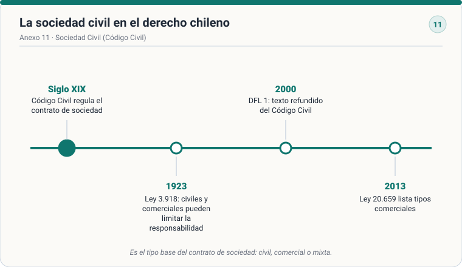
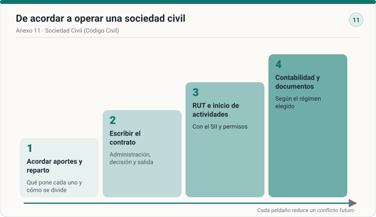
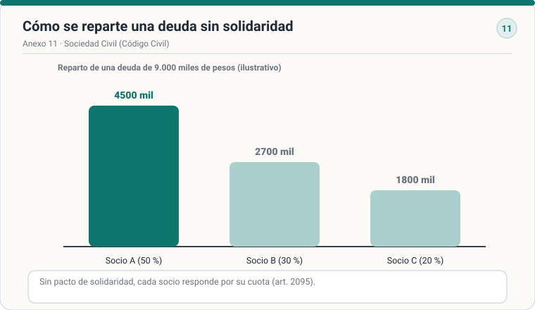
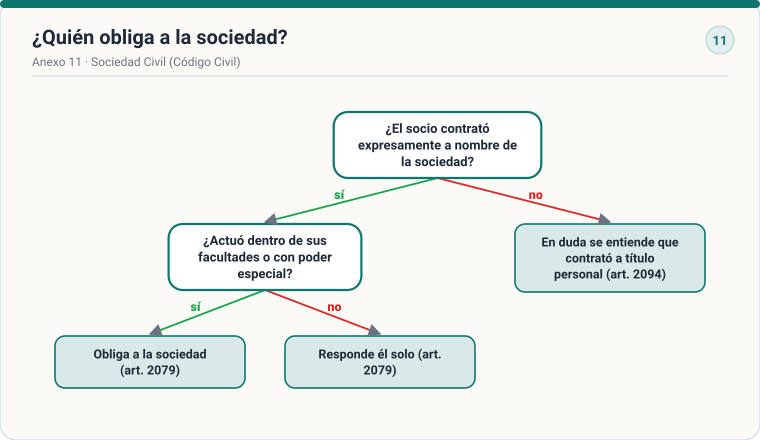
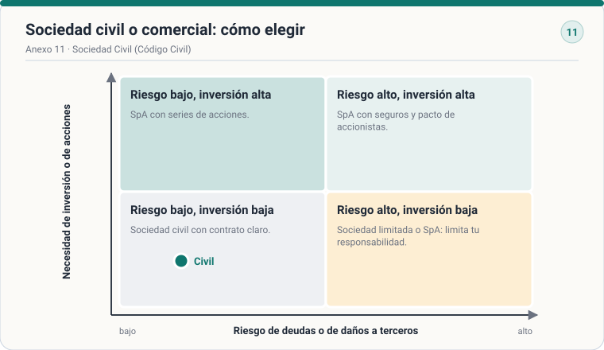

# Anexo 11 · Sociedad Civil (Código Civil, arts. 2053 y siguientes)

> **Fecha de consulta de las fuentes:** 2026-11-25. **Naturaleza:** material educativo; no es asesoría
> legal ni tributaria. Las normas cambian: confirma cada dato en la fuente oficial citada al final
> antes de actuar. Este anexo separa **obligación legal**, **recomendación profesional** y **medida
> voluntaria**.

<!-- anexos:nav-inicio -->

**Navegación:** [← 10. Sociedad de Garantía Recíproca (SAGR y cooperativa de garantía recíproca)](10-sociedad-de-garantia-reciproca-sagr.md) · [Índice de anexos](README.md) · [12. Corporaciones, asociaciones y fundaciones →](12-corporaciones-asociaciones-y-fundaciones.md)

## En 60 segundos

- Es un contrato para repartir beneficios y forma una persona jurídica distinta de los socios (Código Civil, art. 2053).
- Salvo pacto, los socios responden a prorrata de su interés social, no solidariamente (art. 2095).
- En caso de duda, se entiende que el socio contrata a título personal (art. 2094).
- Decide la mayoría de votos según el contrato; modificar lo esencial exige unanimidad (art. 2054).
- No figura entre los tipos del Registro de Empresas y Sociedades.

<!-- anexos:nav-fin -->

## 1. Ficha rápida

| Pregunta | Respuesta |
|---|---|
| ¿Qué es? | Un contrato en que dos o más personas estipulan poner algo en común con la mira de **repartir entre sí los beneficios**; forma una persona jurídica distinta de los socios (art. 2053 del Código Civil). |
| ¿Qué la hace «civil»? | Que no se forme para negocios que la ley califica de actos de comercio (art. 2059). |
| ¿Quién responde por las deudas? | Por regla general los socios responden **a prorrata de su interés social, no solidariamente** (art. 2095), salvo que se exprese otra cosa en el título de la obligación. |
| ¿Cuántos socios? | Dos o más. |
| ¿Qué aportes se admiten? | Dinero, efectos, industria, servicio o trabajo apreciable en dinero (art. 2055). |
| ¿Hay participación de beneficios? | Es **esencial**: sin ella, no hay sociedad (art. 2055). |
| ¿Cómo se vota? | Por mayoría de votos computada según el contrato; si nada se pactó, por mayoría numérica de socios (art. 2054). |
| ¿Se puede constituir en línea? | La Ley 20.659 enumera tipos comerciales; la sociedad civil **no figura** en esa lista. Se rige por el contrato y el Código Civil, y requiere además las gestiones tributarias. |
| ¿Para quién suele servir? | Profesionales, comunidades de bienes o proyectos no mercantiles que quieren una persona jurídica con reglas simples. |
| ¿Para quién no? | Quien necesita acciones, inversionistas o una estructura mercantil reconocida por bancos y reguladores. |

## 2. Historia y evolución

### 2.1. El tipo originario del derecho privado

Antes de que existieran las sociedades comerciales con sus regímenes propios, el derecho civil ya regulaba
la **sociedad** como contrato. En Chile, esa regulación está en el **Título XXVIII del Libro IV del Código
Civil**. El texto vigente es el **texto refundido, coordinado y sistematizado** fijado por el DFL 1 de
2000, promulgado el 16 de mayo de 2000 y publicado el 30 de mayo de 2000. Ese texto conserva el lenguaje y
la estructura de la obra original del siglo XIX (según el dato histórico general, el Código Civil chileno
se promulgó en 1855 y se atribuye a Andrés Bello; esa referencia no proviene del texto consultado para este
anexo).

### 2.2. Civil, comercial y mixta

El artículo 2059 distingue: la sociedad puede ser **civil o comercial**; son comerciales las que se forman
para negocios que la ley califica de actos de comercio; las otras son civiles. Los socios pueden pactar que
una sociedad **civil** se someta a las reglas de la comercial (art. 2060). Y la **sociedad anónima es siempre
mercantil**, aunque se forme para negocios civiles (art. 2064). Esa distinción tiene consecuencias
prácticas: solicitud de formalidades, responsabilidad de los socios y quiénes pueden pedir ciertas
medidas.

### 2.3. Un contrato con clases internas

El artículo 2061 dice que la sociedad, civil o comercial, puede ser **colectiva, en comandita o anónima**.
La colectiva es aquella en que todos los socios administran por sí o por un mandatario elegido de común
acuerdo; la comandita, aquella en que uno o más de los socios se obligan solamente hasta concurrencia de sus
aportes; la anónima, la formada por la reunión de un fondo común suministrado por accionistas responsables
solo por sus aportes. Las sociedades colectivas pueden tener uno o más comanditarios (art. 2063).

### 2.4. Reformas puntuales visibles

El texto actual muestra remisiones a normas posteriores, por ejemplo la **Ley 18.046** sobre sociedades
anónimas (arts. 2061, 2064 y 2070) y la **Ley 18.802**, que el propio texto cita como modificatoria de ciertos
artículos (por ejemplo, 2105 y 2106). Para el estudio de hoy, importan las reglas
vigentes, no su historia.

## 3. Marco legal

### 3.1. Mapa de normas

| Norma | Qué aporta |
|---|---|
| Código Civil, arts. 2053 a 2115 | Régimen completo del contrato de sociedad |
| Código Civil, arts. 2116 y siguientes | Mandato: se aplica al administrador y a los apoderados |
| Código de Comercio | Si los socios pactan someterse a la sociedad comercial (art. 2060 Código Civil) |
| Ley 3.918 | Autoriza sociedades **civiles y comerciales** con responsabilidad limitada (art. 1) |
| Decreto Ley 824 | Renta: tratamiento de sociedades |
| Decreto Ley 825 | IVA: servicios y actividades afectas |
| Reglas de partición | Se aplican a la división del caudal social (art. 2115) |

### 3.2. Obligación, recomendación, opción

| Materia | Tipo | Detalle |
|---|---|---|
| Aporte de cada socio | Obligación esencial | Art. 2055 |
| Participación de beneficios | Obligación esencial | Art. 2055 |
| Contrato por escrito | Recomendación profesional | La ley civil no la exige para todos los casos, pero la prueba y el RUT lo hacen necesario |
| Plazo de duración | Opción | Si nada se dice, rige por toda la vida de los socios (art. 2065) |
| Reglas de reparto | Opción pactada | Si no, a prorrata de los aportes (art. 2068) |
| Administrador designado | Opción | Si no, cada socio administra (art. 2081) |
| Cláusula de continuación con herederos | Opción | Art. 2103 |
| Pacto de solidaridad | Opción expresa | Sin pacto, no hay solidaridad (art. 2095) |

## 4. Cómo se constituye

### 4.1. Elementos esenciales

No hay sociedad si cada socio no pone alguna cosa en común (dinero, efectos, industria, servicio o trabajo
apreciable en dinero) ni sin **participación de beneficios**; el beneficio **puramente moral** no cuenta
(art. 2055). Se prohíbe la sociedad a título universal, de bienes presentes y venideros, y la sociedad de
ganancias a título universal, salvo entre cónyuges; pero pueden ponerse en sociedad cuantos bienes se
quiera, especificándolos (art. 2056).

### 4.2. Pasos recomendados

1. **Redactar el contrato** con identificación de los socios, el objeto civil, los aportes y su valor, el
   reparto de beneficios y pérdidas, la administración, el domicilio, el plazo, la forma de decisión, las
   reglas de salida y la liquidación.
2. **Pactar expresamente** lo que no quieres que decida la ley: solidaridad, reparto, unanimidad y
   continuación con herederos.
3. **Enterar los aportes** con las formalidades propias de cada bien (por ejemplo, la tradición de
   inmuebles exige su propia inscripción).
4. **Obtener RUT e iniciar actividades** ante el Servicio de Impuestos Internos, con las declaraciones y
   documentos que correspondan.
5. **Obtener permisos** sectoriales o municipales de la actividad.
6. **Llevar contabilidad** y documentos según el régimen tributario.

### 4.3. Fecha de inicio y término

Si no se expresa plazo o condición para que tenga principio, la sociedad principia en la fecha del contrato;
si no se expresa para que termine, se entiende contraída **por toda la vida de los asociados**, salvo el
derecho de renuncia; y si el objeto es un negocio de duración limitada, por todo el tiempo que dure el
negocio (art. 2065).

### 4.4. Cuando la sociedad es nula o no puede subsistir

Si se formare de hecho una sociedad que no pueda subsistir legalmente, ni como sociedad, ni como donación,
ni como otro contrato, **cada socio puede pedir que se liquiden las operaciones anteriores y sacar sus
aportes**. Esa regla no se aplica a las sociedades nulas por ilicitud de causa u objeto, que se rigen por la
normativa penal (art. 2057). La nulidad del contrato **no perjudica** a los terceros de buena fe contra todos
y cada uno de los asociados por las operaciones de la sociedad, si existiere de hecho (art. 2058).

### 4.5. Modificar el contrato

La **unanimidad** es necesaria para toda modificación sustancial del contrato, salvo que el mismo contrato
disponga otra cosa (art. 2054). La prórroga también requiere unánime consentimiento y las mismas
formalidades que la constitución primitiva (art. 2098).

## 5. Capital, aportes y propiedad

### 5.1. Los aportes

Los aportes al fondo social pueden hacerse **en propiedad o en usufructo**, y en ambos casos los frutos
pertenecen a la sociedad desde el momento del aporte (art. 2082). El socio que, aun por culpa leve, retarda
la entrega de lo que le toca poner en común, **resarce los perjuicios** que cause, e incluye al socio que
retarda el servicio industrial en que consiste su aporte (art. 2083).

Si se aporta la propiedad, el riesgo de la cosa pasa a la sociedad. Si solo se aporta el usufructo, la
pérdida o deterioro no imputable a culpa de la sociedad pertenece al socio aportante (art. 2084). Quien aporta
un cuerpo cierto, en propiedad o usufructo, está obligado al saneamiento por evicción (art. 2085).

### 5.2. Reparto de ganancias y pérdidas

Los socios fijan libremente las reglas de reparto (art. 2066). Pueden encomendar la división a un tercero,
que no puede ser uno de los socios; solo se reclama contra su decisión si es **manifiestamente inicua**, y ni
siquiera por esa causa después de tres meses desde que fue conocida o desde que se empezó a ejecutar (art.
2067). A falta de estipulación, los beneficios se dividen **a prorrata de los valores que cada socio puso en
el fondo social**, y las pérdidas, a prorrata de la división de los beneficios (art. 2068).

Si uno solo aporta industria, servicio o trabajo y no hay estipulación sobre su cuota, **el juez fija la cuota
en los beneficios**, y en las pérdidas no le cabe otra que la de su trabajo (art. 2069). Los negocios con
pérdida se compensan con los de beneficio y las cuotas recaen sobre el resultado definitivo (art. 2070).

**Ejemplo ilustrativo.** Dos arquitectos y una ingeniera forman una sociedad civil de servicios. Ella
aporta su trabajo; ellos aportan 3.000.000 y 2.000.000 de pesos. Sin pacto, el reparto de beneficios sería a
prorrata de los aportes en dinero y la cuota de la ingeniera la fijaría el juez; en las pérdidas, ella solo
perdería su trabajo (art. 2069). Pactarlo antes evita ese resultado. Los números son ilustrativos.

### 5.3. El socio «industrial» con un pago fijo

Si el acto constitutivo asegura a una persona que ofrece su industria una **cantidad fija** que deba
pagársele aun cuando la sociedad esté en pérdida, esa cantidad se mira como **precio de su industria** y la
persona **no es considerada socio** (art. 2086). Esta regla separa a los socios de los contratados.

### 5.4. Más aportes, incorporación de terceros y reembolsos

A ningún socio puede exigirse un aporte más considerable que aquel a que se obligó; si por cambio de
circunstancias no se puede lograr el objeto sin aumentar aportes, el socio que no consienta puede retirarse y
debe hacerlo si sus consocios lo exigen (art. 2087). Ningún socio, ni aun con las más amplias facultades, puede
**incorporar a un tercero** en la sociedad sin consentimiento de los demás; sí puede asociarlo a sí mismo,
formando una sociedad particular relativa solo a su parte (art. 2088). Cada socio tiene derecho al reembolso
de las sumas adelantadas de buena fe por obligaciones legítimas contraídas para los negocios sociales
(art. 2089).

### 5.5. Conducta de los socios

Los productos de las diversas gestiones de los socios en el interés común pertenecen a la sociedad (art.
2091). Todo socio es responsable de los perjuicios que, **aun por culpa leve**, haya causado a la sociedad
(art. 2093). Si un socio recibió su cuota de un crédito social y los demás no pudieron obtener la suya,
debe comunicarlo (art. 2090).

## 6. Administración y gobierno

### 6.1. Decisión por mayoría y unanimidad

En las deliberaciones decide la **mayoría de votos**, computada según el contrato; si este no dice nada,
la mayoría numérica de socios. Se exceptúan los casos en que la ley o el contrato exigen unanimidad o dan a
cualquier socio un derecho de oposición (art. 2054).

### 6.2. Administrador designado

La administración puede confiarse a uno o más socios, por el contrato o por acto posterior unánime. Si se
confía en el contrato, sus facultades **forman parte de las condiciones esenciales** de la sociedad, salvo
pacto distinto (art. 2071). El socio designado **no puede renunciar** sino por causa prevista o aceptada
unánimemente, ni puede ser removido sino en los casos previstos o por causa grave, entendida como la que lo
haga indigno de confianza o incapaz de administrar útilmente; cualquier socio puede exigir la remoción
justificando la causa (art. 2072).

Si la administración se confirió por acto posterior, puede renunciarse y revocarse por mayoría de los
consocios, según las reglas del mandato (art. 2074). Con varios administradores, cada uno puede ejecutar
por sí solo cualquier acto administrativo, salvo que se haya dispuesto otra cosa (art. 2076).

### 6.3. Límites del administrador

Debe ceñirse a los términos de su mandato y, en lo que este calle, solo puede contraer obligaciones y hacer
adquisiciones o enajenaciones **comprendidas en el giro ordinario** (art. 2077). Debe cuidar la
conservación, reparación y mejora del capital fijo, pero **no puede empeñarlo ni hipotecarlo ni alterar su
forma** (art. 2078). Si obra dentro de los límites legales o con poder especial de sus consocios, **obliga a
la sociedad**; si obra de otra manera, responde él solo (art. 2079). Debe **rendir cuenta** en los períodos
fijados o, a falta de ellos, anualmente (art. 2080).

### 6.4. Sin administrador designado

Si no se confió la administración, **cada socio recibe de los otros el poder de administrar**, con
derecho de **oposición**: cualquiera puede oponerse a los actos de otro mientras estén pendientes o no hayan
producido efectos legales (art. 2081). Cada socio puede servirse para su uso personal de las cosas del
haber social, sujeto a las reglas del propio artículo.

### 6.5. Distinción entre contratar a nombre propio y a nombre de la sociedad

El socio que contrata **a su propio nombre** y no en el de la sociedad no obliga a esta respecto de terceros,
ni aun por el beneficio que reciba; el acreedor solo puede intentar contra la sociedad las acciones del socio
deudor. Se entiende que contrata a nombre de la sociedad solo cuando lo expresa el contrato o las
circunstancias lo manifiestan de modo inequívoco; **en caso de duda, se entiende que contrata en su nombre
privado** (art. 2094). Consecuencia práctica: **firma siempre como representante de la sociedad**.

## 7. Responsabilidad

### 7.1. Frente a terceros: a prorrata, no solidaria

La regla central: si la sociedad colectiva se obliga con terceros, la deuda se divide entre los socios **a
prorrata de su interés social**, y la cuota del insolvente grava a los otros. **No se entiende que los socios
son obligados solidariamente** ni de otra manera que a prorrata, salvo cuando así se exprese en el título de
la obligación y esta se haya contraído por todos los socios o con poder especial de ellos (art. 2095).

**Contraste con la colectiva comercial.** En la colectiva comercial, los socios responden **solidariamente**
y no pueden derogar la solidaridad (art. 370 del Código de Comercio; ver Anexo 04). En la sociedad civil, la
regla de partida es la contraria: **a prorrata** y sin solidaridad, a menos que se pacte o conste en el
título.

**Ejemplo ilustrativo.** Una sociedad civil de tres consultores se endeuda por 9.000.000 de pesos. Sus
intereses sociales son 50 %, 30 % y 20 %. Sin solidaridad, el acreedor puede cobrar 4.500.000, 2.700.000 y
1.800.000 a cada uno; si el tercero es insolvente, su parte grava a los otros (art. 2095). Si en el contrato
con el acreedor se pactó solidaridad, puede cobrar el total a cualquiera. Cifras ilustrativas.

### 7.2. Acreedores personales de un socio

Los acreedores de un socio **no tienen acción sobre los bienes sociales**, salvo por hipoteca anterior a la
sociedad o hipoteca posterior cuando el aporte del inmueble no consta por inscripción en el Registro
competente. Pueden intentar las acciones indirecta y subsidiaria del art. 2094 y pedir que se embarguen las
asignaciones que se hagan a su deudor por beneficios sociales o aportes (art. 2096).

### 7.3. Limitada, comanditaria y anónima

La responsabilidad de comanditarios y accionistas se regula por las normas de sus especies (art. 2097). Se
prohíbe a los comanditarios incluir sus nombres en la razón social y tomar parte en la administración; si lo
hacen, tienen la misma responsabilidad que los socios colectivos (art. 2062). Además, la **Ley 3.918**
permite constituir **sociedades civiles** con responsabilidad limitada de los socios (art. 1); su régimen
y requisitos se explican en el Anexo 03.

### 7.4. Responsabilidad entre socios

Cada socio responde de los perjuicios que, aun por culpa leve, cause a la sociedad (art. 2093). Quien contrata a
nombre propio, responde él (art. 2094). El administrador que excede sus facultades, responde solo (art. 2079).

### 7.5. Penal, tributaria y laboral

Quien administra una sociedad civil enfrenta las responsabilidades generales: tributarias, laborales y
penales. Ver [cumplimiento y riesgo](../docs/13_COMPLIANCE_RISK.md).

## 8. Tributación

### 8.1. Principio de base

La sociedad civil es una persona jurídica distinta de los socios (art. 2053), pero su **tratamiento
tributario depende de su actividad y régimen**: puede quedar afecta a Primera Categoría o ser considerada
según las reglas aplicables a profesionales y a ciertas actividades. Las rutas empresariales que el SII
presenta para la Operación Renta 2026 son Pro Pyme General, Pro Pyme Transparente y Régimen General semi
integrado. La elección y el encuadre de actividades civiles deben revisarse con un contador. Ver el
[flujo tributario](../docs/02_SII_TAX_FLOW.md).

### 8.2. IVA y documentos

Las actividades profesionales o de servicios pueden estar afectas, exentas o fuera del IVA según su
naturaleza. Define con el SII y con tu contador si emitirás facturas afectas, exentas o boletas de
prestación de servicios. Ver el Anexo 16.

### 8.3. Tasas recientes

La **Ley 21.850** fija la tasa de Primera Categoría en 27 % para 2026, 25,5 % para 2027, 24 % para 2028 y
23 % desde 2029, sin perjuicio del art. 25 de la Ley 21.755. **Verifica en el SII.** Ver la
[guía de la Ley 21.850](../docs/20_LEY_21850_RECONSTRUCCION_NACIONAL.md).

### 8.4. Decisión práctica

Una sociedad civil de profesionales puede comparar tres caminos: operar cada uno como persona natural con
boleta de honorarios, constituir una sociedad civil, o una sociedad comercial (por ejemplo, SpA o limitada).
La mejor opción depende de la carga tributaria, la responsabilidad, la imagen frente a clientes y la
necesidad de tener empleados.

**Ejemplo ilustrativo.** Tres psicólogos comparten consulta. Como personas naturales, cada uno emite boletas y
cotiza por separado, pero comparte gastos informalmente. Si forman una sociedad civil, la persona jurídica
factura, contrata personal y paga gastos comunes. A cambio, deben llevar contabilidad y cumplir
obligaciones de empresa. El efecto tributario final depende de las cifras y del régimen. Cifras
ilustrativas.

## 9. Obligaciones laborales, contables y sectoriales

### 9.1. Contabilidad

Sigue el régimen del SII que corresponda; lleva libros y documentos de respaldo. Un **libro de decisiones**
de los socios es muy útil porque la ley civil se apoya en el contrato y la prueba.

### 9.2. Laboral

Si contrata trabajadores, la sociedad es empleador. Un socio que trabaja en la sociedad debe aclarar si
es aporte de industria o relación laboral (arts. 2069 y 2086). Ver el
[flujo laboral](../docs/08_EMPLOYMENT_FLOW_CHILE.md).

### 9.3. Profesiones reguladas

Ciertas profesiones tienen reglas éticas, colegios profesionales y limitaciones de publicidad o de
responsabilidad. Revisa las normas de tu profesión antes de usar una forma societaria.

### 9.4. Permisos y datos

Ver el Anexo 17 (Municipalidades), la [matriz de permisos](../docs/06_PERMITS_MATRIX.md) y
[cumplimiento y riesgo](../docs/13_COMPLIANCE_RISK.md).

## 10. Antes de construir: lista de verificación

### 10.1. Decisiones previas

1. ¿La actividad es civil (no mercantil) y por qué crees que lo es?
2. ¿Qué aporta cada socio y cómo se valora (dinero, bienes, industria)?
3. ¿Cómo se reparten beneficios y pérdidas? ¿Cuál es la cuota de quien aporta trabajo?
4. ¿Quién administra y con qué límites? ¿Cada socio puede oponerse?
5. ¿Se pacta solidaridad o se mantiene la regla de prorrata?
6. ¿Qué pasa si un socio fallece, se incapacita o es insolvente (arts. 2103 a 2106)?
7. ¿Qué pasa si un socio renuncia (arts. 2108 a 2113)?
8. ¿Cómo se liquida y se divide el haber social?
9. ¿Cómo se informará a terceros de la disolución (art. 2114)?
10. ¿Conviene una forma comercial con mejor protección patrimonial?

### 10.2. Documentos

| Documento | Para qué |
|---|---|
| Contrato de sociedad por escrito | Prueba, RUT y claridad de reglas |
| Identificación de socios y apoderados | SII y bancos |
| Valorización de los aportes | Capital y reparto |
| Título del domicilio | Dirección del RUT |
| Pacto de continuación con herederos (si aplica) | Art. 2103 |
| Libro de decisiones | Prueba de acuerdos |

### 10.3. Errores frecuentes

- **No firmar en nombre de la sociedad:** en duda, se entiende que el socio contrata a título personal
  (art. 2094).
- **No pactar el reparto:** rige el de los aportes, con soluciones incómodas para el socio de industria.
- **No regular la salida de un socio:** la renuncia mal hecha puede ser de mala fe o intempestiva (arts.
  2110 a 2112).
- **No prever la muerte de un socio:** la sociedad se disuelve salvo continuación pactada o legal (art. 2103).
- **No avisar la disolución:** no puede alegarse contra terceros sin aviso (art. 2114).
- **Confundir socios con contratados:** una cantidad fija asegurada en pérdidas es precio, no cuota de
  socio (art. 2086).
- **Asumir limitación de responsabilidad que no existe** si no se constituyó con ese carácter.

### 10.4. Caso ilustrado: una consulta de tres profesionales

**Caso ilustrativo.** Una psicóloga, un psiquiatra y una terapeuta ocupacional comparten una consulta. Los
números son ilustrativos.

1. **Objetivo.** Compartir arriendo, secretaria y equipamiento, y emitir documentos a nombre común.
2. **Forma.** Evalúan una sociedad civil. Aceptan que, sin pacto, responden a prorrata, no solidariamente,
   pero que un acreedor puede exigirles solidaridad por contrato. Revisan si una forma comercial les
   conviene más.
3. **Aportes.** Cada uno aporta 2.000.000 de pesos y su trabajo profesional, valorado en el contrato.
4. **Reparto.** Pactan que los beneficios se reparten según la facturación de cada uno, después de gastos
   comunes, y las pérdidas por partes iguales.
5. **Administración.** Designan a la psicóloga como administradora, con límite de monto y rendición
   trimestral. Cualquiera puede oponerse a gastos extraordinarios.
6. **Firma.** Todo contrato se firma como representante de la sociedad (art. 2094).
7. **Salida.** Si un socio se va, avisa con 90 días, no puede llevarse pacientes de la sociedad sin pagar
   la cuota y se valora la participación por un método acordado.
8. **Disolución.** Si todos acuerdan terminar, publican tres avisos en un periódico para poder oponer la
   disolución a terceros (art. 2114).

**Qué aprendemos.** La sociedad civil es flexible, pero esa flexibilidad exige un contrato que anticipe
conflictos.

### 10.5. Mini glosario

| Término | Significado |
|---|---|
| Sociedad civil | La que no se forma para actos de comercio (art. 2059). |
| Interés social | Participación de cada socio en la sociedad. |
| A prorrata | En proporción al interés social. |
| Socio industrial | Socio que aporta industria, servicio o trabajo. |
| Mandato | Contrato por el que una persona confía la gestión de negocios a otra. |
| Renuncia de mala fe | La que hace el socio para apropiarse de una ganancia social (art. 2111). |
| Renuncia intempestiva | La que perjudica los intereses sociales por el momento en que se hace (art. 2112). |
| Haber social | Conjunto de bienes de la sociedad que se divide al disolverla. |

## 11. Cuándo conviene y cuándo no

### 11.1. Comparación

| Criterio | Sociedad civil | Sociedad limitada | SpA | Persona natural |
|---|---|---|---|---|
| Personalidad jurídica | Sí | Sí | Sí | No |
| Responsabilidad de socios | A prorrata, sin límite | Limitada a aportes | Limitada a aportes | Ilimitada |
| Registro en línea | No | Sí | Sí | No aplica |
| Acciones | No | No | Sí | No aplica |
| Formalidad | Baja | Media | Media | Mínima |
| Uso típico | Profesionales y proyectos no mercantiles | Pymes | Startups y pymes | Independientes |

### 11.2. Señales a favor

- Actividad no mercantil, con pocos socios de confianza.
- Interés en una persona jurídica simple para compartir costos o facturar a nombre común.
- Contrato claro, con administrador y reglas de salida bien pactados.

### 11.3. Señales en contra

- Riesgo alto de deudas o daños a terceros: la responsabilidad no está limitada.
- Necesidad de inversión externa o series de acciones.
- Dudas sobre si la actividad es civil o comercial.
- Interés en registro en línea o acceso a programas que exigen un tipo comercial.

## 12. Cuándo llamar a un profesional

| Situación | Profesional | Por qué |
|---|---|---|
| Decidir civil o comercial | Abogado | El encuadre cambia reglas de responsabilidad |
| Redactar el contrato de sociedad | Abogado | Reparto, administración y salida |
| Tributación de la actividad | Contador | Régimen, IVA y profesionales |
| Salida, muerte o insolvencia de un socio | Abogado | Arts. 2103 a 2113 |
| Disolución y liquidación | Abogado | Partición y avisos |

Consulta la [guía de cuándo llamar a un profesional](../docs/18_WHEN_TO_CALL_A_PROFESSIONAL.md).

## 13. Escenarios resueltos

Casos **ilustrativos** (nombres y cifras inventados) sobre los artículos 2053 a 2115 del Código Civil.

### Escenario 1: dos arquitectas y un socio que contrata «a su nombre»

**Situación.** Dos arquitectas forman una sociedad civil. Una de ellas firma un arriendo de oficina a su propio nombre,
sin mencionar la sociedad, y luego la sociedad usa la oficina.

**Análisis.** El socio que contrata a su propio nombre no obliga a la sociedad ante terceros, ni aun por el beneficio que
ella reporte; el acreedor solo puede intentar contra la sociedad las acciones del socio deudor. Solo se entiende que
contrata a nombre de la sociedad cuando lo expresa el contrato o las circunstancias lo manifiestan de modo inequívoco, y
en caso de duda se entiende que contrata en su nombre privado (art. 2094).

**Resultado.** El arrendador cobra a la arquitecta; esta puede reclamar a la sociedad lo que corresponda por la vía
interna del art. 2089.

**Lección.** Firmar siempre «a nombre de la sociedad», con el poder que corresponda.

### Escenario 2: la deuda y la responsabilidad «a prorrata»

**Situación.** Tres socios con intereses de 50 %, 30 % y 20 % deben 9.000.000 de pesos a un proveedor, y la sociedad no
paga.

**Análisis.** Si la sociedad colectiva es obligada respecto de terceros, la totalidad de la deuda se divide entre los socios
a prorrata de su interés social, y la cuota del socio insolvente grava a los otros; no hay solidaridad salvo que se
exprese en el título de la obligación y esta se haya contraído por todos o con poder especial (art. 2095). El cálculo:
50 % de 9.000.000 son 4.500.000; 30 % son 2.700.000; 20 % son 1.800.000.

**Matiz.** Si el socio del 20 % es insolvente, su cuota de 1.800.000 se reparte entre los otros dos. Esa regla es
adicional a la división inicial.

**Lección.** El proveedor que quiere cobrar sin dividir debe exigir una cláusula de solidaridad por escrito.

### Escenario 3: el socio industrial que no pone dinero

**Situación.** Un contador aporta su trabajo a una sociedad civil entre profesionales; no se pactó su cuota de beneficios
ni de pérdidas.

**Análisis.** Si uno de los socios contribuye solo con su industria, servicio o trabajo y no hay estipulación sobre su
cuota en los beneficios, la fija el juez en caso necesario; y si nada se estipuló sobre su cuota en las pérdidas, no le
cabe otra que la de su industria, trabajo o servicio (art. 2069). Si el contrato le asegura una cantidad fija pagadera aun
en pérdida, esa suma se mira como precio de su industria y no es considerado socio (art. 2086).

**Decisión.** Pactar por escrito cuota de beneficios y pérdidas del socio industrial.

### Escenario 4: la muerte de un socio

**Situación.** Fallece uno de los dos socios de una sociedad civil. El contrato no dice nada.

**Análisis.** La sociedad se disuelve por la muerte de cualquiera de los socios, salvo que la ley o el acto constitutivo
dispongan que continúe entre los sobrevivientes con los herederos o sin ellos (art. 2103). Hasta que los administradores
reciban noticia de la muerte se entiende que continúa, y las operaciones iniciadas por el difunto que no supongan aptitud
peculiar deben llevarse a cabo. Los herederos que no entren a la sociedad solo reclaman lo que tocaba a su causante
según el estado de los negocios al saberse la muerte (art. 2105).

**Decisión.** Incluir en el contrato una cláusula de continuación con herederos o sin ellos.

### Escenario 5: la renuncia intempestiva

**Situación.** Un socio renuncia en pleno proyecto, dejando la sociedad sin la persona clave para cerrar un contrato.

**Análisis.** La renuncia no vale si se hace de mala fe o intempestivamente (art. 2110). Es intempestiva cuando la
separación perjudica los intereses sociales; la sociedad continúa hasta terminar los negocios pendientes que requieren la
cooperación del renunciante, y puede aplicársele excluirlo de los beneficios y hacerlo soportar su cuota de las pérdidas
(art. 2112 y 2111). Si la sociedad es de duración fija o para un negocio limitado, la renuncia solo opera si el contrato
la permite o hay grave motivo (art. 2108). Debe notificarse a todos los socios (art. 2109).

### Escenario 6: la deuda particular de un socio

**Situación.** Un acreedor personal de un socio quiere embargar el inmueble que ese socio aportó a la sociedad.

**Análisis.** Los acreedores de un socio no tienen acción sobre los bienes sociales sino por hipoteca anterior a la
sociedad, o posterior si el aporte del inmueble no consta por inscripción en el registro competente; pueden pedir que se
embarguen las asignaciones por cuenta de beneficios sociales o aportes (art. 2096).

**Lección.** Inscribir el aporte de inmuebles protege el patrimonio de la sociedad.

### Escenario 7: la sociedad de hecho

**Situación.** Dos amigos trabajan juntos y reparten ganancias sin contrato escrito. Surge un conflicto.

**Análisis.** Si se forma de hecho una sociedad que no puede subsistir legalmente, cada socio puede pedir que se liquiden
las operaciones anteriores y sacar sus aportes (art. 2057), y la nulidad no perjudica las acciones de terceros de buena fe
contra todos los asociados por las operaciones de la sociedad de hecho (art. 2058). Este anexo no resuelve el caso
concreto: acude a un abogado.

### Escenario 8: aumentar los aportes

**Situación.** El proyecto necesita más dinero. Dos socios quieren aportar más y uno no.

**Análisis.** A ningún socio puede exigírsele un aporte mayor que aquel a que se obligó; si por mutación de
circunstancias no puede lograrse el objeto sin aumentar los aportes, el socio que no consienta puede retirarse y debe
hacerlo si sus consocios lo exigen (art. 2087).

## 14. Catálogo de errores y cómo corregirlos

| N.º | Error | Causa típica | Consecuencia | Cómo corregirlo | Dónde ver más |
|---:|---|---|---|---|---|
| 1 | Firmar a título personal | Costumbre | La sociedad no queda obligada (art. 2094) | «p.p. Sociedad X» con poder | Escenario 1 |
| 2 | Suponer solidaridad | Confundir con la limitada | Responsabilidad a prorrata (art. 2095) | Pactar lo que se quiere | Escenario 2 |
| 3 | No pactar cuota del industrial | Informalidad | La fija el juez (art. 2069) | Cláusula expresa | Escenario 3 |
| 4 | Sin cláusula de continuación | Olvido | Disolución por muerte (art. 2103) | Cláusula con herederos | Escenario 4 |
| 5 | Renunciar de mala fe | Oportunismo | Exclusión de beneficios (art. 2111) | Renuncia oportuna y notificada | Escenario 5 |
| 6 | No inscribir el aporte de inmuebles | Ahorro de trámites | Riesgo frente a acreedores (art. 2096) | Inscribir | Escenario 6 |
| 7 | Sociedad de ganancias a título universal | Desconocer la prohibición | Prohibida (art. 2056) | Especificar bienes | Sección 4 |
| 8 | Exigir más aportes de los pactados | Urgencia | Retiro del socio (art. 2087) | Acuerdo unánime | Escenario 8 |
| 9 | Incorporar a un tercero sin consentimiento | Confianza | Prohibido (art. 2088) | Consentimiento de todos | Sección 6 |
| 10 | No rendir cuenta anual | Descuido | Incumplimiento (art. 2080) | Rendición periódica | Sección 6 |
| 11 | Administrador que hipoteca bienes fijos | Exceso de facultades | Responde él solo (arts. 2078 y 2079) | Respetar los límites | Sección 6 |
| 12 | Disolver sin dar aviso | Olvido | Disolución inoponible a terceros (art. 2114) | Tres avisos | Sección 4 |
| 13 | Dar el arbitrio de reparto a un socio | Comodidad | Prohibido (art. 2067) | Un tercero ajeno | Sección 5 |
| 14 | Mezclar con una sociedad comercial | Equivocar el giro | Régimen distinto (arts. 2059 y 2060) | Elegir bien el tipo | Sección 3 |
| 15 | Olvidar el SII y las patentes | Creer que basta el contrato | Sanciones tributarias | Anexos 16 y 17 | Sección 8 |

## 15. Alternativas y variantes de diseño

### C.1. Sociedad civil frente a otras formas

| Criterio | Sociedad civil | Sociedad colectiva comercial | Limitada | Comunidad |
|---|---|---|---|---|
| Responsabilidad | A prorrata del interés (art. 2095) | Solidaria (Código de Comercio) | Hasta el aporte | Según la ley |
| Regulación | Código Civil | Código de Comercio | Ley 3.918 | Cuasicontrato |
| Constitución en línea | No figura | Sí en el Registro | Sí en el Registro | No aplica |
| Administración | Por socios o mandatario | Por socios | Por socios o gerente | Por comuneros |

### C.2. Opciones de administración

| Opción | Regla | Cuándo sirve |
|---|---|---|
| Todos los socios (art. 2081) | Cada uno puede oponerse a los actos de otro | Dos o tres socios de confianza |
| Uno o más socios designados (art. 2071) | Cada uno actúa por sí salvo prohibición (art. 2076) | Equipos con roles |
| Administrador por acto posterior (art. 2074) | Revocable por mayoría | Cuando se quiere flexibilidad |
| Mandatario ajeno | Reglas del mandato | Profesionalizar la gestión |

### C.3. Variantes de reparto de beneficios y pérdidas

1. A prorrata de los valores aportados (regla supletoria, art. 2068).
2. Fórmula pactada (art. 2066).
3. Arbitrio de un tercero ajeno (art. 2067), nunca de un socio.
4. Cuota especial para el socio industrial (art. 2069).

### C.4. Ideas de cláusulas

1. «La sociedad actuará por medio de [socios] con facultades separadas hasta [monto] y conjuntas por sobre él.»
2. «Si fallece un socio, la sociedad continuará con sus herederos [o con los sobrevivientes].»
3. «La renuncia deberá notificarse con [plazo] de anticipación y no podrá hacerse durante [proyectos].»
4. «Los socios responderán de las deudas sociales a prorrata de su interés, salvo lo que se exprese en el título.»
5. «Cada año se rendirá cuenta de la gestión a los socios.»

## 16. Vinculación con otros anexos y con las clases

### D.1. ¿Cuándo salto a otro anexo?

| Evento | Anexo |
|---|---|
| Quieres limitar la responsabilidad | 03 o 04 |
| Quieres constituir en línea | 15 |
| Dudas de tipo y de régimen tributario | 16 |
| Necesitas patente | 17 |
| Necesitas domicilio | 18 |
| Fin sin ánimo de lucro | 12 |

### D.2. Clases del programa

- [Parte 5, clase 7: comparación jurídica para elegir forma societaria](../curriculum/part-05-diseno-societario-y-gobierno-inicial/class-07-comparacion-juridica-para-elegir-forma-societaria/README.md)
- [Parte 5, clase 13: juntas, actas, libros y trazabilidad de decisiones](../curriculum/part-05-diseno-societario-y-gobierno-inicial/class-13-juntas-actas-libros-y-trazabilidad-de-decisiones/README.md)

### D.3. Hilos que se conectan

1. **Contrato y persona jurídica:** el art. 2053 conecta el pacto con la existencia separada.
2. **Poder y responsabilidad:** el art. 2094 conecta la forma de firmar con quién responde.
3. **Disolución y terceros:** el art. 2114 conecta la publicidad del término con su oponibilidad.
4. **Aportes y acreedores:** el art. 2096 conecta la inscripción con la protección del patrimonio social.

## 17. Plantillas y listas de trabajo

### E.1. Plan de 30, 60 y 90 días

| Plazo | Tareas | Responsable | Evidencia |
|---|---|---|---|
| Días 1 a 15 | Definir objeto, aportes, reparto y administración | Socios | Borrador de acuerdo |
| Días 16 a 30 | Redactar y firmar el contrato; escritura si hay inmuebles | Abogado | Contrato firmado |
| Días 31 a 60 | Inscribir aportes que lo requieran, RUT, inicio de actividades, cuenta | Administrador | Certificados |
| Días 61 a 90 | Contabilidad, patentes y política de rendición de cuentas | Contador | Calendario |

### E.2. Calendario anual

| Cuándo | Tarea | Base |
|---|---|---|
| Cada año | Rendición de cuenta del administrador | Art. 2080 |
| Cada mes | IVA y retenciones según corresponda | Anexo 16 |
| Cada año | Revisar la cláusula de continuación y los poderes | Art. 2103 |
| Antes de cualquier renuncia | Notificar a todos los socios | Art. 2109 |
| Al disolverse | Avisos y división del haber | Arts. 2114 y 2115 |

### E.3. Lista de control del contrato

| Ítem | Sí | No |
|---|---|---|
| Cada socio pone algo en común | | |
| Hay participación de beneficios | | |
| Plazo o condición de término | | |
| Cuotas de beneficios y pérdidas | | |
| Administración y poderes | | |
| Cláusula por muerte, incapacidad o renuncia | | |
| Aportes de inmuebles inscritos | | |

### E.4. Cálculo de responsabilidad por deuda

| Socio | Interés social | Cuota de la deuda |
|---|---:|---:|
| A | | |
| B | | |
| C | | |
| Total | 100 % | |

## 18. Autoevaluación

1. ¿Qué dice el art. 2053?
2. ¿Hay sociedad sin participación de beneficios?
3. ¿Los socios responden solidariamente por regla general?
4. ¿Cuándo se entiende que un socio contrata a nombre de la sociedad?
5. ¿Qué mayoría decide?
6. ¿Qué exige modificar sustancialmente el contrato?
7. ¿Qué pasa si muere un socio?
8. ¿Se puede encargar el reparto a un socio?
9. ¿Qué es renunciar intempestivamente?
10. ¿Cómo se opone la disolución a terceros?

**Respuestas.**

1. Define la sociedad como contrato para repartir beneficios, que forma persona jurídica distinta.
2. No (art. 2055).
3. No: a prorrata del interés social (art. 2095).
4. Cuando lo expresa el contrato o las circunstancias lo manifiestan inequívocamente (art. 2094).
5. La mayoría de votos según el contrato, o la numérica de socios (art. 2054).
6. Unanimidad (art. 2054).
7. Se disuelve, salvo cláusula de continuación (art. 2103).
8. No: el arbitrio no puede cometerse a un socio (art. 2067).
9. Renunciar cuando la separación perjudica los intereses sociales (art. 2112).
10. Con fecha cierta, tres avisos o prueba de noticia (art. 2114).

**Puntaje.** Ocho o más: dominas el tipo. Cuatro a siete: repasa las secciones 6 y 7. Menos de cuatro: relee el anexo.

## 19. Glosario ampliado

| Término | Significado |
|---|---|
| Arbitrio | Decisión de un tercero sobre el reparto de beneficios y pérdidas |
| Aporte en usufructo | Se pone el uso y los frutos; la propiedad sigue siendo del socio |
| Capital fijo | Bienes durables de la sociedad que el administrador no puede empeñar ni hipotecar |
| Comanditario | Socio que responde solo hasta su aporte |
| Disolución | Término de la sociedad por las causas legales o contractuales |
| Evicción | Pérdida de la cosa aportada por derecho de un tercero |
| Interés social | Participación de cada socio en la sociedad |
| Mandato | Contrato por el cual alguien gestiona un negocio por cuenta de otro |
| Prorrata | Reparto en proporción a la parte de cada uno |
| Socio industrial | Socio que aporta trabajo, servicio o industria |
| Sociedad de hecho | La que existe sin cumplir los requisitos legales |

## 20. Preguntas frecuentes

**1. ¿Qué es una sociedad civil?**
Un contrato en que dos o más personas ponen algo en común para repartir beneficios, que forma una persona
jurídica distinta de los socios y no se forma para actos de comercio (arts. 2053 y 2059).

**2. ¿Qué diferencia hay con una sociedad comercial?**
La comercial se forma para negocios que la ley califica de actos de comercio; la civil, para los demás
(art. 2059). Además, la responsabilidad supletoria difiere: la civil responde a prorrata, no solidariamente.

**3. ¿Puedo aportar solo mi trabajo?**
Sí, siempre que sea apreciable en dinero y participes de los beneficios (art. 2055).

**4. ¿Cuánto gano si solo aporto trabajo?**
Lo que pactes; si no hay estipulación, el juez fija tu cuota en los beneficios y en las pérdidas solo pierdes
tu trabajo (art. 2069).

**5. ¿Quién administra si no designamos a nadie?**
Cada socio recibe de los otros el poder de administrar y puede oponerse a los actos de otro (art. 2081).

**6. ¿Cómo se decide?**
Por mayoría de votos según el contrato, o por mayoría numérica de socios si nada se pactó; la unanimidad
rige para modificaciones sustanciales (art. 2054).

**7. ¿Los socios responden solidariamente?**
No, salvo que se exprese en el título de la obligación y esta se haya contraído por todos o con poder
especial (art. 2095).

**8. ¿Puedo firmar a mi nombre y obligar a la sociedad?**
No. Si contratas a tu nombre, no obligas a la sociedad; en duda, se entiende que contratas en tu nombre
privado (art. 2094).

**9. ¿Puede entrar un nuevo socio sin que todos acepten?**
No. Ningún socio puede incorporar a un tercero sin el consentimiento de los demás, aunque sí puede
asociarlo a su propia parte (art. 2088).

**10. ¿Qué pasa si un socio fallece?**
La sociedad se disuelve, salvo que por ley o por el contrato continúe entre los sobrevivientes, con o sin los
herederos (art. 2103). En las sociedades para el arrendamiento de un inmueble, el laboreo de minas y las
anónimas, se subentiende continuar con los herederos (art. 2104).

**11. ¿Puedo renunciar a la sociedad?**
Sí, notificando a todos los socios; la renuncia de mala fe o intempestiva no vale (arts. 2108 a 2112). Si
la sociedad se contrató por tiempo fijo, la renuncia exige facultad contractual o grave motivo.

**12. ¿Cómo se disuelve?**
Por expiración del plazo, finalización del negocio, insolvencia, pérdida del objeto, incumplimiento de un
socio, muerte, incapacidad o insolvencia de un socio, consentimiento unánime o renuncia (arts. 2098 a
2108).

**13. ¿Cuándo puedo oponer la disolución a terceros?**
Cuando expiró el plazo fijado, cuando se avisó con tres publicaciones en un periódico, o cuando el tercero la
conoció por otro medio (art. 2114).

**14. ¿Cómo se reparte el haber al disolver?**
Con las reglas de partición de bienes hereditarios, en lo que no se opongan a este título (art. 2115).

**15. ¿Se puede constituir en línea?**
No por el Registro de Empresas y Sociedades, cuya lista incluye tipos comerciales. Consulta a un
abogado sobre el formato para tu caso.

**16. ¿Puede una sociedad civil ser de responsabilidad limitada?**
Sí, la Ley 3.918 autoriza sociedades civiles y comerciales con responsabilidad limitada, con sus requisitos
(art. 1).

**17. ¿Puedo pactar que se rija como comercial?**
Sí, aunque no sea comercial por su naturaleza (art. 2060).

**18. ¿Mis acreedores personales pueden cobrarse de la sociedad?**
No tienen acción sobre los bienes sociales, salvo hipoteca anterior o ciertos casos; sí pueden embargar lo
que te corresponda por beneficios o aportes (art. 2096).

**19. ¿Qué pasa si un socio no entrega su aporte a tiempo?**
Responde de los perjuicios, aun por culpa leve (art. 2083), y los demás pueden dar la sociedad por disuelta
si falta por su hecho o culpa a su promesa (art. 2101).

**20. ¿Una sociedad civil paga impuestos?**
Depende de su actividad y régimen; consulta a un contador y al SII (ver sección 8).

**21. ¿Puedo aportar el uso de un bien sin entregar la propiedad?**
Sí: los aportes pueden hacerse en propiedad o en usufructo, y en ambos casos los frutos pertenecen a la sociedad desde el
aporte (art. 2082).

**22. ¿Qué pasa si un socio se atrasa en su aporte?**
Resarce los perjuicios que cause el retardo, aun por culpa leve (art. 2083).

**23. ¿Quién soporta la pérdida de un bien aportado en propiedad?**
La sociedad, según las reglas generales; si solo se aportó el usufructo, la pérdida no imputable a la sociedad es del socio
(art. 2084).

**24. ¿Puede un socio incorporar a un tercero?**
No sin el consentimiento de los demás; sí puede asociarlo a su propia parte, formando una sociedad particular (art. 2088).

**25. ¿Puedo cobrar los gastos que adelanté?**
Cada socio tiene derecho a que la sociedad le reembolse las sumas adelantadas con conocimiento de ella (art. 2089).

**26. ¿A quién pertenecen los productos de la gestión de un socio?**
A la sociedad; el socio más exitoso no tiene derecho a mayor beneficio (art. 2091).

**27. ¿Qué responsabilidad tiene un socio frente a la sociedad?**
Responde de los perjuicios causados, aun por culpa leve (art. 2093).

**28. ¿Pueden los acreedores de un socio cobrar al patrimonio social?**
Solo en los casos del art. 2096 (hipoteca y embargo de asignaciones).

**29. ¿Qué pasa si se agota el objeto?**
La sociedad se disuelve por la extinción de la cosa que forma su objeto total, o por finalización del negocio (arts. 2099 y
2100).

**30. ¿Qué pasa si falta el plazo?**
Se entiende contraída por toda la vida de los asociados, salvo el derecho de renuncia (art. 2065).

**31. ¿Se puede prorrogar?**
Con el consentimiento unánime y las mismas formalidades de la constitución (art. 2098).

**32. ¿Qué ocurre ante la incapacidad o insolvencia de un socio?**
La sociedad expira, pero puede continuar con el incapaz o el fallido, y su curador o acreedores ejercen sus derechos
(art. 2106).

**33. ¿Cómo se divide el haber al disolverse?**
Con las reglas de la partición de bienes hereditarios, salvo lo que contradiga el título (art. 2115).

**34. ¿Se pueden pactar reglas de sociedad comercial?**
Sí: se puede estipular que se sujete a ellas aunque no sea comercial por naturaleza (art. 2060).

**35. ¿Hay prohibiciones sobre el tipo de bienes?**
Se prohíbe toda sociedad a título universal y la de ganancias a título universal, salvo entre cónyuges; se pueden poner en
sociedad bienes especificados (art. 2056).

**36. ¿Cuándo debo pedir ayuda profesional?**
Al redactar el contrato, al aportar inmuebles, ante deudas, renuncias, muertes de socios y cualquier tema tributario.

## 21. Fuentes y vigencia

| Fuente | Qué se usó | Dónde consultarla |
|---|---|---|
| Código Civil (DFL 1 de 2000), arts. 2053 a 2115 | Régimen de la sociedad | [BCN, Código Civil](https://www.bcn.cl/leychile/navegar?idNorma=172986) |
| Ley 3.918 | Sociedades civiles y comerciales con responsabilidad limitada | [BCN, Ley 3.918](https://www.bcn.cl/leychile/navegar?idNorma=24349) |
| Ley 20.659 | Tipos que pueden acogerse al Registro | [BCN, Ley 20.659](https://www.bcn.cl/leychile/navegar?idNorma=1048718) |
| Código de Comercio, art. 370 | Contraste con la solidaridad de la colectiva | [BCN, Código de Comercio](https://www.bcn.cl/leychile/navegar?idNorma=1974) |
| ChileAtiende | Formas de empresa y trámites | [ChileAtiende](https://www.chileatiende.gob.cl/fichas/21409-tu-empresa) |
| SII, regímenes tributarios | Rutas de Operación Renta | [SII](https://www.sii.cl/destacados/renta/2026/intermediarios/regimenes_tributarios/) |
| Ley 21.850 y Ley 21.755 | Tasas recientes | [Guía del programa](../docs/20_LEY_21850_RECONSTRUCCION_NACIONAL.md) |

**Vigencia.** Los artículos citados del Código Civil se leyeron en la versión publicada por la Biblioteca del
Congreso Nacional el 2026-11-25. El dato sobre el origen del Código en 1855 es una referencia histórica
general ajena al texto leído. Las tasas y créditos tributarios deben verificarse en el SII.

**Límites.** Este anexo no reproduce todo el Código Civil, no resuelve cuándo una actividad es civil o
comercial en un caso concreto y sus ejemplos numéricos son ilustrativos. No sustituye la asesoría de un
abogado ni de un contador.

<!-- anexos:cierre-inicio -->

## Para seguir leyendo

- [Anexo 03. Sociedad de Responsabilidad Limitada (Ltda.)](03-sociedad-de-responsabilidad-limitada-ltda.md): la limitada, que puede ser civil.
- [Anexo 04. Sociedad Colectiva Comercial](04-sociedad-colectiva-comercial.md): el contraste con la colectiva comercial.
- [Anexo 01. Persona natural con giro y trabajador independiente](01-persona-natural-con-giro-y-trabajador-independiente.md): operar sin sociedad.

**Navegación:** [← 10. Sociedad de Garantía Recíproca (SAGR y cooperativa de garantía recíproca)](10-sociedad-de-garantia-reciproca-sagr.md) · [Índice de anexos](README.md) · [12. Corporaciones, asociaciones y fundaciones →](12-corporaciones-asociaciones-y-fundaciones.md)

<!-- anexos:cierre-fin -->
