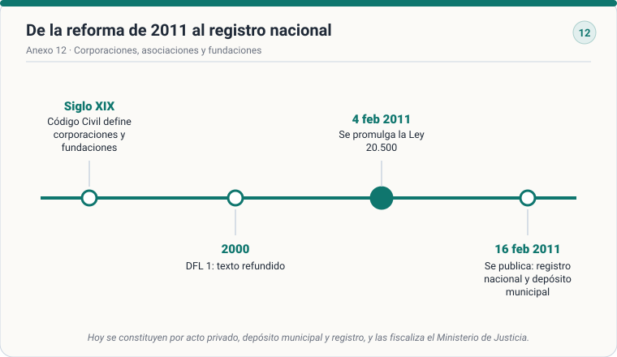
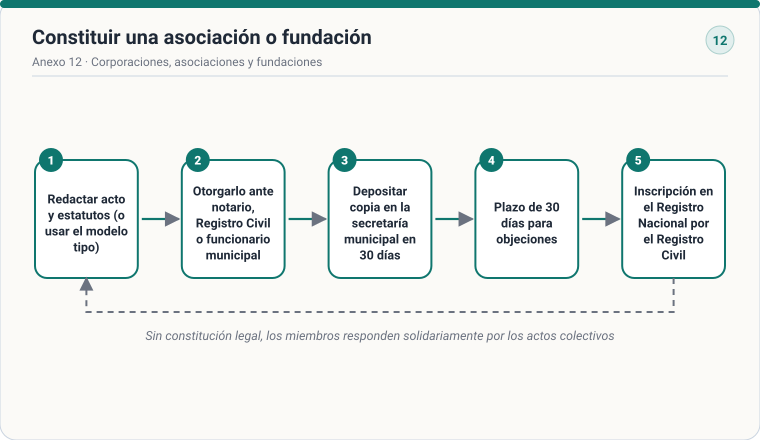
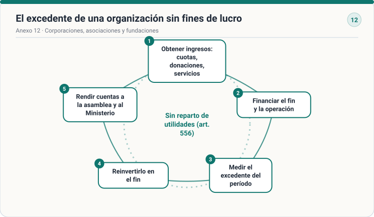
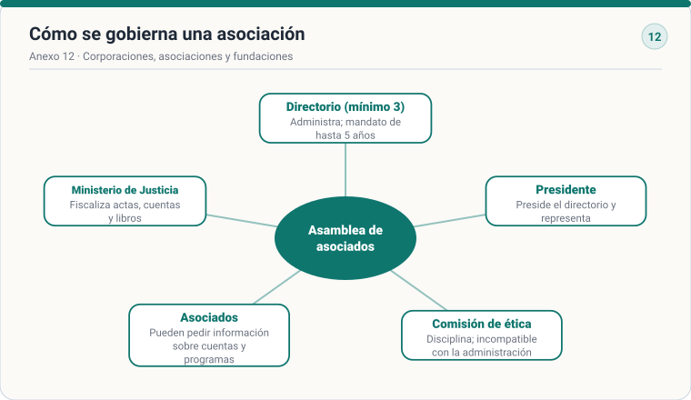
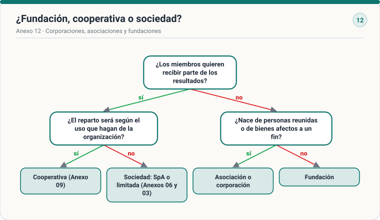

# Anexo 12 · Corporaciones, asociaciones y fundaciones (personas jurídicas sin fines de lucro)

> **Fecha de consulta de las fuentes:** 2026-11-25. **Naturaleza:** material educativo; no es asesoría
> legal ni tributaria. Las normas cambian: confirma cada dato en la fuente oficial citada al final
> antes de actuar. Este anexo separa **obligación legal**, **recomendación profesional** y **medida
> voluntaria**.

<!-- anexos:nav-inicio -->

**Navegación:** [← 11. Sociedad Civil (Código Civil)](11-sociedad-civil.md) · [Índice de anexos](README.md) · [13. Estatuto Pyme: empresas de menor tamaño (Ley 20.416) →](13-estatuto-pyme-empresas-de-menor-tamano.md)

## En 60 segundos

- La asociación reúne personas; la fundación afecta bienes a un fin (Código Civil, art. 545).
- Los excedentes no se reparten, ni al disolverse (art. 556).
- Se constituyen por acto ante ministro de fe, depósito municipal en 30 días e inscripción en el Registro Nacional (art. 548 y Ley 20.500).
- El directorio tiene al menos tres miembros, con mandato de hasta cinco años (art. 551).
- No están exentas de impuestos por defecto; cada ingreso debe analizarse.

<!-- anexos:nav-fin -->

## 1. Ficha rápida

| Pregunta | Respuesta |
|---|---|
| ¿Qué son? | Las dos especies de persona jurídica sin fines de lucro del Código Civil: la **corporación o asociación** (reunión de personas en torno a objetivos de interés común) y la **fundación** (afectación de bienes a un fin determinado de interés general) (art. 545). |
| ¿Pueden repartir utilidades? | **No.** Las rentas, utilidades, beneficios o excedentes no pueden distribuirse entre los asociados, **ni aun en caso de disolución** (art. 556). |
| ¿Quién responde por las deudas? | La persona jurídica con sus bienes; los miembros no responden con sus bienes propios, salvo que se obliguen expresamente (art. 549). |
| ¿Cuántas personas se necesitan? | Una asociación requiere reunión de personas; la ley exige un **directorio de al menos tres miembros** (art. 551). La fundación se crea por afectación de bienes. |
| ¿Cómo se constituyen? | Por escritura pública o privada ante notario, oficial del Registro Civil o funcionario municipal autorizado, con depósito en la secretaría municipal (art. 548). |
| ¿Dónde se registran? | En el **Registro Nacional de Personas Jurídicas sin Fines de Lucro**, a cargo del Servicio de Registro Civil e Identificación (arts. 8 y siguientes de la Ley 20.500). |
| ¿Quién las fiscaliza? | El **Ministerio de Justicia** (art. 557). |
| ¿Para quién suelen servir? | Organizaciones culturales, deportivas, educativas, gremiales, sociales o de beneficencia; emprendimientos con fin social que no reparten utilidades. |
| ¿Para quién no? | Quien quiere obtener y repartir ganancias: para eso existen las sociedades. |

## 2. Historia y evolución

### 2.1. El reconocimiento de las personas jurídicas

El Título XXXIII del Libro I del Código Civil define a la **persona jurídica** como «una persona ficticia,
capaz de ejercer derechos y contraer obligaciones civiles, y de ser representada judicial y
extrajudicialmente» (art. 545). Las divide en **dos especies: corporaciones y fundaciones de beneficencia
pública**; las corporaciones de derecho privado se llaman también **asociaciones**. Ese título es una de las
partes más antiguas del Código Civil, pero su texto actual refleja una reforma profunda de 2011.

### 2.2. La Ley 20.500 de 2011

La **Ley 20.500**, sobre asociaciones y participación ciudadana en la gestión pública, fue promulgada el
**4 de febrero de 2011** y publicada el **16 de febrero de 2011**. Reformó el Título XXXIII del Código
Civil para (según el texto vigente de ese título y de la propia ley):

- hacer que la asociación se constituya por un **acto privado**, con depósito en la **secretaría municipal**
  (art. 548);
- crear el **Registro Nacional de Personas Jurídicas sin Fines de Lucro** (arts. 8 a 12 de la Ley 20.500);
- fijar un **directorio de al menos tres miembros**, con mandato de hasta cinco años (art. 551);
- reconocer la libertad de **constituir uniones o federaciones** y confederaciones (art. 6 de la Ley 20.500);
- permitir **agrupaciones sin personalidad jurídica** (art. 7 de la Ley 20.500).

Según la explicación habitual de la doctrina (no consignada en el texto leído), antes de esa ley se exigía
una aprobación estatal de los estatutos para obtener personalidad jurídica. Esa evolución, de un sistema de aprobación a uno de
constitución libre con depósito y registro, es el cambio más importante para quien hoy quiere fundar una
organización.

### 2.3. La fiscalización

El artículo 557 entrega al **Ministerio de Justicia** la fiscalización de las asociaciones y fundaciones:
puede requerir actas, cuentas, memorias y libros contables, ordenar subsanar irregularidades y pedir al juez
medidas urgentes. **El incumplimiento de sus instrucciones se mira como infracción grave a los estatutos.**

## 3. Marco legal

### 3.1. Mapa de normas

| Norma | Qué aporta |
|---|---|
| Código Civil, arts. 545 a 564 (Título XXXIII del Libro I) | Definición, constitución, gobierno, patrimonio, fiscalización, modificación y disolución |
| Ley 20.500 (2011) | Registro Nacional, uniones y federaciones, participación ciudadana |
| Ley 19.418 | Juntas de vecinos y organizaciones comunitarias, también registradas |
| Reglamento de la Ley 20.500 | Procedimiento de registro y estatutos tipo; verifica su texto vigente |
| Ley 20.393 y normas de delitos económicos | Responsabilidad penal de personas jurídicas |
| Decreto Ley 824 | Renta: tratamiento tributario según la actividad |

### 3.2. Obligación, recomendación, opción

| Materia | Tipo | Detalle |
|---|---|---|
| Acto constitutivo ante ministro de fe y depósito en la secretaría municipal | Obligación | Art. 548 |
| Directorio de al menos tres miembros | Obligación | Art. 551 |
| Prohibición de repartir excedentes | Obligación | Art. 556 |
| Inscripción en el Registro Nacional | Obligación | Arts. 8 a 10 Ley 20.500 |
| Asamblea ordinaria al menos una vez al año | Obligación (salvo estatuto distinto) | Art. 550 |
| Estatutos tipo del Ministerio de Justicia | Opción | Art. 548: las cláusulas que los reproduzcan no pueden objetarse |
| Comisión de ética o tribunal de honor | Obligación para el ejercicio disciplinario | Art. 553 |
| Federación o confederación | Opción | Art. 6 Ley 20.500 |

## 4. Cómo se constituye

### 4.1. Paso a paso (art. 548)

1. **Redactar el acto constitutivo y los estatutos**, o adoptar los **modelos aprobados por el
   Ministerio de Justicia**, cuyas cláusulas no pueden ser objetadas.
2. **Otorgar el acto** en escritura pública o privada suscrita ante **notario, oficial del Registro Civil o
   funcionario municipal autorizado por el alcalde**.
3. **Depositar una copia autorizada** en la **secretaría municipal** del domicilio de la persona jurídica en
   formación **dentro de treinta días** desde su otorgamiento (el plazo no rige para fundaciones creadas
   por testamento).
4. **Plazo de objeción.** Dentro de los treinta días siguientes al depósito, el secretario municipal puede
   **objetar fundadamente** la constitución si no se cumplieron los requisitos legales o reglamentarios.
   La objeción se notifica por carta certificada. Si vence el plazo sin notificación, se entiende por ley
   que **no hay objeción**.
5. **Subsanar.** Si hay observaciones, la organización debe subsanarlas dentro de **treinta días** desde la
   notificación y depositar los nuevos antecedentes; el órgano directivo puede introducir las
   modificaciones estatutarias necesarias.
6. **Remisión al Registro.** Sin objeciones, el secretario municipal archiva una copia y, de oficio y dentro
   de **cinco días**, remite los antecedentes al Servicio de Registro Civil e Identificación para su
   inscripción en el **Registro Nacional de Personas Jurídicas sin Fines de Lucro**, salvo que el interesado
   pida hacer la inscripción directamente.
7. **RUT y SII.** Con la personalidad jurídica, la organización obtiene su RUT e inicia, según su actividad,
   los trámites tributarios y municipales.

### 4.2. Sin acto válido, no hay persona jurídica

El artículo 546 dispone que **no son personas jurídicas** las fundaciones o corporaciones que no se hayan
establecido en virtud de una ley o que no se hayan constituido conforme a las reglas del título. Y si una
corporación no tiene existencia legal según ese artículo, **sus actos colectivos obligan a todos y cada uno
de sus miembros solidariamente** (art. 549). Es decir: **operar sin constituirse expone personalmente a los
dirigentes**.

### 4.3. Exclusiones

El título **no se aplica** a las sociedades industriales (reguladas por otros títulos y por el Código de
Comercio) ni a las corporaciones y fundaciones de derecho público, como el Fisco, las municipalidades, las
iglesias y comunidades religiosas y los establecimientos costeados con fondos del erario (art. 547).

### 4.4. Uniones, federaciones y agrupaciones sin personalidad

Las asociaciones pueden constituir **uniones o federaciones** y estas, **confederaciones** (art. 6 Ley
20.500). Además, pueden constituirse libremente **agrupaciones sin personalidad jurídica** (art. 7 Ley
20.500); quienes actúan por ellas **responden ante terceros** de las obligaciones contraídas en interés de la
agrupación. Operar «de hecho» sin persona jurídica traslada el riesgo a las personas.

### 4.5. Modificar los estatutos

La modificación de los estatutos de una asociación debe ser acordada por la **asamblea citada especialmente**
para ese propósito. La **disolución o fusión** requieren **dos tercios** de los asociados que asistan a la
asamblea (art. 558). Los estatutos de una **fundación** solo pueden modificarse por acuerdo del directorio,
**previo informe favorable del Ministerio** de Justicia, siempre que resulte conveniente al interés
fundacional y que el fundador no lo haya prohibido (art. 558).

## 5. Capital, aportes y propiedad

### 5.1. Los bienes son de la persona jurídica

Lo que pertenece a una corporación **no pertenece, ni en todo ni en parte, a ninguno de sus miembros**; y las
deudas de la corporación no dan acción sobre los bienes propios de los miembros, sino sobre los bienes de la
corporación (art. 549). Los miembros pueden, **expresándolo**, obligarse en particular junto con la
corporación, y su responsabilidad es solidaria si se estipula expresamente la solidaridad; **no se extiende a
los herederos** salvo que los hayan obligado expresamente (art. 549).

### 5.2. Cómo se forma el patrimonio

Las asociaciones y fundaciones pueden **adquirir, conservar y enajenar toda clase de bienes**, a título
gratuito u oneroso, por actos entre vivos o por causa de muerte. El patrimonio de una asociación se integra
además con los **aportes ordinarios o extraordinarios** que la asamblea imponga a sus asociados con arreglo
a los estatutos (art. 556).

### 5.3. La regla de oro: no hay reparto

Las rentas, utilidades, beneficios o excedentes **no pueden distribuirse entre los asociados, ni aun en
caso de disolución** (art. 556). Una organización puede **tener ingresos** (cuotas, venta de servicios,
donaciones, convenios) y puede generar un excedente, pero ese excedente **se reinvierte en su fin**. La
frontera entre «sin fines de lucro» y «sin utilidades» importa: la organización puede ser eficiente y
sustentable, pero no puede transformarse en una vía de retiro de utilidades.

**Ejemplo ilustrativo.** Una fundación de talleres para jóvenes cobra 40.000 pesos mensuales a las
familias que pueden pagar y no cobra a las demás. Cierra el año con un excedente de 6.000.000 de pesos.
Ese excedente se destina a becas, equipamiento y reserva para el año siguiente; no se reparte entre el
fundador ni los directores. Si alguien retira dinero como «utilidad», infringe el art. 556 y los estatutos.
Los números son ilustrativos.

### 5.4. Destino de los bienes al disolverse

Disuelta una corporación, se dispone de sus propiedades **en la forma que hubieren prescrito sus estatutos**;
si nada prevén, pertenecen **al Estado**, con la obligación de emplearlas en objetos análogos a los de la
institución, y corresponde al Presidente de la República señalarlos (art. 561). Por eso, el estatuto debe
indicar a qué otra entidad sin fines de lucro pasan los bienes. Las fundaciones **perecen por la destrucción
de los bienes destinados a su manutención** (art. 564).

### 5.5. Fundaciones: afectación de bienes a un fin

Una fundación nace de la **afectación de bienes a un fin determinado de interés general** (art. 545). El
fundador puede dictar los estatutos; si no manifestó su voluntad o la manifestó incompletamente, se procede
conforme al art. 558 inc. 2 (art. 562). Lo dispuesto en los arts. 549 a 561 sobre corporaciones se aplica
también a las fundaciones y a quienes las administran (art. 563).

## 6. Administración y gobierno

### 6.1. La asamblea

La mayoría de los miembros con voto deliberativo según los estatutos se considera **asamblea legal** de la
corporación entera. Se reúne **ordinariamente una vez al año** y extraordinariamente cuando lo exijan las
necesidades; la voluntad de la mayoría de la asamblea es la voluntad de la corporación, salvo
modificaciones estatutarias (art. 550).

### 6.2. El directorio

La dirección y administración de una asociación recae en un **directorio de al menos tres miembros**, con
mandato de **hasta cinco años**. No pueden integrarlo personas condenadas a **pena aflictiva**. El director
condenado por crimen o simple delito durante el cargo, o que incurra en inhabilidad o incompatibilidad,
**cesa**, y el directorio nombra un reemplazante por el tiempo restante. El **presidente del directorio es
también presidente de la asociación**, la representa judicial y extrajudicialmente y tiene las demás
atribuciones estatutarias. El directorio sesiona con mayoría absoluta de sus miembros y acuerda por mayoría
absoluta de los asistentes; en empate decide el voto del que preside (art. 551).

### 6.3. Rendición de cuentas y derecho a información

El directorio **rinde cuenta ante la asamblea** de la inversión de los fondos y de la marcha de la
asociación. **Cualquier asociado puede pedir información** sobre las cuentas, actividades y programas (art.
551). Es un derecho que conviene facilitar, no resistir.

### 6.4. Actos del representante

Los actos del representante, mientras no excedan los límites de su ministerio, **son actos de la
corporación**; si los exceden, solo obligan **personalmente** al representante (art. 552). Por eso los
estatutos y los poderes deben definir con claridad límites de monto y materia.

### 6.5. Disciplina interna

La potestad disciplinaria de la asociación sobre sus asociados se ejerce a través de una **comisión de
ética, tribunal de honor u otro organismo similar**, mediante un **procedimiento racional y justo** y con
respeto de los derechos constitucionales, legales y estatutarios. **El cargo en el órgano de administración
es incompatible con el cargo en el órgano disciplinario** (art. 553).

### 6.6. Delitos contra los fondos

Los delitos de fraude, dilapidación y malversación de los fondos de la corporación se castigan **con arreglo
a sus estatutos**, sin perjuicio de lo que dispongan sobre ellos las leyes comunes (art. 555).

## 7. Responsabilidad

### 7.1. De los miembros

No responden con sus bienes por las deudas de la corporación, salvo que **se obliguen expresamente** en
particular (art. 549). Un aval personal a favor de la organización es una decisión contractual que reintroduce
tu patrimonio.

### 7.2. De los directores

Los directores y representantes responden por sus actos como mandatarios: los que excedan los límites de su
ministerio los obligan a ellos solos (art. 552); y tendrán las responsabilidades civiles, tributarias,
laborales y penales generales. En fundaciones y corporaciones con recursos públicos o donaciones, los
estándares de rendición de cuentas son más altos.

### 7.3. De la organización

Responde con los bienes de la persona jurídica. Si no tiene existencia legal, responden solidariamente sus
miembros (arts. 546 y 549).

### 7.4. Sanciones y control

El Ministerio de Justicia puede **ordenar subsanar irregularidades y perseguir responsabilidades** (art. 557).
La **disolución por sentencia judicial** procede si la asociación está prohibida por la Constitución o la
ley, infringe gravemente sus estatutos, ha realizado íntegramente su fin o este se hace imposible, y solo
puede pedirse por el **Consejo de Defensa del Estado**, previa petición fundada del Ministerio (art. 559).

### 7.5. Causales de disolución de las asociaciones

Se disuelven por **vencimiento del plazo**, por **acuerdo de asamblea general extraordinaria** con los
requisitos del art. 558, por **sentencia judicial ejecutoriada** y por las demás causas previstas en los
estatutos y las leyes (art. 559).

## 8. Tributación

### 8.1. Lo que dice y lo que no dice el Código Civil

El Código Civil define el **carácter sin fines de lucro** de la persona jurídica (art. 556), pero **no
establece por sí mismo un régimen tributario**: lo que se paga o no depende de las leyes tributarias
aplicables a la actividad y de las exenciones que reconozcan. **No debe presumirse que una organización sin
fines de lucro está exenta** de impuestos. Algunas actividades, como la venta de bienes o servicios, pueden
quedar afectas a IVA o a Primera Categoría; ciertas rentas o actos pueden estar exentos por leyes
específicas. Ver el [flujo tributario](../docs/02_SII_TAX_FLOW.md) y el Anexo 16 sobre el SII.

### 8.2. Qué conviene hacer

1. **Clasificar tus ingresos** en cuotas de socios, donaciones, convenios, venta de servicios y otros.
2. **Consultar al SII y a un contador** el tratamiento de cada tipo de ingreso.
3. **Registrar con respaldo** todas las donaciones y subvenciones: de ello depende la rendición de cuentas.
4. **Revisar los beneficios tributarios de donaciones** que existan en la ley vigente, tanto para quien
   dona como para la organización, y los requisitos para acceder a ellos.
5. **No distribuir excedentes**, aunque tributen o estén exentos: la prohibición es estatutaria y legal.

### 8.3. Tasas

Cuando una actividad de la organización queda afecta a Primera Categoría, rigen las tasas generales. La
**Ley 21.850** fija 27 % para 2026, 25,5 % para 2027, 24 % para 2028 y 23 % desde 2029. **Verifica en el
SII.** Ver la [guía de la Ley 21.850](../docs/20_LEY_21850_RECONSTRUCCION_NACIONAL.md).

### 8.4. Decisión práctica

Si tu proyecto tiene un fin social pero también **vende productos o servicios**, evalúa tres caminos: una
fundación o corporación que reinvierte todo, una sociedad convencional con propósito social que sí puede
repartir utilidades, o una estructura mixta con una entidad sin fines de lucro que controla una sociedad
operativa. **No existe en Chile una ley de sociedades de beneficio e interés colectivo (BIC)**; el propósito
social en una sociedad se pacta en estatutos y contratos, no por un régimen legal específico.

**Ejemplo ilustrativo.** Una organización de recicladores quiere vender material procesado. Como corporación
sin fines de lucro, reinvierte todo el excedente. Si, en cambio, formara una cooperativa (Anexo 09), los
socios podrían recibir excedentes según el uso. La diferencia entre ambas está en quién puede recibir los
resultados. Cifras ilustrativas.

## 9. Obligaciones laborales, contables y sectoriales

### 9.1. Contabilidad y transparencia

Lleva contabilidad ordenada con distinción entre ingresos con fines específicos, aportes de asociados,
donaciones y venta de servicios. El Ministerio de Justicia puede requerir actas, cuentas, memorias, libros
contables, de inventarios y de remuneraciones (art. 557). Presenta una **memoria y cuenta** ante la asamblea
(art. 551).

### 9.2. Registro actualizado

El Registro Nacional inscribe los actos que determinan la **composición de los órganos de dirección y
administración** (art. 10 Ley 20.500). Mantener actualizado el directorio es una obligación práctica: el
Servicio **certifica la vigencia** y la composición de los órganos (art. 11) y elabora una **nómina de
personas jurídicas no vigentes**, que incluye a las que no hayan presentado antecedentes por cinco años
(art. 12). Una organización omisa puede aparecer como no vigente.

### 9.3. Laboral

Si contratas personas, la organización es empleadora y debe cumplir las normas laborales como cualquier
empleador. El voluntariado no es empleo si no hay subordinación ni remuneración; revisa los hechos.
Ver el [flujo laboral](../docs/08_EMPLOYMENT_FLOW_CHILE.md).

### 9.4. Permisos

Una organización que opera un local, un evento o una actividad regulada necesita patente y permisos como
cualquier operador. Ver el Anexo 17 (Municipalidades) y la
[matriz de permisos](../docs/06_PERMITS_MATRIX.md).

### 9.5. Cumplimiento

Las organizaciones que reciben fondos públicos o donaciones relevantes suelen exigir políticas
anticorrupción, de conflicto de interés y de protección de datos. Ver
[cumplimiento y riesgo](../docs/13_COMPLIANCE_RISK.md).

## 10. Antes de construir: lista de verificación

### 10.1. Decisiones previas

1. ¿Quiénes son los fundadores y qué fin concreto persigue la organización?
2. ¿Es una **asociación** (personas en torno a un objetivo común) o una **fundación** (bienes afectos a un
   fin)?
3. ¿Habrá ingresos propios? ¿De qué tipo y cómo se tratarán tributariamente?
4. ¿Quién integrará el directorio (mínimo tres) y por cuánto tiempo (hasta cinco años)?
5. ¿Qué requisitos y qué cuotas tendrán los asociados, y qué derechos de información?
6. ¿Cómo se ejercerá la disciplina interna (comisión de ética)?
7. ¿A qué entidad pasarán los bienes al disolverse?
8. ¿Usarán los estatutos tipo del Ministerio de Justicia para evitar objeciones?
9. ¿Qué políticas de transparencia, conflicto de interés y rendición de cuentas?
10. ¿Hay una alternativa mejor: cooperativa, sociedad con propósito o agrupación sin personalidad?

### 10.2. Documentos

| Documento | Para qué |
|---|---|
| Acta de constitución y estatutos | Acto constitutivo (art. 548) |
| Copia autorizada del acto | Depósito en la secretaría municipal |
| Nómina de fundadores con cédula | Identificación |
| Domicilio y título | Dirección y RUT |
| Políticas internas | Transparencia y conflictos |
| Libro de actas y de socios | Operación |

### 10.3. Errores frecuentes

- **Operar sin constituirse:** responden solidariamente los miembros (art. 549).
- **No depositar en treinta días:** el trámite se complica.
- **Estatutos que se apartan de los modelos** y reciben objeciones.
- **Repartir excedentes entre los socios:** prohibido (art. 556).
- **No indicar el destino de los bienes:** pasan al Estado (art. 561).
- **Directorio sin actualizar en el Registro.**
- **Confundir voluntariado con trabajo** y desconocer obligaciones laborales.
- **No rendir cuentas a la asamblea** ni responder las peticiones de información de los asociados.
- **Mezclar fondos personales y de la organización.**

### 10.4. Caso ilustrado: una fundación de huertos comunitarios

**Caso ilustrativo.** Seis vecinos quieren crear una organización que enseñe huertos urbanos en escuelas y
venda plantas para financiarse. Los números son ilustrativos.

1. **Forma.** Evalúan una asociación y una fundación. Como los miembros actuarán entre sí y habrá cuotas,
   eligen **asociación**.
2. **Estatutos.** Adoptan el modelo aprobado por el Ministerio de Justicia, con directorio de tres
   miembros, mandato de tres años y una comisión de ética separada.
3. **Constitución.** Otorgan el acto ante un funcionario municipal autorizado y depositan la copia en la
   secretaría municipal dentro de treinta días. No hay objeciones y la inscripción se hace en el Registro
   Nacional.
4. **Ingresos.** Cobran cuotas, reciben una donación de 3.000.000 de pesos y venden plantas por
   1.200.000 en el año. Consultan al SII y a un contador cómo tratar las ventas.
5. **Excedente.** Les queda un excedente de 800.000 pesos, que destinan a materiales para dos escuelas
   nuevas. No hay reparto entre socios.
6. **Disolución.** Su estatuto establece que, si se disuelve, los bienes pasarán a otra organización sin
   fines de lucro con objetivos educativos.

**Qué aprendemos.** Una organización sin fines de lucro puede ser **sostenible**, pero sus excedentes
tienen un único destino: su fin.

### 10.5. Mini glosario

| Término | Significado |
|---|---|
| Asociación | Corporación de derecho privado: reunión de personas en torno a objetivos comunes. |
| Fundación | Persona jurídica formada por la afectación de bienes a un fin de interés general. |
| Ministro de fe | Notario, oficial del Registro Civil o funcionario municipal autorizado. |
| Secretaría municipal | Oficina donde se deposita copia del acto constitutivo. |
| Registro Nacional de Personas Jurídicas sin Fines de Lucro | Registro a cargo del Servicio de Registro Civil e Identificación. |
| Pena aflictiva | Pena grave que inhabilita para integrar el directorio. |
| Comisión de ética | Órgano disciplinario que debe ser distinto del de administración. |
| Federación | Unión de asociaciones constituida conforme a la ley. |

### 10.6. Un guion para redactar los estatutos

La ley deja al estatuto muchas decisiones. Este guion, construido a partir de lo que el texto legal
menciona, ayuda a no olvidar nada importante:

| Tema | Pregunta que el estatuto debe responder | Base en el texto |
|---|---|---|
| Fin | ¿Cuál es el objetivo de interés común o general, dicho con precisión? | Art. 545 |
| Duración | ¿Tiene plazo o es indefinida? | Art. 559 letra a |
| Asamblea | ¿Cuándo se reúne la ordinaria y quién convoca a las extraordinarias? | Art. 550 |
| Votos | ¿Quién tiene voto deliberativo y cómo se computa? | Art. 550 |
| Directorio | ¿Cuántos miembros (mínimo tres), qué mandato (hasta cinco años) y cómo se reemplaza a un director? | Art. 551 |
| Presidente | ¿Qué atribuciones tiene además de presidir y representar? | Art. 551 |
| Cuentas | ¿Cómo rinde cuentas el directorio y cómo piden información los asociados? | Art. 551 |
| Aportes | ¿Qué aportes ordinarios y extraordinarios puede imponer la asamblea? | Art. 556 |
| Disciplina | ¿Quién integra la comisión de ética o el tribunal de honor y qué procedimiento sigue? | Art. 553 |
| Modificación | ¿Qué quórum modifica los estatutos y cuál disuelve o fusiona (dos tercios de los asistentes)? | Art. 558 |
| Destino de bienes | ¿A qué entidad sin fines de lucro pasan los bienes al disolverse? | Art. 561 |
| Fiscalización | ¿Quién atenderá los requerimientos del Ministerio de Justicia? | Art. 557 |

Tres consejos adicionales. Primero, **copia los modelos aprobados** si no tienes una razón fuerte para
apartarte: sus cláusulas no pueden ser objetadas por el secretario municipal (art. 548). Segundo, **lee el
estatuto en voz alta con tu directorio** antes de firmarlo: los estatutos tienen «fuerza obligatoria sobre
toda» la corporación y sus miembros deben obedecerlos bajo las sanciones que ellos mismos impongan
(art. 553). Tercero, **separa las funciones**: quien administra no debe juzgar la disciplina (art. 553) ni
quien rinde cuentas debe ser el único que las revisa.

Un último punto para organizaciones que piensan crecer en red. La ley permite que las asociaciones formen
**uniones o federaciones**, y estas, **confederaciones**, cumpliendo los requisitos que fijen sus estatutos y
los que la ley exige para constituir asociaciones (art. 6 de la Ley 20.500). Si prevés integrarte a una
red, incluye desde el inicio una cláusula que lo autorice y que diga quién decide la afiliación, qué aportes
implica y qué ocurre si quieres salir. Así evitas modificar los estatutos con apuro cuando llegue la
oportunidad. Cada nivel de la red es una persona jurídica distinta, con su propio directorio, su propio
registro y su propia responsabilidad: la federación no responde por las deudas de cada asociación ni al
revés, salvo que se obliguen expresamente.

## 11. Cuándo conviene y cuándo no

### 11.1. Comparación

| Criterio | Asociación o fundación | Cooperativa | Sociedad (SpA o limitada) |
|---|---|---|---|
| Reparto de resultados | No | Según uso | Según capital |
| Fin | Interés común o general | Mejorar condiciones de vida de los socios | Lucro |
| Fiscalización | Ministerio de Justicia | Departamento de Cooperativas | Según el sector |
| Constitución | Acto ante ministro de fe y depósito municipal | Junta, escritura, extracto | Registro en línea o escritura |
| Gobierno | Asamblea y directorio | Junta, consejo y gerente | Libre por tipo |
| Inversión externa | No aplica | Difícil | Fácil |

### 11.2. Señales a favor

- El fin es de interés común o general y no se busca repartir utilidades.
- Hay voluntad de rendir cuentas y de operar con transparencia.
- Se buscan donaciones, fondos concursables o apoyo comunitario.

### 11.3. Señales en contra

- Se espera retirar ganancias o captar inversión con retorno.
- No hay disposición a un gobierno colegiado ni a la supervisión.
- El proyecto es principalmente comercial y el fin social es secundario: evalúa una sociedad con
  propósito pactado.

## 12. Cuándo llamar a un profesional

| Situación | Profesional | Por qué |
|---|---|---|
| Redactar estatutos y elegir forma | Abogado | Evita objeciones y conflictos |
| Tributación de ingresos y donaciones | Contador | No hay exención automática |
| Fiscalización del Ministerio de Justicia | Abogado | Requerimientos de información |
| Conflictos internos o disciplina | Abogado | Procedimiento racional y justo |
| Fondos públicos o convenios | Abogado y contador | Rendición de cuentas |
| Disolución | Abogado | Destino de bienes y plazos |

Consulta la [guía de cuándo llamar a un profesional](../docs/18_WHEN_TO_CALL_A_PROFESSIONAL.md).

## 13. Escenarios resueltos

Casos **ilustrativos** (nombres y cifras inventados) sobre los artículos 545 a 564 del Código Civil, texto leído en Ley
Chile (BCN).

### Escenario 1: la junta de vecinos que quiere «repartir las ganancias»

**Situación.** Una asociación vecinal organiza una feria anual y obtiene un excedente de 3.000.000 de pesos. Algunos
socios piden repartirlo.

**Análisis.** Las rentas, utilidades, beneficios o excedentes de la asociación **no pueden distribuirse entre los
asociados ni aun en caso de disolución** (art. 556). Pueden realizar actividades económicas que se relacionen con sus
fines, pero las rentas solo se destinan a los fines de la asociación o a incrementar su patrimonio (art. 557-2).

**Decisión.** Destinar el excedente a los fines (por ejemplo, equipamiento) y documentarlo en el balance y la memoria.

### Escenario 2: el director que cobra un sueldo

**Situación.** El presidente de una fundación quiere cobrar una remuneración por dirigir.

**Análisis.** Los directores ejercen su cargo **gratuitamente**, con derecho a reembolso de gastos autorizados por el
directorio y justificados. Salvo que los estatutos digan lo contrario, el directorio puede fijar una retribución adecuada a
quienes presten **servicios distintos de sus funciones como directores**, y debe darse cuenta detallada de toda
remuneración a la asamblea (o al directorio en fundaciones), incluidas las de personas relacionadas por parentesco,
convivencia, interés o propiedad (art. 551-1).

**Decisión.** Separar cargo directivo y servicio remunerado, aprobar con transparencia y reportar.

### Escenario 3: el estatuto con un directorio de dos personas

**Situación.** Se redacta un estatuto con un directorio de dos miembros.

**Análisis.** La dirección y administración de una asociación recae en un directorio de **al menos tres miembros**, con
mandato de **hasta cinco años** (art. 551).

**Decisión.** Corregir el estatuto antes de depositarlo.

### Escenario 4: el director condenado

**Situación.** Un director es condenado por un delito durante su mandato.

**Análisis.** No pueden integrar el directorio personas condenadas a pena aflictiva, y el director que durante el cargo
fuere condenado por crimen o simple delito, o incurriere en otra inhabilidad o incompatibilidad, **cesa en sus
funciones**; el directorio nombra un reemplazante por el tiempo restante (art. 551).

### Escenario 5: la objeción del secretario municipal

**Situación.** Se deposita el acta constitutiva y, a los 20 días, el secretario municipal objeta la constitución.

**Análisis.** El secretario municipal puede objetar fundadamente dentro de **treinta días** desde el depósito si no se
cumplieron los requisitos; no puede objetar cláusulas que reproduzcan los modelos aprobados por el Ministerio de Justicia.
La organización en formación debe subsanar dentro de **treinta días** desde la notificación, y su órgano directivo se
entiende facultado para modificar los estatutos con ese fin (art. 548). Si no objeta en plazo, se entiende que no objeta, y
tras el trámite se envía al Servicio de Registro Civil para la inscripción; la personalidad jurídica rige **desde esa
inscripción**.

**Decisión.** Usar los estatutos modelo cuando sea posible y llevar un calendario de plazos.

### Escenario 6: «actuamos como asociación» sin inscribirse

**Situación.** Un grupo opera varios meses, firma contratos y no completa la inscripción.

**Análisis.** No son personas jurídicas las corporaciones o fundaciones que no se hayan constituido conforme a las reglas
del título (art. 546). Si una corporación no tiene existencia legal, **sus actos colectivos obligan a todos y cada uno de
sus miembros solidariamente** (art. 549).

**Decisión.** Completar la constitución antes de contratar.

### Escenario 7: el socio expulsado

**Situación.** Un socio es expulsado por una decisión del directorio sin audiencia.

**Análisis.** La potestad disciplinaria se ejerce a través de una **comisión de ética, tribunal de honor u otro organismo
similar**, mediante un procedimiento racional y justo, respetando derechos constitucionales, legales y estatutarios; el
cargo en el órgano de administración es **incompatible** con el cargo en el órgano disciplinario (art. 553). Quien resulte
perjudicado por los estatutos puede recurrir a la justicia en procedimiento breve y sumario (art. 548-4).

**Decisión.** Crear el órgano disciplinario con separación de funciones y un procedimiento escrito.

### Escenario 8: modificar los estatutos de una fundación

**Situación.** El directorio de una fundación quiere ampliar sus fines.

**Análisis.** Los estatutos de una fundación solo pueden modificarse por acuerdo del directorio, **previo informe
favorable del Ministerio de Justicia**, siempre que resulte conveniente al interés fundacional; no cabe modificación si el
fundador la prohibió (art. 558).

**Decisión.** Verificar la prohibición del fundador y solicitar el informe antes de acordar.

## 14. Catálogo de errores y cómo corregirlos

| N.º | Error | Causa típica | Consecuencia | Cómo corregirlo | Dónde ver más |
|---:|---|---|---|---|---|
| 1 | Actuar sin inscripción | Apuro | Solidaridad de los miembros (art. 549) | Completar la constitución | Escenario 6 |
| 2 | Repartir excedentes | Presión de socios | Contraviene el art. 556 | Destinar a los fines | Escenario 1 |
| 3 | Directorio de menos de tres | Estatuto improvisado | Incumple el art. 551 | Ajustar estatuto | Escenario 3 |
| 4 | No rendir cuenta a la asamblea | Descuido | Incumple el art. 551 | Rendición anual | Sección 6 |
| 5 | No llevar actas fieles | Informalidad | Prueba débil (art. 557-3) | Libro idóneo | Sección 6 |
| 6 | No mantener registros de asociados y directores | Olvido | Incumple el art. 557-3 | Registros actualizados | Sección 6 |
| 7 | Sin contabilidad ni memoria | Creer que no aplica | Incumple el art. 557-1 | Contador y memoria anual | Sección 9 |
| 8 | Sin auditoría cuando corresponde | Desconocer umbrales | Incumple el art. 557-1 | Verificar umbrales del Ministro de Justicia | Sección 9 |
| 9 | Pagar remuneraciones sin cuenta | Opacidad | Infracción del art. 551-1 | Informar a la asamblea | Escenario 2 |
| 10 | Expulsar sin procedimiento | Conflicto interno | Reclamo judicial (art. 548-4) | Órgano disciplinario | Escenario 7 |
| 11 | Modificar estatutos sin el quórum | Apuro | Acuerdo cuestionable (art. 558) | Asamblea especial | Sección 4.5 |
| 12 | Nombre que se confunde con otro | Poca verificación | Rechazo (art. 548-3) | Verificar nombres | Sección 4 |
| 13 | Estatutos sin destino de bienes | Plantilla incompleta | Incumple el art. 548-2 | Indicar institución destinataria | Sección 5.4 |
| 14 | Mezclar caja de la organización y personal | Informalidad | Malversación y responsabilidades (art. 555) | Cuenta propia | Sección 6.6 |
| 15 | Creer que no pagan impuestos por ser sin fines de lucro | Confusión | Sorpresas tributarias | Análisis por ingreso | Sección 8 |

## 15. Alternativas y variantes de diseño

### C.1. Asociación frente a fundación

| Criterio | Asociación | Fundación |
|---|---|---|
| Base | Reunión de personas en torno a objetivos de interés común (art. 545) | Afectación de bienes a un fin de interés general (art. 545) |
| Gobierno | Asamblea y directorio de al menos tres | Directorio; sin asamblea de socios |
| Reforma de estatutos | Asamblea citada especialmente | Directorio con informe favorable del Ministerio de Justicia (art. 558) |
| Disolución voluntaria | Dos tercios de los asociados presentes (art. 558) | Por destrucción de los bienes destinados a su manutención, entre otras causas (art. 564) |
| Reparto de excedentes | Prohibido (art. 556) | Prohibido en la lógica del título; los bienes se afectan al fin |

### C.2. Alternativas a crear una persona jurídica

| Alternativa | Qué es | Cuándo sirve | Límite |
|---|---|---|---|
| Convenio con una organización existente | Se canaliza la actividad por una organización ya constituida | Proyecto breve | Depende de un tercero |
| Comunidad o grupo informal | Sin personalidad jurídica | Actividad mínima | Responsabilidad solidaria de los miembros si actúan como corporación sin existencia legal (art. 549) |
| Sociedad civil o comercial | Persona jurídica con fines de lucro | Actividad económica con reparto | No es una organización sin fines de lucro |
| Cooperativa | Ver anexo 09 | Servicios a los socios con reparto según uso | Reglas propias |

### C.3. Diseño del gobierno

| Opción | Descripción | Cuándo sirve |
|---|---|---|
| Directorio mínimo de tres | Cumple lo básico | Organizaciones pequeñas |
| Directorio ampliado con comisiones | Finanzas, ética, programas | Organizaciones medianas |
| Comisión de ética separada | Cumple el art. 553 | Todas las asociaciones |
| Comité asesor | Sin poder decisorio | Cuando se busca experticia |

### C.4. Ideas de cláusulas de estatutos

1. «El patrimonio inicial se compone de [bienes] aportados en la forma [detalle].»
2. «La asamblea ordinaria se reunirá una vez al año, y la extraordinaria cuando lo exijan las necesidades.»
3. «Los directores ejercerán gratuitamente su cargo, con reembolso de gastos autorizados por el directorio.»
4. «La comisión de ética tendrá a su cargo la potestad disciplinaria con un procedimiento racional y justo.»
5. «En caso de extinción, los bienes pasarán a [institución sin fines de lucro].»

## 16. Vinculación con otros anexos y con las clases

### D.1. ¿Cuándo salto a otro anexo?

| Evento | Anexo |
|---|---|
| La actividad necesita ingresos con reparto | 03, 06 u 11 |
| La actividad es de servicios a los socios | 09 |
| Trámite municipal | 17 |
| Tributación y documentos | 16 |
| Domicilio | 18 |
| Constitución rápida de sociedades | 15 |

### D.2. Clases del programa

- [Parte 5, clase 7: comparación jurídica para elegir forma societaria](../curriculum/part-05-diseno-societario-y-gobierno-inicial/class-07-comparacion-juridica-para-elegir-forma-societaria/README.md)
- [Parte 5, clase 13: juntas, actas, libros y trazabilidad de decisiones](../curriculum/part-05-diseno-societario-y-gobierno-inicial/class-13-juntas-actas-libros-y-trazabilidad-de-decisiones/README.md)

### D.3. Hilos que se conectan

1. **No reparto y destino de bienes:** los arts. 556 y 548-2 conectan el patrimonio con la institución destinataria.
2. **Gobierno y gratuidad:** el art. 551-1 conecta la transparencia con la remuneración.
3. **Disciplina y separación de funciones:** el art. 553 conecta el procedimiento con la incompatibilidad de cargos.
4. **Fiscalización y evidencia:** los arts. 557 y 557-3 conectan al Ministerio de Justicia con las actas, cuentas y registros.

## 17. Plantillas y listas de trabajo

### E.1. Plan de 30, 60 y 90 días

| Plazo | Tareas | Responsable | Evidencia |
|---|---|---|---|
| Días 1 a 15 | Definir fines, nombre, domicilio, patrimonio inicial y órganos | Fundadores | Borrador de estatutos |
| Días 16 a 30 | Acto constitutivo ante ministro de fe; depósito en la secretaría municipal (30 días) | Fundadores | Acta y recibo del depósito |
| Días 31 a 60 | Respuesta a objeciones, inscripción en el Registro Nacional | Directorio | Certificado de inscripción |
| Días 61 a 90 | RUT, cuenta bancaria, libros, política de remuneraciones y comisión de ética | Tesorería | Libros y políticas |

### E.2. Calendario anual

| Cuándo | Tarea | Base |
|---|---|---|
| Una vez al año | Asamblea ordinaria | Art. 550 |
| Al cierre del ejercicio | Memoria y balance | Art. 557-1 |
| Cada año | Revisar umbral de auditoría externa | Art. 557-1 |
| Cada sesión | Actas en libro idóneo | Art. 557-3 |
| Permanente | Actualizar registros de asociados, directores y autoridades | Art. 557-3 |
| Cuando corresponda | Informar remuneraciones a la asamblea | Art. 551-1 |

### E.3. Lista de control del directorio

| Ítem | Sí | No |
|---|---|---|
| Tres directores o más, con mandato de hasta cinco años | | |
| Sin directores condenados a pena aflictiva | | |
| Libro de actas fiel | | |
| Registros de asociados y autoridades al día | | |
| Memoria y balance aprobados | | |
| Remuneraciones informadas | | |
| Comisión de ética separada del directorio | | |

### E.4. Modelo de informe de remuneraciones a la asamblea

| Persona | Vínculo | Servicio prestado | Monto | Aprobación del directorio | Fecha |
|---|---|---|---:|---|---|
| | | | | | |

## 18. Autoevaluación

1. ¿Qué diferencia hay entre asociación y fundación?
2. ¿Cuántos directores mínimo tiene una asociación?
3. ¿Pueden repartirse excedentes?
4. ¿Cuándo adquiere personalidad jurídica?
5. ¿Qué plazo tiene el depósito del acto constitutivo?
6. ¿Pueden los directores cobrar por serlo?
7. ¿Quién fiscaliza?
8. ¿Qué mayoría disuelve una asociación voluntariamente?
9. ¿Quién debe informar para modificar los estatutos de una fundación?
10. ¿Qué pasa con los bienes al extinguirse?

**Respuestas.**

1. La asociación reúne personas; la fundación afecta bienes a un fin (art. 545).
2. Tres (art. 551).
3. No, ni en caso de disolución (art. 556).
4. Desde la inscripción en el Registro Nacional (art. 548).
5. Treinta días desde el otorgamiento (art. 548).
6. No: ejercen gratuitamente, con reembolso de gastos y posibles retribuciones por servicios distintos (art. 551-1).
7. El Ministerio de Justicia (art. 557).
8. Dos tercios de los asociados que asistan a la asamblea (art. 558).
9. El Ministerio de Justicia emite un informe favorable previo (art. 558).
10. Pasan a la institución sin fines de lucro indicada en los estatutos (art. 548-2); si no se previó, al Estado con la
    obligación de emplearlos en objetos análogos (art. 561).

**Puntaje.** Ocho o más: dominas el tipo. Cuatro a siete: repasa las secciones 5 y 6. Menos de cuatro: relee el anexo.

## 19. Glosario ampliado

| Término | Significado |
|---|---|
| Acto constitutivo | Escritura o documento ante ministro de fe que crea la organización |
| Asamblea | Reunión de los miembros con derecho a voto |
| Asociación | Persona jurídica formada por una reunión de personas en torno a objetivos comunes |
| Comisión de ética | Órgano que ejerce la potestad disciplinaria |
| Fundación | Persona jurídica formada por la afectación de bienes a un fin de interés general |
| Ministro de fe | Notario, oficial del Registro Civil o funcionario municipal autorizado |
| Persona jurídica en formación | Organización cuyo acto constitutivo ya se depositó, pero que aún no se inscribe |
| Registro Nacional de Personas Jurídicas sin Fines de Lucro | Registro del Servicio de Registro Civil donde se inscribe la organización |
| Retribución | Pago por servicios distintos de las funciones de director |
| Secretario municipal | Funcionario ante quien se deposita el acto constitutivo |

## 20. Preguntas frecuentes

**1. ¿Cuál es la diferencia entre asociación y fundación?**
La asociación es una reunión de personas en torno a objetivos comunes; la fundación, la afectación de bienes
a un fin de interés general (art. 545).

**2. ¿Pueden repartir utilidades?**
No, ni siquiera al disolverse (art. 556).

**3. ¿Cuántas personas se necesitan?**
El directorio debe tener al menos tres miembros (art. 551). La asociación necesita reunir personas en torno a
un fin común.

**4. ¿Cómo se constituyen?**
Por acto escrito ante notario, oficial del Registro Civil o funcionario municipal autorizado, con depósito de
copia en la secretaría municipal dentro de treinta días (art. 548).

**5. ¿Pueden objetar mis estatutos?**
El secretario municipal puede objetar fundadamente dentro de treinta días del depósito, pero no puede
objetar cláusulas que reproduzcan los modelos aprobados por el Ministerio de Justicia (art. 548).

**6. ¿Dónde se inscriben?**
En el Registro Nacional de Personas Jurídicas sin Fines de Lucro, a cargo del Servicio de Registro Civil e
Identificación (arts. 8 y 9 Ley 20.500).

**7. ¿Quién las fiscaliza?**
El Ministerio de Justicia (art. 557).

**8. ¿Los socios responden por las deudas?**
No con sus bienes propios, salvo que se obliguen expresamente; y si la corporación no tiene existencia
legal, responden solidariamente (art. 549).

**9. ¿Cuánto dura el directorio?**
Hasta cinco años, según el estatuto (art. 551).

**10. ¿Quién puede ser director?**
Quien no haya sido condenado a pena aflictiva y cumpla las inhabilidades de la ley y los estatutos (art. 551).

**11. ¿Puedo pedir información como asociado?**
Sí. Cualquier asociado puede pedir información sobre las cuentas, actividades y programas (art. 551).

**12. ¿Cómo se sanciona a un asociado?**
Mediante una comisión de ética o tribunal de honor, con un procedimiento racional y justo; el cargo en la
administración es incompatible con el cargo en el órgano disciplinario (art. 553).

**13. ¿Cómo se modifican los estatutos?**
Por la asamblea citada especialmente; en una fundación, por acuerdo del directorio con informe favorable del
Ministerio de Justicia (art. 558).

**14. ¿Cuántos votos se necesitan para disolver?**
Dos tercios de los asociados que asistan a la asamblea (art. 558).

**15. ¿A dónde van los bienes al disolverse?**
Donde indiquen los estatutos; si nada dicen, al Estado, para objetos análogos (art. 561).

**16. ¿Pueden tener ingresos propios?**
Sí: pueden adquirir y enajenar bienes y recibir aportes, pero sin repartir excedentes (art. 556).

**17. ¿Están exentas de impuestos?**
No necesariamente. El Código Civil no fija un régimen tributario; consulta al SII y a un contador.

**18. ¿Pueden formar federaciones?**
Sí, uniones o federaciones y, estas, confederaciones (art. 6 Ley 20.500).

**19. ¿Puedo actuar sin constituir persona jurídica?**
Sí, mediante una agrupación sin personalidad jurídica, pero quienes actúan responden ante terceros (art. 7 Ley
20.500).

**20. ¿Existe una ley de sociedades de beneficio e interés colectivo?**
No existe en Chile una ley BIC publicada a la fecha de consulta. Es posible pactar propósito social en
estatutos, pero sin régimen legal específico.

**21. ¿Pueden las asociaciones realizar actividades económicas?**
Sí, si se relacionan con sus fines; las rentas solo se destinan a esos fines o a incrementar el patrimonio (art. 557-2).

**22. ¿Qué pasa con la responsabilidad de los miembros por las deudas?**
Lo que pertenece a la corporación no pertenece a sus miembros, y las deudas no dan acción sobre los bienes propios de ellos;
pueden obligarse en particular si lo expresan, y solo hay solidaridad si se estipula (art. 549).

**23. ¿Cuándo se reúne la asamblea?**
Ordinariamente una vez al año y extraordinariamente cuando lo exijan las necesidades (art. 550); sesiona con la mayoría de
los miembros con voto deliberativo, salvo lo que digan los estatutos.

**24. ¿Cómo toma acuerdos el directorio?**
Sesiona con mayoría absoluta de sus miembros y acuerda por mayoría absoluta de los asistentes; el voto del que preside
dirime el empate (art. 551).

**25. ¿Quién representa a la asociación?**
El presidente del directorio, judicial y extrajudicialmente (art. 551).

**26. ¿Qué pasa si el representante se excede?**
Los actos que exceden los límites de su ministerio obligan solo personalmente al representante (art. 552).

**27. ¿Cómo se salva un director de la responsabilidad por un acuerdo?**
Haciendo constar su oposición y dando cuenta en la próxima asamblea (art. 551-2); los directores responden solidariamente
hasta de culpa leve por los perjuicios que causen.

**28. ¿Qué delitos contra los fondos se contemplan?**
Fraude, dilapidación y malversación, que se castigan según los estatutos sin perjuicio de las leyes comunes (art. 555).

**29. ¿Qué puede pedir el Ministerio de Justicia?**
Actas, cuentas, memorias, libros de contabilidad, de inventarios y de remuneraciones, y puede ordenar subsanar
irregularidades (art. 557).

**30. ¿Hay auditoría externa?**
Cuando el patrimonio o los ingresos superen los límites que defina el Ministro de Justicia (art. 557-1).

**31. ¿Qué es una persona jurídica «en formación»?**
La que ya depositó el acto constitutivo pero aún no tiene la inscripción que le da personalidad (art. 548).

**32. ¿Pueden dos asociaciones fusionarse?**
La fusión con otra asociación debe aprobarse por dos tercios de los asociados que asistan (art. 558).

**33. ¿Qué causales disuelven una asociación?**
Vencimiento del plazo, acuerdo de la asamblea extraordinaria, sentencia judicial por infracción grave o fin cumplido o
imposible, y otras previstas en estatutos y leyes (art. 559).

**34. ¿Quién demanda la disolución judicial?**
El Consejo de Defensa del Estado, a petición fundada del Ministerio de Justicia; en ciertos casos también la institución
destinataria de los bienes (art. 559).

**35. ¿Cuándo se extingue una fundación?**
Por la destrucción de los bienes destinados a su manutención, entre otras causas (art. 564).

**36. ¿Qué nombre puedo usar?**
Uno que haga referencia a su naturaleza, objeto o finalidad y que no se confunda con otra persona jurídica u organización
(art. 548-3).

**37. ¿Se pueden objetar mis estatutos si uso el modelo?**
No pueden objetarse las cláusulas que reproduzcan los modelos aprobados por el Ministerio de Justicia (art. 548).

**38. ¿Cuándo debo pedir ayuda profesional?**
Al redactar estatutos, ante conflictos disciplinarios, remuneraciones, tributación de ingresos y modificaciones de fundaciones.

## 21. Fuentes y vigencia

| Fuente | Qué se usó | Dónde consultarla |
|---|---|---|
| Código Civil (DFL 1 de 2000), arts. 545 a 564 | Régimen de corporaciones y fundaciones | [BCN, Código Civil](https://www.bcn.cl/leychile/navegar?idNorma=172986) |
| Ley 20.500, sobre asociaciones y participación ciudadana | Registro Nacional, uniones y federaciones | [BCN, Ley 20.500](https://www.bcn.cl/leychile/navegar?idNorma=1023143) |
| Ley 19.418, juntas de vecinos | Organizaciones comunitarias registradas | [BCN, Ley 19.418](https://www.bcn.cl/leychile/navegar?idNorma=30785) |
| Servicio de Registro Civil e Identificación | Registro Nacional de Personas Jurídicas sin Fines de Lucro | [Registro Civil](https://www.registrocivil.cl) |
| Ministerio de Justicia y Derechos Humanos | Fiscalización y estatutos tipo | [Ministerio de Justicia](https://www.minjusticia.gob.cl) |
| SII, regímenes tributarios | Tratamiento tributario | [SII](https://www.sii.cl/destacados/renta/2026/intermediarios/regimenes_tributarios/) |
| Ley 21.850 y Ley 21.755 | Tasas recientes | [Guía del programa](../docs/20_LEY_21850_RECONSTRUCCION_NACIONAL.md) |

**Vigencia.** Los artículos citados del Código Civil y de la Ley 20.500 se leyeron en la versión publicada
por la Biblioteca del Congreso Nacional el 2026-11-25. El reglamento y los estatutos tipo del Ministerio de
Justicia no se transcriben: confirma su texto vigente. Los beneficios tributarios de donaciones no se
describen porque cambian por ley y deben verificarse.

**Límites.** Este anexo no reproduce el texto íntegro de las leyes, no determina el tratamiento tributario de
una organización concreta y sus ejemplos numéricos son ilustrativos. No sustituye la asesoría de un abogado
ni de un contador.

<!-- anexos:cierre-inicio -->

## Para seguir leyendo

- [Anexo 09. Cooperativa](09-cooperativa.md): cooperativa: reparto según uso.
- [Anexo 06. Sociedad por Acciones (SpA)](06-sociedad-por-acciones-spa.md): sociedad con propósito pactado.
- [Anexo 17. Municipalidades: patente comercial, zonificación y permisos locales](17-municipalidades-patentes-y-permisos-locales.md): exención de patente para ciertas entidades.

**Navegación:** [← 11. Sociedad Civil (Código Civil)](11-sociedad-civil.md) · [Índice de anexos](README.md) · [13. Estatuto Pyme: empresas de menor tamaño (Ley 20.416) →](13-estatuto-pyme-empresas-de-menor-tamano.md)

<!-- anexos:cierre-fin -->
