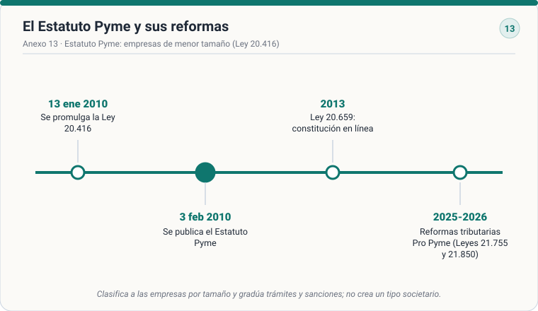
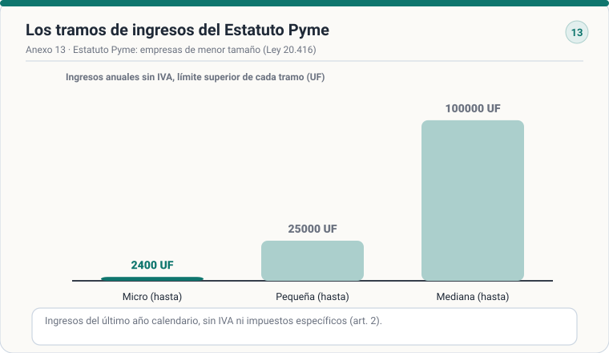
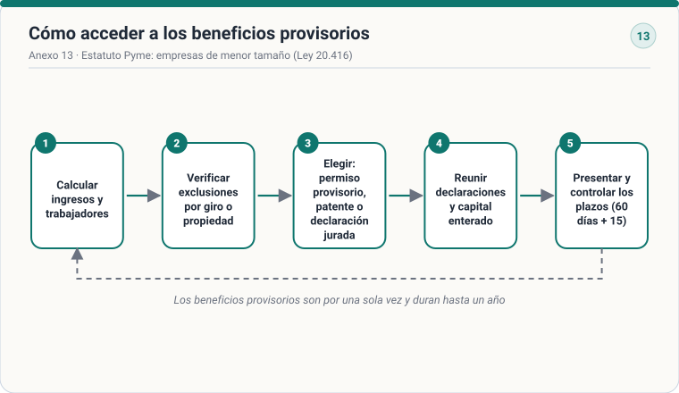
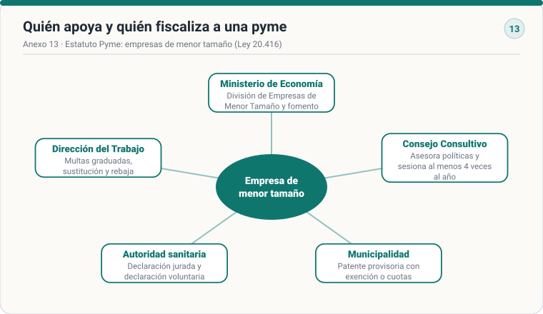
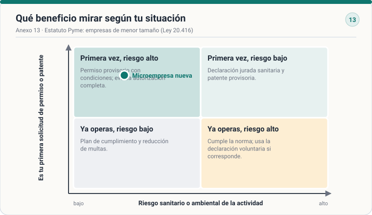

# Anexo 13 · Estatuto Pyme: empresas de menor tamaño (Ley 20.416)

> **Fecha de consulta de las fuentes:** 2026-11-25. **Naturaleza:** material educativo; no es asesoría
> legal ni tributaria. Las normas cambian: confirma cada dato en la fuente oficial citada al final
> antes de actuar. Este anexo separa **obligación legal**, **recomendación profesional** y **medida
> voluntaria**. **Importante:** la Ley 20.416 **no es un tipo de empresa**: es un conjunto de reglas que
> se superponen a cualquier tipo (EIRL, SpA, limitada, persona natural) según el **tamaño** de la empresa.

<!-- anexos:nav-inicio -->

**Navegación:** [← 12. Corporaciones, asociaciones y fundaciones](12-corporaciones-asociaciones-y-fundaciones.md) · [Índice de anexos](README.md) · [14. Sucursal o agencia de sociedad extranjera →](14-sucursal-o-agencia-de-sociedad-extranjera.md)

## En 60 segundos

- Micro: hasta 2.400 UF; pequeña: hasta 25.000 UF; mediana: hasta 100.000 UF de ingresos anuales sin IVA (art. 2).
- No es un tipo de sociedad ni el régimen tributario Pro Pyme.
- Permisos provisorios por una sola vez y de hasta un año; patente provisoria con exención o cuotas hasta un capital de 5.000 UF.
- En micro y pequeñas, las multas laborales se pueden sustituir o rebajar al menos 80 % si se corrige a tiempo.
- No elimina obligaciones: gradúa sanciones.

<!-- anexos:nav-fin -->

## 1. Ficha rápida

| Pregunta | Respuesta |
|---|---|
| ¿Qué es? | La ley que «fija normas especiales para las empresas de menor tamaño», con el objeto de **facilitar su desenvolvimiento** mediante normas que rijan su iniciación, funcionamiento y término, en atención a su tamaño y grado de desarrollo (art. 1 de la Ley 20.416). |
| ¿Quiénes son empresas de menor tamaño? | Microempresas, pequeñas y medianas empresas, según sus **ingresos anuales** (art. 2). |
| ¿Cuáles son los tramos? | Micro: hasta **2.400 UF** en el último año calendario. Pequeña: más de 2.400 y hasta **25.000 UF**. Mediana: más de 25.000 y hasta **100.000 UF** (art. 2). |
| ¿Cómo se miden los ingresos? | Ventas, servicios y otras actividades del giro del año calendario anterior, **sin IVA ni impuestos específicos** (art. 2). |
| ¿Hay un registro? | La ley clasifica por ingresos; no crea un tipo societario. Acreditas tu tamaño ante cada servicio con tus declaraciones tributarias. |
| ¿Qué ofrece? | Permisos provisorios, patente provisoria, declaración jurada sanitaria, rebajas de multas laborales, protección frente a proveedores, acuerdos de producción limpia y más. |
| ¿Qué NO es? | No es el régimen tributario **Pro Pyme** del impuesto a la renta (arts. 14 D de la Ley de la Renta), que tiene sus propios requisitos y tasas. |
| ¿Para quién suele servir? | Quien está empezando o es una empresa pequeña y quiere aprovechar trámites simplificados, plazos y protecciones. |
| ¿Para quién no? | Empresas que superan 100.000 UF de ingresos o quedan excluidas por su giro o por su propiedad. |

## 2. Historia y evolución

### 2.1. Una ley de 2010

La **Ley 20.416** se promulgó el **13 de enero de 2010** y se publicó el **3 de febrero de 2010**. Es conocida
como el **Estatuto Pyme** o la «Ley de Empresas de Menor Tamaño». Su idea central es que **no todas las
empresas tienen la misma capacidad** de cumplir trámites, soportar multas o negociar con proveedores
grandes, y que la regulación puede **graduarse por tamaño** sin abandonar los resguardos esenciales.

### 2.2. Qué contiene

El texto está organizado en artículos con nombres propios:

| Artículo | Materia |
|---|---|
| Primero | Objetivo |
| Segundo | Sujeto: definición por ingresos |
| Tercero | Rol del Ministerio de Economía y División de Empresas de Menor Tamaño |
| Cuarto | Consejo Nacional Consultivo de la Empresa de Menor Tamaño |
| Quinto | Procedimiento para dictar reglamentos y normas de carácter general |
| Sexto | Transparencia en procedimientos de fiscalización |
| Séptimo | Permisos provisorios de funcionamiento |
| Octavo | Normas sanitarias |
| Noveno | Rol de consumidoras de micro y pequeñas empresas |
| Décimo | Acuerdos de producción limpia |
| Undécimo | Reorganización o cierre de micro y pequeñas empresas en crisis |
| Duodécimo | Modificaciones a otras leyes (Código del Trabajo, patentes, consumo, competencia desleal) |
| Décimo tercero | Cambio de denominación |

### 2.3. Reformas y relación con otras leyes

La Biblioteca del Congreso Nacional publica el texto con modificaciones posteriores; la versión consultada
muestra vigencia actualizada a 2025. La ley convive con la **Ley 20.659** (constitución en línea de
sociedades, cuya administración corresponde a la Subsecretaría de Economía y Empresas de Menor Tamaño), con la
Ley 21.210 y la Ley 21.755 (que cambiaron el régimen tributario Pro Pyme) y con la Ley 20.720 de
reorganización y liquidación de empresas, que **debe contrastarse** con el artículo undécimo de la Ley
20.416 antes de aplicarlo.

## 3. Marco legal

### 3.1. Mapa de normas

| Norma | Qué aporta |
|---|---|
| Ley 20.416 | Definición por tamaño y normas especiales de fomento, permisos, sanciones y protección |
| Código del Trabajo, art. 505 bis y siguientes (agregados por el art. duodécimo) | Clasificación por número de trabajadores y multas graduadas |
| Decreto Ley 3.063, art. 26 | Patente provisoria municipal para empresas con capital efectivo hasta 5.000 UF |
| Ley 19.496 | Protección de consumidores, aplicable en parte a micro y pequeñas empresas frente a sus proveedores |
| Ley 20.169 | Competencia desleal: abusos contra proveedores de menor tamaño |
| Ley 20.659 | Registro de Empresas y Sociedades |
| Ley 20.720 | Reorganización y liquidación de empresas y personas |
| Decreto Ley 824 | Renta: régimen Pro Pyme (distinto de la clasificación de la Ley 20.416) |

### 3.2. Dos clasificaciones distintas: por ingresos y por trabajadores

| Clasificación | Criterio | Dónde | Micro | Pequeña | Mediana | Grande |
|---|---|---|---|---|---|---|
| Por ingresos | Ventas anuales sin IVA | Art. 2 Ley 20.416 | Hasta 2.400 UF | Más de 2.400 hasta 25.000 UF | Más de 25.000 hasta 100.000 UF | Sobre 100.000 UF |
| Por trabajadores | Número de contratados | Art. 505 bis Código del Trabajo | 1 a 9 | 10 a 49 | 50 a 199 | 200 o más |

**Cuidado:** una empresa puede ser **micro por ingresos y pequeña por trabajadores**. Cada beneficio dice
cuál clasificación usa. No los mezcles.

### 3.3. Obligación, recomendación, opción

| Materia | Tipo | Detalle |
|---|---|---|
| Cumplir normas laborales, tributarias y sanitarias | Obligación | La ley no elimina las obligaciones; modula trámites y sanciones |
| Acreditar tamaño ante cada servicio | Obligación práctica | Con declaraciones y registros |
| Pedir permiso provisorio | Opción | Solo primera vez, vigencia de hasta un año (art. séptimo) |
| Declaración voluntaria de incumplimiento sanitario | Opción | Exención de multas en primera infracción de una naturaleza (art. octavo) |
| Sustitución de multa laboral | Opción | Una vez al año por la misma infracción (art. 506 ter) |
| Acuerdo de producción limpia | Opción | Voluntario (art. décimo) |
| Mantener documentos de respaldo | Recomendación profesional | Para probar tamaño y capital |

## 4. Cómo se constituye

### 4.1. Una pyme no se constituye: se califica

En este anexo, la sección «Cómo se constituye» describe **cómo se califica una empresa y cómo se accede a los
beneficios**, porque la Ley 20.416 no crea un tipo societario.

Una empresa de menor tamaño **no es un tipo social**. Puedes ser una EIRL, una SpA, una limitada o una
persona natural con giro. La ley asigna la categoría por los **ingresos anuales de ventas, servicios y otras
actividades del giro del año calendario anterior**, descontado el IVA y los impuestos específicos (art. 2).
Si iniciaste actividades el año anterior, los límites se calculan **proporcionalmente** a los meses de
actividad, y las fracciones de mes cuentan como meses completos.

### 4.2. Quiénes quedan excluidos

No pueden clasificarse como empresas de menor tamaño (art. 2):

- las que tengan por giro o actividad alguna de las descritas en las letras d) y e) de los números 1 y 2 del
  artículo 20 de la Ley de la Renta;
- las que realicen **negocios inmobiliarios o actividades financieras**, salvo las necesarias para su
  actividad principal, o las que posean o exploten derechos sociales, acciones, participaciones en contratos
  de asociación o cuentas en participación, **siempre que, en conjunto, los ingresos de esas actividades
  superen en el año comercial anterior el 35 % de los ingresos de ese período**;
- las empresas en cuyo capital pagado participen, **en más de un 30 %**, sociedades con cotización bursátil o
  sus filiales.

El Presidente de la República puede, mediante decreto, **modificar la clasificación** dentro del tope de
100.000 UF o fijar indicadores adicionales (art. 2). Los organismos públicos pueden usar **otros indicadores**
para focalizar sus programas de apoyo.

**Ejemplo ilustrativo.** Una ferretería vendió el año pasado 48.000.000 de pesos sin IVA. Si la UF vale
alrededor de 38.000 pesos, eso equivale a unas 1.263 UF: **microempresa**. Si ese año hubiera vendido
120.000.000 de pesos (unas 3.158 UF), sería **pequeña**. Si además arrienda un inmueble y ese arriendo
representa el 40 % de sus ingresos, podría quedar excluida por el criterio de negocios inmobiliarios. El
valor de la UF es ilustrativo: usa el vigente. Los demás números son ilustrativos.

### 4.3. El permiso provisorio de funcionamiento (art. séptimo)

Los servicios públicos que deban entregar permisos de funcionamiento **podrán**, dentro de sus competencias,
otorgar **permisos provisorios** a las empresas de menor tamaño que lo soliciten **por primera vez**. Si la
empresa no registra ingresos en el año calendario anterior, se entiende que es de menor tamaño si su **capital
efectivo no supera las 5.000 UF**; y si no está obligada a declarar capital efectivo, se usa el capital
efectivamente enterado al iniciar actividades. Estos permisos:

- se otorgan **por una sola vez**;
- tienen vigencia **no superior a un año**;
- están sujetos a condiciones generales y objetivas de cada autoridad;
- deben otorgarse **dentro de 60 días** desde que se presentan los antecedentes, prorrogables **por una sola
  vez hasta por 15 días adicionales**.

### 4.4. La patente provisoria municipal

El artículo duodécimo modificó el artículo 26 del Decreto Ley 3.063: las municipalidades **podrán otorgar
patente provisoria** a empresas que la soliciten por primera vez, que acrediten un **capital efectivo no
superior a 5.000 UF** y el cumplimiento de requisitos sanitarios mediante **permisos provisorios** de la
autoridad sanitaria, sin perjuicio de cumplir las normas de **zonificación** del plan regulador. En esos
casos, las municipalidades podrán **eximir del pago** de las patentes provisorias u otorgar **plazos de hasta
doce cuotas mensuales reajustables**, según ordenanza y sin diferencias arbitrarias entre quienes ejercen
la misma actividad. La exención corresponde al año que dure la patente provisoria. Ver el Anexo 17.

### 4.5. La declaración jurada sanitaria (art. octavo N.º 2)

Las **microempresas** cuyas actividades **no presenten riesgo grave** para la salud o seguridad de las
personas, o que no deban someterse al Sistema de Evaluación de Impacto Ambiental, se sujetan al
procedimiento de **declaración jurada** para la habilitación sanitaria que requieran de las Secretarías
Regionales Ministeriales de Salud. Solo se presenta una declaración jurada del titular, con la acreditación
del pago de derechos. **El comprobante de ingreso basta** como acreditación sanitaria ante la municipalidad.
La declaración debe identificar con precisión las actividades y comprometer su desarrollo fiel y conforme a
las normas.

### 4.6. Cómo ordenar el trámite

1. **Calcula tu tamaño** (ingresos del año anterior y trabajadores).
2. **Verifica exclusiones** por giro o por propiedad.
3. **Elige el beneficio** que aplica a tu trámite: permiso provisorio, patente provisoria o declaración
   jurada.
4. **Reúne respaldos**: declaración de inicio de actividades, capital enterado, balances y documentos
   tributarios.
5. **Presenta la solicitud** ante cada servicio y registra el plazo en tu calendario.

## 5. Capital, aportes y propiedad

### 5.1. El capital efectivo como umbral

Dos beneficios (permiso provisorio y patente provisoria) usan como criterio de tamaño para empresas sin ventas
un **capital efectivo de hasta 5.000 UF** (art. séptimo y art. 26 del DL 3.063). El capital efectivo se define
en la Ley de la Renta; para quienes no están obligados a declararlo, se toma el **capital efectivamente
enterado** al iniciar actividades, acreditado con la declaración presentada.

**Ejemplo ilustrativo.** Una nueva panadería comienza sin ventas anteriores y enteró 6.000.000 de pesos de
capital. Con una UF de unos 38.000 pesos, eso son unas 158 UF, muy por debajo del tope de 5.000 UF: califica
para los beneficios provisorios, sujeto a los demás requisitos. Cifras ilustrativas.

### 5.2. Propiedad que descalifica

Si más del **30 % del capital pagado** pertenece a sociedades con cotización bursátil o filiales de ellas, la
empresa no puede clasificarse como de menor tamaño (art. 2). Una pyme que **recibe inversión de una gran
empresa** debe revisar este límite antes de pedir beneficios.

### 5.3. Tipo societario y pyme

El tipo societario es independiente de la clasificación. Para elegir entre EIRL, SpA, limitada u otros,
consulta los Anexos 02 a 11. Para constituir en línea, consulta el Anexo 15 (Empresa en un Día).

### 5.4. Grupos de empresas y fraccionamiento

Si una persona controla varias empresas pequeñas para mantenerse bajo los umbrales, el SII y otros servicios
pueden analizarlas como un grupo. No planifiques tu estructura para «parecer» pequeña sin sustancia
económica. Esta es una **recomendación profesional**, no una norma del texto revisado.

## 6. Administración y gobierno

Aquí el «gobierno» es el del **Estado respecto de las pymes**: la ley crea instituciones que conviene
conocer, porque son canales de reclamo y de información.

### 6.1. Ministerio de Economía y División de Empresas de Menor Tamaño

El Ministerio debe **impulsar el desarrollo** de las empresas de menor tamaño y facilitarles el uso de los
instrumentos de fomento de los órganos del Estado. A la Subsecretaría le corresponde coordinar con los
ministerios sectoriales las políticas y planes de fomento, hacer seguimiento y generar condiciones de acceso
a información útil (art. tercero). La ley creó la **División de Empresas de Menor Tamaño** en la Subsecretaría.

### 6.2. Consejo Nacional Consultivo de la Empresa de Menor Tamaño

Es un órgano de asesoría presidido por el Ministro de Economía e integrado por representantes de CORFO, de
la Dirección de Promoción de Exportaciones, del Servicio de Cooperación Técnica, de gremios de empresas de
menor tamaño (seis, de los cuales al menos dos de regiones), de gremios exportadores, de la educación
superior, de organizaciones no gubernamentales, del Consejo Nacional de Innovación y de las municipalidades
(art. cuarto). Sesiona **al menos cuatro veces al año**, una de ellas fuera de la Región Metropolitana, y puede
convocar hasta tres sesiones especiales regionales abiertas a pymes. Sus miembros desempeñan sus funciones
**ad honorem**.

### 6.3. Transparencia regulatoria

Los ministerios y organismos que dicten o modifiquen **normas generales que afecten a empresas de menor
tamaño** deben mantener disponibles los antecedentes preparatorios, con una **estimación simple del impacto
social y económico** sobre estas empresas, e informar al Ministerio de Economía antes de dictarlas (art.
quinto). El incumplimiento no afecta la validez del acto.

### 6.4. Transparencia en la fiscalización

Los servicios públicos que **fiscalizan** a empresas de menor tamaño deben publicar en sus sitios web los
**manuales o resoluciones internas** que contienen las instrucciones sobre procedimientos de fiscalización y
los criterios que guían a los fiscalizadores en inspecciones, multas y sanciones. El incumplimiento por los
funcionarios y la **interpretación extensiva o abusiva** de la ley o de esos manuales dan lugar a la
**nulidad de derecho público** del acto fiscalizador, además de las responsabilidades administrativas (art.
sexto). Es una herramienta poderosa: **pide el manual aplicable** cuando te fiscalicen.

## 7. Responsabilidad

### 7.1. La responsabilidad no cambia, la sanción se gradúa

La ley no libera a las pymes de cumplir; **gradúa las sanciones** y ofrece vías de corrección. Es
fundamental entender esa distinción.

### 7.2. Sanciones laborales

El artículo duodécimo agregó los artículos **505 bis, 506, 506 bis, 506 ter y 511** del Código del Trabajo:

| Materia | Regla | Artículo |
|---|---|---|
| Clasificación por trabajadores | Micro: 1 a 9; pequeña: 10 a 49; mediana: 50 a 199; grande: 200 o más | 505 bis |
| Multa genérica | Micro y pequeña: de 1 a 10 UTM; mediana: de 2 a 40 UTM; grande: de 3 a 60 UTM | 506 |
| Multas especiales | Su rango puede duplicarse o triplicarse según las condiciones del Código | 506 |
| Fuero sindical | Multa de 14 a 70 UTM | 506 |
| Plazo para corregir | En micro y pequeñas, si la infracción no pone en riesgo inminente la salud o seguridad, el inspector puede dar **al menos cinco días hábiles** para cumplir | 506 bis |
| Sustitución de multa | En micro y pequeñas, **una vez al año** por la misma infracción, por un programa de asistencia al cumplimiento (higiene y seguridad) o capacitación de la Dirección del Trabajo | 506 ter |
| Reconsideración | El Director del Trabajo puede dejar sin efecto o rebajar la multa; si se corrige dentro de quince días, rebaja de **al menos 50 %**, y en micro y pequeñas, **al menos 80 %** | 511 |

La sustitución de multa se solicita dentro de **treinta días** desde la notificación; si no se cumple el
programa o la capacitación en 60 días, la multa original aumenta hasta un 25 % (art. 506 ter).

### 7.3. Sanciones sanitarias

El titular de una empresa de menor tamaño con autorización o informe sanitario favorable puede **declarar
voluntariamente** el incumplimiento de obligaciones del Código Sanitario. La autoridad considera la
declaración solo respecto de la **primera infracción de una naturaleza determinada** y debe **eximir de las
multas**. Si la infracción puede causar riesgo grave, la multa puede rebajarse hasta en 75 % o la sanción en un
grado. La autoridad fija un plazo razonable para subsanar, salvo riesgo grave para la salud o seguridad (art.
octavo N.º 1).

### 7.4. Fiscalizadores sujetos a manuales

Como se vio, los manuales y criterios deben ser públicos y su interpretación abusiva puede anular el acto
(art. sexto).

### 7.5. Cuando la empresa también es proveedora

La protección de la ley **no disminuye** la responsabilidad de las micro y pequeñas empresas frente a sus
propios consumidores finales (art. noveno N.º 7). Si vendes al público, la Ley del Consumidor te aplica
como a cualquier proveedor.

## 8. Tributación

### 8.1. Qué dice y qué no dice la Ley 20.416

La Ley 20.416 **no contiene el régimen tributario Pro Pyme**. Ese régimen está en el artículo 14 D de la Ley
de la Renta, tiene requisitos propios y fue modificado por leyes posteriores. Las rutas que el SII presenta
para la Operación Renta 2026 son **Pro Pyme General, Pro Pyme Transparente y Régimen General semi integrado**.
No presumas que ser «empresa de menor tamaño» según la Ley 20.416 te da automáticamente el régimen Pro Pyme
tributario. Ver el [flujo tributario](../docs/02_SII_TAX_FLOW.md).

### 8.2. Leyes recientes

El artículo 25 de la **Ley 21.755** estableció una disminución transitoria a 12,5 % de la tasa de Primera
Categoría para empresas Pro Pyme en los ejercicios 2025, 2026 y 2027, sujeta a condiciones; la **Ley
21.850** fija la tasa general en 27 % para 2026, 25,5 % para 2027, 24 % para 2028 y 23 % desde 2029.
**Trata estas tasas como datos dinámicos y verifícalas en el SII.** Ver la
[guía de la Ley 21.850](../docs/20_LEY_21850_RECONSTRUCCION_NACIONAL.md).

### 8.3. Beneficios no tributarios

- Permisos y patentes provisorias, con posible exención o pago en cuotas (arts. séptimo y duodécimo).
- Rebajas y sustituciones de multas laborales y sanitarias.
- Protección frente a proveedores con normas de consumo.
- Acuerdos de producción limpia para metas voluntarias, con eventual exención de nuevas exigencias.
- Acceso a instrumentos de fomento coordinados por el Ministerio de Economía.

### 8.4. Rol de consumidoras (art. noveno)

Las micro y pequeñas empresas, en su relación con proveedores, tienen la protección de ciertas normas de
la Ley 19.496 y de la Ley sobre Portabilidad Financiera: sanciones con arreglo al art. 24 de la Ley 19.496;
competencia del **juez de policía local** donde ocurrió la infracción, celebró el acto o inició su ejecución,
a elección del actor; procedimientos del párrafo 1 del Título IV de la Ley 19.496; y **acciones colectivas**,
incluso por entidades gremiales. El tribunal debe considerar que el **deber de profesionalidad** de la micro
o pequeña empresa, cuando contrata bienes o servicios relacionados con su giro principal, es **equivalente** al
del proveedor. La aplicación de estas normas es **irrenunciable anticipadamente**.

### 8.5. Competencia desleal contra proveedores pequeños

El artículo duodécimo agregó a la Ley 20.169 dos conductas: imponer a un proveedor condiciones basadas en las
que él ofrece a empresas competidoras para obtener mejores condiciones que estas, y establecer **cláusulas
contractuales o conductas abusivas** en desmedro de los proveedores o incumplir **sistemáticamente** los
deberes contractuales con ellos. La empresa de menor tamaño afectada puede demandar los perjuicios, personalmente,
en demanda colectiva o representada por su gremio.

## 9. Obligaciones laborales, contables y sectoriales

### 9.1. Contabilidad

Las obligaciones contables y tributarias dependen del régimen elegido, no de la Ley 20.416. Revisa el
Anexo 16 (SII).

### 9.2. Laboral

Usa la **clasificación por trabajadores** del art. 505 bis para saber en qué rango de multas estás. Mantén
contratos, registros de asistencia y cotizaciones al día. Ver el
[flujo laboral](../docs/08_EMPLOYMENT_FLOW_CHILE.md).

### 9.3. Sanitario y ambiental

Si tu actividad requiere autorización sanitaria, evalúa la declaración jurada (microempresas sin riesgo grave) y
la declaración voluntaria de incumplimiento. Para el impacto ambiental, se excluyen de la declaración jurada
las actividades que deban someterse al Sistema de Evaluación de Impacto Ambiental (Ley 19.300). Ver la
[matriz de permisos](../docs/06_PERMITS_MATRIX.md).

### 9.4. Acuerdos de producción limpia

El artículo décimo regula los **Acuerdos de Producción Limpia (APL)**: convenios voluntarios entre un sector
empresarial, una o varias empresas y los órganos del Estado con competencia en materias ambientales,
sanitarias, de higiene y seguridad laboral, energía y fomento productivo, para aplicar metas y acciones
específicas **no exigidas por la ley**. Tienen etapas (diagnóstico general, propuesta, adhesión,
implementación y evaluación final de cumplimiento). Los órganos públicos pueden **eximir de nuevas
exigencias** a las empresas que los hayan suscrito por un plazo determinado, con condiciones y sin
discriminaciones. Para las empresas de menor tamaño en incumplimiento, el APL puede incluir **programas de
promoción del cumplimiento**; si no se cumplen, el incumplimiento es **agravante** y puede aplicarse la
sanción máxima. El Consejo Nacional de Producción Limpia de CORFO coordina y emite certificaciones.

### 9.5. Reorganización o cierre en crisis

El artículo undécimo contiene una «Ley de Reorganización o Cierre de Micro y Pequeñas Empresas en Crisis»,
aplicable a personas naturales o jurídicas cuyas rentas tributen en primera categoría y no estén exceptuadas.
**Verifica su vigencia y su relación con la Ley 20.720**, que sustituyó el régimen concursal anterior, antes
de aplicarla. Ver [crisis, insolvencia y cierre](../docs/14_CRISIS_INSOLVENCY_CLOSURE.md).

## 10. Antes de construir: lista de verificación

### 10.1. Decisiones previas

1. ¿Cuánto vendiste el año calendario anterior (sin IVA) y en qué tramo estás: micro, pequeña o mediana?
2. ¿Cuántos trabajadores tendrás y en qué rango del Código del Trabajo (1 a 9, 10 a 49…)?
3. ¿Tu giro o tu propiedad te excluyen (negocios inmobiliarios o financieros sobre el 35 %, o participación
   bursátil sobre 30 %)?
4. ¿Es tu primera solicitud de permiso o patente? Los beneficios provisorios son por una sola vez.
5. ¿Tu capital efectivo está bajo 5.000 UF, si no tienes ventas previas?
6. ¿Tu actividad tiene riesgo grave sanitario? ¿Podrías usar declaración jurada?
7. ¿Necesitas acuerdos de producción limpia o programas de cumplimiento?
8. ¿Quién guardará los respaldos que prueban tu tamaño?
9. ¿Qué régimen tributario conviene, evaluado aparte de la Ley 20.416?
10. ¿Qué plan tienes si superas los tramos al año siguiente?

### 10.2. Documentos

| Documento | Para qué |
|---|---|
| Declaraciones de IVA y renta del año anterior | Acreditar ingresos |
| Declaración de inicio de actividades | Acreditar capital enterado |
| Balances o registros de compras y ventas | Respaldo de ingresos |
| Contratos de trabajo y planillas | Clasificación por trabajadores |
| Solicitudes de permisos y patente provisoria | Beneficios provisorios |
| Manuales de fiscalización del servicio que te inspecciona | Defensa ante actuaciones abusivas |

### 10.3. Errores frecuentes

- **Confundir la clasificación por ingresos con la laboral.**
- **Creer que Ley 20.416 equivale al régimen tributario Pro Pyme.**
- **No considerar exclusiones por giro inmobiliario o financiero.**
- **Pedir permisos provisorios sin tener claro que son por una sola vez** y de duración máxima de un año.
- **No solicitar a tiempo la sustitución de multa** (plazo de treinta días desde la notificación).
- **Ignorar los manuales de fiscalización** y no reclamar una interpretación abusiva.
- **Usar la ley como excusa para incumplir:** gradúa sanciones, no obligaciones.
- **No volver a calcular el tamaño cada año.**

### 10.4. Caso ilustrado: un local de comida que abre por primera vez

**Caso ilustrativo.** Daniela abre una cocina para delivery con capital de 8.000.000 de pesos y un trabajador.
Los números son ilustrativos.

1. **Tamaño.** Sin ventas anteriores, su capital efectivo es unas 210 UF, muy por debajo de 5.000 UF: se
   entiende de menor tamaño para efectos provisorios. Por trabajadores es microempresa (1 a 9).
2. **Permiso sanitario.** Su actividad de manipulación de alimentos puede tener riesgo grave; evalúa con la
   autoridad si le corresponde declaración jurada o autorización completa. Pide el **permiso provisorio**,
   que debe resolverse en 60 días, prorrogables 15.
3. **Patente.** Solicita a la municipalidad una **patente provisoria**, acreditando capital bajo 5.000 UF,
   permiso sanitario provisorio y zonificación. Pide el pago en cuotas.
4. **Fiscalización laboral.** Seis meses después, un inspector detecta que falta un registro de asistencia.
   Como es micro, puede obtener cinco días hábiles para regularizar; si se aplica multa, puede pedir su
   sustitución dentro de treinta días.
5. **Revisión anual.** Al año siguiente recalcula su tamaño, deja de usar el permiso provisorio y regulariza
   su patente definitiva.

**Qué aprendemos.** El Estatuto Pyme ofrece **ventanas de tiempo** para ordenarse, no una licencia para
operar sin cumplir.

### 10.5. Mini glosario

| Término | Significado |
|---|---|
| Empresa de menor tamaño | Micro, pequeña o mediana empresa según los ingresos del art. 2. |
| Capital efectivo | Concepto de la Ley de la Renta; umbral de 5.000 UF para beneficios provisorios. |
| Permiso provisorio | Permiso por una sola vez, de hasta un año, para empresas de menor tamaño. |
| Patente provisoria | Patente municipal temporal con posible exención o pago en cuotas. |
| Declaración voluntaria de incumplimiento | Aviso a la autoridad sanitaria que puede eximir la multa de la primera infracción de su especie. |
| Deber de profesionalidad | Estándar de cuidado exigible al proveedor y, en ciertos casos, a la micro o pequeña empresa que contrata. |
| APL | Acuerdo de Producción Limpia. |
| Nulidad de derecho público | Sanción a un acto fiscalizador abusivo o contrario a su manual. |

## 11. Cuándo conviene y cuándo no

### 11.1. Comparación de lo que ofrece cada marco

| Aspecto | Estatuto Pyme (Ley 20.416) | Régimen tributario Pro Pyme | Tipo societario |
|---|---|---|---|
| Qué es | Reglas por tamaño | Régimen de impuesto a la renta | Forma jurídica |
| Se elige | No: aplica según ingresos | Sí, con requisitos | Sí |
| Efecto principal | Trámites, sanciones, protección | Base imponible y tasa | Responsabilidad y gobierno |
| Fuente | Ley 20.416 | Art. 14 D Ley de la Renta | Código de Comercio y leyes especiales |
| Cambia cada año | Según ingresos | Según leyes tributarias | Rara vez |

### 11.2. Señales a favor de aprovechar el Estatuto

- Empresa nueva con capital bajo 5.000 UF y necesidad de permisos.
- Microempresa con actividad sin riesgo grave, que puede usar declaración jurada.
- Empresa con trabajadores que quiere conocer sus derechos a corregir antes de multas.
- Empresa que contrata con grandes proveedores y quiere defender sus derechos.

### 11.3. Señales de cautela

- Ingresos cercanos a los umbrales: puedes cambiar de categoría de un año a otro.
- Actividad con riesgo grave sanitario o ambiental: los beneficios son limitados.
- Estructuras de grupo que buscan mantenerse artificialmente bajo los umbrales.
- Giros inmobiliarios o financieros relevantes.

## 12. Cuándo llamar a un profesional

| Situación | Profesional | Por qué |
|---|---|---|
| Clasificación en el límite de los tramos | Contador | Cálculo de ingresos sin IVA y proporcionalidad |
| Permisos provisorios y patente | Gestor o abogado | Requisitos y plazos |
| Multas laborales | Abogado laboral | Sustitución y reconsideración |
| Fiscalización abusiva | Abogado | Nulidad de derecho público |
| Acuerdos de producción limpia | Consultor ambiental | Metas y certificación |
| Crisis y cierre | Abogado concursal | Relación con la Ley 20.720 |

Consulta la [guía de cuándo llamar a un profesional](../docs/18_WHEN_TO_CALL_A_PROFESSIONAL.md).

## 13. Escenarios resueltos

Casos **ilustrativos** (nombres y cifras inventados) sobre la Ley 20.416. Las cifras en UF se convierten con el valor de la
UF de la fecha que corresponda; aquí se usa un valor ficticio de 38.000 pesos solo para ilustrar.

### Escenario 1: ¿en qué categoría estoy?

**Situación.** Una panadería facturó, sin IVA, 70.000.000 de pesos el año calendario anterior.

**Análisis.** Con una UF ilustrativa de 38.000 pesos, 70.000.000 / 38.000 son unas 1.842 UF. El límite de la microempresa
es de **2.400 UF** de ingresos anuales por ventas y servicios y otras actividades del giro, descontados el IVA y los
impuestos específicos (art. 2). Queda dentro de la categoría micro. Si hubiese facturado 150.000.000 (unas 3.947 UF), sería
pequeña (hasta 25.000 UF).

**Lección.** La categoría se mide por los **ingresos del año calendario anterior**, no por el capital ni por la cantidad de
trabajadores.

### Escenario 2: empezó a operar en octubre

**Situación.** Una empresa inició actividades en octubre del año anterior y vendió 4.000.000 de pesos en tres meses.

**Análisis.** Si inició actividades el año calendario anterior, los límites se determinan **en proporción a los meses de
actividad**, y las fracciones de mes cuentan como meses completos (art. 2). Octubre, noviembre y diciembre son tres meses:
el límite proporcional de la microempresa sería 2.400 UF × 3/12 = 600 UF, comparado con sus ingresos de esos meses.

### Escenario 3: la empresa con arriendos

**Situación.** Una empresa de servicios gana el 45 % de sus ingresos de arrendar propiedades.

**Análisis.** No pueden clasificarse como empresas de menor tamaño las que realicen **negocios inmobiliarios o actividades
financieras**, salvo las necesarias para su actividad principal, **o** posean o exploten derechos sociales, acciones o
participaciones, **siempre que los ingresos provenientes de esas actividades en conjunto superen el 35 %** de los ingresos
del año comercial anterior (art. 2). Con 45 %, supera el umbral.

**Decisión.** Reorganizar las actividades o aceptar que no accede a la categoría.

### Escenario 4: el socio bursátil

**Situación.** Una sociedad pequeña tiene un accionista que es una sociedad con acciones en bolsa, con 35 % del capital
pagado.

**Análisis.** No pueden clasificarse como empresas de menor tamaño aquellas en cuyo capital pagado participen, en **más de
un 30 %**, sociedades con cotización bursátil o filiales de estas (art. 2).

### Escenario 5: el permiso provisorio

**Situación.** Un taller nuevo solicita su primer permiso de funcionamiento.

**Análisis.** Los servicios públicos pueden otorgar permisos provisorios a las empresas de menor tamaño que lo soliciten por
primera vez. Si no hubo ingresos el año anterior, se entiende que es de menor tamaño si su **capital efectivo no supera las
5.000 UF**. Se otorgan **por una sola vez**, con vigencia **no superior a un año**, sujetos a las condiciones generales y
objetivas de la autoridad, y deben otorgarse dentro de **60 días** desde que se presentan los antecedentes, prorrogables una
vez por hasta **15 días** (art. 7).

**Decisión.** Usar el permiso para empezar a operar, y aprovechar el año para completar los requisitos definitivos.

### Escenario 6: la declaración voluntaria sanitaria

**Situación.** Un local de alimentos con autorización sanitaria detecta que incumple una obligación y la declara a la
autoridad.

**Análisis.** El titular de una empresa de menor tamaño con autorización o informe sanitario favorable puede **declarar
voluntariamente** el incumplimiento; solo se considera la **primera infracción de una naturaleza determinada**, y obliga a
la autoridad a **eximir de las multas**. Si hay riesgo grave, se puede rebajar la multa hasta un 75 %, y la autoridad fija
un plazo razonable para subsanar, salvo riesgo grave para la salud o seguridad (art. 8).

### Escenario 7: la fiscalización con criterios desconocidos

**Situación.** Un fiscalizador aplica una multa sin que existan manuales públicos del procedimiento.

**Análisis.** Los servicios que fiscalicen empresas de menor tamaño deben mantener publicados los manuales o resoluciones
internas del procedimiento y los criterios de inspección y sanción; el incumplimiento y la interpretación extensiva o
abusiva dan lugar a la **nulidad de derecho público** del acto fiscalizador (art. 6).

**Decisión.** Pedir por escrito los manuales aplicables y consultar a un abogado antes de reclamar.

### Escenario 8: declaración jurada para microempresas

**Situación.** Una microempresa de actividad sin riesgo grave necesita habilitación sanitaria.

**Análisis.** Las microempresas cuyas actividades no presentan riesgo grave y que no deben someterse al sistema de evaluación
ambiental se sujetan a un procedimiento de **declaración jurada** acompañada del pago de derechos; el comprobante basta como
acreditación sanitaria ante la municipalidad (art. 8 N.º 2).

## 14. Catálogo de errores y cómo corregirlos

| N.º | Error | Causa típica | Consecuencia | Cómo corregirlo | Dónde ver más |
|---:|---|---|---|---|---|
| 1 | Creer que es un tipo de sociedad | Confusión con la forma jurídica | Decisiones societarias erradas | Es una clasificación por tamaño | Sección 1 |
| 2 | Confundirla con el régimen tributario Pro Pyme | Nombres parecidos | Errores de tributación | Revisar el anexo 16 | Sección 8 |
| 3 | Medir por capital o trabajadores | Costumbre | Categoría equivocada | Medir ingresos del año anterior | Escenario 1 |
| 4 | Incluir el IVA en los ingresos | Falta de asesoría | Sobreestimar tamaño | Descontar IVA e impuestos específicos | Escenario 1 |
| 5 | Ignorar la proporcionalidad del primer año | Desconocimiento | Categoría errónea | Contar meses de actividad | Escenario 2 |
| 6 | No ver las exclusiones del art. 2 | Lectura parcial | Pedir beneficios sin derecho | Revisar actividad y socios | Escenarios 3 y 4 |
| 7 | Pedir permiso provisorio por segunda vez | Desconocimiento | Rechazo | Planificar el definitivo | Escenario 5 |
| 8 | Dejar vencer el permiso provisorio | Descuido | Operar sin permiso | Calendario de vencimiento | Escenario 5 |
| 9 | Declarar incumplimientos sin primera infracción | Confusión | No exime multa | Verificar la naturaleza | Escenario 6 |
| 10 | No usar la declaración voluntaria | Miedo | Multas evitables | Evaluar con asesoría | Escenario 6 |
| 11 | No exigir manuales de fiscalización | Desconocimiento | Perder un argumento | Pedirlos por escrito | Escenario 7 |
| 12 | Creer que reduce las obligaciones | Confusión | Incumplimientos | Gradúa sanciones, no elimina deberes | Sección 1 |
| 13 | No actualizar la categoría cada año | Olvido | Beneficios perdidos | Revisión anual | Sección 8 |
| 14 | Usar beneficios sin acreditar la categoría | Informalidad | Reclamos | Guardar los antecedentes | Sección 3 |
| 15 | No documentar la corrección a tiempo | Desorden | Pierde la rebaja de multas | Evidencia de subsanación | Sección 9 |

## 15. Alternativas y variantes de diseño

### C.1. Las tres categorías

| Categoría | Ingresos anuales (sin IVA) | Observación |
|---|---|---|
| Micro | Hasta 2.400 UF | Acceso a declaración jurada sanitaria en ciertos casos |
| Pequeña | Más de 2.400 y hasta 25.000 UF | |
| Mediana | Más de 25.000 y hasta 100.000 UF | |

El Presidente de la República puede, **dentro del rango máximo de 100.000 UF**, modificar la clasificación o establecer
factores adicionales de categorización mediante decreto supremo, previa consulta al Consejo (art. 2).

### C.2. Clasificación de la ley frente a otras clasificaciones

| Clasificación | Para qué sirve |
|---|---|
| Ley 20.416 | Normas regulatorias especiales, permisos y fiscalización |
| Régimen tributario (por ejemplo, Pro Pyme) | Cómo tributas ante el SII |
| Criterios de programas públicos | Quién puede postular a un fondo |
| Forma jurídica | Cómo se organiza y responde la empresa |

Una misma empresa puede ser micro según la Ley 20.416, estar en un régimen tributario distinto y calificar bajo criterios
propios en un programa público. La ley dice que las **clasificaciones de otras normas se mantienen vigentes** para sus
propios efectos y que los organismos públicos pueden usar otros indicadores para focalizar programas (art. 2).

### C.3. Cómo planificar el crecimiento entre categorías

| Situación | Qué mirar |
|---|---|
| Estás cerca del límite de micro | Proyectar ingresos del año y revisar qué beneficios perderías o ganarías |
| Vas a pasar a mediana | Revisar obligaciones y ventajas de cada régimen |
| Planeas recibir un socio bursátil | Verificar el límite del 30 % |
| Vas a diversificar a arriendos o finanzas | Verificar el límite del 35 % |

### C.4. Ideas de documentos de respaldo

1. Carpeta tributaria y declaraciones del año anterior para acreditar ingresos.
2. Certificado de inicio de actividades si se aplica la proporcionalidad.
3. Composición del capital pagado y de los socios.
4. Detalle de ingresos por actividad para verificar el umbral del 35 %.

## 16. Vinculación con otros anexos y con las clases

### D.1. ¿Cuándo salto a otro anexo?

| Evento | Anexo |
|---|---|
| Elegir la forma jurídica | 03, 04, 05, 06 u 11 |
| Constituir en línea | 15 |
| Régimen tributario y documentos | 16 |
| Patente y permisos locales | 17 |
| Domicilio | 18 |

### D.2. Clases del programa

- [Parte 16, clase 6: SERCOTEC y programas de fomento](../curriculum/part-16-financiamiento-banca-fondos-e-inversion/class-06-sercotec-y-programas-de-fomento/README.md)
- [Parte 5, clase 7: comparación jurídica para elegir forma societaria](../curriculum/part-05-diseno-societario-y-gobierno-inicial/class-07-comparacion-juridica-para-elegir-forma-societaria/README.md)

### D.3. Hilos que se conectan

1. **Tamaño y permisos:** el art. 7 conecta la categoría con el acceso a permisos provisorios.
2. **Tamaño y sanciones:** el art. 8 y las normas laborales del anexo conectan la categoría con rebajas de multas.
3. **Fiscalización y transparencia:** el art. 6 conecta a la empresa con la publicidad de los criterios de los fiscalizadores.
4. **Clasificación y fomento:** el art. 3 conecta al Ministerio de Economía con los instrumentos de apoyo.

## 17. Plantillas y listas de trabajo

### E.1. Plan de 30, 60 y 90 días

| Plazo | Tareas | Responsable | Evidencia |
|---|---|---|---|
| Días 1 a 15 | Calcular ingresos del año anterior en UF y determinar la categoría | Contador | Cálculo firmado |
| Días 16 a 45 | Verificar exclusiones (actividad y socios) | Dirección | Lista de verificación |
| Días 46 a 75 | Identificar permisos y beneficios aplicables | Administrador | Matriz de permisos |
| Días 76 a 90 | Calendario de vencimientos de permisos provisorios y plan de transición a los definitivos | Administrador | Calendario |

### E.2. Calendario anual

| Cuándo | Tarea | Base |
|---|---|---|
| Inicio de año | Recalcular la categoría con los ingresos del año anterior | Art. 2 |
| Al solicitar un permiso por primera vez | Pedir el provisorio, si corresponde | Art. 7 |
| 60 a 75 días después de presentar antecedentes | Seguimiento del permiso provisorio | Art. 7 |
| Antes del vencimiento de cada provisorio | Obtener el definitivo | Art. 7 |
| Ante un incumplimiento sanitario | Evaluar la declaración voluntaria | Art. 8 |

### E.3. Lista de verificación de elegibilidad

| Ítem | Sí | No |
|---|---|---|
| Ingresos del año calendario anterior sin IVA dentro del rango | | |
| Proporcionalidad si inició actividades el año anterior | | |
| Menos del 35 % de ingresos inmobiliarios, financieros o por participaciones | | |
| Menos del 30 % de capital en manos de sociedades bursátiles | | |
| Antecedentes para acreditar la categoría | | |

### E.4. Cálculo de la categoría

| Concepto | Monto |
|---|---:|
| Ingresos anuales por ventas y servicios del año anterior | |
| (−) IVA e impuestos específicos | |
| = Ingresos netos | |
| Valor de la UF de referencia | |
| Ingresos en UF | |
| Categoría (micro, pequeña, mediana) | |

## 18. Autoevaluación

1. ¿Cómo se define una microempresa?
2. ¿Qué límite tiene una mediana empresa?
3. ¿Se incluye el IVA en los ingresos?
4. ¿Qué pasa si iniciaste actividades el año anterior?
5. ¿Qué porcentaje de ingresos inmobiliarios o financieros excluye?
6. ¿Cuánto capital bursátil excluye?
7. ¿Cuánto dura un permiso provisorio?
8. ¿Cuántas veces se puede obtener?
9. ¿Qué plazo tiene la autoridad para otorgarlo?
10. ¿Qué pasa si una fiscalización no sigue los manuales publicados?

**Respuestas.**

1. Ingresos anuales hasta 2.400 UF en el último año calendario (art. 2).
2. 100.000 UF (art. 2).
3. No: se descuentan el IVA y los impuestos específicos (art. 2).
4. Los límites se determinan según la proporción de meses de actividad (art. 2).
5. Más del 35 % de los ingresos (art. 2).
6. Más del 30 % del capital pagado en manos de sociedades bursátiles o sus filiales (art. 2).
7. Hasta un año (art. 7).
8. Una sola vez (art. 7).
9. 60 días, prorrogables una vez por hasta 15 días (art. 7).
10. El acto fiscalizador puede ser nulo de derecho público (art. 6).

**Puntaje.** Ocho o más: dominas el tipo. Cuatro a siete: repasa las secciones 3 y 8. Menos de cuatro: relee el anexo.

## 19. Glosario ampliado

| Término | Significado |
|---|---|
| Capital efectivo | Concepto de la Ley sobre Impuesto a la Renta usado para medir el capital de una empresa nueva |
| Consejo Nacional Consultivo de la Empresa de Menor Tamaño | Órgano que asesora al Ministerio de Economía |
| Declaración jurada sanitaria | Procedimiento simplificado de habilitación para microempresas de bajo riesgo |
| Declaración voluntaria de incumplimiento | Aviso a la autoridad sanitaria de una infracción propia, con exención de multa en ciertos casos |
| Empresa de menor tamaño | Micro, pequeña o mediana empresa según los ingresos anuales |
| Nulidad de derecho público | Invalidez de un acto de autoridad que infringe la ley |
| Permiso provisorio | Autorización temporal, por una sola vez y hasta un año |
| Proporcionalidad | Ajuste de los límites según los meses de actividad |
| UF | Unidad de Fomento, unidad de cuenta reajustable |

## 20. Preguntas frecuentes

**1. ¿Qué es una empresa de menor tamaño?**
Una micro, pequeña o mediana empresa según los ingresos del último año calendario sin IVA: hasta 2.400 UF,
hasta 25.000 UF y hasta 100.000 UF, respectivamente (art. 2).

**2. ¿Es un tipo de sociedad?**
No. Es una clasificación por tamaño que se superpone a cualquier tipo de empresa.

**3. ¿Es lo mismo que el régimen tributario Pro Pyme?**
No. El régimen Pro Pyme del impuesto a la renta está en la Ley de la Renta con requisitos propios.

**4. ¿Cómo se miden los ingresos si recién empecé?**
Proporcionalmente a los meses de actividad del año anterior; las fracciones de mes cuentan como meses
completos (art. 2).

**5. ¿Quién queda excluido?**
Ciertos giros del art. 20 de la Ley de la Renta, quienes superen el 35 % de ingresos por negocios inmobiliarios
o financieros y quienes tengan más de 30 % de capital pagado en manos de sociedades con cotización bursátil
(art. 2).

**6. ¿Qué es el permiso provisorio?**
Un permiso de funcionamiento que ciertos servicios pueden dar por una sola vez a empresas de menor tamaño, de
vigencia hasta un año y a resolver en 60 días (art. séptimo).

**7. ¿Qué capital cuenta si no tengo ventas?**
El capital efectivo hasta 5.000 UF, o el efectivamente enterado al iniciar actividades si no declaras capital
efectivo (art. séptimo).

**8. ¿Qué es la patente provisoria?**
Una patente municipal temporal para quien la pide por primera vez con capital bajo 5.000 UF y requisitos
sanitarios provisorios; puede eximirse o pagarse hasta en doce cuotas (art. 26 DL 3.063).

**9. ¿Qué es la declaración jurada sanitaria?**
Un procedimiento simplificado para microempresas sin riesgo grave: basta una declaración jurada y el pago de
derechos (art. octavo N.º 2).

**10. ¿Puedo evitar una multa sanitaria declarando mi incumplimiento?**
Si tienes autorización sanitaria y es la primera infracción de su naturaleza, la autoridad debe eximir de la
multa; si hay riesgo grave, puede rebajarla (art. octavo N.º 1).

**11. ¿Cómo me clasifica el Código del Trabajo?**
Por trabajadores: micro 1 a 9; pequeña 10 a 49; mediana 50 a 199; grande 200 o más (art. 505 bis).

**12. ¿Cuánto es la multa laboral genérica?**
De 1 a 10 UTM para micro y pequeña empresa; 2 a 40 UTM para mediana; 3 a 60 UTM para grande (art. 506).

**13. ¿Puedo cambiar una multa laboral por capacitación?**
En micro y pequeñas empresas, una vez al año por la misma infracción, por un programa de asistencia al
cumplimiento o capacitación, solicitándolo dentro de treinta días (art. 506 ter).

**14. ¿Qué descuento hay si corrijo rápido?**
Si corriges dentro de quince días, la multa se rebaja al menos en 50 %, y en micro y pequeñas, al menos en
80 % (art. 511).

**15. ¿Me protege la Ley del Consumidor frente a mis proveedores?**
Sí, en parte: las micro y pequeñas empresas tienen aplicables ciertas normas, con juez de policía local y
acciones colectivas (art. noveno).

**16. ¿Qué pasa si un fiscalizador interpreta abusivamente la ley?**
El acto fiscalizador puede ser nulo de derecho público, además de responsabilidades administrativas
(art. sexto).

**17. ¿Qué es un acuerdo de producción limpia?**
Un convenio voluntario con el Estado para cumplir metas ambientales o sanitarias no exigidas por ley, con
posible exención de nuevas exigencias (art. décimo).

**18. ¿Mis grandes clientes pueden imponerme condiciones abusivas?**
La Ley 20.169 sanciona cláusulas o conductas abusivas contra proveedores y el incumplimiento sistemático de
deberes contractuales; puedes demandar perjuicios (art. duodécimo N.º 5).

**19. ¿La ley me exime de cumplir normas?**
No. Gradúa las sanciones y ofrece plazos o sustituciones, pero las obligaciones siguen vigentes.

**20. ¿Qué hago si superé los 100.000 UF?**
Dejas de ser empresa de menor tamaño y no podrás usar estos beneficios; la clasificación se recalcula cada año.

**21. ¿Quién fomenta a las empresas de menor tamaño?**
El Ministerio de Economía, con una División de Empresas de Menor Tamaño en la Subsecretaría, que impulsa políticas y
facilita el uso de los instrumentos de fomento (art. 3).

**22. ¿Qué es el Consejo Nacional Consultivo?**
Un órgano de asesoría al Ministerio, con representantes públicos, gremiales, académicos y municipales, que se reúne al menos
cuatro veces al año (art. 4).

**23. ¿Se pueden cambiar las categorías?**
El Presidente puede modificarlas o agregar factores, dentro del máximo de 100.000 UF, mediante decreto supremo (art. 2).

**24. ¿Qué pasa con las normas que afectan a mi empresa?**
Los organismos que dicten normas generales deben publicar los antecedentes preparatorios con una estimación simple del
impacto; su incumplimiento no afecta la validez del acto (art. 5).

**25. ¿Puedo reclamar por una fiscalización abusiva?**
La ley prevé la nulidad de derecho público ante incumplimiento de las normas de transparencia o interpretación extensiva o
abusiva (art. 6); consulta a un abogado.

**26. ¿Cuándo es válido un permiso provisorio?**
Hasta un año, otorgado una sola vez (art. 7).

**27. ¿Qué capital se considera para una empresa sin ingresos?**
El capital efectivo definido por la Ley sobre Impuesto a la Renta, que no debe superar las 5.000 UF; si no declara capital
efectivo, el enterado al declarar el inicio de actividades (art. 7).

**28. ¿Qué es una declaración voluntaria?**
Informar a la autoridad sanitaria un incumplimiento propio, lo que obliga a eximir de multas la primera infracción de esa
naturaleza (art. 8).

**29. ¿Y si hay riesgo grave?**
Se puede rebajar la multa hasta en un 75 % y se fija plazo para subsanar, salvo riesgo grave para la salud o seguridad
(art. 8).

**30. ¿Las microempresas tienen un trámite sanitario simplificado?**
Si su actividad no presenta riesgo grave y no debe someterse al sistema de evaluación ambiental, usan una declaración jurada
(art. 8 N.º 2).

**31. ¿Cambia mi forma jurídica por ser micro?**
No: la categoría no es una forma jurídica ni un régimen tributario.

**32. ¿Acredito mi categoría ante cada servicio?**
Conviene guardar los antecedentes para hacerlo cuando se solicite un beneficio.

**33. ¿Qué pasa si mis ingresos suben en el año?**
La categoría se determina por el año calendario anterior; revisa cada año.

**34. ¿La ley rebaja multas laborales?**
Según el anexo, en micro y pequeñas empresas se pueden sustituir o rebajar si se corrige a tiempo; revisa el texto vigente.

**35. ¿Cuándo debo pedir ayuda profesional?**
Para calcular la categoría, verificar exclusiones, solicitar permisos provisorios y reclamar por fiscalizaciones.

## 21. Fuentes y vigencia

| Fuente | Qué se usó | Dónde consultarla |
|---|---|---|
| Ley 20.416 (texto con modificaciones) | Estatuto Pyme completo | [BCN, Ley 20.416](https://www.bcn.cl/leychile/navegar?idNorma=1010668) |
| Código del Trabajo (DFL 1 de 2002) | Arts. 505 bis, 506, 506 bis, 506 ter y 511 | [BCN, Código del Trabajo](https://www.bcn.cl/leychile/navegar?idNorma=207436) |
| Ley 19.496, del consumidor | Normas aplicables a micro y pequeñas | [BCN, Ley 19.496](https://www.bcn.cl/leychile/navegar?idNorma=61438) |
| Ley 20.169, competencia desleal | Conductas abusivas contra proveedores | [BCN, Ley 20.169](https://www.bcn.cl/leychile/navegar?idNorma=258377) |
| Ley 20.659 | Registro de Empresas y Sociedades | [BCN, Ley 20.659](https://www.bcn.cl/leychile/navegar?idNorma=1048718) |
| Ministerio de Economía, Subsecretaría de Economía y Empresas de Menor Tamaño | Fomento y programas | [Subsecretaría](https://www.economia.gob.cl) |
| SII, regímenes tributarios | Rutas de Operación Renta | [SII](https://www.sii.cl/destacados/renta/2026/intermediarios/regimenes_tributarios/) |
| Ley 21.850 y Ley 21.755 | Tasas recientes | [Guía del programa](../docs/20_LEY_21850_RECONSTRUCCION_NACIONAL.md) |

**Vigencia.** El texto de la Ley 20.416 se leyó en la versión publicada por la Biblioteca del Congreso
Nacional el 2026-11-25. El artículo 26 del Decreto Ley 3.063 se conoce por la modificación citada en el
artículo duodécimo de la Ley 20.416, no por su texto vigente completo: confirma la redacción actual. El valor
de la UF, el régimen Pro Pyme tributario y la vigencia del artículo undécimo deben verificarse en las fuentes.

**Límites.** Este anexo no reproduce el texto íntegro de la ley, no determina la clasificación de una empresa
concreta y sus ejemplos numéricos son ilustrativos. No sustituye la asesoría de un abogado ni de un
contador.

<!-- anexos:cierre-inicio -->

## Para seguir leyendo

- [Anexo 17. Municipalidades: patente comercial, zonificación y permisos locales](17-municipalidades-patentes-y-permisos-locales.md): patente provisoria y microempresa familiar.
- [Anexo 16. Servicio de Impuestos Internos (SII): lo que una empresa debe saber](16-servicio-de-impuestos-internos-sii.md): régimen tributario.
- [Anexo 01. Persona natural con giro y trabajador independiente](01-persona-natural-con-giro-y-trabajador-independiente.md): persona natural como microempresa.

**Navegación:** [← 12. Corporaciones, asociaciones y fundaciones](12-corporaciones-asociaciones-y-fundaciones.md) · [Índice de anexos](README.md) · [14. Sucursal o agencia de sociedad extranjera →](14-sucursal-o-agencia-de-sociedad-extranjera.md)

<!-- anexos:cierre-fin -->
