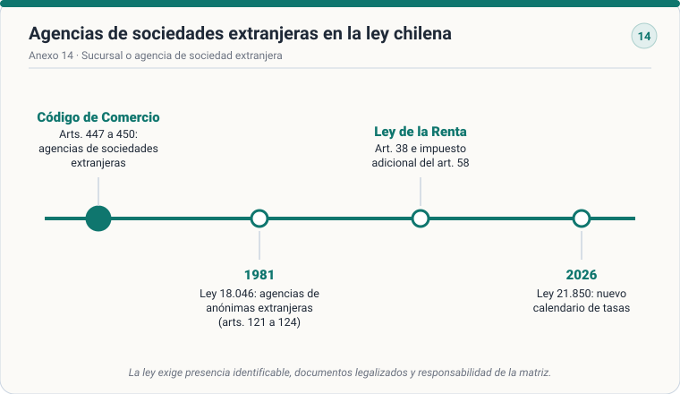
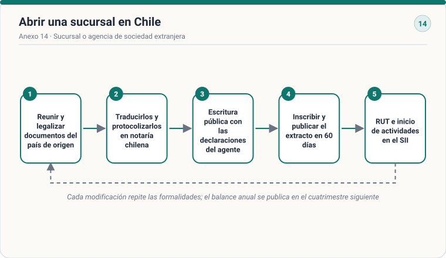
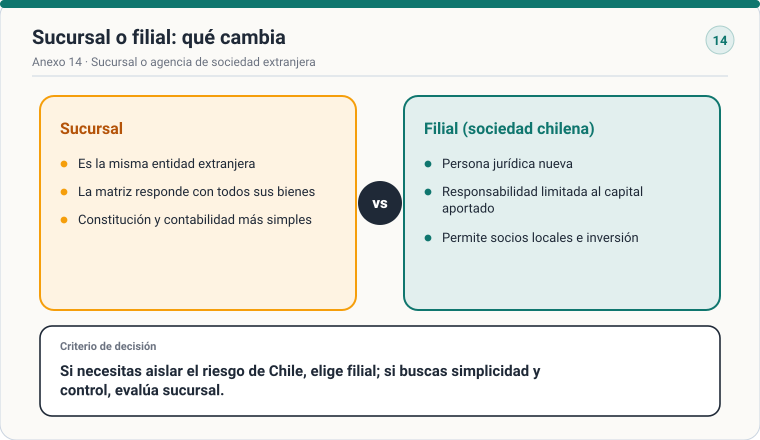
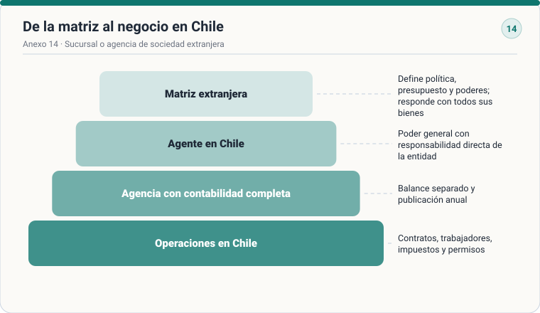
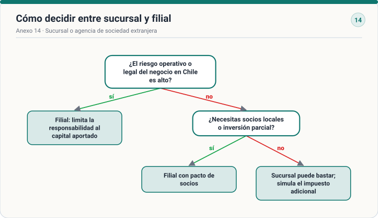

# Anexo 14 · Sucursal o agencia de sociedad extranjera

> **Fecha de consulta de las fuentes:** 2026-11-25. **Naturaleza:** material educativo; no es asesoría
> legal, tributaria ni migratoria. Las normas cambian: confirma cada dato en la fuente oficial citada al
> final antes de actuar. Este anexo separa **obligación legal**, **recomendación profesional** y **medida
> voluntaria**.

<!-- anexos:nav-inicio -->

**Navegación:** [← 13. Estatuto Pyme: empresas de menor tamaño (Ley 20.416)](13-estatuto-pyme-empresas-de-menor-tamano.md) · [Índice de anexos](README.md) · [15. Empresa en un Día: el Registro de Empresas y Sociedades →](15-empresa-en-un-dia-registro-de-empresas-y-sociedades.md)

## En 60 segundos

- La agencia es la misma entidad extranjera: no limita la responsabilidad (Código de Comercio, arts. 447 y 448).
- Exige documentos legalizados, protocolización, escritura de declaraciones y extracto en 60 días (arts. 447 a 449).
- Debe publicar su balance anual en el cuatrimestre siguiente al cierre (art. 450).
- Tributa con contabilidad completa como empresa separada; las remesas pagan impuesto adicional de 35 % (Ley de la Renta, arts. 38 y 58).
- Si necesitas aislar el riesgo, una filial suele ser mejor.

<!-- anexos:nav-fin -->

## 1. Ficha rápida

| Pregunta | Respuesta |
|---|---|
| ¿Qué es? | La forma en que una sociedad u otra persona jurídica **extranjera con fines de lucro** opera en Chile **sin crear una nueva persona jurídica**: una **agencia** (o sucursal) de la entidad extranjera (arts. 447 a 450 del Código de Comercio; arts. 121 a 124 de la Ley 18.046 para las anónimas). |
| ¿Es una persona jurídica distinta? | **No.** Es la misma entidad extranjera actuando en Chile por medio de un agente; por eso el agente «obra en Chile bajo la responsabilidad directa de la entidad» (art. 447 N.º 3). |
| ¿Quién responde por las deudas? | La entidad extranjera **con todos sus bienes**: sus bienes quedan afectos a las leyes chilenas para responder de las obligaciones que cumpla en Chile (art. 448 N.º 3), y debe mantener en Chile bienes de fácil realización (art. 448 N.º 4). |
| ¿Qué se necesita? | Protocolizar documentos legalizados del país de origen, declarar ciertas materias en escritura pública, inscribir y publicar un extracto dentro de 60 días (arts. 447 a 449). |
| ¿Se puede constituir en línea? | **No** por el Registro de Empresas y Sociedades: la Ley 20.659 no incluye a las agencias de sociedades extranjeras. |
| ¿Cómo tributa? | La renta de las agencias, sucursales y establecimientos permanentes se determina con contabilidad completa, **como si fueran una empresa separada de su matriz** (art. 38 de la Ley de la Renta); las remesas o retiros pagan **impuesto adicional de 35 %** (art. 58 N.º 1). |
| ¿Alternativa? | Constituir una **filial** en Chile (por ejemplo, una SpA), que sí es una persona jurídica nueva con responsabilidad limitada (Anexos 06 a 08). |
| ¿Para quién suele servir? | Empresas extranjeras que quieren operar en Chile con control directo, sin mantener una entidad chilena separada. |
| ¿Para quién no? | Quien quiere **aislar el riesgo** de Chile del resto del grupo: la sucursal compromete a toda la entidad extranjera. |

## 2. Historia y evolución

### 2.1. Un problema antiguo del comercio

Desde que el comercio cruza fronteras, los Estados enfrentan la misma pregunta: ¿cómo reconocer a una
empresa extranjera que actúa en su territorio sin que eluda sus leyes ni deje a los acreedores locales sin
garantía? La solución del derecho chileno es **exigir una presencia identificable** (el agente), **documentos
que prueben la existencia y poder de la matriz** y **un compromiso de responder con bienes en el país**.

### 2.2. Dónde está regulada

El **Código de Comercio** regula en su Párrafo 9 «las agencias de sociedades extranjeras u otras personas
jurídicas con fines de lucro» (arts. 447 a 450). La **Ley 18.046** regula, en su Título XI, las agencias de
sociedades anónimas extranjeras (arts. 121 a 124) con reglas prácticamente idénticas. Tras ellas, el texto
del Código de Comercio muestra una serie de artículos derogados (451 a 469), muestra de reformas pasadas.

### 2.3. Las reglas tributarias

La **Ley de la Renta** (Decreto Ley 824) contempla expresamente a las «agencias, sucursales u otras formas
de establecimientos permanentes de empresas extranjeras que operen en Chile» en su artículo 38 y fija el
impuesto adicional del artículo 58. Las leyes tributarias recientes (Leyes 21.210, 21.755 y 21.850) cambiaron
tasas y créditos; sus vigencias están en la
[guía de la Ley 21.850](../docs/20_LEY_21850_RECONSTRUCCION_NACIONAL.md).

## 3. Marco legal

### 3.1. Mapa de normas

| Norma | Qué aporta |
|---|---|
| Código de Comercio, arts. 447 a 450 | Requisitos para constituir agencia, extracto, modificaciones y balance anual |
| Ley 18.046, arts. 121 a 124 | Lo mismo para sociedades anónimas extranjeras |
| Decreto Ley 824, art. 38 | Renta del establecimiento permanente: contabilidad completa y trato como empresa separada |
| Decreto Ley 824, art. 58 N.º 1 | Impuesto adicional de 35 % sobre remesas o retiros |
| Decreto Ley 825 | IVA sobre las operaciones de la agencia |
| Ley 19.799 y reglas de legalización | Documentos electrónicos y apostilla |
| Convenios para evitar la doble tributación | Pueden modificar el tratamiento de remesas (verifica el convenio aplicable) |

### 3.2. Obligación, recomendación, opción

| Materia | Tipo | Detalle |
|---|---|---|
| Protocolizar antecedentes legalizados y traducidos | Obligación | Art. 447 |
| Escritura de declaraciones del agente | Obligación | Art. 448 |
| Extracto inscrito y publicado en 60 días | Obligación | Art. 449 |
| Formalidades para modificaciones | Obligación | Art. 450 |
| Publicar el balance anual de la agencia dentro del cuatrimestre siguiente al cierre | Obligación | Art. 450 |
| Mantener bienes de fácil realización en Chile | Obligación (declaración) | Art. 448 N.º 4 |
| Contabilidad completa y balance separado | Obligación tributaria | Art. 38 LIR |
| Evaluar una filial en lugar de sucursal | Recomendación profesional | Limita el riesgo |

## 4. Cómo se constituye

### 4.1. Paso a paso

1. **Reunir los antecedentes del país de origen**, emanados de ese país y **debidamente legalizados**
   (o con apostilla, según corresponda):
   - los antecedentes que acrediten que la entidad está legalmente constituida y un **certificado de
     vigencia**;
   - una **copia auténtica de los estatutos vigentes**;
   - un **poder general** al agente que la representará en Chile, que exprese con claridad que **el agente
     obra en Chile bajo la responsabilidad directa de la entidad**, con amplias facultades para ejecutar
     operaciones en su nombre y las facultades del inciso segundo del art. 7 del Código de Procedimiento
     Civil (art. 447).
2. **Traducir al español** los documentos que no estén en ese idioma, y **protocolizar** todo en una notaría
   del domicilio que la entidad tendrá en Chile, en el idioma oficial del país de origen (art. 447).
3. **Otorgar una escritura pública** en la misma fecha y ante el mismo notario, en la que el agente declara
   a nombre de la entidad (art. 448):
   - el **nombre con que funcionará en Chile** y su objeto u objetos;
   - que la entidad **conoce la legislación chilena** y los reglamentos aplicables a sus agencias, actos,
     contratos y obligaciones;
   - que **sus bienes quedan afectos a las leyes chilenas**, especialmente para responder de las
     obligaciones que cumpla en Chile;
   - que se **obliga a mantener en Chile bienes de fácil realización** para atender las obligaciones que
     deban cumplirse en el país;
   - cuál es el **capital efectivo** que tendrá en el país para el giro de sus operaciones y **la fecha y
     forma en que ingresará** a la caja de la agencia;
   - cuál es el **domicilio de la agencia principal**.
4. **Inscribir y publicar un extracto** de la protocolización y la escritura, certificado por el notario, en
   el Registro de Comercio del domicilio de la agencia principal y en el Diario Oficial, **dentro de 60 días**
   desde la fecha de la protocolización (art. 449). Debe indicar fecha y número de la protocolización y de la
   escritura, el nombre de la entidad y el que usará en Chile, el domicilio, el capital de la agencia y el
   nombre del agente.
5. **Registrar en el SII**: RUT, inicio de actividades y documentos. Confirma con el SII los pasos para
   establecimientos permanentes de entidades extranjeras.
6. **Obtener los permisos** municipales y sectoriales de la actividad (Anexo 17).

### 4.2. Qué documentos de origen se necesitan en la práctica

| Documento | Observación |
|---|---|
| Certificado de existencia y vigencia | Emitido por la autoridad del país de origen; fecha reciente |
| Estatutos vigentes | Copia auténtica |
| Poder al agente | Con las menciones exigidas por el art. 447 N.º 3 |
| Traducción al español | Cuando el original esté en otro idioma |
| Legalización o apostilla | Según el país de origen; la Ley 20.659 menciona la autenticación por apostilla en el caso de poderes otorgados en el extranjero |

**Recomendación profesional:** pide a un abogado chileno una **lista de verificación** con el país de origen
antes de reunir documentos; los errores de legalización o de traducción son la causa de demora más común.

### 4.3. Modificaciones

El agente debe cumplir las **mismas formalidades** respecto de cualquier modificación de los documentos o
declaraciones, **excepto** la relativa al capital efectivo del art. 448 N.º 4 (art. 450). Un cambio de poder,
de estatutos de la matriz, de nombre o de domicilio requiere repetir la protocolización, la escritura y el
extracto.

### 4.4. Balance anual público

El agente debe **publicar el balance anual de la agencia** en un diario del domicilio de esta, **dentro del
cuatrimestre siguiente** a la fecha de cierre del ejercicio (art. 450). Es una obligación de transparencia
frente a quienes contratan con la agencia.

### 4.5. Término

Los artículos revisados regulan el **inicio** y las **modificaciones**; no contienen un procedimiento
específico de cierre. Para terminar operaciones, consulta a un abogado qué actos de cancelación, aviso y
liquidación de obligaciones en Chile corresponden y cómo se informa al SII.

## 5. Capital, aportes y propiedad

### 5.1. El «capital» de una sucursal

La agencia **no tiene capital social propio**, porque no es una persona jurídica distinta. Pero el agente
debe declarar **cuál es el capital efectivo** que tendrá en Chile y cuándo y cómo ingresará a la caja de la
agencia (art. 448 N.º 5). Ese capital es la base de la contabilidad separada y del patrimonio que verán los
acreedores locales.

**Ejemplo ilustrativo.** Una empresa de software europea abre una sucursal en Chile con un capital efectivo de
60.000.000 de pesos, que ingresa en tres cuotas. Los acreedores chilenos pueden mirar ese capital, pero su
garantía final es **todo el patrimonio de la matriz**, no solo lo asignado a Chile. Los números son
ilustrativos.

### 5.2. Bienes de fácil realización

La entidad se obliga a **mantener en Chile bienes de fácil realización** para atender las obligaciones que
deban cumplirse en el país (art. 448 N.º 4). La ley no define un monto; la práctica contractual y la
fiscalización pueden exigir más.

### 5.3. Propiedad

La propiedad de la sucursal es **la propiedad de la matriz**: no hay accionistas locales ni juntas chilenas.
Si el grupo quiere socios locales, inversión parcial o venta de una parte del negocio chileno, deberá
**constituir una sociedad** (Anexos 06 y siguientes) y transferirle el negocio.

### 5.4. Sucursal o filial: el cuadro central

| Aspecto | Sucursal o agencia | Filial (sociedad chilena) |
|---|---|---|
| Personalidad jurídica | La de la matriz | Propia |
| Responsabilidad | De la matriz, con todos sus bienes | Limitada a los aportes de la matriz |
| Constitución | Protocolización, escritura y extracto | Registro en línea o escritura |
| Capital | Asignado y declarado | Capital social |
| Retiro de utilidades | Remesas con impuesto adicional (35 %) | Dividendos, con el régimen que corresponda |
| Socios locales | No | Sí |
| Cierre | Cancelación de la agencia | Disolución y liquidación |

## 6. Administración y gobierno

### 6.1. El agente o representante

El **agente** es la persona que la matriz designa por un **poder general** con las menciones del art. 447
N.º 3. Obra «bajo la responsabilidad directa» de la entidad. Debe estar facultado para ejecutar operaciones en
su nombre y recibir notificaciones judiciales conforme al art. 7 del Código de Procedimiento Civil.

### 6.2. Gobierno corporativo

La **gobernanza real** está en la matriz: su directorio y su junta aprueban el presupuesto, las políticas y los
poderes. Define claramente **qué puede decidir el agente solo**, qué requiere visto bueno de la matriz y qué
límites de monto se aplican.

### 6.3. Poderes y firmas

Los poderes del agente se acreditan con el documento protocolizado. Si cambian, repite las formalidades del
art. 450. Mantén una **matriz de poderes** con montos y materias.

### 6.4. Información a la matriz

La sucursal debe llevar **contabilidad completa** propia para fines tributarios (art. 38 LIR) y producir
informes para la matriz. Define quién será responsable en Chile (contador y gerente) y cómo se reconciliarán
las cifras con la contabilidad de la matriz.

### 6.5. Contratación de personal

La entidad extranjera es el **empleador** de las personas contratadas en la agencia. Aplica el derecho laboral
chileno a los trabajadores en Chile. Ver el [flujo laboral](../docs/08_EMPLOYMENT_FLOW_CHILE.md). Si envías
personal extranjero a Chile, consulta aparte las normas migratorias; no están en este anexo.

## 7. Responsabilidad

### 7.1. La matriz responde con todo

La característica clave: la agencia **no limita** la responsabilidad. El agente obra bajo la **responsabilidad
directa** de la entidad (art. 447 N.º 3) y los **bienes de la entidad quedan afectos a las leyes chilenas**,
en especial para responder de las obligaciones que cumpla en Chile (art. 448 N.º 3). Un acreedor chileno
puede reclamar contra la entidad extranjera y, en principio, contra sus bienes **en Chile y fuera**, con las
dificultades prácticas que eso implique.

### 7.2. Del agente

El agente responde ante la matriz según su mandato y ante terceros según las normas generales de
representación. Los actos que exceden sus facultades pueden no obligar a la entidad, y el agente podría
responder personalmente. Define sus facultades con precisión.

### 7.3. Responsabilidad tributaria

La agencia es **contribuyente en Chile** por la renta de su establecimiento permanente (art. 38 LIR). Los
retiros y remesas están afectos al impuesto adicional (art. 58 N.º 1). Las infracciones tributarias se
sancionan según el Código Tributario. Ver el Anexo 16.

### 7.4. Responsabilidad penal y de cumplimiento

La Ley 20.393 establece la responsabilidad penal de las **personas jurídicas** por ciertos delitos, y la
entidad extranjera que opera en Chile puede quedar expuesta. Las normas de prevención de lavado de activos,
anticorrupción y protección de datos pueden aplicar según la actividad. Ver
[cumplimiento y riesgo](../docs/13_COMPLIANCE_RISK.md).

### 7.5. Riesgo de «contagio» al grupo

Una deuda o una demanda en Chile puede alcanzar activos de la matriz fuera del país. Si tu grupo quiere
**aislar el riesgo** del negocio chileno, la sucursal es la herramienta equivocada: usa una filial.

## 8. Tributación

### 8.1. La renta de la sucursal (art. 38 LIR)

La renta de las agencias, sucursales u otros establecimientos permanentes de empresas extranjeras que
operen en Chile se determina sobre la base de **los resultados obtenidos por estos en su gestión** en el país
y en el exterior que les sean atribuibles. Se consideran las rentas originadas por actividades desarrolladas
por el establecimiento o por bienes asignados a él o utilizados por él. Debe determinarse sobre la base de un
**balance general según contabilidad completa**, **como si se tratara de una empresa totalmente separada e
independiente de su matriz**, tanto respecto de las operaciones con ella, como con otros establecimientos
permanentes de la misma matriz, con empresas relacionadas y con terceros independientes. Esto hace relevante
la **política de precios de transferencia** y el respaldo de operaciones con la matriz.

### 8.2. Impuesto adicional

Las personas naturales sin residencia ni domicilio en Chile y las sociedades o personas jurídicas
constituidas fuera del país que tengan en Chile cualquier clase de establecimientos permanentes, tales como
**sucursales, oficinas, agentes o representantes**, pagan el **impuesto adicional con tasa de 35 %** por el
**total de las rentas que remesen al exterior o sean retiradas** conforme a las normas legales que cita el
art. 58 N.º 1. Cuando corresponda aplicar el crédito del art. 63, se agrega un monto equivalente para
determinar la base imponible. Los convenios para evitar la doble tributación pueden alterar el tratamiento
de ciertas rentas. **Verifica con un contador el convenio aplicable y los créditos.**

### 8.3. Tasas de Primera Categoría

La **Ley 21.850** fija la tasa de Primera Categoría en 27 % para 2026, 25,5 % para 2027, 24 % para 2028 y 23 %
desde 2029. Los créditos y la restitución cambiaron con la ley; ver la
[guía de la Ley 21.850](../docs/20_LEY_21850_RECONSTRUCCION_NACIONAL.md). **Verifica en el SII.**

### 8.4. IVA y documentos

La sucursal factura, declara IVA y emite documentos tributarios electrónicos como cualquier contribuyente.
Ver el Anexo 16.

### 8.5. Decisión práctica

Para decidir entre sucursal y filial, simula **ambos caminos** con las cifras del plan a cinco años:

1. impuesto de Primera Categoría en cada caso;
2. impuesto adicional sobre remesas (sucursal) o sobre dividendos (filial);
3. créditos disponibles en el país de la matriz;
4. costos de cumplimiento, contabilidad y publicación;
5. riesgo de responsabilidad.

**Ejemplo ilustrativo.** Una empresa extranjera proyecta una utilidad anual de 100.000.000 de pesos en Chile.
Con sucursal, tributa en Primera Categoría y, al remesar, aplica el impuesto adicional con crédito por lo
pagado, según la ley. Con filial, la sociedad chilena paga su impuesto y luego el accionista extranjero
tributa por los dividendos. El resultado depende del régimen, de los créditos y de los convenios; no hay una
respuesta única. Cifras ilustrativas.

## 9. Obligaciones laborales, contables y sectoriales

### 9.1. Contabilidad y publicación

Lleva contabilidad completa, publica el balance anual en el plazo del art. 450 y reconcilia con la
contabilidad de la matriz.

### 9.2. Laboral

La entidad extranjera es empleadora de los trabajadores en Chile. Ver el
[flujo laboral](../docs/08_EMPLOYMENT_FLOW_CHILE.md).

### 9.3. Sectores regulados

Los sectores financiero, asegurador, bancario, de telecomunicaciones, de salud y otros pueden exigir
autorizaciones o formas societarias especiales. Las normas bancarias, por ejemplo, exigen
autorización del regulador a los bancos extranjeros que quieran establecer sucursal en el país. Para un
sector regulado, consulta a un especialista **antes** de crear la agencia.

### 9.4. Permisos municipales y sectoriales

Ver el Anexo 17 (Municipalidades) y la [matriz de permisos](../docs/06_PERMITS_MATRIX.md).

### 9.5. Datos personales y cumplimiento

La entidad debe cumplir las normas chilenas de protección de datos, consumo y prevención del delito. Ver
[cumplimiento y riesgo](../docs/13_COMPLIANCE_RISK.md).

## 10. Antes de construir: lista de verificación

### 10.1. Decisiones previas

1. ¿Sucursal o filial? Simula tributación, riesgo y costos de cada una.
2. ¿Quién será el agente y qué poderes tendrá? ¿Quién lo supervisa en la matriz?
3. ¿Qué capital efectivo asignarás a Chile y cuándo ingresará?
4. ¿Cómo mantendrás en Chile bienes de fácil realización para atender obligaciones?
5. ¿Qué nombre usará la agencia en Chile y cuál será su domicilio principal?
6. ¿Qué documentos debes obtener en el país de origen (vigencia, estatutos, poder)?
7. ¿Qué legalización o apostilla y qué traducciones necesitas?
8. ¿Cómo se determinarán los precios de transferencia con la matriz?
9. ¿Qué contabilidad completa y qué publicación anual del balance?
10. ¿Qué pasa si la actividad está regulada (financiera, seguros, salud)?

### 10.2. Documentos

| Documento | Para qué |
|---|---|
| Certificado de vigencia de la entidad | Art. 447 N.º 1 |
| Estatutos vigentes, copia auténtica | Art. 447 N.º 2 |
| Poder general al agente con las menciones legales | Art. 447 N.º 3 |
| Traducciones y legalización o apostilla | Validez en Chile |
| Escritura pública de declaraciones | Art. 448 |
| Extracto inscrito y publicado | Art. 449 |
| Contabilidad completa y balance anual | Arts. 450 y 38 LIR |

### 10.3. Errores frecuentes

- **Creer que la sucursal limita la responsabilidad:** la matriz responde con todo.
- **Documentos sin legalizar o con traducción defectuosa:** retrasan o invalidan el trámite.
- **Poder sin las menciones exigidas:** el art. 447 N.º 3 es específico.
- **No inscribir ni publicar el extracto en 60 días.**
- **No publicar el balance anual** de la agencia.
- **No documentar las operaciones con la matriz** (precios de transferencia).
- **No simular el impuesto adicional** y descubrir tarde el costo de remesar.
- **No considerar la alternativa de la filial.**

### 10.4. Caso ilustrado: una consultora extranjera que llega a Chile

**Caso ilustrativo.** Una consultora de ingeniería de un país europeo quiere iniciar un contrato de tres
años con una empresa minera en Chile. Los números son ilustrativos.

1. **Decisión.** Evalúa sucursal y filial. Como el contrato es de largo plazo, con riesgo operativo
   relevante, su abogado le advierte que en una sucursal, **una demanda en Chile puede alcanzar activos de la
   matriz**.
2. **Alternativa.** Opta por una **filial** (una SpA) con capital de 30.000.000 de pesos, para limitar la
   responsabilidad a lo aportado. Mantiene la sucursal como opción para trabajos menores o temporales.
3. **Si hubiera elegido sucursal.** Habría reunido estatutos, certificado de vigencia y poder, legalizado y
   traducido; protocolizado los antecedentes; otorgado la escritura; inscrito y publicado el extracto en 60
   días; y llevado contabilidad completa separada.
4. **Operación.** Define el precio de los servicios que la matriz presta a la filial con un estudio de
   precios de transferencia, y formaliza un contrato entre ambas.
5. **Resultado.** La filial paga su impuesto; los dividendos hacia la matriz tributan con el impuesto adicional
   según la ley y el convenio aplicable.

**Qué aprendemos.** La sucursal es simple de operar y compromete a la matriz; la filial requiere una
estructura adicional y aísla el riesgo. La elección depende del riesgo y de la tributación.

### 10.5. Mini glosario

| Término | Significado |
|---|---|
| Agencia o sucursal | Presencia en Chile de una entidad extranjera, sin nueva personalidad jurídica. |
| Agente | Persona que representa a la entidad en Chile con poder general. |
| Protocolización | Incorporación de documentos al registro de un notario. |
| Legalización o apostilla | Autenticación de documentos otorgados en el extranjero. |
| Establecimiento permanente | Sucursal, oficina, agente o representante que da presencia fiscal en Chile. |
| Impuesto adicional | Impuesto de 35 % sobre remesas o retiros de establecimientos permanentes y otras rentas de no residentes. |
| Filial | Sociedad chilena controlada por la matriz extranjera. |
| Precios de transferencia | Precios de operaciones entre entidades relacionadas, que deben ser de mercado. |

### 10.6. Cronograma ilustrativo con responsables

Un cronograma realista ayuda a no subestimar el trabajo previo en el país de origen. Los plazos que siguen
son **ilustrativos**: los de las autoridades extranjeras y de las notarías varían. Solo los 60 días del
extracto vienen de la ley (art. 449).

| Etapa | Responsable | Producto | Observación |
|---|---|---|---|
| 1. Decisión de estructura (sucursal o filial) | Directorio de la matriz con abogado y contador | Memo de decisión | Simula tributación y riesgo |
| 2. Certificados y estatutos | Secretaría de la matriz | Certificado de vigencia y copia auténtica | Fecha reciente |
| 3. Poder general al agente | Abogado de la matriz | Poder con las menciones del art. 447 N.º 3 | Revisa el texto con un abogado chileno |
| 4. Legalización o apostilla y traducción | Abogado y traductor | Juego de documentos listos | Es la etapa que más demora |
| 5. Protocolización y escritura | Agente y notario chileno | Protocolización y escritura de declaraciones | Misma fecha y mismo notario (art. 448) |
| 6. Extracto, inscripción y publicación | Abogado chileno | Extracto inscrito y publicado | Dentro de 60 días (art. 449) |
| 7. RUT e inicio de actividades | Contador y agente | Documentos tributarios | Confirma pasos con el SII |
| 8. Cuenta bancaria, contabilidad y permisos | Agente y contador | Operación habilitada | Ver Anexo 17 |
| 9. Primer balance y publicación | Contador y agente | Balance publicado | Dentro del cuatrimestre siguiente al cierre (art. 450) |

### 10.7. Preguntas que debes llevar a tu abogado y a tu contador

**Para el abogado:**

1. ¿Los documentos de mi país de origen cumplen las exigencias de legalización o apostilla para Chile?
2. ¿El poder al agente contiene todas las menciones del art. 447 N.º 3?
3. ¿Qué pasa si debo cambiar al agente o el nombre de la agencia? ¿Cuánto tarda repetir las formalidades?
4. ¿Qué riesgos concretos corre mi matriz por las obligaciones de la sucursal en Chile?
5. ¿Mi sector exige una forma societaria o una autorización especial?

**Para el contador:**

1. ¿Cuál es la diferencia de carga tributaria entre sucursal y filial con mis cifras de cinco años?
2. ¿Qué convenio para evitar la doble tributación aplica entre Chile y mi país, y cómo cambia el trato de las
   remesas?
3. ¿Qué créditos puedo imputar contra el impuesto adicional?
4. ¿Cómo debo documentar los precios de las operaciones con mi matriz?
5. ¿Qué contabilidad y qué reportes necesita la matriz y cuáles necesita el SII?

Llegar con estas diez preguntas a la primera reunión ahorra semanas, porque obliga a decidir las materias de
fondo antes de reunir papeles.

Una última recomendación práctica: **guarda un expediente único** con el original y la traducción de cada
documento, las fechas de legalización, el número de protocolización, la copia del extracto con sus timbres de
inscripción y publicación, y cada modificación posterior. Cuando un banco, un cliente grande o el propio SII
pida acreditar la existencia y los poderes de la agencia, ese expediente evita repetir trámites en el
extranjero, que son los más lentos y costosos.

## 11. Cuándo conviene y cuándo no

### 11.1. Comparación

| Criterio | Sucursal | Filial (SpA) | Oficina de representación sin actividad comercial |
|---|---|---|---|
| Persona jurídica | La matriz | Nueva | No aplica |
| Responsabilidad | Ilimitada de la matriz | Limitada | Según los actos que realice |
| Constitución | Protocolización, escritura, extracto | Registro en línea | Consulta a un abogado: puede configurar establecimiento permanente |
| Tributación | Renta de la sucursal e impuesto adicional | Renta de la sociedad y dividendos | Según actividad |
| Socios locales | No | Sí | No |
| Cierre | Cancelación de la agencia | Disolución y liquidación | Según el caso |

### 11.2. Señales a favor de una sucursal

- Operación acotada, temporal o de bajo riesgo.
- Control directo de la matriz y facilidad para consolidar resultados.
- No se necesitan socios locales ni inversión parcial.
- El tratamiento tributario simulado resulta favorable.

### 11.3. Señales en contra

- Riesgo operativo o regulatorio alto: conviene una filial.
- Necesidad de socios locales o inversión externa.
- Sector regulado con exigencias de forma societaria.
- Aversión a que Chile comprometa los activos de la matriz.

## 12. Cuándo llamar a un profesional

| Situación | Profesional | Por qué |
|---|---|---|
| Elegir entre sucursal y filial | Abogado y contador | Riesgo y tributación |
| Legalización, traducción y protocolización | Abogado chileno y notario | Formalidades del art. 447 |
| Precios de transferencia | Contador o economista | Art. 38 LIR |
| Convenios de doble tributación | Contador internacional | Efecto en remesas |
| Contratación y migración | Abogado laboral y migratorio | Trabajadores locales y extranjeros |
| Sector regulado | Abogado del sector | Autorizaciones |

Consulta la [guía de cuándo llamar a un profesional](../docs/18_WHEN_TO_CALL_A_PROFESSIONAL.md).

## 13. Escenarios resueltos

Casos **ilustrativos** (nombres y cifras inventados) sobre los artículos 447 a 450 del Código de Comercio, leídos en Ley
Chile (BCN).

### Escenario 1: «solo abrimos una oficina de representación»

**Situación.** Una empresa de software extranjera quiere abrir una oficina en Santiago con un gerente que firme contratos
y cobre a clientes chilenos.

**Análisis.** Una oficina que opera de forma estable con un agente que ejecuta operaciones en nombre de la entidad es,
en la práctica, una **agencia** (arts. 447 y siguientes). Si el agente solo promociona sin celebrar contratos, el análisis
puede ser distinto: no lo resuelvas por el nombre de la oficina, sino por lo que hace.

**Decisión.** Describir las funciones por escrito y consultar a un abogado antes de elegir la figura.

### Escenario 2: los documentos que llegan sin legalizar

**Situación.** La casa matriz envía los estatutos y el certificado de vigencia por correo, sin legalizaciones.

**Análisis.** El agente debe protocolizar en una notaría del domicilio de la agencia, en el idioma oficial del país de
origen y traducidos al español si corresponde, los documentos emanados del país de constitución **debidamente legalizados**:
antecedentes de constitución legal y certificado de vigencia, copia auténtica de los estatutos vigentes y un poder general
al agente (art. 447).

**Decisión.** Gestionar apostilla o legalización en origen y traducciones antes de viajar a la notaría.

### Escenario 3: el poder que no dice lo que debe decir

**Situación.** El poder otorga facultades amplias, pero no dice que el agente obra bajo la responsabilidad directa de la
entidad.

**Análisis.** El poder general debe constar la personería del mandante y expresar de forma clara y precisa que el agente obra
en Chile **bajo la responsabilidad directa de la entidad**, con amplias facultades para ejecutar operaciones en su nombre y
con las facultades del inciso segundo del art. 7 del Código de Procedimiento Civil (art. 447 N.º 3).

**Decisión.** Reemplazar el poder por uno redactado con asesoría chilena.

### Escenario 4: la escritura de declaraciones

**Situación.** El agente quiere postergar la escritura pública «para cuando haya clientes».

**Análisis.** La escritura de declaraciones debe otorgarse **en la misma fecha y ante el mismo notario** que la
protocolización. En ella el agente declara, a nombre de la entidad: el nombre con que funcionará en Chile y su objeto; que
conoce la legislación chilena; que sus bienes quedan afectos a las leyes chilenas para responder de las obligaciones en
Chile; que se obliga a mantener en Chile **bienes de fácil realización**; el capital efectivo y la fecha y forma de ingreso
a la caja de la agencia; y el domicilio de la agencia principal (art. 448).

### Escenario 5: el extracto fuera de plazo

**Situación.** Pasan 75 días desde la protocolización sin inscribir ni publicar.

**Análisis.** El extracto certificado debe inscribirse en el Registro de Comercio del domicilio de la agencia principal y
publicarse **una sola vez en el Diario Oficial dentro de los 60 días** desde la protocolización (art. 449). El plazo se
superó.

**Decisión.** Consultar a un abogado sobre cómo regularizar y qué consecuencias tiene el incumplimiento.

### Escenario 6: cambio en el capital de la agencia

**Situación.** La casa matriz decide aumentar el capital asignado a la agencia.

**Análisis.** El agente debe cumplir las mismas formalidades respecto de cualquier modificación en los documentos o
declaraciones, **salvo la del N.º 4 del art. 448** (la obligación de mantener bienes de fácil realización) (art. 450).

**Decisión.** Planificar la modificación con la misma notaría y calendario de inscripción y publicación.

### Escenario 7: el balance de la agencia

**Situación.** La agencia cierra su ejercicio el 31 de diciembre.

**Análisis.** El agente debe publicar el **balance anual de la agencia** en un diario del domicilio de esta dentro del
**cuatrimestre siguiente** al cierre (art. 450), es decir, antes de fines de abril.

### Escenario 8: ¿agencia o filial?

**Situación.** Una empresa extranjera duda entre abrir una agencia o constituir una filial.

**Análisis.** La agencia es la misma entidad extranjera actuando en Chile bajo su responsabilidad directa; la filial es una
sociedad chilena con patrimonio separado. Si la prioridad es aislar el riesgo, la filial suele ser más adecuada; si la
prioridad es operar rápido y bajo la misma persona jurídica, la agencia puede serlo.

**Decisión.** Comparar por escrito responsabilidad, tributación, costos y trámites.

## 14. Catálogo de errores y cómo corregirlos

| N.º | Error | Causa típica | Consecuencia | Cómo corregirlo | Dónde ver más |
|---:|---|---|---|---|---|
| 1 | Operar sin completar la constitución | Apuro | Incumplimiento (arts. 447 a 449) | Completar formalidades | Sección 4 |
| 2 | Documentos sin legalizar | Ahorro de trámites | Rechazo | Legalizar y traducir | Escenario 2 |
| 3 | Poder insuficiente | Plantilla extranjera | No cumple art. 447 N.º 3 | Poder a medida | Escenario 3 |
| 4 | No declarar bienes de fácil realización | Desconocimiento | Incumple art. 448 N.º 4 | Mantenerlos | Escenario 4 |
| 5 | Capital sin definir | Descuido | Incumple art. 448 N.º 5 | Declarar monto y forma | Sección 5 |
| 6 | Extracto fuera de 60 días | Calendario | Incumple art. 449 | Calendario de plazos | Escenario 5 |
| 7 | No inscribir en el Registro de Comercio | Olvido | Incumple art. 449 | Inscribir | Sección 4 |
| 8 | No modificar documentos cuando cambian | Falta de seguimiento | Incumple art. 450 | Procedimiento de cambios | Escenario 6 |
| 9 | No publicar el balance | Desconocimiento | Incumple art. 450 | Calendario anual | Escenario 7 |
| 10 | Suponer responsabilidad limitada | Confusión con filial | Responde la entidad | Evaluar filial | Escenario 8 |
| 11 | Mezclar facturación de matriz y agencia | Desorden | Problemas tributarios | Contabilidad separada | Sección 8 |
| 12 | Ignorar el impuesto sobre remesas | Falta de asesoría | Sorpresas fiscales | Planificar con contador | Sección 8 |
| 13 | Contratar sin permiso laboral o de residencia | Informalidad | Sanciones | Revisar migración | Sección 9 |
| 14 | Agente sin respaldo de la matriz | Falta de gobierno | Actos cuestionados | Acta o poder claro | Sección 6 |
| 15 | No guardar los documentos protocolizados | Desorden | Dificultad para acreditar | Archivo con índice | Sección 4 |

## 15. Alternativas y variantes de diseño

### C.1. Agencia, filial y otras presencias

| Criterio | Agencia | Filial (sociedad chilena) | Oficina de representación | Agente independiente |
|---|---|---|---|---|
| Persona jurídica | La misma entidad extranjera | Nueva sociedad chilena | La misma entidad, sin operar | Tercero |
| Responsabilidad | Directa de la entidad (art. 447 N.º 3) | Limitada al patrimonio de la filial | Según el alcance de lo que haga | Del agente |
| Trámites | Protocolización, escritura, inscripción y publicación (arts. 447 a 449) | Constitución según el tipo social | Según lo que haga | Contrato |
| Balance | Publicación anual (art. 450) | Según su tipo | No aplica | No aplica |

### C.2. Variantes de la agencia

| Variante | Descripción | Cuándo sirve |
|---|---|---|
| Agencia principal | Domicilio de la agencia principal (arts. 448 N.º 6 y 449) | Primera presencia |
| Agencias adicionales | Sucursales de la agencia | Expansión dentro de Chile |
| Agencia con capital mayor | Mayor capital efectivo declarado (art. 448 N.º 5) | Operaciones de mayor escala |

### C.3. Cómo estructurar el gobierno local

| Opción | Descripción | Cuidado |
|---|---|---|
| Agente único con poder amplio | Un agente con poder general | Concentra el riesgo |
| Agente con límites y comité de la matriz | Montos por sobre los cuales se requiere aprobación | Más control, más tiempo |
| Agente más gerente local | Separación de representación y gestión | Aclarar facultades |

### C.4. Ideas de cláusulas del poder (para llevar a un abogado)

1. «Otorga poder general a [agente] para representarla en Chile con amplias facultades para ejecutar operaciones.»
2. «El agente obra en Chile bajo la responsabilidad directa de [entidad].»
3. «Se le otorgan las facultades del inciso segundo del art. 7 del Código de Procedimiento Civil.»
4. «Se establecen los siguientes límites internos de monto: [detalle].»

## 16. Vinculación con otros anexos y con las clases

### D.1. ¿Cuándo salto a otro anexo?

| Evento | Anexo |
|---|---|
| Prefieres una filial | 03, 06 o 07 |
| Dudas sobre el Registro en línea | 15 |
| Tributación, remesas, IVA y documentos | 16 |
| Patente y permisos locales | 17 |
| Domicilio de la agencia | 18 |

### D.2. Clases del programa

- [Parte 5, clase 7: comparación jurídica para elegir forma societaria](../curriculum/part-05-diseno-societario-y-gobierno-inicial/class-07-comparacion-juridica-para-elegir-forma-societaria/README.md)
- [Parte 5, clase 13: juntas, actas, libros y trazabilidad de decisiones](../curriculum/part-05-diseno-societario-y-gobierno-inicial/class-13-juntas-actas-libros-y-trazabilidad-de-decisiones/README.md)

### D.3. Hilos que se conectan

1. **Poder y responsabilidad:** el art. 447 N.º 3 conecta la facultad del agente con la responsabilidad directa de la entidad.
2. **Bienes en Chile y acreedores:** el art. 448 conecta la afectación de bienes con la protección de quienes contratan.
3. **Publicidad y confianza:** los arts. 449 y 450 conectan la inscripción, el extracto y el balance con la transparencia.
4. **Tributación y matriz:** la contabilidad de la agencia conecta con las remesas a la casa matriz.

## 17. Plantillas y listas de trabajo

### E.1. Plan de 30, 60 y 90 días

| Plazo | Tareas | Responsable | Evidencia |
|---|---|---|---|
| Días 1 a 20 | Reunir y legalizar documentos en origen; traducir; redactar el poder | Matriz y abogado local | Documentos legalizados |
| Días 21 a 30 | Protocolización y escritura de declaraciones en la misma fecha | Agente | Protocolización y escritura |
| Días 31 a 60 | Inscripción y publicación del extracto (60 días desde la protocolización) | Abogado | Inscripción y aviso |
| Días 61 a 90 | RUT, inicio de actividades, banco, libros y contabilidad | Contador | Certificados |

### E.2. Calendario anual

| Cuándo | Tarea | Base |
|---|---|---|
| Cierre del ejercicio | Balance de la agencia | Art. 450 |
| Cuatrimestre siguiente | Publicar el balance en un diario del domicilio | Art. 450 |
| Cada cambio en documentos o declaraciones | Repetir formalidades (salvo la del art. 448 N.º 4) | Art. 450 |
| Mensual | IVA y retenciones según corresponda | Anexo 16 |
| Anual | Renta y revisión de remesas | Anexo 16 |

### E.3. Lista de control de la constitución

| Ítem | Sí | No |
|---|---|---|
| Antecedentes de constitución y certificado de vigencia legalizados | | |
| Copia auténtica de los estatutos vigentes | | |
| Poder general con la cláusula de responsabilidad directa | | |
| Traducción al español cuando corresponda | | |
| Escritura de declaraciones en la misma fecha y notaría | | |
| Extracto inscrito y publicado dentro de 60 días | | |

### E.4. Modelo de declaraciones de la escritura (art. 448)

| N.º | Declaración | Dato |
|---:|---|---|
| 1 | Nombre en Chile y objeto | |
| 2 | Conocimiento de la legislación chilena | Sí |
| 3 | Bienes afectos a las leyes chilenas | Sí |
| 4 | Bienes de fácil realización en Chile | Descripción y monto |
| 5 | Capital efectivo, fecha y forma de ingreso | |
| 6 | Domicilio de la agencia principal | |

## 18. Autoevaluación

1. ¿Qué es una agencia de una sociedad extranjera?
2. ¿Qué documentos se protocolizan?
3. ¿Qué dice el poder del agente?
4. ¿Qué declara la escritura?
5. ¿Qué plazo hay para inscribir y publicar el extracto?
6. ¿Qué se publica cada año?
7. ¿Responde la entidad con todo su patrimonio?
8. ¿Qué alternativa aísla mejor el riesgo?
9. ¿Qué cambios exigen repetir formalidades?
10. ¿Dónde se inscribe el extracto?

**Respuestas.**

1. La misma entidad extranjera actuando en Chile bajo su responsabilidad directa (art. 447 N.º 3).
2. Constitución legal con certificado de vigencia, estatutos vigentes y poder general, legalizados (art. 447).
3. Que el agente obra bajo la responsabilidad directa de la entidad, con amplias facultades (art. 447 N.º 3).
4. Nombre y objeto, conocimiento de la ley, bienes afectos, bienes de fácil realización, capital y domicilio (art. 448).
5. Sesenta días desde la protocolización (art. 449).
6. El balance anual de la agencia, dentro del cuatrimestre siguiente al cierre (art. 450).
7. Sí: la agencia no limita la responsabilidad de la entidad.
8. Una filial constituida en Chile.
9. Cualquier modificación de los documentos o declaraciones, salvo la del N.º 4 del art. 448 (art. 450).
10. En el Registro de Comercio del domicilio de la agencia principal (art. 449).

**Puntaje.** Ocho o más: dominas el tipo. Cuatro a siete: repasa las secciones 4 y 5. Menos de cuatro: relee el anexo.

## 19. Glosario ampliado

| Término | Significado |
|---|---|
| Agencia | Presencia estable en Chile de una entidad extranjera, representada por un agente |
| Agente | Persona que representa a la entidad extranjera en Chile |
| Apostilla | Certificación que legaliza un documento público para su uso en otro país |
| Bienes de fácil realización | Bienes que pueden convertirse en dinero con rapidez |
| Capital efectivo | Capital realmente asignado a la agencia para operar |
| Casa matriz | Entidad extranjera de la que depende la agencia |
| Certificado de vigencia | Documento que acredita que la entidad existe y está vigente |
| Filial | Sociedad chilena controlada por otra entidad |
| Legalización | Procedimiento para que un documento extranjero tenga validez en Chile |
| Protocolización | Incorporación de un documento al registro de un notario |

## 20. Preguntas frecuentes

**1. ¿Una sucursal es una empresa chilena?**
No. Es la entidad extranjera actuando en Chile mediante un agente; no es una persona jurídica nueva.

**2. ¿Quién responde por sus deudas?**
La entidad extranjera, con todos sus bienes, sin límite de responsabilidad (arts. 447 N.º 3 y 448 N.º 3).

**3. ¿Qué documentos necesito del país de origen?**
Antecedentes de constitución y certificado de vigencia, copia auténtica de los estatutos y un poder general al
agente, legalizados y traducidos (art. 447).

**4. ¿Dónde se protocolizan?**
En una notaría del domicilio que la entidad tendrá en Chile (art. 447).

**5. ¿Qué debe declarar el agente en la escritura?**
El nombre y objeto en Chile, que conoce la legislación, que sus bienes quedan afectos a las leyes chilenas,
que mantendrá bienes de fácil realización, el capital efectivo y el domicilio de la agencia principal
(art. 448).

**6. ¿Qué plazo hay para inscribir y publicar el extracto?**
60 días desde la fecha de la protocolización (art. 449).

**7. ¿Se puede hacer en línea?**
No por el Registro de Empresas y Sociedades; la Ley 20.659 no incluye a las agencias.

**8. ¿Debo publicar mis balances?**
Sí, el balance anual de la agencia en un diario de su domicilio dentro del cuatrimestre siguiente al cierre
(art. 450).

**9. ¿Cómo tributa la sucursal?**
Con contabilidad completa y como empresa separada de su matriz (art. 38 de la Ley de la Renta).

**10. ¿Pago impuesto por remesar utilidades?**
Sí. Las remesas o retiros de establecimientos permanentes pagan impuesto adicional con tasa de 35 % (art. 58
N.º 1), con los créditos y convenios aplicables.

**11. ¿Qué es mejor, sucursal o filial?**
Depende. La filial limita la responsabilidad y admite socios locales; la sucursal es más simple y compromete a
la matriz.

**12. ¿Qué pasa si cambio el poder del agente?**
Debes cumplir las mismas formalidades de protocolización, escritura y extracto (art. 450).

**13. ¿La sucursal puede contratar trabajadores?**
Sí; la entidad extranjera es el empleador y debe cumplir la ley laboral chilena.

**14. ¿Los acreedores pueden perseguir bienes de la matriz?**
La ley dispone que los bienes de la entidad quedan afectos a las leyes chilenas para responder de las
obligaciones en Chile; la ejecución sobre bienes fuera del país depende de normas internacionales.

**15. ¿Qué pasa si quiero cerrar?**
Los artículos revisados no contienen un procedimiento de cierre; consulta a un abogado y al SII.

**16. ¿Necesito un agente en Chile?**
Sí. La ley exige un agente o representante con poder general y responsabilidad directa de la entidad
(art. 447 N.º 3).

**17. ¿Sirve para un banco o una aseguradora extranjera?**
Los sectores regulados tienen reglas propias, como la autorización del regulador para sucursales de bancos
extranjeros. Consulta a un especialista.

**18. ¿Cuánto capital debo asignar?**
La ley exige declarar el capital efectivo y su forma de ingreso (art. 448 N.º 5), sin fijar un monto mínimo
en los artículos revisados.

**19. ¿Los precios con mi matriz deben ser de mercado?**
Sí, la sucursal se trata como empresa separada, incluso en sus operaciones con la matriz (art. 38 LIR).

**20. ¿Puedo empezar con sucursal y luego pasar a filial?**
Sí, aportando el negocio a una sociedad chilena; las consecuencias tributarias deben evaluarse con anticipación.

**21. ¿Qué es un poder general del agente?**
Un poder que acredita la personería del mandante y le otorga amplias facultades para ejecutar operaciones, bajo la
responsabilidad directa de la entidad (art. 447 N.º 3).

**22. ¿En qué idioma se protocolizan los documentos?**
En el idioma oficial del país de origen, traducidos al español si no están en ese idioma (art. 447).

**23. ¿Cuándo se otorga la escritura de declaraciones?**
En la misma fecha y ante el mismo notario que la protocolización (art. 448).

**24. ¿Qué es el capital efectivo de la agencia?**
El que la entidad declara tendrá en el país para el giro de sus operaciones, con la fecha y forma de ingreso a la caja
(art. 448 N.º 5).

**25. ¿Qué son los bienes de fácil realización?**
Los que la entidad se obliga a mantener en Chile para atender las obligaciones que deban cumplirse en el país (art. 448 N.º 4).

**26. ¿Dónde se publica el extracto?**
Una sola vez en el Diario Oficial, y se inscribe en el Registro de Comercio del domicilio de la agencia principal, dentro
de 60 días desde la protocolización (art. 449).

**27. ¿Qué datos lleva el extracto?**
Fecha y número de la protocolización y de la escritura, nombre de la entidad y el que usará en Chile, domicilio, capital de
la agencia y nombre del agente (art. 449).

**28. ¿Qué pasa si cambia el agente?**
Hay que cumplir las formalidades respecto de cualquier modificación de los documentos o declaraciones (art. 450).

**29. ¿Dónde se publica el balance?**
En un diario del domicilio de la agencia, dentro del cuatrimestre siguiente al cierre del ejercicio (art. 450).

**30. ¿Una agencia tiene responsabilidad limitada?**
No: el agente obra bajo la responsabilidad directa de la entidad (art. 447 N.º 3).

**31. ¿Puedo abrir una cuenta bancaria?**
Normalmente sí, una vez cumplidas las formalidades y obtenido el RUT; cada banco tiene requisitos propios.

**32. ¿Debo inscribirme en el SII?**
Sí, para iniciar actividades y cumplir obligaciones tributarias; revisa el anexo 16.

**33. ¿Qué pasa con las remesas a la casa matriz?**
Tienen tratamiento tributario específico; el anexo menciona el impuesto adicional. Consulta a un asesor tributario.

**34. ¿Puedo contratar trabajadores?**
Sí, con las reglas laborales chilenas; consulta el manual laboral y a un abogado.

**35. ¿Qué pasa si quiero cerrar la agencia?**
Hay que planificar el término con contabilidad, obligaciones tributarias y laborales; consulta a un abogado.

**36. ¿Cuándo debo pedir ayuda profesional?**
Al legalizar documentos, redactar el poder, cumplir los plazos del extracto y planificar la tributación y las remesas.

## 21. Fuentes y vigencia

| Fuente | Qué se usó | Dónde consultarla |
|---|---|---|
| Código de Comercio, arts. 447 a 450 | Agencias de sociedades extranjeras | [BCN, Código de Comercio](https://www.bcn.cl/leychile/navegar?idNorma=1974) |
| Ley 18.046, Título XI | Agencias de sociedades anónimas extranjeras | [BCN, Ley 18.046](https://www.bcn.cl/leychile/navegar?idNorma=29473) |
| Decreto Ley 824 (Ley de la Renta), arts. 38 y 58 | Renta del establecimiento permanente e impuesto adicional | [BCN, DL 824](https://www.bcn.cl/leychile/navegar?idNorma=6368) |
| Decreto Ley 825 | IVA | [BCN, DL 825](https://www.bcn.cl/leychile/navegar?idNorma=6369) |
| Ley 20.659 | Lista de tipos del Registro en línea | [BCN, Ley 20.659](https://www.bcn.cl/leychile/navegar?idNorma=1048718) |
| SII, regímenes tributarios | Rutas de Operación Renta | [SII](https://www.sii.cl/destacados/renta/2026/intermediarios/regimenes_tributarios/) |
| Ley 21.850 y Ley 21.755 | Tasas recientes | [Guía del programa](../docs/20_LEY_21850_RECONSTRUCCION_NACIONAL.md) |

**Vigencia.** Los artículos citados del Código de Comercio, de la Ley 18.046 y de la Ley de la Renta se
leyeron en la versión publicada por la Biblioteca del Congreso Nacional el 2026-11-25. Los convenios para
evitar la doble tributación, los créditos del art. 63 y las normas migratorias no se transcriben: verifícalos
en las fuentes oficiales.

**Límites.** Este anexo no reproduce el texto íntegro de las normas, no analiza convenios internacionales ni
migración y sus ejemplos numéricos son ilustrativos. No sustituye la asesoría de un abogado ni de un
contador.

<!-- anexos:cierre-inicio -->

## Para seguir leyendo

- [Anexo 06. Sociedad por Acciones (SpA)](06-sociedad-por-acciones-spa.md): filial como SpA.
- [Anexo 07. Sociedad Anónima Cerrada (S.A.)](07-sociedad-anonima-cerrada.md): filial como anónima.
- [Anexo 16. Servicio de Impuestos Internos (SII): lo que una empresa debe saber](16-servicio-de-impuestos-internos-sii.md): impuesto adicional y contabilidad.

**Navegación:** [← 13. Estatuto Pyme: empresas de menor tamaño (Ley 20.416)](13-estatuto-pyme-empresas-de-menor-tamano.md) · [Índice de anexos](README.md) · [15. Empresa en un Día: el Registro de Empresas y Sociedades →](15-empresa-en-un-dia-registro-de-empresas-y-sociedades.md)

<!-- anexos:cierre-fin -->
