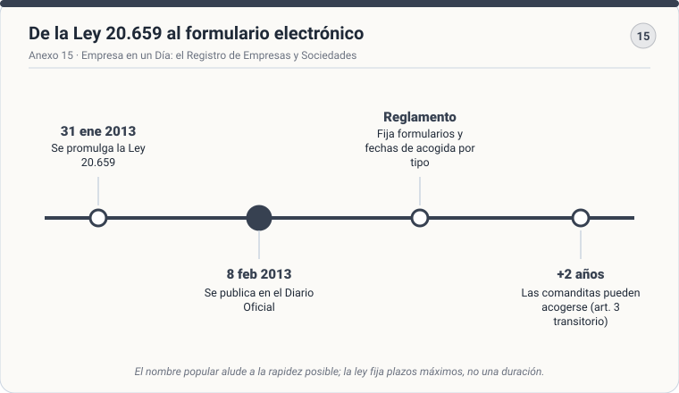
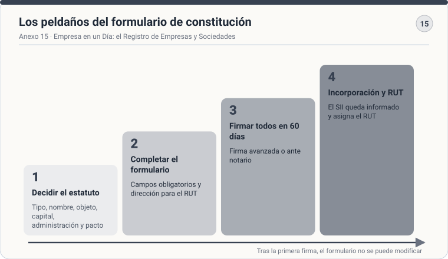
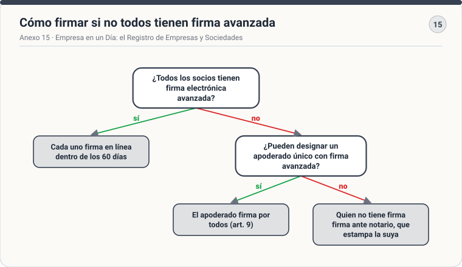
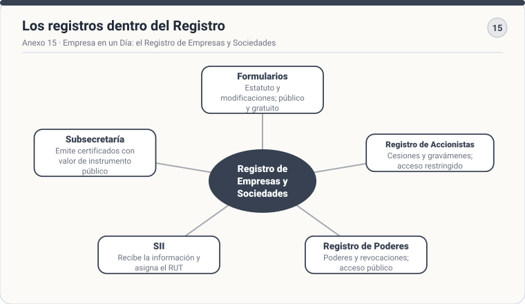

# Anexo 15 · Empresa en un Día: el Registro de Empresas y Sociedades (Ley 20.659)

> **Fecha de consulta de las fuentes:** 2026-11-25. **Naturaleza:** material educativo; no es asesoría
> legal ni tributaria. Las normas cambian: confirma cada dato en la fuente oficial citada al final
> antes de actuar. Este anexo separa **obligación legal**, **recomendación profesional** y **medida
> voluntaria**. El nombre popular «Empresa en un Día» es un nombre de programa: **la ley no promete que
> todo se haga en un día**; promete un sistema electrónico simplificado. Este anexo cita el texto de la ley.

<!-- anexos:nav-inicio -->

**Navegación:** [← 14. Sucursal o agencia de sociedad extranjera](14-sucursal-o-agencia-de-sociedad-extranjera.md) · [Índice de anexos](README.md) · [16. Servicio de Impuestos Internos (SII): lo que una empresa debe saber →](16-servicio-de-impuestos-internos-sii.md)

## En 60 segundos

- Es voluntario y cubre ocho tipos de sociedad (arts. 1 y 2).
- Todos deben firmar dentro de 60 días desde la primera firma; después no se puede modificar el formulario (art. 10).
- Al incorporarse, el SII queda informado y asigna el RUT; puede pedirse el inicio de actividades (art. 13).
- El Registro es público y gratuito; las firmas ante notario pagan una tarifa fijada por decreto (arts. 9 y 11).
- No reemplaza permisos, patente ni cuenta bancaria.

<!-- anexos:nav-fin -->

## 1. Ficha rápida

| Pregunta | Respuesta |
|---|---|
| ¿Qué es? | El régimen electrónico que permite **constituir, modificar, transformar, fusionar, dividir, terminar o disolver** ciertas sociedades **mediante un formulario** firmado y su incorporación al **Registro de Empresas y Sociedades** (arts. 1, 4 y 11 de la Ley 20.659). |
| ¿Qué ley la crea? | La **Ley 20.659**, promulgada el 31 de enero de 2013 y publicada el 8 de febrero de 2013, que «simplifica el régimen de constitución, modificación y disolución de las sociedades comerciales». |
| ¿Quién la administra? | El **Ministerio de Economía, Fomento y Turismo** (art. 11); los certificados los emite la **Subsecretaría de Economía y Empresas de Menor Tamaño** (arts. 12 y 22). |
| ¿Qué tipos incluye? | EIRL, sociedad de responsabilidad limitada, sociedad anónima **cerrada**, sociedad anónima de garantía recíproca, sociedad colectiva comercial, SpA, comandita simple y comandita por acciones (art. 2). |
| ¿Es obligatorio usarla? | **No.** Rige para quienes **voluntariamente** se constituyan o acojan a ella (art. 1). Quien no se acoge, usa la vía tradicional. |
| ¿Cuánto cuesta? | El Registro es **público y gratuito** (art. 11). Si alguien firma ante notario, este cobra por su firma electrónica avanzada una **tarifa fijada por decreto** (art. 9). |
| ¿Qué pasa al firmar? | El formulario se incorpora **automáticamente**, el SII se entiende **informado**, se asigna el **RUT** y puede solicitarse el **inicio de actividades** y el **timbraje** (art. 13). |
| ¿Qué NO hace? | No reemplaza permisos municipales ni sectoriales, ni abre cuentas bancarias, ni inscribe bienes raíces por sí solo. |
| ¿Para quién suele servir? | Cualquiera que quiera constituir una EIRL, limitada, SpA o anónima cerrada con trámite electrónico. |
| ¿Para quién no? | Cooperativas, fundaciones, anónimas abiertas, sociedades civiles y sucursales extranjeras: la ley no las incluye. |

## 2. Historia y contexto

### 2.1. Un trámite que antes pasaba por notaría y conservador

Antes de 2013, constituir una sociedad en Chile exigía, en general, **escritura pública** ante notario, **extracto**
inscrito en el Registro de Comercio del Conservador de Bienes Raíces y **publicación en el Diario Oficial**,
dentro de plazos legales (por ejemplo, 60 días en las sociedades de los Anexos 03 a 07), y luego los trámites
ante el SII. La Ley 20.659 **simplificó** ese camino para ciertos tipos: reemplazó la escritura y la inscripción
por un **formulario electrónico** y un **registro único**.

### 2.2. La ley

La Ley 20.659 está organizada en ocho títulos: disposiciones generales; formularios; suscripción;
Registro de Empresas y Sociedades; modificación, transformación, fusión, división, terminación y disolución;
saneamiento de la nulidad; migración; y disposiciones finales. Su objetivo está en el artículo 1: que las
personas jurídicas enumeradas puedan ser constituidas, modificadas, transformadas, fusionadas, divididas,
terminadas o disueltas «cumpliendo solamente con las solemnidades establecidas para estos efectos en la
presente ley».

### 2.3. Entrada en vigencia y reglamento

La ley dispuso que un **reglamento** del Ministerio de Economía, suscrito también por el Ministro de Hacienda,
se expediría dentro de tres meses desde su publicación, y que **entraría en vigencia el primer día hábil del
mes subsiguiente** al de la publicación del reglamento (artículos primero y segundo transitorios). Además, el
reglamento fijaría las fechas desde las cuales podrían acogerse los distintos tipos, y las comanditas simples
y por acciones solo podrían hacerlo **transcurridos dos años** desde la publicación de la ley (artículo tercero
transitorio). Esos plazos son parte de la historia: hoy el sistema está operativo para los ocho tipos.

### 2.4. Lo que significa «en un día»

La expresión popular alude a la **rapidez potencial** del trámite cuando todos los firmantes cuentan con firma
electrónica avanzada y el formulario está bien completado. La ley, en cambio, fija **plazos máximos** (60 días
para completar las firmas, 30 días para ciertos respaldos) y **no garantiza** una duración. La rapidez
depende de que todos firmen, de que el sistema funcione y de que el SII autorice lo que le corresponda.

## 3. Marco legal

### 3.1. Mapa de normas

| Norma | Qué aporta |
|---|---|
| Ley 20.659 | Régimen electrónico, Registro, formularios, migración, saneamiento |
| Reglamento de la Ley 20.659 | Detalles operativos (formularios, campos, certificados); verifica su texto vigente |
| Ley 19.799 | Documentos electrónicos y firma electrónica avanzada |
| Código de Comercio | Régimen sustantivo de las sociedades |
| Ley 18.046 | Régimen de la sociedad anónima |
| Ley 19.857 | Régimen de la EIRL |
| Ley 3.918 | Régimen de la sociedad limitada |
| Ley 20.179 | Garantía recíproca |
| Código Tributario, arts. 69 y 70 | Casos en que el SII debe autorizar ciertas actuaciones |

### 3.2. Obligación, recomendación, opción

| Materia | Tipo | Detalle |
|---|---|---|
| Usar el Registro | Opción | Voluntario (art. 1) |
| Completar todos los campos exigidos por la ley | Obligación | Art. 6 |
| Dirección para obtener RUT | Obligación | Art. 6 |
| Firma de todos dentro de 60 días | Obligación | Art. 10 |
| Firma electrónica avanzada o ante notario | Obligación | Art. 9 |
| Registro de accionistas llevado en el Registro | Obligación (para sociedades acogidas con tal registro) | Art. 13 bis |
| Registrar poderes en el Registro de Poderes | Opción | Art. 13 ter |
| Pacto de socios adicional | Recomendación profesional | El formulario recoge el estatuto, no todos los pactos |

## 4. Qué entra y qué queda fuera

### 4.1. Los ocho tipos incluidos (art. 2)

| N.º | Tipo | Anexo |
|---:|---|---|
| 1 | Empresa individual de responsabilidad limitada | 02 |
| 2 | Sociedad de responsabilidad limitada | 03 |
| 3 | Sociedad anónima **cerrada** | 07 |
| 4 | Sociedad anónima de garantía recíproca | 10 |
| 5 | Sociedad colectiva comercial | 04 |
| 6 | Sociedad por acciones (SpA) | 06 |
| 7 | Sociedad en comandita simple | 05 |
| 8 | Sociedad en comandita por acciones | 05 |

### 4.2. Lo que no está en la lista

No figuran, y por tanto **no pueden constituirse por este Registro**: persona natural con giro, sociedad
anónima abierta o especial, cooperativas, corporaciones y fundaciones, sociedades civiles ni sucursales o
agencias de sociedades extranjeras. Para ellas, ver los Anexos 01, 08, 09, 11, 12 y 14.

### 4.3. Si ya existe la sociedad

Las sociedades constituidas por la vía tradicional pueden **migrar** al régimen electrónico y viceversa (arts.
18 a 20; sección 9). La migración **no es una modificación social**.

## 5. Antes de entrar al sistema: lo que debes decidir

El formulario te pedirá datos que son **decisiones jurídicas**, no meros campos. Resuélvelas antes:

| Decisión | Dónde ver más |
|---|---|
| Tipo de sociedad | Anexos 02 a 11 y la [guía de formas jurídicas](../docs/01_COMPANY_TYPES_CHILE.md) |
| Nombre (verifica semejanzas y marcas) | INAPI y Registro |
| Objeto o giro | Amplio pero claro; revisa tu plan de negocios |
| Capital, forma y plazo de pago | Anexos del tipo elegido |
| Administración y poderes | Anexos del tipo elegido |
| Domicilio y su respaldo | Contrato de arriendo, comodato o propiedad |
| Duración | Indefinida si nada se dice, según el tipo |
| Pacto de socios | Abogado |
| Régimen tributario | Contador y Anexo 16 |

**Recomendación profesional:** completa un borrador en papel, con tu abogado, antes de abrir el formulario.
Una vez que **el primer socio firma, el formulario no puede modificarse** (art. 10).

## 6. El formulario, campo por campo

### 6.1. Qué es

El **formulario** es el documento electrónico que contiene el contrato social y sus modificaciones (art. 3
N.º 2). El **contrato social y el estatuto** de la persona jurídica son los que constan en el formulario de
constitución inscrito y en sus modificaciones (art. 5). Por eso el formulario **es** tu estatuto.

### 6.2. Reglas de contenido (art. 6)

- Debe contener **todos los campos** necesarios para completar las menciones que las leyes establecen para la
  validez del acto de que se trate.
- Quienes lo suscriben deben completar todos los campos de **requisitos obligatorios**; las menciones **no
  obligatorias** pueden completarse **voluntariamente**.
- Si **no se completan** las menciones voluntarias, **rigen las normas supletorias** de las leyes que regulan
  el acto. Por eso conviene conocer qué dice la ley supletoria (por ejemplo, el art. 424 del Código de Comercio
  para la SpA o el art. 4 de la Ley 18.046 para la anónima).
- Debe completarse necesariamente el campo de **domicilio social** si la ley que rige a la persona jurídica lo
  exige, **y todas deben especificar una dirección para obtener el RUT**.
- El reglamento establece el sistema para **identificar** al constituyente, socio, accionista o representante y
  su capacidad para celebrar el acto.

### 6.3. Aportes que exigen formalidades

Sin perjuicio de la mención al capital, **cuando se requieran formalidades o solemnidades especiales para
enterar el aporte, según el tipo de bien, deben cumplirse** (art. 8). Un inmueble o un vehículo aportado
exige sus propias inscripciones o transferencias; el formulario no las reemplaza.

### 6.4. Disponibilidad pública

Los formularios deben estar en el Registro **permanentemente a disposición de los interesados** (art. 7).
Cualquiera puede consultar el estatuto de una sociedad acogida.

### 6.5. Errores manifiestos

El Registro, de oficio o a petición de parte, puede **rectificar errores manifiestos u omisiones** según el
reglamento, y esa rectificación se registra conforme a la ley (art. 12). **No efectúa inscripciones** si los
formularios no contienen las designaciones legales o reglamentarias requeridas.

## 7. La firma: lo que más se subestima

### 7.1. Quién firma

Deben suscribir el formulario el **constituyente, los socios o los accionistas**, o sus representantes o
apoderados (art. 9). El formulario **solo se entiende incorporado al Registro cuando lo firman todos** los
que deben concurrir (art. 4).

### 7.2. Dos formas de firmar

| Forma | Cómo funciona | Cuándo conviene |
|---|---|---|
| **Firma electrónica avanzada** | Cada firmante firma electrónicamente, según la Ley 19.799 y el reglamento | Cuando todos tienen certificado de firma avanzada |
| **Ante notario** | El firmante que no tiene firma electrónica avanzada suscribe ante un notario, que estampa su propia firma electrónica avanzada en el formulario | Cuando alguien no tiene firma avanzada; el notario cobra la tarifa fijada por decreto |

### 7.3. Representantes y apoderados

El firmante puede actuar por **representante legal o apoderado**. El poder debe otorgarse por alguna de
estas vías: el **Registro de Poderes** (art. 13 ter); **escritura pública**; **instrumento privado con firmas
autorizadas por notario y protocolizado**; o **documento electrónico firmado con firma electrónica avanzada**
(Ley 19.799). En el formulario se deja constancia del tipo de documento, su fecha, el notario y el repertorio.
**Si el poder se otorgó en el extranjero**, debe cumplirse la **legalización** o la **apostilla** (art. 9).
Una copia digital íntegra del instrumento de la personería debe incorporarse al Registro, por el notario o por
el apoderado con firma avanzada.

**Apoderado único para firmar.** Los constituyentes, socios o accionistas pueden designar en el formulario
(o en otro que disponga el Registro) a **un apoderado para que actúe en representación de todos ellos** en la
suscripción con firma electrónica avanzada o ante notario (art. 9). Es una gran simplificación cuando los
socios están en distintos lugares.

### 7.4. El plazo de sesenta días

La suscripción por **todos** debe efectuarse **dentro de sesenta días** contados desde la firma del primero;
si no, **se tienen por no suscritos para todos los efectos** (art. 10). Y con la firma del primero, **el
formulario no puede modificarse**. Dos consecuencias prácticas: (1) revisa el texto con todos antes de la
primera firma; (2) coordina agendas y certificados de firma desde el inicio.

### 7.5. La fecha del acto

La **fecha del acto jurídico** es la fecha en que **firma el primero** de los socios o accionistas o el
constituyente (art. 4). El formulario produce sus efectos de registro cuando firma el último.

## 8. Qué ocurre al firmar: incorporación, RUT e inicio de actividades

### 8.1. Incorporación automática

Una vez suscrito por todos quienes deban hacerlo, el formulario **se incorpora automáticamente al Registro**
desde esa fecha, y con su solo mérito **se entiende informado el SII**, sin perjuicio de sus facultades de
fiscalización (art. 13).

### 8.2. Excepción para ciertos trámites tributarios

En los casos de los artículos **69, inciso final, y 70 del Código Tributario**, la incorporación de la
respectiva actuación se realiza **solo cuando el SII así lo autorice** (art. 13). Es decir: ciertos actos
dependen de autorización del Servicio.

### 8.3. RUT

El SII debe asignar, «sin más trámite», un **Rol Único Tributario** a toda persona jurídica constituida
conforme a la ley, **en forma simultánea a la incorporación al Registro**. Con la sola incorporación del
formulario de constitución se entiende requerido el SII para asignar el RUT. Ese rol es el **número de
identificación en el Registro** y sirve para identificar los antecedentes de la persona jurídica (art. 13).

### 8.4. Inicio de actividades y timbraje

En el mismo formulario de constitución se puede solicitar al SII el **inicio de actividades** y el
**timbraje de documentos tributarios**, según determine el reglamento (art. 13). Esta es la parte «en un día»
más valiosa: la sociedad nace con RUT y puede quedar habilitada tributariamente.

### 8.5. Lo que sigue siendo tu tarea

- Elegir **giros y códigos de actividad**, y el **régimen tributario** (Anexo 16).
- Obtener **patente municipal y permisos** (Anexo 17).
- Abrir **cuenta bancaria** (el banco tiene sus propias exigencias).
- Obtener el **certificado de vigencia** y demás certificados que pidan bancos o clientes.

## 9. Los registros dentro del Registro

### 9.1. Registro de Accionistas

Las personas jurídicas acogidas que, según sus leyes, deban llevar **registro de accionistas** lo llevan
**exclusivamente en el Registro** (art. 13 bis). Es de **acceso restringido** a accionistas, administradores y
apoderados facultados, y al notario cuando corresponda. Toda **cesión de acciones**, **constitución de
gravámenes** o **pactos** sobre cesión deben inscribirse mediante el formulario «De Inscripción al Registro de
Accionistas», o por los formularios «De Suscripción» o «De Compraventa de Acciones» firmados por las partes. El
**gerente general** o los administradores deben registrar esos formularios. Firmado uno de ellos, se
**presume** que la persona jurídica emisora tomó conocimiento de la solicitud, y la Subsecretaría puede
certificarlo. Una vez inscrita la cesión, **se entiende informada al SII**.

### 9.2. Registro de Poderes

Los poderes y delegaciones de facultades para representar a las personas jurídicas acogidas pueden otorgarse,
modificarse y revocarse mediante un **formulario** que se incorpora al **Registro de Poderes**, de **acceso
público** (art. 13 ter). Los poderes registrados se entienden vigentes mientras no se incorpore su
modificación o revocación y quedan **revestidos de todas las solemnidades** necesarias para actos que exijan
escritura pública, bastando el certificado de la Subsecretaría. Si para otorgarlos se requería una sesión de
directorio u otro acuerdo, debe acompañarse una copia digital del acta o acuerdo. Los poderes que forman parte
del estatuto se incorporan de manera automática.

### 9.3. Certificados

Los certificados de las personas jurídicas incorporadas son emitidos por la **Subsecretaría de Economía y
Empresas de Menor Tamaño**, mediante firma electrónica por el Subsecretario en su calidad de **ministro de
fe**, o por delegación (arts. 12 y 22). Tienen **valor probatorio de instrumento público** y **constituyen
título ejecutivo** (art. 22).

### 9.4. Efecto sobre otras formalidades

Cuando las leyes exigen una **anotación o inscripción en el Registro de Comercio** o una **publicación en el
Diario Oficial** respecto de los actos de que trata la ley, esas formalidades **se entienden cumplidas y
reemplazadas** por la incorporación del formulario al Registro (art. 21). Para los terceros, la **publicidad**
la da el Registro, que es **único, rige en todo el territorio, es público y gratuito** (art. 11).

## 10. Modificar, transformar, fusionar, dividir, terminar y disolver

### 10.1. Regla general

Las personas jurídicas acogidas se modifican, transforman, fusionan, dividen, terminan y disuelven **mediante
la sola suscripción del formulario respectivo y su incorporación al Registro** (art. 14). Lo firman los
titulares de los derechos sociales o acciones con derecho a voto **al tiempo de celebrarse el acto**, o sus
apoderados o representantes.

### 10.2. Cuando se requiere junta

Si para adoptar el acuerdo se requiere una **junta**, el acta, cumplidas las formalidades que correspondan, se
**reduce a escritura pública o se protocoliza**, y el formulario lo firman los accionistas que concurrieron a
firmar el acta (o su representante designado); **quienes firmaron el acta no pueden negarse a firmar el
formulario** (art. 14). **No se requiere** que la junta se celebre ante notario ni que el acta se reduzca a
escritura pública o se proteja por protocolización si **todos** los accionistas (y los socios gestores en la
comandita por acciones) firman el formulario o lo firma un representante designado para todos.

### 10.3. Respaldo en 30 días

En cualquier caso, una **copia digital íntegra** del acta o de su reducción o protocolización debe incorporarse
al Registro **en un plazo máximo de treinta días corridos** posteriores a la celebración de la junta o a su
reducción o protocolización (art. 14).

### 10.4. Redacción del cambio

Los acuerdos se incorporan al formulario **indicando las nuevas cláusulas** de los estatutos y **aquellas que
se modifican o sustituyen** (art. 14).

### 10.5. Fusión y división

En la **fusión** con personas jurídicas no acogidas, cada una cumple las solemnidades propias, y la sociedad
resultante sigue regulada por el régimen que le corresponda, sin perjuicio de migrar después. En la
**división**, la nueva persona jurídica **debe acogerse** a esta ley, sin perjuicio de migrar (art. 15).

### 10.6. Resciliación

El reglamento determina cómo puede hacerse la **resciliación** de determinados actos, para lo cual las partes
que comparecieron suscriben un formulario (art. 4).

### 10.7. El Registro no cancela de oficio

El Registro **no hace cancelación alguna de oficio** (art. 12). Una sociedad inactiva no desaparece por sí sola:
debe terminarse o disolverse por los medios legales.

## 11. Nulidad y saneamiento

### 11.1. Corregir el formulario

Para sanear la nulidad por **vicios formales** en la constitución, modificación, transformación, división,
fusión, terminación o disolución, quienes son titulares de los derechos sociales o acciones al tiempo del
saneamiento deben **corregir el formulario en que conste el vicio y suscribirlo** de conformidad con las
normas de suscripción (art. 16). Si el vicio incide en una **cesión de derechos sociales**, deben concurrir
también el cedente o sus causahabientes y quienes sean titulares de los derechos en ese momento.

### 11.2. Efecto retroactivo

El saneamiento **produce efecto retroactivo a la fecha de la incorporación del formulario rectificado** al
Registro (art. 17). Este procedimiento **sustituye** al de la Ley 19.499 en todo lo que sea contrario a la
Ley 20.659 respecto de las personas jurídicas acogidas (art. 16).

## 12. Migración entre el sistema tradicional y el electrónico

### 12.1. Del Conservador al Registro (migración voluntaria)

Las personas jurídicas enumeradas en el art. 2, constituidas conforme a sus leyes propias, pueden regirse por
la Ley 20.659 **migrando** (art. 18). Si nada dice el estatuto, la migración se aprueba por **todos los
titulares de derechos sociales** y, en sociedades con juntas, por **mayoría absoluta de las acciones con
derecho a voto**; el acta se reduce a escritura pública. Pasos:

1. pedir al **Registro de Comercio del Conservador** un **certificado para migración** (contiene el extracto
   de los estatutos); desde su emisión **no pueden hacerse anotaciones, inscripciones ni subinscripciones**
   sobre esa persona jurídica;
2. dentro de **treinta días** desde el certificado, suscribir el formulario **«de migración al régimen
   simplificado»** y acompañar la copia del certificado;
3. el Registro emite un **certificado digital de migración**, lo envía al Conservador dentro del quinto día
   hábil, y este tiene **cinco días hábiles** para anotar al margen de la inscripción;
4. si transcurren **treinta y cinco días** desde la emisión del certificado sin comunicar la incorporación al
   Registro electrónico, **caduca** el certificado y se reanudan las anotaciones en el Conservador.

El Conservador puede negarse a otorgar el certificado si hay una solicitud de inscripción o anotación en
trámite. La migración **no es una modificación social** (art. 18).

### 12.2. Del Registro al sistema general

Si una persona jurídica acogida deja de corresponder a alguno de los tipos del art. 2, debe **migrar
obligatoriamente** al sistema general **dentro de sesenta días**, con el formulario «De Migración Obligatoria
al Régimen General» suscrito por todos (art. 19). También puede migrar **voluntariamente** con la misma
mayoría. Después, el Registro emite un certificado digital de migración con el estatuto y un extracto que debe
**inscribirse en el Registro de Comercio** y, si corresponde, **publicarse en el Diario Oficial dentro de
treinta días**; la migración se perfecciona con esa inscripción y publicación. Una vez emitido el certificado,
no pueden incorporarse formularios al Registro (art. 20).

**Ejemplo ilustrativo.** Una SpA acogida al Registro crece y pasa a cumplir las condiciones que la hacen
sociedad anónima por ley (art. 430 del Código de Comercio). Deja de corresponder a los tipos del art. 2 y debe
migrar al régimen general dentro de sesenta días. Cifras y fechas ilustrativas.

## 13. Lo que el sistema no resuelve

| Tema | Qué debes hacer |
|---|---|
| Permisos municipales y sectoriales | Ver Anexo 17 y la [matriz de permisos](../docs/06_PERMITS_MATRIX.md) |
| Patente comercial | Municipalidad |
| Cuenta bancaria | Banco |
| Aportes de bienes con formalidades | Cumplir las formalidades del bien (art. 8) |
| Pacto de socios | Contrato privado |
| Contabilidad y régimen tributario | Contador y Anexo 16 |
| Cumplimiento (datos, consumo, laboral) | [Cumplimiento y riesgo](../docs/13_COMPLIANCE_RISK.md) |
| Marca | INAPI |

### 13.1. Todos los plazos de la ley en un solo cuadro

Los plazos importan porque su incumplimiento tiene efectos concretos. Este cuadro reúne los que fija el texto
leído; los plazos de atención del portal o de las notarías no están en la ley.

| Plazo | Qué debe hacerse | Si no se cumple | Artículo |
|---|---|---|---|
| 60 días desde la primera firma | Que firmen todos los socios o accionistas | El formulario se tiene por no suscrito | 10 |
| 30 días corridos desde la junta, su reducción a escritura o su protocolización | Incorporar al Registro copia digital del acta | Incumplimiento del deber de respaldo | 14 |
| 30 días desde el certificado para migración | Suscribir el formulario «de migración al régimen simplificado» | Se reanudan las anotaciones tras la caducidad | 18 |
| 35 días desde el certificado de vigencia para migración | Comunicar la incorporación al Registro electrónico | Caduca el certificado | 18 |
| 5 días hábiles | El Conservador anota al margen la migración | Obligación del Conservador | 18 |
| 60 días desde que se deja de cumplir un tipo del art. 2 | Migrar obligatoriamente al régimen general | Incumplimiento de la obligación de migrar | 19 |
| 30 días desde la emisión del certificado digital de migración al régimen general | Inscribir el extracto y, si corresponde, publicarlo | La migración no se perfecciona hasta esa inscripción y publicación | 19 |

Una buena práctica es **registrar cada plazo en un calendario compartido** con los socios, indicando el responsable
y la fecha de alerta, tal como se hace con los plazos tributarios (Anexo 16).

## 14. Antes de construir: lista de verificación

1. Elige el tipo con ayuda de los Anexos 02 a 11 y confirma que está en la lista del art. 2.
2. Redacta el borrador completo del estatuto con un abogado.
3. Verifica nombre, marca y semejanzas.
4. Define domicilio y reúne su respaldo.
5. Confirma que **todos** los firmantes tienen firma electrónica avanzada, o agenda al notario.
6. Si alguien firma por poder, prepara el poder con la formalidad que corresponde (apostilla si es extranjero).
7. Considera nombrar **un apoderado único** para firmar por todos.
8. Revisa el texto con todos **antes** de la primera firma: no se puede modificar después.
9. Define el régimen tributario y los códigos de actividad; marca el inicio de actividades en el formulario si
   corresponde.
10. Programa los **30 días** de respaldo cuando haya juntas, y el calendario de **60 días** de firmas.

### 14.1. Errores frecuentes

- **Completar el formulario sin un estatuto pensado:** quedan reglas supletorias que no esperabas.
- **No coordinar firmas:** pasan los 60 días y el formulario se tiene por no suscrito.
- **Firmar antes de revisar:** no puede modificarse tras la primera firma.
- **Creer que el sistema da permisos o patente.**
- **No registrar los poderes** o no revocarlos en el Registro de Poderes: siguen vigentes.
- **Olvidar el respaldo de actas en 30 días.**
- **No migrar cuando se deja de cumplir el tipo** (60 días).
- **Usar el sistema para un tipo que no está en la lista.**

### 14.2. Caso ilustrado: tres socios en tres ciudades

**Caso ilustrativo.** Tres socios, en Arica, Santiago y Punta Arenas, quieren constituir una SpA. Los números
son ilustrativos.

1. **Diseño.** Con su abogado preparan el estatuto: capital, series de acciones, administración, arbitraje y
   pacto de socios. Verifican el nombre y los códigos de actividad.
2. **Firmas.** Dos tienen firma electrónica avanzada y el tercero no. Evalúan que el tercero firme ante un
   notario de su ciudad, o que designen a un **apoderado único** con firma avanzada para firmar por todos
   (art. 9). Eligen la segunda vía y otorgan el poder con firma avanzada.
3. **Plazo.** Programan todas las firmas en una semana, muy dentro de los 60 días del art. 10.
4. **Formulario.** Completan los campos, marcan el inicio de actividades y el timbraje, indican la dirección
   para el RUT y revisan el texto entre los tres antes de la primera firma.
5. **Incorporación.** Cuando firma el último, el formulario se incorpora; el SII queda informado y se asigna
   el RUT (art. 13).
6. **Después.** Piden el certificado de vigencia a la Subsecretaría, abren cuenta bancaria, definen régimen y
   tramitan patente y permisos municipales.

**Qué aprendemos.** El «día» depende de la preparación. La mayor parte del tiempo está en **decidir** y
**coordinar firmas**, no en el sistema.

### 14.3. Mini glosario

| Término | Significado |
|---|---|
| Formulario | Documento electrónico que contiene el contrato social y sus modificaciones. |
| Registro | Registro de Empresas y Sociedades, único, público y gratuito. |
| Firma electrónica avanzada | Firma certificada según la Ley 19.799. |
| Migración | Paso entre el sistema del Conservador y el sistema electrónico. |
| Registro de Accionistas | Registro electrónico de acciones y gravámenes. |
| Registro de Poderes | Registro público de poderes y delegaciones. |
| Certificado | Documento emitido por la Subsecretaría con valor de instrumento público. |
| Resciliación | Término de un acto por acuerdo de las partes. |

## 15. Escenarios resueltos

Casos **ilustrativos** (nombres y cifras inventados) sobre los artículos 1 a 13 ter de la Ley 20.659, leídos en Ley Chile
(BCN).

### Escenario 1: tres socios, uno de viaje

**Situación.** Tres socios completan el formulario de una SpA el 3 de marzo. Dos firman ese día; el tercero viaja y firma
el 10 de mayo.

**Análisis.** Todos deben firmar **dentro de sesenta días desde la firma del primero**; si no, los formularios se tienen
por **no suscritos para todos los efectos** (art. 10). Del 3 de marzo al 10 de mayo pasan 68 días. Además, con la firma del
primero el formulario **no puede modificarse** (art. 10), y solo se entiende incorporado al Registro cuando firman todos
(art. 4).

**Decisión.** Antes de iniciar, coordinar las agendas de todos los firmantes o designar un apoderado en el formulario.

### Escenario 2: firma sin firma electrónica avanzada

**Situación.** Una socia no tiene firma electrónica avanzada.

**Análisis.** Quien no cuente con firma electrónica avanzada debe suscribir el formulario **ante un notario**, quien estampa
su firma electrónica avanzada, y se entiende suscrito para todos los efectos. También puede concurrir por representante
legal o apoderado (art. 9). Los notarios solo pueden cobrar la tarifa fijada por decreto.

**Decisión.** Reservar hora con un notario o tramitar la firma electrónica avanzada antes de la fecha límite.

### Escenario 3: el poder desde el extranjero

**Situación.** Un socio que vive en otro país otorga un poder para firmar por él.

**Análisis.** El poder debe otorgarse según las formas del art. 9 (escritura pública, instrumento privado con firma
autorizada por notario y protocolizado, o documento electrónico con firma electrónica avanzada). Si se otorga en el
extranjero, deben cumplirse las normas de **legalización o apostilla**, y una **copia digital íntegra** del instrumento de
la personería se incorpora al Registro.

**Decisión.** Tramitar apostilla y traducción con anticipación.

### Escenario 4: el RUT que no llegó

**Situación.** Una socia espera una respuesta del SII para recibir el RUT.

**Análisis.** El SII **asigna sin más trámite** un RUT a toda persona jurídica que se constituya conforme a esta ley, en
forma simultánea a la incorporación al Registro; con la sola incorporación del formulario de constitución se entiende
requerido (art. 13). En el mismo formulario puede solicitarse el **inicio de actividades** y el **timbraje** de documentos
tributarios, según el Reglamento.

### Escenario 5: la dirección para el RUT

**Situación.** Los socios no tienen una oficina y quieren dejar el domicilio vacío.

**Análisis.** El formulario debe completar el domicilio social si la ley del tipo societario lo exige, y **todos deben
especificar una dirección para obtener RUT** (art. 6). Revisa el anexo 18 sobre domicilio.

### Escenario 6: venta de acciones en una SpA acogida

**Situación.** Un socio de una SpA constituida por el Registro vende parte de sus acciones.

**Análisis.** Para las personas jurídicas acogidas, el Registro de Accionistas se lleva **exclusivamente en el sitio del
Registro**. Toda cesión, adquisición, gravamen y pacto sobre cesión deben inscribirse tras firmar el formulario «De
Inscripción al Registro de Accionistas»; la suscripción y compraventa pueden hacerse con los formularios «De Suscripción»
o «De Compraventa de Acciones» firmados por ambas partes (art. 13 bis).

**Decisión.** Designar quién registra (gerente general o administrador) y guardar los certificados.

### Escenario 7: poderes en el Registro de Poderes

**Situación.** Una sociedad quiere dar un poder a un gerente y revocarlo cuando termine su contrato.

**Análisis.** El otorgamiento, modificación y revocación de poderes puede hacerse por formulario, que se incorpora
automáticamente al **Registro de Poderes**, que es de **acceso público**. Los poderes se entienden vigentes mientras no se
incorpore su modificación o revocación, y desde su incorporación se entienden revestidos de las solemnidades necesarias, con
un certificado como prueba (art. 13 ter).

**Decisión.** Mantener actualizado el Registro de Poderes: un poder no revocado sigue vigente.

### Escenario 8: errores manifiestos

**Situación.** Se detecta un error de tipeo en el nombre de un socio.

**Análisis.** El Registro puede rectificar errores manifiestos u omisiones, de oficio o a petición, y la rectificación
debe registrarse según la ley; no hace cancelaciones de oficio (art. 12).

## 16. Catálogo de errores y cómo corregirlos

| N.º | Error | Causa típica | Consecuencia | Cómo corregirlo | Dónde ver más |
|---:|---|---|---|---|---|
| 1 | Firmar fuera de los 60 días | Coordinación | Formularios por no suscritos (art. 10) | Calendario de firmas | Escenario 1 |
| 2 | Modificar tras la primera firma | Detectar errores tarde | No se puede (art. 10) | Revisar antes de firmar | Sección 6 |
| 3 | Elegir un tipo fuera de la lista | Desconocimiento | No es posible (art. 2) | Revisar el catálogo | Sección 4 |
| 4 | No tener firma avanzada ni notario | Falta de previsión | No se completa la suscripción (art. 9) | Notario o firma avanzada | Escenario 2 |
| 5 | Poder extranjero sin apostilla | Apuro | Rechazo (art. 9) | Apostilla y traducción | Escenario 3 |
| 6 | Dejar el domicilio sin dirección para RUT | Informalidad | Incumple el art. 6 | Dirección válida | Escenario 5 |
| 7 | Aportar bienes sin la solemnidad exigida | Olvidar el art. 8 | Aporte ineficaz | Cumplir las formalidades del bien | Sección 6 |
| 8 | Llevar el Registro de Accionistas fuera del sitio | Costumbre | Incumple el art. 13 bis | Llevarlo en el Registro | Escenario 6 |
| 9 | No revocar poderes | Descuido | Poder vigente (art. 13 ter) | Formulario de revocación | Escenario 7 |
| 10 | Suponer que el Registro reemplaza permisos | Confusión | Operar sin patente | Anexo 17 | Sección 13 |
| 11 | Esperar al SII para el RUT | Desconocimiento | Retrasos innecesarios | Revisar el art. 13 | Escenario 4 |
| 12 | No documentar el apoderado único | Desorden | Dudas sobre quién firmó | Designar en el formulario | Sección 7 |
| 13 | Mezclar sistemas tradicional y electrónico | Desconocimiento | Doble registro | Seguir el Título VII | Sección 12 |
| 14 | No guardar los certificados | Desorden | Dificultad para acreditar | Archivo con índice | Sección 8 |
| 15 | Creer que cualquier acto se hace en el Registro | Confusión | Actos fuera del sistema | Revisar actos admitidos | Sección 10 |

## 17. Alternativas y variantes de diseño

### C.1. Registro en línea frente a la vía tradicional

| Criterio | Registro de Empresas y Sociedades | Escritura, extracto, inscripción y publicación |
|---|---|---|
| Naturaleza | Voluntaria; solo para los ocho tipos del art. 2 | Para cualquier tipo y para quienes no se acojan |
| Forma | Formulario electrónico (art. 4) | Escritura y trámites conservatorios |
| Firma | Firma electrónica avanzada o notario (art. 9) | Escritura pública o privada autorizada |
| Plazo de firmas | 60 días desde la primera firma (art. 10) | Plazos propios de cada tipo |
| Efectos tributarios | RUT asignado al incorporarse; opción de inicio de actividades (art. 13) | Trámites separados en el SII |
| Publicidad | Registro público y gratuito (art. 11) | Inscripción y publicación |

### C.2. Los ocho tipos que pueden acogerse (art. 2)

| N.º | Tipo | Anexo |
|---:|---|---|
| 1 | Empresa individual de responsabilidad limitada | 02 |
| 2 | Sociedad de responsabilidad limitada | 03 |
| 3 | Sociedad anónima cerrada | 07 |
| 4 | Sociedad anónima de garantía recíproca | 10 |
| 5 | Sociedad colectiva comercial | 04 |
| 6 | Sociedad por acciones | 06 |
| 7 | Sociedad en comandita simple | 05 |
| 8 | Sociedad en comandita por acciones | 05 |

### C.3. Opciones de firma

| Opción | Cuándo sirve | Cuidado |
|---|---|---|
| Firma electrónica avanzada de cada socio | Socios con firma | Obtenerla con anticipación |
| Firma ante notario | Socios sin firma avanzada | Tarifa fijada por decreto |
| Representante o apoderado | Socios ausentes | Poder bien otorgado y copia en el Registro |
| Apoderado único para todos | Muchos socios | Designarlo en el formulario de constitución |

### C.4. Ideas de contenido del formulario

1. Datos completos de cada socio y su capacidad.
2. Domicilio y dirección para RUT.
3. Capital y forma de aportarlo, con las solemnidades del tipo de bien.
4. Administración y representación.
5. Cláusulas opcionales que no quieras dejar al régimen supletorio.

## 18. Vinculación con otros anexos y con las clases

### D.1. ¿Cuándo salto a otro anexo?

| Evento | Anexo |
|---|---|
| Elegir el tipo | 02 al 07 |
| Qué hace el SII después | 16 |
| Patente y permisos | 17 |
| Domicilio y dirección | 18 |
| Alternativas fuera de la lista | 09, 11, 12 o 14 |

### D.2. Clases del programa

- [Parte 5, clase 7: comparación jurídica para elegir forma societaria](../curriculum/part-05-diseno-societario-y-gobierno-inicial/class-07-comparacion-juridica-para-elegir-forma-societaria/README.md)
- [Parte 5, clase 13: juntas, actas, libros y trazabilidad de decisiones](../curriculum/part-05-diseno-societario-y-gobierno-inicial/class-13-juntas-actas-libros-y-trazabilidad-de-decisiones/README.md)

### D.3. Hilos que se conectan

1. **Firma y plazo:** los arts. 9 y 10 conectan los medios de firma con el plazo de 60 días.
2. **Registro y SII:** el art. 13 conecta la incorporación con el RUT y el inicio de actividades.
3. **Accionistas y poderes:** los arts. 13 bis y 13 ter extienden el sistema más allá de la constitución.
4. **Sistema y realidad:** el sistema formaliza la sociedad; no sustituye permisos ni patente.

## 19. Plantillas y listas de trabajo

### E.1. Plan de 30, 60 y 90 días

| Plazo | Tareas | Responsable | Evidencia |
|---|---|---|---|
| Días 1 a 10 | Elegir el tipo, redactar el contenido y reunir datos de todos | Socios | Borrador |
| Días 11 a 20 | Completar el formulario y coordinar las firmas | Apoderado | Formulario |
| Días 21 a 60 | Firmas dentro del plazo; descargar certificados | Socios | Certificados |
| Días 61 a 90 | Cuenta bancaria, contabilidad, patente y permisos | Administrador | Calendario |

### E.2. Calendario del constituyente

| Cuándo | Tarea | Base |
|---|---|---|
| Día de la primera firma | Contar 60 días | Art. 10 |
| Antes del día 50 | Verificar que todos firmaron | Art. 10 |
| Al incorporarse | Descargar certificados y RUT | Art. 13 |
| Al ceder acciones | Formularios del Registro de Accionistas | Art. 13 bis |
| Al otorgar o revocar un poder | Formulario del Registro de Poderes | Art. 13 ter |

### E.3. Lista de control antes de la primera firma

| Ítem | Sí | No |
|---|---|---|
| Tipo dentro de los ocho del art. 2 | | |
| Datos de socios verificados | | |
| Domicilio y dirección para RUT | | |
| Capital y solemnidades de los aportes | | |
| Firma avanzada o notario para cada socio | | |
| Apoderados con poder correcto y apostilla | | |
| Todos pueden firmar dentro de 60 días | | |

### E.4. Registro de firmas

| Socio | Medio de firma | Fecha | Observaciones |
|---|---|---|---|
| | | | |

## 20. Autoevaluación

1. ¿Es obligatorio el Registro?
2. ¿Cuántos tipos de sociedad cubre?
3. ¿En cuánto tiempo deben firmar todos?
4. ¿Qué pasa si alguien no firma a tiempo?
5. ¿Puedo modificar el formulario tras la primera firma?
6. ¿Cómo firma quien no tiene firma avanzada?
7. ¿Quién asigna el RUT?
8. ¿Dónde se lleva el Registro de Accionistas?
9. ¿Qué es el Registro de Poderes?
10. ¿El Registro es público?

**Respuestas.**

1. No: es voluntario (art. 1).
2. Ocho (art. 2).
3. En sesenta días desde la firma del primero (art. 10).
4. Los formularios se tienen por no suscritos para todos los efectos (art. 10).
5. No (art. 10).
6. Ante un notario, que estampa su firma electrónica avanzada (art. 9).
7. El SII, al incorporarse el formulario (art. 13).
8. Exclusivamente en el sitio del Registro (art. 13 bis).
9. Un registro electrónico público de poderes y delegaciones (art. 13 ter).
10. Sí, público y gratuito (art. 11).

**Puntaje.** Ocho o más: dominas el tipo. Cuatro a siete: repasa las secciones 6 y 7. Menos de cuatro: relee el anexo.

## 21. Glosario ampliado

| Término | Significado |
|---|---|
| Apostilla | Certificación que da validez en otro país a un documento público |
| Certificado para migración | Documento que acredita la vigencia para pasar de un sistema de registro al otro |
| Firma electrónica avanzada | Firma electrónica con certificación que permite suscribir el formulario |
| Formulario | Documento electrónico que contiene el contrato social y sus modificaciones |
| Migración | Tránsito entre el sistema tradicional y el del Registro |
| Registro de Accionistas | Registro electrónico de titulares de acciones llevado en el sitio del Registro |
| Registro de Empresas y Sociedades | Registro único, público y gratuito administrado por el Ministerio de Economía |
| Registro de Poderes | Registro electrónico público de poderes y delegaciones |
| RUT | Rol Único Tributario asignado por el SII |
| Solemnidad | Formalidad exigida para la validez de un acto |

## 22. Preguntas frecuentes

**1. ¿Es obligatorio usar el Registro de Empresas y Sociedades?**
No. Rige para quienes voluntariamente se constituyan o acojan a la ley (art. 1).

**2. ¿Qué tipos de sociedad puedo constituir?**
EIRL, limitada, anónima cerrada, garantía recíproca, colectiva comercial, SpA, comandita simple y comandita
por acciones (art. 2).

**3. ¿Se constituye una persona natural con giro por este sistema?**
No. La persona natural no es persona jurídica y no está en la lista del art. 2.

**4. ¿Realmente se hace en un día?**
La ley no lo promete. Puede ser muy rápido si todos firman y el formulario está bien hecho, pero los plazos
legales máximos son de 60 días para firmas y 30 para ciertos respaldos.

**5. ¿Cuánto cuesta?**
El Registro es público y gratuito (art. 11). Si firmas ante notario, este cobra la tarifa fijada por decreto
(art. 9). Los costos de abogados y otros trámites son aparte.

**6. ¿Necesito firma electrónica avanzada?**
Sí, o firmar ante un notario que estampe la suya (art. 9).

**7. ¿Puede firmar un apoderado?**
Sí. El poder debe constar en el Registro de Poderes, escritura pública, instrumento privado autorizado y
protocolizado, o documento electrónico con firma avanzada; si es extranjero, con legalización o apostilla
(art. 9).

**8. ¿Puedo nombrar un solo apoderado para todos los socios?**
Sí, en el formulario de constitución o en otro que disponga el Registro (art. 9).

**9. ¿Cuánto tiempo tienen los socios para firmar?**
Sesenta días desde la firma del primero; si no, se tiene por no suscrito (art. 10).

**10. ¿Puedo corregir el formulario después de la primera firma?**
No: con la firma del primero, no puede modificarse (art. 10). Se corrige luego por los procedimientos de
modificación o saneamiento.

**11. ¿Cuándo nace la sociedad?**
La fecha del acto es la de la firma del primero (art. 4), y el formulario se incorpora al Registro cuando
firman todos (art. 13).

**12. ¿Se asigna el RUT automáticamente?**
Sí, el SII asigna el RUT sin más trámite, simultáneamente a la incorporación (art. 13).

**13. ¿Puedo pedir el inicio de actividades en el mismo formulario?**
Sí, y el timbraje de documentos, según determine el reglamento (art. 13).

**14. ¿Qué pasa si el SII debe autorizar algo?**
En los casos de los arts. 69 inc. final y 70 del Código Tributario, la incorporación se hace solo cuando el SII
autoriza (art. 13).

**15. ¿Cómo se cede una acción en una sociedad acogida?**
Mediante formularios del Registro de Accionistas: inscripción, suscripción o compraventa (art. 13 bis).

**16. ¿Los poderes registrados reemplazan una escritura pública?**
Desde su incorporación al Registro de Poderes se entienden revestidos de todas las solemnidades necesarias, y
se acreditan con el certificado de la Subsecretaría (art. 13 ter).

**17. ¿Quién emite los certificados?**
La Subsecretaría de Economía y Empresas de Menor Tamaño; tienen valor de instrumento público y son título
ejecutivo (arts. 12 y 22).

**18. ¿Cómo modifico mi estatuto?**
Con el formulario de modificación y, si hay junta, con acta reducida a escritura o protocolizada, salvo que
firmen todos (art. 14). Respalda el acta digital en 30 días.

**19. ¿Cómo salgo del sistema?**
Mediante migración voluntaria o, si dejas de corresponder a un tipo del art. 2, migración obligatoria en 60
días (art. 19).

**20. ¿El sistema cancela las sociedades inactivas?**
No. El Registro no hace cancelaciones de oficio (art. 12).

**21. ¿Qué pasa si no me acojo a la ley?**
Los actos de la persona jurídica se rigen por las normas tradicionales que la regulan, y no se aplican las disposiciones de
esta ley (art. 1).

**22. ¿Qué rige si el formulario guarda silencio?**
Las normas aplicables a su especie (art. 5).

**23. ¿Qué es el formulario?**
El documento electrónico que contiene el contrato social y sus modificaciones (art. 3).

**24. ¿Quién administra el Registro?**
El Ministerio de Economía (art. 11).

**25. ¿Quién emite los certificados?**
El Subsecretario de Economía y Empresas de Menor Tamaño como ministro de fe, con firma electrónica (art. 12).

**26. ¿Se puede rechazar una inscripción?**
No se efectúan las inscripciones si los formularios no contienen las designaciones legales o reglamentarias requeridas
(art. 12).

**27. ¿Qué se hace con una sentencia que ordena disolver?**
Se incorpora al Registro la sentencia o resolución judicial ejecutoriada que ordene la disolución o modificación (art. 12).

**28. ¿Puedo pedir inicio de actividades en el mismo formulario?**
Sí, y también el timbraje de documentos tributarios, según el Reglamento (art. 13).

**29. ¿Quién registra las cesiones de acciones?**
El gerente general en la anónima cerrada y la SpA, o los administradores si no hay gerente general (art. 13 bis).

**30. ¿Cuándo se entiende que la sociedad conoce la solicitud de inscripción de acciones?**
Firmado el formulario, se presume que la persona jurídica emisora tomó conocimiento (art. 13 bis).

**31. ¿Quién puede ver el Registro de Accionistas?**
Accionistas, administradores o apoderados facultados y, cuando corresponda, el notario (art. 13 bis).

**32. ¿Qué valor tiene un poder inscrito?**
Desde su incorporación se entiende revestido de las solemnidades necesarias, con un certificado como prueba (art. 13 ter).

**33. ¿Los poderes informan automáticamente al SII?**
No: al Registro de Poderes no se le aplica la información automática al SII del art. 13 (art. 13 ter).

**34. ¿Qué es un aporte con solemnidades especiales?**
Un aporte (por ejemplo, un inmueble) que exige formalidades propias además de la mención del capital (art. 8).

**35. ¿Cuándo debo pedir ayuda profesional?**
Para elegir el tipo, redactar el contenido del formulario, coordinar firmas y poderes, y preparar la operación posterior.

## 23. Fuentes y vigencia

| Fuente | Qué se usó | Dónde consultarla |
|---|---|---|
| Ley 20.659 (texto íntegro) | Régimen del Registro, formularios, firma, migración y saneamiento | [BCN, Ley 20.659](https://www.bcn.cl/leychile/navegar?idNorma=1048718) |
| Registro de Empresas y Sociedades | Portal oficial del trámite | [Sitio oficial](https://www.registrodeempresasysociedades.cl) |
| ChileAtiende, ficha «Tu empresa» | Descripción del trámite para el público | [ChileAtiende](https://www.chileatiende.gob.cl/fichas/21409-tu-empresa) |
| Ley 19.799 | Documentos electrónicos y firma avanzada | [BCN, Ley 19.799](https://www.bcn.cl/leychile/navegar?idNorma=196640) |
| Código de Comercio | Régimen sustantivo (SpA, colectiva, comandita) | [BCN, Código de Comercio](https://www.bcn.cl/leychile/navegar?idNorma=1974) |
| Ley 18.046 | Régimen de la sociedad anónima | [BCN, Ley 18.046](https://www.bcn.cl/leychile/navegar?idNorma=29473) |
| SII | Inicio de actividades y régimen tributario | [SII](https://www.sii.cl/destacados/renta/2026/intermediarios/regimenes_tributarios/) |

**Vigencia.** El texto de la Ley 20.659 se leyó íntegro en la versión publicada por la Biblioteca del
Congreso Nacional el 2026-11-25. El reglamento, los formularios y las tarifas de notarios cambian: no se
transcriben. El flujo operativo del portal puede variar; confirma en el sitio oficial.

**Límites.** Este anexo explica la ley, no el funcionamiento técnico del portal ni sus tiempos de respuesta, y
sus ejemplos numéricos son ilustrativos. No sustituye la asesoría de un abogado ni de un contador.

<!-- anexos:cierre-inicio -->

## Para seguir leyendo

- [Anexo 16. Servicio de Impuestos Internos (SII): lo que una empresa debe saber](16-servicio-de-impuestos-internos-sii.md): qué sigue ante el SII.
- [Anexo 17. Municipalidades: patente comercial, zonificación y permisos locales](17-municipalidades-patentes-y-permisos-locales.md): patente y permisos locales.
- [Anexo 06. Sociedad por Acciones (SpA)](06-sociedad-por-acciones-spa.md): el tipo más usado.

**Navegación:** [← 14. Sucursal o agencia de sociedad extranjera](14-sucursal-o-agencia-de-sociedad-extranjera.md) · [Índice de anexos](README.md) · [16. Servicio de Impuestos Internos (SII): lo que una empresa debe saber →](16-servicio-de-impuestos-internos-sii.md)

<!-- anexos:cierre-fin -->
