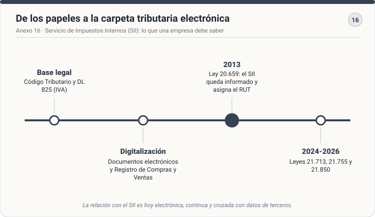
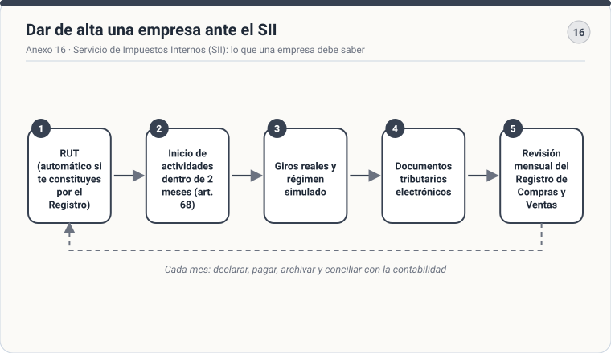
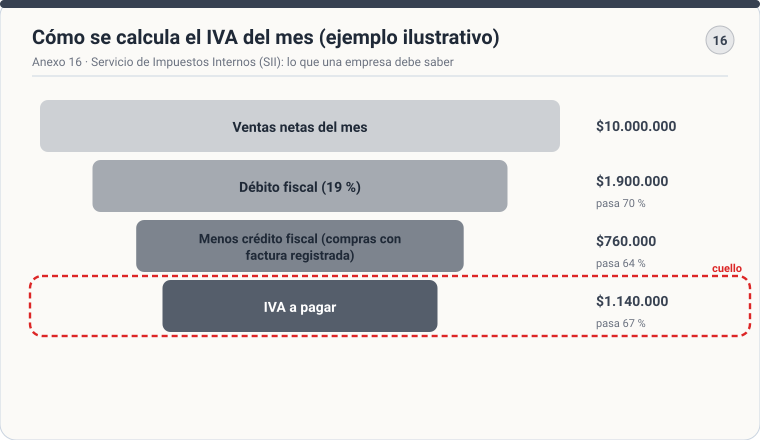
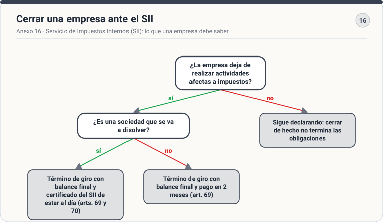

# Anexo 16 · Servicio de Impuestos Internos (SII): lo que una empresa debe saber

> **Fecha de consulta de las fuentes:** 2026-11-25. **Naturaleza:** material educativo; no es asesoría
> tributaria ni legal. Los tributos cambian por ley y por instrucciones del SII: confirma cada dato en la
> fuente oficial citada al final antes de actuar. Este anexo separa **obligación legal**, **recomendación
> profesional** y **medida voluntaria**. No contiene plazos de vencimiento mensuales ni anuales: se consultan
> en el calendario oficial del SII.

<!-- anexos:nav-inicio -->

**Navegación:** [← 15. Empresa en un Día: el Registro de Empresas y Sociedades](15-empresa-en-un-dia-registro-de-empresas-y-sociedades.md) · [Índice de anexos](README.md) · [17. Municipalidades: patente comercial, zonificación y permisos locales →](17-municipalidades-patentes-y-permisos-locales.md)

## En 60 segundos

- Debes inscribirte en el RUT y declarar el inicio de actividades en dos meses (Código Tributario, arts. 66 y 68).
- El IVA es 19 %: débito menos crédito fiscal; el crédito exige factura registrada (DL 825, arts. 14, 20 y 25).
- Los documentos tributarios son electrónicos y se registran en el Registro de Compras y Ventas (arts. 54 y 59).
- No se autoriza disolver una sociedad sin certificado de estar al día (Código Tributario, art. 70).
- Los plazos de vencimiento se consultan en el calendario oficial del SII.

<!-- anexos:nav-fin -->

## 1. Ficha rápida

| Pregunta | Respuesta |
|---|---|
| ¿Qué es el SII? | El organismo del Estado que **administra y fiscaliza los impuestos internos**; es la contraparte tributaria de toda empresa. |
| ¿Quién debe inscribirse? | Todas las personas naturales y jurídicas y las entidades sin personalidad jurídica que, por su actividad o condición, **causen o puedan causar o retengan o deban retener impuestos**, en el **Rol Único Tributario (RUT)** (art. 66 del Código Tributario). |
| ¿Cómo se hace? | La inscripción se realiza mediante la **carpeta tributaria electrónica** (art. 66, que remite al art. 68). |
| ¿Cuándo se declara el inicio de actividades? | Quien inicia negocios o labores susceptibles de producir rentas gravadas en primera y segunda categoría debe presentar una **declaración jurada de iniciación** **dentro de los dos meses** siguientes al comienzo de las actividades (art. 68). |
| ¿Cómo sé que debo emitir documentos? | Quien celebre contratos o convenciones de los Títulos II y III del DL 825 debe emitir **facturas o boletas**, aunque la operación sea exenta (art. 52 del DL 825); y deben ser **documentos electrónicos** (art. 54). |
| ¿Qué tasa tiene el IVA? | **19 %** sobre la base imponible (art. 14 del DL 825). |
| ¿Cómo se calcula? | **Débito fiscal** (impuesto recargado en ventas y servicios) **menos crédito fiscal** (impuesto soportado en compras): arts. 20 y 23 del DL 825. |
| ¿Cómo se acredita el crédito? | Con facturas que recarguen separadamente el impuesto, **registradas en el Registro de Compras y Ventas** (arts. 25 y 59). |
| ¿Y al cerrar? | Se avisa el **término de giro** con balance, y no se autoriza la disolución de una sociedad **sin certificado del SII** de estar al día en sus tributos (arts. 69 y 70 del Código Tributario). |
| ¿Para quién suele servir este anexo? | Para quien está por constituir una empresa o acaba de hacerlo y debe ordenar su relación con el SII. |

## 2. Historia y contexto

### 2.1. De los papeles a lo electrónico

La relación entre empresa y SII cambió radicalmente con la **digitalización**: hoy la inscripción en el RUT se
realiza mediante la **carpeta tributaria electrónica** (art. 66 del Código Tributario), los documentos tributarios
son **exclusivamente electrónicos**, salvo excepciones legales (art. 54 del DL 825), y el SII **registra de forma
automatizada y cronológica** los documentos emitidos y recibidos en un libro especial electrónico llamado
**Registro de Compras y Ventas** (art. 59 del DL 825).

### 2.2. El vínculo con el Registro de Empresas y Sociedades

Para las sociedades que se constituyen por el Registro de la Ley 20.659, el artículo 13 dispone que, con el
solo mérito de la firma del formulario, **se entiende informado el SII**, que **asigna el RUT** en forma
simultánea a la incorporación y que en el mismo formulario se puede pedir el **inicio de actividades** y el
**timbraje de documentos**. Ver el Anexo 15.

### 2.3. Un marco que cambia

Las leyes recientes modificaron el sistema: la **Ley 21.210** modernizó la legislación tributaria; la **Ley
21.713**, promulgada el 21 de octubre de 2024 y publicada el 24 de octubre de 2024, «dicta normas para asegurar
el cumplimiento de las obligaciones tributarias» y modifica el Código Tributario, entre otras materias su
**norma general antielusiva** (art. 4 bis); la **Ley 21.755** y la **Ley 21.850** modificaron tasas, créditos
y regímenes. Los detalles con fechas están en la
[guía de la Ley 21.850](../docs/20_LEY_21850_RECONSTRUCCION_NACIONAL.md) y en el
[flujo tributario](../docs/02_SII_TAX_FLOW.md).

## 3. Marco legal

### 3.1. Mapa de normas

| Norma | Qué aporta |
|---|---|
| Código Tributario (DL 830) | RUT, inicio de actividades, término de giro, fiscalización |
| Ley sobre Impuesto a la Renta (DL 824) | Impuesto de Primera Categoría, regímenes, impuestos finales |
| Ley sobre Impuesto a las Ventas y Servicios (DL 825) | IVA, documentos, Registro de Compras y Ventas |
| Ley 20.659 | Integración con el Registro de Empresas y Sociedades |
| Ley 21.210 | Modernización tributaria y regímenes |
| Ley 21.713 | Cumplimiento tributario y antielusión |
| Ley 21.755 y Ley 21.850 | Tasas y créditos recientes |
| Resoluciones y circulares del SII | Detalle de formularios, plazos y procedimientos |

### 3.2. Obligación, recomendación, opción

| Materia | Tipo | Detalle |
|---|---|---|
| Inscribirse en el RUT | Obligación | Art. 66 Código Tributario |
| Declaración de inicio de actividades | Obligación | Art. 68 Código Tributario (dos meses) |
| Emitir facturas o boletas electrónicas | Obligación | Arts. 52 y 54 DL 825 |
| Declarar y pagar IVA por período | Obligación | Arts. 20 y siguientes DL 825 |
| Llevar y revisar el Registro de Compras y Ventas | Obligación de registro, recomendación de revisión | Art. 59 DL 825 |
| Aviso de término de giro | Obligación | Art. 69 Código Tributario |
| Certificado de estar al día para disolver | Obligación | Art. 70 Código Tributario |
| Calendario interno con alertas | Recomendación profesional | Evita multas y recargos |
| Respaldar la razón de negocios de las operaciones | Recomendación profesional | Ley 21.713 y art. 4 bis |

## 4. Cómo se constituye la relación con el SII

### 4.1. Paso 1: RUT

Todas las personas jurídicas deben estar inscritas en el RUT (art. 66). Si te constituyes por el Registro de
Empresas y Sociedades, el SII asigna el RUT sin más trámite al incorporarse el formulario (art. 13 Ley
20.659). Si te constituyes por escritura, inscribes el RUT mediante la carpeta tributaria electrónica, según
las instrucciones del SII.

### 4.2. Paso 2: inicio de actividades

La **declaración jurada de iniciación de actividades** se presenta **dentro de los dos meses** siguientes a
aquel en que comienzan las actividades (art. 68). Es el acto por el cual declaras al SII que tu empresa
realizará actividades susceptibles de producir rentas gravadas. El Director puede, por norma general, eximir o
sustituir la exigencia para ciertos contribuyentes (art. 68). **No esperes los dos meses:** muchas decisiones
dependen de esta declaración (emitir documentos, recuperar IVA de compras iniciales).

El contenido práctico de la declaración, según el flujo del programa, incluye:

| Elemento | Qué definir |
|---|---|
| Domicilio | El lugar donde se desarrolla efectivamente la administración central o la actividad |
| Actividades económicas o giros | Códigos de actividad que reflejen lo que realmente harás |
| Capital | El capital efectivo o enterado |
| Régimen tributario | Pro Pyme General, Pro Pyme Transparente, general u otro |
| Representantes | Quién firma y actúa ante el SII |
| Documentos a emitir | Factura, boleta, guía, notas |

### 4.3. Paso 3: giros y códigos de actividad

**No elijas códigos por aproximación.** Cada código habilita o limita documentos (nota de crédito, nota de
débito, guía de despacho, factura de exportación, si corresponde) y puede afectar tu régimen y tus
beneficios. Revisa con tu contador la correspondencia entre tu giro real y los códigos.

### 4.4. Paso 4: documentos tributarios electrónicos

Quien celebre los contratos o convenciones de los títulos de ventas y servicios **debe emitir facturas o
boletas** según el caso, **aun cuando no se apliquen los impuestos** o se trate de operaciones exentas
(art. 52 DL 825). Los contribuyentes afectos deben emitir **facturas**, incluso por sus ventas o servicios
exentos, en las operaciones con otros vendedores, importadores y prestadores de servicios, entre otros casos
(art. 53). Esos documentos **consisten exclusivamente en documentos electrónicos** (art. 54), con las
excepciones legales (por ejemplo, las guías de despacho de ciertos sectores pueden emitirse en papel). Los
comprobantes de transacciones pagadas por medios electrónicos tienen, según las condiciones que fije el SII,
valor de boleta.

**Timbraje y folios.** La Ley 20.659 menciona el «timbraje de documentos tributarios» que puede solicitarse
en el formulario de constitución (art. 13). Para la emisión práctica de documentos electrónicos, sigue el
proceso de postulación y autorización del SII y el software que elijas.

### 4.5. Paso 5: Registro de Compras y Ventas

Los documentos tributarios electrónicos emitidos o recibidos por vendedores o prestadores de servicios afectos
son **registrados de forma automatizada y cronológica por el SII**, respecto de cada contribuyente, en el
libro especial electrónico llamado **Registro de Compras y Ventas** (art. 59). Los contribuyentes deben
registrar, por cada período, también los documentos no electrónicos y aquellos cuyo detalle no requiere
informarse al SII, ya respalden operaciones afectas, no afectas o exentas. El detalle lo fija el SII por
resolución. **Tu tarea mensual es revisar y clasificar** ese registro.

## 5. El IVA, paso a paso

### 5.1. Concepto

El IVA grava las **ventas y servicios** (art. 8 del DL 825) con una tasa de **19 %** sobre la base imponible
(art. 14). Afecta al vendedor o a quien presta el servicio (art. 10), con ciertos casos en que el sujeto es el
comprador (art. 11). Hay bienes y operaciones **exentos** (art. 12).

### 5.2. Débito, crédito y pago

El **débito fiscal mensual** es la suma de los impuestos recargados en las ventas y servicios del período. El
**impuesto a pagar** es la diferencia entre débito y **crédito fiscal** (art. 20). El crédito equivale al
impuesto recargado en las **facturas de tus adquisiciones o utilización de servicios** que se destinen al giro
(art. 23). Para usarlo debes **acreditar** que el impuesto te fue recargado en las facturas respectivas y que
esos documentos están **registrados en el libro especial** del art. 59; y solo se deduce el impuesto
**recargado separadamente** en la factura (art. 25). Del crédito se deducen los impuestos correspondientes a
descuentos, devoluciones y bonificaciones recibidos, y se suma el de las notas de débito (art. 24).

**Ejemplo ilustrativo.** Una consultora vende servicios afectos por 10.000.000 de pesos netos en el mes:
débito fiscal de 1.900.000. Sus compras afectas del mes (arriendo, software, publicidad) suman 4.000.000 netos:
crédito fiscal de 760.000. IVA a pagar: 1.140.000. Si una compra de 500.000 no tiene factura registrada, no da
crédito. Los números son ilustrativos.

### 5.3. Un recordatorio sobre sociedades de hecho y comunidades

El DL 825 considera contribuyentes a las personas naturales o jurídicas, **incluyendo las comunidades y las
sociedades de hecho**; en estas, los comuneros y socios son **solidariamente responsables** de las
obligaciones de la ley (art. 3). Operar sin constituir la sociedad puede dejarte con responsabilidad solidaria
ante el SII.

## 6. El ciclo mensual y el ciclo anual

### 6.1. Ciclo mensual (según el flujo del programa)

1. Cerrar ventas del mes.
2. Recibir y clasificar compras en el Registro de Compras y Ventas.
3. Conciliar documentos electrónicos con el banco.
4. Validar remuneraciones y retenciones.
5. Preparar el formulario mensual de declaración y pago.
6. Calcular IVA, pagos provisionales mensuales y otros.
7. Declarar y pagar en el plazo del calendario del SII.
8. Archivar la evidencia.
9. Reconciliar el saldo tributario con la contabilidad.

### 6.2. Ciclo anual

1. Cierre contable.
2. Determinación de renta líquida o base según el régimen.
3. Registros empresariales.
4. Declaraciones juradas.
5. Preparación y revisión del formulario anual de renta.
6. Impuestos finales de los propietarios, cuando corresponda.
7. Archivo de papeles de trabajo.

### 6.3. Tasas de renta y regímenes

La **Ley 21.850** fija la tasa de Primera Categoría en 27 % para 2026, 25,5 % para 2027, 24 % para 2028 y 23 %
desde 2029, sin perjuicio del artículo 25 de la Ley 21.755, que estableció una disminución transitoria a 12,5 %
para empresas Pro Pyme en 2025, 2026 y 2027, con condiciones. Las rutas que el SII presenta para la Operación
Renta 2026 son **Pro Pyme General, Pro Pyme Transparente y Régimen General semi integrado**, y la renta
presunta cuando legalmente proceda. **Trata estas tasas como datos dinámicos y verifícalas en el SII.**

### 6.4. Calendario

Los vencimientos mensuales y anuales **no se reproducen aquí** porque el SII los fija y los publica cada año.
Consulta el calendario oficial y la guía del programa sobre calendario 2027-2030 en la
[guía de la Ley 21.850](../docs/20_LEY_21850_RECONSTRUCCION_NACIONAL.md).

**Ejemplo ilustrativo.** Una empresa con ventas mensuales de 30.000.000 de pesos que no provisiona el IVA
puede descubrir, el día del vencimiento, que la caja está comprometida. Una práctica sana es **provisionar el
IVA y el pago provisional** cada semana en una cuenta separada, según el flujo de caja de 13 semanas del
programa. Cifras ilustrativas.

## 7. Roles dentro de la empresa

| Rol | Responsabilidad |
|---|---|
| Representante legal | Dirección y firma ante el SII; responde por las obligaciones |
| Contador | Ejecución contable y tributaria |
| Asesor tributario | Estructuración, casos complejos y contingencias |
| Tesorería | Pago y conciliación |
| Gerencia | Entiende el flujo y no delega ciegamente |

### 7.1. Quién hace qué en cada tarea (matriz de responsabilidades)

La siguiente matriz usa cuatro letras: **R** (realiza), **A** (aprueba y responde), **C** (se le consulta) e
**I** (se le informa). Es un punto de partida **ilustrativo**: ajústalo al tamaño de tu empresa.

| Tarea | Representante legal | Contador | Asesor tributario | Tesorería |
|---|---|---|---|---|
| Inicio de actividades y giros | A | R | C | I |
| Elección de régimen | A | C | R | I |
| Emisión de documentos electrónicos | A | R | I | I |
| Clasificación del Registro de Compras y Ventas | I | R | C | I |
| Declaración y pago mensual | A | R | C | R |
| Provisión de impuestos | A | C | C | R |
| Declaración anual de renta | A | R | C | I |
| Respuesta a requerimientos del SII | A | R | R | I |
| Término de giro | A | R | R | C |

Leer la matriz sirve para detectar **huecos**: si en una fila nadie tiene la **R** o nadie tiene la **A**,
esa tarea depende de la buena voluntad de alguien. Corrígelo antes del primer vencimiento.

**Regla de oro:** el contador ejecuta, pero **la empresa responde**. Tener un contador no te exime de
conocer el calendario y de revisar los documentos que firmas.

## 8. Cambios, avisos y relación continua

### 8.1. Qué cambios deben informarse

Cada vez que cambian datos relevantes (domicilio, giros, representantes, socios, régimen o capital), debes
**actualizar la información** ante el SII por los canales que este disponga. Si la sociedad se acoge al
Registro de la Ley 20.659, muchas modificaciones **se entienden informadas** con la incorporación del
formulario (art. 13), salvo los casos de los arts. 69 inc. final y 70 del Código Tributario, que requieren
autorización del Servicio.

### 8.2. Carpeta tributaria electrónica

La **carpeta tributaria electrónica** sirve para acreditar créditos, renta, tamaño de la empresa y entregar
información personalizada a terceros (bancos, clientes, licitaciones). Es el documento que más piden las
instituciones financieras. Mantén tus declaraciones al día para que la carpeta refleje tu situación real.

### 8.3. Cruce de información

La Ley 21.850 amplió el cruce de datos del SII con el Estado desde el 1 de noviembre de 2026, según la guía del
programa. Esto significa que **las inconsistencias entre tus declaraciones y los datos de terceros** (bancos,
clientes, otros organismos) son más visibles. La mejor defensa es la **conciliación periódica** y el
respaldo documental.

### 8.4. La norma antielusiva

La Ley 21.713 modificó el art. 4 bis del Código Tributario: **existe elusión** cuando, mediante actos o
negocios jurídicos o un conjunto de ellos, **con abuso o simulación**, se eluden los hechos imponibles
establecidos en las leyes tributarias. Las consecuencias están en los arts. 4 ter y 4 quáter y el
procedimiento, en el 4 quinquies. La facultad de revisión prescribe en seis años desde la expiración del
plazo legal, según el texto citado. **Documenta la razón de negocios** de cada estructura u
operación relevante: no la inventes después.

## 9. Término de giro y disolución

### 9.1. Aviso de término de giro (art. 69)

Todo contribuyente que, por terminación de su giro comercial o industrial, o de sus actividades, deje de estar
afecto a impuestos, debe **dar aviso al SII a través de la carpeta tributaria electrónica**, con un formulario
que contiene las enunciaciones requeridas, y **adjuntar su balance de término de giro** y los antecedentes para
determinar los impuestos que correspondan. Debe **pagar el impuesto** determinado a la fecha del balance final
**dentro de los dos meses** siguientes a la fecha de término. Con esa declaración, el contribuyente cumple
todas sus obligaciones, sin otros trámites, y el SII actualiza sus registros. Presentado el aviso, el SII
tiene **seis meses** para revisar y girar cualquier diferencia; vencido el plazo, debe emitir el giro
correspondiente y **certificará el término de giro** una vez verificado el pago. A falta de giro, se entiende
aceptada la presentación del contribuyente.

### 9.2. No hay disolución sin certificado (art. 70)

**No se autoriza ninguna disolución de sociedad sin un certificado del SII** que conste que la sociedad se
encuentra al día en el pago de sus tributos. En el Registro de la Ley 20.659, la incorporación de ciertas
actuaciones se realiza solo cuando el SII lo autoriza (art. 13). Planifica el cierre con meses de
anticipación.

### 9.3. Venta o traspaso del negocio (art. 71)

Cuando una persona natural o jurídica cesa en sus actividades por venta, cesión o traspaso de sus bienes,
negocios o industrias, **quien adquiere tiene el carácter de fiador** de las obligaciones tributarias
correspondientes a lo adquirido que afecten al vendedor o cedente. Para gozar del beneficio de excusión debe
cumplir los arts. 2358 y 2359 del Código Civil. Antes de comprar un negocio, **pide la situación tributaria**
del vendedor y negocia cláusulas de indemnidad.

### 9.4. Inventarios, activos y conservación

El cierre no termina las obligaciones: planifica inventarios, activos, cuentas, impuestos, documentos,
declaraciones, término de giro y **conservación documental**, como indica el flujo del programa.

## 10. Antes de construir: lista de verificación

### 10.1. Decisiones previas

1. ¿Qué actividades realizarás y qué códigos de actividad las reflejan?
2. ¿Qué régimen tributario conviene según una simulación a cuatro años?
3. ¿Cuál es el domicilio y qué documento lo respalda?
4. ¿Quién será el representante ante el SII y quién el contador?
5. ¿Qué documentos emitirás (factura, boleta, guía, notas) y con qué software?
6. ¿Cómo clasificarás las compras en el Registro de Compras y Ventas?
7. ¿Cómo provisionarás IVA y pagos provisionales?
8. ¿Qué calendario interno usarás y quién lo revisa?
9. ¿Qué respaldo documental guardarás y por cuánto tiempo?
10. ¿Qué haces si cierras: aviso de término de giro y certificados?

### 10.2. Documentos

| Documento | Para qué |
|---|---|
| Escritura o formulario de constitución | RUT e inicio de actividades |
| Contrato o título del domicilio | Domicilio tributario |
| Poderes del representante | Actuaciones ante el SII |
| Software de facturación autorizado | Emisión de DTE |
| Registro de Compras y Ventas mensual | Crédito fiscal y declaración |
| Carpeta tributaria electrónica | Acreditar renta y tamaño |
| Balance de término de giro (al cerrar) | Art. 69 |

### 10.3. Errores frecuentes

- **Elegir códigos por aproximación.**
- **Esperar los dos meses** para declarar el inicio de actividades.
- **Perder crédito fiscal** por compras sin factura registrada.
- **No revisar el Registro de Compras y Ventas** y clasificar mal.
- **No provisionar el IVA** y tener problemas de caja.
- **Operar como sociedad de hecho:** responsabilidad solidaria (art. 3 DL 825).
- **Cerrar de hecho sin término de giro:** las obligaciones continúan.
- **Comprar un negocio sin revisar su situación tributaria** (art. 71).
- **No documentar la razón de negocios** de estructuras complejas.

### 10.4. Caso ilustrado: de la constitución al primer cierre mensual

**Caso ilustrativo.** Una SpA de diseño se constituye por el Registro de Empresas y Sociedades. Los números
son ilustrativos.

1. **Constitución.** Al firmar el último socio, el formulario se incorpora y el SII asigna el RUT; marcan el
   inicio de actividades en el mismo formulario.
2. **Giros.** Su contador elige los códigos que reflejan consultoría de diseño y venta de licencias, no el
   código «de oficina» más cercano.
3. **Régimen.** Simulan a cuatro años y eligen un régimen Pro Pyme, con revisión anual.
4. **Documentos.** Contratan un software autorizado para emitir facturas electrónicas y activan el Registro de
   Compras y Ventas.
5. **Primer mes.** Venden 6.000.000 netos (débito de 1.140.000) y compran 2.500.000 netos (crédito de
   475.000). Pagan 665.000 de IVA y su pago provisional.
6. **Alertas.** Cargan en un calendario compartido los vencimientos del SII y el día interno de cierre.
7. **Año 2.** Evalúan cambios de régimen y la Ley 21.850 con su contador.

**Qué aprendemos.** La empresa que entiende el flujo mensual **no se sorprende** con el impuesto.

### 10.5. Mini glosario

| Término | Significado |
|---|---|
| RUT | Rol Único Tributario: número de identificación tributaria. |
| DTE | Documento tributario electrónico (factura, boleta, guía, notas). |
| RCV | Registro de Compras y Ventas, libro especial electrónico del art. 59 DL 825. |
| Débito fiscal | IVA recargado en las ventas del período. |
| Crédito fiscal | IVA soportado en las compras que dan derecho a crédito. |
| Término de giro | Aviso al SII del cese de actividades, con balance final. |
| Carpeta tributaria electrónica | Conjunto de información tributaria de un contribuyente disponible para terceros. |
| Elusión | Evitar hechos imponibles con abuso o simulación (art. 4 bis CT). |

### 10.6. Un calendario interno modelo

Un calendario interno no reemplaza al calendario oficial del SII: lo **traduce a tareas con responsable y
evidencia**. Este modelo es una **recomendación profesional**; ajusta los días a tu operación y a los
vencimientos publicados por el SII.

| Frecuencia | Tarea | Responsable | Evidencia que se archiva |
|---|---|---|---|
| Semanal | Provisionar el IVA y el pago provisional en una cuenta separada | Tesorería | Comprobante de traspaso |
| Semanal | Revisar documentos recibidos en el Registro de Compras y Ventas | Contador | Registro clasificado |
| Mensual | Cerrar ventas y conciliar con el banco | Contador y tesorería | Conciliación firmada |
| Mensual | Validar remuneraciones y retenciones | Contador y RR. HH. | Planilla de remuneraciones |
| Mensual | Preparar, revisar y presentar la declaración y el pago | Contador y representante legal | Comprobante de declaración y de pago |
| Trimestral | Revisar la proyección de renta y el régimen | Asesor tributario | Memo de proyección |
| Anual | Cerrar contabilidad, preparar registros y declaración de renta | Contador | Papeles de trabajo |
| Anual | Revisar cambios legales (por ejemplo, tasas y créditos) | Asesor tributario | Informe de cambios |
| Eventual | Actualizar datos ante el SII (domicilio, giros, representantes) | Representante legal | Comprobante de actualización |

### 10.7. Cómo prepararte para una fiscalización

Una fiscalización del SII no es una señal de que hiciste algo mal: es parte del sistema. Lo que cambia el
resultado es **qué tan ordenada esté tu evidencia**. Estas prácticas son recomendaciones profesionales:

1. **Un expediente por período.** Guarda, mes a mes, el Registro de Compras y Ventas, la declaración
   presentada, el comprobante de pago y las conciliaciones.
2. **Respaldo del crédito fiscal.** Como el crédito exige facturas que recarguen separadamente el impuesto y
   que estén registradas (art. 25 DL 825), conserva el vínculo entre cada factura de compra, su pago y su
   destino en el giro.
3. **Contratos y razón de negocios.** Para operaciones relevantes, guarda el contrato, el correo con la
   decisión y una nota de por qué se hizo así. La norma antielusiva (art. 4 bis del Código Tributario) pone el
   foco en el **abuso o la simulación**; un buen respaldo muestra sustancia económica.
4. **Conciliación con terceros.** Compara tus ventas declaradas con lo que reportan bancos y plataformas de
   pago. Las diferencias se explican mejor **antes** de que alguien las pregunte.
5. **Una sola vía de respuesta.** Designa a una persona (representante legal o contador) como responsable de
   recibir y responder requerimientos, y registra cada plazo en el calendario.
6. **No improvises.** Si recibes una citación o liquidación, consulta de inmediato a un abogado o contador
   tributario. Los plazos son breves y los errores iniciales son difíciles de corregir.

**Ejemplo ilustrativo.** Una empresa recibe una consulta por una diferencia de 1.200.000 pesos entre las
ventas declaradas y los depósitos bancarios. Como mantiene la conciliación mensual firmada, puede mostrar en un
día que la diferencia corresponde a dos anticipos de clientes aún no facturados. Sin esa conciliación, el
trabajo de reconstrucción tomaría semanas. Cifras ilustrativas.

## 11. Cuándo conviene y cuándo no (qué hacer por cuenta propia)

### 11.1. Qué puedes hacer tú

| Tarea | ¿Puedes hacerla tú? | Observación |
|---|---|---|
| Revisar el Registro de Compras y Ventas | Sí | Es tu mejor control mensual |
| Emitir documentos con tu software | Sí | Con capacitación |
| Provisionar IVA | Sí | Con una regla simple |
| Declarar el IVA mensual | Posible | Con apoyo si hay operaciones complejas |
| Elegir régimen y estructurar | No sin asesoría | Efectos a largo plazo |
| Operación Renta anual | Con contador | Registros empresariales y créditos |
| Término de giro y disolución | Con contador y abogado | Balance final y certificados |

### 11.2. Señales de que necesitas más apoyo

- Ventas con exportación, importación o plataformas internacionales.
- Muchos documentos o inventarios.
- Estructuras con varias sociedades o socios con impuestos finales distintos.
- Un requerimiento o citación del SII.
- Cambios de régimen o de tamaño.

### 11.3. Señales de que estás bien encaminado

- Registro de Compras y Ventas conciliado cada mes.
- Provisión de impuestos en una cuenta separada.
- Calendario compartido con responsable y alerta.
- Respaldo documental ordenado.

## 12. Cuándo llamar a un profesional

| Situación | Profesional | Por qué |
|---|---|---|
| Elegir régimen y simular | Contador o asesor tributario | Efectos a cuatro años |
| Operación Renta | Contador | Registros y créditos |
| Citación o fiscalización | Abogado tributario | Defensa y plazos |
| Reorganizaciones y cierre | Abogado y contador | Término de giro y certificado |
| Operaciones con el exterior | Asesor tributario internacional | Impuesto adicional y convenios |
| Planificación y razón de negocios | Asesor tributario | Norma antielusiva |

Consulta la [guía de cuándo llamar a un profesional](../docs/18_WHEN_TO_CALL_A_PROFESSIONAL.md).

## 13. Preguntas frecuentes

**1. ¿Debo inscribirme en el RUT?**
Sí, si en razón de tu actividad causas o puedes causar impuestos, o retienes o debes retener (art. 66 Código
Tributario).

**2. ¿Cuánto tiempo tengo para declarar el inicio de actividades?**
Dos meses desde que comienzas las actividades, salvo exenciones o procedimientos simplificados (art. 68).

**3. ¿Si me constituyo por el Registro, el SII sabe de mí?**
Sí, con la firma del formulario se entiende informado y se asigna el RUT (art. 13 Ley 20.659).

**4. ¿Qué tasa tiene el IVA?**
19 % sobre la base imponible (art. 14 DL 825).

**5. ¿Cómo se calcula el IVA a pagar?**
Débito fiscal menos crédito fiscal del período (arts. 20 y 23).

**6. ¿Puedo usar crédito fiscal sin factura?**
No. Debes acreditar que el impuesto te fue recargado en facturas registradas en el libro del art. 59 (art. 25).

**7. ¿Qué es el Registro de Compras y Ventas?**
Un libro electrónico donde el SII registra automáticamente tus documentos electrónicos emitidos y recibidos
(art. 59).

**8. ¿Debo emitir factura aunque la venta sea exenta?**
Sí. La obligación de emitir facturas o boletas rige aunque no se apliquen los impuestos (art. 52).

**9. ¿Los documentos pueden ser de papel?**
Por regla, deben ser electrónicos, con las excepciones legales (art. 54).

**10. ¿Qué pasa si opero como sociedad de hecho?**
Los socios son solidariamente responsables de las obligaciones del DL 825 (art. 3).

**11. ¿Cómo cierro mi empresa ante el SII?**
Con el aviso de término de giro por la carpeta tributaria electrónica, el balance final y el pago del impuesto
dentro de dos meses (art. 69).

**12. ¿Puedo disolver sin pagar impuestos pendientes?**
No se autoriza la disolución sin un certificado del SII de estar al día (art. 70).

**13. ¿Qué pasa si compro un negocio con deudas tributarias?**
El adquirente tiene el carácter de fiador de las obligaciones tributarias del vendedor correspondientes a lo
adquirido (art. 71).

**14. ¿Cuánto tiempo tiene el SII para revisar mi término de giro?**
Seis meses desde el aviso para revisar y girar diferencias (art. 69).

**15. ¿Qué es la carpeta tributaria electrónica?**
El conjunto de información tributaria que sirve para inscribirse, acreditar renta o tamaño y compartir
información con terceros.

**16. ¿Qué tasa de renta pagaré?**
Depende del régimen y del año; la Ley 21.850 fija 27 % para 2026, 25,5 % para 2027, 24 % para 2028 y 23 %
desde 2029, sin perjuicio del art. 25 de la Ley 21.755. Verifica en el SII.

**17. ¿Qué es la elusión?**
Evitar los hechos imponibles mediante actos o negocios jurídicos con abuso o simulación (art. 4 bis del
Código Tributario).

**18. ¿Necesito un contador?**
No está definido en los artículos leídos, pero es altamente recomendable por la complejidad del régimen y de
los registros.

**19. ¿Dónde veo los plazos de cada mes?**
En el calendario oficial del SII; este anexo no los reproduce.

**20. ¿Qué hago si recibo una citación del SII?**
No la ignores: consulta de inmediato a un abogado o contador tributario y respeta los plazos que indique.

## 14. Fuentes y vigencia

| Fuente | Qué se usó | Dónde consultarla |
|---|---|---|
| Código Tributario (DL 830), arts. 66 a 71 | RUT, inicio de actividades, término de giro, disolución, fiador | [BCN, Código Tributario](https://www.bcn.cl/leychile/navegar?idNorma=6374) |
| DL 825 (IVA), arts. 3 a 25, 52 a 54 y 59 | IVA, documentos y Registro de Compras y Ventas | [BCN, DL 825](https://www.bcn.cl/leychile/navegar?idNorma=6369) |
| DL 824 (Ley de la Renta) | Regímenes y tasas | [BCN, DL 824](https://www.bcn.cl/leychile/navegar?idNorma=6368) |
| Ley 20.659, art. 13 | Integración con el SII | [BCN, Ley 20.659](https://www.bcn.cl/leychile/navegar?idNorma=1048718) |
| Ley 21.713 | Cumplimiento tributario y norma antielusiva | [BCN, Ley 21.713](https://www.bcn.cl/leychile/navegar?idNorma=1207746) |
| SII, preguntas frecuentes sobre RUT e inicio de actividades | Domicilio y actividades | [SII, RUT e inicio de actividades](https://www.sii.cl/preguntas_frecuentes/rut_inicio_actividades/001_105_8704.htm) |
| SII, Registro de Compras y Ventas | Funcionamiento del RCV | [SII, RCV](https://www.sii.cl/destacados/f29/registrocompraventas.htm) |
| SII, carpeta tributaria electrónica | Generación y usos | [SII, carpeta tributaria](https://zeus.sii.cl/dii_doc/carpeta_tributaria/html/generar_carpeta.htm) |
| SII, regímenes tributarios | Rutas de Operación Renta | [SII](https://www.sii.cl/destacados/renta/2026/intermediarios/regimenes_tributarios/) |

**Vigencia.** Los artículos citados del Código Tributario y del DL 825 se leyeron en la versión publicada por
la Biblioteca del Congreso Nacional el 2026-11-25. Las páginas del SII se citan por su dirección oficial; sus
contenidos cambian y deben verificarse. No se transcriben circulares, resoluciones ni plazos.

**Límites.** Este anexo no reproduce el texto íntegro de las leyes tributarias, no calcula impuestos de un caso
concreto, no contiene plazos de vencimiento y sus ejemplos numéricos son ilustrativos. No sustituye la
asesoría de un contador ni de un abogado tributario.

<!-- anexos:cierre-inicio -->

## Para seguir leyendo

- [Anexo 15. Empresa en un Día: el Registro de Empresas y Sociedades](15-empresa-en-un-dia-registro-de-empresas-y-sociedades.md): el RUT automático.
- [Anexo 17. Municipalidades: patente comercial, zonificación y permisos locales](17-municipalidades-patentes-y-permisos-locales.md): patente según capital propio.
- [Anexo 01. Persona natural con giro y trabajador independiente](01-persona-natural-con-giro-y-trabajador-independiente.md): persona natural.
- [Anexo 13. Estatuto Pyme: empresas de menor tamaño (Ley 20.416)](13-estatuto-pyme-empresas-de-menor-tamano.md): tamaño de la empresa.

**Navegación:** [← 15. Empresa en un Día: el Registro de Empresas y Sociedades](15-empresa-en-un-dia-registro-de-empresas-y-sociedades.md) · [Índice de anexos](README.md) · [17. Municipalidades: patente comercial, zonificación y permisos locales →](17-municipalidades-patentes-y-permisos-locales.md)

<!-- anexos:cierre-fin -->
