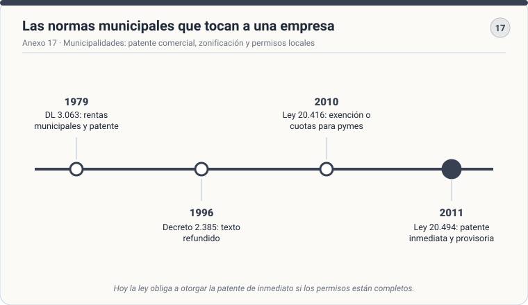
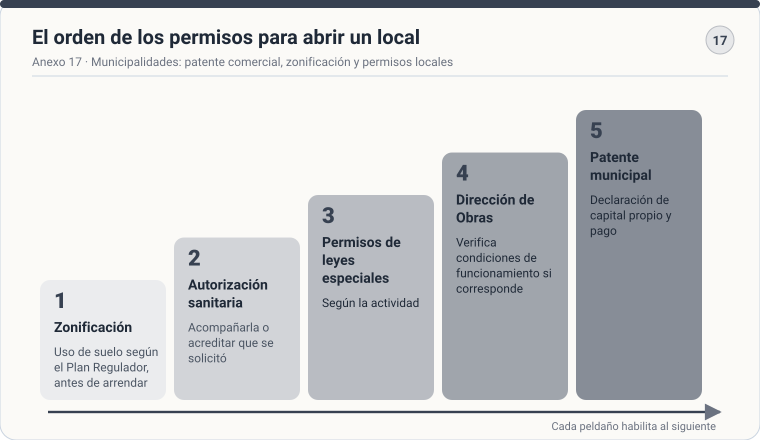
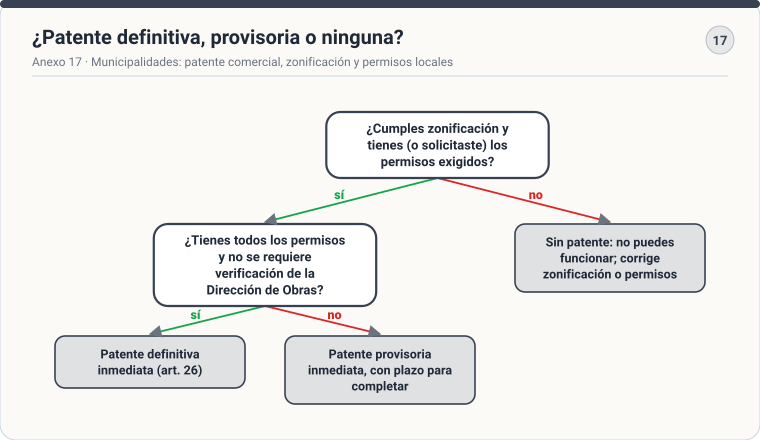
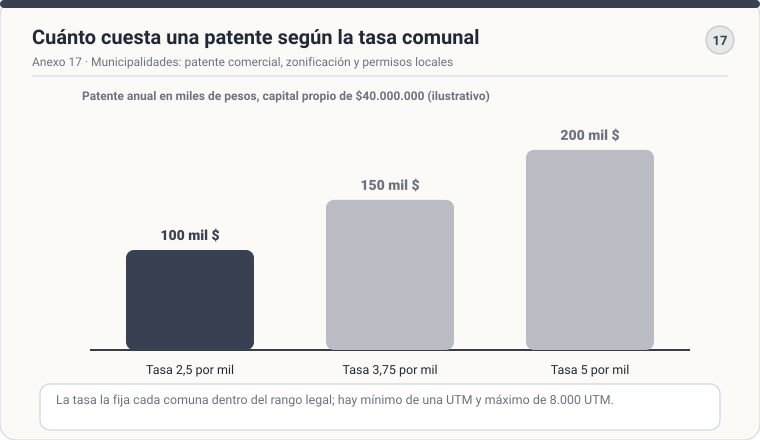
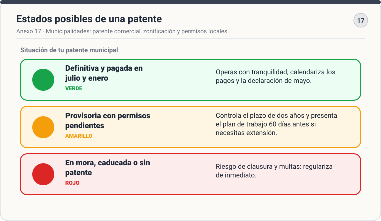

# Anexo 17 · Municipalidades: patente comercial, zonificación y permisos locales

> **Fecha de consulta de las fuentes:** 2026-11-25. **Naturaleza:** material educativo; no es asesoría
> legal ni tributaria. Las ordenanzas municipales varían por comuna y las normas cambian: confirma cada dato en
> la fuente oficial y en la municipalidad de tu comuna antes de actuar. Este anexo separa **obligación legal**,
> **recomendación profesional** y **medida voluntaria**.

<!-- anexos:nav-inicio -->

**Navegación:** [← 16. Servicio de Impuestos Internos (SII): lo que una empresa debe saber](16-servicio-de-impuestos-internos-sii.md) · [Índice de anexos](README.md) · [18. Domicilio, oficinas virtuales, coworking y otras formas de ubicar tu empresa →](18-domicilio-oficinas-virtuales-y-coworking.md)

## En 60 segundos

- La patente grava la actividad en un local determinado y cuesta entre 2,5 y 5 por mil del capital propio (DL 3.063, art. 24).
- Se paga en julio y enero; si te estableces después del 31 de diciembre, pagas el 50 %.
- La municipalidad debe otorgarla de inmediato si están los permisos; si no, procede la provisoria con plazos (art. 26).
- La mora o la falta de patente permiten la clausura (art. 58).
- Verifica la zonificación antes de firmar el arriendo.

<!-- anexos:nav-fin -->

## 1. Ficha rápida

| Pregunta | Respuesta |
|---|---|
| ¿Qué es una municipalidad? | Una **corporación autónoma de derecho público**, con personalidad jurídica y patrimonio propio, cuya finalidad es satisfacer las necesidades de la comunidad local y asegurar su participación en el progreso económico, social y cultural de la comuna (art. 1 de la Ley 18.695). |
| ¿Qué permiso exige a una empresa? | La **patente municipal**: el ejercicio de toda profesión, oficio, industria, comercio, arte o actividad lucrativa secundaria o terciaria está sujeto a una contribución de patente (art. 23 del DL 3.063, texto refundido por el Decreto 2.385). |
| ¿Qué grava la patente? | La actividad que ejerce un mismo contribuyente **en su local, oficina, establecimiento, kiosco o lugar determinado**, sin importar el número de giros o rubros (art. 24). |
| ¿Cuánto cuesta? | Entre **2,5 y 5 por mil del capital propio**, con un mínimo de **1 UTM** y un máximo de **8.000 UTM**, por doce meses (art. 24). |
| ¿Cómo se paga? | Al contado o en **dos cuotas iguales**, en **julio y enero** de cada año (art. 29). |
| ¿Cuándo se otorga? | La municipalidad debe otorgarla **de inmediato** cuando se acompañan todos los permisos requeridos o los verifica por otros medios (art. 26). |
| ¿Existe patente provisoria? | Sí, cuando se cumplen zonificación, autorización sanitaria (o su solicitud) y permisos de leyes especiales (art. 26). |
| ¿Qué pasa si no la pago? | La mora faculta al alcalde a decretar la **clausura** inmediata del negocio mientras dure la mora (art. 58). |
| ¿Quién queda exento? | Las personas jurídicas **sin fines de lucro** que realicen acciones de beneficencia, culto, culturales, de ayuda mutua, artísticas o deportivas no profesionales y de promoción de intereses comunitarios (art. 27). |
| ¿Para quién suele servir este anexo? | Para quien va a abrir un local, oficina o actividad en una comuna y debe ordenar el orden de los permisos. |

## 2. Historia y contexto

### 2.1. El municipio como primer contacto

Para muchas empresas, la primera autoridad con la que se enfrenta no es el SII ni el Ministerio de Economía, sino
la **municipalidad**. Es la que autoriza dónde puedes ubicarte (zonificación), cuándo puedes funcionar (patente)
y, en muchos casos, la que verifica que tu local cumpla condiciones. Por eso, equivocar el orden (firmar un
arriendo antes de saber si el uso de suelo lo permite) es uno de los errores más caros para un emprendedor.

### 2.2. Las normas de rentas municipales

La patente se regula en el **Decreto Ley 3.063, de 1979**, sobre rentas municipales, cuyo texto refundido
y sistematizado fijó el **Decreto 2.385, promulgado el 30 de mayo de 1996 y publicado el 20 de noviembre de
1996**, del Ministerio del Interior. Desde entonces ha tenido modificaciones. Dos son relevantes para quien
abre una empresa:

- La **Ley 20.416** (Estatuto Pyme, 2010) agregó la posibilidad de **eximir del pago** de las patentes
  provisorias o dar **hasta doce cuotas mensuales reajustables** a empresas con capital efectivo de hasta
  5.000 UF (Anexo 13).
- La **Ley 20.494**, promulgada el 19 de enero de 2011 y publicada el 27 de enero de 2011, titulada «agiliza
  trámites para el inicio de actividades de nuevas empresas», modificó el artículo 26 para exigir a la
  municipalidad que otorgue la patente **de forma inmediata** cuando se cumplan los requisitos, y reguló la
  **patente provisoria**.

### 2.3. La ley orgánica de las municipalidades

La **Ley Orgánica Constitucional de Municipalidades** (Ley 18.695, cuyo texto refundido se fijó por el DFL 1 de
2006, promulgado el 9 de mayo de 2006 y publicado el 26 de julio de 2006) atribuye a las municipalidades
**funciones privativas**, entre ellas elaborar el plan comunal de desarrollo, **planificar y regular la comuna y
confeccionar el plan regulador comunal**, aplicar las normas de **construcción y urbanización** y velar por el
aseo y ornato (art. 3). Además, pueden desarrollar, directamente o con otros órganos del Estado, funciones
relacionadas con la **capacitación, la promoción del empleo y el fomento productivo**, el turismo, la salud
pública y la protección del medio ambiente, entre otras (art. 4).

## 3. Marco legal

### 3.1. Mapa de normas

| Norma | Qué aporta |
|---|---|
| Ley 18.695, Orgánica Constitucional de Municipalidades | Naturaleza y funciones de las municipalidades |
| DL 3.063 (Decreto 2.385 de 1996), rentas municipales | Patente, permisos de circulación, sanciones y Fondo Común Municipal |
| Ley 20.494 (2011) | Patente inmediata y provisoria |
| Ley 20.416 (Estatuto Pyme, 2010) | Beneficios para empresas de menor tamaño |
| Ley General de Urbanismo y Construcciones (DFL 458 de 1976) | Zonificación y Dirección de Obras Municipales; citada en el art. 26 |
| Ley 19.925 | Clasificación de patentes de alcoholes (art. 33 DL 3.063) |
| Código Sanitario y reglamentos | Autorizaciones sanitarias |
| Ordenanzas municipales | Reglas locales de cada comuna |

### 3.2. Obligación, recomendación, opción

| Materia | Tipo | Detalle |
|---|---|---|
| Patente municipal para actividades lucrativas | Obligación | Art. 23 |
| Declaración jurada simple del capital propio al iniciar | Obligación | Art. 26 |
| Pago en julio y enero (o al contado) | Obligación | Art. 29 |
| Aviso de cambio de domicilio en 30 días | Obligación | Art. 29 |
| Anotar el cambio de dominio del establecimiento | Obligación | Art. 30 |
| Verificar zonificación antes de arrendar | Recomendación profesional | Evita clausura |
| Solicitar patente provisoria | Opción | Art. 26 |
| Pedir exención o cuotas si calificas como pyme | Opción | Art. 26 |

## 4. Cómo se obtiene la patente

### 4.1. El orden correcto

Antes de firmar contratos de arriendo o inversiones, sigue este orden. Es una recomendación **construida sobre
las condiciones que el art. 26 fija para otorgar la patente**:

1. **Zonificación (uso de suelo).** Verifica que la actividad esté permitida en la zona según el **Plan
   Regulador**. El art. 26 exige el «emplazamiento según las normas de zonificación del Plan Regulador».
2. **Autorizaciones sanitarias.** Si tu actividad requiere autorización sanitaria, debes acompañarla; si es de
   aquellas que no aparecen expresamente en el decreto sanitario, basta acreditar que la **solicitaste**.
3. **Otros permisos de leyes especiales**, según tu actividad (por ejemplo, eléctricos, de combustibles o
   ambientales; ver la [matriz de permisos](../docs/06_PERMITS_MATRIX.md)).
4. **Condiciones de funcionamiento** verificadas por la **Dirección de Obras Municipales**, cuando
   corresponda.
5. **Solicitud de patente** con la declaración jurada simple de capital propio.

### 4.2. La solicitud

Toda persona que inicie un giro o actividad gravada con patente presenta, **conjuntamente con la solicitud de
autorización para funcionar en un local o lugar determinado**, una **declaración jurada simple** acerca del
monto del **capital propio** del negocio (art. 26). Si tienes sucursales o varias unidades, aplica además la
declaración del art. 25 sobre trabajadores por unidad.

### 4.3. Patente definitiva inmediata

La municipalidad **está obligada a otorgar la patente en forma inmediata** una vez que acompañaste todos los
permisos requeridos o ella los verificó por otros medios (sanitarios, de zonificación y los exigidos por leyes
especiales), **siempre que no sea necesario verificar condiciones de funcionamiento** por la Dirección de Obras.
**Para patentes de profesionales y de sociedades de profesionales no se exige permiso alguno** (art. 26).

### 4.4. Patente provisoria

La municipalidad **debe** otorgar **patente provisoria en forma inmediata** cuando se cumplen estos requisitos
(art. 26):

| Requisito | Detalle |
|---|---|
| a) Zonificación | Emplazamiento según las normas del Plan Regulador |
| b) Autorización sanitaria | Si el Código Sanitario la exige expresamente |
| c) Actividades con autorización sanitaria no listada | Basta acreditar que se solicitó |
| d) Permisos de leyes especiales | Según sea el caso |

Además, las municipalidades **pueden** otorgar patentes provisorias para actividades que deban cumplir los
requisitos de las letras b) y d) **sin exigir la autorización**, siempre que la actividad esté en una
**ordenanza** que solo puede incluir tipos de actividades previamente autorizadas por la autoridad competente.

**Plazos de la provisoria:**

- El requisito pendiente debe cumplirse dentro de un plazo que **no puede exceder de dos años** desde el
  otorgamiento, con **una única extensión de hasta un año adicional**, para lo cual el contribuyente presenta,
  **sesenta días antes** del vencimiento, un **plan de trabajo** con las acciones ejecutadas y pendientes y los
  plazos estimados; si la unidad municipal lo aprueba, la extensión se declara sin más trámite.
- Si se rechaza la autorización sanitaria o los permisos, o **vence el plazo**, la patente provisoria **caduca
  de pleno derecho** y el contribuyente **debe cesar de inmediato** sus actividades.
- Si la actividad exige verificación de la **Dirección de Obras**, esta debe hacerse **dentro de los treinta
  días corridos** siguientes al otorgamiento de la provisoria. Si la municipalidad no concurre o no encuentra
  observaciones en ese plazo, **la patente se convierte por ley en definitiva**, siempre que se hayan obtenido
  los permisos sanitarios correspondientes. Si hay observaciones subsanables, la provisoria puede mantenerse
  por el tiempo que fije la Dirección, **hasta tres años** desde su otorgamiento.

### 4.5. Autorización sanitaria tácita

Si la autorización sanitaria se obtuvo **tácitamente** conforme al Código Sanitario, debes acompañar una
**declaración jurada** que indique que la autoridad no se pronunció en el plazo legal y el documento que
acredite que hiciste la solicitud (art. 26). **Falsear información** o no cesar actividades tras la
caducidad se sanciona (art. 53).

### 4.6. Beneficios para empresas de menor tamaño

Para empresas que acrediten un **capital efectivo no superior a 5.000 UF**, las municipalidades pueden **eximir
del pago** de las patentes provisorias u otorgar plazos de **hasta doce cuotas mensuales reajustables**,
conforme a una **ordenanza** que no puede establecer diferencias arbitrarias entre quienes ejercen la misma
actividad o participan en el mismo sector o zona; la exención corresponde al año que dure la patente
provisoria (art. 26). Ver el Anexo 13.

### 4.7. Microempresa familiar

Las limitaciones y autorizaciones anteriores **no se aplican a la microempresa familiar**, definida por tres
requisitos: (a) la actividad se ejerce en la **casa habitación familiar**; (b) laboran en ella **no más de
cinco trabajadores ajenos a la familia**; y (c) sus **activos productivos**, sin contar el valor del inmueble,
**no exceden de 1.000 UF**. Puede desarrollar cualquier actividad lícita, **excluidas las peligrosas,
contaminantes o molestas**, y las que manipulan alimentos deben cumplir el Reglamento Sanitario de los
Alimentos. Para acogerse a sus beneficios (y a los de ciertos artículos de las leyes de renta e IVA), el
interesado debe **inscribirse en la municipalidad** y acompañar una **declaración jurada** en la que afirme que
es legítimo ocupante de la vivienda y que su actividad no produce contaminación; si la vivienda está en un
condominio, necesita la autorización del Comité de Administración (art. 26).

## 5. Cuánto se paga y cómo se calcula

### 5.1. La fórmula

El valor por doce meses de la patente es un monto **equivalente entre el dos y medio por mil y el cinco por
mil del capital propio** de cada contribuyente, **no inferior a una UTM ni superior a 8.000 UTM** (art. 24). El
alcalde, con acuerdo del concejo, puede fijar **una tasa única** para toda la comuna o **tasas diferenciadas**
por zonas definidas en el instrumento de planificación urbana, mediante decreto alcaldicio publicitado en la
comuna. Para modificar la tasa vigente, la municipalidad debe dictar una resolución publicada en el Diario
Oficial **con al menos seis meses de anticipación** al inicio del año calendario en que regirá.

### 5.2. Qué es el capital propio

Es el **capital inicial declarado** si se trata de actividades nuevas, o el registrado en el **balance al 31 de
diciembre** inmediatamente anterior a la fecha en que deba prestarse la declaración, con los reajustes y
ajustes de la Ley de la Renta (art. 24). El SII aporta a las municipalidades, dentro de mayo de cada año, la
información del capital propio declarado, el RUT y el código de actividad de cada contribuyente. Puedes
**deducir** la parte del capital propio invertida en otros negocios afectos a patente, acreditándola con
certificado de las municipalidades correspondientes.

### 5.3. Contribuyentes sin balance

Quienes **no estén obligados a demostrar sus rentas mediante balance general** pagan una patente por doce meses
igual a **una UTM**. Los contribuyentes obligados a determinar un capital propio tributario simplificado en el
régimen Pro Pyme pagan su patente según ese capital (art. 24).

### 5.4. Profesionales

Quienes ejercen profesiones liberales u ocupaciones lucrativas según el art. 42 N.º 2 de la Ley de la Renta
**pagan su patente anual solo en la comuna donde tienen su consulta, estudio u oficina principal**, y esa
patente los habilita para ejercer **en todo el territorio nacional**. Pagan una **patente única anual
equivalente a una UTM** (art. 32).

### 5.5. Sucursales

Si tienes sucursales, oficinas o locales, el monto total se **distribuye proporcionalmente** por unidad
considerando el número de trabajadores de cada una, según el reglamento. Debes presentar **dentro de mayo**,
en la municipalidad de la casa matriz, una declaración con el número de trabajadores por unidad (art. 25).

### 5.6. Período y pago

La patente corresponde a doce meses comprendidos **entre el 1 de julio del año de la declaración y el 30 de
junio del siguiente**. Se paga al contado o en **dos cuotas iguales en julio y enero**; la segunda se reajusta
según la variación del IPC entre el 1 de junio y el 30 de noviembre. **Si te estableces después del 31 de
diciembre, pagas el 50 %** del valor de la patente. No se pueden cobrar derechos distintos por los instrumentos
que debes presentar para obtener la patente (art. 29).

**Ejemplo ilustrativo.** Una tienda inicia actividades con un capital propio declarado de 40.000.000 de pesos.
Con una tasa comunal de 2,5 por mil, la patente anual es de 100.000 pesos; con 5 por mil, de 200.000. Se
compara con el mínimo de una UTM (valor ilustrativo de unos 68.000 pesos): ambos resultados lo superan. Si se
establece en febrero, paga el 50 %. Una empresa sin obligación de balance pagaría una UTM. Los valores de la
tasa comunal y de la UTM son ilustrativos: consulta la ordenanza de tu comuna.

## 6. Obligaciones durante la vida de la patente

### 6.1. Cambio de domicilio

Quien cambie de domicilio su casa matriz o sucursal paga la patente en la municipalidad del nuevo domicilio a
partir del **semestre siguiente** al de su instalación. Debe comunicarlo dentro de **treinta días corridos**,
exhibiendo la patente pagada en la municipalidad de origen y un **certificado de no deuda**. **Si existe deuda,
no se otorga patente definitiva ni provisoria** hasta regularizarla (art. 29). Los profesionales del art. 32 no
se rigen por esta regla.

### 6.2. Cambio de dueño del establecimiento

Si un establecimiento **cambia de dominio**, el nuevo dueño debe **anotar la transferencia en el rol** y paga
por el semestre corriente un monto igual al girado (art. 30). El **comprador, usufructuario, sucesor u ocupante
a cualquier título** responde del pago de las **patentes morosas** (art. 34). Antes de comprar un negocio, **pide
el certificado de no deuda**.

### 6.3. Responsables del pago

Responden del pago, además de los propietarios, los **administradores o regentes** del negocio aun sin
nombramiento o mandato legal (art. 31). Las sanciones pueden hacerse efectivas contra cualquiera de ellos
(art. 55).

### 6.4. Patentes temporales

En comunas con balnearios o lugares de turismo, las municipalidades pueden otorgar patentes **temporales hasta
por cuatro meses**, al **50 %** del valor de la ordinaria por el período (art. 28).

### 6.5. Alcoholes

Las patentes de expendio de bebidas alcohólicas se clasifican y otorgan según la **Ley 19.925**, sin perjuicio de
quedar afectas a la contribución del art. 24 (art. 33).

### 6.6. Exenciones

Solo están exentas las **personas jurídicas sin fines de lucro** que realicen acciones de beneficencia, culto
religioso, culturales, de ayuda mutua de sus asociados, artísticas o deportivas no profesionales y de promoción
de intereses comunitarios (art. 27). Ver el Anexo 12.

## 7. Responsabilidad y sanciones

| Conducta | Sanción | Artículo |
|---|---|---|
| No presentar la declaración dentro del plazo | Multa del 50 % del valor de la patente, cobrada con esta | 52 |
| Engañar sobre el capital propio, adulterar o negarse a dar antecedentes | Multa de hasta el 200 % del valor de la patente | 53 |
| Falsear declaraciones sobre autorizaciones sanitarias o no cesar tras la caducidad | Multa de hasta el 200 % del valor de la patente | 53 |
| Infracciones no sancionadas especialmente | Multa de hasta tres UTM | 56 |
| Mora en el pago de la patente | **Clausura** decretada por el alcalde mientras dure la mora | 58 |
| Funcionar sin patente | Clausura posible por el alcalde | 58 |

Las infracciones las conocen en la forma ordinaria los **juzgados de policía local** (art. 57). La mora faculta
además a ejercer las acciones judiciales para cobrar lo adeudado (art. 58). Los administradores de hoteles o
establecimientos similares pueden ser sancionados si se ejerce públicamente una actividad gravada sin
autorización municipal (art. 55).

### 7.1. Regularización de deudas de derechos municipales

La **Ley 21.850** contempla, en su décimo artículo transitorio, una **regularización de deudas de derechos
municipales** con una ventana de solicitud de doce meses desde el 1 de diciembre de 2026 (cálculo propio de la
guía del programa). Consulta la [guía de la Ley 21.850](../docs/20_LEY_21850_RECONSTRUCCION_NACIONAL.md) y las
instrucciones de tu municipalidad antes de confiar en las fechas.

## 8. Tributación y patente

### 8.1. La patente no es impuesto a la renta

La patente es una **contribución municipal** distinta del impuesto a la renta y del IVA. Puede ser un **gasto**
de la empresa; consulta a tu contador el tratamiento en tu régimen. Ver el [flujo tributario](../docs/02_SII_TAX_FLOW.md)
y el Anexo 16.

### 8.2. Coordinación con el SII

El SII aporta a las municipalidades, en mayo de cada año, la información del capital propio, el RUT y el código
de actividad. **Declara tu capital propio con coherencia** entre lo que presentas al SII y a la municipalidad.

### 8.3. Fondo Común Municipal

Parte de los recursos municipales se redistribuye mediante el **Fondo Común Municipal**; el aporte de la patente
se calcula considerando la tasa máxima legal para estos efectos (art. 24). Es un detalle de financiamiento
municipal que explica por qué las comunas fiscalizan el pago.

## 9. Otras obligaciones locales

### 9.1. Zonificación y obras

La **Dirección de Obras Municipales** verifica condiciones de funcionamiento cuando corresponde. Consulta
siempre las normas del **Plan Regulador** y de la ordenanza local: pueden limitar horarios, ruidos, carga y
descarga, publicidad o ubicación.

### 9.2. Publicidad y letreros

Los letreros, toldos y publicidad en la vía pública suelen requerir autorización municipal según la ordenanza.
Este anexo no transcribe esas ordenanzas: consulta la de tu comuna.

### 9.3. Residuos y aseo

El aseo y ornato de la comuna es función privativa municipal (art. 3 Ley 18.695). Las empresas con residuos
especiales o industriales deben revisar las normas sectoriales, no solo las municipales.

### 9.4. Permiso de circulación

El DL 3.063 también regula los **permisos de circulación** de vehículos: pagan en la municipalidad que
corresponda, y el permiso habilita para transitar en todo el territorio nacional (art. 21). Si tu empresa usa
vehículos, calendariza su renovación.

### 9.5. Fomento productivo

Las municipalidades pueden desarrollar funciones de **capacitación, promoción del empleo y fomento productivo**
(art. 4 Ley 18.695), y muchas tienen oficinas de fomento que orientan a emprendedores sobre trámites y
programas.

### 9.6. Laboral, datos y cumplimiento

La patente no reemplaza las obligaciones laborales, de protección de datos y de consumo. Ver el
[flujo laboral](../docs/08_EMPLOYMENT_FLOW_CHILE.md) y [cumplimiento y riesgo](../docs/13_COMPLIANCE_RISK.md).

## 10. Antes de construir: lista de verificación

### 10.1. Decisiones previas

1. ¿La zonificación del lugar permite mi actividad? Pide la información al municipio **antes** de arrendar.
2. ¿Mi actividad necesita autorización sanitaria o permisos de leyes especiales?
3. ¿Necesita verificación de la Dirección de Obras?
4. ¿Puedo pedir patente provisoria? ¿Qué plazos tengo (dos años, más un año por plan de trabajo)?
5. ¿Califico para exención o cuotas (capital efectivo hasta 5.000 UF)?
6. ¿Soy profesional (patente única) o microempresa familiar?
7. ¿Cuál es la tasa comunal y cuánto pagaré según mi capital propio?
8. ¿Cómo manejaré el pago en julio y enero y la provisión de caja?
9. ¿Qué ocurre si cambio de domicilio o compro un negocio con deuda?
10. ¿Qué ordenanzas locales (publicidad, horarios, ruido) debo revisar?

### 10.2. Documentos

| Documento | Para qué |
|---|---|
| Contrato o título del local | Domicilio y patente |
| Información de zonificación de la comuna | Verificar uso de suelo |
| Autorización sanitaria o solicitud | Requisito de patente |
| Permisos de leyes especiales | Según actividad |
| Declaración jurada simple de capital propio | Art. 26 |
| Certificado de no deuda del local anterior | Cambio de domicilio o compra de negocio |
| Plan de trabajo (si extiendes la provisoria) | Presentado 60 días antes del vencimiento |

### 10.3. Errores frecuentes

- **Firmar el arriendo antes de verificar la zonificación.**
- **Abrir sin patente:** riesgo de clausura (art. 58).
- **Dejar vencer la patente provisoria:** caduca de pleno derecho y debes cesar (art. 26).
- **No presentar el plan de trabajo 60 días antes** del vencimiento si necesitas extensión.
- **Declarar un capital propio incoherente** con el del SII (multas del art. 53).
- **No avisar el cambio de domicilio** en 30 días.
- **Comprar un negocio con patentes morosas:** el comprador responde (art. 34).
- **Creer que el permiso sanitario reemplaza la patente.**

### 10.4. Caso ilustrado: abrir una cafetería

**Caso ilustrativo.** Camila quiere abrir una cafetería en un local de 60 metros cuadrados. Los números son
ilustrativos.

1. **Antes de firmar.** Consulta la zonificación en la municipalidad: la zona permite comercio de barrio con
   venta de alimentos. Firma el arriendo.
2. **Sanitario.** Solicita la autorización sanitaria a la autoridad correspondiente.
3. **Patente.** Presenta la solicitud con la declaración jurada de capital propio de 12.000.000 de pesos.
   Cumple zonificación y acredita haber solicitado la autorización sanitaria (en una actividad cuya
   autorización no está expresamente listada) y obtiene **patente provisoria inmediata**.
4. **Dirección de Obras.** La Dirección de Obras debe verificar las condiciones de funcionamiento dentro de
   treinta días corridos; no concurre. Con los permisos sanitarios obtenidos, **la patente se convierte por
   ley en definitiva**.
5. **Costo.** Con una tasa comunal de 3 por mil, la patente anual es de 36.000 pesos, pero el mínimo legal es de
   una UTM; paga la UTM. Como inició en marzo, paga el período completo.
6. **Beneficio pyme.** Como su capital efectivo no excede de 5.000 UF, consulta si la municipalidad ofrece
   exención o cuotas para la patente provisoria.
7. **Calendario.** Anota julio y enero para los pagos y mayo para las declaraciones.

**Qué aprendemos.** El orden de los permisos y el calendario de la patente evitan clausuras y multas.

### 10.5. Mini glosario

| Término | Significado |
|---|---|
| Patente municipal | Contribución anual por ejercer una actividad lucrativa en un local o lugar determinado. |
| Capital propio | Base de cálculo de la patente: capital inicial o patrimonio del balance. |
| UTM | Unidad Tributaria Mensual; su valor lo fija el SII cada mes. |
| Plan Regulador | Instrumento de planificación que define usos de suelo en la comuna. |
| Dirección de Obras Municipales | Unidad municipal que verifica condiciones de construcción y funcionamiento. |
| Patente provisoria | Patente temporal mientras se obtienen permisos pendientes. |
| Clausura | Cierre del negocio decretado por el alcalde en caso de mora o falta de patente. |
| Microempresa familiar | Actividad en la casa habitación con las condiciones del art. 26. |

## 11. Cuándo conviene y cuándo no

### 11.1. Tipos de situación y qué elegir

| Situación | Camino | Observación |
|---|---|---|
| Profesional con consulta propia | Patente de profesional (1 UTM, válida a nivel nacional) | Sin permisos adicionales (art. 26 y 32) |
| Microempresa en la casa | Microempresa familiar | Cumplir los tres requisitos; sin actividades peligrosas |
| Local comercial con permisos completos | Patente definitiva inmediata | Cuando todos los permisos están listos |
| Local con permisos pendientes | Patente provisoria | Plazo de dos años y extensión por plan de trabajo |
| Empresa con sucursales | Distribución proporcional por trabajadores | Declaración en mayo |
| Actividad de temporada | Patente temporal (hasta 4 meses) | Solo en balnearios o lugares de turismo |

### 11.2. Señales a favor de actuar temprano

- Quieres abrir pronto y la autorización sanitaria demora.
- Tu comuna tiene ordenanza que permite provisorias sin autorización previa para ciertas actividades.
- Calificas para exención o cuotas como pyme.

### 11.3. Señales de cautela

- Zonificación incierta o con restricciones fuertes.
- Actividad que requiere verificación de condiciones por la Dirección de Obras.
- Local con deudas de patente anteriores.
- Actividades con alcoholes (régimen especial).

## 12. Cuándo llamar a un profesional

| Situación | Profesional | Por qué |
|---|---|---|
| Zonificación incierta | Arquitecto o abogado urbanista | Interpretar el Plan Regulador |
| Autorizaciones sanitarias complejas | Asesor sanitario | Requisitos técnicos |
| Patente de alcoholes | Abogado | Ley 19.925 y limitaciones |
| Clausura o multas | Abogado | Defensa ante juzgado de policía local |
| Compra de un negocio con deudas | Abogado y contador | Responsabilidad del adquirente |
| Declaración de capital propio | Contador | Coherencia con el SII |

Consulta la [guía de cuándo llamar a un profesional](../docs/18_WHEN_TO_CALL_A_PROFESSIONAL.md).

## 13. Preguntas frecuentes

**1. ¿Qué actividades pagan patente?**
El ejercicio de toda profesión, oficio, industria, comercio, arte o actividad lucrativa secundaria o terciaria
(art. 23), y algunas actividades primarias con elaboración o venta directa.

**2. ¿Cuánto cuesta la patente?**
Entre el 2,5 y el 5 por mil del capital propio por doce meses, con mínimo de una UTM y máximo de 8.000 UTM
(art. 24).

**3. ¿Cuándo se paga?**
Al contado o en dos cuotas iguales, en julio y enero (art. 29).

**4. ¿Qué pasa si empiezo a mitad de año?**
Si te estableces después del 31 de diciembre, pagas el 50 % del valor (art. 29).

**5. ¿La municipalidad puede demorar mi patente?**
Debe otorgarla de inmediato cuando acompañas todos los permisos o ella los verifica, salvo que deba verificar
la Dirección de Obras (art. 26).

**6. ¿Qué es una patente provisoria?**
Una patente temporal que debe otorgarse de inmediato si cumples zonificación, autorización sanitaria (o su
solicitud) y los permisos de leyes especiales (art. 26).

**7. ¿Cuánto dura la provisoria?**
Hasta dos años para cumplir los requisitos pendientes, con una extensión única de hasta un año presentando un
plan de trabajo 60 días antes del vencimiento (art. 26).

**8. ¿Qué pasa si vence la provisoria sin cumplir?**
Caduca de pleno derecho y debes cesar actividades de inmediato (art. 26).

**9. ¿La patente provisoria puede convertirse en definitiva?**
Sí, por ley, si la Dirección de Obras no concurre o no tiene observaciones dentro de treinta días corridos y
tienes los permisos sanitarios (art. 26).

**10. ¿Los profesionales necesitan permisos?**
No se exige permiso alguno para las patentes de profesionales y de sociedades de profesionales (art. 26), y
pagan una patente única de una UTM en la comuna de su consulta (art. 32).

**11. ¿Qué es una microempresa familiar?**
La que ejerce su giro en la casa habitación familiar, con no más de cinco trabajadores ajenos a la familia y
activos productivos que no exceden de 1.000 UF (art. 26).

**12. ¿Quién está exento de patente?**
Las personas jurídicas sin fines de lucro que realicen acciones de beneficencia, culto, culturales, de ayuda
mutua, artísticas o deportivas no profesionales y de promoción de intereses comunitarios (art. 27).

**13. ¿Qué pasa si cambio de domicilio?**
Pagas en la nueva municipalidad desde el semestre siguiente y debes comunicarlo en 30 días con certificado de
no deuda (art. 29).

**14. ¿Qué pasa si compro un negocio con patentes impagas?**
El comprador responde de las patentes morosas (art. 34).

**15. ¿Pueden clausurarme?**
Sí. La mora o la falta de patente facultan al alcalde a decretar la clausura (art. 58).

**16. ¿Cuánto es la multa por no declarar a tiempo?**
50 % del valor de la patente (art. 52).

**17. ¿Y por declarar un capital falso?**
Hasta 200 % del valor de la patente (art. 53).

**18. ¿La patente de alcoholes es igual?**
Se clasifica y otorga según la Ley 19.925, además de la contribución del art. 24 (art. 33).

**19. ¿Una pyme puede pagar la patente provisoria en cuotas?**
Si acredita un capital efectivo hasta 5.000 UF, la municipalidad puede eximirla o darle hasta doce cuotas
mensuales reajustables (art. 26).

**20. ¿Dónde veo la tasa de mi comuna?**
En la ordenanza o decreto alcaldicio de tu municipalidad, que puede fijar una tasa única o tasas por zonas
dentro del rango legal (art. 24).

## 14. Fuentes y vigencia

| Fuente | Qué se usó | Dónde consultarla |
|---|---|---|
| Decreto 2.385 de 1996, texto refundido del DL 3.063 sobre rentas municipales | Patente, sanciones, exenciones | [BCN, rentas municipales](https://www.bcn.cl/leychile/navegar?idNorma=18967) |
| Ley 20.494 | Patente inmediata y provisoria | [BCN, Ley 20.494](https://www.bcn.cl/leychile/navegar?idNorma=1022392) |
| Ley 18.695, Orgánica Constitucional de Municipalidades (DFL 1 de 2006) | Naturaleza y funciones | [BCN, Ley 18.695](https://www.bcn.cl/leychile/navegar?idNorma=251693) |
| Ley 20.416, Estatuto Pyme | Beneficios provisorios | [BCN, Ley 20.416](https://www.bcn.cl/leychile/navegar?idNorma=1010668) |
| Ley General de Urbanismo y Construcciones | Zonificación y Dirección de Obras (citada en el art. 26) | [BCN, normas de urbanismo](https://www.bcn.cl/leychile/navegar?idNorma=13560) |
| Matriz de permisos del programa | Orden de permisos | [Matriz de permisos](../docs/06_PERMITS_MATRIX.md) |
| Guía de la Ley 21.850 | Regularización de deudas de derechos municipales | [Guía del programa](../docs/20_LEY_21850_RECONSTRUCCION_NACIONAL.md) |
| Sitio de cada municipalidad | Ordenanzas y tasas | Consulta el sitio de tu comuna |

**Vigencia.** Los artículos del texto refundido del DL 3.063 y de la Ley 18.695 se leyeron en la versión
publicada por la Biblioteca del Congreso Nacional el 2026-11-25. Las ordenanzas, tasas comunales, requisitos
de zonificación y trámites locales **varían por comuna** y no se transcriben. La Ley General de Urbanismo y
Construcciones solo se cita por referencia del art. 26: su texto no fue leído para este anexo.

**Límites.** Este anexo no sustituye la consulta a tu municipalidad ni la asesoría de un abogado o contador, no
incluye los requisitos específicos de cada comuna y sus ejemplos numéricos son ilustrativos.

<!-- anexos:cierre-inicio -->

## Para seguir leyendo

- [Anexo 13. Estatuto Pyme: empresas de menor tamaño (Ley 20.416)](13-estatuto-pyme-empresas-de-menor-tamano.md): patente provisoria para pymes.
- [Anexo 16. Servicio de Impuestos Internos (SII): lo que una empresa debe saber](16-servicio-de-impuestos-internos-sii.md): capital propio y SII.
- [Anexo 12. Corporaciones, asociaciones y fundaciones](12-corporaciones-asociaciones-y-fundaciones.md): exención para organizaciones sin fines de lucro.

**Navegación:** [← 16. Servicio de Impuestos Internos (SII): lo que una empresa debe saber](16-servicio-de-impuestos-internos-sii.md) · [Índice de anexos](README.md) · [18. Domicilio, oficinas virtuales, coworking y otras formas de ubicar tu empresa →](18-domicilio-oficinas-virtuales-y-coworking.md)

<!-- anexos:cierre-fin -->
