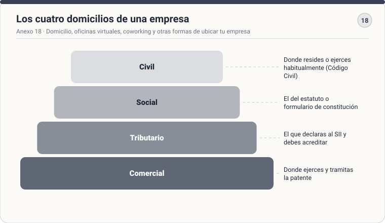
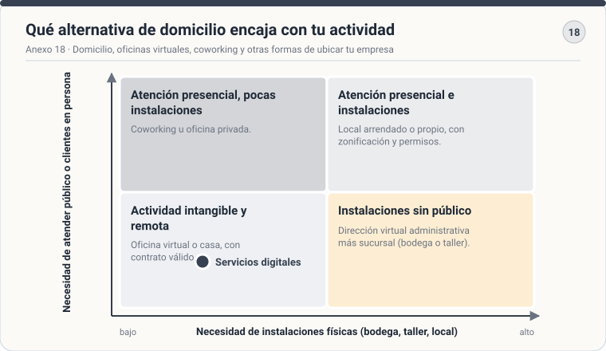
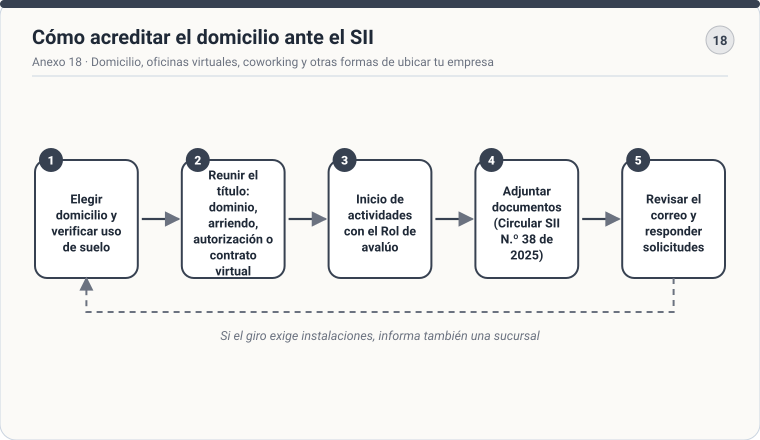
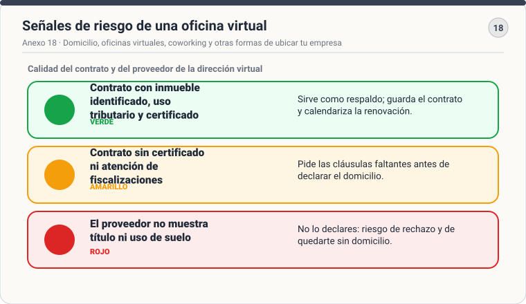
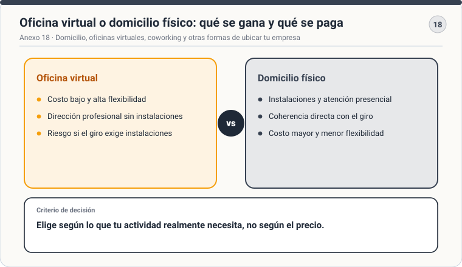

# Anexo 18 · Domicilio, oficinas virtuales, coworking y otras formas de ubicar tu empresa

> **Fecha de consulta de las fuentes:** 2026-11-25. **Naturaleza:** material educativo; no es asesoría
> legal ni tributaria. Los criterios del SII y las ordenanzas municipales cambian: confirma cada dato en la
> fuente oficial citada al final y en tu comuna antes de actuar. Este anexo separa **obligación legal**,
> **recomendación profesional** y **medida voluntaria**. No recomienda proveedores ni fija precios: los valores
> son ilustrativos.

<!-- anexos:nav-inicio -->

**Navegación:** [← 17. Municipalidades: patente comercial, zonificación y permisos locales](17-municipalidades-patentes-y-permisos-locales.md) · [Índice de anexos](README.md) · —

## En 60 segundos

- El domicilio decide la oficina del SII, la patente, las notificaciones y la competencia: hay al menos cuatro domicilios distintos.
- El SII acepta una dirección virtual si en esa oficina se desarrolla efectivamente la actividad principal; si no, exige una sucursal física.
- El título que presentas depende de tu calidad sobre el inmueble: propietario, arrendatario, cedido, usufructuario o sucesión.
- Un arriendo con cláusula de uso exclusivo habitacional no sirve como domicilio tributario.
- Cambiar de domicilio exige avisar al SII, a la municipalidad (30 días) y, si corresponde, modificar el estatuto.

<!-- anexos:nav-fin -->

## 1. Ficha rápida

| Pregunta | Respuesta |
|---|---|
| ¿Por qué importa el domicilio? | Porque ordena **qué oficina del SII te fiscaliza, qué municipalidad te da la patente, dónde se te notifica y qué tribunal es competente**. Una dirección mal elegida bloquea trámites. |
| ¿Cuántos «domicilios» hay? | Al menos cuatro: **civil**, **social** (el del estatuto), **tributario** (el que declaras al SII) y **comercial** (donde ejerces y tramitas la patente). Pueden coincidir o no. |
| ¿Qué dice el SII? | El domicilio tributario es el lugar donde tienes **el asiento de tus negocios** y debe estar asociado a un **Rol de avalúo**; si necesitas instalaciones, debes informar además una **sucursal** (FAQ del SII, actualizada en 2026). |
| ¿Sirve una oficina virtual? | **Sí, con condiciones:** si tu actividad no requiere instalaciones físicas (por ejemplo, ventas por internet o servicios intangibles) y en esa oficina se desarrolla efectivamente la actividad principal. Si fabricas, elaboras o guardas productos, la dirección virtual puede ser tu domicilio administrativo y debes agregar una sucursal. |
| ¿Y el coworking? | Puede servir si el contrato te da derecho de uso identificable sobre el inmueble, no prohíbe actividades comerciales y la zonificación lo permite. Debes verificarlo caso a caso. |
| ¿Y mi casa? | Puede ser domicilio tributario si el inmueble no tiene restricción de uso exclusivamente habitacional; para patente, la **microempresa familiar** tiene un régimen especial (art. 26 del DL 3.063). |
| ¿Qué documento me piden? | Depende de tu calidad sobre el inmueble: propietario, arrendatario, cedido (comodato), usufructuario o sucesión. |
| ¿Qué cambia si me mudo? | Debes actualizar el SII, la municipalidad (30 días para comunicar el cambio, art. 29 del DL 3.063), el estatuto si el domicilio social cambia y tus contratos y cuentas. |
| ¿Para quién suele servir este anexo? | Para quien está por elegir dónde «vivirá» su empresa: dirección, oficina, local, bodega o espacio compartido. |

## 2. Por qué el domicilio importa: cuatro funciones

El domicilio parece un dato administrativo, pero **cumple cuatro funciones distintas**, y cada una puede usar una
dirección diferente.

| Función | Qué decide | Fuente |
|---|---|---|
| **Jurisdicción tributaria** | Qué Dirección Regional del SII tiene competencia sobre ti | FAQ del SII: «el domicilio del contribuyente determinará la jurisdicción competente de este Servicio» |
| **Patente y zonificación** | Qué municipalidad te cobra la patente y si tu actividad cabe en esa zona | Arts. 24 y 26 del DL 3.063 |
| **Competencia y notificaciones** | Qué tribunales y dónde se te notifica judicialmente | Domicilio social (estatuto) y domicilio civil (Código Civil, arts. 59 a 69) |
| **Prueba y confianza** | Qué dirección ven bancos, clientes y proveedores | Contratos, certificados y el Registro |

### 2.1. El domicilio civil: el concepto base

El Código Civil define el domicilio como la **residencia acompañada, real o presuntivamente, del ánimo de
permanecer en ella** (art. 59). Dice además que **el lugar donde ejerces habitualmente tu profesión u oficio
determina tu domicilio civil** (art. 62) y que **se presume el ánimo de permanecer** por el hecho de abrir en un
lugar «tienda, botica, fábrica, taller, posada, escuela u otro establecimiento durable» para administrarlo en
persona (art. 64). Cuando concurren varias secciones territoriales con circunstancias de domicilio, se entiende
que se tiene en todas ellas, salvo las cosas que se relacionan con una sola (art. 67). Esta es la base conceptual:
**el domicilio sigue a la vida real, no a la etiqueta**.

### 2.2. El domicilio especial en un contrato

Los contratantes pueden **establecer de común acuerdo un domicilio civil especial** para los actos judiciales o
extrajudiciales que den lugar a ese contrato (art. 69). En la práctica, contratos con clientes y proveedores
suelen fijar un domicilio para notificaciones y tribunales competentes. No cambia tu domicilio tributario, pero
**sí dónde se discuten los conflictos del contrato**.

### 2.3. El domicilio de la sociedad

Las sociedades deben tener domicilio. En la SpA, si la escritura no lo indica, **se entiende domiciliada en el lugar
de otorgamiento** (art. 433 del Código de Comercio; regla similar para las anónimas en el art. 5 A de la Ley
18.046). En el Registro de Empresas y Sociedades, **debe completarse el domicilio social si la ley del tipo lo
exige, y todas las sociedades deben indicar una dirección para obtener el RUT** (art. 6 de la Ley 20.659). Es decir:
el estatuto puede tener una dirección y el SII, otra.

## 3. Marco legal

### 3.1. Mapa de normas y fuentes

| Fuente | Qué aporta |
|---|---|
| Código Civil, arts. 59 a 69 | Concepto de domicilio civil y domicilio especial en contratos |
| Código de Comercio, art. 433 | Domicilio de la SpA |
| Ley 18.046, art. 5 A | Domicilio de la sociedad anónima |
| Ley 20.659, art. 6 | Domicilio social y dirección para el RUT en el Registro |
| Código Tributario, arts. 11, 66 y 68 | Notificaciones por correo electrónico, RUT e inicio de actividades |
| FAQ del SII sobre domicilio (IDs 001.105.8704, 001.105.0136, 001.105.7326, 001.105.3793) y portal Emprendedor | Qué es el domicilio tributario, dirección virtual, sucursales y acreditación |
| Circular SII N.º 38 de 2025 | Instrucciones de acreditación del domicilio (citada por el SII; no transcrita aquí) |
| DL 3.063, arts. 23 a 34 | Patente, zonificación, microempresa familiar, cambio de domicilio |
| Plan Regulador comunal y ordenanzas | Usos de suelo permitidos en cada zona |
| Ley 20.416 | Patente provisoria y beneficios para pymes (Anexo 13) |

### 3.2. Obligación, recomendación, opción

| Materia | Tipo | Detalle |
|---|---|---|
| Informar un domicilio al iniciar actividades | Obligación | Art. 68 del Código Tributario y trámite del SII |
| Acreditar el domicilio con un título de uso | Obligación | FAQ del SII y Circular N.º 38 de 2025 |
| Informar sucursales si ejerces en más de un lugar | Obligación | FAQ del SII |
| Comunicar el cambio de domicilio a la municipalidad en 30 días | Obligación | Art. 29 del DL 3.063 |
| Verificar la zonificación antes de arrendar | Recomendación profesional | Evita clausura (art. 26 DL 3.063) |
| Guardar el contrato y sus renovaciones | Recomendación profesional | Es tu prueba ante el SII |
| Pedir al proveedor virtual una cláusula de uso tributario | Recomendación profesional | Evita rechazos |
| Elegir un domicilio postal o urbano para notificaciones | Opción | FAQ del SII (domicilios opcionales) |

## 4. Los cuatro «domicilios» que no debes confundir

| Domicilio | Dónde se fija | Para qué sirve | ¿Puede ser virtual? | ¿Lo verifica alguien? |
|---|---|---|---|---|
| **Civil** | Residencia con ánimo de permanecer; lugar de ejercicio habitual (arts. 59 y 62 del Código Civil) | Competencia, notificaciones personales, efectos civiles | No es un trámite: es un hecho | Los tribunales, si se discute |
| **Social** | Estatuto o formulario de constitución | Competencia y reglas societarias; si no se indica, el lugar de otorgamiento | Puede ser cualquier dirección real del estatuto | El Registro, si falta |
| **Tributario** | Inicio de actividades y modificaciones (art. 68 del Código Tributario) | Jurisdicción del SII, fiscalización, rol de avalúo | Sí, con las condiciones del SII | El SII, con acreditación y eventual verificación |
| **Comercial** | Solicitud de patente | Patente municipal y zonificación | Solo si el uso de suelo y la actividad lo permiten | La municipalidad |

**Regla práctica.** Antes de firmar un contrato de arriendo o de oficina virtual, responde por escrito: ¿qué
domicilio estoy fijando con esto (social, tributario, comercial) y qué documento voy a mostrar para cada uno?

### 4.1. Domicilio postal o urbano: el opcional

Además del domicilio principal, el SII permite **fijar un domicilio postal o urbano para ser notificado**, como
domicilio opcional (FAQ del SII sobre el aplicativo de inicio de actividades). Sirve para recibir correspondencia
en un lugar distinto del asiento de tus negocios. No reemplaza la obligación de informar el domicilio principal.

### 4.2. Notificaciones del SII por correo electrónico

El Código Tributario dispone que las notificaciones que deba practicar el SII **se realizan por correo electrónico**,
a la dirección que el contribuyente haya señalado y que conste en su sitio personal, salvo cuando no haya informado
un correo, una ley disponga otra forma o el contribuyente acredite carecer de medios tecnológicos (art. 11). Para ti
significa que **tu correo registrado importa tanto o más que tu dirección física** para enterarte de actuaciones del
SII. Revisa y actualiza tu correo cada vez que cambies de proveedor o de persona responsable.

## 5. Cada alternativa, explicada

Esta es la sección central. Para cada alternativa se responde: qué es, cuándo sirve, qué exige, qué riesgos tiene y
qué documentos necesitas. Las referencias a la ley y al SII son las citadas en la sección 3.

### 5.1. Casa habitación (tu vivienda como domicilio)

**Qué es.** Usar tu casa o departamento como domicilio tributario y, si corresponde, como lugar de trabajo.

**Cuándo sirve.** Servicios intangibles (consultoría, diseño, programación), ventas por internet con bodega mínima y
profesionales independientes.

**Qué exige.**

- **Ante el SII:** el domicilio debe estar asociado a un Rol de avalúo; si el inmueble es **arrendado**, el contrato
  **no debe contener la cláusula de «uso exclusivo habitacional» ni una que prohíba desarrollar actividades
  comerciales** (portal Emprendedor del SII); si es **propio**, los datos se validan automáticamente, y si el sistema
  no te reconoce como propietario (por ejemplo, por compra reciente), debes adjuntar el certificado de dominio
  vigente del Conservador de Bienes Raíces o la escritura.
- **Ante la municipalidad:** si quieres patente comercial, la actividad debe ser compatible con la **zonificación**
  (art. 26 del DL 3.063); una zona exclusivamente habitacional puede impedirlo. Para actividades de baja escala existe
  la **microempresa familiar** (sección 5.2).
- **Ante el condominio:** si vives en un condominio, el reglamento puede restringir actividades; y para acogerse a la
  microempresa familiar necesitas la autorización del Comité de Administración (art. 26).

**Riesgos.** Rechazo del SII si el contrato de arriendo prohíbe usos comerciales; reclamos de vecinos; clausura si la
actividad no es compatible con la zona.

**Documentos.** Escritura o certificado de dominio vigente (propio) o contrato de arriendo sin cláusula habitacional
exclusiva (arrendado); Rol de avalúo; autorización del condominio si corresponde.

### 5.2. Microempresa familiar (casa habitación con régimen especial)

**Qué es.** Un régimen del art. 26 del DL 3.063 para quien ejerce su giro **en la casa habitación familiar**, con **no
más de cinco trabajadores ajenos a la familia** y **activos productivos que no excedan 1.000 UF** (sin contar el
inmueble). Puede desarrollar cualquier actividad lícita, **excluidas las peligrosas, contaminantes o molestas**.

**Cuándo sirve.** Producción artesanal, alimentos de baja escala (cumpliendo el Reglamento Sanitario de los
Alimentos), servicios caseros.

**Qué exige.** Inscribirse en la municipalidad con una **declaración jurada** de que eres legítimo ocupante y de que
tu actividad no contamina; en condominio, autorización del Comité de Administración.

**Beneficio.** Las limitaciones y autorizaciones de patente (como la verificación de zonificación) **no se aplican a
la microempresa familiar**, y puede acceder a beneficios de las leyes de renta e IVA que cita el propio artículo.

**Riesgos.** Perder el régimen si creces (más de cinco trabajadores ajenos o más de 1.000 UF de activos);
actividades que el artículo excluye; obligaciones sanitarias que siguen vigentes.

**Documentos.** Declaración jurada, comprobante de residencia, autorización del condominio si corresponde.

### 5.3. Local u oficina propia

**Qué es.** Un inmueble de tu propiedad (o de tu empresa) donde desarrollas la actividad.

**Cuándo sirve.** Cuando necesitas estabilidad, instalaciones propias o quieres capitalizar el inmueble.

**Qué exige.** Para el SII, los datos de propietario se validan automáticamente; si no, certificado de dominio vigente
o escritura. Para la patente: zonificación, permisos sanitarios o especiales y, si corresponde, verificación de la
Dirección de Obras (art. 26 DL 3.063).

**Riesgos.** Inmovilizar capital; que el inmueble esté a nombre de una persona y la empresa sea otra (entonces tu
empresa lo usa en calidad de «cedido» o «arrendado» y necesita título); contribuciones y gastos comunes.

**Documentos.** Escritura, certificado de dominio vigente, Rol de avalúo.

### 5.4. Local u oficina arrendada

**Qué es.** Un inmueble que arriendas para tu actividad.

**Cuándo sirve.** La mayoría de las pymes con local comercial u oficina.

**Qué exige.** Ante el SII, **adjuntar el contrato de arriendo**, que **no contenga cláusula de uso exclusivo
habitacional ni prohibición de actividades comerciales**; informar el RUT del propietario y el monto del arriendo si
eres de Primera Categoría (FAQ del SII). Ante la municipalidad, la compatibilidad de uso de suelo y los permisos.

**Riesgos.** Contratos que no autorizan la actividad que realizarás; plazos cortos que te dejan sin domicilio;
cláusulas de término anticipado; arrendador distinto del propietario sin poder.

**Qué negociar.** Uso comercial expreso, plazo suficiente, derecho a usar la dirección como domicilio tributario y
comercial, cláusula de salida y estado del inmueble.

**Documentos.** Contrato firmado, cédula del arrendador, certificado de dominio vigente (para verificar que el
arrendador es el dueño), Rol de avalúo.

### 5.5. Comodato o inmueble cedido

**Qué es.** Usas un inmueble que te presta o cede alguien (un familiar, un socio, otra empresa), sin pagar arriendo.

**Cuándo sirve.** Cuando partes con el apoyo de un familiar o de un socio que tiene un local.

**Qué exige.** Ante el SII, para el inmueble **cedido**, presentar la **autorización por escrito o con firma
electrónica avanzada del propietario** (portal Emprendedor del SII). El SII indica que la calidad de uso puede ser
«arrendado», «comodato o cedido» o «usufructuado», y que si el inmueble no es propio debes informar el **RUT del
propietario** y la forma en que te autoriza el uso (FAQ del SII).

**Riesgos.** Autorizaciones informales que el SII no acepte; que el propietario retire el permiso; que el inmueble
tenga restricción de uso; conflictos familiares.

**Recomendación profesional.** Convertir el préstamo en un **contrato escrito**, con plazo, uso permitido y
cláusula sobre qué pasa si el propietario fallece o vende.

**Documentos.** Autorización escrita o con firma electrónica avanzada, cédula del propietario, Rol de avalúo.

### 5.6. Usufructo

**Qué es.** Tienes un derecho de usufructo sobre el inmueble (derecho a usarlo y gozarlo).

**Qué exige.** Presentar la **escritura de usufructo** (portal Emprendedor del SII).

**Riesgos.** El usufructo termina por las causas legales o pactadas; si termina, pierdes el título del domicilio.

### 5.7. Inmueble de una sucesión o comunidad

**Qué es.** El inmueble pertenece a una sucesión o comunidad (por ejemplo, herederos que no se han repartido la
propiedad).

**Qué exige.** Según el SII, si el dueño corresponde a una sucesión, presentar la **posesión efectiva** y la
**autorización escrita de todos los miembros de la comunidad o sucesión**, o del representante designado por la
unanimidad de ellos (portal Emprendedor del SII).

**Riesgos.** Falta de unanimidad; conflictos entre herederos; autorizaciones que se retiran.

### 5.8. Oficina virtual (dirección virtual)

**Qué es.** Un servicio que contratas con un tercero para tener una **dirección comercial** que usas como domicilio,
normalmente con recepción de correspondencia y, a veces, uso de salas de reuniones. El SII la reconoce como
«dirección virtual» y la permite bajo condiciones.

**Qué dice el SII.** Puedes usar un domicilio virtual **si en esa oficina se desarrolla efectivamente la actividad
principal** del giro; por ejemplo, cuando los servicios son de **naturaleza intangible** y pueden realizarse desde
ahí sin mayores instalaciones. Si la actividad **no es compatible** con una dirección virtual, el aplicativo te pedirá
registrar una **sucursal con domicilio físico** (FAQ del SII ID 001.105.8704). Para actividades que involucran
fabricar insumos, elaborar productos o guardar mercaderías en bodegas, puedes usar la dirección virtual como
**domicilio principal administrativo** y agregar una **sucursal** donde efectivamente se desarrolla la actividad
(portal Emprendedor del SII).

**Qué es y qué no es.** La oficina virtual **es** una dirección con servicios; **no es** un permiso, **no** reemplaza
la zonificación ni la patente y **no** resuelve la obligación de informar sucursales. Un proveedor serio te entrega el
contrato y la documentación del inmueble; uno dudoso solo te entrega una dirección.

Se desarrolla en la sección 7.

### 5.9. Coworking (espacio compartido)

**Qué es.** Un espacio de trabajo compartido, con puestos flexibles, puestos fijos u oficinas privadas, normalmente
con contrato de servicios.

**Cuándo sirve.** Equipos pequeños, freelancers y startups que necesitan flexibilidad y un lugar donde atender
clientes.

**Qué exige.** El contrato debe darte un **título de uso identificable** sobre el inmueble para poder usarlo como
domicilio (arrendado o similar), **no prohibir actividades comerciales** y estar compatible con la zonificación. Un
simple pase diario no suele servir para acreditar domicilio.

**Riesgos.** Contratos de servicios que no hablan del uso como domicilio; cambios de condiciones; proveedores que
cierran; zonificación incompatible.

Se desarrolla en la sección 8.

### 5.10. Sucursal, bodega, taller y fábrica

**Qué es.** Lugares adicionales donde se desarrollan funciones de tu giro, distintos del domicilio principal.

**Qué dice el SII.** Quien necesita **instalaciones** (maquinarias, bodegas, oficinas u otra infraestructura) y
requiere más de un lugar, debe informar una **dirección adicional en calidad de sucursal**, esto es, un
establecimiento que depende de otro principal, donde se desempeñan funciones del giro y que está en un lugar
distinto; y quienes desarrollan actividades en más de un lugar deben informar **todas las direcciones de sus
sucursales**, junto con la **calidad de uso** de cada inmueble (FAQ del SII ID 001.105.0136).

**Efectos municipales.** La patente se reparte proporcionalmente por unidad según el número de trabajadores de cada
una, y debes presentar en mayo una declaración con los trabajadores por unidad (art. 25 del DL 3.063; Anexo 17).

**Riesgos.** Operar una bodega o un taller sin informarlo; usar una dirección virtual para actividades que exigen
instalaciones; olvidar la patente de cada local.

### 5.11. Domicilio de sociedades de profesionales y de inversión

**Qué es.** Para sociedades de inversiones o **sociedades de profesionales que no registran domicilio comercial**, la
patente se paga **en la comuna del domicilio registrado ante el SII** (art. 24 del DL 3.063), y el SII aporta esa
información a las municipalidades cada mayo. Además, las patentes de profesionales y de sociedades de profesionales
**no exigen permiso alguno** (art. 26).

**Cuándo sirve.** Sociedades que prestan servicios profesionales desde cualquier lugar, o que solo mantienen
inversiones.

**Riesgo.** Declarar un domicilio que no refleja dónde se ejerce realmente; el SII puede pedir antecedentes.

### 5.12. Vía pública y venta ambulante

**Qué es.** Comercio en la vía pública con permiso municipal. La Ley de la Renta contempla un régimen de **impuesto
único anual** para los «pequeños comerciantes que desarrollan actividades en la vía pública», calificados según el
permiso municipal (art. 22 de la Ley de la Renta).

**Qué exige.** Permiso municipal; consulta al SII la forma de inscripción. La noción de domicilio civil reconoce que
quien se ocupa en un «tráfico ambulante» no adquiere domicilio por ese solo hecho (art. 63 del Código Civil).

### 5.13. Domicilio en el extranjero o sucursal de entidad extranjera

Una entidad extranjera que opera en Chile mediante agencia debe declarar el **domicilio de la agencia principal** en
la escritura de declaraciones (art. 448 N.º 6 del Código de Comercio; Anexo 14).

### 5.14. Casos especiales ante el SII

El portal Emprendedor del SII indica que si vives en un **campamento** y no sabes qué número de Rol indicar, debes
acercarte a la unidad del Servicio más cercana para recibir orientación personalizada. Casos como este muestran que
**el sistema tiene vías de orientación**: úsalas antes de declarar un dato incierto.

## 6. Cómo se acredita el domicilio ante el SII

### 6.1. El principio

Para inscribir el RUT y dar aviso de inicio de actividades, que se hace **por internet**, el contribuyente debe
**acreditar su domicilio** adjuntando antecedentes por la aplicación del SII, según las instrucciones de la
**Circular N.º 38 de 2025** (FAQ del SII ID 001.105.0136, actualizada el 1 de junio de 2026). Para efectos
tributarios, el domicilio es el lugar (calle, número, comuna, ciudad, región, o Rol de avalúo) declarado al informar
el inicio de actividades o sus modificaciones, **donde tengas el asiento de tus negocios**.

### 6.2. Qué te pide el SII según tu calidad sobre el inmueble

| Tu calidad | Qué debes informar o adjuntar | Observaciones |
|---|---|---|
| **Propietario** | Datos validados automáticamente; si no te reconoce, certificado de dominio vigente del Conservador de Bienes Raíces o escritura | Compra reciente es el caso típico |
| **Arrendatario** | Contrato de arriendo en archivo digital; RUT del propietario; monto del arriendo si eres de Primera Categoría | El contrato **no debe** tener cláusula de uso exclusivo habitacional ni prohibir actividades comerciales |
| **Cedido (comodato)** | Autorización por escrito o con firma electrónica avanzada del propietario; RUT del propietario | Informal no basta |
| **Usufructuario** | Escritura de usufructo | |
| **Sucesión o comunidad** | Posesión efectiva y autorización escrita de todos los miembros, o del representante designado por unanimidad | |
| **Virtual** | Contrato con el proveedor, que debe acreditar tu derecho a usar la dirección | Ver sección 7 |

### 6.3. Rol de avalúo

El domicilio debe estar asociado a un **Rol de avalúo**, identificador único por comuna compuesto por dos números
separados por un guion (manzana y predio). Si no lo conoces, el aplicativo ofrece un buscador por dirección, número y
comuna; también puedes consultarlo en el sitio del SII («Obtener certificado de avalúo») o verlo en la colilla de
pago de las contribuciones (portal Emprendedor del SII).

### 6.4. Qué más puede pedir el SII

El resultado del trámite informa si debes efectuar alguna actuación posterior, **por ejemplo acreditar título o
domicilio**, y el SII puede pedir antecedentes adicionales por correo electrónico. El resultado se envía, junto con
el certificado de inicio de actividades, al correo que indicaste (FAQ del SII ID 001.105.3793). Por eso conviene:

1. usar un correo que revises todos los días;
2. guardar el contrato y la autorización en una carpeta digital;
3. responder rápido a cualquier solicitud de antecedentes.

### 6.5. Cuando el SII no está de acuerdo con tu domicilio

El SII puede cuestionar un domicilio que no corresponda al asiento real de tus negocios. Consecuencias posibles:
bloqueo de trámites, solicitud de antecedentes, o incluso observaciones en la fiscalización. Si te piden aclarar,
responde por escrito con evidencia de que realmente desarrollas ahí tu actividad (contratos, fotografías, correos,
facturas de servicios). Consulta a un contador o abogado antes de responder si el caso es complejo.

## 7. La oficina virtual en profundidad

### 7.1. Qué incluye normalmente un servicio de oficina virtual

Los servicios del mercado varían. Estos son los componentes más habituales; **verifica cuáles incluye el contrato que
firmas**, porque no todos son obligatorios ni todos sirven para el SII:

| Componente | Qué es | Importancia para tu domicilio |
|---|---|---|
| Dirección comercial | Calle, número, oficina y comuna que usas como domicilio | Es lo que declaras al SII |
| Contrato de uso | El documento que acredita tu derecho a usar la dirección | **Es lo que adjuntas al SII** |
| Recepción de correspondencia | El proveedor recibe cartas y paquetes y te avisa o reenvía | Útil para notificaciones |
| Atención de visitas y fiscalizaciones | Alguien atiende si llega el SII, la municipalidad u otro | Muy importante si se verifica el domicilio |
| Salas de reunión | Uso por horas o por día | Útil si recibes clientes |
| Línea telefónica o secretaría | Recepción de llamadas | Opcional |
| Certificado de uso | Constancia del proveedor para trámites | Recomendable pedirlo |
| Uso como domicilio comercial para patente | Cláusula que lo permite | Solo si el uso de suelo lo permite |

### 7.2. Cuándo sí sirve y cuándo no

Aplicando el criterio del SII (FAQ ID 001.105.8704 y portal Emprendedor):

| Actividad | ¿Dirección virtual como domicilio? | Cómo se resuelve |
|---|---|---|
| Consultoría, asesorías remotas, servicios digitales | Posible, si se desarrolla efectivamente desde esa oficina | Dirección virtual |
| Venta por internet con productos de terceros enviados directamente | Posible si el giro no requiere instalaciones físicas | Dirección virtual; revisa bodega y devoluciones |
| Venta por internet con inventario propio | Parcial | Dirección virtual como domicilio administrativo y **sucursal** donde está la bodega |
| Fabricación o elaboración de productos | No como único domicilio | Dirección virtual administrativa más sucursal (taller o fábrica) |
| Bodegaje de mercaderías | No como único domicilio | Dirección virtual más sucursal con la bodega |
| Construcción menor | Posible según el SII, si no requiere instalaciones propias | Evalúa con el contador |
| Local abierto al público | No | Domicilio físico |
| Actividades reguladas con inspección física (por ejemplo, ciertos servicios sanitarios) | No | Domicilio físico y permisos |

**Principio.** El SII mira la **coherencia** entre tu giro y tu domicilio. Una dirección virtual con un giro que
claramente requiere instalaciones será observada.

### 7.3. Cláusulas que debes exigir en el contrato

Estas cláusulas son una **recomendación profesional** para que el contrato sirva como título de uso. Llévalas a tu
abogado:

1. **Identificación del inmueble:** dirección exacta, Rol de avalúo y propietario.
2. **Derecho de uso:** que el cliente puede usar la dirección como domicilio tributario y comercial.
3. **Sin restricciones habitacionales:** declaración de que el inmueble no tiene cláusula de uso exclusivo
   habitacional ni prohibición de actividades comerciales.
4. **Plazo y renovación:** vigencia mínima y avisos de término.
5. **Atención de fiscalizaciones:** compromiso de atender visitas y notificaciones y de avisarte en un plazo breve.
6. **Recepción de correspondencia:** quién la recibe, cómo te avisa y por cuánto tiempo la guarda.
7. **Certificado de uso:** obligación de entregarte constancia cuando la pidas.
8. **Cambio de dirección del proveedor:** aviso previo y derecho a terminar sin costo.
9. **Protección de datos:** tratamiento de tus datos y de la correspondencia.
10. **Salida ordenada:** qué pasa si el proveedor cierra o tú terminas el contrato.

### 7.4. Cómo evaluar a un proveedor (debida diligencia sencilla)

| Pregunta | Por qué importa | Qué evidencia pedir |
|---|---|---|
| ¿Quién es el propietario del inmueble y qué título tiene el proveedor? | Un contrato sobre un inmueble sin título no sirve | Certificado de dominio vigente y contrato de arriendo del proveedor |
| ¿El inmueble permite uso comercial? | La zonificación y el reglamento pueden prohibirlo | Informe de uso de suelo o patente del proveedor |
| ¿Atienden visitas del SII o municipales? | Si no, el domicilio puede declararse «no habido» | Compromiso por escrito |
| ¿Cuánto tiempo llevan operando? | Estabilidad | Antigüedad y referencias |
| ¿Cuántos clientes comparten la dirección? | Muchas empresas en una oficina pueden llamar la atención | Política de uso |
| ¿Cómo manejan la correspondencia? | Confidencialidad y plazos | Procedimiento escrito |
| ¿Qué ocurre si cierran? | Riesgo de quedarte sin domicilio | Cláusula de continuidad o aviso |

### 7.5. Señales de alerta

- Precio muy inferior al de proveedores comparables, sin explicación.
- Se niegan a entregar el contrato o el certificado de uso.
- No identifican al propietario del inmueble.
- Prometen «patente garantizada» sin verificar uso de suelo.
- Usan una dirección residencial sin autorización.
- Piden pagar solo por transferencias a una persona natural sin documento.
- Ofrecen domicilio para giros que claramente requieren instalaciones.

### 7.6. Ciclo de vida de una oficina virtual

1. **Elegir y verificar** al proveedor (sección 7.4).
2. **Firmar** un contrato con las cláusulas de la sección 7.3.
3. **Declarar** el domicilio al SII con el contrato como respaldo.
4. **Operar:** revisar correspondencia, mantener el pago y guardar comprobantes.
5. **Renovar** antes del vencimiento y actualizar el respaldo ante el SII si cambia el contrato.
6. **Salir:** si cambias de domicilio, sigue la sección 12.

### 7.7. Costos y su análisis (valores ilustrativos)

Los precios dependen de la ciudad, del proveedor y del plan. A modo de **ejercicio**, supón tres opciones:

| Opción | Cargo mensual ilustrativo | Qué incluye | Costo anual ilustrativo |
|---|---:|---|---:|
| Dirección virtual básica | $15.000 | Dirección y contrato de uso | $180.000 |
| Dirección con recepción y salas por horas | $35.000 | Lo anterior más correspondencia y salas | $420.000 |
| Oficina privada pequeña | $250.000 | Espacio exclusivo | $3.000.000 |

La comparación correcta no es solo el precio: incluye **riesgo de rechazo del SII**, **tiempo perdido** y **costo de
cambiarse**. Una dirección barata que el SII rechaza sale más cara que una intermedia que sirve.

## 8. El coworking en profundidad

### 8.1. Modalidades típicas

| Modalidad | Descripción | ¿Sirve como domicilio? |
|---|---|---|
| Pase diario o flexible | Usas un puesto cuando lo necesitas, sin lugar fijo | Rara vez: no hay un lugar identificable |
| Puesto fijo | Un escritorio asignado dentro del espacio compartido | Posible, si el contrato lo describe como uso del inmueble |
| Oficina privada | Un espacio cerrado dentro del coworking | Más probable, con contrato de arriendo o uso exclusivo |
| Membresía virtual | Dirección y recepción sin puesto | Es una oficina virtual (sección 7) |

### 8.2. Qué verificar antes de firmar

1. **Título del proveedor** sobre el inmueble y uso comercial permitido.
2. **Descripción del espacio** que se te asigna y por cuánto tiempo.
3. **Autorización expresa** para usar la dirección como domicilio tributario y comercial.
4. **Reglas de acceso** (horarios, visitas, confidencialidad).
5. **Plazo y salida:** penalidades y preaviso.
6. **Seguridad de datos y de equipos.**
7. **Servicios incluidos:** internet, impresión, salas, recepción.
8. **Zonificación**: la actividad de coworking y la tuya deben ser compatibles con el uso de suelo.

### 8.3. Riesgos propios del coworking

- Contratos de servicios que no mencionan uso de domicilio.
- Cambios de precios o de condiciones durante el plazo.
- Cierre del espacio o cambio de operador.
- Confidencialidad entre empresas vecinas.
- Falta de espacio para recibir fiscalizaciones.

### 8.4. Coworking frente a oficina virtual

| Aspecto | Coworking con puesto u oficina | Oficina virtual |
|---|---|---|
| Lugar físico | Sí | No (o solo salas por horas) |
| Costo | Medio a alto | Bajo a medio |
| Atiende clientes | Sí | Depende de las salas |
| Sirve para actividades que exigen presencia | Mejor | Peor |
| Riesgo de rechazo del SII | Bajo si hay contrato claro | Medio si el giro requiere instalaciones |
| Flexibilidad | Alta | Muy alta |

## 9. Patente y zonificación según el tipo de domicilio

La patente municipal se tramita en la comuna del **domicilio comercial**: el local, oficina o lugar donde ejerces la
actividad. La municipalidad debe otorgarla de inmediato cuando están todos los permisos (art. 26 del DL 3.063;
Anexo 17). Lo que cambia según el tipo de domicilio:

| Tipo de domicilio | Patente y zonificación | Observaciones |
|---|---|---|
| Casa habitación sin microempresa familiar | Requiere compatibilidad con la zonificación | Puede estar prohibido en zonas habitacionales |
| Microempresa familiar | No se aplican las limitaciones y autorizaciones de patente (art. 26) | Con las condiciones y exclusiones del artículo |
| Local arrendado o propio | Zonificación, permisos sanitarios y especiales, eventual verificación de la Dirección de Obras | Es el caso general |
| Oficina virtual | La dirección debe tener uso de suelo compatible con tu actividad | La oficina virtual no reemplaza la zonificación |
| Coworking | Debe tener uso compatible | Pide al proveedor su patente y uso de suelo |
| Profesional o sociedad de profesionales sin domicilio comercial | Patente en la comuna del domicilio registrado en el SII; sin permisos adicionales | Arts. 24 y 26 |
| Sucursales y bodegas | Patente por cada establecimiento, con reparto proporcional según trabajadores | Art. 25 |

### 9.1. Informe de uso de suelo

Antes de firmar un contrato, pide a la municipalidad (Dirección de Obras Municipales) la información de las normas
aplicables al predio: uso de suelo permitido, restricciones y condiciones. El nombre exacto del documento y el
procedimiento varían por comuna; consulta al municipio. La zonificación se rige por el Plan Regulador y la Ley
General de Urbanismo y Construcciones citada en el art. 26.

### 9.2. Patente provisoria y domicilio

Si cumples zonificación, autorización sanitaria (o su solicitud) y permisos especiales, la municipalidad debe otorgar
patente provisoria inmediata; el domicilio comercial es el que figura en la solicitud (art. 26). Para pymes con
capital efectivo hasta 5.000 UF, puede haber exención o cuotas (Anexo 13).

## 10. Tributación y domicilio: modificaciones y relación con el SII

### 10.1. Qué determina tu domicilio tributario

El domicilio determina la **Dirección Regional del SII** competente, **salvo instrucción específica en otras
materias** (FAQ del SII). Por eso un cambio de región implica un cambio de jurisdicción.

### 10.2. Actividades físicas e intangibles

El SII distingue entre **actividades físicas**, que requieren un espacio definido como una tienda, oficina o local, y
**actividades intangibles**, como servicios digitales o asesorías remotas. La distinción **debe ser coherente** con la
información del domicilio y las sucursales (FAQ del SII ID 001.105.7326). Es la base lógica de todo el tema:
**declarar lo que haces y dónde lo haces**.

### 10.3. Modificaciones posteriores

El domicilio puede modificarse informando al SII las modificaciones posteriores conforme al art. 68 del Código
Tributario. Debe comunicarse cada cambio (de dirección, de calidad de uso, de sucursales) por los canales del SII.
Si te constituiste por el Registro de Empresas y Sociedades, algunas modificaciones se entienden informadas con la
incorporación del formulario (art. 13 de la Ley 20.659; Anexo 15), salvo los casos que requieren autorización del SII.

### 10.4. Giros y domicilio

El SII ofrece una lista de **674 actividades económicas** con código de seis números (portal Emprendedor). Elegir el
código correcto importa porque se relaciona con tu domicilio: una actividad que normalmente requiere instalaciones
no se compagina con una dirección virtual (Anexo 16).

### 10.5. Cambio de comuna y capital propio

Si cambias de comuna, cambia la municipalidad que cobra la patente y el SII informa a la nueva municipalidad el capital
propio y el código de actividad (art. 24 del DL 3.063). Revisa que tus datos sean consistentes en ambos sistemas.

## 11. Responsabilidad y riesgos

| Riesgo | Cómo se produce | Consecuencia posible | Cómo se previene |
|---|---|---|---|
| Domicilio no acreditable | Contrato que no sirve como título | Trámite detenido | Revisar el contrato antes de firmar |
| Domicilio incoherente con el giro | Dirección virtual para una actividad física | Observaciones del SII | Declarar sucursal |
| Uso de suelo incompatible | No consultar al municipio | Patente denegada o clausura | Consulta previa |
| Cláusula habitacional en el arriendo | Inmueble residencial | Rechazo del SII | Leer el contrato |
| Propietario que revoca la autorización | Comodato informal | Pérdida del domicilio | Contrato escrito |
| Proveedor virtual que cierra | Empresa inestable | Sin domicilio acreditado | Cláusula de salida y plan B |
| Correspondencia perdida | Recepción deficiente | Plazos vencidos | Procedimiento y correo electrónico al día |
| Notificación judicial no recibida | Domicilio no atendido | Juicios en rebeldía | Domicilio especial y atención efectiva |
| Cambio de domicilio sin avisar | Descuido | Multas y patente impaga | Lista de cambio (sección 12) |
| Información falsa | Declarar una dirección inexistente | Sanciones y daño reputacional | No declares lo que no es verdad |

**Sobre información falsa.** Este anexo no analiza sanciones concretas. La regla es simple: **declara el lugar real
donde ejerces**, respáldalo con documentos y, si dudas, consulta antes.

## 12. Cambiar de domicilio, paso a paso

### 12.1. Orden recomendado

1. **Decidir y verificar** el nuevo domicilio (título, uso de suelo, zonificación).
2. **Firmar el contrato** o la autorización con las cláusulas necesarias.
3. **Actualizar el SII:** informar la modificación de domicilio y de la calidad de uso, con los respaldos.
4. **Comunicar a la municipalidad:** quien cambia de domicilio su casa matriz o sucursal paga la patente en la
   municipalidad del nuevo domicilio **a partir del semestre siguiente** al de su instalación, debe comunicarlo
   **dentro de 30 días corridos**, exhibiendo la patente pagada en la municipalidad de origen y un **certificado de no
   deuda**; si hay deuda, no se otorga patente definitiva ni provisoria hasta regularizarla (art. 29 del DL 3.063).
5. **Modificar el estatuto** si el domicilio social cambia: en el Registro, con el formulario de modificación (art. 14
   de la Ley 20.659); en la vía tradicional, con las solemnidades del tipo social.
6. **Actualizar contratos y cuentas:** bancos, clientes, proveedores, seguros, trabajadores y plataformas.
7. **Avisar a los organismos sectoriales** que correspondan (sanitaria, SEC, SENCE, entre otros).
8. **Archivar** el contrato anterior y los comprobantes de término.

### 12.2. Calendario ilustrativo de una mudanza

| Semana | Tarea | Responsable |
|---|---|---|
| -4 | Elegir y verificar el nuevo domicilio | Fundador y abogado |
| -3 | Firmar contrato y revisar uso de suelo | Abogado |
| -2 | Preparar documentos para el SII y la municipalidad | Contador |
| -1 | Informar a clientes y proveedores | Administración |
| 0 | Mudanza y actualización en el SII | Contador |
| +1 | Comunicar a la municipalidad y regularizar patente | Contador |
| +2 | Modificar el estatuto y actualizar bancos | Abogado |
| +4 | Revisión final y archivo | Fundador |

## 13. Antes de construir: lista de verificación

### 13.1. Decisiones previas

1. ¿Mi actividad es física o intangible? ¿Necesito instalaciones, bodega o atención presencial?
2. ¿Qué domicilio uso para el estatuto, el SII y la patente? ¿Coinciden?
3. ¿Tengo un título de uso del inmueble (propiedad, arriendo, comodato, usufructo, contrato virtual)?
4. ¿El contrato permite uso comercial y no contiene cláusula habitacional exclusiva?
5. ¿La zonificación permite mi actividad? ¿Pedí el informe a la municipalidad?
6. ¿Necesito una sucursal para la bodega, el taller o la fábrica?
7. ¿Qué correo registraré ante el SII y quién lo revisa?
8. ¿Qué plan B tengo si el proveedor o el propietario cambian las condiciones?
9. ¿Cómo cambiaré de domicilio si crezco?
10. ¿Qué costo total (arriendo, patente, servicios) implica esta decisión?

### 13.2. Documentos

| Documento | Para qué |
|---|---|
| Escritura o certificado de dominio vigente | Acreditar propiedad |
| Contrato de arriendo, de comodato o de oficina virtual | Acreditar uso |
| Autorización firmada o con firma electrónica avanzada | Inmueble cedido |
| Escritura de usufructo o posesión efectiva y autorizaciones | Usufructo o sucesión |
| Rol de avalúo | Identificar el inmueble ante el SII |
| Informe de uso de suelo | Patente |
| Certificado de uso del proveedor | Respaldo adicional |
| Autorización del Comité de Administración | Microempresa familiar en condominio |

### 13.3. Errores frecuentes (resumen)

- Firmar el contrato antes de consultar la zonificación.
- Usar una dirección virtual con un giro que requiere bodega.
- Arrendar un inmueble con cláusula habitacional exclusiva.
- Aceptar un comodato verbal.
- No informar la sucursal.
- No revisar el correo registrado en el SII.
- No comunicar el cambio de domicilio en 30 días.
- Confiar en un proveedor sin pedirle el título del inmueble.

### 13.4. Caso ilustrado: una tienda en línea que crece

**Caso ilustrativo.** Sofía abre una tienda en línea de cosmética natural. Los números son ilustrativos.

1. **Año 1.** Vende productos de terceros que se despachan desde el proveedor. Su actividad es intangible. Contrata
   una **dirección virtual** con contrato de uso y certificado, y la declara como domicilio ante el SII.
2. **Año 2.** Compra inventario y lo guarda en una bodega arrendada. Su actividad ya requiere instalaciones.
   **Informa la bodega como sucursal** y mantiene la dirección virtual como domicilio administrativo.
3. **Municipalidad.** Tramita la patente de la bodega con informe de uso de suelo y permisos sanitarios aplicables.
4. **Año 3.** Abre un pequeño taller de mezclas. Necesita autorización sanitaria y un local con uso de suelo
   compatible. Revisa si conviene trasladar también el domicilio principal.
5. **Lección.** El domicilio **crece con la actividad**: cada etapa exige actualizar el SII y la municipalidad.

### 13.5. Mini glosario

| Término | Significado |
|---|---|
| Domicilio tributario | Lugar declarado al SII donde se tiene el asiento de los negocios |
| Domicilio social | Domicilio fijado en el estatuto |
| Domicilio comercial | Lugar donde se ejerce la actividad y se tramita la patente |
| Domicilio virtual | Dirección contratada con un tercero, con las condiciones del SII |
| Sucursal | Establecimiento que depende de otro principal y donde se cumplen funciones del giro |
| Rol de avalúo | Identificador del bien raíz en el SII y en la comuna |
| Comodato o cedido | Uso gratuito de un inmueble ajeno con autorización del propietario |
| Domicilio postal o urbano | Dirección opcional para notificaciones |

## 14. Cuándo conviene y cuándo no

### 14.1. Comparación de alternativas

| Alternativa | Costo | Flexibilidad | Riesgo con el SII | Riesgo municipal | Ideal para |
|---|---|---|---|---|---|
| Casa habitación | Bajo | Media | Medio (cláusulas y uso) | Medio a alto | Servicios intangibles |
| Microempresa familiar | Bajo | Media | Bajo | Bajo | Producción casera pequeña |
| Local propio | Alto (capital) | Baja | Bajo | Bajo a medio | Operación estable |
| Local arrendado | Medio a alto | Media | Bajo si el contrato es bueno | Medio | Comercio y servicios con público |
| Comodato | Bajo | Baja | Medio (autorización) | Medio | Etapas iniciales |
| Oficina virtual | Bajo | Alta | Medio (coherencia con el giro) | Medio (uso de suelo) | Servicios intangibles y comercio electrónico |
| Coworking | Medio | Alta | Bajo a medio | Medio | Equipos pequeños |
| Sucursal o bodega | Medio a alto | Baja | Bajo (si se informa) | Medio | Inventario y producción |

### 14.2. Señales a favor de una oficina virtual

- Actividad intangible o comercio electrónico sin inventario propio.
- Necesidad de una dirección profesional con bajo costo.
- Equipo remoto sin atención presencial.

### 14.3. Señales en contra

- Atención al público o inspecciones físicas frecuentes.
- Fabricación, elaboración o bodegaje propios.
- Actividades reguladas que exigen instalaciones.
- Proveedor sin título claro del inmueble.

## 15. Cuándo llamar a un profesional

| Situación | Profesional | Por qué |
|---|---|---|
| Duda sobre coherencia entre giro y domicilio | Contador | Evitar observaciones del SII |
| Contrato de arriendo o de oficina virtual | Abogado | Cláusulas de uso y salida |
| Zonificación incierta | Arquitecto o abogado urbanista | Interpretar el Plan Regulador |
| Comodato o sucesión | Abogado | Autorizaciones y unanimidad |
| Cambio de domicilio social | Abogado | Modificación del estatuto |
| Requerimiento del SII sobre domicilio | Contador o abogado tributario | Plazos y respuesta |

Consulta la [guía de cuándo llamar a un profesional](../docs/18_WHEN_TO_CALL_A_PROFESSIONAL.md).

## 16. Escenarios resueltos

Todos son **ilustrativos**.

### Escenario 1: la consultora que solo necesita una dirección

**Situación.** Elena hace consultoría de recursos humanos para empresas, trabaja desde su casa arrendada y atiende
a sus clientes en las oficinas de ellos. Su contrato de arriendo tiene una cláusula de **uso exclusivo
habitacional**.

**Análisis.** Para el SII, el contrato de arriendo **no debe** contener esa cláusula; si la tiene, el inmueble no
puede ser su domicilio tributario. Su actividad es intangible.

**Decisión.** Contratar una **dirección virtual** con contrato de uso y certificado, declararla como domicilio
tributario y guardar los respaldos. Revisar que su correo registrado ante el SII sea de uso diario.

### Escenario 2: el pastelero con taller en casa

**Situación.** Tomás elabora pasteles en su cocina y los vende por encargo. Vive en una casa propia con dos personas
ajenas a la familia que lo ayudan.

**Análisis.** Podría acogerse a la **microempresa familiar** si cumple las tres condiciones y la actividad no es
peligrosa, contaminante ni molesta (art. 26 del DL 3.063). La elaboración de alimentos obliga además al Reglamento
Sanitario de los Alimentos.

**Decisión.** Inscribirse como microempresa familiar, solicitar la autorización sanitaria que corresponda y declarar
su casa como domicilio tributario con el certificado de dominio vigente. Si crece, evaluar un local con permisos
completos.

### Escenario 3: la tienda en línea con bodega

**Situación.** Gabriel vende electrónicos por internet, con inventario propio guardado en una bodega arrendada.
Usa una dirección virtual como domicilio.

**Análisis.** Como guarda mercaderías, el SII indica que puede usar la dirección virtual como domicilio principal
(administrativo) **y debe agregar una sucursal** donde está la bodega. La bodega debe tener patente y uso de suelo
compatibles.

**Decisión.** Informar la bodega como sucursal, tramitar su patente con reparto por trabajadores si corresponde y
actualizar los datos ante el SII.

### Escenario 4: el comodato que se cae

**Situación.** Camila usa el local de su tío como domicilio, con permiso verbal. El tío vende el local.

**Análisis.** El SII exigía autorización escrita o con firma electrónica avanzada del propietario. Un permiso verbal
no sirve y la venta deja a Camila sin título.

**Decisión.** Buscar un nuevo domicilio con contrato escrito y actualizar el SII y la municipalidad; en el futuro,
formalizar cualquier cesión.

### Escenario 5: la sociedad de profesionales sin local

**Situación.** Tres arquitectos forman una sociedad de profesionales que trabaja en las oficinas de sus clientes.

**Análisis.** Para sociedades de profesionales que no registran domicilio comercial, la patente se paga en la comuna
del domicilio registrado ante el SII, y no exigen permisos adicionales (arts. 24 y 26 del DL 3.063).

**Decisión.** Elegir un domicilio tributario coherente con su actividad, que puede ser una oficina compartida o
virtual si cumple las condiciones, y pagar la patente en esa comuna.

### Escenario 6: la mudanza apurada

**Situación.** Una pyme se muda de comuna y olvida avisar a la municipalidad de origen.

**Análisis.** Quien cambia de domicilio debe pagar la patente en el nuevo y comunicarlo en 30 días con certificado de
no deuda (art. 29 del DL 3.063). Si hay deuda, no se otorga patente en el nuevo domicilio hasta regularizarla.

**Decisión.** Regularizar la deuda, obtener el certificado y presentar la comunicación; actualizar luego el estatuto y
los contratos.

## 17. Catálogo de errores y cómo corregirlos

| N.º | Error | Consecuencia | Corrección | Sección |
|---:|---|---|---|---|
| 1 | Declarar un domicilio sin título de uso | Trámite detenido | Reunir el documento según tu calidad | 6 |
| 2 | Arrendar con cláusula habitacional exclusiva | Rechazo del SII | Renegociar o buscar otro inmueble | 5.1 y 6 |
| 3 | Dirección virtual para un giro con bodega | Observaciones | Agregar sucursal | 7.2 |
| 4 | No pedir informe de uso de suelo | Patente denegada | Consulta previa a la municipalidad | 9 |
| 5 | Comodato verbal | Pérdida del domicilio | Autorización escrita | 5.5 |
| 6 | No revisar el correo registrado | Notificaciones perdidas | Correo de uso diario | 4.2 |
| 7 | No comunicar el cambio en 30 días | Multas e impagos | Lista de cambio | 12 |
| 8 | Proveedor virtual sin título | Contrato inútil | Debida diligencia | 7.4 |
| 9 | No informar sucursales | Incoherencia ante el SII | Declarar cada lugar | 5.10 |
| 10 | Mezclar domicilios sin documentar | Confusión de trámites | Cuadro de los cuatro domicilios | 4 |
| 11 | Olvidar autorización del condominio | Pérdida del régimen familiar | Pedir autorización | 5.2 |
| 12 | No guardar el contrato | Sin prueba ante el SII | Carpeta digital | 6.4 |
| 13 | Cambiar de comuna sin ajustar la patente | Deuda | Certificado de no deuda | 12 |
| 14 | Elegir código de actividad incompatible | Rechazo o reclasificación | Revisar con el contador | 10.4 |
| 15 | Usar la misma dirección para todo sin analizar | Riesgo concentrado | Evaluar cada función | 2 |

## 18. Vinculación con otros anexos y con las clases

### 18.1. ¿Cuándo salto a otro anexo?

| Evento | Anexo |
|---|---|
| Constituyes la sociedad y debes fijar el domicilio social | 15 |
| Declaras el inicio de actividades | 16 |
| Tramitas la patente y los permisos | 17 |
| Eres persona natural y usas tu casa | 01 |
| Eres EIRL o SpA y cambias de domicilio | 02 y 06 |
| Tienes sucursales de una entidad extranjera | 14 |
| Eres pyme y quieres beneficios provisorios | 13 |
| Tu organización es sin fines de lucro y usa un local | 12 |

### 18.2. Clases del programa

- [Parte 6, clase 4: domicilio social, comercial y tributario](../curriculum/part-06-constitucion-formal-de-la-empresa-en-chile/class-04-domicilio-social-comercial-y-tributario/README.md)
- [Parte 7, clase 4: acreditación de domicilio ante el SII](../curriculum/part-07-sii-y-ciclo-tributario-de-principio-a-fin/class-04-acreditacion-de-domicilio-ante-sii/README.md)
- [Parte 7, clase 2: inicio de actividades en el SII](../curriculum/part-07-sii-y-ciclo-tributario-de-principio-a-fin/class-02-inicio-de-actividades-en-sii/README.md)
- [Parte 17, clase 1: patente municipal, flujo y evidencia](../curriculum/part-17-permisos-patentes-y-regulacion-sectorial/class-01-patente-municipal-flujo-y-evidencia/README.md)
- [Parte 17, clase 2: uso de suelo, DOM y compatibilidad territorial](../curriculum/part-17-permisos-patentes-y-regulacion-sectorial/class-02-uso-de-suelo-dom-y-compatibilidad-territorial/README.md)
- [Parte 6, clase 14: checklist de empresa jurídicamente lista](../curriculum/part-06-constitucion-formal-de-la-empresa-en-chile/class-14-checklist-de-empresa-juridicamente-lista/README.md)

### 18.3. Cómo se conectan los hilos

1. **Estatuto ↔ Registro:** el domicilio social del formulario (art. 6 de la Ley 20.659).
2. **SII ↔ municipalidad:** el SII informa el capital propio y el código de actividad a la municipalidad (art. 24 del
   DL 3.063).
3. **Contrato ↔ acreditación:** lo que dice tu contrato determina si el SII lo acepta.
4. **Actividad ↔ domicilio:** el giro define si basta una dirección virtual o se necesita instalaciones.

## 19. Plantillas y listas de trabajo

### 19.1. Cuadro de los cuatro domicilios (para completar)

| Domicilio | Dirección | Documento de respaldo | Fecha de vencimiento | Responsable |
|---|---|---|---|---|
| Social | | | | |
| Tributario | | | | |
| Comercial | | | | |
| Postal o urbano (opcional) | | | | |

### 19.2. Matriz de cotización de proveedores (virtual o coworking)

| Criterio | Proveedor A | Proveedor B | Proveedor C |
|---|---|---|---|
| Título del inmueble verificado | | | |
| Uso comercial permitido | | | |
| Cláusula de uso tributario | | | |
| Atención de fiscalizaciones | | | |
| Certificado de uso | | | |
| Correspondencia | | | |
| Plazo y salida | | | |
| Costo anual | | | |

### 19.3. Ficha anual de revisión del domicilio

| Pregunta | Sí | No |
|---|---|---|
| ¿El contrato o título sigue vigente? | | |
| ¿Mi giro sigue siendo compatible con este domicilio? | | |
| ¿Informé al SII todas las sucursales? | | |
| ¿La patente está al día en cada comuna? | | |
| ¿El correo registrado en el SII es de uso diario? | | |
| ¿El proveedor mantiene el título del inmueble? | | |
| ¿Tengo un plan B si el domicilio falla? | | |

### 19.4. Modelo de cláusula de autorización de uso (idea para tu abogado)

«El propietario autoriza a [Empresa], RUT [...], a usar el inmueble ubicado en [dirección], Rol de avalúo [...],
como domicilio tributario, comercial y social, y para desarrollar las actividades de su giro, por el plazo de [...].
El inmueble no contiene restricciones de uso exclusivamente habitacional ni prohibiciones de actividades comerciales.
El propietario avisará con [...] días de anticipación cualquier cambio.»

Es solo una **idea de redacción**: su validez y alcance los define un abogado según el caso.

### 19.5. Plan de 30, 60 y 90 días para definir el domicilio

| Plazo | Tareas | Evidencia |
|---|---|---|
| Días 1 a 15 | Definir actividad física o intangible; elegir alternativas; pedir informe de uso de suelo | Memo de decisión |
| Días 16 a 30 | Firmar contrato o autorización; reunir documentos para el SII | Contrato y documentos |
| Días 31 a 60 | Declarar domicilio; tramitar patente; informar sucursales | Comprobantes |
| Días 61 a 90 | Revisar correo, correspondencia y plan B | Ficha de revisión |

## 20. Autoevaluación

1. ¿Cuáles son los cuatro domicilios que debes distinguir?
2. ¿Qué dice el SII sobre las direcciones virtuales?
3. ¿Qué haces si tu actividad requiere bodega y usas dirección virtual?
4. ¿Qué cláusula del contrato de arriendo hace que el SII rechace el inmueble?
5. ¿Qué documento presentas si el inmueble es cedido?
6. ¿Qué pides si eres propietario pero el SII no te reconoce?
7. ¿Qué es el Rol de avalúo y dónde lo encuentras?
8. ¿En cuánto tiempo debes comunicar a la municipalidad un cambio de domicilio?
9. ¿Qué es la microempresa familiar y qué exige?
10. ¿Qué pasa con la patente de una sociedad de profesionales sin domicilio comercial?
11. ¿Cómo te notifica el SII?
12. ¿Qué cláusulas pedirías a un proveedor de oficina virtual?

**Respuestas.**

1. Civil, social, tributario y comercial (y, opcionalmente, postal o urbano).
2. Permite el domicilio virtual si en esa oficina se desarrolla efectivamente la actividad principal y la actividad es
   compatible; si no, pide una sucursal con domicilio físico.
3. Informas la bodega como sucursal y mantienes la dirección virtual como domicilio administrativo.
4. La de uso exclusivo habitacional o que prohíbe desarrollar actividades comerciales.
5. Autorización por escrito o con firma electrónica avanzada del propietario, y su RUT.
6. Certificado de dominio vigente del Conservador de Bienes Raíces o la escritura.
7. Es el identificador del bien raíz por comuna; aparece en el aplicativo, en el certificado de avalúo del sitio del
   SII y en la colilla de contribuciones.
8. Dentro de 30 días corridos, con certificado de no deuda (art. 29 del DL 3.063).
9. Actividad en la casa habitación familiar, hasta cinco trabajadores ajenos y activos hasta 1.000 UF (art. 26).
10. Se paga en la comuna del domicilio registrado en el SII y no se exigen permisos (arts. 24 y 26).
11. Por correo electrónico, a la dirección registrada (art. 11 del Código Tributario), salvo excepciones.
12. Identificación del inmueble, derecho de uso tributario y comercial, ausencia de restricción habitacional,
    atención de fiscalizaciones, certificado de uso, plazos y salida.

## 21. Preguntas frecuentes

**1. ¿Puedo usar una oficina virtual como domicilio tributario?**
Sí, si en esa oficina se desarrolla efectivamente la actividad principal del giro, por ejemplo servicios de
naturaleza intangible. Si la actividad no es compatible, el sistema pide registrar una sucursal con domicilio físico.

**2. ¿La oficina virtual me sirve para la patente?**
Solo si la dirección tiene uso de suelo compatible con tu actividad. La oficina virtual no reemplaza la
zonificación.

**3. ¿Qué es una sucursal para el SII?**
Un establecimiento que depende de otro principal, donde se desempeñan funciones del giro y que está en un lugar
diferente.

**4. ¿Qué es el domicilio tributario?**
El lugar declarado al SII donde tienes el asiento de tus negocios, asociado a un Rol de avalúo.

**5. ¿Qué es el Rol de avalúo?**
El identificador único del bien raíz por comuna.

**6. ¿Puedo usar mi casa arrendada?**
Si el contrato no tiene cláusula de uso exclusivo habitacional ni prohíbe actividades comerciales, y la actividad es
compatible con la zonificación.

**7. ¿Qué documento muestro si soy propietario?**
Los datos se validan automáticamente; si no, un certificado de dominio vigente o la escritura.

**8. ¿Y si el inmueble es de un familiar?**
Presenta la autorización escrita o con firma electrónica avanzada del propietario; conviene formalizar un contrato.

**9. ¿Qué hago si el inmueble es de una sucesión?**
Presenta la posesión efectiva y la autorización de todos los miembros o de un representante designado por
unanimidad.

**10. ¿Puedo tener varios domicilios?**
Puedes tener un domicilio principal y sucursales, y debes informar todos los lugares donde ejerces con la calidad de
uso de cada uno.

**11. ¿Cómo me notifica el SII?**
Por correo electrónico a la dirección registrada, salvo excepciones legales (art. 11 del Código Tributario).

**12. ¿Qué es el domicilio postal o urbano?**
Un domicilio opcional para ser notificado, distinto del principal.

**13. ¿Cuánto tiempo tengo para comunicar un cambio de domicilio a la municipalidad?**
Treinta días corridos, con la patente pagada en la municipalidad de origen y un certificado de no deuda (art. 29 del
DL 3.063).

**14. ¿Qué pasa si debo patente en la comuna de origen?**
No se otorga patente definitiva ni provisoria en el nuevo domicilio hasta regularizar la deuda.

**15. ¿Qué es la microempresa familiar?**
Una actividad en la casa habitación familiar con hasta cinco trabajadores ajenos a la familia y activos productivos
hasta 1.000 UF (art. 26 del DL 3.063).

**16. ¿Las sociedades de profesionales necesitan permisos para la patente?**
No se exigen permisos para las patentes de profesionales y de sociedades de profesionales (art. 26).

**17. ¿Dónde pagan patente las sociedades de inversión sin domicilio comercial?**
En la comuna del domicilio registrado ante el SII (art. 24 del DL 3.063).

**18. ¿Qué es un coworking para efectos tributarios?**
Un espacio compartido cuyo contrato debe darte un título de uso identificable para servir como domicilio.

**19. ¿Un pase diario sirve como domicilio?**
En general no: no identifica un lugar de uso estable. Consulta al SII y al proveedor.

**20. ¿Puedo cambiar el domicilio social sin cambiar el tributario?**
Sí, son domicilios distintos, pero ambos deben estar respaldados y ser coherentes con tu actividad.

**21. ¿Debo modificar el estatuto si cambio de domicilio?**
Si cambia el domicilio social, sí: con el formulario de modificación en el Registro o con las solemnidades del tipo
social (art. 14 de la Ley 20.659).

**22. ¿Qué pasa si el proveedor de mi oficina virtual cierra?**
Quedas sin título de uso. Por eso conviene una cláusula de aviso y salida y un plan B.

**23. ¿Qué debo pedir a un proveedor de oficina virtual?**
Contrato con identificación del inmueble, derecho de uso tributario, atención de fiscalizaciones y certificado de
uso.

**24. ¿Cuánto cuesta una oficina virtual?**
Depende del proveedor y del plan; este anexo no fija precios. Compara también el riesgo de rechazo y de cambio.

**25. ¿Puedo usar la misma dirección para varias empresas?**
Puede ser posible, pero cada empresa necesita su propio título de uso y coherencia con su giro. Consulta a tu
contador.

**26. ¿Qué es el domicilio civil?**
El lugar donde resides con ánimo de permanecer; el lugar donde ejerces habitualmente tu profesión determina tu
domicilio civil (arts. 59 y 62 del Código Civil).

**27. ¿Puedo fijar un domicilio especial en un contrato?**
Sí, de común acuerdo, para los actos judiciales o extrajudiciales que den lugar al contrato (art. 69 del Código
Civil).

**28. ¿Qué domicilio tiene una SpA si el estatuto no lo dice?**
Se entiende domiciliada en el lugar de otorgamiento de la escritura (art. 433 del Código de Comercio).

**29. ¿Se puede constituir en línea sin dirección?**
No: el formulario exige una dirección para obtener el RUT y el domicilio social si el tipo lo requiere (art. 6 de la
Ley 20.659).

**30. ¿Cómo encuentro el Rol de mi propiedad?**
En el buscador del aplicativo de inicio de actividades, en el sitio del SII o en la colilla de contribuciones.

**31. ¿Qué pasa si vivo en un campamento?**
Acércate a la unidad del SII más cercana para recibir orientación personalizada.

**32. ¿El SII verifica en terreno el domicilio?**
Puede pedir antecedentes y verificar la actividad y el domicilio en ciertos casos; mantén tus respaldos vigentes.

**33. ¿Qué pasa si arriendo un local y el arrendador no es el dueño?**
Pide el certificado de dominio vigente y el poder del arrendador: el contrato debe sustentarse en un título válido.

**34. ¿Cambia mi jurisdicción tributaria si me cambio de región?**
Sí: el domicilio determina la Dirección Regional del SII competente, salvo instrucciones específicas.

**35. ¿Puedo tener solo dirección virtual si vendo productos físicos?**
Puedes usarla como domicilio administrativo, pero debes informar una sucursal donde se guarden o elaboren los
productos.

**36. ¿Qué pasa con la patente de una bodega?**
Cada establecimiento tributa patente, con el reparto proporcional por trabajadores si corresponde (art. 25 del DL
3.063).

**37. ¿Necesito autorización del condominio?**
Para la microempresa familiar en un condominio, sí (art. 26); y revisa el reglamento de copropiedad en todo caso.

**38. ¿Qué cambia si soy persona natural?**
Los criterios del SII son los mismos; además, tu domicilio civil es tu residencia o el lugar donde ejerces
habitualmente (Código Civil, arts. 59 y 62).

**39. ¿Qué hago si el SII me pide aclarar mi domicilio?**
Responde por escrito con evidencia de la actividad real y consulta a un contador o abogado si el caso es complejo.

**40. ¿Cuándo debo revisar mi domicilio?**
Cada año, y siempre que cambie tu actividad, tu tamaño, tu inmueble o tu proveedor.

## 22. Fuentes y vigencia

| Fuente | Qué se usó | Dónde consultarla |
|---|---|---|
| SII, ¿Cuál es la dirección que se debe registrar en el Inicio de Actividades? (ID 001.105.8704) | Domicilio virtual y sucursal física | [SII, FAQ 001.105.8704](https://www.sii.cl/preguntas_frecuentes/rut_inicio_actividades/001_105_8704.htm) |
| SII, ¿Cómo se acredita el domicilio ante el SII? (ID 001.105.0136, actualizada el 01/06/2026) | Acreditación, sucursales y calidad de uso | [SII, FAQ 001.105.0136](https://www.sii.cl/preguntas_frecuentes/rut_inicio_actividades/001_105_0136.htm) |
| SII, ¿Qué se entiende por domicilio en un Aviso de Inicio de Actividades? (ID 001.105.7326) | Actividades físicas e intangibles | [SII, FAQ 001.105.7326](https://www.sii.cl/preguntas_frecuentes/rut_inicio_actividades/001_105_7326.htm) |
| SII, ¿Cómo inicio actividades por internet? (ID 001.105.3793) | Direcciones, calidad de ocupación y domicilios opcionales | [SII, FAQ 001.105.3793](https://www.sii.cl/preguntas_frecuentes/rut_inicio_actividades/001_105_3793.htm) |
| Portal Emprendedor del SII, «4 puntos clave» | Dirección virtual, documentos por calidad sobre el inmueble, Rol y actividades económicas | [SII, Portal Emprendedor](https://www.sii.cl/portales/emprendedor/4puntos_claves.html) |
| Código Civil, arts. 59 a 69 | Domicilio civil y domicilio especial | [BCN, Código Civil](https://www.bcn.cl/leychile/navegar?idNorma=172986) |
| Código de Comercio, art. 433 | Domicilio de la SpA | [BCN, Código de Comercio](https://www.bcn.cl/leychile/navegar?idNorma=1974) |
| Código Tributario, arts. 11, 66 y 68 | Notificaciones, RUT e inicio de actividades | [BCN, Código Tributario](https://www.bcn.cl/leychile/navegar?idNorma=6374) |
| Ley 20.659, art. 6 | Domicilio social y dirección para el RUT | [BCN, Ley 20.659](https://www.bcn.cl/leychile/navegar?idNorma=1048718) |
| DL 3.063 (Decreto 2.385 de 1996), arts. 22 a 29 | Patente, microempresa familiar y cambio de domicilio | [BCN, rentas municipales](https://www.bcn.cl/leychile/navegar?idNorma=18967) |

**Vigencia.** Las páginas del SII se consultaron el 2026-11-25 con las fechas de actualización indicadas en cada una; sus
contenidos cambian y la Circular N.º 38 de 2025 no fue leída para este anexo. Las leyes se leyeron en la versión
publicada por la Biblioteca del Congreso Nacional. Las ordenanzas y el Plan Regulador de cada comuna **no** se
transcriben.

**Límites.** Este anexo no reemplaza la consulta al SII, a la municipalidad ni a un abogado o contador; no recomienda
proveedores; no fija precios y sus cifras son ilustrativas.

<!-- anexos:cierre-inicio -->

## Para seguir leyendo

- [Anexo 15. Empresa en un Día: el Registro de Empresas y Sociedades](15-empresa-en-un-dia-registro-de-empresas-y-sociedades.md): el domicilio social del formulario.
- [Anexo 16. Servicio de Impuestos Internos (SII): lo que una empresa debe saber](16-servicio-de-impuestos-internos-sii.md): inicio de actividades y acreditación.
- [Anexo 17. Municipalidades: patente comercial, zonificación y permisos locales](17-municipalidades-patentes-y-permisos-locales.md): patente y zonificación.
- [Anexo 01. Persona natural con giro y trabajador independiente](01-persona-natural-con-giro-y-trabajador-independiente.md): si usas tu casa como persona natural.

**Navegación:** [← 17. Municipalidades: patente comercial, zonificación y permisos locales](17-municipalidades-patentes-y-permisos-locales.md) · [Índice de anexos](README.md) · —

<!-- anexos:cierre-fin -->
