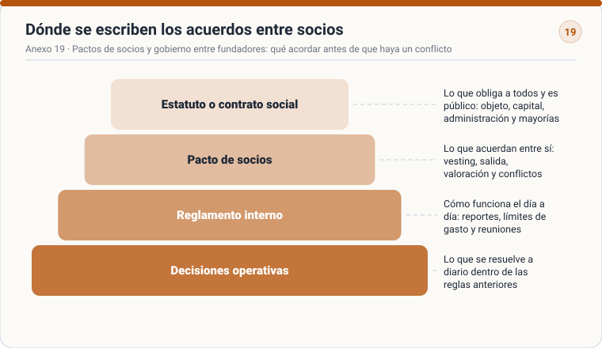
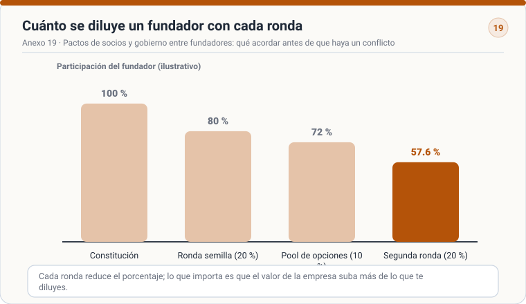
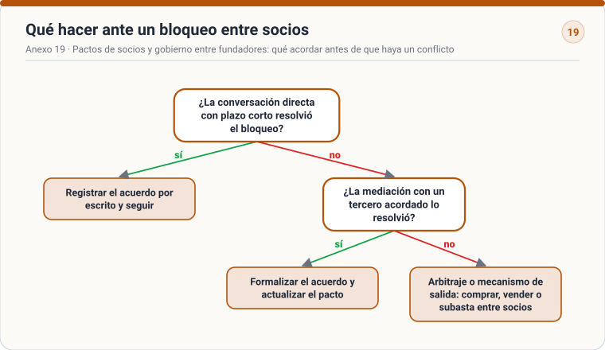
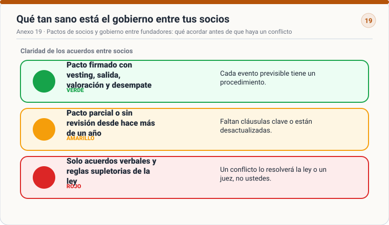
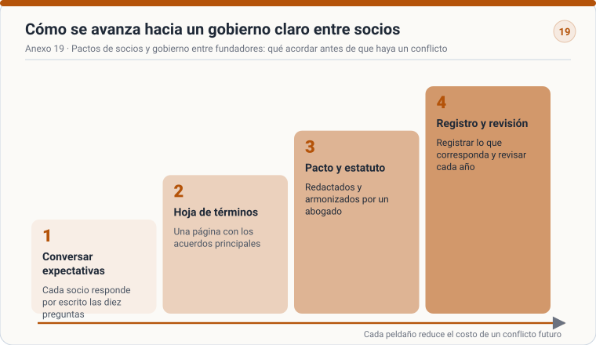

# Anexo 19 · Pactos de socios y gobierno entre fundadores: qué acordar antes de que haya un conflicto

> **Fecha de consulta de las fuentes:** 2026-11-25. **Naturaleza:** material educativo; no es asesoría
> legal ni tributaria. Los pactos son contratos a medida: este anexo explica qué decisiones conviene
> acordar y qué dice la ley cuando no acuerdas nada, pero **no entrega un modelo listo para firmar**. Separa
> **obligación legal**, **recomendación profesional** y **medida voluntaria**. Las cifras son ilustrativas.

<!-- anexos:nav-inicio -->

**Navegación:** [← 18. Domicilio, oficinas virtuales, coworking y otras formas de ubicar tu empresa](18-domicilio-oficinas-virtuales-y-coworking.md) · [Índice de anexos](README.md) · [20. Cambios de estructura: modificar, transformar, fusionar, dividir, vender y cerrar una empresa →](20-cambios-de-estructura-fusion-division-venta-y-cierre.md)

## En 60 segundos

- Sin pacto rigen las reglas supletorias del Código Civil y el estatuto, que rara vez calzan con lo que los fundadores creen haber acordado.
- Por defecto decide la mayoría, los cambios sustanciales requieren unanimidad y la muerte de un socio disuelve la sociedad salvo cláusula de continuación (arts. 2054 y 2103).
- En la SpA el estatuto puede fijar libremente derechos, administración y pactos (art. 424 del Código de Comercio).
- Los pactos sobre cesión de acciones deben depositarse o registrarse en ciertas sociedades para ser oponibles (Ley 18.046, art. 14; Ley 20.659, art. 13 bis).
- Las cláusulas que más se echan de menos son vesting, valoración de salida y mecanismo de desempate.

<!-- anexos:nav-fin -->

## 1. Ficha rápida

| Pregunta | Respuesta |
|---|---|
| ¿Qué es un pacto de socios? | Un contrato entre quienes son (o serán) dueños de una empresa que fija **cómo se toman decisiones, quién aporta qué, cómo entran y salen los socios y cómo se resuelven los conflictos**, más allá de lo que dice el estatuto. |
| ¿Es obligatorio? | No. Pero sin pacto rigen las **reglas supletorias de la ley** y el estatuto, que rara vez calzan con lo que los fundadores creen haber acordado. |
| ¿Por qué importa? | Porque la mayoría de los conflictos entre socios no surgen por mala fe, sino porque **nadie acordó** qué pasa si uno quiere salir, si no se ponen de acuerdo o si entra un inversionista. |
| ¿Cuándo hacerlo? | **Antes** de trabajar juntos, de aportar dinero o de recibir inversión. Después, cada acuerdo cuesta más. |
| ¿Quién lo redacta? | Los socios deciden; un **abogado corporativo** lo redacta y revisa, porque cada cláusula interactúa con el estatuto y con la ley. |
| ¿Se inscribe? | Depende del tipo social: el estatuto sí; el pacto puede ser privado, y en ciertas sociedades los pactos sobre cesión de acciones deben depositarse o registrarse para ser oponibles a terceros (ver sección 3). |
| ¿Sirve para sociedades limitadas? | Sí, con las reglas de su tipo; el contrato social ya es el pacto y puede completarse con acuerdos privados. |

## 2. El problema que resuelve

Tres amigos fundan una empresa con entusiasmo y un apretón de manos. Dos años después:

- uno trabaja a tiempo completo y los otros dos, a ratos, pero **los tres tienen el mismo porcentaje**;
- llega un inversionista que quiere el 20 % y **nadie sabe cuánto se diluye cada uno**;
- un socio quiere vender su parte a un tercero y **los demás no quieren a ese tercero**;
- hay dos grupos de igual poder que **no logran decidir** y la empresa se paraliza;
- un socio fallece y **sus herederos** reclaman su parte.

Ninguno de estos problemas es raro. Todos tienen una respuesta **si se acordó antes**; sin acuerdo, la respuesta la dan la ley supletoria o un juez, y suele no ser la que los socios habrían elegido.

> **Idea central:** un pacto de socios no es desconfianza, es **claridad**. Se escribe cuando todos están de buen ánimo para que sirva cuando alguien no lo esté.

## 3. Marco legal: qué dice la ley y qué puedes pactar

### 3.1. Mapa de normas

| Norma | Qué aporta | Qué verificar |
|---|---|---|
| Código Civil, arts. 2053 a 2115 | Reglas supletorias de la sociedad: mayorías, reparto, administración, renuncia, muerte, disolución | Se aplican si el contrato no dice otra cosa |
| Código de Comercio, art. 424 | En la SpA, el estatuto fija derechos y obligaciones, administración y demás pactos, que **salvo lo dispuesto en el párrafo, podrán ser establecidos libremente** | Libertad contractual amplia, con límites del párrafo |
| Código de Comercio, art. 427 | La modificación del estatuto de una SpA la acuerda la junta, con acta protocolizada, o la totalidad de los accionistas por escritura o instrumento protocolizado | Un pacto que cambia el estatuto debe seguir esta forma |
| Ley 20.659, art. 13 bis | En el Registro de Empresas y Sociedades, las cesiones de acciones, gravámenes y **pactos particulares relativos a cesión de acciones** se inscriben en el Registro de Accionistas | Si usas el sistema en línea, los pactos de cesión se registran allí |
| Ley 18.046 (anónimas), art. 14 | Los pactos entre accionistas sobre cesión de acciones deben depositarse en la compañía y mencionarse en el Registro de Accionistas, o serán inoponibles a terceros | Revisa el texto vigente para tu tipo social |

### 3.2. Obligación, recomendación, opción

| Medida | Clasificación | Fuente o criterio |
|---|---|---|
| Cumplir las menciones del estatuto de tu tipo social | Obligación | Ley del tipo social |
| Seguir la forma exigida para modificar el estatuto | Obligación | Código de Comercio, art. 427, y normas del tipo |
| Depositar o registrar los pactos de cesión cuando la ley lo exija | Obligación | Ley 18.046, art. 14, o Ley 20.659, art. 13 bis |
| Firmar un pacto de socios | Recomendación profesional | Evita las reglas supletorias |
| Incluir un mecanismo de salida y valoración | Recomendación profesional | Es lo que más se echa de menos |
| Pactar arbitraje o mediación | Opción | Reduce costos y tiempos de un conflicto |
| Ceder el pacto a nuevos socios | Opción | Se debe pactar expresamente |

### 3.3. La regla general: lo que no acuerdas, lo decide la ley

El Código Civil contiene reglas supletorias para la sociedad. Algunas que conviene conocer porque **cambian al pactar**:

| Tema | Regla supletoria | Artículo |
|---|---|---|
| Decisiones | Decide la mayoría de votos computada según el contrato; si nada se pactó, la mayoría numérica de socios | 2054 |
| Cambios sustanciales | Se requiere **unanimidad** para modificar sustancialmente el contrato, salvo pacto distinto | 2054 |
| Reparto de beneficios y pérdidas | A prorrata de los valores puestos en el fondo social; las pérdidas, a prorrata de los beneficios | 2068 |
| Socio industrial | Su cuota la fija el juez si no se pactó; en pérdidas, solo pierde su trabajo | 2069 |
| Aportes adicionales | Ningún socio está obligado a aportar más de lo pactado; quien no consiente puede retirarse | 2087 |
| Terceros | Ningún socio puede incorporar a un tercero sin consentimiento de los demás | 2088 |
| Muerte de un socio | La sociedad se disuelve, salvo cláusula de continuación | 2103 |
| Renuncia | Puede renunciar, con límites si la sociedad es de plazo fijo; no vale la renuncia de mala fe o intempestiva | 2108 a 2112 |
| Remoción del administrador | Solo por causa prevista o grave | 2072 |

> **Lo que muestra esta tabla:** las reglas supletorias son **razonables pero genéricas**. Un pacto las reemplaza por
> reglas pensadas para tu caso, por ejemplo, mayorías distintas para decisiones distintas o una cláusula de
> continuación con los herederos.

## 4. Dónde se escribe cada cosa: estatuto, pacto y reglamento

Los acuerdos entre socios pueden vivir en tres niveles. Elegir el nivel correcto evita que un acuerdo privado choque con el
estatuto público.

| Nivel | Qué contiene | Quién lo ve | Cómo se cambia |
|---|---|---|---|
| **Estatuto o contrato social** | Lo que la ley exige y lo que quieres que sea público y oponible a todos: nombre, objeto, capital, administración, mayorías | Público (registro) | Con las formalidades del tipo social |
| **Pacto de socios** | Acuerdos entre los socios: vesting, salida, no competencia, resolución de conflictos, confidencialidad | Privado (salvo lo que deba registrarse) | Por acuerdo de las partes, según el pacto |
| **Reglamento interno o políticas** | Cómo funciona el día a día: reportes, reuniones, límites de gasto | Interno | Por decisión de la administración o de los socios |
| **Decisiones operativas** | Lo que se resuelve a diario | Interno | Según las reglas anteriores |

**Regla práctica:** lo que debe obligar a la empresa frente a terceros, al **estatuto**; lo que obliga a los socios entre sí,
al **pacto**; lo operativo, al **reglamento**. Si un pacto contradice el estatuto, el conflicto puede resolverse a favor del
estatuto frente a terceros; por eso conviene que un abogado los armonice.

## 5. Las doce decisiones que conviene acordar

### 5.1. Capital y aportes

| Pregunta | Por qué importa |
|---|---|
| ¿Cuánto aporta cada socio y en qué forma (dinero, bienes, trabajo)? | Los aportes definen la participación inicial |
| ¿Cómo se valoran los aportes que no son dinero? | Evita disputas de valor |
| ¿Hay obligación de aportes futuros? | Por defecto nadie está obligado a aportar más (art. 2087) |
| ¿Qué pasa si un socio no aporta lo prometido? | Define sanciones o dilución |
| ¿Los aportes pueden ser préstamos de socios? | Tiene efectos contables y tributarios |

### 5.2. Roles y dedicación

Aclara por escrito quién hace qué, con cuánto tiempo y bajo qué remuneración. Un socio que trabaja a tiempo completo y otro
que solo aporta capital tienen contribuciones distintas; si no se reconocen, aparece el resentimiento.

| Tema | Ejemplo de acuerdo |
|---|---|
| Dedicación mínima | «Los socios fundadores trabajarán al menos [horas] semanales». |
| Cargo y funciones | «[Socio A] será gerente general; [Socio B], director de producto». |
| Remuneración | «Sueldos fijados por el directorio, con tope de [monto] hasta [hito]». |
| Exclusividad | «Los socios no desarrollarán actividades competidoras». |

### 5.3. Vesting: ganar la participación con el tiempo

El **vesting** significa que los socios fundadores **ganan** sus acciones o derechos de forma gradual, y no desde el primer
día. Protege a la empresa si un fundador se va pronto.

**Ejemplo ilustrativo.** Tres fundadores con 1.000 acciones cada uno, con vesting de 4 años y un **cliff** de 1 año:

| Momento | Acciones ganadas por fundador | Qué pasa si se va |
|---|---:|---|
| Mes 0 a 11 | 0 | No se queda con acciones |
| Mes 12 (cliff) | 250 (25 %) | Se queda con 250 |
| Mes 24 | 500 | Se queda con 500 |
| Mes 36 | 750 | Se queda con 750 |
| Mes 48 | 1.000 | Se queda con todas |

Las acciones no ganadas pueden ser recompradas por la sociedad o los demás socios a un precio pactado (por ejemplo, su valor
nominal). Acordarlo evita que un fundador que se va al segundo mes conserve un tercio de la empresa.

### 5.4. Decisiones y mayorías

Por defecto decide la mayoría y los cambios sustanciales requieren unanimidad (Código Civil, art. 2054). En un pacto se
suelen diferenciar tres niveles:

| Nivel | Ejemplos de materias | Mayoría sugerida (ilustrativa) |
|---|---|---|
| **Decisiones ordinarias** | Presupuesto, contratación habitual, gastos dentro del plan | Mayoría simple o decisión del administrador |
| **Decisiones relevantes** | Endeudamiento sobre un monto, contratos de largo plazo, nombramientos clave | Mayoría calificada (por ejemplo, dos tercios) |
| **Materias reservadas** | Cambio de objeto, aumento o reducción de capital, venta de la empresa, fusión, disolución, entrada de nuevos socios | Unanimidad o veto de ciertos socios |

### 5.5. Entrada de nuevos socios y dilución

Cuando entra capital nuevo, cada socio existente se diluye. El pacto debe decir **cómo se decide una nueva emisión** y si los
socios tienen **derecho de suscripción preferente** para mantener su porcentaje.

**Ejemplo ilustrativo de dilución.** Un fundador con el 100 % de 1.000 acciones:

| Etapa | Acciones totales | Participación del fundador |
|---|---:|---:|
| Constitución | 1.000 | 100 % |
| Ronda semilla: el inversionista compra el 20 % (250 acciones nuevas) | 1.250 | 80 % |
| Pool de opciones del 10 % post-ronda (139 acciones) | 1.389 | 72 % |
| Segunda ronda: otro inversionista compra el 20 % (347 acciones) | 1.736 | 57,6 % |

### 5.6. Transferencia de acciones

| Mecanismo | Idea | Cuándo sirve |
|---|---|---|
| **Derecho de preferencia** | Si un socio quiere vender, primero ofrece a los demás | Mantener el círculo cerrado |
| **Aprobación de nuevos socios** | Se requiere consentimiento para que entre un tercero (en sociedades de personas es la regla supletoria, art. 2088) | Evitar socios no deseados |
| **Tag-along (derecho de acompañamiento)** | Si un socio mayoritario vende, los minoritarios pueden vender en las mismas condiciones | Proteger minorías |
| **Drag-along (obligación de acompañar)** | Si se acuerda vender la empresa, todos venden | Facilitar una venta total |
| **Restricción temporal (lock-up)** | Nadie vende durante un período | Dar estabilidad al inicio |

### 5.7. Salida: renuncia, muerte, incapacidad y exclusión

| Evento | Regla supletoria | Qué conviene pactar |
|---|---|---|
| **Renuncia** | Es posible, con límites en sociedades de plazo fijo; no vale si es de mala fe o intempestiva (arts. 2108 a 2112) | Plazo de aviso, restricciones durante proyectos críticos, precio de salida |
| **Muerte** | La sociedad se disuelve salvo cláusula de continuación (art. 2103) | Continuación con herederos o con los sobrevivientes, y cómo se paga a los herederos |
| **Incapacidad o insolvencia** | La sociedad expira, pero puede continuar (art. 2106) | Continuación y valoración |
| **Incumplimiento grave** | Los demás pueden dar la sociedad por disuelta (art. 2101) | Causales de exclusión y procedimiento |
| **Divorcio o conflicto familiar de un socio** | No está regulado en el pacto por defecto | Cómo proteger la participación frente a cambios de régimen de bienes |

### 5.8. Valoración de la salida

Fijar **cómo se valora** una participación al salir es una de las cláusulas más importantes.

| Método | Descripción | Ventaja | Riesgo |
|---|---|---|---|
| **Valor libro** | Patrimonio contable proporcional | Simple | Subvalora empresas que crecen |
| **Múltiplo de resultados o ingresos** | Valor según un múltiplo pactado | Objetivo si el múltiplo está claro | Se discute el múltiplo |
| **Tasación independiente** | Un perito valora | Neutral | Costo y plazo |
| **Fórmula con descuento** | Descuento si el socio sale por incumplimiento | Desincentiva el abandono | Debe pactarse con cuidado |
| **Última ronda de inversión** | Precio de la última ronda | Referencia de mercado | Puede no reflejar la realidad actual |

**Ejemplo ilustrativo.** Un socio con 25 % se va. Se acordó valorar a **cuatro veces el resultado operacional del último
año**. Si el resultado operacional fue 30.000.000 de pesos, la empresa se valora en 120.000.000 y su parte es
30.000.000 de pesos. Si el pacto dice que quien sale por incumplimiento recibe el 70 % del valor, recibiría 21.000.000.

## 6. Conflictos: empates, bloqueos y cómo resolverlos

### 6.1. El empate 50/50

Dos socios con el 50 % cada uno pueden quedar paralizados. Conviene decidir de antemano qué mecanismo se usa:

| Mecanismo | Cómo funciona | Cuidado |
|---|---|---|
| **Voto dirimente** | Un cargo (por ejemplo, el presidente) desempata | Concentra poder en una persona |
| **Mediación** | Un tercero neutral facilita un acuerdo | No obliga, pero ordena |
| **Árbitro o panel** | Un tercero decide con efecto vinculante | Costo y confidencialidad |
| **Comprar o vender** | Un socio fija un precio y el otro decide si compra o vende a ese precio | Puede favorecer al socio con más caja |
| **Subasta entre socios** | Cada uno ofrece por la parte del otro | Reglas claras de plazos y pago |
| **Disolución ordenada** | Si fracasa todo, se liquida | Último recurso |

### 6.2. Escalera de resolución

1. **Conversación directa** con un plazo corto.
2. **Mediación** con un tercero acordado.
3. **Arbitraje o tribunal**, según lo pactado.
4. **Mecanismo de salida** (compra, venta o subasta).

Pactar la escalera evita que cada conflicto parta en un juicio. Una cláusula de resolución de conflictos debe fijar **quién
decide, en qué plazo y con qué reglas de costos**.

## 7. Confidencialidad, competencia y propiedad intelectual

| Tema | Qué pactar | Cuidado |
|---|---|---|
| **Confidencialidad** | Qué información es reservada, por cuánto tiempo y con qué excepciones | Debe ser razonable |
| **No competencia** | Que un socio no compita mientras lo sea y durante un período razonable después | Una restricción excesiva puede ser discutible; consulta a un abogado |
| **No captación** | No llevarse clientes ni trabajadores al salir | Plazo y ámbito razonables |
| **Propiedad intelectual** | Que lo creado para la empresa pertenece a la empresa; cesión de derechos de los fundadores | Registrar y documentar las cesiones |
| **Uso de la marca** | Quién puede usarla y cuándo cesa el derecho | Alinear con registros de marca |

> **Regla práctica:** si un fundador desarrolló el producto antes de crear la empresa, **cede por escrito** los derechos a
> la sociedad. De lo contrario, la empresa podría no ser dueña de su activo principal (ver el manual de activos y registros).

## 8. Cómo formalizar y registrar el pacto

| Paso | Qué hacer | Evidencia |
|---|---|---|
| 1 | Acordar los términos principales en una hoja de términos | Hoja de términos firmada |
| 2 | Redactar el pacto con un abogado y armonizarlo con el estatuto | Borrador revisado |
| 3 | Firmar el pacto con todos los socios (incluidos los futuros, mediante adhesión) | Pacto firmado y fecha |
| 4 | Modificar el estatuto si hay materias que deben ser públicas, siguiendo la forma legal (por ejemplo, art. 427 del Código de Comercio en una SpA) | Escritura o acta protocolizada y extracto |
| 5 | Depositar o registrar los pactos de cesión cuando la ley lo exija (Ley 18.046, art. 14; Ley 20.659, art. 13 bis) | Certificado de depósito o inscripción |
| 6 | Guardar copias y registrar los cambios | Carpeta de gobierno |
| 7 | Revisar el pacto cada año y ante hitos (inversión, nuevo socio) | Acta de revisión |

## 9. Pactos según el tipo de sociedad

| Tipo | Libertad para pactar | Particularidades |
|---|---|---|
| **SpA** | Muy amplia: el estatuto fija derechos, administración y demás pactos que pueden establecerse libremente (art. 424) | Ideal para inversión; la modificación sigue el art. 427 |
| **Limitada** | Amplia en el contrato social | Cambios del contrato requieren la forma legal; reglas supletorias del Código Civil |
| **Anónima cerrada** | Más reglada por la ley de sociedades anónimas | Pactos de cesión con depósito y mención en el registro (art. 14 de la Ley 18.046) |
| **Colectiva y comandita** | Reglas del Código de Comercio y supletorias del Código Civil | Revisar la responsabilidad de cada socio (anexos 04 y 05) |
| **EIRL** | No aplica pacto de socios (un solo titular) | Si entra un socio, se debe transformar en sociedad |

## 10. Pactos cuando entra un inversionista

Un inversionista suele pedir derechos adicionales a cambio de su capital. Conviene conocerlos para negociarlos con calma. Son
**ideas habituales**, no una lista de lo que debas aceptar.

| Derecho | Qué significa | Qué preguntar |
|---|---|---|
| **Preferencia de liquidación** | Al vender o liquidar la empresa, el inversionista recupera primero su aporte (o un múltiplo) antes de repartir al resto | ¿Es de una vez el aporte o múltiplos? ¿Participa además del reparto? |
| **Antidilución** | Protege al inversionista si luego se emiten acciones a un precio menor | ¿Qué tipo de ajuste y cuándo se activa? |
| **Derecho de información** | Acceso a estados financieros y reportes periódicos | ¿Con qué frecuencia y detalle? |
| **Lugar en el directorio** | Un director designado por el inversionista | ¿Cuántos puestos, y con qué mayorías? |
| **Materias reservadas** | Veto sobre decisiones importantes | ¿Qué umbrales y qué plazo de respuesta? |
| **Derecho de preferencia** | Participar en rondas futuras para no diluirse | ¿Hasta qué porcentaje? |
| **Acompañamiento y arrastre** | Tag-along y drag-along | ¿Qué precio mínimo activa el arrastre? |
| **Restricciones de uso de fondos** | Qué se puede financiar con el aporte | ¿Qué gastos requieren autorización? |

**Ejemplo ilustrativo de preferencia de liquidación.** Un inversionista aporta 100.000.000 de pesos por el 20 % con
preferencia de una vez su aporte. La empresa se vende en 300.000.000.

| Concepto | Sin preferencia | Con preferencia de 1x no participativa |
|---|---:|---:|
| Inversionista (20 %) | 60.000.000 | 100.000.000 (recupera su aporte primero) |
| Resto de los socios (80 %) | 240.000.000 | 200.000.000 |

Con la preferencia, los fundadores reciben 40.000.000 menos que con un reparto simple. En una venta mayor, el inversionista
preferiría convertir sus acciones y recibir su 20 %. Es otra razón para negociar los términos con asesoría.

## 11. Un ejemplo de hoja de términos completada

Tres fundadores —Ana, Bruno y Carla— crean una SpA de software. **Ejemplo ilustrativo**:

| Tema | Acuerdo |
|---|---|
| Participación inicial | Ana 40 %, Bruno 35 %, Carla 25 %, según capital y dedicación acordadas |
| Aportes | Ana: 20.000.000 de pesos; Bruno: 10.000.000 y el prototipo, tasado en 15.000.000; Carla: 5.000.000 y trabajo |
| Roles | Ana, gerente general; Bruno, tecnología; Carla, ventas, todos a tiempo completo desde el mes 3 |
| Vesting | 4 años, con cliff de 12 meses; acciones no ganadas se recompran a su valor nominal |
| Decisiones ordinarias | Las toma el gerente general dentro del presupuesto anual |
| Decisiones relevantes | Endeudamiento sobre 20.000.000, contratos de más de dos años: mayoría de dos tercios |
| Materias reservadas | Cambio de objeto, venta, fusión, aumento de capital, nuevos socios: unanimidad |
| Transferencia | Derecho de preferencia de los demás socios; lock-up de dos años |
| Fallecimiento | La sociedad continúa; los herederos reciben el valor de la participación según el método pactado, en cuotas |
| Valoración de salida | Promedio entre un múltiplo de 4 veces el resultado operacional y una tasación independiente |
| Conflictos | Mediación en 30 días; luego arbitraje |
| Confidencialidad y propiedad intelectual | Todo lo creado para la empresa pertenece a la empresa; cesión escrita de Bruno por el prototipo |
| Revisión | Anual y ante cada ronda |

**Qué muestra el ejemplo.** Los porcentajes (40/35/25) reflejan capital y dedicación, no un reparto parejo; el aporte en
especie de Bruno está tasado y cedido por escrito; y existe un procedimiento para cada evento previsible.

## 12. Aprender del conflicto: señales de alerta

| Señal | Qué suele indicar | Qué hacer |
|---|---|---|
| Las reuniones terminan sin decisiones | Falta de mecanismo de desempate o de roles | Activar mediación y revisar el pacto |
| Un socio decide solo | Falta de límites de autoridad | Definir montos y materias |
| Se evita hablar de dinero | Expectativas no alineadas | Reunión específica con cifras |
| Se discute la «propiedad» de lo creado | Falta de cesión de derechos | Cesión escrita |
| Un socio se desentiende | Dedicación sin acuerdo | Reconocer o ajustar participación |
| Aparece un tercero que «aconseja» a un socio | Intereses cruzados | Transparentar y reglas de relacionados |

### 12.1. Diez preguntas que cada socio debería responder por escrito antes de firmar

Pídele a cada socio que responda **por separado**, sin consultar a los demás, y compara las respuestas en una reunión. Las
diferencias que aparezcan son exactamente lo que hay que acordar.

1. ¿Cuánto tiempo semanal puedo dedicar durante los próximos dos años, y cuánto dinero puedo aportar sin poner en riesgo mi
   situación personal?
2. ¿Qué espero de la empresa en tres años: un sueldo, una venta, una empresa estable o un crecimiento acelerado?
3. ¿Qué haría si la empresa necesitara más dinero y yo no pudiera aportar?
4. ¿Qué haría si uno de nosotros quisiera irse en el primer año?
5. ¿Aceptaría que entrara un inversionista que exigiera ceder el control de ciertas decisiones?
6. ¿Qué decisiones considero que nunca deberían tomarse sin mi acuerdo?
7. ¿Cuánto vale mi aporte de trabajo o de conocimiento y cómo debería reconocerse?
8. ¿Qué pasaría con mi parte si me enfermo o falleciera?
9. ¿Qué actividad paralela tengo o planeo tener que podría competir con la empresa?
10. ¿Qué información personal o familiar podría afectar mi participación (por ejemplo, un cambio de régimen de bienes) y
    cómo quiero protegerla?

### 12.2. Cuándo conviene no asociarse

No toda relación de amistad o de confianza debería convertirse en sociedad. Conviene replantearlo cuando:

- no hay acuerdo ni siquiera sobre las preguntas anteriores y nadie quiere ceder;
- uno de los socios aporta únicamente una idea sin trabajo ni capital y espera una participación grande;
- alguno necesita ingresos inmediatos que la empresa no podrá darle durante un tiempo y no hay un plan para ello;
- hay una relación de poder desigual, como un socio que es además jefe, cliente o acreedor de los demás;
- existe una actividad competidora no declarada.

En esos casos, pueden ser mejores alternativas un contrato de servicios, un contrato de colaboración con plazo, una comisión
por resultados o una participación que se gane con hitos. Una conversación franca antes de constituir la sociedad cuesta
mucho menos que una disputa después, y un abogado corporativo puede ayudarte a diseñar una alternativa a la medida.

---

## 13. Siete escenarios resueltos

> Casos **ilustrativos**, con nombres y cifras inventados. No son asesoría.

### 13.1. El fundador que se fue al mes tres

**Situación.** Tres amigos tienen 33,3 % cada uno, sin pacto. Uno se va a los tres meses y exige conservar su parte.

**Análisis.** Sin pacto no hay vesting ni recompra: el socio conserva su participación, aunque ya no aporte. La renuncia
puede ser válida y el socio sigue siendo dueño de sus derechos.

**Decisión.** Negociar una recompra y firmar un pacto con vesting para el futuro.

### 13.2. El inversionista y las materias reservadas

**Situación.** Un inversionista entra con el 20 % y pide poder de veto sobre endeudamiento mayor a 50.000.000 de pesos.

**Análisis.** Es una materia reservada típica. Debe constar en el estatuto o pacto, con umbrales claros, para no paralizar la
operación diaria.

**Decisión.** Aceptar el veto con un monto razonable y un procedimiento de respuesta rápida (por ejemplo, 10 días).

### 13.3. El socio que fallece

**Situación.** Una sociedad de dos socios queda con uno tras el fallecimiento del otro.

**Análisis.** Por defecto, la sociedad se disuelve por la muerte de un socio salvo cláusula de continuación (Código Civil, art.
2103). Los herederos solo pueden reclamar lo que correspondía al causante según el estado de los negocios al saberse la muerte
(art. 2105).

**Decisión.** Un pacto que prevea la continuación y la forma de pagar a los herederos evita una disolución no deseada.

### 13.4. El 50/50 bloqueado

**Situación.** Dos socios se enfrentan por la dirección estratégica. No hay mecanismo de desempate.

**Análisis.** Sin cláusula, el conflicto puede escalar a juicio, con costos y tiempo. Un mecanismo de mediación y comprar o
vender habría ordenado el proceso.

**Decisión.** Proponer mediación inmediata y, si no funciona, un procedimiento de compra de la parte de uno.

### 13.5. El aporte en especie sin valorar

**Situación.** Un socio aportó su software «por 30 %» sin tasación.

**Análisis.** La falta de valoración abre disputas. Además, debe haber cesión escrita de los derechos.

**Decisión.** Tasar el aporte, documentar la cesión y ajustar la participación si corresponde.

### 13.6. El socio que quiere vender a un tercero

**Situación.** Un socio con 30 % ofrece su parte a una persona externa.

**Análisis.** En sociedades de personas, ningún socio puede incorporar a un tercero sin el consentimiento de los demás (Código
Civil, art. 2088). En una SpA o una anónima, la libre cesión es la regla salvo restricciones pactadas, y los pactos deben
registrarse para ser oponibles.

**Decisión.** Pactar derecho de preferencia y aprobación de nuevos socios.

### 13.7. La renuncia en medio de un proyecto

**Situación.** Un socio clave renuncia mientras la empresa negocia un contrato importante.

**Análisis.** La renuncia intempestiva, cuando la separación perjudica los intereses sociales, no vale y la sociedad continúa
hasta terminar los negocios pendientes que requieran su cooperación (Código Civil, arts. 2110 y 2112).

**Decisión.** Acordar plazos de aviso y obligaciones durante proyectos críticos.

## 14. Catálogo de quince errores frecuentes

| N.º | Error | Consecuencia | Cómo evitarlo |
|---:|---|---|---|
| 1 | No tener pacto | Rigen reglas supletorias genéricas | Firmar antes de operar |
| 2 | Repartir 33/33/33 sin reconocer aportes distintos | Resentimiento | Reconocer dedicación y capital |
| 3 | Sin vesting | Un fundador que se va se queda con todo | Vesting y recompra |
| 4 | Sin valoración de salida | Disputas de precio | Fórmula acordada |
| 5 | Sin mecanismo de desempate | Parálisis | Mediación o voto dirimente |
| 6 | Mayoría única para todo | Decisiones menores bloqueadas o mayores vulnerables | Tres niveles de decisión |
| 7 | Aportes en especie sin cesión escrita | La empresa no es dueña del activo | Cesión y tasación |
| 8 | Pacto que contradice el estatuto | Inoponibilidad o conflicto | Armonizar con abogado |
| 9 | No registrar pactos de cesión cuando corresponde | Inoponible a terceros | Depósito o inscripción |
| 10 | Olvidar a los herederos | Disolución o disputas | Cláusula de continuación |
| 11 | No prever nuevas rondas | Dilución desordenada | Preferencia y reglas de emisión |
| 12 | Cláusula de no competencia excesiva | Posible nulidad parcial | Redacción razonable |
| 13 | No actualizar el pacto | Obsolescencia | Revisión anual |
| 14 | No documentar decisiones | Prueba débil | Actas y registros |
| 15 | Mezclar vida personal y empresa | Conflictos de interés | Reglas de operaciones con relacionados |

## 15. Plantillas y listas de trabajo

### 15.1. Hoja de términos del pacto (una página)

| Tema | Acuerdo |
|---|---|
| Socios y porcentajes | |
| Aportes y valoración | |
| Roles y dedicación | |
| Vesting (años y cliff) | |
| Decisiones: tres niveles y mayorías | |
| Materias reservadas | |
| Nuevas emisiones y preferencia | |
| Transferencia: preferencia, tag, drag, lock-up | |
| Salida: renuncia, muerte, incapacidad, incumplimiento | |
| Valoración de la salida | |
| Resolución de conflictos | |
| Confidencialidad, no competencia, propiedad intelectual | |
| Revisión del pacto | |

### 15.2. Plan de 30, 60 y 90 días

| Plazo | Tareas | Responsable | Evidencia |
|---|---|---|---|
| Días 1 a 15 | Cada socio escribe sus expectativas; se acuerda la hoja de términos | Socios | Hoja de términos |
| Días 16 a 45 | Redacción y revisión del pacto y del estatuto | Abogado | Borradores |
| Días 46 a 60 | Firma, formalización y registros | Socios y abogado | Pacto firmado y certificados |
| Días 61 a 90 | Reglas operativas, calendario de revisión y carpeta de gobierno | Administración | Reglamento y calendario |

### 15.3. Calendario anual de gobierno

| Cuándo | Tarea |
|---|---|
| Cada trimestre | Reunión de socios con cifras y decisiones pendientes |
| Cada año | Revisar el pacto, vesting, valoraciones y registros |
| Antes de una ronda | Revisar dilución, derechos preferentes y materias reservadas |
| Ante un nuevo socio | Adhesión al pacto y actualización de registros |
| Ante la salida de un socio | Aplicar el procedimiento pactado |

### 15.4. Lista de control antes de firmar

| Ítem | Sí | No |
|---|---|---|
| Todos los socios entienden cada cláusula | | |
| Hay mecanismo de desempate | | |
| Hay vesting y recompra | | |
| Hay fórmula de valoración de salida | | |
| Hay cláusula de continuación por fallecimiento | | |
| El pacto es coherente con el estatuto | | |
| Los registros legales están al día | | |

## 16. Cuándo llamar a un profesional

| Situación | Profesional |
|---|---|
| Redactar el pacto y armonizarlo con el estatuto | Abogado corporativo |
| Valorar la empresa o aportes | Perito, contador o asesor financiero |
| Efectos tributarios de aportes, ventas y opciones | Asesor tributario |
| Conflicto entre socios | Mediador y abogado |
| Entrada de inversionistas | Abogado corporativo y tributario |

Para más detalle, usa la [guía de cuándo llamar a un profesional](../docs/18_WHEN_TO_CALL_A_PROFESSIONAL.md).

## 17. Preguntas frecuentes

**1. ¿Es obligatorio firmar un pacto de socios?**
No, pero sin pacto rigen las reglas supletorias de la ley y el estatuto, que pueden no coincidir con lo que quieren los socios.

**2. ¿Un pacto puede contradecir el estatuto?**
Puede generar conflicto, y frente a terceros suele prevalecer el estatuto; por eso un abogado debe armonizarlos.

**3. ¿Qué es el vesting?**
Un mecanismo por el cual los fundadores ganan sus acciones o derechos de forma gradual, normalmente con un período inicial
(cliff).

**4. ¿Qué es el cliff?**
Un período mínimo (por ejemplo, un año) antes del cual no se gana ninguna participación.

**5. ¿Qué es el tag-along?**
Un derecho de los socios minoritarios a vender en las mismas condiciones cuando el mayoritario vende.

**6. ¿Qué es el drag-along?**
La obligación de los minoritarios de vender si se acuerda la venta de la empresa en ciertas condiciones.

**7. ¿Qué pasa si un socio fallece sin pacto?**
Por defecto la sociedad se disuelve, salvo cláusula de continuación (Código Civil, art. 2103).

**8. ¿Puedo obligar a un socio a aportar más dinero?**
Por defecto no: a ningún socio puede exigírsele un aporte mayor al pactado, y quien no consiente puede retirarse (art. 2087).

**9. ¿Cómo se distribuyen las utilidades si no pactamos nada?**
A prorrata de los valores puestos en el fondo social (art. 2068).

**10. ¿Qué mayoría se necesita para modificar el contrato?**
Por defecto, unanimidad para modificaciones sustanciales (art. 2054), salvo pacto distinto.

**11. ¿El pacto se inscribe?**
No necesariamente; pero los pactos de cesión de acciones deben depositarse o registrarse en ciertas sociedades para ser
oponibles (Ley 18.046, art. 14; Ley 20.659, art. 13 bis).

**12. ¿Puede un socio vender sin autorización?**
Depende del tipo social y de lo pactado; en las sociedades de personas se requiere consentimiento (art. 2088).

**13. ¿Qué es una materia reservada?**
Una decisión que requiere mayoría reforzada, unanimidad o el voto de ciertos socios.

**14. ¿Cómo se valora una participación al salir?**
Según el método pactado: valor libro, múltiplo, tasación independiente o fórmula con descuento.

**15. ¿Cuánto cuesta un pacto?**
Este anexo no fija precios; pide estimaciones por escrito a abogados corporativos.

**16. ¿Un pacto vale para nuevos socios?**
Solo si adhieren expresamente; incluye una cláusula de adhesión obligatoria.

**17. ¿Puedo pactar arbitraje?**
Sí, es habitual; define quién arbitra, dónde y con qué reglas de costos.

**18. ¿Qué hago si ya hay conflicto y no hay pacto?**
Busca mediación y asesoría legal; luego formaliza un acuerdo de salida o de gobierno.

**19. ¿Una cláusula de no competencia siempre es válida?**
No siempre; debe ser razonable en tiempo, ámbito y actividad. Consulta a un abogado.

**20. ¿Cuándo llamar a un profesional?**
Antes de firmar el pacto, al entrar inversionistas y ante cualquier conflicto entre socios.

## 18. Fuentes y vigencia

**Fecha de consulta de las fuentes:** 2026-11-25.

| Fuente | Qué contiene | Enlace |
|---|---|---|
| Código Civil, arts. 2053 a 2115 | Reglas supletorias de la sociedad | [BCN, Código Civil](https://www.bcn.cl/leychile/navegar?idNorma=172986) |
| Código de Comercio, arts. 424 a 428 | Sociedad por acciones y libertad de pactos | [BCN, Código de Comercio](https://www.bcn.cl/leychile/navegar?idNorma=1974) |
| Ley 20.659, arts. 13 bis y 14 | Registro de Accionistas y modificaciones en el Registro de Empresas | [BCN, Ley 20.659](https://www.bcn.cl/leychile/navegar?idNorma=1048718) |
| Ley 18.046, art. 14 | Pactos sobre cesión de acciones en sociedades anónimas | [BCN, Ley 18.046](https://www.bcn.cl/leychile/navegar?idNorma=29473) |
| Ley 3.918 | Sociedades de responsabilidad limitada | [BCN, Ley 3.918](https://www.bcn.cl/leychile/navegar?idNorma=24349) |
| Guía del programa | Cuándo llamar a un profesional | [Guía](https://github.com/vladimiracunadev-create/modern-business-creation-program/blob/main/docs/18_WHEN_TO_CALL_A_PROFESSIONAL.md) |

**Vigencia.** Las leyes se leyeron en la versión publicada por la Biblioteca del Congreso Nacional. No se leyó el texto
íntegro de la Ley 18.046; la referencia a su art. 14 proviene del análisis del anexo 08. Los modelos de cláusulas son
ideas de redacción, no textos listos para firmar.

**Límites.** Este anexo no reemplaza la asesoría de un abogado; no recomienda proveedores; no fija precios y sus cifras son
ilustrativas.

<!-- anexos:cierre-inicio -->

## Para seguir leyendo

- [Anexo 03. Sociedad de Responsabilidad Limitada (Ltda.)](03-sociedad-de-responsabilidad-limitada-ltda.md): sociedad limitada y su contrato social.
- [Anexo 06. Sociedad por Acciones (SpA)](06-sociedad-por-acciones-spa.md): SpA: la libertad de pactos.
- [Anexo 07. Sociedad Anónima Cerrada (S.A.)](07-sociedad-anonima-cerrada.md): anónima cerrada y sus pactos.
- [Anexo 11. Sociedad Civil (Código Civil)](11-sociedad-civil.md): reglas supletorias de la sociedad civil.
- [Anexo 15. Empresa en un Día: el Registro de Empresas y Sociedades](15-empresa-en-un-dia-registro-de-empresas-y-sociedades.md): registro de accionistas y poderes en línea.
- [Anexo 20. Cambios de estructura: modificar, transformar, fusionar, dividir, vender y cerrar una empresa](20-cambios-de-estructura-fusion-division-venta-y-cierre.md): cuando hay que salir, vender o transformar.

**Navegación:** [← 18. Domicilio, oficinas virtuales, coworking y otras formas de ubicar tu empresa](18-domicilio-oficinas-virtuales-y-coworking.md) · [Índice de anexos](README.md) · [20. Cambios de estructura: modificar, transformar, fusionar, dividir, vender y cerrar una empresa →](20-cambios-de-estructura-fusion-division-venta-y-cierre.md)

<!-- anexos:cierre-fin -->
