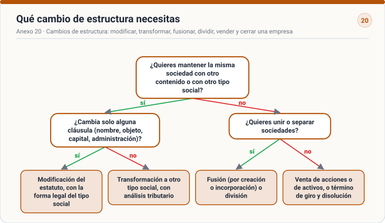
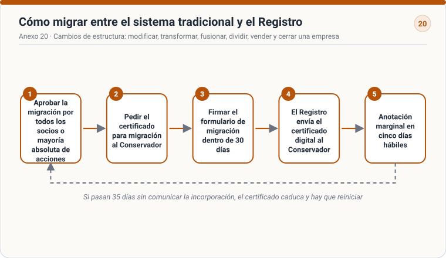
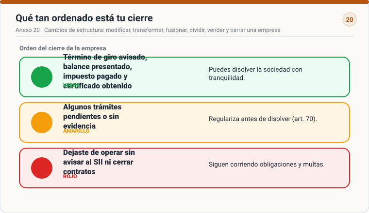
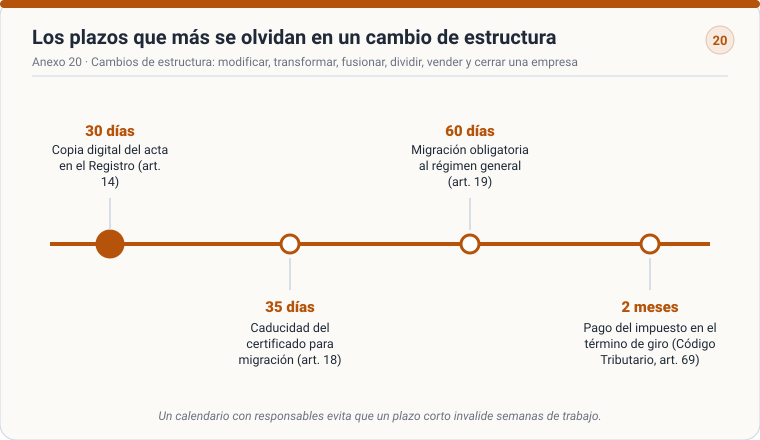
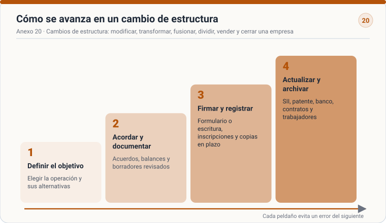

# Anexo 20 · Cambios de estructura: modificar, transformar, fusionar, dividir, vender y cerrar una empresa

> **Fecha de consulta de las fuentes:** 2026-11-25. **Naturaleza:** material educativo; no es asesoría
> legal ni tributaria. Cada operación societaria tiene efectos legales, tributarios, laborales y contables que
> dependen de tu caso: este anexo ordena las preguntas y los pasos generales, **no reemplaza a un abogado ni a un
> contador**. Separa **obligación legal**, **recomendación profesional** y **medida voluntaria**. Las cifras son
> ilustrativas.

<!-- anexos:nav-inicio -->

**Navegación:** [← 19. Pactos de socios y gobierno entre fundadores: qué acordar antes de que haya un conflicto](19-pactos-de-socios-y-gobierno-entre-fundadores.md) · [Índice de anexos](README.md) · [21. Insolvencia: reorganización, liquidación y cómo actuar a tiempo (Ley 20.720) →](21-insolvencia-reorganizacion-y-liquidacion.md)

## En 60 segundos

- En el Registro de Empresas, modificar, transformar, fusionar, dividir, terminar y disolver se hace con la sola suscripción del formulario (Ley 20.659, art. 14).
- La copia digital del acta debe subirse dentro de 30 días corridos; el certificado de migración caduca a los 35 días (arts. 14 y 18).
- Los cambios de dominio de la empresa no alteran los derechos de los trabajadores, que continúan con el nuevo empleador (Código del Trabajo, art. 4).
- Para disolver una sociedad se exige un certificado del SII de tributos al día; el término de giro se paga en dos meses (Código Tributario, arts. 69 y 70).
- Quien compra un negocio es fiador de las obligaciones tributarias del vendedor correspondientes a lo adquirido (art. 71).

<!-- anexos:nav-fin -->

## 1. Ficha rápida

| Pregunta | Respuesta |
|---|---|
| ¿De qué trata? | De las operaciones con las que una empresa **cambia su forma o su dueño**: modificar estatutos, transformarse en otro tipo de sociedad, fusionarse, dividirse, migrar de sistema registral, vender acciones o activos, y terminar o disolverse. |
| ¿Por qué importa? | Porque cada operación exige una **forma legal**, tiene **efectos tributarios y laborales** y, mal hecha, puede viciarse de nulidad o dejar obligaciones sin cerrar. |
| ¿Qué dice la ley sobre las sociedades en línea? | Las personas jurídicas acogidas a la Ley 20.659 se modifican, transforman, fusionan, dividen, terminan y disuelven con la **sola suscripción del formulario** y su incorporación al Registro (art. 14). |
| ¿Y si no estoy en el sistema en línea? | Rigen las formalidades de la ley propia de cada tipo social (escritura, extracto, inscripción, publicación). |
| ¿Cambia la situación de los trabajadores? | Las modificaciones del dominio, posesión o mera tenencia de la empresa **no alteran los derechos y obligaciones de los trabajadores**, que continúan con el nuevo empleador (Código del Trabajo, art. 4). |
| ¿Y los impuestos? | Para terminar el giro hay que avisar al SII, presentar el balance de término y pagar en dos meses; para disolver una sociedad se exige un certificado de tributos al día (Código Tributario, arts. 69 y 70). |
| ¿Quién interviene? | Abogado corporativo, contador y asesor tributario; en ventas, también el comprador y su asesor. |

## 2. El mapa de operaciones

| Operación | Qué es | Cuándo se piensa |
|---|---|---|
| **Modificación del estatuto** | Cambiar nombre, objeto, capital, administración u otras cláusulas | La empresa evoluciona |
| **Transformación** | Cambiar de tipo social (por ejemplo, de limitada a SpA) conservando la persona jurídica | Llega un inversionista o se quiere más flexibilidad |
| **Fusión** | Dos o más sociedades se unen: por creación (nace una nueva) o por incorporación (una absorbe a otra) | Integrar negocios o simplificar un grupo |
| **División** | Una sociedad se separa en dos o más, repartiendo su patrimonio | Separar negocios o riesgos |
| **Migración registral** | Pasar del sistema tradicional al Registro en línea o viceversa | Simplificar trámites futuros |
| **Venta de acciones o derechos** | Los socios venden su participación | Entrada o salida de socios, venta de la empresa |
| **Venta de activos o de un establecimiento** | La sociedad vende bienes o una unidad de negocio | Vender solo una parte |
| **Término de giro** | Informar al SII que se terminó la actividad | La actividad cesa |
| **Disolución y liquidación** | La sociedad deja de existir y se reparte su patrimonio | Cierre definitivo |

> **Distinción clave:** vender **las acciones** cambia al dueño, pero la empresa sigue siendo la misma (con todas sus
> deudas y contratos); vender **los activos** deja la sociedad con el dinero y las deudas, y el comprador recibe solo lo que
> compra. Elegir entre una y otra es una decisión legal, tributaria y comercial.

## 3. Marco legal

### 3.1. Mapa de normas

| Norma | Qué aporta | Qué verificar |
|---|---|---|
| Ley 20.659, arts. 14 a 19 | Formularios para modificar, transformar, fusionar, dividir, terminar y disolver; fusión con sociedades no acogidas; saneamiento de nulidad; migración | Texto vigente y Reglamento |
| Código de Comercio, art. 427 | Modificación del estatuto de una SpA por junta o por unanimidad con escritura | Forma de acta y extracto |
| Código Civil, arts. 2098 a 2115 | Disolución de la sociedad, renuncia, muerte y partición del haber | Aplica en lo supletorio |
| Código Tributario, arts. 69 a 71 | Término de giro, certificado para disolver y responsabilidad del adquirente | Plazos y procedimiento |
| Código del Trabajo, art. 4 | Continuidad de los derechos de los trabajadores ante cambios de dominio o posesión | Revisar reglas de término por necesidades de la empresa |
| Ley de cada tipo social | Quórums, derechos de los socios disidentes, publicaciones | Revisar el anexo del tipo |

### 3.2. Obligación, recomendación, opción

| Medida | Clasificación | Fuente o criterio |
|---|---|---|
| Seguir la forma legal de cada operación | Obligación | Ley del tipo social o Ley 20.659 |
| Incorporar al Registro copia del acta dentro de 30 días corridos | Obligación | Ley 20.659, art. 14 |
| Pedir certificado del SII de tributos al día para disolver | Obligación | Código Tributario, art. 70 |
| Avisar el término de giro con balance y pagar en dos meses | Obligación | Código Tributario, art. 69 |
| Hacer una auditoría legal y tributaria antes de comprar o fusionar | Recomendación profesional | Evita pasivos ocultos |
| Revisar el efecto laboral de cada operación | Recomendación profesional | Código del Trabajo, art. 4 |
| Valorar la empresa con un tercero independiente | Opción | Reduce disputas |

## 4. Las operaciones con el Registro de Empresas y Sociedades (Ley 20.659)

### 4.1. La regla general (art. 14)

Las personas jurídicas acogidas a la ley **se modifican, transforman, fusionan, dividen, terminan y disuelven mediante la sola
suscripción del formulario respectivo** y su incorporación al Registro. Lo suscriben los titulares de los derechos sociales o
de las acciones con derecho a voto **al tiempo de celebrarse el acto**, o sus apoderados o representantes.

| Paso | Qué ocurre | Dato clave |
|---|---|---|
| 1 | Se toma el acuerdo (por junta o por unanimidad según el tipo) | Si hay junta, el acta debe reducirse a escritura pública o protocolizarse |
| 2 | Se completa el formulario con las nuevas cláusulas, indicando las que se modifican o sustituyen | Debe señalar las cláusulas nuevas |
| 3 | Firman los accionistas que concurrieron al acta o un representante designado | Los que firmaron el acta **no pueden negarse** a suscribir el formulario |
| 4 | Se incorpora una copia digital íntegra del acta o de su escritura | Plazo máximo de **30 días corridos** desde la junta |
| 5 | El formulario se incorpora al Registro | La sociedad queda modificada |

**Excepción útil.** No se requiere que la junta se celebre ante notario ni que el acta se reduzca a escritura si **la
totalidad de los accionistas** (y los gestores en las comanditas por acciones) suscriben el formulario, o lo hace un
representante designado por todos (art. 14).

### 4.2. Fusión y división (art. 15)

| Caso | Regla |
|---|---|
| **Fusión con una sociedad no acogida** | Cada una cumple sus propias solemnidades y la resultante **continúa regida por el régimen que le resulte aplicable**, sin perjuicio de migrar después |
| **División de una sociedad acogida** | La **nueva sociedad** que se constituya debe acogerse a esta ley, sin perjuicio de migrar después |

### 4.3. Saneamiento de nulidad (arts. 16 y 17)

Los vicios formales de una constitución, modificación, transformación, división, fusión, terminación o disolución se
corrigen **corrigiendo el formulario** y suscribiéndolo según el Título III. Si el vicio afecta una cesión de derechos,
concurren también el cedente o sus causahabientes. El saneamiento **produce efecto retroactivo** a la fecha de incorporación
del formulario rectificado (art. 17) y sustituye al procedimiento de la Ley 19.499 en lo que sea contrario a esta ley.

### 4.4. Migración entre sistemas (arts. 18 y 19)

Una sociedad constituida bajo el sistema tradicional puede migrar al régimen electrónico. Si el contrato o estatuto nada dice,
la migración debe aprobarse por **la totalidad de los titulares de los derechos sociales** y, en sociedades con juntas, por
**mayoría absoluta de las acciones con derecho a voto** (art. 18).

| Hito | Plazo o regla | Artículo |
|---|---|---|
| Pedir el certificado para migración al Conservador | Desde su emisión, no se pueden hacer anotaciones, inscripciones ni subinscripciones | 18 |
| Suscribir el formulario «de migración al régimen simplificado» | **Dentro de 30 días** desde la emisión del certificado | 18 |
| Anotación marginal en el Conservador | 5 días hábiles tras recibir el certificado digital | 18 |
| Caducidad del certificado | **35 días** desde su emisión sin comunicar la incorporación | 18 |
| La migración no es modificación social | Se dice expresamente | 18 |
| Migración obligatoria al régimen general | **60 días** desde que la sociedad deja de cumplir los requisitos para estar acogida | 19 |

## 5. La modificación del estatuto fuera del sistema en línea

Para una SpA, el estatuto se modifica por **acuerdo de la junta de accionistas**, con acta protocolizada o reducida a
escritura pública, y un extracto que se inscribe y publica; **no se requiere junta** si la totalidad de los accionistas
suscribe una escritura pública o un instrumento privado protocolizado con la modificación (Código de Comercio, art. 427). El
extracto debe referirse al contenido de la reforma solo cuando se modifican las materias que el estatuto debe expresar
(nombre, objeto, capital, administración, duración).

| Cambio | Ejemplos | Cuidado |
|---|---|---|
| **Cambio de nombre** | Adoptar un nuevo nombre comercial | Verificar el tipo social («SpA», «Limitada») y marcas |
| **Cambio de objeto** | Ampliar o cambiar actividades | Revisar giros ante el SII y permisos |
| **Cambio de capital** | Aumento o disminución | Efecto en la participación y en los acreedores |
| **Cambio de administración** | Nuevos administradores o poderes | Inscripción de poderes |
| **Cambio de domicilio** | Cambiar de comuna | Aviso al SII y a la municipalidad; ver anexos 17 y 18 |

## 6. Transformación: cambiar de tipo social

La transformación permite que **la misma persona jurídica** adopte otro tipo social (por ejemplo, una limitada que pasa a SpA
para recibir inversión), sin disolverse. En el sistema en línea se hace por formulario (Ley 20.659, art. 14); fuera de él, con
las solemnidades que exige la ley del tipo de destino.

| Pregunta | Por qué importa |
|---|---|
| ¿Cuál es el tipo de destino y qué reglas tiene? | Cambia la responsabilidad, el gobierno y las formalidades |
| ¿Se mantienen los contratos y las deudas? | La persona jurídica continúa, pero los acreedores deben ser considerados |
| ¿Cómo tributa la operación? | Requiere análisis de un asesor tributario |
| ¿Hay derechos de socios disidentes? | Algunas leyes dan derecho a retiro; revisar el tipo social |
| ¿Se actualizan permisos, patentes y cuentas? | Cambian los datos de la empresa |

**Ejemplo ilustrativo.** Una sociedad limitada de tres socios quiere incorporar a un inversionista y prefiere la flexibilidad de
una SpA. Se acuerda la transformación, se redacta el nuevo estatuto, se firma el formulario (o la escritura, según el sistema)
y se actualizan el SII, la patente y el banco. Los contratos con clientes continúan, pero se informa el cambio de tipo social.

## 7. Fusión y división

### 7.1. Fusión

| Modalidad | Qué ocurre | Efecto |
|---|---|---|
| **Por creación** | Se crea una nueva sociedad y las anteriores se disuelven | Todo el patrimonio pasa a la nueva |
| **Por incorporación** | Una sociedad absorbe a otra | La absorbida se disuelve y su patrimonio pasa a la absorbente |

La fusión exige acuerdos de las sociedades participantes, balances y las solemnidades de cada una (art. 15 de la Ley 20.659
cuando se fusiona una sociedad acogida con otra que no lo está). Hay que cuidar a los acreedores, los trabajadores, los
contratos con cláusula de cambio de control y los efectos tributarios.

### 7.2. División

| Modalidad | Qué ocurre |
|---|---|
| **Escisión** | Una sociedad se separa en dos o más y reparte su patrimonio entre las resultantes |
| **Escisión parcial** | Una parte del patrimonio pasa a una nueva sociedad y la original continúa |

La nueva sociedad que nace de la división de una sociedad acogida debe acogerse a la Ley 20.659 (art. 15). Antes de dividir,
revisa quién responde por las deudas anteriores y cómo se reparten los activos, contratos y trabajadores.

### 7.3. Lista de revisión previa a una fusión o división

- [ ] Balances actualizados y revisados por un contador.
- [ ] Inventario de contratos con cláusulas de cambio de control o de consentimiento.
- [ ] Deudas y garantías: quién responde después.
- [ ] Trabajadores: continuidad de contratos (Código del Trabajo, art. 4).
- [ ] Permisos, patentes y licencias: qué se transfiere y qué se solicita de nuevo.
- [ ] Efecto tributario analizado por un asesor.
- [ ] Derechos de socios disidentes revisados.

## 8. Vender la empresa: acciones frente a activos

| Criterio | Venta de acciones o derechos | Venta de activos o de un establecimiento |
|---|---|---|
| Qué se transfiere | La participación en la sociedad | Bienes, contratos y marca seleccionados |
| Deudas y contingencias | Quedan en la sociedad; el comprador las asume indirectamente | Quedan en el vendedor, salvo lo que el comprador asuma |
| Contratos | Continúan; revisar cláusulas de cambio de control | Hay que **ceder cada contrato** con consentimiento |
| Trabajadores | Sigue el mismo empleador | Rige la continuidad del art. 4 del Código del Trabajo ante cambios en el dominio |
| Permisos y patentes | Siguen vigentes a nombre de la sociedad | Pueden requerir nuevos trámites |
| Complejidad | Menor en trámites, mayor en riesgo | Mayor en trámites, menor en riesgo para el comprador |

### 8.1. Responsabilidad tributaria del adquirente

Cuando una persona cesa sus actividades por **venta, cesión o traspaso de sus bienes, negocios o industrias**, quien adquiere
**tiene el carácter de fiador** de las obligaciones tributarias correspondientes a lo adquirido que afecten al vendedor. Para
invocar el beneficio de excusión debe cumplir los arts. 2358 y 2359 del Código Civil, y las actuaciones se notifican al
vendedor y al adquirente (Código Tributario, art. 71).

> **Qué significa para el comprador:** antes de comprar un negocio, pide un **certificado de situación tributaria** y
> revisa declaraciones, deudas y fiscalizaciones. **Qué significa para el vendedor:** conserva evidencia de que estás al día.

### 8.2. Ejemplo comparado (ilustrativo)

Una tienda tiene activos por 60.000.000 de pesos, deudas con proveedores por 15.000.000 y una contingencia tributaria
posible de 10.000.000. Un comprador ofrece 80.000.000.

| Concepto | Compra de acciones | Compra de activos seleccionados |
|---|---:|---:|
| Precio ofrecido | 80.000.000 | 80.000.000 |
| Deudas que el comprador asume de hecho | 15.000.000 | 0 (solo las que acuerde) |
| Contingencia tributaria | Queda en la sociedad: el comprador la hereda | Puede alcanzarlo como adquirente (art. 71) |
| Riesgo para el comprador | Mayor, pero puede negociar garantías y descuento | Menor, pero con más trámites |

La conclusión no es universal: depende del caso, del precio, de los permisos y de las garantías del contrato. Por eso se
analiza con un abogado y un contador.

### 8.3. Debida diligencia: qué revisa un comprador

| Área | Qué se revisa |
|---|---|
| **Societaria** | Estatutos, actas, libro de accionistas, poderes, pactos de socios |
| **Tributaria** | Declaraciones, documentos, deudas, fiscalizaciones |
| **Laboral** | Contratos, cotizaciones, finiquitos, conflictos |
| **Contractual** | Contratos con clientes y proveedores, cláusulas de cambio de control |
| **Propiedad intelectual y datos** | Marcas, software, contratos de desarrollo, privacidad |
| **Permisos** | Patentes, autorizaciones sectoriales |
| **Financiera** | Estados financieros, deudas, garantías, flujo |
| **Litigios** | Juicios en curso o amenazas |

Una empresa con registros ordenados (ver el [manual de activos y registros](../docs/05_ASSETS_AND_RECORDS.md)) vende más
rápido y mejor.

## 9. Efectos laborales de los cambios de estructura

Las modificaciones totales o parciales relativas al dominio, posesión o mera tenencia de la empresa **no alteran los derechos
y obligaciones de los trabajadores** emanados de sus contratos o de los instrumentos colectivos; **mantienen su vigencia y
continuidad con el o los nuevos empleadores** (Código del Trabajo, art. 4).

| Situación | Qué implica |
|---|---|
| Venta de acciones | El empleador sigue siendo el mismo |
| Fusión o transformación | Los contratos continúan con la sociedad resultante |
| Venta de un establecimiento | Los contratos pasan al nuevo titular, con sus derechos |
| Término de la empresa | Se aplican las causales y pagos de término (ver el [manual laboral](../docs/08_EMPLOYMENT_FLOW_CHILE.md)) |

**Recomendación:** informa con anticipación y por escrito a los trabajadores cualquier cambio relevante y consulta a un
abogado laboral antes de reestructurar equipos.

## 10. Terminar y disolver una sociedad

### 10.1. Causas de disolución en el Código Civil

El Código Civil enumera causas por las cuales la sociedad se disuelve o expira, entre ellas: la expiración del plazo o la
condición pactada (art. 2098), la finalización del negocio (art. 2099), la insolvencia o extinción de la cosa objeto (art.
2100), la falta de un socio a su promesa de aportar (art. 2101), la muerte de un socio salvo cláusula de continuación (art.
2103), la incapacidad o insolvencia de un socio (art. 2106), el consentimiento unánime de los socios (art. 2107) y la renuncia
(art. 2108). La disolución no puede alegarse contra terceros sino en los casos del art. 2114 (por ejemplo, tres avisos en un
periódico o prueba de conocimiento). Disuelta la sociedad se procede a la **división de su haber** con las reglas de la
partición de bienes hereditarios (art. 2115).

### 10.2. Lo que exige el SII

| Trámite | Regla | Artículo del Código Tributario |
|---|---|---|
| **Término de giro** | Aviso por la carpeta tributaria con balance de término y antecedentes; pago del impuesto dentro de **dos meses** | 69 |
| **Revisión del SII** | Seis meses para revisar y girar diferencias, ampliables en tres meses en ciertos casos | 69 |
| **Certificado para disolver** | No se autoriza ninguna disolución de sociedad sin un certificado del SII de que está **al día en sus tributos** | 70 |
| **Traspaso de negocio** | El adquirente es fiador de las obligaciones tributarias del vendedor | 71 |

### 10.3. Secuencia recomendada de un cierre ordenado

1. **Decisión y acta** de los socios.
2. **Plan de cierre**: calendario, responsables y presupuesto.
3. **Trabajadores**: términos con causal, carta, pagos y finiquitos (ver el [manual laboral](../docs/08_EMPLOYMENT_FLOW_CHILE.md)).
4. **Clientes y proveedores**: cumplir o traspasar, conciliar saldos.
5. **Activos y datos**: inventario, venta, baja y borrado seguro (ver el [manual de activos](../docs/05_ASSETS_AND_RECORDS.md)).
6. **Bancos**: cerrar líneas y cuentas.
7. **SII**: balance de término, pago y certificado de tributos al día.
8. **Disolución** según el tipo social o el formulario del Registro.
9. **Archivo** de los documentos por los plazos legales.

Para el detalle de las señales de crisis y el cierre cuando hay deudas, revisa el
[manual de crisis, insolvencia y cierre](../docs/14_CRISIS_INSOLVENCY_CLOSURE.md) y el [anexo 21](21-insolvencia-reorganizacion-y-liquidacion.md).

## 11. Calendario de los plazos que más se olvidan

| Plazo | Operación | Fuente |
|---|---|---|
| 30 días corridos | Copia digital del acta en el Registro tras la junta | Ley 20.659, art. 14 |
| 60 días | Firmas de todos los socios desde la primera | Ley 20.659, art. 10 |
| 30 días | Formulario de migración tras el certificado | Ley 20.659, art. 18 |
| 35 días | Caducidad del certificado para migración | Ley 20.659, art. 18 |
| 60 días | Migración obligatoria al régimen general | Ley 20.659, art. 19 |
| 2 meses | Pago del impuesto en el término de giro | Código Tributario, art. 69 |
| 6 meses | Revisión del SII del término de giro | Código Tributario, art. 69 |

## 12. Ocho escenarios resueltos

> Casos **ilustrativos**, con nombres y cifras inventados. No son asesoría.

### 12.1. De limitada a SpA

**Situación.** Tres socios de una limitada quieren recibir a un inversionista.

**Análisis.** La SpA permite mayor libertad de pactos (Código de Comercio, art. 424). La transformación debe seguir las
formalidades de la operación y su efecto tributario debe analizarse.

**Decisión.** Consultar a un abogado y a un asesor tributario, redactar el estatuto y el pacto, y actualizar permisos y
cuentas.

### 12.2. El acta que no llegó al Registro

**Situación.** Se hizo una junta para modificar el estatuto, pero nadie subió la copia digital del acta.

**Análisis.** La copia debe incorporarse dentro de **30 días corridos** de la junta (Ley 20.659, art. 14).

**Decisión.** Subir la copia de inmediato y establecer un responsable del seguimiento.

### 12.3. La migración que caducó

**Situación.** Una sociedad obtuvo el certificado para migración y no firmó el formulario a tiempo.

**Análisis.** Si pasan 35 días sin comunicar la incorporación, el certificado caduca y vuelven a permitirse anotaciones en el
Registro de Comercio (art. 18). Hay que reiniciar el trámite.

### 12.4. La sociedad que ya no cabe en el sistema

**Situación.** Una sociedad acogida deja de cumplir los requisitos del art. 2.

**Análisis.** Debe migrar obligatoriamente al régimen general dentro de 60 días desde que dejó de cumplirlos (art. 19), con el
formulario de migración obligatoria suscrito por todos y la inscripción del extracto.

### 12.5. Comprar un negocio con deuda tributaria

**Situación.** Un comprador adquiere el local y las existencias de un comerciante.

**Análisis.** Es fiador de las obligaciones tributarias del vendedor correspondientes a lo adquirido (Código Tributario, art.
71).

**Decisión.** Pedir certificados y revisar declaraciones; negociar garantías en el contrato.

### 12.6. Disolver con deudas pendientes

**Situación.** Los socios quieren disolver la sociedad sin haber pagado el último impuesto.

**Análisis.** No se autoriza la disolución sin certificado de tributos al día (art. 70).

**Decisión.** Regularizar primero, o evaluar con un abogado si corresponde un procedimiento concursal (anexo 21).

### 12.7. El socio que no quiere firmar el formulario

**Situación.** Un accionista que votó a favor en la junta se niega a suscribir el formulario.

**Análisis.** Los accionistas que hayan firmado el acta **no pueden negarse** a suscribir el formulario, que puede firmarse
también por un representante designado (art. 14).

### 12.8. Fusión entre una sociedad en línea y una tradicional

**Situación.** Una sociedad acogida quiere fusionarse con otra constituida por la vía tradicional.

**Análisis.** Cada una cumple sus solemnidades y la resultante continúa regida por el régimen aplicable (art. 15).

## 13. Catálogo de quince errores frecuentes

| N.º | Error | Consecuencia | Cómo evitarlo |
|---:|---|---|---|
| 1 | Cambiar el estatuto sin seguir la forma legal | Acuerdo ineficaz | Seguir el procedimiento del tipo |
| 2 | No incorporar la copia del acta a tiempo | Incumplimiento (art. 14) | Calendario y responsable |
| 3 | Dejar caducar el certificado para migración | Reiniciar el trámite | Firmar dentro de 30 días |
| 4 | Ignorar la migración obligatoria | Régimen inadecuado | Control de requisitos del art. 2 |
| 5 | Comprar un negocio sin revisar sus deudas | Responsabilidad como fiador | Debida diligencia |
| 6 | Vender acciones sin revisar cláusulas de cambio de control | Contratos en riesgo | Revisar contratos |
| 7 | Transformar sin analizar el efecto tributario | Costos inesperados | Asesoría tributaria previa |
| 8 | Fusionar sin balances actualizados | Disputas posteriores | Balances y revisión |
| 9 | Dividir sin repartir claramente deudas y contratos | Acreedores reclaman | Reglas de responsabilidad |
| 10 | No informar a los trabajadores | Conflictos y desconfianza | Comunicación anticipada |
| 11 | Cerrar de hecho sin término de giro | Obligaciones vigentes | Aviso al SII |
| 12 | Disolver sin certificado de tributos | No se autoriza (art. 70) | Regularizar antes |
| 13 | Olvidar actualizar patentes y permisos | Operar sin autorización | Lista de trámites |
| 14 | No guardar los documentos de la operación | Indefensión | Carpeta de operación |
| 15 | No coordinar abogado, contador y notario | Plazos incumplidos | Plan con responsables |

## 14. Plantillas y listas de trabajo

### 14.1. Plan de 30, 60 y 90 días para una reorganización

| Plazo | Tareas | Responsable | Evidencia |
|---|---|---|---|
| Días 1 a 20 | Definir objetivo, revisar alternativas y reunir documentos | Socios y asesores | Memorando |
| Días 21 a 45 | Acuerdos, balances, redacción y revisión | Abogado y contador | Borradores |
| Días 46 a 70 | Firmas, formularios, escrituras, inscripciones | Socios y abogado | Certificados |
| Días 71 a 90 | Actualizar SII, patentes, banco, contratos y trabajadores | Administración | Lista cerrada |

### 14.2. Lista de control de la operación

| Ítem | Sí | No |
|---|---|---|
| Objetivo y alternativas documentados | | |
| Acuerdos y quórum cumplidos | | |
| Formulario o escritura firmados | | |
| Copia del acta incorporada en plazo | | |
| Efectos tributarios analizados | | |
| Efectos laborales analizados | | |
| Actualización de SII, patente, banco y contratos | | |

### 14.4. Cómo elegir la operación: cinco preguntas

| Pregunta | Si la respuesta es «sí» |
|---|---|
| ¿Quiero cambiar solo el tipo de sociedad y mantener la persona jurídica? | Transformación |
| ¿Quiero unir dos negocios en una sola sociedad? | Fusión (por creación o incorporación) |
| ¿Quiero separar negocios o riesgos? | División |
| ¿Quiero que entre o salga un socio sin cambiar la sociedad? | Cesión de acciones o derechos, con registro |
| ¿Quiero vender solo una parte del negocio? | Venta de activos o de un establecimiento |

Si dos respuestas son «sí», el orden de las operaciones importa y debe planificarse con un abogado y un asesor tributario:
por ejemplo, dividir primero y vender después puede tener efectos distintos a vender primero y dividir luego.

### 14.5. Siete preguntas que hacer a tu asesor tributario antes de firmar

1. ¿Cómo tributa esta operación para la sociedad y para cada socio?
2. ¿Hay efectos distintos si la hago este año o el siguiente?
3. ¿Qué documentos tributarios debo emitir o recibir?
4. ¿Se mantienen los créditos, pérdidas y saldos tributarios de la sociedad?
5. ¿Qué obligaciones de aviso o actualización tengo ante el SII?
6. ¿Qué contingencias tributarias pasan al comprador o a la sociedad resultante?
7. ¿Puedo pedir al SII una confirmación o certificado antes de cerrar?

### 14.3. Registro de plazos

| Operación | Fecha de inicio | Plazo legal | Fecha límite | Responsable | Cumplido |
|---|---|---|---|---|---|
| | | | | | |

## 15. Cuándo llamar a un profesional

| Situación | Profesional |
|---|---|
| Elegir y diseñar la operación | Abogado corporativo |
| Efectos tributarios de transformar, fusionar, dividir o vender | Asesor tributario |
| Balances, valoración y cierre contable | Contador |
| Efectos laborales | Abogado laboral |
| Fusiones o ventas relevantes | Abogado y asesor financiero |

Usa la [guía de cuándo llamar a un profesional](../docs/18_WHEN_TO_CALL_A_PROFESSIONAL.md).

## 16. Cronograma de una venta de empresa en doce semanas (ilustrativo)

La venta de una empresa se parece a un proyecto: tiene fases, responsables y entregables. Este calendario es una **referencia
didáctica**; cada operación real tiene sus propios tiempos.

| Semanas | Fase | Qué se hace | Entregable |
|---|---|---|---|
| 1 a 2 | **Preparación** | Ordenar documentos societarios, tributarios, laborales y contractuales; definir un precio de referencia y qué se vende (acciones o activos) | Carpeta de información y memorando de venta |
| 3 a 4 | **Contacto y confidencialidad** | Identificar interesados, firmar acuerdos de confidencialidad y compartir un resumen | Lista de interesados y acuerdos firmados |
| 5 a 6 | **Ofertas** | Recibir ofertas, aclarar dudas, comparar condiciones, no solo precio | Cartas de oferta comparadas |
| 7 a 9 | **Debida diligencia** | El comprador revisa la empresa; se responde y se corrigen contingencias | Informe de diligencia y lista de pendientes |
| 10 a 11 | **Contrato** | Negociar precio, ajustes, garantías, declaraciones, plazos y condiciones | Contrato de compraventa firmado |
| 12 | **Cierre** | Pagos, cesión de acciones o activos, registros, poderes, avisos a trabajadores, clientes y proveedores | Constancias y carpeta de cierre |

### 16.1. Qué ver además del precio

| Cláusula o tema | Pregunta |
|---|---|
| **Forma de pago** | ¿Todo al cierre o parte diferida? ¿Con qué garantías? |
| **Ajuste de precio** | ¿Se ajusta por deuda, caja o capital de trabajo a la fecha de cierre? |
| **Declaraciones y garantías** | ¿Qué declara el vendedor sobre la empresa y por cuánto tiempo responde? |
| **Indemnidades** | ¿Quién responde si aparece una contingencia anterior al cierre? |
| **No competencia del vendedor** | ¿Por cuánto tiempo y en qué ámbito? |
| **Transición** | ¿El vendedor acompaña al comprador un período? |
| **Trabajadores y contratos clave** | ¿Qué requisitos se exigen para el cierre? |

### 16.2. Qué se actualiza después de cerrar

| Elemento | Qué hacer |
|---|---|
| **SII** | Actualizar socios, representantes y, si corresponde, domicilio y giros |
| **Registro de accionistas o de socios** | Anotar la cesión según el sistema (en el Registro en línea, formulario de cesión, art. 13 bis de la Ley 20.659) |
| **Poderes** | Revocar y otorgar poderes; en el Registro de Poderes, formulario de modificación o revocación (art. 13 ter) |
| **Bancos** | Cambiar firmas autorizadas y apoderados |
| **Patente y permisos** | Informar el cambio de titularidad o de representante |
| **Contratos** | Notificar cambios de control cuando el contrato lo exija |
| **Trabajadores** | Informar la continuidad de sus contratos |
| **Contabilidad** | Registrar la operación con el contador |

### 16.3. Cuatro historias breves para pensar

> Casos ilustrativos, con cifras inventadas. No son asesoría.

**La venta que se cayó en la diligencia.** Un comprador interesado descubrió que la empresa tenía tres meses de cotizaciones
impagas. El precio bajó 15 % y el vendedor tuvo que regularizar antes de cerrar. *Lección:* regularizar antes de ofrecer.

**El contrato clave con cláusula de cambio de control.** Una consultora vendió sus acciones sin notar que su principal cliente
podía terminar el contrato ante un cambio de dueño. El cliente se fue. *Lección:* leer los contratos clave antes de negociar.

**El socio que no aparecía en el registro.** Una cesión de acciones no se anotó y, años después, el comprador no pudo probar su
calidad de socio. *Lección:* registrar cada cesión en el momento (art. 13 bis).

**El cierre sin término de giro.** Un emprendedor dejó de operar pero nunca avisó al SII; meses después recibió cobros por
declaraciones omitidas. *Lección:* el término de giro se informa y se paga dentro de dos meses (art. 69).

---

## 17. Preguntas frecuentes

**1. ¿Puedo cambiar el tipo de mi sociedad sin disolverla?**
Sí, mediante una transformación, siguiendo las formalidades del tipo de destino o el formulario del Registro.

**2. ¿Qué plazo hay para subir el acta al Registro?**
Treinta días corridos desde la junta, su reducción a escritura o su protocolización (Ley 20.659, art. 14).

**3. ¿Qué pasa si un socio no quiere firmar el formulario?**
Los accionistas que firmaron el acta no pueden negarse (art. 14).

**4. ¿Cuánto dura el certificado para migración?**
Caduca a los 35 días si no se comunica la incorporación al Registro (art. 18).

**5. ¿Cuándo hay que migrar obligatoriamente?**
Dentro de 60 días desde que la sociedad deja de cumplir los requisitos del art. 2 (art. 19).

**6. ¿La migración es una modificación del estatuto?**
No: la ley dice expresamente que no lo es (art. 18).

**7. ¿Qué pasa con los trabajadores si vendo la empresa?**
Sus derechos y obligaciones continúan con el nuevo empleador (Código del Trabajo, art. 4).

**8. ¿Qué responsabilidad tiene quien compra mi negocio?**
Es fiador de las obligaciones tributarias correspondientes a lo adquirido (Código Tributario, art. 71).

**9. ¿Cómo termino mi giro?**
Avisando al SII con balance de término y pagando el impuesto en dos meses (art. 69).

**10. ¿Puedo disolver mi sociedad si debo impuestos?**
No se autoriza sin certificado de tributos al día (art. 70).

**11. ¿Qué es una fusión por incorporación?**
Una sociedad absorbe a otra, que se disuelve; su patrimonio pasa a la absorbente.

**12. ¿Qué es una división?**
Una sociedad se separa en dos o más, repartiendo su patrimonio.

**13. ¿Conviene vender acciones o activos?**
Depende del caso: las acciones transmiten todo el pasivo; los activos permiten seleccionar, pero exigen más trámites.

**14. ¿Se pueden sanear vicios de nulidad?**
Sí, en el sistema en línea, corrigiendo el formulario y suscribiéndolo; produce efecto retroactivo a la fecha del formulario
rectificado (arts. 16 y 17).

**15. ¿Necesito notario en el sistema en línea?**
No siempre: quien no tenga firma electrónica avanzada firma ante notario; la junta puede no requerir notario si todos suscriben
el formulario (arts. 9 y 14).

**16. ¿Qué efectos tributarios tiene una transformación?**
Depende del caso; consulta a un asesor tributario antes de decidir.

**17. ¿Qué hago si mi empresa tiene deudas y quiero cerrar?**
Revisa el anexo 21 y consulta a un abogado de insolvencia.

**18. ¿Cómo valoro mi empresa para venderla?**
Con un método acordado y, de preferencia, una tasación independiente; ver el anexo 19.

**19. ¿Cuánto cuesta una reorganización?**
Este anexo no fija precios; pide estimaciones por escrito.

**20. ¿Cuándo llamar a un profesional?**
Antes de acordar cualquier cambio de estructura, venta o cierre.

## 18. Fuentes y vigencia

**Fecha de consulta de las fuentes:** 2026-11-25.

| Fuente | Qué contiene | Enlace |
|---|---|---|
| Ley 20.659, arts. 9, 10 y 14 a 19 | Formularios, fusión, división, saneamiento y migración | [BCN, Ley 20.659](https://www.bcn.cl/leychile/navegar?idNorma=1048718) |
| Código de Comercio, art. 427 | Modificación del estatuto de la SpA | [BCN, Código de Comercio](https://www.bcn.cl/leychile/navegar?idNorma=1974) |
| Código Civil, arts. 2098 a 2115 | Disolución y partición del haber social | [BCN, Código Civil](https://www.bcn.cl/leychile/navegar?idNorma=172986) |
| Código Tributario, arts. 69 a 71 | Término de giro, certificado para disolver y fiador del adquirente | [BCN, Código Tributario](https://www.bcn.cl/leychile/navegar?idNorma=6374) |
| Código del Trabajo, art. 4 | Continuidad de derechos de los trabajadores | [BCN, Código del Trabajo](https://www.bcn.cl/leychile/navegar?idNorma=207436) |
| SII | Trámites de término de giro | [SII](https://www.sii.cl/) |

**Vigencia.** Las leyes se leyeron en la versión publicada por la Biblioteca del Congreso Nacional. No se leyeron las normas
de transformación, fusión y división de la Ley 18.046 ni el Reglamento de la Ley 20.659: se mencionan solo como marco.

**Límites.** Este anexo no reemplaza la asesoría de un abogado ni de un contador; no recomienda proveedores; no fija precios y
sus cifras son ilustrativas.

<!-- anexos:cierre-inicio -->

## Para seguir leyendo

- [Anexo 15. Empresa en un Día: el Registro de Empresas y Sociedades](15-empresa-en-un-dia-registro-de-empresas-y-sociedades.md): formularios, migración y saneamiento en línea.
- [Anexo 16. Servicio de Impuestos Internos (SII): lo que una empresa debe saber](16-servicio-de-impuestos-internos-sii.md): término de giro y certificado de tributos.
- [Anexo 19. Pactos de socios y gobierno entre fundadores: qué acordar antes de que haya un conflicto](19-pactos-de-socios-y-gobierno-entre-fundadores.md): valoración, salida y venta entre socios.
- [Anexo 21. Insolvencia: reorganización, liquidación y cómo actuar a tiempo (Ley 20.720)](21-insolvencia-reorganizacion-y-liquidacion.md): si el cierre ocurre con deudas.
- [Anexo 03. Sociedad de Responsabilidad Limitada (Ltda.)](03-sociedad-de-responsabilidad-limitada-ltda.md): transformación de una limitada.
- [Anexo 06. Sociedad por Acciones (SpA)](06-sociedad-por-acciones-spa.md): transformación a SpA.

**Navegación:** [← 19. Pactos de socios y gobierno entre fundadores: qué acordar antes de que haya un conflicto](19-pactos-de-socios-y-gobierno-entre-fundadores.md) · [Índice de anexos](README.md) · [21. Insolvencia: reorganización, liquidación y cómo actuar a tiempo (Ley 20.720) →](21-insolvencia-reorganizacion-y-liquidacion.md)

<!-- anexos:cierre-fin -->
