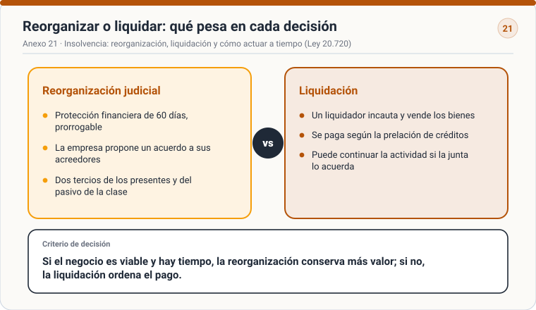
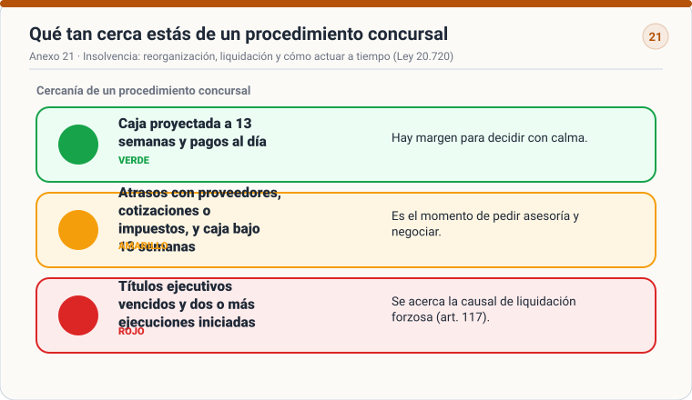
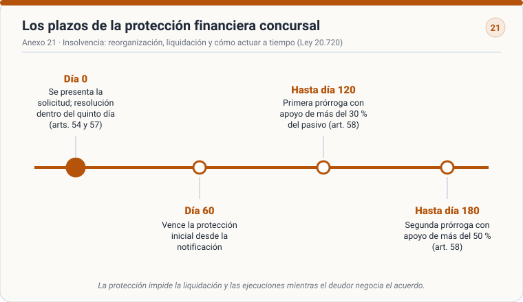
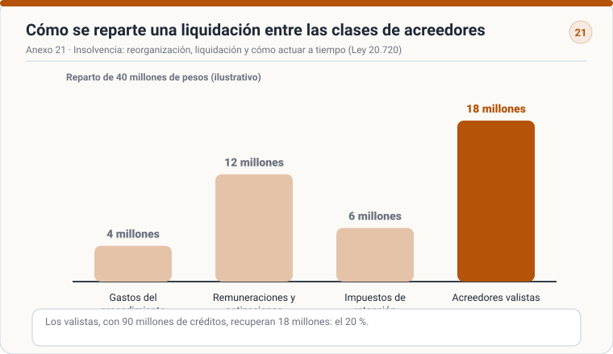
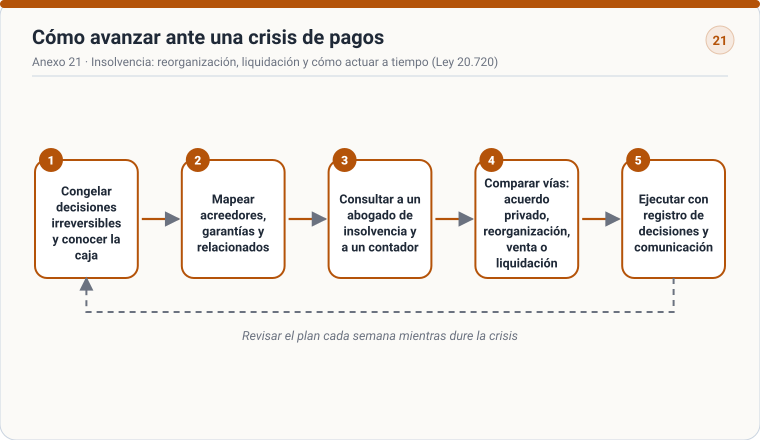

# Anexo 21 · Insolvencia: reorganización, liquidación y cómo actuar a tiempo (Ley 20.720)

> **Fecha de consulta de las fuentes:** 2026-11-25. **Naturaleza:** material educativo; no es asesoría
> legal. Los procedimientos concursales son técnicos, con plazos que corren y consecuencias para la empresa, los socios y los
> administradores: este anexo explica **qué existe, en qué orden y qué preguntas hacer**, pero **no sustituye a un abogado
> especialista en insolvencia**. Separa **obligación legal**, **recomendación profesional** y **medida voluntaria**. Las
> cifras son ilustrativas.

<!-- anexos:nav-inicio -->

**Navegación:** [← 20. Cambios de estructura: modificar, transformar, fusionar, dividir, vender y cerrar una empresa](20-cambios-de-estructura-fusion-division-venta-y-cierre.md) · [Índice de anexos](README.md) · —

## En 60 segundos

- La Ley 20.720 regula la reorganización y la liquidación de empresas y personas; la reorganización busca un acuerdo para seguir operando.
- La protección financiera dura 60 días desde la notificación, prorrogable con apoyo de más del 30 % y del 50 % del pasivo (arts. 57 y 58).
- Un acreedor puede pedir la liquidación si hay un título ejecutivo vencido, o dos o más con dos ejecuciones iniciadas, o la empresa no es habida (art. 117).
- En la liquidación se paga primero a los créditos de primera clase (costas, remuneraciones, cotizaciones, impuestos de retención, con límites) y los valistas cobran a prorrata.
- Pagos anticipados, garantías para deudas antiguas y actos perjudiciales de hasta uno o dos años antes pueden revocarse (arts. 287 a 289).

<!-- anexos:nav-fin -->

## 1. Ficha rápida

| Pregunta | Respuesta |
|---|---|
| ¿Qué es la Ley 20.720? | La ley que regula los **procedimientos concursales de reorganización y liquidación** de empresas y personas deudoras, y el rol de la Superintendencia de Insolvencia y Reemprendimiento. |
| ¿A quién se aplica? | A la **Empresa Deudora**: toda persona jurídica de derecho privado, con o sin fines de lucro, y toda persona natural que, dentro de los 24 meses anteriores al inicio del procedimiento, haya sido contribuyente de primera categoría (art. 2). Las demás personas naturales son **Personas Deudoras**. |
| ¿Qué vías hay? | **Reorganización judicial** (acuerdo con los acreedores para seguir operando), **acuerdo de reorganización extrajudicial**, **liquidación voluntaria** y **liquidación forzosa** (a petición de un acreedor). |
| ¿Quién gestiona el procedimiento? | Un **Veedor** en la reorganización y un **Liquidador** en la liquidación, ambos de nóminas supervisadas. |
| ¿Cuánto dura la protección en la reorganización? | **60 días** desde la notificación de la resolución, prorrogables (arts. 57 y 58). |
| ¿Qué decide el acuerdo? | La junta de acreedores por **dos tercios** de los presentes que representen al menos dos tercios del pasivo con derecho a voto de su clase; las personas relacionadas no votan (art. 79). |
| ¿Qué pasa con los actos recientes de la empresa? | Algunos pueden **revocarse**: pagos anticipados, ciertas garantías y actos perjudiciales de hasta uno o dos años antes (arts. 287 a 289). |
| ¿Cuándo actuar? | **Antes** de que haya demandas y ejecuciones: las herramientas funcionan mejor cuando todavía hay negocio y caja. |

## 2. La idea de fondo

Cuando una empresa no puede pagar todas sus deudas, los acreedores tienden a correr: el primero que cobra se lleva más, el
último queda sin nada, y la empresa muere por la carrera. Un **procedimiento concursal** ordena esa carrera: congela las
ejecuciones, reúne a los acreedores, decide si hay un acuerdo para seguir o si se vende y reparte, y establece un **orden de
pago** y reglas de **igualdad** entre acreedores.

| Objetivo | Cómo lo busca la ley |
|---|---|
| **Conservar lo viable** | Reorganización: la empresa propone un acuerdo y sigue operando |
| **Pagar con orden** | Liquidación: se venden los bienes y se paga según la prelación |
| **Evitar ventajas indebidas** | Acciones revocatorias de actos sospechosos y posposición de ciertas personas relacionadas |
| **Dar una segunda oportunidad** | Procedimientos para personas y reglas de término |

> **Mensaje práctico:** la Ley 20.720 no es «el final»: es un conjunto de herramientas. La más útil —la reorganización— se
> usa **antes** de que la empresa colapse.

## 3. Señales y decisión: ¿cuándo pensar en un procedimiento concursal?

| Señal | Qué indica | Primera reacción |
|---|---|---|
| Caja proyectada menor a 13 semanas sin plan | Liquidez crítica | Flujo semanal y plan con asesoría |
| Cuotas e impuestos atrasados | Deuda creciente | Priorizar y negociar |
| Demandas y títulos ejecutivos vencidos | Los acreedores ya actúan | Consultar de inmediato a un abogado de insolvencia |
| Dos o más ejecuciones iniciadas | Riesgo de liquidación forzosa | Evaluar reorganización antes de que se pida la liquidación |
| Socios que no se ponen de acuerdo en seguir | Parálisis de gobierno | Mediación y decisión formal |

### 3.1. Antes de cualquier procedimiento: lo que ayuda siempre

1. **Flujo de caja semanal** a 13 semanas.
2. **Mapa de acreedores** con montos, vencimientos y garantías.
3. **Carpeta de documentos**: contratos, balances, declaraciones, deudas laborales y previsionales.
4. **Registro de decisiones** de los administradores con su fundamento.
5. **Primera consulta con un abogado de insolvencia** y con el contador.

## 4. Reorganización judicial: cómo funciona

### 4.1. Inicio

El procedimiento de reorganización judicial **solo es aplicable a la Empresa Deudora** y se inicia mediante una **solicitud de
la propia empresa** ante el tribunal correspondiente a su domicilio; la Superintendencia regula un modelo de solicitud (art.
54). La empresa presenta además los antecedentes para la nominación de los Veedores titular y suplente, incluido un
**certificado de un auditor independiente** con un estado de sus deudas, entre otros (art. 55).

### 4.2. La resolución de reorganización y la protección financiera

Dentro del **quinto día** de efectuada la presentación, el tribunal dicta una resolución que **designa a los Veedores** y
dispone, entre otras cosas, que durante **sesenta días** desde la notificación (prorrogables) la empresa goza de una
**Protección Financiera Concursal** (art. 57):

| Efecto de la protección | Detalle |
|---|---|
| **No puede declararse ni iniciarse la liquidación** del deudor | Protege de una liquidación forzosa durante el plazo |
| **No pueden iniciarse juicios ejecutivos, ejecuciones ni restituciones en juicios de arrendamiento** | Con excepción de los juicios laborales sobre créditos de primera clase, donde solo se suspende la ejecución y realización de bienes |
| **Se suspende la tramitación** de esos procedimientos y los **plazos de prescripción extintiva** | Evita perder o ganar tiempo |
| **Los contratos mantienen su vigencia** | Condiciones y plazos, según el texto del artículo |

### 4.3. Prórrogas de la protección (art. 58)

| Prórroga | Condición |
|---|---|
| Hasta **60 días** adicionales | Apoyo de dos o más acreedores que representen **más del 30 %** del pasivo, excluidos los créditos de personas relacionadas |
| Otros **60 días** | Apoyo de dos o más acreedores que representen **más del 50 %** del pasivo, solicitada hasta el décimo día antes del vencimiento |
| Hasta **120 días** en un solo acto | Si se cumplen las condiciones que establece el artículo |

### 4.4. La propuesta de acuerdo y la votación

La propuesta de acuerdo se analiza y vota **por clases o categorías** de acreedores. Se entiende acordada cuando cuenta con el
consentimiento del deudor y el voto conforme de **dos tercios o más de los acreedores presentes**, que representen al menos
**dos tercios del pasivo con derecho a voto** de su clase (art. 79). **No pueden votar las personas relacionadas** con el
deudor y sus créditos no se consideran en el pasivo, ni los cesionarios de créditos adquiridos dentro de los 30 días
anteriores al inicio del procedimiento.

| Etapa | Qué ocurre |
|---|---|
| 1 | Verificación y objeción de créditos (arts. 70 y 71) |
| 2 | Informe del Veedor sobre la propuesta |
| 3 | Junta de acreedores: votación por clases |
| 4 | Notificación e impugnación del acuerdo (arts. 84 a 86) |
| 5 | Aprobación judicial y efectos (arts. 89 a 91) |
| 6 | Cumplimiento o incumplimiento: acción de incumplimiento o nulidad (arts. 97 a 99) |

**Qué puede contener un acuerdo:** quitas (rebajas) de deuda, esperas (plazos más largos), conversión de deuda en capital,
venta de activos, nuevas garantías y reglas de pago diferenciadas por clase, con las limitaciones que fija la ley (por
ejemplo, la prohibición de repartos mientras el acuerdo esté vigente, art. 67). Verifica con un abogado cuáles aplican a tu
caso.

### 4.5. Acuerdo de reorganización extrajudicial

La ley contempla también un **acuerdo extrajudicial** entre el deudor y sus acreedores que puede aprobarse judicialmente y
producir los efectos de un acuerdo judicial (arts. 100 a 114). Su ventaja es la flexibilidad y la menor intervención del
tribunal; su condición es que se logre la mayoría exigida por la ley y la aprobación judicial.

## 5. Liquidación: cuándo y cómo

### 5.1. Liquidación voluntaria

La Empresa Deudora puede **solicitar su propia liquidación** ante el juzgado de letras competente, acompañando antecedentes
que incluyen la **lista de sus bienes**, su ubicación y gravámenes, los documentos que acreditan el dominio, una lista de los
bienes legalmente excluidos, la relación de juicios pendientes y los estados financieros, entre otros (art. 115).

### 5.2. Liquidación forzosa: a petición de un acreedor

Cualquier acreedor puede demandar la liquidación de una Empresa Deudora en tres casos (art. 117):

| N.º | Causal |
|---:|---|
| 1 | Si cesa en el pago de una obligación que conste en **título ejecutivo vencido**, propia de la actividad de la empresa con el acreedor solicitante (no se puede invocar contra fiadores o avalistas) |
| 2 | Si existen **dos o más títulos ejecutivos vencidos**, de obligaciones diversas, con **al menos dos ejecuciones iniciadas**, y no presenta bienes suficientes dentro de los **cuatro días** siguientes a los requerimientos |
| 3 | Si la empresa o sus administradores **no son habidos** y dejaron cerradas sus oficinas, salvo que haya un mandatario con facultades suficientes |

La demanda debe acompañar los documentos que acreditan la causal y un **vale vista o boleta por 100 UF** para los gastos
iniciales y los honorarios del liquidador, que si se dicta la resolución de liquidación se considera crédito del acreedor
solicitante con preferencia (art. 118).

> **Por qué importa:** una empresa con dos ejecuciones iniciadas ya está cerca de la causal 2. La reorganización debe
> evaluarse **antes** de llegar ahí, porque la protección financiera impide que se declare la liquidación mientras dura.

### 5.3. La resolución de liquidación

La resolución de liquidación (art. 129) incluye, entre otras órdenes: la **designación del liquidador**, la **incautación** de
los bienes, libros y documentos, la entrega al liquidador de la correspondencia, la **acumulación de los juicios pendientes**
contra el deudor, la advertencia al público de **no pagar ni entregar mercaderías al deudor** bajo pena de nulidad, y la
orden de informar a los acreedores el plazo que tienen para presentar sus créditos.

### 5.4. Qué hace el liquidador

| Etapa | Qué ocurre |
|---|---|
| Incautación e inventario | Se toman y registran los bienes (arts. 164 y 165) |
| Verificación de créditos | Los acreedores presentan sus créditos y el liquidador los estudia (arts. 170 a 176) |
| Juntas de acreedores | Constitutiva, ordinarias y extraordinarias (arts. 180 a 202) |
| Realización de bienes | Venta con las reglas de los arts. 203 a 229 |
| Continuación de actividades | Provisoria o definitiva, si conviene (arts. 230 a 240) |
| Pago según prelación | Reparto de fondos (arts. 241 a 253) |
| Término | Resolución de término y cuenta final (arts. 254 a 259) |

**Continuación de actividades.** La ley permite que, en lugar de detener todo, el liquidador y la junta de acreedores
acuerden la **continuación provisional o definitiva** de actividades económicas, con administrador identificado y reglas
(arts. 232 y 233). Esta opción puede preservar valor y empleos si el negocio es viable.

## 6. El orden de pago: la prelación de créditos

En la liquidación los acreedores se pagan según el Título XLI del Libro IV del Código Civil, con respeto a la subordinación
pactada entre acreedores valistas (Ley 20.720, art. 241). El Código Civil ordena los créditos en **cinco clases**:

| Clase | Qué comprende (resumen) | Artículo del Código Civil |
|---|---|---|
| **Primera** | Costas judiciales de interés general; gastos de administración del procedimiento de liquidación y de realización del activo; **remuneraciones de los trabajadores**, asignaciones familiares y **cotizaciones previsionales** (con los límites que fija el artículo, considerándose valista el exceso); **indemnizaciones laborales** devengadas, con límites; **créditos del fisco por impuestos de retención y de recargo**; entre otros | 2472 |
| **Segunda** | Créditos con prenda y derecho de retención, sobre los bienes gravados | 2474 y siguientes |
| **Tercera** | Créditos **hipotecarios**, sobre la finca hipotecada | 2477 |
| **Cuarta** | Ciertos créditos de personas protegidas (menores, incapaces, entidades) | 2481 |
| **Quinta** | **Créditos sin preferencia (valistas)**, que se pagan a prorrata sobre el sobrante, y donde los subordinados se pagan después | 2489 |

Las reglas de la Ley 20.720 añaden que los créditos de primera clase del art. 2472 **prefieren a todo otro crédito con
privilegio establecido por leyes especiales** y que los acreedores **personas relacionadas** del deudor cuyos créditos no estén
**debidamente documentados 90 días antes de la resolución de liquidación** serán pospuestos incluso después de los valistas
(art. 241).

> **Lo que muestra la prelación:** quien tiene garantía real (prenda o hipoteca) cobra primero sobre ese bien; los créditos de
> primera clase afectan **todos los bienes** (salvo las fincas hipotecadas, a menos que no alcance con los demás, art. 2478);
> y los acreedores sin preferencia se reparten lo que sobra, **a prorrata**.

### 6.1. Ejemplo ilustrativo de reparto

Una empresa se liquida. Los bienes **sin hipoteca ni prenda** se venden en **40.000.000 de pesos**. Los créditos son:

| Concepto | Monto del crédito | Clase |
|---|---:|---|
| Gastos del procedimiento y de realización | 4.000.000 | Primera |
| Remuneraciones y cotizaciones (dentro de los límites) | 12.000.000 | Primera |
| Impuestos de retención y de recargo | 6.000.000 | Primera |
| Proveedores y otros acreedores sin preferencia | 90.000.000 | Quinta (valistas) |

| Paso | Cálculo | Resultado |
|---|---|---:|
| Fondos disponibles | | 40.000.000 |
| (−) Primera clase, en orden de numeración | 4.000.000 + 12.000.000 + 6.000.000 | −22.000.000 |
| Sobrante para valistas | 40.000.000 − 22.000.000 | 18.000.000 |
| Porcentaje de pago a valistas | 18.000.000 / 90.000.000 | 20 % |
| Un proveedor con crédito de 9.000.000 recibe | 9.000.000 × 20 % | 1.800.000 |

## 7. Revocación de actos: lo que se hizo antes de la crisis

Una vez iniciados los procedimientos de reorganización o de liquidación, los acreedores pueden —y el Veedor o el Liquidador
**deben**— demandar la **revocación** de ciertos actos de la empresa deudora (arts. 287 a 289).

| Tipo | Qué actos | Plazo hacia atrás |
|---|---|---|
| **Revocabilidad objetiva** (art. 287) | Todo **pago anticipado**; todo **pago de deudas vencidas** que no se ejecute en la forma estipulada; toda **hipoteca, prenda o anticresis** constituida sobre bienes del deudor para asegurar obligaciones anteriores | **1 año** antes del inicio del procedimiento; **2 años** si se trata de actos gratuitos o de actos con personas relacionadas |
| **Revocabilidad subjetiva** (art. 288) | Cualquier acto o contrato con cualquier persona, siempre que el contratante **conocía el mal estado de los negocios** del deudor y el acto **cause perjuicio a la masa** o altere la igualdad entre acreedores | **2 años** antes |
| **Reformas de pactos o estatutos** (art. 289) | Reformas que disminuyan el patrimonio del deudor | **6 meses** antes |

> **Qué significa en la práctica:** si una empresa en dificultades **paga con anticipación a un amigo**, **da una prenda** a un
> acreedor antiguo o **vende un bien a un pariente a bajo precio**, esos actos pueden anularse después. Por eso, en una crisis,
> no se decide «a quién ayudar» sin asesoría.

## 8. Personas relacionadas: por qué la ley las mira con lupa

La ley define **Personas Relacionadas** como el cónyuge, ascendientes, descendientes y colaterales por consanguinidad o
afinidad hasta el sexto grado, las sociedades en que estos participan (salvo las inscritas en el Registro de Valores) y las
personas del art. 100 de la Ley de Mercado de Valores (art. 2). Consecuencias:

| Ámbito | Efecto |
|---|---|
| **Votación** | No pueden votar en la junta de acreedores ni sus créditos se consideran en el pasivo (art. 79) |
| **Prórroga de protección** | Sus créditos se excluyen del cálculo del 30 % y 50 % (art. 58) |
| **Pago** | Si sus créditos no estaban documentados 90 días antes de la liquidación, se pagan después de los valistas (art. 241) |
| **Revocación** | Plazo ampliado a 2 años para ciertos actos (art. 287) |

## 9. Qué significa para los socios y los administradores

La ley protege a los acreedores, pero también ordena la conducta de quienes dirigen la empresa. Sin ser asesoría, estas son las
preguntas que un abogado hará:

| Pregunta | Por qué importa |
|---|---|
| ¿Se tomaron decisiones informadas y documentadas? | Muestra prudencia ante una eventual revisión |
| ¿Se pagó a unos acreedores en perjuicio de otros? | Puede haber revocación de actos |
| ¿Se transfirieron bienes a relacionados? | Revocabilidad y posible responsabilidad |
| ¿Se ocultaron bienes o información? | La ley contempla delitos concursales en el Código Penal (Título IX del Libro Segundo) |
| ¿Hay avales o garantías personales? | Los socios pueden responder con su patrimonio por esas garantías |
| ¿Se pagaron cotizaciones y remuneraciones? | Son créditos de primera clase y de especial sensibilidad (ver el [manual laboral](../docs/08_EMPLOYMENT_FLOW_CHILE.md)) |

> **Regla práctica:** no ocultes, no beneficies a relacionados y no pagues con criterio de amistad. Registra cada decisión con
> su razón y consulta a un abogado de insolvencia **antes** de actuar.

## 10. Alternativas fuera del procedimiento judicial

| Alternativa | Qué es | Cuándo sirve | Cuidado |
|---|---|---|---|
| **Renegociación privada** | Acuerdos bilaterales con acreedores | Pocos acreedores y confianza | Trato igualitario y evidencia escrita |
| **Reestructuración con el banco** | Nuevo calendario, período de gracia, quita | Deuda concentrada en un banco | Garantías y avales |
| **Venta de activos o de una línea de negocio** | Liquidez para pagar | Hay activos con valor | Revocación si es a relacionados o a bajo precio |
| **Ingreso de socio o inversionista** | Capital nuevo | Negocio viable | Dilución y condiciones |
| **Acuerdo extrajudicial** | Acuerdo con efectos concursales | Se logra mayoría de acreedores | Aprobación judicial |
| **Cierre ordenado** | Terminar sin procedimiento concursal | Pasivo manejable | Ver [anexo 20](20-cambios-de-estructura-fusion-division-venta-y-cierre.md) y el [manual de crisis](../docs/14_CRISIS_INSOLVENCY_CLOSURE.md) |

### 10.1. Personas naturales que no son empresa: el procedimiento de renegociación

La ley distingue a la **Empresa Deudora** de la **Persona Deudora**, que es toda persona natural no comprendida en la primera
definición (art. 2). Para las personas deudoras existe un procedimiento de **renegociación** y otro de **liquidación de sus
bienes**, regulados en los arts. 260 a 286: incluyen examen de admisibilidad, audiencias de determinación del pasivo, de
renegociación y de ejecución, y reglas sobre bienes inembargables. Si eres independiente y tus deudas se mezclan con las de
tu negocio, un abogado debe decirte **cuál de los dos regímenes te corresponde**: la respuesta depende de si, en los 24 meses
anteriores, fuiste contribuyente de primera categoría.

### 10.2. Diez preguntas para tu primera reunión con el abogado de insolvencia

1. ¿Mi situación se clasifica como empresa deudora o persona deudora?
2. ¿Qué vías tengo hoy y cuáles se cierran si espero tres meses?
3. ¿Qué efecto tendría una solicitud de reorganización sobre mis contratos, mis garantías y mis avales?
4. ¿Qué apoyo de acreedores necesito para prorrogar la protección y para aprobar un acuerdo?
5. ¿Qué actos de los últimos dos años podrían considerarse revocables?
6. ¿Qué créditos son de primera clase y cuánto suman?
7. ¿Qué responsabilidad tienen los administradores y los socios en mi caso?
8. ¿Cuánto costaría cada vía y cuánto demoraría, a grandes rasgos?
9. ¿Qué información y documentos debo reunir esta semana?
10. ¿Qué no debo hacer hasta que decidamos la estrategia?

### 10.3. Cuatro historias breves

> Casos ilustrativos, con cifras inventadas. No son asesoría.

**La panadería que pidió ayuda a los tres meses.** Una panadería acumuló atrasos con dos proveedores y un banco. Con un abogado
y un contador, construyó un flujo de 13 semanas, renegoció calendarios y evitó las ejecuciones. *Lección:* el tiempo es la
herramienta más valiosa.

**El taller que llegó con tres demandas.** Cuando consultó, ya tenía tres demandas ejecutivas y dos ejecuciones iniciadas. La
reorganización seguía siendo posible, pero con menos margen y con acreedores ya desconfiados. *Lección:* las demandas reducen
las opciones.

**La empresa familiar y los pagos a parientes.** Antes de cerrar, pagó anticipadamente una deuda con un tío del dueño. Ese pago
fue revocado y debió devolverse a la masa. *Lección:* no se beneficia a relacionados en crisis.

**La liquidación que continuó operando.** Un restaurante en liquidación logró que la junta de acreedores acordara la
continuación de actividades por seis meses y vendió el negocio en marcha por más que sus activos sueltos. *Lección:* la
continuidad puede preservar valor cuando el negocio es viable.

## 11. Ocho escenarios resueltos

> Casos **ilustrativos**, con nombres y cifras inventados. No son asesoría.

### 11.1. La pyme con dos ejecuciones

**Situación.** Una empresa tiene dos títulos ejecutivos vencidos con acreedores distintos y dos ejecuciones iniciadas; no puede
presentar bienes suficientes.

**Análisis.** Se acerca a la causal 2 de liquidación forzosa (art. 117). La reorganización, con su protección financiera,
impide que se declare la liquidación mientras dura (art. 57).

**Decisión.** Consultar de inmediato a un abogado de insolvencia para evaluar una solicitud de reorganización antes de que un
acreedor pida la liquidación.

### 11.2. La empresa que quiere seguir

**Situación.** Un taller con buenos clientes tiene deudas bancarias que superan su flujo.

**Análisis.** Puede proponer un acuerdo de reorganización con quitas y esperas, con el apoyo de acreedores que representen más
del 30 % del pasivo para prorrogar la protección (art. 58) y los dos tercios de su clase para aprobarlo (art. 79).

**Decisión.** Preparar el flujo proyectado, el plan de operación y un acercamiento temprano con los acreedores principales.

### 11.3. El pago al pariente

**Situación.** Una empresa en problemas paga una deuda por adelantado a un familiar del dueño seis meses antes de iniciar un
procedimiento.

**Análisis.** Es un pago anticipado dentro del año anterior, con una persona relacionada: el plazo se amplía a dos años (art.
287). Es revocable.

**Decisión.** No hacerlo. Si ya se hizo, informarlo al abogado.

### 11.4. Los trabajadores y la liquidación

**Situación.** Una empresa se liquida y debe tres meses de remuneraciones y cotizaciones.

**Análisis.** Son créditos de primera clase, con los límites del Código Civil, y se pagan antes que los valistas sobre los bienes
no hipotecados (art. 2472).

**Decisión.** Informar a los trabajadores y coordinar con el liquidador; consultar a un abogado laboral.

### 11.5. El aval del dueño

**Situación.** El dueño de una pyme avaló personalmente el crédito bancario de la empresa.

**Análisis.** El procedimiento concursal de la empresa no elimina por sí mismo el aval: el banco puede cobrar al avalista (art.
117 N.º 1 explicita que la causal de liquidación no puede invocarse contra fiadores o avalistas, pero el crédito sigue
exigible según su contrato).

**Decisión.** Evaluar con un abogado el riesgo personal y las alternativas.

### 11.6. El acreedor que adelantó 100 UF

**Situación.** Un acreedor demanda la liquidación de una empresa con tres títulos vencidos.

**Análisis.** Debe acompañar el vale vista por 100 UF, que si se dicta la liquidación se considera crédito suyo con preferencia
(art. 118).

### 11.7. La empresa de un solo dueño que dejó de operar

**Situación.** Una persona natural que fue contribuyente de primera categoría dejó de operar hace diez meses y tiene deudas.

**Análisis.** Si dentro de los 24 meses anteriores al inicio del procedimiento fue contribuyente de primera categoría, se la
considera **Empresa Deudora** (art. 2). Si no, sería Persona Deudora, con otro procedimiento.

### 11.8. La venta del negocio en crisis

**Situación.** Una empresa vende su línea más rentable a un tercero al 50 % de su valor para pagar a un banco.

**Análisis.** Si el comprador conocía el mal estado de los negocios y el precio se aleja del mercado, el acto puede ser
revocable (art. 288). Además, pagar a un solo acreedor altera la igualdad.

**Decisión.** Obtener una valoración independiente y asesoría antes de vender.

## 12. Catálogo de quince errores frecuentes

| N.º | Error | Consecuencia | Cómo evitarlo |
|---:|---|---|---|
| 1 | Esperar a tener demandas y ejecuciones | Menos herramientas | Actuar a las primeras señales |
| 2 | No conocer la caja semanal | Decisiones a ciegas | Flujo de 13 semanas |
| 3 | Pagar con criterio de amistad | Actos revocables | Registrar el criterio con asesoría |
| 4 | Beneficiar a relacionados | Posposición y revocación | Transparencia |
| 5 | Prendar o hipotecar para acreedores antiguos | Revocación objetiva (art. 287) | Asesoría previa |
| 6 | Vender activos a bajo precio | Revocación subjetiva (art. 288) | Valoración independiente |
| 7 | No documentar créditos de relacionados | Posposición (art. 241) | Documentar con anticipación |
| 8 | Ocultar bienes o información | Delitos concursales | Información completa |
| 9 | Ignorar cotizaciones y remuneraciones | Créditos de primera clase y conflictos | Priorizarlas |
| 10 | Pedir la reorganización sin plan | Pérdida de protección y confianza | Plan creíble |
| 11 | Proponer quitas sin hablar con los acreedores | Rechazo del acuerdo | Negociar antes |
| 12 | No separar el patrimonio personal | Exposición por avales | Revisar garantías |
| 13 | Llegar a la liquidación forzosa sin defensa | Pérdida de control | Evaluar la oposición con un abogado |
| 14 | No usar la continuación de actividades | Pérdida de valor y empleos | Evaluarla con el liquidador y la junta |
| 15 | Cerrar de hecho | Obligaciones vigentes | Cierre ordenado |

## 13. Plantillas y listas de trabajo

### 13.1. Plan de las primeras ocho semanas

| Semana | Tarea | Resultado |
|---:|---|---|
| 1 | Congelar decisiones irreversibles; flujo diario; reunir documentos | Foto de liquidez y carpeta |
| 2 | Mapa de acreedores y de garantías; consulta a abogado de insolvencia y contador | Opciones por escrito |
| 3 a 4 | Flujo proyectado a 13 semanas con escenarios; negociaciones iniciales | Plan base y plan malo |
| 5 a 6 | Decisión: acuerdo privado, reorganización, venta o liquidación | Acta de decisión |
| 7 a 8 | Ejecutar la vía elegida y comunicar a las audiencias | Hitos con responsables |

### 13.2. Mapa de acreedores

| Acreedor | Monto | Vencimiento | Clase probable (Código Civil) | Garantía | Relacionado (sí/no) | Estado |
|---|---:|---|---|---|:---:|---|
| | | | | | | |

### 13.3. Lista de documentos para el abogado

| Documento | Para qué |
|---|---|
| Estados financieros y balances | Viabilidad y capacidad de pago |
| Listado de deudas con acreedor, monto, vencimiento y garantía | Base del acuerdo |
| Listado de bienes, ubicación y gravámenes | Capacidad de pago y liquidación |
| Contratos relevantes y de trabajo | Riesgos y oportunidades |
| Declaraciones tributarias y cotizaciones | Situación fiscal y previsional |
| Pactos de socios y estatutos | Gobierno y decisiones |
| Garantías y avales de los socios | Exposición personal |
| Juicios y cobranzas en curso | Contingencias |
| Operaciones con relacionados de los últimos dos años | Posible revocación |

### 13.4. Calendario de plazos

| Hito | Plazo | Fuente |
|---|---|---|
| Resolución de reorganización | Dentro del quinto día de la presentación | Art. 57 |
| Protección financiera | 60 días desde la notificación | Art. 57 |
| Primera prórroga | Hasta 60 días con más del 30 % del pasivo | Art. 58 |
| Segunda prórroga | 60 días con más del 50 %, pedida hasta el décimo día antes del vencimiento | Art. 58 |
| Pago al presentar demanda de liquidación | Vale vista de 100 UF | Art. 118 |
| Verificación de créditos tras la liquidación | Plazo informado en la resolución | Art. 129 |
| Revocación objetiva | 1 año, o 2 con relacionados o actos gratuitos | Art. 287 |
| Revocación subjetiva | 2 años | Art. 288 |
| Reformas estatutarias | 6 meses | Art. 289 |

## 14. Cuándo llamar a un profesional

| Situación | Profesional |
|---|---|
| Cualquier señal de insolvencia o demanda ejecutiva | Abogado de insolvencia |
| Armar el flujo y los estados | Contador |
| Negociar con bancos y proveedores | Abogado y asesor financiero |
| Despidos y deudas laborales | Abogado laboral |
| Avales personales y patrimonio de los socios | Abogado |
| Venta de activos o del negocio | Abogado y valorizador |

Usa la [guía de cuándo llamar a un profesional](../docs/18_WHEN_TO_CALL_A_PROFESSIONAL.md).

## 15. Preguntas frecuentes

**1. ¿Qué es la Ley 20.720?**
La ley que regula los procedimientos concursales de reorganización y liquidación de empresas y personas.

**2. ¿Quién puede pedir la reorganización?**
La Empresa Deudora, mediante una solicitud ante el tribunal de su domicilio (art. 54).

**3. ¿Cuánto dura la protección financiera?**
Sesenta días desde la notificación, prorrogables hasta por sesenta días más con apoyo de más del 30 % del pasivo, y otros
sesenta con más del 50 % (arts. 57 y 58).

**4. ¿Qué impide la protección financiera?**
Que se declare la liquidación y que se inicien juicios ejecutivos y ejecuciones, con excepción de ciertos juicios laborales (art.
57).

**5. ¿Quién decide el acuerdo de reorganización?**
La junta de acreedores, por dos tercios de los presentes que representen dos tercios del pasivo de su clase (art. 79).

**6. ¿Pueden votar los familiares del dueño?**
No: las personas relacionadas no pueden votar y sus créditos no se consideran en el pasivo (art. 79).

**7. ¿Cuándo puede un acreedor pedir mi liquidación?**
En los tres casos del art. 117: título ejecutivo vencido, dos o más títulos con dos ejecuciones iniciadas, o empresa o
administradores no habidos.

**8. ¿Qué debe acompañar un acreedor?**
Los documentos de la causal y un vale vista o boleta por 100 UF (art. 118).

**9. ¿Qué hace el liquidador?**
Incauta, inventaría y vende los bienes, verifica créditos, convoca juntas y paga según la prelación (arts. 164 a 253).

**10. ¿En qué orden se pagan los créditos?**
Primera clase (incluye remuneraciones, cotizaciones, costas y gastos del procedimiento, e impuestos de retención y recargo, con
límites), luego los garantizados sobre sus bienes y por último los valistas a prorrata (Código Civil, arts. 2472 y siguientes).

**11. ¿Qué es un acto revocable?**
Un acto de la empresa anterior al procedimiento que puede anularse, como pagos anticipados o garantías para deudas antiguas
(arts. 287 a 289).

**12. ¿Qué plazo hacia atrás tiene la revocación?**
Un año (dos con relacionados o actos gratuitos) en la objetiva; dos años en la subjetiva; seis meses en reformas estatutarias.

**13. ¿Mis avales personales desaparecen?**
No necesariamente; consulta a un abogado según tus contratos.

**14. ¿Se puede seguir operando durante la liquidación?**
Sí, mediante la continuación provisional o definitiva de actividades acordada con la junta de acreedores (arts. 232 y 233).

**15. ¿Qué es un Veedor?**
Un profesional de una nómina supervisada que fiscaliza la reorganización y emite informes (arts. 11 y siguientes).

**16. ¿Una persona natural puede usar estos procedimientos?**
Hay reglas para Personas Deudoras (por ejemplo, los arts. 260 y siguientes); consulta a un abogado.

**17. ¿Cuánto cuesta un procedimiento?**
Este anexo no fija costos: incluyen honorarios de veedores o liquidadores y otros gastos; pide estimaciones por escrito.

**18. ¿Qué pasa con los trabajadores?**
Sus remuneraciones, cotizaciones e indemnizaciones, con los límites legales, son créditos de primera clase (Código Civil, art.
2472); consulta al abogado laboral.

**19. ¿Cuándo es demasiado tarde?**
No hay una fecha única, pero con demandas y ejecuciones en curso las opciones se reducen. Actúa a las primeras señales.

**20. ¿Cuándo llamar a un profesional?**
En cuanto aparezcan varias señales de insolvencia o llegue una demanda.

## 16. Fuentes y vigencia

**Fecha de consulta de las fuentes:** 2026-11-25.

| Fuente | Qué contiene | Enlace |
|---|---|---|
| Ley 20.720 (arts. 2, 54 a 58, 79, 115 a 118, 129, 232, 233, 241, 287 a 289) | Reorganización, liquidación, prelación y revocación | [BCN, Ley 20.720](https://www.bcn.cl/leychile/navegar?idNorma=1058072) |
| Código Civil, arts. 2465 y 2471 a 2489 | Prelación de créditos | [BCN, Código Civil](https://www.bcn.cl/leychile/navegar?idNorma=172986) |
| Código del Trabajo, arts. 162 y 163 | Término de contratos e indemnizaciones | [BCN, Código del Trabajo](https://www.bcn.cl/leychile/navegar?idNorma=207436) |
| Superintendencia de Insolvencia y Reemprendimiento | Información oficial sobre procedimientos y nóminas | [Superir](https://www.superir.gob.cl/) |
| Guía del programa | Crisis, insolvencia y cierre | [Manual de crisis](https://github.com/vladimiracunadev-create/modern-business-creation-program/blob/main/docs/14_CRISIS_INSOLVENCY_CLOSURE.md) |

**Vigencia.** Los artículos citados se leyeron en la versión de la Ley 20.720 publicada por la Biblioteca del Congreso
Nacional; no se leyó íntegra, y las reglas de personas deudoras y los reglamentos no se analizaron. Verifica siempre el texto
vigente y consulta a un abogado de insolvencia.

**Límites.** Este anexo no reemplaza la asesoría de un abogado; no recomienda proveedores; no fija precios y sus cifras son
ilustrativas.

<!-- anexos:cierre-inicio -->

## Para seguir leyendo

- [Anexo 20. Cambios de estructura: modificar, transformar, fusionar, dividir, vender y cerrar una empresa](20-cambios-de-estructura-fusion-division-venta-y-cierre.md): cierre y disolución cuando no hay deudas.
- [Anexo 19. Pactos de socios y gobierno entre fundadores: qué acordar antes de que haya un conflicto](19-pactos-de-socios-y-gobierno-entre-fundadores.md): conflictos y salida entre socios.
- [Anexo 09. Cooperativa](09-cooperativa.md): cooperativas y su régimen propio.
- [Anexo 16. Servicio de Impuestos Internos (SII): lo que una empresa debe saber](16-servicio-de-impuestos-internos-sii.md): término de giro y obligaciones tributarias.
- [Anexo 03. Sociedad de Responsabilidad Limitada (Ltda.)](03-sociedad-de-responsabilidad-limitada-ltda.md): responsabilidad limitada y avales de los socios.

**Navegación:** [← 20. Cambios de estructura: modificar, transformar, fusionar, dividir, vender y cerrar una empresa](20-cambios-de-estructura-fusion-division-venta-y-cierre.md) · [Índice de anexos](README.md) · —

<!-- anexos:cierre-fin -->
