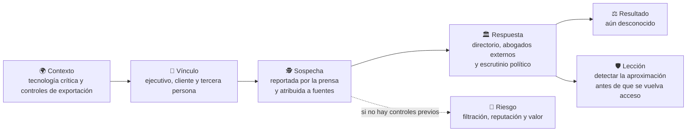

# 🛡️ Caso 22 — NVIDIA: sospecha de espionaje, vínculos con terceros y protección del conocimiento

| 🌐 Alcance | 🏭 Industria | 🔎 Naturaleza | 📅 Corte | ⏳ Estado |
|---|---|---|---|---|
| Estados Unidos y China | Semiconductores y computación de IA | Sospecha de inteligencia extranjera sobre un ejecutivo | 12-11-2026 | **Investigación no concluida** |

> [!IMPORTANT]
> Este caso es material educativo y **está en desarrollo**. No afirma que NVIDIA haya sufrido
> espionaje industrial, que alguna persona sea culpable ni que se haya filtrado información.
> Reconstruye qué dicen las fuentes, quién lo dice, qué niega la empresa y qué se desconoce, para
> que el estudiante aprenda a razonar con evidencia incompleta. Ninguna de las fuentes citadas
> describe cargos formales contra nadie. Todo lo que cambie después del corte invalida este texto.

## 🧭 Mapa visual del caso

## 🧾 Cómo leer el expediente

Cada afirmación conserva una de estas etiquetas. **No uses una etiqueta como prueba de otra.**

| Etiqueta | Significado |
|---|---|
| **INFORMACIÓN OFICIALMENTE CONOCIDA** | La declaró la propia empresa, su directivo o una institución, o es un hecho de procedimiento verificable (quién contrató a quién y cuándo). |
| **SOSPECHA O ALEGACIÓN** | Lo afirman medios o fuentes anónimas, sin confirmación oficial; es una hipótesis sobre la que hay que decidir con prudencia. |
| **NEGACIÓN O POSICIÓN DE PARTE** | Lo sostiene una parte interesada (empresa, gobierno, persona aludida). Es información, no veredicto. |
| **INVESTIGACIÓN NO CONCLUIDA** | Existe un proceso abierto cuyo resultado se desconoce. No se rellena con suposiciones. |
| **DESCONOCIDO** | La fuente no lo informa. Declararlo es parte del rigor. |
| **LECCIÓN EMPRESARIAL** | Interpretación pedagógica que sirve aunque el caso termine de cualquier manera. |

## 1. Información oficialmente conocida

| Dato | Etiqueta | Fuente |
|---|---|---|
| El 08-11-2026 el director ejecutivo, Jensen Huang, escribió al personal que había sido infiel a su cónyuge. | **INFORMACIÓN OFICIALMENTE CONOCIDA** | CNBC, 08-11-2026 (actualizado 09-11) |
| El directorio de NVIDIA abrió una investigación independiente sobre la alegación de que el ejecutivo fue objetivo de un esfuerzo de inteligencia extranjera. | **INFORMACIÓN OFICIALMENTE CONOCIDA** | CNBC; Nextgov/FCW, 11-11-2026 |
| El 10-11-2026 los directores independientes contrataron a Joon H. Kim, ex fiscal federal interino del Distrito Sur de Nueva York, y a su estudio, Wachtell, Lipton, Rosen & Katz. | **INFORMACIÓN OFICIALMENTE CONOCIDA** | NBC News, 10-11-2026 |
| La empresa describió la investigación como «exhaustiva e independiente» y un vocero dijo que el ejecutivo sigue dirigiendo la compañía sin interrupción. | **NEGACIÓN O POSICIÓN DE PARTE** (sobre continuidad) | NBC News; CNBC |
| Tres presidentes de comisiones de la Cámara de Representantes pidieron una reunión cerrada con el ejecutivo sobre la relación y las salvaguardas de la empresa. | **INFORMACIÓN OFICIALMENTE CONOCIDA** (la solicitud) | CNBC; Nextgov/FCW |
| Las acciones de la empresa cayeron más de 10 % entre el lunes 9 y el martes 10 de noviembre. | **INFORMACIÓN OFICIALMENTE CONOCIDA** (dato de mercado reportado) | NBC News |

## 2. Sospecha o alegación

| Dato | Etiqueta | Fuente |
|---|---|---|
| Agencias de inteligencia de Estados Unidos creerían que una empresaria china, vinculada a una empresa de nube y a un cliente de NVIDIA llamado Megaspeed, entregó información a Beijing. | **SOSPECHA O ALEGACIÓN** | NBC News (fuentes); CNBC, citando al *New York Times* y al *Financial Times* |
| Megaspeed ha sido acusado de ayudar a empresas chinas restringidas a adquirir chips de NVIDIA; NVIDIA dijo que ya había sido investigado antes por evasión de controles de exportación. | **SOSPECHA O ALEGACIÓN** (la acusación) · **INFORMACIÓN OFICIALMENTE CONOCIDA** (la declaración de NVIDIA) | CNBC |
| La inteligencia habría provenido de comunicaciones interceptadas entre el ejecutivo y la mujer, según un funcionario estadounidense. | **SOSPECHA O ALEGACIÓN** | Nextgov/FCW |
| Un reporte del *New York Times* dice que el secretario de Estado advirtió dos veces al presidente sobre los vínculos del ejecutivo con la inteligencia china. NBC no lo confirmó. | **SOSPECHA O ALEGACIÓN** | NBC News |
| El presidente dijo que el FBI investiga el asunto. No se describe una declaración del FBI. | **SOSPECHA O ALEGACIÓN** (el alcance) | NBC News; Nextgov/FCW |

## 3. Negaciones y posiciones de parte

| Posición | Etiqueta | Fuente |
|---|---|---|
| El directorio dice que no tiene razón para creer que se comprometieron la seguridad nacional ni secretos de NVIDIA. Es su posición, no un hallazgo. | **NEGACIÓN O POSICIÓN DE PARTE** | CNBC; Nextgov/FCW |
| China niega las acusaciones de espionaje. | **NEGACIÓN O POSICIÓN DE PARTE** | Nextgov/FCW |
| El presidente de Estados Unidos dijo que el ejecutivo «no tenía idea» de que la mujer era espía y que le cree. | **NEGACIÓN O POSICIÓN DE PARTE** | NBC News |
| El ejecutivo se comprometió a cooperar con la investigación independiente. | **NEGACIÓN O POSICIÓN DE PARTE** | Nextgov/FCW |

## 4. Investigación no concluida y desconocido

| Pregunta | Estado |
|---|---|
| ¿Se entregó información a un tercero y, si ocurrió, cuál? | **DESCONOCIDO** |
| ¿Se comprometió algún secreto comercial o tecnología sujeta a controles de exportación? | **INVESTIGACIÓN NO CONCLUIDA** (el directorio solo expresa que no tiene razón para creerlo) |
| ¿Cómo se obtuvieron las comunicaciones y qué evidencia sostiene la sospecha de inteligencia? | **DESCONOCIDO** |
| ¿Qué alcance, plazo y hallazgos tendrá la investigación del directorio? | **INVESTIGACIÓN NO CONCLUIDA** |
| ¿Qué determinará la investigación atribuida al FBI y qué resultará de la reunión con el Congreso? | **INVESTIGACIÓN NO CONCLUIDA** |
| ¿Existe relación entre el vínculo personal, el cliente y la presunta conducta de inteligencia? | **DESCONOCIDO** |
| ¿Cuántas otras personas pudieron ser objeto de aproximaciones similares? | **DESCONOCIDO** |

> [!NOTE]
> Una sospecha de inteligencia extranjera sobre un ejecutivo **no es lo mismo** que espionaje
> industrial probado. Tampoco lo descarta. El estudiante debe poder sostener ambas frases a la
> vez: es lo que distingue el análisis de la conclusión anticipada.

## 5. Por qué este caso sirve aunque no se sepa el final

El programa no usa el caso para decidir quién tiene razón, sino para estudiar **cómo se ve el
riesgo antes de que haya un incidente**:

1. **La aproximación ocurre por la relación, no por el sistema.** Una persona con acceso a decisiones o a información puede ser el punto de entrada sin que falle ningún control técnico.
2. **El tercero es un vector.** Un cliente, un distribuidor o un socio con intereses propios puede ser, al mismo tiempo, comprador legítimo y canal de influencia.
3. **La vida privada de un ejecutivo es una superficie de riesgo, pero no un campo de vigilancia libre.** Existen límites de dignidad, privacidad y proporcionalidad que la empresa debe respetar.
4. **La reacción es parte del riesgo.** Qué se informa, a quién, con qué abogados y en qué orden determina cuánto valor se pierde y cuánta confianza se conserva.
5. **El incentivo comercial puede debilitar la vigilancia.** Un cliente que compra mucho se examina menos; en tecnología sujeta a controles, ese sesgo se paga caro.
6. **La cultura pesa tanto como el manual.** Los especialistas citados por Nextgov/FCW destacan que el equipo de seguridad debe poder detectar una aproximación antes de que se convierta en acceso, y que eso depende de que la dirección dé el ejemplo al reportar.

## 6. Análisis de decisiones: el directorio

Reconstruye la decisión con la información disponible a la fecha de corte.

| Decisión | Alternativas | Qué se gana | Qué se arriesga |
|---|---|---|---|
| Quién investiga | Equipo interno de seguridad · directores independientes con abogados externos | Independencia, credibilidad ante reguladores y mercado | Costo, tiempo y exposición de hechos privados |
| Cuánto comunicar | Silencio hasta tener hallazgos · declaración temprana y acotada | Control del relato frente a rumores | Cualquier afirmación puede ser desmentida por hechos posteriores |
| Rol del ejecutivo durante la revisión | Mantenerlo · apartarlo temporalmente | Continuidad operativa y estabilidad frente a clientes | Percepción de conflicto de interés en la propia investigación |
| Relación con autoridades | Esperar a ser requerido · coordinar proactivamente | Reducir incertidumbre regulatoria | Compromisos de información que luego limiten la defensa |
| Qué hacer con el cliente señalado | Continuar con refuerzos de control · suspender relaciones mientras se aclara | Preservar ingresos o proteger la tecnología | Perder un cliente legítimo frente a exponer tecnología sensible |

**Pregunta de cierre:** ¿qué parte de esta decisión depende de un hecho que todavía se desconoce y cuál habría que tomar igual con la información actual?

## 7. Lo que cambia según el tamaño de la empresa

| Nivel | Qué enseña este caso | Medida proporcionada, sin sistemas nuevos |
|---|---|---|
| **Emprendedor o microempresa** | El fundador es el activo y el punto de entrada. No hay equipo de seguridad que lo detecte. | Un acuerdo escrito de dos socios: ante cualquier propuesta inusual de un tercero (inversión, alianza, regalos), se comenta con el otro socio antes de responder. |
| **Pyme** | El cliente grande o el socio que pide acceso puede combinar interés comercial con interés de obtener información. | Una página que defina qué información se comparte con clientes, quién la aprueba y qué se registra; revisión anual de a quién se le dio acceso. |
| **Gran empresa o multinacional** | La investigación independiente, los canales de reporte y el apoyo de seguridad a ejecutivos deben existir antes del incidente. | Política de declaración de relaciones relevantes, canal de reporte de aproximaciones, inducción de ejecutivos que viajan y protocolo de investigación independiente. |

## 8. Ejercicios

Todos se resuelven con papel, correo y calendario. **No requieren crear ningún sistema informático.**

1. **Clasifica.** Toma cinco afirmaciones del caso y asígnales una etiqueta del expediente. Para cada una escribe qué documento o declaración la cambiaría de categoría.
2. **Qué diría tu empresa.** Redacta tres frases que tu empresa podría decir si un medio asegurara que un directivo fue objeto de una aproximación de inteligencia: una que afirme, una que niegue y una que explique qué se está verificando. Elige cuál usarías y por qué.
3. **Mapa de tus relaciones sensibles.** Lista tres personas externas que hoy conocen información que, en manos de un competidor, te dañaría. Para cada una anota qué sabe, desde cuándo y qué ocurriría si cambiara de lealtad.
4. **Decisión con información incompleta.** Tu mayor cliente es mencionado en un reporte periodístico por un presunto uso indebido de tu producto. Define qué harías en las primeras 24 horas, qué no harías y qué dato esperarías antes de decidir.
5. **Límite de la vigilancia.** Redacta una regla de una página sobre qué información personal de un directivo la empresa **puede** pedir (por ejemplo, declarar conflictos de interés) y cuál **no** puede pedir, citando la norma de privacidad que aplicaría.

## 9. Preguntas de comprobación

1. ¿Qué diferencia hay entre una sospecha de inteligencia extranjera y un espionaje industrial probado?
2. ¿Por qué la posición del directorio de que no hay razón para creer que se comprometieron secretos no equivale a un hallazgo?
3. ¿Qué rol cumple un cliente que, además de comprar, puede ser un canal de influencia?
4. ¿Qué datos de este caso son oficiales y cuáles se atribuyen a fuentes anónimas?
5. ¿Qué medida de una microempresa cumple el mismo objetivo que la investigación independiente de una gran empresa?

## 10. Fuentes y fecha de consulta

| Fuente | Consulta |
|---|---|
| CNBC — «Nvidia investigates CEO Jensen Huang's relationship with alleged Chinese spy», 08-11-2026 | 12-11-2026 |
| NBC News — «Nvidia hires former acting U.S. attorney to probe Jensen Huang affair», 10-11-2026 | 12-11-2026 |
| Nextgov/FCW — «Nvidia spying allegations test Washington's defenses against tech espionage», 11-11-2026 | 12-11-2026 |

Los enlaces y la explicación de cada fuente están en el
[registro de fuentes](../docs/16_OFFICIAL_SOURCE_CATALOG.md). Los medios no son fuentes
oficiales: se usan para fijar quién afirma qué y cuándo. Las declaraciones de NVIDIA, de las
comisiones del Congreso y de las agencias deben verificarse en sus propios comunicados a medida
que el caso avance.

[← Guía de inteligencia económica y protección del conocimiento](../docs/21_INTELIGENCIA_ECONOMICA_Y_PROTECCION_DEL_CONOCIMIENTO.md) · [Casos](./) · [Inicio](../README.md)
