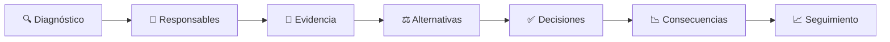

# 🤝 Caso 23 — Reputación y crisis: siete simulaciones para empresas pequeñas y medianas

| 🌐 Alcance | 🔎 Naturaleza | 🧪 Datos | 📅 Corte legal |
|---|---|---|---|
| Chile | **Simulaciones ilustrativas** | Supuestos de trabajo | 2026-11-25 |

> [!IMPORTANT]
> Las empresas, personas y cifras de este expediente **son ficticias**. No describen ni se inspiran
> en una empresa real. Sirven para practicar el razonamiento: separar hecho de alegación, decidir con
> evidencia incompleta y distinguir **obligación legal** de **recomendación profesional**. Las
> normas citadas se leyeron en la BCN el 2026-11-25; la guía
> [docs/22](../docs/22_REPUTACION_CRISIS_Y_CONFIANZA.md) explica cada una. Las plantillas están en
> [templates/25 a 33](../templates/25_politica_comunicacion_corporativa.md).

## 🧭 Cómo se lee cada caso

Cada caso trae: **diagnóstico**, **responsables**, **evidencia**, **alternativas**, **decisiones**,
**consecuencias** y **seguimiento**. Las cifras marcadas con ⚙️ son supuestos. Las etiquetas
**[Obligación legal]**, **[Recomendación]** y **[Voluntaria]** significan lo mismo que en la guía.

## 1. Microempresa con una controversia pública

**Empresa:** «Pan de Casa», panadería artesanal con 4 personas y venta por redes (⚙️ 1.200 clientes
recurrentes). **Hecho:** una clienta publica en Instagram una foto de una torta con un pelo y escribe
que «la dueña la trató de mentirosa». La publicación llega a 15.000 personas (⚙️) en 48 horas.

### Diagnóstico

Severidad **S2**: varias personas, tracción local, sin riesgo a la seguridad. La publicación mezcla
un **hecho verificable** (la torta, el pelo), una **alegación** (el trato) y una **interpretación**
(«mala gente»). El conflicto real es de **trato**, no de higiene.

### Responsables

Fundadora (vocería), un socio de confianza (registro y evidencia) y la contadora externa (asesora de
llamada). Sustituto de la vocería: el socio.

### Evidencia

Pedido y fecha de compra; chat completo con la clienta; foto original; capturas de la publicación y
de los comentarios con fecha y hora; registro de higiene del día de producción.

### Alternativas

| Alternativa | Ventaja | Riesgo |
|---|---|---|
| A. Borrar comentarios y bloquear | Rápida | Se vuelve la noticia; destruye evidencia |
| B. Responder discutiendo la versión | Defensa inmediata | Escala y revela datos de la clienta |
| C. Reconocer, corregir y ofrecer reparación en privado | Protege a la persona y a la marca | Puede leerse como admisión |
| D. Ir por la vía legal contra la clienta | Defiende el honor | Costosa; transforma a la clienta en víctima |

### Decisiones

Se elige **C**. **[Recomendación]** Respuesta pública única: «Lamentamos lo ocurrido; la revisamos
y te escribimos por privado para resolverlo». Contacto personal en 3 horas: se reembolsa la torta y
se reconoce que el trato pudo ser mejor. **No** se publica el chat. **[Obligación legal]** Respetar
lo ofrecido y no inducir a error en la información (Ley 19.496, arts. 12 y 33): se revisa que la web
no prometa «cero defectos».

### Consecuencias

La clienta agradece y edita su publicación (⚙️). Dos comentarios críticos permanecen; no se borran.
Aprendizaje: la empresa no tenía una regla de respuesta ni quién respondía los fines de semana.

### Seguimiento

A 7 días: tiempo de primera respuesta por turno (indicador 1 de la plantilla 32). A 30 días: guion de
reclamos de una página y un segundo responsable. A 90 días: reclamos repetidos por causa. Simulación
**S-01** cada año.

## 2. Empresa con fallas de un producto

**Empresa:** «TermoHogar», pyme importadora (⚙️ 30 personas) de calefactores eléctricos. **Hecho:**
en 10 días llegan 3 reclamos por sobrecalentamiento de un modelo; uno incluye la foto de un mueble
chamuscado. No hay lesionados confirmados.

### Diagnóstico

**S3**: riesgo para la seguridad de personas. Aunque aún no hay daño, la información existente
obliga a actuar. Lo que se sabe: tres reportes del mismo modelo y lote. Lo que se ignora: cuántas
unidades del lote están en uso y si la causa es de diseño, de componente o de uso.

### Responsables

Gerencia general (responsable del incidente), jefa de calidad (causa), jefe de postventa (contacto
con clientes), abogado externo (obligaciones y textos), encargada de comunicaciones (vocería). Cada
rol con sustituto.

### Evidencia

Número de serie y lote; ficha técnica y certificación; registros de importación; fotos y facturas de
los tres reclamos; pruebas de laboratorio encargadas; lista de clientes por lote.

### Alternativas

| Alternativa | Ventaja | Riesgo |
|---|---|---|
| A. Esperar el informe del laboratorio | Evita alarma innecesaria | Riesgo de lesiones y de infracción por demora |
| B. Retirar solo las unidades reclamadas | Barata | Deja el lote en circulación |
| C. Detener ventas, avisar a todos los compradores del lote y ofrecer cambio o devolución | Protege personas | Costosa; efecto en ventas |

### Decisiones

Se elige **C** en menos de 24 horas. **[Obligación legal]** Poner el riesgo **sin demora** en
conocimiento de la autoridad competente y advertir a los consumidores (Ley 19.496, arts. 45 y 46);
cambio del producto o restitución de lo pagado (arts. 47 y 48); facilitar la fiscalización del SERNAC
(art. 58). **[Recomendación]** Mensaje «deje de usar el producto» con instrucciones concretas y
línea telefónica atendida por personas; una sola versión para tienda, clientes y trabajadores.

### Consecuencias

⚙️ Tasa de contacto efectiva del 91 % a las 72 horas; la empresa cubre cambios por 18 millones de
pesos; las ventas del modelo caen 40 % durante dos meses. La autoridad pide información que se
entrega en plazo. El laboratorio identifica un termostato defectuoso de un proveedor.

### Seguimiento

Informe de causa raíz con la corrección en 30 días; contrato con el proveedor con cláusula de
retiro y repetición de costos (clases 138 y 176); indicador de tasa de contacto y de reclamos
repetidos; simulación **S-02**.

## 3. Negocio afectado por publicaciones falsas

**Empresa:** «Viñedo del Sur», empresa familiar de vinos (⚙️ 12 personas, 40 % de ventas a
restaurantes). **Hecho:** una cuenta anónima publica que el vino «tiene aditivos prohibidos» y que
«la dueña fue sancionada». Una página de noticias digital lo replica. Ambas afirmaciones son falsas.

### Diagnóstico

**S3**: afecta ventas a terceros y la afirmación imputa un incumplimiento y una sanción inexistentes.
Hay tres tipos de afirmación: una **falsa verificable** (sanción), una **falsa técnica** (aditivos) y
un **medio** que difunde.

### Responsables

Dueña (vocería, apoyada por una segunda persona), enólogo (evidencia técnica), abogado (vías),
encargado de ventas (restaurantes).

### Evidencia

Análisis de laboratorio recientes; resoluciones de la autoridad sanitaria o, en este caso,
certificación de que **no existe sanción**; capturas con fecha y hora de las publicaciones, URL y
cuentas; registro de llamadas de clientes.

### Alternativas

| Alternativa | Ventaja | Riesgo |
|---|---|---|
| A. Ignorar | Evita amplificar | Los clientes asumen que es cierto |
| B. Desmentir con ataque a la cuenta | Defensa visible | Escala y puede constituir injuria |
| C. Aclarar con evidencia, pedir **aclaración al medio** y evaluar acciones con abogado | Corrige sin escalar | Requiere plazo y recursos |
| D. Querella por calumnia desde el primer día | Disuasión | Tiempo, costo; decisión de abogado |

### Decisiones

Se elige **C** y se deja **D** en evaluación. **[Voluntaria]** El derecho de aclaración y
rectificación de la Ley 19.733 (art. 16) protege también a personas **jurídicas**; el medio debe
publicarla gratuitamente, hasta 1.000 palabras (art. 18), y el derecho **prescribe a los 20 días**
de la emisión (art. 20). La empresa envía la solicitud el día 3. **[Recomendación]** Comunicado de
tres líneas con el informe de laboratorio, y llamada personal a los 15 restaurantes. El abogado
evalúa si la imputación de una sanción inexistente es injuria (Código Penal, arts. 416 y 418) o la
de un delito falso, calumnia (art. 412).

### Consecuencias

⚙️ El medio publica la aclaración a los 5 días; 2 de 15 restaurantes suspenden pedidos
temporalmente. La cuenta anónima desaparece. La decisión penal queda abierta con abogado.

### Seguimiento

Archivo de evidencia; monitoreo semanal manual de menciones; indicador de recompra de los
restaurantes afectados; publicar un certificado de calidad en la web. Simulación **S-01**.

## 4. Empresa que sufre una filtración de datos

**Empresa:** «ClínicaFit», pyme de servicios de salud y bienestar (⚙️ 45 personas, 6.000 clientes).
**Hecho:** un trabajador de administración envía por error a una lista externa una planilla con
nombres, RUT, teléfonos y objetivos de salud de 4.000 clientes. Se detecta a las 6 horas.

### Diagnóstico

**S3**: datos personales, algunos relativos a la salud, con riesgo para los titulares. Hecho
verificado: error humano; destinatario externo desconocido; sin evidencia de uso malicioso. Pregunta
crítica: ¿qué tan sensibles son los «objetivos de salud» y quién es el destinatario?

### Responsables

Gerencia (responsable), encargada de seguridad de la información (contención), abogado de datos,
vocería, jefatura de personas (trabajador involucrado, con trato digno y sin linchamiento).

### Evidencia

Correo enviado y bitácora de servidor; lista de destinatarios; planilla exacta; confirmaciones de
eliminación del destinatario si responde; política y capacitación vigentes; línea de tiempo.

### Alternativas

| Alternativa | Ventaja | Riesgo |
|---|---|---|
| A. Callar porque «no hubo ataque» | Evita alarma | Daño a titulares y a la confianza |
| B. Avisar solo a clientes con datos de salud | Proporcional | Los demás se enteran por otros |
| C. Aviso a todos los afectados con lenguaje claro y recomendaciones, reporte a quien corresponda y corrección del proceso | Protege y responde | Costo reputacional inmediato |

### Decisiones

Se elige **C**. **[Obligación legal]** Hoy el deber del **art. 14 sexies** (reportar a la Agencia y
avisar a los titulares cuando hay datos sensibles) **no es exigible**, porque la Ley 21.719 entra en
vigencia el 15-10-2027 (Ley 21.855); la clínica evalúa si es una institución comprendida en la
Ley 21.663 (arts. 4, 9 y 27) o si su normativa sectorial o sus contratos exigen reportar. **[Recomendación]**
Aplicar desde ya el estándar futuro: registro del incidente, aviso a cada titular en lenguaje claro,
singularizando los datos y las medidas, y a los de salud primero. Se pide por escrito la eliminación
al destinatario.

### Consecuencias

⚙️ 38 solicitudes de baja y 2 reclamos formales; un 4 % de cancelaciones; la mayoría agradece el
aviso. La empresa descubre que la planilla se exportaba a diario sin necesidad. Se elimina.

### Seguimiento

Tasa de contacto efectiva; reclamos por la misma causa; revisión de permisos de exportación; auditoría
a 90 días; programa de adecuación a la Ley 21.719 con hito antes del 15-10-2027 (clases 146 y 147).
Simulación **S-03**.

## 5. Empresa con conflicto laboral público

**Empresa:** «LogiSur», operador logístico (⚙️ 140 trabajadores). **Hecho:** el sindicato publica una
carta con acusaciones de sobrecarga de turnos y de una denuncia de acoso contra un jefe. Anuncia
un paro en 10 días. Un cliente grande pregunta si habrá retrasos.

### Diagnóstico

**S3**: conflicto colectivo con cobertura, denuncia grave y riesgo para clientes. Hechos
verificables: turnos y registros de asistencia; la denuncia existe. Alegaciones: sobrecarga
sistemática; trato abusivo. La empresa tiene **dos audiencias** que leerán lo mismo.

### Responsables

Gerente de personas (conflicto), abogado laboral, jefe de operaciones (continuidad), vocería,
gerente comercial (cliente). El jefe denunciado se aparta del manejo de la denuncia.

### Evidencia

Registros de asistencia y horas extra; reglamento interno y protocolo (CT, art. 154); la denuncia y
el procedimiento (art. 211-C); actas de reuniones con el sindicato; comunicaciones previas.

### Alternativas

| Alternativa | Ventaja | Riesgo |
|---|---|---|
| A. Comunicado público contra el sindicato | Defiende la imagen | Lectura de práctica antisindical; escala |
| B. Silencio hasta el paro | Evita conflicto verbal | Vacío que llena el rumor |
| C. Mensaje interno primero, reunión formal, investigación de la denuncia y plan de continuidad | Ordenado | Exige tiempo y concesiones |

### Decisiones

Se elige **C**. **[Obligación legal]** No presionar con pérdida del empleo o cierre (arts. 289 y
291) ni reemplazar a trabajadores en huelga (art. 345); investigar la denuncia en **30 días** con
reserva y oyendo a ambas partes, o remitirla a la Inspección dentro de 3 días (art. 211-C).
**[Recomendación]** Comunicado a los trabajadores antes que al público: «reconocemos el conflicto,
estamos dispuestos a negociar, investigaremos la denuncia y mantendremos nuestro servicio». Cliente
grande: plan de continuidad con un 70 % de capacidad (⚙️) y aviso cada 24 horas. Se evita todo
término de contrato durante el conflicto sin consulta previa al abogado (arts. 161 y 162).

### Consecuencias

⚙️ El paro se reduce a 1 día; la investigación confirma fallas de turnos y no el acoso; se
reordenan los turnos. Un cliente reduce su volumen en 5 %.

### Seguimiento

Rotación voluntaria a 90 días; denuncias investigadas en plazo; horas extra por persona; reunión
trimestral con el sindicato; actualización del reglamento y protocolo. Simulación **S-04**.

## 6. Startup que pierde un socio importante

**Empresa:** «Rutia», startup SaaS B2B (⚙️ 12 personas, 3 fundadores). **Hecho:** el cofundador técnico
anuncia su salida por diferencias; mantiene accesos y repositorios. Un inversionista se entera por
un rumor.

### Diagnóstico

**S2** con riesgo de pasar a **S3**: continuidad técnica, relación con inversionistas y clientes.
Hechos: salida anunciada; accesos activos; pacto de socios vigente. Desconocido: motivos
verdaderos y si hay otra empresa detrás.

### Responsables

CEO (vocería), CFO (inversionistas), abogado corporativo (pacto), responsable de seguridad
(accesos, con sustituto) y una segunda persona que registra todo.

### Evidencia

Pacto de socios y contrato de trabajo; cláusulas de confidencialidad y propiedad intelectual
(clases 131 y 132); registros de acceso; actas de directorio; comunicaciones con el inversionista.

### Alternativas

| Alternativa | Ventaja | Riesgo |
|---|---|---|
| A. Ocultar la salida unos meses | Evita ruido | Rumor, pérdida de confianza y posible incumplimiento del pacto |
| B. Anuncio inmediato con crítica al socio | Se adelanta | Conflicto público y demanda |
| C. Comunicación ordenada: equipo, inversionistas, clientes, y traspaso técnico acordado | Estabiliza | Requiere negociar la salida |

### Decisiones

Se elige **C**. **[Recomendación]** Revisar y cortar accesos según el pacto y con evidencia, sin
acciones unilaterales que lo contradigan; mensaje a inversionistas en 24 horas con hechos, plan y
próxima fecha; comunicado al equipo antes que a clientes; plan de traspaso por escrito y sin
denigrar. Si hubiera información confidencial en juego, se aplica la guía de protección del
conocimiento (docs/21) y se consulta al abogado.

### Consecuencias

⚙️ Un inversionista exige cláusulas nuevas; dos clientes piden garantías técnicas; el equipo se
estabiliza tras una reunión franca. Se aprende que la dependencia técnica de una persona era el
riesgo principal.

### Seguimiento

Mapa de dependencias críticas; documentación técnica; informe mensual a inversionistas; indicador de
hitos informados; revisión del pacto; simulación **S-06**.

## 7. Empresa que enfrenta problemas de liquidez y reclamos

**Empresa:** «ModaViva», e-commerce de ropa (⚙️ 35 personas). **Hecho:** una campaña mal
proyectada consume la caja. Hay 12 reclamos por pedidos pagados y no entregados; tres proveedores
exigen pago; los sueldos vencen en 9 días.

### Diagnóstico

**S3** con tendencia a **S4**: liquidez, clientes con dinero adelantado, proveedores y trabajadores.
Hechos: flujo de 13 semanas negativo en la semana 2 (⚙️); obligaciones por 85 millones y caja para 55.
La comunicación mezcla tres cosas que deben separarse: **continuidad del servicio**, **pagos** y
**situación financiera**.

### Responsables

Gerente general (decisiones), CFO (flujo y priorización), abogado de insolvencia, responsable de
atención al cliente, vocería, jefe de personas.

### Evidencia

Flujo de caja de 13 semanas (plantilla 07); lista de pedidos pagados y no entregados; facturas con
fecha de recepción; contratos con proveedores; sueldos y cotizaciones por pagar.

### Alternativas

| Alternativa | Ventaja | Riesgo |
|---|---|---|
| A. Seguir vendiendo y prometiendo entregas | Entra caja | Engaño y más reclamos; infracción por publicidad |
| B. Pagar solo a quien más presiona | Calma el ruido | Trato desigual sin criterio |
| C. Pausar ventas con prepago, entregar o devolver lo pagado, priorizar con criterio escrito y negociar por escrito con cada proveedor | Honestidad y orden | Baja el ingreso y exige liquidez para devolver |
| D. Evaluar reorganización con asesoría | Protección si es viable | Decisión judicial, costo, señal pública |

### Decisiones

Se combinan **C** y **D en evaluación**. **[Obligación legal]** No inducir a error ni cobrar por lo
que no se puede entregar (Ley 19.496, arts. 12, 28 y 33); pagar a proveedores en 30 días corridos
salvo acuerdo escrito inscrito (Ley 21.131); los sueldos y cotizaciones tienen su propia
prioridad. **[Voluntaria]** La reorganización judicial se solicita ante el tribunal (Ley 20.720,
art. 54) y la protección financiera concursal detiene ejecuciones y liquidación mientras dura.
**[Recomendación]** Mensaje a clientes: «pausamos nuevas ventas; entregaremos o devolveremos todo
lo pagado en X días»; a trabajadores, con cifras y plan; a cada proveedor, una propuesta distinta
por escrito con el mismo criterio de priorización.

### Consecuencias

⚙️ La devolución a 12 clientes consume 4 millones de pesos; dos proveedores aceptan cuotas; uno
inicia cobranza. El abogado recomienda esperar 3 semanas antes de decidir la reorganización.
La confianza mejora entre clientes que recibieron su dinero.

### Seguimiento

Flujo semanal a 13 semanas; indicador de pagos dentro del plazo comprometido; reclamos resueltos
en plazo; reunión a 7, 30 y 90 días; decisión de reorganización con fecha. Clases 285, 287, 289 y
292 del programa. Simulación **S-07**.

## 📌 Lecciones comunes

1. **Primero las personas**, después la imagen: la medida de protección va antes que el comunicado.
2. **Hecho, alegación e interpretación** se separan en cada mensaje.
3. **Una versión** para todas las audiencias, con foco distinto.
4. **Distinguir** lo que la ley exige de lo que conviene hacer; en la duda, consulta con un abogado.
5. **Registrar** decisiones, horas y evidencia: es lo que se pide después.
6. **Prometer solo lo que se puede cumplir** y comprometer la próxima actualización.
7. **Medir** con indicadores comprobables y publicar el avance.
