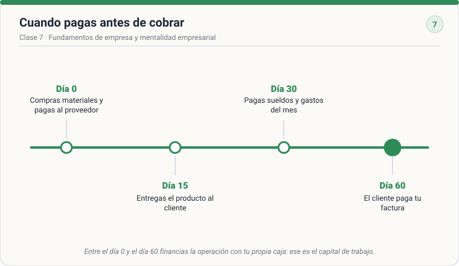

# Clase 007 — Activos, pasivos, patrimonio y capital de trabajo

> **Parte 01 · Fundamentos de empresa y mentalidad empresarial** — clase 7 de 14

**Estado de evidencia:** `GUIA-PRACTICA` · **Jurisdicción:** Chile-first · **Fecha base normativa:** 07-08-2026 
**Decisión que habilita:** determinar cuánta caja inmoviliza la operación por cada peso adicional de venta 
**Entregable:** cálculo de capital de trabajo actual y proyectado a un crecimiento de 50%

## 🎯 Propósito

Entender por qué una empresa rentable puede quedarse sin dinero, que es la lección de esta parte con mayor efecto práctico sobre la supervivencia del primer año.

## 📚 Resultados de aprendizaje

Al finalizar esta clase podrás:

1. **Definir** con precisión los cuatro conceptos de la tabla siguiente y usarlos para describir un caso real.
2. **Explicar** por qué esta materia condiciona decisiones de otras partes del programa.
3. **Decidir** —determinar cuánta caja inmoviliza la operación por cada peso adicional de venta— y justificar la decisión por escrito.
4. **Producir** el entregable de la clase y contrastarlo contra su criterio de aceptación.
5. **Distinguir** el dato estable del dato dinámico que exige revalidación en la fuente oficial.

## 🧩 Conceptos centrales

| Concepto | Comprensión verificable |
|---|---|
| **Activo** | Recurso controlado por la empresa con capacidad de generar beneficio futuro. |
| **Pasivo** | Obligación presente que consumirá recursos. |
| **Patrimonio** | Diferencia entre activos y pasivos; lo que queda para los dueños. |
| **Capital de trabajo** | Activo corriente menos pasivo corriente; la caja que la operación inmoviliza. |

## 🗺️ Modelo mental: Cuando pagas antes de cobrar

> **La idea en una frase:** Una empresa rentable puede quedarse sin dinero si cobra a sesenta días y paga a treinta: cada peso de crecimiento consume caja antes de volver.

**Qué mirar primero:** La línea muestra cuándo sale y cuándo entra el dinero. El tramo entre el primer pago y el cobro es la caja que la empresa debe financiar por su cuenta.

**Una imagen cotidiana:** Es llenar una piscina con una manguera mientras otra la vacía: crecer sin mirar el desfase hace que el nivel baje aunque haya mucha agua pasando.

## 📖 Desarrollo

### 1. El fondo del asunto

El capital de trabajo explica por qué una empresa rentable puede quedarse sin dinero: si se cobra a sesenta días y se paga a treinta, cada peso de crecimiento consume caja. Entender esta ecuación antes de crecer evita la trampa clásica de vender más y quebrar.

### 2. Cómo se traduce en la práctica

Calcula tres números: los días que tardas en cobrar, los días que tardas en pagar y los días que tienes inventario. El capital de trabajo es el costo diario de operar multiplicado por esos días netos. Antes de aceptar un pedido grande, calcula cuánto financiamiento adicional requiere y de dónde saldrá. Negociar cobro más corto o pago más largo mejora la caja sin vender más.

### 3. Marco aplicable y quién interviene

- Código de Comercio y Código Civil como base de los actos de comercio y las obligaciones
- Ley 20.416 (Estatuto Pyme) para el encuadre de tamaño de empresa
- clasificación de empresa por ventas anuales en UF que usan SII, Sercotec y Corfo

**Autoridades o contrapartes involucradas:** SII, Registro de Empresas y Sociedades, Servicio Nacional del Consumidor.
**Profesionales de apoyo:** fundador o gerencia, contador, abogado corporativo. La participación concreta depende del riesgo, del
tamaño de la empresa y de la actividad económica.

### 4. Los números, paso a paso

Una empresa vende 10 millones al mes con un margen de 30 %. Paga a proveedores a los 30 días y cobra a los 60. El desfase es de 30 días, es decir, necesita financiar cerca de 7 millones de costos antes de recibir el primer pago. Si duplica sus ventas a 20 millones, necesita 14 millones de capital de trabajo: ganó más, pero tiene menos caja disponible (cifras ilustrativas).

### 5. En qué se apoya

- **Financial Intelligence** (Harvard Business Review Press): Berman y Knight explican el capital de trabajo y el ciclo del efectivo, y por qué una empresa con utilidades puede quedarse sin caja.
- **Principles of Corporate Finance** (McGraw-Hill): Brealey y Myers tratan la gestión del capital de trabajo como parte de las decisiones financieras de corto plazo de cualquier empresa.

*Las lecturas de apoyo ofrecen marcos conceptuales; lo que exige la ley chilena se verifica en las fuentes oficiales de esta clase.*

## 🧪 Taller guiado

Aplica esta clase a **una** de las siguientes líneas de negocio y repite después el ejercicio con
una segunda línea de carga regulatoria distinta:

| Línea | Carga regulatoria |
|---|---|
| SaaS B2B con IA | media |
| Servicios profesionales | baja |
| E-commerce D2C | media |
| Alimentos o foodtech | alta |
| Exportación de servicios | media |
| Fintech regulada | alta |
| Construcción o servicios técnicos | alta |

**Secuencia de trabajo:**

1. Delimita el contexto: actividad económica, escala, comuna y etapa de la empresa.
2. Reúne los antecedentes que la decisión exige y anota la fecha de cada fuente.
3. Identifica las alternativas reales, incluida la de no hacer nada.
4. Evalúa el impacto en mercado, caja, personas, regulación y operación.
5. Toma la decisión y regístrala con sus supuestos.
6. Produce el entregable.
7. Contrástalo contra el criterio de aceptación.
8. Anota lo que requiere validación profesional y programa su revisión.

### 📦 Entregable

Cálculo de capital de trabajo actual y proyectado a un crecimiento de 50%.

Debe incluir decisión, supuestos, fuentes con fecha de consulta, responsable, riesgos
identificados y próximos pasos.

## 🏆 Reto verificable

Resuelve la misma materia para una segunda línea de negocio con distinta carga regulatoria y
explica por escrito **qué cambió, por qué y qué fuente lo determina**.

## ✅ Criterio de aceptación

- [ ] el capital de trabajo está calculado con datos propios
- [ ] se muestra el efecto de un crecimiento sobre la caja
- [ ] cada afirmación regulatoria está referida a una fuente oficial con fecha de consulta;
- [ ] los datos dinámicos quedan marcados para revalidación;
- [ ] hay un responsable asignado y evidencia reproducible del trabajo.

## ⚠️ Errores frecuentes

**Propios de esta clase:**

- Confundir patrimonio contable con dinero disponible.
- Crecer sin financiar el capital de trabajo adicional que el crecimiento exige.

**Característicos de la parte 01:**

- Confundir facturación con utilidad y utilidad con caja disponible.
- Construir un autoempleo creyendo que se construye una empresa vendible.

## 🇨🇱 Checklist Chile

- [ ] ¿existe norma o autoridad específica para esta materia?
- [ ] ¿la fuente consultada está vigente a la fecha de ejecución?
- [ ] ¿se activa algún trámite ante el SII?
- [ ] ¿se activa algún requisito municipal o sectorial?
- [ ] ¿afecta a consumidores o al tratamiento de datos personales?
- [ ] ¿afecta a trabajadores o a la seguridad y salud en el trabajo?
- [ ] ¿afecta a impuestos, contabilidad o caja?
- [ ] ¿afecta a contratos o a propiedad intelectual?
- [ ] ¿requiere renovación, reporte periódico o revalidación?

## ❓ Preguntas de comprobación

1. ¿Cuánta caja inmoviliza hoy tu operación por cada millón de venta mensual?
2. ¿Qué pasaría con tu caja si duplicaras las ventas el próximo trimestre?
3. ¿De dónde saldría el capital de trabajo adicional que ese crecimiento exige?

## 🔗 Fuentes oficiales

**Biblioteca del Congreso Nacional · LeyChile — Normativa oficial consolidada**  
<https://www.bcn.cl/leychile/> · verificado 2026-11-05

- *Qué contiene:* Publica el texto oficial y consolidado de leyes, decretos y reglamentos, con la versión vigente a una fecha, el historial de modificaciones y la tramitación que las originó.
- *Cómo leerla:* Usa siempre el selector de versión vigente a la fecha en que ejecutarás el trámite, no la última publicada. Y lee el artículo transitorio: en normas en implantación gradual —jornada, datos personales— ahí está la fecha que realmente te aplica.
- *Uso en esta clase:* aporta el marco de «Normativa oficial consolidada» para determinar cuánta caja inmoviliza la operación por cada peso adicional de venta.

**Servicio de Impuestos Internos — Nuevos contribuyentes, inicio de actividades y DTE**  
<https://www.sii.cl/ayudas/nuevos_contribuyentes/boleta-vys-facturador.html> · verificado 2026-11-05

- *Qué contiene:* Reúne el circuito completo del contribuyente nuevo: obtención de RUT, declaración de inicio de actividades, elección de códigos de actividad económica y habilitación para emitir documentos tributarios electrónicos.
- *Cómo leerla:* Sepáralo en dos actos distintos que la página trata seguidos: el RUT identifica, el inicio de actividades habilita. Lo que te bloquea para facturar casi siempre está en el segundo, no en el primero.
- *Uso en esta clase:* aporta el marco de «Nuevos contribuyentes, inicio de actividades y DTE» para determinar cuánta caja inmoviliza la operación por cada peso adicional de venta.

**Servicio de Cooperación Técnica — Fomento para micro y pequeñas empresas**  
<https://www.sercotec.cl/> · verificado 2026-11-05

- *Qué contiene:* Publica las convocatorias vigentes con sus bases: perfil de empresa elegible, monto del subsidio, cofinanciamiento exigido, gastos financiables y obligaciones de rendición.
- *Cómo leerla:* Lee las bases desde el final: la sección de rendición decide si podrás quedarte con el subsidio. Muchos proyectos se adjudican y después devuelven fondos por no poder acreditar el gasto en la forma exigida.
- *Uso en esta clase:* aporta el marco de «Fomento para micro y pequeñas empresas» para determinar cuánta caja inmoviliza la operación por cada peso adicional de venta.

**Harvard Business Review Press — Financial Intelligence**  
<https://openlibrary.org/isbn/9781591397649> · verificado 2026-11-25

- *Qué contiene:* Explica a personas no financieras cómo leer estados financieros, márgenes, flujo de caja y capital de trabajo.
- *Cómo leerla:* Úsalo como marco conceptual para entender el porqué de la práctica, nunca como prueba de lo que exige la ley chilena; para eso están las fuentes oficiales de la clase.
- *Uso en esta clase:* aporta el marco de «Financial Intelligence» para determinar cuánta caja inmoviliza la operación por cada peso adicional de venta.

**McGraw-Hill — Principles of Corporate Finance**  
<https://openlibrary.org/isbn/9780071140539> · verificado 2026-11-25

- *Qué contiene:* Texto de finanzas corporativas: valor presente, riesgo, costo de capital y decisiones de inversión. Se usa como lectura de apoyo conceptual y no como fuente normativa.
- *Cómo leerla:* Úsalo como marco conceptual para entender el porqué de la práctica, nunca como prueba de lo que exige la ley chilena; para eso están las fuentes oficiales de la clase.
- *Uso en esta clase:* aporta el marco de «Principles of Corporate Finance» para determinar cuánta caja inmoviliza la operación por cada peso adicional de venta.

Complementos del repositorio: [glosario](../../../docs/19_GLOSSARY.md) ·
[ruta de lecturas](../../../docs/15_BOOKS_AND_LEARNING_PATH.md) ·
[catálogo de fuentes](../../../docs/16_OFFICIAL_SOURCE_CATALOG.md).

> [!IMPORTANT]
> Material educativo. Para una decisión real de alto impacto hay que verificar la fuente oficial
> vigente y validar con el profesional competente.

---

| Anterior | Índice | Siguiente |
|---|---|---|
| [← 006 · Ingresos, costos, gastos, inversión y utilidad](../class-06-ingresos-costos-gastos-inversion-y-utilidad/README.md) | [Parte 01](../README.md) · [Programa](../../../README.md) | [008 · Riesgo, incertidumbre y toma de decisiones →](../class-08-riesgo-incertidumbre-y-toma-de-decisiones/README.md) |
