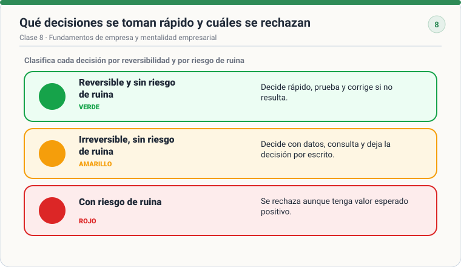

# Clase 008 — Riesgo, incertidumbre y toma de decisiones

> **Parte 01 · Fundamentos de empresa y mentalidad empresarial** — clase 8 de 14

**Estado de evidencia:** `GUIA-PRACTICA` · **Jurisdicción:** Chile-first · **Fecha base normativa:** 07-08-2026 
**Decisión que habilita:** clasificar cada decisión por reversibilidad y por exposición a ruina antes de decidir 
**Entregable:** registro de decisiones con reversibilidad, exposición máxima y criterio de reversión

## 🎯 Propósito

Instalar una regla de decisión que protege a la empresa de la ruina: tratar rápido lo reversible, lento lo irreversible, y rechazar toda exposición ilimitada aunque el valor esperado sea positivo.

## 📚 Resultados de aprendizaje

Al finalizar esta clase podrás:

1. **Definir** con precisión los cuatro conceptos de la tabla siguiente y usarlos para describir un caso real.
2. **Explicar** por qué esta materia condiciona decisiones de otras partes del programa.
3. **Decidir** —clasificar cada decisión por reversibilidad y por exposición a ruina antes de decidir— y justificar la decisión por escrito.
4. **Producir** el entregable de la clase y contrastarlo contra su criterio de aceptación.
5. **Distinguir** el dato estable del dato dinámico que exige revalidación en la fuente oficial.

## 🧩 Conceptos centrales

| Concepto | Comprensión verificable |
|---|---|
| **Riesgo** | Evento con probabilidad estimable y consecuencia acotada. |
| **Incertidumbre** | Situación donde no se conoce la distribución de resultados posibles. |
| **Apuesta reversible** | Decisión que puede deshacerse a bajo costo. |
| **Ruina** | Escenario del que la empresa no puede recuperarse aunque el valor esperado sea positivo. |

## 🗺️ Modelo mental: Qué decisiones se toman rápido y cuáles se rechazan

> **La idea en una frase:** Se deciden rápido las cosas reversibles y se piensan despacio las irreversibles, y se rechaza toda apuesta cuya pérdida pueda destruir la empresa.

**Lectura guiada:** Cada banda es una regla de decisión. Pon cada decisión importante en una banda antes de discutirla: lo que cae en rojo no se negocia, y lo que cae en verde no debe frenarse por exceso de análisis.

**Una analogía:** Es cruzar un río: si el agua llega a los tobillos pruebas el paso; si llega al cuello, no importa cuántas veces hayas cruzado antes.

## 📖 Desarrollo

### 1. El fondo del asunto

La regla operativa es tratar rápido las decisiones reversibles y lento las irreversibles, y rechazar toda apuesta con riesgo de ruina aunque tenga valor esperado positivo. Un contrato con cláusula de responsabilidad ilimitada puede ser rentable en promedio y aun así ser inaceptable.

### 2. Cómo se traduce en la práctica

Escribe las tres bandas en una hoja y, durante un mes, clasifica por ellas todas las decisiones de más de cierto monto. Define de antemano qué significa ruina para tu empresa (por ejemplo, perder más de seis meses de caja). Las decisiones verdes se delegan; las amarillas se documentan; las rojas se rechazan o se rediseñan para reducir la exposición.

### 3. Marco aplicable y quién interviene

- Código de Comercio y Código Civil como base de los actos de comercio y las obligaciones
- Ley 20.416 (Estatuto Pyme) para el encuadre de tamaño de empresa
- clasificación de empresa por ventas anuales en UF que usan SII, Sercotec y Corfo

**Autoridades o contrapartes involucradas:** SII, Registro de Empresas y Sociedades, Servicio Nacional del Consumidor.
**Profesionales de apoyo:** fundador o gerencia, contador, abogado corporativo. La participación concreta depende del riesgo, del
tamaño de la empresa y de la actividad económica.

### 4. Un error y su corrección

El error: una pyme firma un contrato con una cláusula de responsabilidad ilimitada porque el cliente es grande y la utilidad esperada es buena. La corrección: ponerlo en la banda roja. Aunque en promedio el contrato deje ganancias, un solo incidente puede superar el patrimonio de la empresa. Se negocia un tope de responsabilidad o se rechaza; en cambio, cambiar el proveedor de embalaje, una decisión reversible, se prueba durante un mes sin comité (caso ilustrativo).

### 5. En qué se apoya

- **Thinking in Bets** (Portfolio): Duke propone evaluar la calidad de una decisión por la información y el razonamiento disponibles y no solo por su resultado, y tratar las decisiones como apuestas con probabilidades.
- **The Black Swan** (Random House): Taleb sostiene que los eventos improbables de gran impacto dominan los resultados, por lo que evitar la ruina importa más que optimizar el promedio.

*Las lecturas de apoyo ofrecen marcos conceptuales; lo que exige la ley chilena se verifica en las fuentes oficiales de esta clase.*

## 🧪 Taller guiado

Aplica esta clase a **una** de las siguientes líneas de negocio y repite después el ejercicio con
una segunda línea de carga regulatoria distinta:

| Línea | Carga regulatoria |
|---|---|
| SaaS B2B con IA | media |
| Servicios profesionales | baja |
| E-commerce D2C | media |
| Alimentos o foodtech | alta |
| Exportación de servicios | media |
| Fintech regulada | alta |
| Construcción o servicios técnicos | alta |

**Secuencia de trabajo:**

1. Delimita el contexto: actividad económica, escala, comuna y etapa de la empresa.
2. Reúne los antecedentes que la decisión exige y anota la fecha de cada fuente.
3. Identifica las alternativas reales, incluida la de no hacer nada.
4. Evalúa el impacto en mercado, caja, personas, regulación y operación.
5. Toma la decisión y regístrala con sus supuestos.
6. Produce el entregable.
7. Contrástalo contra el criterio de aceptación.
8. Anota lo que requiere validación profesional y programa su revisión.

### 📦 Entregable

Registro de decisiones con reversibilidad, exposición máxima y criterio de reversión.

Debe incluir decisión, supuestos, fuentes con fecha de consulta, responsable, riesgos
identificados y próximos pasos.

## 🏆 Reto verificable

Resuelve la misma materia para una segunda línea de negocio con distinta carga regulatoria y
explica por escrito **qué cambió, por qué y qué fuente lo determina**.

## ✅ Criterio de aceptación

- [ ] cada decisión registrada indica su exposición máxima
- [ ] existe un criterio explícito de reversión
- [ ] cada afirmación regulatoria está referida a una fuente oficial con fecha de consulta;
- [ ] los datos dinámicos quedan marcados para revalidación;
- [ ] hay un responsable asignado y evidencia reproducible del trabajo.

## ⚠️ Errores frecuentes

**Propios de esta clase:**

- Decidir lento lo reversible y rápido lo irreversible.
- Aceptar exposición ilimitada por un contrato atractivo.

**Característicos de la parte 01:**

- Confundir facturación con utilidad y utilidad con caja disponible.
- Construir un autoempleo creyendo que se construye una empresa vendible.

## 🇨🇱 Checklist Chile

- [ ] ¿existe norma o autoridad específica para esta materia?
- [ ] ¿la fuente consultada está vigente a la fecha de ejecución?
- [ ] ¿se activa algún trámite ante el SII?
- [ ] ¿se activa algún requisito municipal o sectorial?
- [ ] ¿afecta a consumidores o al tratamiento de datos personales?
- [ ] ¿afecta a trabajadores o a la seguridad y salud en el trabajo?
- [ ] ¿afecta a impuestos, contabilidad o caja?
- [ ] ¿afecta a contratos o a propiedad intelectual?
- [ ] ¿requiere renovación, reporte periódico o revalidación?

## ❓ Preguntas de comprobación

1. ¿Cuál es tu exposición máxima en el peor escenario de tu contrato más grande?
2. ¿Qué decisiones tomaste rápido el último año que en realidad eran irreversibles?
3. ¿Qué apuesta actual tiene riesgo de ruina y qué la haría reversible?

## 🔗 Fuentes oficiales

**Biblioteca del Congreso Nacional · LeyChile — Normativa oficial consolidada**  
<https://www.bcn.cl/leychile/> · verificado 2026-11-05

- *Qué contiene:* Publica el texto oficial y consolidado de leyes, decretos y reglamentos, con la versión vigente a una fecha, el historial de modificaciones y la tramitación que las originó.
- *Cómo leerla:* Usa siempre el selector de versión vigente a la fecha en que ejecutarás el trámite, no la última publicada. Y lee el artículo transitorio: en normas en implantación gradual —jornada, datos personales— ahí está la fecha que realmente te aplica.
- *Uso en esta clase:* aporta el marco de «Normativa oficial consolidada» para clasificar cada decisión por reversibilidad y por exposición a ruina antes de decidir.

**Servicio de Impuestos Internos — Nuevos contribuyentes, inicio de actividades y DTE**  
<https://www.sii.cl/ayudas/nuevos_contribuyentes/boleta-vys-facturador.html> · verificado 2026-11-05

- *Qué contiene:* Reúne el circuito completo del contribuyente nuevo: obtención de RUT, declaración de inicio de actividades, elección de códigos de actividad económica y habilitación para emitir documentos tributarios electrónicos.
- *Cómo leerla:* Sepáralo en dos actos distintos que la página trata seguidos: el RUT identifica, el inicio de actividades habilita. Lo que te bloquea para facturar casi siempre está en el segundo, no en el primero.
- *Uso en esta clase:* aporta el marco de «Nuevos contribuyentes, inicio de actividades y DTE» para clasificar cada decisión por reversibilidad y por exposición a ruina antes de decidir.

**Servicio de Cooperación Técnica — Fomento para micro y pequeñas empresas**  
<https://www.sercotec.cl/> · verificado 2026-11-05

- *Qué contiene:* Publica las convocatorias vigentes con sus bases: perfil de empresa elegible, monto del subsidio, cofinanciamiento exigido, gastos financiables y obligaciones de rendición.
- *Cómo leerla:* Lee las bases desde el final: la sección de rendición decide si podrás quedarte con el subsidio. Muchos proyectos se adjudican y después devuelven fondos por no poder acreditar el gasto en la forma exigida.
- *Uso en esta clase:* aporta el marco de «Fomento para micro y pequeñas empresas» para clasificar cada decisión por reversibilidad y por exposición a ruina antes de decidir.

**Portfolio — Thinking in Bets**  
<https://openlibrary.org/isbn/9780735216358> · verificado 2026-11-25

- *Qué contiene:* Aplica la lógica de las apuestas a la decisión bajo incertidumbre: separar la calidad de la decisión del resultado.
- *Cómo leerla:* Úsalo como marco conceptual para entender el porqué de la práctica, nunca como prueba de lo que exige la ley chilena; para eso están las fuentes oficiales de la clase.
- *Uso en esta clase:* aporta el marco de «Thinking in Bets» para clasificar cada decisión por reversibilidad y por exposición a ruina antes de decidir.

**Random House — The Black Swan**  
<https://openlibrary.org/isbn/9780812979183> · verificado 2026-11-25

- *Qué contiene:* Examina el impacto de los eventos improbables y los límites de la predicción. Se usa como lectura de apoyo conceptual y no como fuente normativa.
- *Cómo leerla:* Úsalo como marco conceptual para entender el porqué de la práctica, nunca como prueba de lo que exige la ley chilena; para eso están las fuentes oficiales de la clase.
- *Uso en esta clase:* aporta el marco de «The Black Swan» para clasificar cada decisión por reversibilidad y por exposición a ruina antes de decidir.

Complementos del repositorio: [glosario](../../../docs/19_GLOSSARY.md) ·
[ruta de lecturas](../../../docs/15_BOOKS_AND_LEARNING_PATH.md) ·
[catálogo de fuentes](../../../docs/16_OFFICIAL_SOURCE_CATALOG.md).

> [!IMPORTANT]
> Material educativo. Para una decisión real de alto impacto hay que verificar la fuente oficial
> vigente y validar con el profesional competente.

---

| Anterior | Índice | Siguiente |
|---|---|---|
| [← 007 · Activos, pasivos, patrimonio y capital de trabajo](../class-07-activos-pasivos-patrimonio-y-capital-de-trabajo/README.md) | [Parte 01](../README.md) · [Programa](../../../README.md) | [009 · Ética empresarial y licencia social para operar →](../class-09-etica-empresarial-y-licencia-social-para-operar/README.md) |
