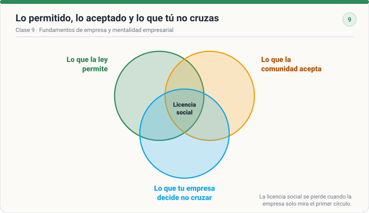

# Clase 009 — Ética empresarial y licencia social para operar

> **Parte 01 · Fundamentos de empresa y mentalidad empresarial** — clase 9 de 14

**Estado de evidencia:** `GUIA-PRACTICA` · **Jurisdicción:** Chile-first · **Fecha base normativa:** 07-08-2026 
**Decisión que habilita:** definir los límites que la empresa no cruzará aunque sean legalmente permitidos 
**Entregable:** mapa de grupos de interés con impacto, expectativa y canal de relación

## 🎯 Propósito

Tratar la licencia social como activo operativo y no como discurso: su pérdida se traduce en fiscalización, dificultad para contratar y costo de capital más alto.

## 📚 Resultados de aprendizaje

Al finalizar esta clase podrás:

1. **Definir** con precisión los cuatro conceptos de la tabla siguiente y usarlos para describir un caso real.
2. **Explicar** por qué esta materia condiciona decisiones de otras partes del programa.
3. **Decidir** —definir los límites que la empresa no cruzará aunque sean legalmente permitidos— y justificar la decisión por escrito.
4. **Producir** el entregable de la clase y contrastarlo contra su criterio de aceptación.
5. **Distinguir** el dato estable del dato dinámico que exige revalidación en la fuente oficial.

## 🧩 Conceptos centrales

| Concepto | Comprensión verificable |
|---|---|
| **Ética empresarial** | Criterio de decisión que se sostiene cuando nadie está mirando. |
| **Licencia social** | Aceptación de la comunidad que permite operar sin fricción. |
| **Grupo de interés** | Actor afectado por la operación aunque no sea cliente. |
| **Conflicto de interés** | Situación donde el interés personal compite con el de la empresa. |

## 🗺️ Modelo mental: Lo permitido, lo aceptado y lo que tú no cruzas

> **La idea en una frase:** La licencia social es un activo operativo: se pierde cuando la empresa mira solo lo que la ley permite y no lo que su comunidad y sus propios valores toleran.

**Cómo leerlo:** Los tres círculos no coinciden del todo. La zona central es donde la empresa puede operar sin conflicto; lo que está solo en el primer círculo es legal, pero puede costar fiscalización, rechazo o dificultad para contratar.

**Piénsalo así:** Es como vivir en un edificio: cumplir el reglamento es necesario, pero si no saludas ni cuidas los espacios comunes, nadie querrá trabajar contigo.

## 📖 Desarrollo

### 1. El fondo del asunto

La licencia social no es un ideal: es un activo operativo. Su pérdida se traduce en fiscalización, rechazo comunitario, dificultad para contratar y costo de capital más alto. En sectores con impacto territorial o ambiental, es a menudo el factor que determina si el proyecto se ejecuta.

### 2. Cómo se traduce en la práctica

Define tres o cuatro límites que tu empresa no cruzará aunque sean legales: por ejemplo, no pagar a proveedores con atraso deliberado, no usar publicidad que exagere o no despedir sin explicar. Escríbelos, compártelos con tu equipo y úsalos como criterio en las decisiones difíciles. Revisa también qué grupos de interés pueden retirarte su apoyo y qué señales mostrarían ese riesgo.

### 3. Marco aplicable y quién interviene

- Código de Comercio y Código Civil como base de los actos de comercio y las obligaciones
- Ley 20.416 (Estatuto Pyme) para el encuadre de tamaño de empresa
- clasificación de empresa por ventas anuales en UF que usan SII, Sercotec y Corfo

**Autoridades o contrapartes involucradas:** SII, Registro de Empresas y Sociedades, Servicio Nacional del Consumidor.
**Profesionales de apoyo:** fundador o gerencia, contador, abogado corporativo. La participación concreta depende del riesgo, del
tamaño de la empresa y de la actividad económica.

### 4. Una conversación que enseña

Gerente: «El reglamento permite operar de noche». Jefa de comunidad: «Los vecinos ya reclamaron por el ruido; si no hablamos, irán a la municipalidad». Gerente: «Pero estamos dentro de la norma». Jefa: «Dentro de la norma, sí; dentro de la tolerancia, no. Si perdemos su apoyo, nos cuesta más caro que mover un turno». Deciden acordar horarios con los vecinos y publicar un canal de contacto (conversación ilustrativa).

### 5. En qué se apoya

- **Normativa oficial consolidada** (Biblioteca del Congreso Nacional · LeyChile): La normativa oficial fija el mínimo exigible; la guía distingue ese mínimo de los límites éticos propios de la empresa, que la ley no impone y que sostienen su aceptación social.

*Las lecturas de apoyo ofrecen marcos conceptuales; lo que exige la ley chilena se verifica en las fuentes oficiales de esta clase.*

## 🛡️ Protección del conocimiento: Marco legal chileno: obligación, recomendación y medida voluntaria

[Guía de inteligencia económica y protección del conocimiento, sección 12](../../../docs/21_INTELIGENCIA_ECONOMICA_Y_PROTECCION_DEL_CONOCIMIENTO.md#12-marco-legal-chileno-obligación-recomendación-y-medida-voluntaria)

**Lente para esta clase:** La ética empresarial fija el límite de la inteligencia competitiva: qué harías aunque no hubiera ley ni forma de que te descubrieran.

| Nivel | Medida proporcionada |
|---|---|
| **Emprendedor o microempresa** | Una regla escrita de lo que no harías por ganar un cliente. |
| **Pyme** | Código de conducta de una página con ejemplos de conductas prohibidas. |
| **Gran empresa o multinacional** | Código de ética con formación, canal de consultas y sanciones aplicadas. |

**Actividad sin crear sistemas:** Escribe tres conductas que tu empresa no hará para obtener información de la competencia, aunque fueran legales.

**Términos:** Licencia social (*Social License to Operate*) · Ética empresarial (*Business Ethics*)

*Enfoque defensivo: reconocer, prevenir, documentar y escalar. No enseña a obtener información de forma indebida; la calificación jurídica de un hecho concreto corresponde a un abogado.*

## 🧪 Taller guiado

Aplica esta clase a **una** de las siguientes líneas de negocio y repite después el ejercicio con
una segunda línea de carga regulatoria distinta:

| Línea | Carga regulatoria |
|---|---|
| SaaS B2B con IA | media |
| Servicios profesionales | baja |
| E-commerce D2C | media |
| Alimentos o foodtech | alta |
| Exportación de servicios | media |
| Fintech regulada | alta |
| Construcción o servicios técnicos | alta |

**Secuencia de trabajo:**

1. Delimita el contexto: actividad económica, escala, comuna y etapa de la empresa.
2. Reúne los antecedentes que la decisión exige y anota la fecha de cada fuente.
3. Identifica las alternativas reales, incluida la de no hacer nada.
4. Evalúa el impacto en mercado, caja, personas, regulación y operación.
5. Toma la decisión y regístrala con sus supuestos.
6. Produce el entregable.
7. Contrástalo contra el criterio de aceptación.
8. Anota lo que requiere validación profesional y programa su revisión.

### 📦 Entregable

Mapa de grupos de interés con impacto, expectativa y canal de relación.

Debe incluir decisión, supuestos, fuentes con fecha de consulta, responsable, riesgos
identificados y próximos pasos.

## 🏆 Reto verificable

Resuelve la misma materia para una segunda línea de negocio con distinta carga regulatoria y
explica por escrito **qué cambió, por qué y qué fuente lo determina**.

## ✅ Criterio de aceptación

- [ ] los grupos de interés están identificados con su expectativa
- [ ] hay al menos un límite autoimpuesto declarado
- [ ] cada afirmación regulatoria está referida a una fuente oficial con fecha de consulta;
- [ ] los datos dinámicos quedan marcados para revalidación;
- [ ] hay un responsable asignado y evidencia reproducible del trabajo.

## ⚠️ Errores frecuentes

**Propios de esta clase:**

- Reducir la ética a un código escrito que nadie usa para decidir.
- Tratar a la comunidad como obstáculo y no como parte interesada.

**Característicos de la parte 01:**

- Confundir facturación con utilidad y utilidad con caja disponible.
- Construir un autoempleo creyendo que se construye una empresa vendible.

## 🇨🇱 Checklist Chile

- [ ] ¿existe norma o autoridad específica para esta materia?
- [ ] ¿la fuente consultada está vigente a la fecha de ejecución?
- [ ] ¿se activa algún trámite ante el SII?
- [ ] ¿se activa algún requisito municipal o sectorial?
- [ ] ¿afecta a consumidores o al tratamiento de datos personales?
- [ ] ¿afecta a trabajadores o a la seguridad y salud en el trabajo?
- [ ] ¿afecta a impuestos, contabilidad o caja?
- [ ] ¿afecta a contratos o a propiedad intelectual?
- [ ] ¿requiere renovación, reporte periódico o revalidación?

## ❓ Preguntas de comprobación

1. ¿Qué actores se ven afectados por tu operación sin ser clientes tuyos?
2. ¿Qué límite no cruzarías aunque fuera legalmente permitido y rentable?
3. ¿Cómo te enterarías de que estás perdiendo la aceptación de tu entorno, antes del conflicto?

## 🔗 Fuentes oficiales

**Biblioteca del Congreso Nacional · LeyChile — Normativa oficial consolidada**  
<https://www.bcn.cl/leychile/> · verificado 2026-11-05

- *Qué contiene:* Publica el texto oficial y consolidado de leyes, decretos y reglamentos, con la versión vigente a una fecha, el historial de modificaciones y la tramitación que las originó.
- *Cómo leerla:* Usa siempre el selector de versión vigente a la fecha en que ejecutarás el trámite, no la última publicada. Y lee el artículo transitorio: en normas en implantación gradual —jornada, datos personales— ahí está la fecha que realmente te aplica.
- *Uso en esta clase:* aporta el marco de «Normativa oficial consolidada» para definir los límites que la empresa no cruzará aunque sean legalmente permitidos.

**Servicio de Impuestos Internos — Nuevos contribuyentes, inicio de actividades y DTE**  
<https://www.sii.cl/ayudas/nuevos_contribuyentes/boleta-vys-facturador.html> · verificado 2026-11-05

- *Qué contiene:* Reúne el circuito completo del contribuyente nuevo: obtención de RUT, declaración de inicio de actividades, elección de códigos de actividad económica y habilitación para emitir documentos tributarios electrónicos.
- *Cómo leerla:* Sepáralo en dos actos distintos que la página trata seguidos: el RUT identifica, el inicio de actividades habilita. Lo que te bloquea para facturar casi siempre está en el segundo, no en el primero.
- *Uso en esta clase:* aporta el marco de «Nuevos contribuyentes, inicio de actividades y DTE» para definir los límites que la empresa no cruzará aunque sean legalmente permitidos.

**Servicio de Cooperación Técnica — Fomento para micro y pequeñas empresas**  
<https://www.sercotec.cl/> · verificado 2026-11-05

- *Qué contiene:* Publica las convocatorias vigentes con sus bases: perfil de empresa elegible, monto del subsidio, cofinanciamiento exigido, gastos financiables y obligaciones de rendición.
- *Cómo leerla:* Lee las bases desde el final: la sección de rendición decide si podrás quedarte con el subsidio. Muchos proyectos se adjudican y después devuelven fondos por no poder acreditar el gasto en la forma exigida.
- *Uso en esta clase:* aporta el marco de «Fomento para micro y pequeñas empresas» para definir los límites que la empresa no cruzará aunque sean legalmente permitidos.

Complementos del repositorio: [glosario](../../../docs/19_GLOSSARY.md) ·
[ruta de lecturas](../../../docs/15_BOOKS_AND_LEARNING_PATH.md) ·
[catálogo de fuentes](../../../docs/16_OFFICIAL_SOURCE_CATALOG.md).

> [!IMPORTANT]
> Material educativo. Para una decisión real de alto impacto hay que verificar la fuente oficial
> vigente y validar con el profesional competente.

---

| Anterior | Índice | Siguiente |
|---|---|---|
| [← 008 · Riesgo, incertidumbre y toma de decisiones](../class-08-riesgo-incertidumbre-y-toma-de-decisiones/README.md) | [Parte 01](../README.md) · [Programa](../../../README.md) | [010 · Formalidad, informalidad y costo del incumplimiento →](../class-10-formalidad-informalidad-y-costo-del-incumplimiento/README.md) |
