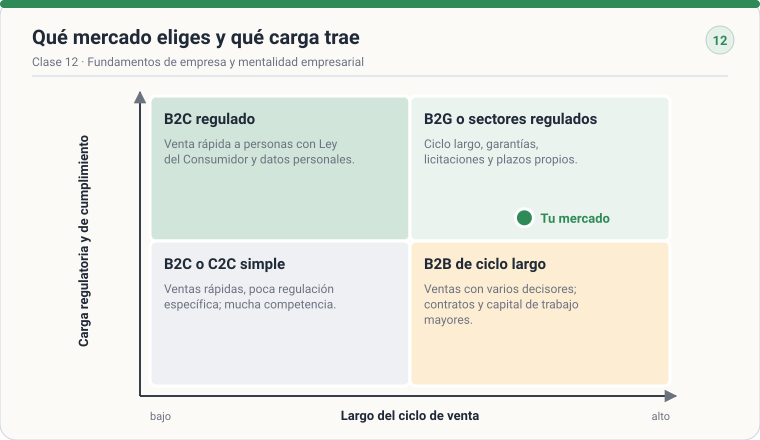

# Clase 012 — Tipos de mercado: B2C, B2B, B2G, C2C y plataformas

> **Parte 01 · Fundamentos de empresa y mentalidad empresarial** — clase 12 de 14

**Estado de evidencia:** `GUIA-PRACTICA` · **Jurisdicción:** Chile-first · **Fecha base normativa:** 07-08-2026 
**Decisión que habilita:** elegir a qué tipo de mercado se vende y aceptar la carga que trae 
**Entregable:** comparación del mismo producto vendido en dos tipos de mercado, con ciclo y regulación

## 🎯 Propósito

Elegir a qué tipo de mercado se vende sabiendo qué carga trae cada uno, porque el ciclo de venta y el capital de trabajo cambian más que el producto.

## 📚 Resultados de aprendizaje

Al finalizar esta clase podrás:

1. **Definir** con precisión los cuatro conceptos de la tabla siguiente y usarlos para describir un caso real.
2. **Explicar** por qué esta materia condiciona decisiones de otras partes del programa.
3. **Decidir** —elegir a qué tipo de mercado se vende y aceptar la carga que trae— y justificar la decisión por escrito.
4. **Producir** el entregable de la clase y contrastarlo contra su criterio de aceptación.
5. **Distinguir** el dato estable del dato dinámico que exige revalidación en la fuente oficial.

## 🧩 Conceptos centrales

| Concepto | Comprensión verificable |
|---|---|
| **B2C** | Venta a consumidor final, regulada por la ley 19.496. |
| **B2B** | Venta a empresas, con ciclo largo y decisión distribuida. |
| **B2G** | Venta al estado a través de chilecompra y licitaciones. |
| **Plataforma** | Modelo que intermedia entre dos lados y monetiza la transacción. |

## 🗺️ Modelo mental: Qué mercado eliges y qué carga trae

> **La idea en una frase:** El tipo de mercado define el ciclo de venta, el capital de trabajo y el bloque regulatorio que deberás cumplir antes de vender el primer producto.

**Cómo leerlo:** Ubica el mercado al que quieres vender según cuánto tarda en cerrar una venta y cuánta regulación trae. Cada cuadrante exige un tipo distinto de caja, equipo y asesoría.

**Una analogía:** Es elegir en qué cancha jugar: las reglas, los tiempos y el tamaño del equipo no son los mismos en fútbol, en tenis o en rugby.

## 📖 Desarrollo

### 1. El fondo del asunto

El tipo de mercado determina el ciclo de venta, el capital de trabajo requerido y el bloque regulatorio aplicable. B2C activa la Ley del Consumidor completa; B2G exige inscripción, garantías y plazos de pago propios del Estado; las plataformas asumen responsabilidades que dependen de cuánto controlan la transacción.

### 2. Cómo se traduce en la práctica

Antes de elegir mercado, haz tres preguntas: ¿cuánto tarda en cerrar una venta típica?, ¿cuánta caja debo financiar hasta el primer cobro? y ¿qué normas aplican desde el primer día? B2C activa la Ley del Consumidor completa; B2G exige inscripción y garantías propias; las plataformas asumen responsabilidades según cuánto controlan la transacción. Elige donde puedas sostener el ciclo.

### 3. Marco aplicable y quién interviene

- Código de Comercio y Código Civil como base de los actos de comercio y las obligaciones
- Ley 20.416 (Estatuto Pyme) para el encuadre de tamaño de empresa
- clasificación de empresa por ventas anuales en UF que usan SII, Sercotec y Corfo

**Autoridades o contrapartes involucradas:** SII, Registro de Empresas y Sociedades, Servicio Nacional del Consumidor.
**Profesionales de apoyo:** fundador o gerencia, contador, abogado corporativo. La participación concreta depende del riesgo, del
tamaño de la empresa y de la actividad económica.

### 4. Pruébalo tú: mini simulación

Tienes un software de gestión de bodegas. Ubícalo en el mapa en tres versiones: vendido a personas, a empresas medianas y al Estado. Para cada versión escribe cuántos meses tarda en cerrarse la primera venta, quién firma y qué normas deberás cumplir (consumidor, contratos, compras públicas). Después estima cuánta caja necesitarás para sostener el ciclo. Elige la versión que tu caja pueda financiar y registra por qué descartaste las otras.

### 5. En qué se apoya

- **The Startup Owner's Manual** (K&S Ranch): Blank y Dorf distinguen tipos de mercado (existente, nuevo y resegmentado) y explican que cada uno exige una estrategia de ventas y una inversión distintas.
- **Compras públicas y ventas al Estado** (ChileCompra): ChileCompra reúne las reglas para vender al Estado, que ilustran cómo el tipo de comprador cambia el ciclo de venta y las obligaciones del proveedor.

*Las lecturas de apoyo ofrecen marcos conceptuales; lo que exige la ley chilena se verifica en las fuentes oficiales de esta clase.*

## 🧪 Taller guiado

Aplica esta clase a **una** de las siguientes líneas de negocio y repite después el ejercicio con
una segunda línea de carga regulatoria distinta:

| Línea | Carga regulatoria |
|---|---|
| SaaS B2B con IA | media |
| Servicios profesionales | baja |
| E-commerce D2C | media |
| Alimentos o foodtech | alta |
| Exportación de servicios | media |
| Fintech regulada | alta |
| Construcción o servicios técnicos | alta |

**Secuencia de trabajo:**

1. Delimita el contexto: actividad económica, escala, comuna y etapa de la empresa.
2. Reúne los antecedentes que la decisión exige y anota la fecha de cada fuente.
3. Identifica las alternativas reales, incluida la de no hacer nada.
4. Evalúa el impacto en mercado, caja, personas, regulación y operación.
5. Toma la decisión y regístrala con sus supuestos.
6. Produce el entregable.
7. Contrástalo contra el criterio de aceptación.
8. Anota lo que requiere validación profesional y programa su revisión.

### 📦 Entregable

Comparación del mismo producto vendido en dos tipos de mercado, con ciclo y regulación.

Debe incluir decisión, supuestos, fuentes con fecha de consulta, responsable, riesgos
identificados y próximos pasos.

## 🏆 Reto verificable

Resuelve la misma materia para una segunda línea de negocio con distinta carga regulatoria y
explica por escrito **qué cambió, por qué y qué fuente lo determina**.

## ✅ Criterio de aceptación

- [ ] la comparación incluye ciclo de venta y capital de trabajo
- [ ] el bloque regulatorio de cada mercado está identificado
- [ ] cada afirmación regulatoria está referida a una fuente oficial con fecha de consulta;
- [ ] los datos dinámicos quedan marcados para revalidación;
- [ ] hay un responsable asignado y evidencia reproducible del trabajo.

## ⚠️ Errores frecuentes

**Propios de esta clase:**

- Entrar a b2g sin dimensionar el capital de trabajo que exige el plazo de pago.
- Operar una plataforma asumiendo que no responde por lo que ocurre en ella.

**Característicos de la parte 01:**

- Confundir facturación con utilidad y utilidad con caja disponible.
- Construir un autoempleo creyendo que se construye una empresa vendible.

## 🇨🇱 Checklist Chile

- [ ] ¿existe norma o autoridad específica para esta materia?
- [ ] ¿la fuente consultada está vigente a la fecha de ejecución?
- [ ] ¿se activa algún trámite ante el SII?
- [ ] ¿se activa algún requisito municipal o sectorial?
- [ ] ¿afecta a consumidores o al tratamiento de datos personales?
- [ ] ¿afecta a trabajadores o a la seguridad y salud en el trabajo?
- [ ] ¿afecta a impuestos, contabilidad o caja?
- [ ] ¿afecta a contratos o a propiedad intelectual?
- [ ] ¿requiere renovación, reporte periódico o revalidación?

## ❓ Preguntas de comprobación

1. ¿Cuánto capital de trabajo exige el ciclo de cobro de cada mercado al que apuntas?
2. ¿Qué bloque regulatorio se activa en cada uno y quién lo gestionará?
3. Si operas una plataforma, ¿de qué respondes frente al usuario final?

## 🔗 Fuentes oficiales

**Biblioteca del Congreso Nacional · LeyChile — Normativa oficial consolidada**  
<https://www.bcn.cl/leychile/> · verificado 2026-11-05

- *Qué contiene:* Publica el texto oficial y consolidado de leyes, decretos y reglamentos, con la versión vigente a una fecha, el historial de modificaciones y la tramitación que las originó.
- *Cómo leerla:* Usa siempre el selector de versión vigente a la fecha en que ejecutarás el trámite, no la última publicada. Y lee el artículo transitorio: en normas en implantación gradual —jornada, datos personales— ahí está la fecha que realmente te aplica.
- *Uso en esta clase:* aporta el marco de «Normativa oficial consolidada» para elegir a qué tipo de mercado se vende y aceptar la carga que trae.

**Servicio de Impuestos Internos — Nuevos contribuyentes, inicio de actividades y DTE**  
<https://www.sii.cl/ayudas/nuevos_contribuyentes/boleta-vys-facturador.html> · verificado 2026-11-05

- *Qué contiene:* Reúne el circuito completo del contribuyente nuevo: obtención de RUT, declaración de inicio de actividades, elección de códigos de actividad económica y habilitación para emitir documentos tributarios electrónicos.
- *Cómo leerla:* Sepáralo en dos actos distintos que la página trata seguidos: el RUT identifica, el inicio de actividades habilita. Lo que te bloquea para facturar casi siempre está en el segundo, no en el primero.
- *Uso en esta clase:* aporta el marco de «Nuevos contribuyentes, inicio de actividades y DTE» para elegir a qué tipo de mercado se vende y aceptar la carga que trae.

**Servicio de Cooperación Técnica — Fomento para micro y pequeñas empresas**  
<https://www.sercotec.cl/> · verificado 2026-11-05

- *Qué contiene:* Publica las convocatorias vigentes con sus bases: perfil de empresa elegible, monto del subsidio, cofinanciamiento exigido, gastos financiables y obligaciones de rendición.
- *Cómo leerla:* Lee las bases desde el final: la sección de rendición decide si podrás quedarte con el subsidio. Muchos proyectos se adjudican y después devuelven fondos por no poder acreditar el gasto en la forma exigida.
- *Uso en esta clase:* aporta el marco de «Fomento para micro y pequeñas empresas» para elegir a qué tipo de mercado se vende y aceptar la carga que trae.

**K&S Ranch — The Startup Owner's Manual**  
<https://openlibrary.org/isbn/9780984999309> · verificado 2026-11-25

- *Qué contiene:* Guía de desarrollo de clientes: validar hipótesis de negocio hablando con clientes antes de escalar.
- *Cómo leerla:* Úsalo como marco conceptual para entender el porqué de la práctica, nunca como prueba de lo que exige la ley chilena; para eso están las fuentes oficiales de la clase.
- *Uso en esta clase:* aporta el marco de «The Startup Owner's Manual» para elegir a qué tipo de mercado se vende y aceptar la carga que trae.

**ChileCompra — Compras públicas y ventas al Estado**  
<https://www.chilecompra.cl/> · verificado 2026-11-05

- *Qué contiene:* Opera el mercado público: registro de proveedores, licitaciones, convenios marco, garantías exigidas y plazos de pago del Estado.
- *Cómo leerla:* Antes de mirar oportunidades, revisa garantías y plazos de pago: vender al Estado exige capital de trabajo propio, y ese requisito descarta más empresas que la competencia técnica.
- *Uso en esta clase:* aporta el marco de «Compras públicas y ventas al Estado» para elegir a qué tipo de mercado se vende y aceptar la carga que trae.

Complementos del repositorio: [glosario](../../../docs/19_GLOSSARY.md) ·
[ruta de lecturas](../../../docs/15_BOOKS_AND_LEARNING_PATH.md) ·
[catálogo de fuentes](../../../docs/16_OFFICIAL_SOURCE_CATALOG.md).

> [!IMPORTANT]
> Material educativo. Para una decisión real de alto impacto hay que verificar la fuente oficial
> vigente y validar con el profesional competente.

---

| Anterior | Índice | Siguiente |
|---|---|---|
| [← 011 · Ciclo de vida completo de una empresa](../class-11-ciclo-de-vida-completo-de-una-empresa/README.md) | [Parte 01](../README.md) · [Programa](../../../README.md) | [013 · Empresa tradicional, digital y habilitada por IA →](../class-13-empresa-tradicional-digital-y-habilitada-por-ia/README.md) |
