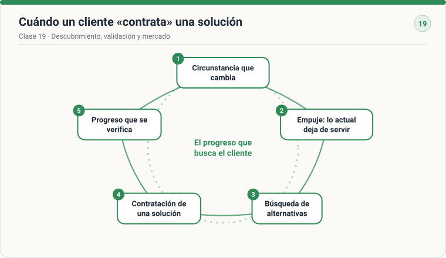

# Clase 019 — Jobs to Be Done y resultados esperados

> **Parte 02 · Descubrimiento, validación y mercado** — clase 5 de 14

**Estado de evidencia:** `GUIA-PRACTICA` · **Jurisdicción:** Chile-first · **Fecha base normativa:** 07-08-2026 
**Decisión que habilita:** definir qué progreso contrata el cliente y con qué métrica lo juzga 
**Entregable:** declaración de JTBD con circunstancia, progreso, resultados esperados y fuerzas de cambio

## 🎯 Propósito

Cambiar el foco desde el atributo del producto hacia el progreso que el cliente intenta lograr, para identificar contra qué se compite realmente.

## 📚 Resultados de aprendizaje

Al finalizar esta clase podrás:

1. **Definir** con precisión los cuatro conceptos de la tabla siguiente y usarlos para describir un caso real.
2. **Explicar** por qué esta materia condiciona decisiones de otras partes del programa.
3. **Decidir** —definir qué progreso contrata el cliente y con qué métrica lo juzga— y justificar la decisión por escrito.
4. **Producir** el entregable de la clase y contrastarlo contra su criterio de aceptación.
5. **Distinguir** el dato estable del dato dinámico que exige revalidación en la fuente oficial.

## 🧩 Conceptos centrales

| Concepto | Comprensión verificable |
|---|---|
| **Job to be done** | Progreso que el cliente busca en una circunstancia concreta. |
| **Resultado esperado** | Métrica con la que el cliente juzga si el progreso ocurrió. |
| **Circunstancia** | Contexto que gatilla la contratación de la solución. |
| **Fuerza de cambio** | Empuje del problema y atracción de la solución contra hábito y ansiedad. |

## 🗺️ Modelo mental: Cuándo un cliente «contrata» una solución

> **La idea en una frase:** El cliente no compra un producto: contrata una solución para lograr un progreso en una circunstancia concreta, y sus competidores reales son todas las formas en que hoy lo consigue.

**Qué mirar primero:** El ciclo muestra por qué se contrata una solución: algo cambia, lo actual empuja a buscar y el progreso se verifica después. Toda venta debe poder ubicarse en alguno de estos puntos.

**Una imagen cotidiana:** Es como contratar a un taxi para llegar a una reunión: lo que compras es llegar a tiempo, y tu competidor puede ser el bus, la bicicleta o salir antes.

## 📖 Desarrollo

### 1. El fondo del asunto

El marco JTBD desplaza el foco desde el atributo del producto hacia el progreso que el cliente intenta lograr. Su valor práctico es identificar los competidores reales, que muchas veces son la planilla de cálculo, el trabajo manual o no hacer nada, y no las empresas del mismo rubro.

### 2. Cómo se traduce en la práctica

Entrevista a tres clientes recientes y reconstruye la historia de su decisión: qué cambió, qué probaron antes, qué los empujó a actuar y qué habrían hecho si tu solución no existiera. Anota el progreso que esperaban y cómo lo juzgan. Esa lista define tus competidores reales y la métrica que debes mejorar: el cliente evalúa el resultado, no tus atributos.

### 3. Marco aplicable y quién interviene

- método de descubrimiento de clientes y experimentación acotada
- Jobs to Be Done como marco de resultados esperados
- estadística oficial chilena: INE, Banco Central, Censo y encuestas sectoriales

**Autoridades o contrapartes involucradas:** INE, Banco Central de Chile, SII (estadísticas de empresas por rubro).
**Profesionales de apoyo:** fundador, investigador de mercado, analista de datos. La participación concreta depende del riesgo, del
tamaño de la empresa y de la actividad económica.

### 4. Antes y después

Antes: una empresa define a su cliente como «pymes de más de 20 empleados» y compite por atributos de su software de horarios. Después: descubre que sus mejores clientes lo contrataron cuando abrieron un segundo turno y la planilla dejó de funcionar. Su competidor era la planilla y el grupo de mensajería, no otro software. Cambia el mensaje a «cuando abras el segundo turno, tus horarios no se romperán» y su tasa de respuesta sube (caso ilustrativo).

### 5. En qué se apoya

- **Value Proposition Design** (Wiley): Osterwalder y sus coautores organizan la propuesta de valor alrededor de las tareas que el cliente intenta realizar, sus dolores y sus ganancias, que es la base del enfoque de trabajos por resolver.
- **The Innovator's Dilemma** (Harper Business): Christensen explica por qué los clientes eligen productos para lograr un progreso concreto y cómo los competidores aparecen donde la empresa no los esperaba.

*Las lecturas de apoyo ofrecen marcos conceptuales; lo que exige la ley chilena se verifica en las fuentes oficiales de esta clase.*

## 🧪 Taller guiado

Aplica esta clase a **una** de las siguientes líneas de negocio y repite después el ejercicio con
una segunda línea de carga regulatoria distinta:

| Línea | Carga regulatoria |
|---|---|
| SaaS B2B con IA | media |
| Servicios profesionales | baja |
| E-commerce D2C | media |
| Alimentos o foodtech | alta |
| Exportación de servicios | media |
| Fintech regulada | alta |
| Construcción o servicios técnicos | alta |

**Secuencia de trabajo:**

1. Delimita el contexto: actividad económica, escala, comuna y etapa de la empresa.
2. Reúne los antecedentes que la decisión exige y anota la fecha de cada fuente.
3. Identifica las alternativas reales, incluida la de no hacer nada.
4. Evalúa el impacto en mercado, caja, personas, regulación y operación.
5. Toma la decisión y regístrala con sus supuestos.
6. Produce el entregable.
7. Contrástalo contra el criterio de aceptación.
8. Anota lo que requiere validación profesional y programa su revisión.

### 📦 Entregable

Declaración de jtbd con circunstancia, progreso, resultados esperados y fuerzas de cambio.

Debe incluir decisión, supuestos, fuentes con fecha de consulta, responsable, riesgos
identificados y próximos pasos.

## 🏆 Reto verificable

Resuelve la misma materia para una segunda línea de negocio con distinta carga regulatoria y
explica por escrito **qué cambió, por qué y qué fuente lo determina**.

## ✅ Criterio de aceptación

- [ ] los resultados esperados están expresados como métricas del cliente
- [ ] las cuatro fuerzas de cambio están identificadas
- [ ] cada afirmación regulatoria está referida a una fuente oficial con fecha de consulta;
- [ ] los datos dinámicos quedan marcados para revalidación;
- [ ] hay un responsable asignado y evidencia reproducible del trabajo.

## ⚠️ Errores frecuentes

**Propios de esta clase:**

- Describir el job en términos del producto y no del progreso del cliente.
- Ignorar la inercia del hábito como competidor principal.

**Característicos de la parte 02:**

- Entrevistar buscando confirmación en vez de refutación.
- Estimar mercado de arriba hacia abajo sin conexión con capacidad real de venta.

## 🇨🇱 Checklist Chile

- [ ] ¿existe norma o autoridad específica para esta materia?
- [ ] ¿la fuente consultada está vigente a la fecha de ejecución?
- [ ] ¿se activa algún trámite ante el SII?
- [ ] ¿se activa algún requisito municipal o sectorial?
- [ ] ¿afecta a consumidores o al tratamiento de datos personales?
- [ ] ¿afecta a trabajadores o a la seguridad y salud en el trabajo?
- [ ] ¿afecta a impuestos, contabilidad o caja?
- [ ] ¿afecta a contratos o a propiedad intelectual?
- [ ] ¿requiere renovación, reporte periódico o revalidación?

## ❓ Preguntas de comprobación

1. ¿Qué progreso concreto contrata tu cliente cuando te compra?
2. ¿Con qué métrica juzga él si ese progreso ocurrió?
3. ¿Cuál es la inercia del hábito que compite contigo y cómo la vences?

## 🔗 Fuentes oficiales

**Biblioteca del Congreso Nacional · LeyChile — Normativa oficial consolidada**  
<https://www.bcn.cl/leychile/> · verificado 2026-11-05

- *Qué contiene:* Publica el texto oficial y consolidado de leyes, decretos y reglamentos, con la versión vigente a una fecha, el historial de modificaciones y la tramitación que las originó.
- *Cómo leerla:* Usa siempre el selector de versión vigente a la fecha en que ejecutarás el trámite, no la última publicada. Y lee el artículo transitorio: en normas en implantación gradual —jornada, datos personales— ahí está la fecha que realmente te aplica.
- *Uso en esta clase:* aporta el marco de «Normativa oficial consolidada» para definir qué progreso contrata el cliente y con qué métrica lo juzga.

**Servicio de Cooperación Técnica — Fomento para micro y pequeñas empresas**  
<https://www.sercotec.cl/> · verificado 2026-11-05

- *Qué contiene:* Publica las convocatorias vigentes con sus bases: perfil de empresa elegible, monto del subsidio, cofinanciamiento exigido, gastos financiables y obligaciones de rendición.
- *Cómo leerla:* Lee las bases desde el final: la sección de rendición decide si podrás quedarte con el subsidio. Muchos proyectos se adjudican y después devuelven fondos por no poder acreditar el gasto en la forma exigida.
- *Uso en esta clase:* aporta el marco de «Fomento para micro y pequeñas empresas» para definir qué progreso contrata el cliente y con qué métrica lo juzga.

**ProChile — Programas, estudios de mercado y promoción**  
<https://www.prochile.gob.cl/> · verificado 2026-11-05

- *Qué contiene:* Publica estudios de mercado por país y sector, agendas de negocios, ferias, y los programas de cofinanciamiento de actividades de promoción.
- *Cómo leerla:* Los estudios de mercado por país son el mejor uso gratuito: entregan tamaño, canales, competencia y requisitos de entrada verificados, que es justo lo que una estimación bottom-up necesita.
- *Uso en esta clase:* aporta el marco de «Programas, estudios de mercado y promoción» para definir qué progreso contrata el cliente y con qué métrica lo juzga.

**Wiley — Value Proposition Design**  
<https://openlibrary.org/isbn/9781118968055> · verificado 2026-11-25

- *Qué contiene:* Método para ajustar una propuesta de valor a las tareas, los dolores y las ganancias del cliente.
- *Cómo leerla:* Úsalo como marco conceptual para entender el porqué de la práctica, nunca como prueba de lo que exige la ley chilena; para eso están las fuentes oficiales de la clase.
- *Uso en esta clase:* aporta el marco de «Value Proposition Design» para definir qué progreso contrata el cliente y con qué métrica lo juzga.

**Harper Business — The Innovator's Dilemma**  
<https://openlibrary.org/isbn/9780066620695> · verificado 2026-11-25

- *Qué contiene:* Explica por qué empresas bien gestionadas pueden perder frente a tecnologías o modelos disruptivos. Se usa como lectura de apoyo conceptual y no como fuente normativa.
- *Cómo leerla:* Úsalo como marco conceptual para entender el porqué de la práctica, nunca como prueba de lo que exige la ley chilena; para eso están las fuentes oficiales de la clase.
- *Uso en esta clase:* aporta el marco de «The Innovator's Dilemma» para definir qué progreso contrata el cliente y con qué métrica lo juzga.

Complementos del repositorio: [glosario](../../../docs/19_GLOSSARY.md) ·
[ruta de lecturas](../../../docs/15_BOOKS_AND_LEARNING_PATH.md) ·
[catálogo de fuentes](../../../docs/16_OFFICIAL_SOURCE_CATALOG.md).

> [!IMPORTANT]
> Material educativo. Para una decisión real de alto impacto hay que verificar la fuente oficial
> vigente y validar con el profesional competente.

---

| Anterior | Índice | Siguiente |
|---|---|---|
| [← 018 · Segmentación y perfil de cliente ideal](../class-04-segmentacion-y-perfil-de-cliente-ideal/README.md) | [Parte 02](../README.md) · [Programa](../../../README.md) | [020 · Tamaño de mercado TAM SAM SOM →](../class-06-tamano-de-mercado-tam-sam-som/README.md) |
