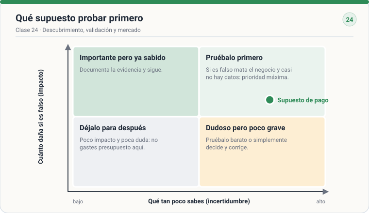

# Clase 024 — Hipótesis críticas del negocio

> **Parte 02 · Descubrimiento, validación y mercado** — clase 10 de 14

**Estado de evidencia:** `GUIA-PRACTICA` · **Jurisdicción:** Chile-first · **Fecha base normativa:** 07-08-2026 
**Decisión que habilita:** priorizar qué supuestos se prueban primero y con qué presupuesto 
**Entregable:** lista de hipótesis críticas ordenada por impacto e incertidumbre, con experimento asociado

## 🎯 Propósito

Ordenar los supuestos por el producto de impacto e incertidumbre, para probar primero lo que mataría el negocio si fuera falso y sobre lo que además se sabe menos.

## 📚 Resultados de aprendizaje

Al finalizar esta clase podrás:

1. **Definir** con precisión los cuatro conceptos de la tabla siguiente y usarlos para describir un caso real.
2. **Explicar** por qué esta materia condiciona decisiones de otras partes del programa.
3. **Decidir** —priorizar qué supuestos se prueban primero y con qué presupuesto— y justificar la decisión por escrito.
4. **Producir** el entregable de la clase y contrastarlo contra su criterio de aceptación.
5. **Distinguir** el dato estable del dato dinámico que exige revalidación en la fuente oficial.

## 🧩 Conceptos centrales

| Concepto | Comprensión verificable |
|---|---|
| **Hipótesis crítica** | Supuesto cuyo error invalida todo el negocio. |
| **Riesgo de deseabilidad** | Que el cliente no quiera la solución. |
| **Riesgo de viabilidad** | Que el modelo no genere margen suficiente. |
| **Riesgo de factibilidad** | Que la empresa no pueda entregarlo de forma sostenible. |

## 🗺️ Modelo mental: Qué supuesto probar primero

> **La idea en una frase:** No todos los supuestos merecen una prueba: se prueba primero lo que, si resulta falso, mata el negocio y sobre lo que menos se sabe.

**Cómo leerlo:** Ubica cada supuesto de tu plan según el daño que haría si fuera falso y qué tan poco sabes de él. El cuadrante superior derecho define tu primer experimento.

**Una analogía:** Es revisar los cimientos antes que la pintura: lo que sostiene todo se verifica primero, aunque sea menos vistoso.

## 📖 Desarrollo

### 1. El fondo del asunto

No todos los supuestos merecen ser probados. La prioridad la fija el producto de impacto por incertidumbre: primero se prueba lo que, siendo falso, mata el negocio y sobre lo que además se sabe menos. Ese orden ahorra meses de trabajo en la dirección equivocada.

### 2. Cómo se traduce en la práctica

Haz una lista de diez supuestos y escribe, para cada uno, el daño si es falso y la evidencia que tienes. Elige los dos que quedan arriba a la derecha y diseña un experimento de una a dos semanas para cada uno, con presupuesto, umbral y fecha. Deja los demás en espera. Revisa la lista cuando aprendas algo: la prioridad cambia con la evidencia.

### 3. Marco aplicable y quién interviene

- método de descubrimiento de clientes y experimentación acotada
- Jobs to Be Done como marco de resultados esperados
- estadística oficial chilena: INE, Banco Central, Censo y encuestas sectoriales

**Autoridades o contrapartes involucradas:** INE, Banco Central de Chile, SII (estadísticas de empresas por rubro).
**Profesionales de apoyo:** fundador, investigador de mercado, analista de datos. La participación concreta depende del riesgo, del
tamaño de la empresa y de la actividad económica.

### 4. Cómo se decide, paso a paso

Decide el orden con tres preguntas. Uno: lista todos los supuestos del plan (deseabilidad, viabilidad, factibilidad). Dos: para cada uno, ¿qué ocurre si es falso? Si es mortal, sube; si es menor, baja. Tres: ¿qué evidencia tienes? Si es poca, sube. Con una pyme de catering: que los clientes paguen precio premium es mortal y poco sabido (primero); que el proveedor de cajas entregue a tiempo es importante pero ya conocido (se documenta).

### 5. En qué se apoya

- **The Lean Startup (2011)** (Crown Business): Ries propone identificar los supuestos de mayor riesgo del plan (los actos de fe) y probarlos primero con experimentos baratos.
- **Running Lean** (O'Reilly): Maurya adapta esa idea al lienzo lean y propone priorizar los riesgos del modelo de negocio y probar primero los más peligrosos.

*Las lecturas de apoyo ofrecen marcos conceptuales; lo que exige la ley chilena se verifica en las fuentes oficiales de esta clase.*

## 🧪 Taller guiado

Aplica esta clase a **una** de las siguientes líneas de negocio y repite después el ejercicio con
una segunda línea de carga regulatoria distinta:

| Línea | Carga regulatoria |
|---|---|
| SaaS B2B con IA | media |
| Servicios profesionales | baja |
| E-commerce D2C | media |
| Alimentos o foodtech | alta |
| Exportación de servicios | media |
| Fintech regulada | alta |
| Construcción o servicios técnicos | alta |

**Secuencia de trabajo:**

1. Delimita el contexto: actividad económica, escala, comuna y etapa de la empresa.
2. Reúne los antecedentes que la decisión exige y anota la fecha de cada fuente.
3. Identifica las alternativas reales, incluida la de no hacer nada.
4. Evalúa el impacto en mercado, caja, personas, regulación y operación.
5. Toma la decisión y regístrala con sus supuestos.
6. Produce el entregable.
7. Contrástalo contra el criterio de aceptación.
8. Anota lo que requiere validación profesional y programa su revisión.

### 📦 Entregable

Lista de hipótesis críticas ordenada por impacto e incertidumbre, con experimento asociado.

Debe incluir decisión, supuestos, fuentes con fecha de consulta, responsable, riesgos
identificados y próximos pasos.

## 🏆 Reto verificable

Resuelve la misma materia para una segunda línea de negocio con distinta carga regulatoria y
explica por escrito **qué cambió, por qué y qué fuente lo determina**.

## ✅ Criterio de aceptación

- [ ] las hipótesis están ordenadas por impacto e incertidumbre
- [ ] cada hipótesis crítica tiene un experimento definido
- [ ] cada afirmación regulatoria está referida a una fuente oficial con fecha de consulta;
- [ ] los datos dinámicos quedan marcados para revalidación;
- [ ] hay un responsable asignado y evidencia reproducible del trabajo.

## ⚠️ Errores frecuentes

**Propios de esta clase:**

- Probar primero lo más fácil de probar en vez de lo más crítico.
- Tratar un riesgo regulatorio como un detalle que se resuelve después.

**Característicos de la parte 02:**

- Entrevistar buscando confirmación en vez de refutación.
- Estimar mercado de arriba hacia abajo sin conexión con capacidad real de venta.

## 🇨🇱 Checklist Chile

- [ ] ¿existe norma o autoridad específica para esta materia?
- [ ] ¿la fuente consultada está vigente a la fecha de ejecución?
- [ ] ¿se activa algún trámite ante el SII?
- [ ] ¿se activa algún requisito municipal o sectorial?
- [ ] ¿afecta a consumidores o al tratamiento de datos personales?
- [ ] ¿afecta a trabajadores o a la seguridad y salud en el trabajo?
- [ ] ¿afecta a impuestos, contabilidad o caja?
- [ ] ¿afecta a contratos o a propiedad intelectual?
- [ ] ¿requiere renovación, reporte periódico o revalidación?

## ❓ Preguntas de comprobación

1. ¿Qué supuesto, si resulta falso, invalida todo el negocio?
2. ¿Estás probando primero lo más crítico o lo más cómodo?
3. ¿Qué riesgo regulatorio estás tratando como detalle a resolver después?

## 🔗 Fuentes oficiales

**Biblioteca del Congreso Nacional · LeyChile — Normativa oficial consolidada**  
<https://www.bcn.cl/leychile/> · verificado 2026-11-05

- *Qué contiene:* Publica el texto oficial y consolidado de leyes, decretos y reglamentos, con la versión vigente a una fecha, el historial de modificaciones y la tramitación que las originó.
- *Cómo leerla:* Usa siempre el selector de versión vigente a la fecha en que ejecutarás el trámite, no la última publicada. Y lee el artículo transitorio: en normas en implantación gradual —jornada, datos personales— ahí está la fecha que realmente te aplica.
- *Uso en esta clase:* aporta el marco de «Normativa oficial consolidada» para priorizar qué supuestos se prueban primero y con qué presupuesto.

**Servicio de Cooperación Técnica — Fomento para micro y pequeñas empresas**  
<https://www.sercotec.cl/> · verificado 2026-11-05

- *Qué contiene:* Publica las convocatorias vigentes con sus bases: perfil de empresa elegible, monto del subsidio, cofinanciamiento exigido, gastos financiables y obligaciones de rendición.
- *Cómo leerla:* Lee las bases desde el final: la sección de rendición decide si podrás quedarte con el subsidio. Muchos proyectos se adjudican y después devuelven fondos por no poder acreditar el gasto en la forma exigida.
- *Uso en esta clase:* aporta el marco de «Fomento para micro y pequeñas empresas» para priorizar qué supuestos se prueban primero y con qué presupuesto.

**ProChile — Programas, estudios de mercado y promoción**  
<https://www.prochile.gob.cl/> · verificado 2026-11-05

- *Qué contiene:* Publica estudios de mercado por país y sector, agendas de negocios, ferias, y los programas de cofinanciamiento de actividades de promoción.
- *Cómo leerla:* Los estudios de mercado por país son el mejor uso gratuito: entregan tamaño, canales, competencia y requisitos de entrada verificados, que es justo lo que una estimación bottom-up necesita.
- *Uso en esta clase:* aporta el marco de «Programas, estudios de mercado y promoción» para priorizar qué supuestos se prueban primero y con qué presupuesto.

**Crown Business — The Lean Startup (2011)**  
<https://openlibrary.org/isbn/9780307887894> · verificado 2026-11-25

- *Qué contiene:* Propone construir, medir y aprender con ciclos cortos y con indicadores accionables, en lugar de métricas de vanidad.
- *Cómo leerla:* Úsalo como marco conceptual para entender el porqué de la práctica, nunca como prueba de lo que exige la ley chilena; para eso están las fuentes oficiales de la clase.
- *Uso en esta clase:* aporta el marco de «The Lean Startup (2011)» para priorizar qué supuestos se prueban primero y con qué presupuesto.

**O'Reilly — Running Lean**  
<https://openlibrary.org/isbn/9781449331900> · verificado 2026-11-25

- *Qué contiene:* Método para iterar un modelo de negocio con el lienzo lean y experimentos cortos. Se usa como lectura de apoyo conceptual y no como fuente normativa.
- *Cómo leerla:* Úsalo como marco conceptual para entender el porqué de la práctica, nunca como prueba de lo que exige la ley chilena; para eso están las fuentes oficiales de la clase.
- *Uso en esta clase:* aporta el marco de «Running Lean» para priorizar qué supuestos se prueban primero y con qué presupuesto.

Complementos del repositorio: [glosario](../../../docs/19_GLOSSARY.md) ·
[ruta de lecturas](../../../docs/15_BOOKS_AND_LEARNING_PATH.md) ·
[catálogo de fuentes](../../../docs/16_OFFICIAL_SOURCE_CATALOG.md).

> [!IMPORTANT]
> Material educativo. Para una decisión real de alto impacto hay que verificar la fuente oficial
> vigente y validar con el profesional competente.

---

| Anterior | Índice | Siguiente |
|---|---|---|
| [← 023 · Propuesta de valor y diferenciación](../class-09-propuesta-de-valor-y-diferenciacion/README.md) | [Parte 02](../README.md) · [Programa](../../../README.md) | [025 · Experimentos de demanda antes de invertir →](../class-11-experimentos-de-demanda-antes-de-invertir/README.md) |
