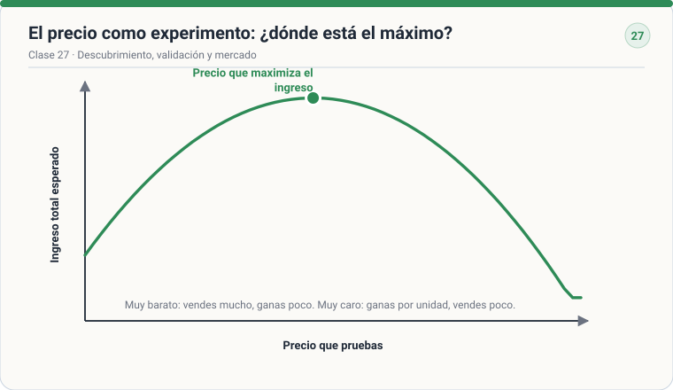

# Clase 027 — Precio como experimento de mercado

> **Parte 02 · Descubrimiento, validación y mercado** — clase 13 de 14

**Estado de evidencia:** `GUIA-PRACTICA` · **Jurisdicción:** Chile-first · **Fecha base normativa:** 07-08-2026 
**Decisión que habilita:** fijar el precio inicial con un método declarado y un plan de prueba 
**Entregable:** experimento de precio con al menos dos niveles y registro de tasa de conversión

## 🎯 Propósito

Tratar el precio como experimento y no como dato heredado del competidor, porque es la variable con mayor efecto sobre el resultado y la que menos se prueba.

## 📚 Resultados de aprendizaje

Al finalizar esta clase podrás:

1. **Definir** con precisión los cuatro conceptos de la tabla siguiente y usarlos para describir un caso real.
2. **Explicar** por qué esta materia condiciona decisiones de otras partes del programa.
3. **Decidir** —fijar el precio inicial con un método declarado y un plan de prueba— y justificar la decisión por escrito.
4. **Producir** el entregable de la clase y contrastarlo contra su criterio de aceptación.
5. **Distinguir** el dato estable del dato dinámico que exige revalidación en la fuente oficial.

## 🧩 Conceptos centrales

| Concepto | Comprensión verificable |
|---|---|
| **Precio de referencia** | Monto que el cliente ya paga por la alternativa actual. |
| **Disposición a pagar** | Máximo que el cliente pagaría antes de rechazar. |
| **Ancla** | Primer número que condiciona la percepción de todo el resto. |
| **Elasticidad** | Sensibilidad de la demanda ante un cambio de precio. |

## 🗺️ Modelo mental: El precio como experimento: ¿dónde está el máximo?

> **La idea en una frase:** El precio es la variable de negocio con mayor efecto sobre el resultado y la que más se decide por imitación; probarlo como experimento entrega más información que cualquier análisis.

**Cómo leerlo:** A precios bajos vendes mucho pero ganas poco por unidad; a precios altos ocurre al revés. El máximo del ingreso está entre ambos y solo se descubre probando niveles distintos.

**Una imagen cotidiana:** Es afinar una guitarra: no sabes cuánto apretar la cuerda hasta que pruebas y escuchas el sonido.

## 📖 Desarrollo

### 1. El fondo del asunto

El precio es la variable de negocio con mayor efecto sobre el resultado y la que más se decide por imitación. Probarlo como experimento —distintos niveles, distintos empaquetados, distinta ancla— entrega más información sobre el valor percibido que cualquier encuesta.

### 2. Cómo se traduce en la práctica

Define el método con que fijarás el precio inicial: costos más margen, valor para el cliente o referencia del mercado. Prueba al menos tres niveles o tres empaquetados distintos con grupos comparables y registra qué compra cada uno. Considera el ancla: lo primero que el cliente ve condiciona lo que le parece caro. Decide con margen y valor de vida, no solo con volumen.

### 3. Marco aplicable y quién interviene

- método de descubrimiento de clientes y experimentación acotada
- Jobs to Be Done como marco de resultados esperados
- estadística oficial chilena: INE, Banco Central, Censo y encuestas sectoriales

**Autoridades o contrapartes involucradas:** INE, Banco Central de Chile, SII (estadísticas de empresas por rubro).
**Profesionales de apoyo:** fundador, investigador de mercado, analista de datos. La participación concreta depende del riesgo, del
tamaño de la empresa y de la actividad económica.

### 4. Los números, paso a paso

Una escuela de idiomas prueba tres precios mensuales durante tres semanas con grupos similares. A $20.000 se inscriben 100 personas (ingreso $2,0 millones); a $30.000, 80 (ingreso $2,4 millones); a $40.000, 45 (ingreso $1,8 millones). El máximo está en $30.000. Antes de decidir también revisa el costo por alumno y el valor de vida del cliente, no solo el ingreso (cifras ilustrativas).

### 5. En qué se apoya

- **The Strategy and Tactics of Pricing** (Prentice Hall): Nagle y Holden tratan la fijación de precios como una decisión basada en el valor percibido por el cliente y no solo en los costos de la empresa.
- **Thinking, Fast and Slow** (Macmillan): Kahneman describe el efecto ancla, según el cual un número inicial condiciona los juicios posteriores, relevante al presentar precios.

*Las lecturas de apoyo ofrecen marcos conceptuales; lo que exige la ley chilena se verifica en las fuentes oficiales de esta clase.*

## 🧪 Taller guiado

Aplica esta clase a **una** de las siguientes líneas de negocio y repite después el ejercicio con
una segunda línea de carga regulatoria distinta:

| Línea | Carga regulatoria |
|---|---|
| SaaS B2B con IA | media |
| Servicios profesionales | baja |
| E-commerce D2C | media |
| Alimentos o foodtech | alta |
| Exportación de servicios | media |
| Fintech regulada | alta |
| Construcción o servicios técnicos | alta |

**Secuencia de trabajo:**

1. Delimita el contexto: actividad económica, escala, comuna y etapa de la empresa.
2. Reúne los antecedentes que la decisión exige y anota la fecha de cada fuente.
3. Identifica las alternativas reales, incluida la de no hacer nada.
4. Evalúa el impacto en mercado, caja, personas, regulación y operación.
5. Toma la decisión y regístrala con sus supuestos.
6. Produce el entregable.
7. Contrástalo contra el criterio de aceptación.
8. Anota lo que requiere validación profesional y programa su revisión.

### 📦 Entregable

Experimento de precio con al menos dos niveles y registro de tasa de conversión.

Debe incluir decisión, supuestos, fuentes con fecha de consulta, responsable, riesgos
identificados y próximos pasos.

## 🏆 Reto verificable

Resuelve la misma materia para una segunda línea de negocio con distinta carga regulatoria y
explica por escrito **qué cambió, por qué y qué fuente lo determina**.

## ✅ Criterio de aceptación

- [ ] hay al menos dos niveles de precio probados con datos
- [ ] el método de fijación está declarado y es defendible
- [ ] cada afirmación regulatoria está referida a una fuente oficial con fecha de consulta;
- [ ] los datos dinámicos quedan marcados para revalidación;
- [ ] hay un responsable asignado y evidencia reproducible del trabajo.

## ⚠️ Errores frecuentes

**Propios de esta clase:**

- Fijar precio copiando al competidor sin conocer su estructura de costos.
- Bajar precio ante la primera objeción y destruir el ancla.

**Característicos de la parte 02:**

- Entrevistar buscando confirmación en vez de refutación.
- Estimar mercado de arriba hacia abajo sin conexión con capacidad real de venta.

## 🇨🇱 Checklist Chile

- [ ] ¿existe norma o autoridad específica para esta materia?
- [ ] ¿la fuente consultada está vigente a la fecha de ejecución?
- [ ] ¿se activa algún trámite ante el SII?
- [ ] ¿se activa algún requisito municipal o sectorial?
- [ ] ¿afecta a consumidores o al tratamiento de datos personales?
- [ ] ¿afecta a trabajadores o a la seguridad y salud en el trabajo?
- [ ] ¿afecta a impuestos, contabilidad o caja?
- [ ] ¿afecta a contratos o a propiedad intelectual?
- [ ] ¿requiere renovación, reporte periódico o revalidación?

## ❓ Preguntas de comprobación

1. ¿Cuántos niveles de precio has probado con datos reales de conversión?
2. ¿Cuál es el precio de referencia que tu cliente ya paga hoy por su alternativa?
3. ¿Qué método usaste para fijar el precio actual y podrías defenderlo?

## 🔗 Fuentes oficiales

**Biblioteca del Congreso Nacional · LeyChile — Normativa oficial consolidada**  
<https://www.bcn.cl/leychile/> · verificado 2026-11-05

- *Qué contiene:* Publica el texto oficial y consolidado de leyes, decretos y reglamentos, con la versión vigente a una fecha, el historial de modificaciones y la tramitación que las originó.
- *Cómo leerla:* Usa siempre el selector de versión vigente a la fecha en que ejecutarás el trámite, no la última publicada. Y lee el artículo transitorio: en normas en implantación gradual —jornada, datos personales— ahí está la fecha que realmente te aplica.
- *Uso en esta clase:* aporta el marco de «Normativa oficial consolidada» para fijar el precio inicial con un método declarado y un plan de prueba.

**Servicio de Cooperación Técnica — Fomento para micro y pequeñas empresas**  
<https://www.sercotec.cl/> · verificado 2026-11-05

- *Qué contiene:* Publica las convocatorias vigentes con sus bases: perfil de empresa elegible, monto del subsidio, cofinanciamiento exigido, gastos financiables y obligaciones de rendición.
- *Cómo leerla:* Lee las bases desde el final: la sección de rendición decide si podrás quedarte con el subsidio. Muchos proyectos se adjudican y después devuelven fondos por no poder acreditar el gasto en la forma exigida.
- *Uso en esta clase:* aporta el marco de «Fomento para micro y pequeñas empresas» para fijar el precio inicial con un método declarado y un plan de prueba.

**ProChile — Programas, estudios de mercado y promoción**  
<https://www.prochile.gob.cl/> · verificado 2026-11-05

- *Qué contiene:* Publica estudios de mercado por país y sector, agendas de negocios, ferias, y los programas de cofinanciamiento de actividades de promoción.
- *Cómo leerla:* Los estudios de mercado por país son el mejor uso gratuito: entregan tamaño, canales, competencia y requisitos de entrada verificados, que es justo lo que una estimación bottom-up necesita.
- *Uso en esta clase:* aporta el marco de «Programas, estudios de mercado y promoción» para fijar el precio inicial con un método declarado y un plan de prueba.

**Prentice Hall — The Strategy and Tactics of Pricing**  
<https://openlibrary.org/isbn/9780132043588> · verificado 2026-11-25

- *Qué contiene:* Tratado de fijación de precios basada en el valor percibido por el cliente. Se usa como lectura de apoyo conceptual y no como fuente normativa.
- *Cómo leerla:* Úsalo como marco conceptual para entender el porqué de la práctica, nunca como prueba de lo que exige la ley chilena; para eso están las fuentes oficiales de la clase.
- *Uso en esta clase:* aporta el marco de «The Strategy and Tactics of Pricing» para fijar el precio inicial con un método declarado y un plan de prueba.

**Macmillan — Thinking, Fast and Slow**  
<https://openlibrary.org/isbn/9781464166174> · verificado 2026-11-25

- *Qué contiene:* Describe sesgos y heurísticas de la decisión humana a partir de dos modos de pensar.
- *Cómo leerla:* Úsalo como marco conceptual para entender el porqué de la práctica, nunca como prueba de lo que exige la ley chilena; para eso están las fuentes oficiales de la clase.
- *Uso en esta clase:* aporta el marco de «Thinking, Fast and Slow» para fijar el precio inicial con un método declarado y un plan de prueba.

Complementos del repositorio: [glosario](../../../docs/19_GLOSSARY.md) ·
[ruta de lecturas](../../../docs/15_BOOKS_AND_LEARNING_PATH.md) ·
[catálogo de fuentes](../../../docs/16_OFFICIAL_SOURCE_CATALOG.md).

> [!IMPORTANT]
> Material educativo. Para una decisión real de alto impacto hay que verificar la fuente oficial
> vigente y validar con el profesional competente.

---

| Anterior | Índice | Siguiente |
|---|---|---|
| [← 026 · MVP, prototipo y concierge test](../class-12-mvp-prototipo-y-concierge-test/README.md) | [Parte 02](../README.md) · [Programa](../../../README.md) | [028 · Decidir: perseverar, pivotar o abandonar →](../class-14-decidir-perseverar-pivotar-o-abandonar/README.md) |
