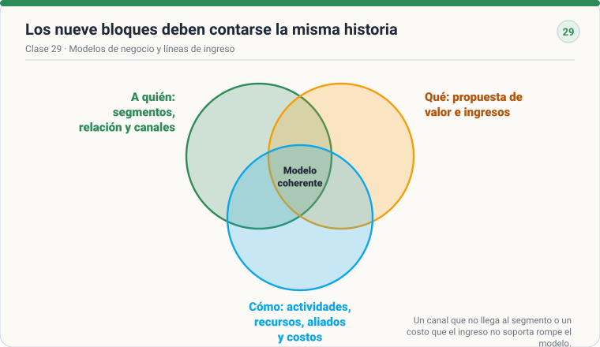

# Clase 029 — Business Model Canvas

> **Parte 03 · Modelos de negocio y líneas de ingreso** — clase 1 de 14

**Estado de evidencia:** `GUIA-PRACTICA` · **Jurisdicción:** Chile-first · **Fecha base normativa:** 07-08-2026 
**Decisión que habilita:** verificar si los nueve bloques del modelo son consistentes entre sí 
**Entregable:** canvas versionado con registro de evidencia por bloque y al menos tres inconsistencias resueltas

## 🎯 Propósito

Usar el Canvas como prueba versionada de coherencia, vinculando cada bloque relevante con evidencia, riesgo y próximo experimento.

## 📚 Resultados de aprendizaje

Al finalizar esta clase podrás:

1. **Definir** con precisión los cuatro conceptos de la tabla siguiente y usarlos para describir un caso real.
2. **Explicar** por qué esta materia condiciona decisiones de otras partes del programa.
3. **Decidir** —verificar si los nueve bloques del modelo son consistentes entre sí— y justificar la decisión por escrito.
4. **Producir** el entregable de la clase y contrastarlo contra su criterio de aceptación.
5. **Distinguir** el dato estable del dato dinámico que exige revalidación en la fuente oficial.

## 🧩 Conceptos centrales

| Concepto | Comprensión verificable |
|---|---|
| **Business Model Canvas** | Representación de nueve bloques de cómo la empresa crea, entrega y captura valor. |
| **Actividad clave** | Proceso sin el cual la propuesta de valor no se puede entregar. |
| **Recurso clave** | Activo indispensable: equipo, licencia, dato, permiso o instalación. |
| **Coherencia del canvas** | Que los nueve bloques se sostengan entre sí. |

## 🗺️ Modelo mental: Los nueve bloques deben contarse la misma historia

> **La idea en una frase:** El canvas no vale como cuadro decorativo sino como prueba de coherencia: cada bloque debe sostener a los demás.

**Lectura guiada:** Las tres áreas deben cruzarse en el centro. Si un bloque de un círculo contradice a otro (por ejemplo, un canal que no alcanza al segmento), el modelo no cierra aunque cada bloque suene razonable.

**Piénsalo así:** Es un engranaje de tres ruedas: si una no calza con las otras, la máquina no avanza aunque todas giren.

## 📖 Desarrollo

### 1. El fondo del asunto

El canvas no vale como cuadro decorativo sino como prueba de coherencia: si el canal no alcanza al segmento, si la estructura de costos no soporta la fuente de ingreso o si la actividad clave exige un recurso que no se tiene, el modelo está roto. Cada afirmación relevante debe registrar hipótesis, evidencia, fuente, nivel de confianza, riesgo y próximo experimento; cuando cambia la evidencia se crea una nueva versión y se documenta qué bloques cambiaron.

### 2. Cómo se traduce en la práctica

Llena los nueve bloques en una hoja con lápiz, no en software. Después recorre las parejas críticas y pregúntate si cierran: ¿el canal llega al segmento?, ¿la fuente de ingreso paga la estructura de costos?, ¿la actividad clave necesita un recurso que no tienes? Subraya cada incoherencia y decide qué bloque cambias. Repite la prueba cada vez que cambie un bloque.

### 3. Marco aplicable y quién interviene

- Business Model Canvas y Lean Canvas como instrumentos de diseño
- Ley 19.496 sobre protección de los derechos de los consumidores para modelos B2C
- Ley 20.169 sobre competencia desleal y DL 211 en modelos de plataforma

**Autoridades o contrapartes involucradas:** SERNAC, FNE, SII.
**Profesionales de apoyo:** fundador, abogado comercial, contador de gestión. La participación concreta depende del riesgo, del
tamaño de la empresa y de la actividad económica.

### 4. Caso trabajado

Una empresa de cursos para operarios mineros llena su canvas: segmento (operarios), canal (redes sociales), propuesta (cursos online) e ingreso (suscripción mensual personal). Al revisar la coherencia descubre dos fallas: el segmento usa poco redes sociales en su turno y quien paga es el empleador, no el operario. Reordena el modelo hacia ventas a jefaturas de capacitación con pago por faena y el canal pasa a ser visitas y ferias (caso ilustrativo).

### 5. En qué se apoya

- **Business Model Generation** (Wiley): Osterwalder y Pigneur presentan los nueve bloques del lienzo como un lenguaje común para describir y comparar modelos de negocio y detectar incoherencias.
- **Running Lean** (O'Reilly): Maurya adapta el lienzo a las etapas tempranas y lo usa como un conjunto de hipótesis que se prueban, no como un plan terminado.

*Las lecturas de apoyo ofrecen marcos conceptuales; lo que exige la ley chilena se verifica en las fuentes oficiales de esta clase.*

## 🧪 Taller guiado

Aplica esta clase a **una** de las siguientes líneas de negocio y repite después el ejercicio con
una segunda línea de carga regulatoria distinta:

| Línea | Carga regulatoria |
|---|---|
| SaaS B2B con IA | media |
| Servicios profesionales | baja |
| E-commerce D2C | media |
| Alimentos o foodtech | alta |
| Exportación de servicios | media |
| Fintech regulada | alta |
| Construcción o servicios técnicos | alta |

**Secuencia de trabajo:**

1. Delimita el contexto: actividad económica, escala, comuna y etapa de la empresa.
2. Reúne los antecedentes que la decisión exige y anota la fecha de cada fuente.
3. Identifica las alternativas reales, incluida la de no hacer nada.
4. Evalúa el impacto en mercado, caja, personas, regulación y operación.
5. Toma la decisión y regístrala con sus supuestos.
6. Produce el entregable.
7. Contrástalo contra el criterio de aceptación.
8. Anota lo que requiere validación profesional y programa su revisión.

### 📦 Entregable

Canvas versionado con registro de evidencia por bloque y al menos tres inconsistencias resueltas.

Debe incluir decisión, supuestos, fuentes con fecha de consulta, responsable, riesgos
identificados y próximos pasos.

## 🏆 Reto verificable

Resuelve la misma materia para una segunda línea de negocio con distinta carga regulatoria y
explica por escrito **qué cambió, por qué y qué fuente lo determina**.

## ✅ Criterio de aceptación

- [ ] los nueve bloques están completos con contenido específico
- [ ] cada afirmación relevante declara hipótesis, evidencia, fuente, confianza, riesgo y experimento
- [ ] los cambios de evidencia quedan reflejados en una nueva versión
- [ ] cada afirmación regulatoria está referida a una fuente oficial con fecha de consulta;
- [ ] los datos dinámicos quedan marcados para revalidación;
- [ ] hay un responsable asignado y evidencia reproducible del trabajo.

## ⚠️ Errores frecuentes

**Propios de esta clase:**

- Llenar los nueve bloques sin revisar la consistencia entre ellos.
- Mantener el canvas intacto después de que la evidencia contradice un bloque.

**Característicos de la parte 03:**

- Copiar un modelo extranjero sin verificar su viabilidad regulatoria o logística en chile.
- Sumar líneas de negocio antes de que la primera sea rentable.

## 🇨🇱 Checklist Chile

- [ ] ¿existe norma o autoridad específica para esta materia?
- [ ] ¿la fuente consultada está vigente a la fecha de ejecución?
- [ ] ¿se activa algún trámite ante el SII?
- [ ] ¿se activa algún requisito municipal o sectorial?
- [ ] ¿afecta a consumidores o al tratamiento de datos personales?
- [ ] ¿afecta a trabajadores o a la seguridad y salud en el trabajo?
- [ ] ¿afecta a impuestos, contabilidad o caja?
- [ ] ¿afecta a contratos o a propiedad intelectual?
- [ ] ¿requiere renovación, reporte periódico o revalidación?

## ❓ Preguntas de comprobación

1. ¿Qué evidencia y fuente sostienen cada afirmación relevante del Canvas?
2. ¿Qué bloque tiene menor confianza y mayor riesgo si resulta falso?
3. ¿Qué cambió desde la versión anterior y cuál es el próximo experimento?

## 🔗 Fuentes oficiales

**Servicio Nacional del Consumidor — Ley 19.496, comercio electrónico y garantía legal**  
<https://www.sernac.cl/> · verificado 2026-11-05

- *Qué contiene:* Publica la interpretación aplicada de la Ley del Consumidor: deberes de información en la oferta, reglas del comercio electrónico, garantía legal, contratos de adhesión y el procedimiento de reclamos.
- *Cómo leerla:* Entra por el rubro de tu negocio y revisa las alertas y procedimientos colectivos publicados: muestran qué está fiscalizando el servicio ahora, que es mejor predictor de tu riesgo que la lectura abstracta de la ley.
- *Uso en esta clase:* aporta el marco de «Ley 19.496, comercio electrónico y garantía legal» para verificar si los nueve bloques del modelo son consistentes entre sí.

**Servicio de Impuestos Internos — Nuevos contribuyentes, inicio de actividades y DTE**  
<https://www.sii.cl/ayudas/nuevos_contribuyentes/boleta-vys-facturador.html> · verificado 2026-11-05

- *Qué contiene:* Reúne el circuito completo del contribuyente nuevo: obtención de RUT, declaración de inicio de actividades, elección de códigos de actividad económica y habilitación para emitir documentos tributarios electrónicos.
- *Cómo leerla:* Sepáralo en dos actos distintos que la página trata seguidos: el RUT identifica, el inicio de actividades habilita. Lo que te bloquea para facturar casi siempre está en el segundo, no en el primero.
- *Uso en esta clase:* aporta el marco de «Nuevos contribuyentes, inicio de actividades y DTE» para verificar si los nueve bloques del modelo son consistentes entre sí.

**Biblioteca del Congreso Nacional · LeyChile — Normativa oficial consolidada**  
<https://www.bcn.cl/leychile/> · verificado 2026-11-05

- *Qué contiene:* Publica el texto oficial y consolidado de leyes, decretos y reglamentos, con la versión vigente a una fecha, el historial de modificaciones y la tramitación que las originó.
- *Cómo leerla:* Usa siempre el selector de versión vigente a la fecha en que ejecutarás el trámite, no la última publicada. Y lee el artículo transitorio: en normas en implantación gradual —jornada, datos personales— ahí está la fecha que realmente te aplica.
- *Uso en esta clase:* aporta el marco de «Normativa oficial consolidada» para verificar si los nueve bloques del modelo son consistentes entre sí.

**Wiley — Business Model Generation**  
<https://openlibrary.org/isbn/9780470876411> · verificado 2026-11-25

- *Qué contiene:* Presenta el lienzo del modelo de negocio de nueve bloques y patrones para describir, diseñar y comparar modelos.
- *Cómo leerla:* Úsalo como marco conceptual para entender el porqué de la práctica, nunca como prueba de lo que exige la ley chilena; para eso están las fuentes oficiales de la clase.
- *Uso en esta clase:* aporta el marco de «Business Model Generation» para verificar si los nueve bloques del modelo son consistentes entre sí.

**O'Reilly — Running Lean**  
<https://openlibrary.org/isbn/9781449331900> · verificado 2026-11-25

- *Qué contiene:* Método para iterar un modelo de negocio con el lienzo lean y experimentos cortos. Se usa como lectura de apoyo conceptual y no como fuente normativa.
- *Cómo leerla:* Úsalo como marco conceptual para entender el porqué de la práctica, nunca como prueba de lo que exige la ley chilena; para eso están las fuentes oficiales de la clase.
- *Uso en esta clase:* aporta el marco de «Running Lean» para verificar si los nueve bloques del modelo son consistentes entre sí.

Complementos del repositorio: [glosario](../../../docs/19_GLOSSARY.md) ·
[ruta de lecturas](../../../docs/15_BOOKS_AND_LEARNING_PATH.md) ·
[catálogo de fuentes](../../../docs/16_OFFICIAL_SOURCE_CATALOG.md).

> [!IMPORTANT]
> Material educativo. Para una decisión real de alto impacto hay que verificar la fuente oficial
> vigente y validar con el profesional competente.

---

| Anterior | Índice | Siguiente |
|---|---|---|
| **Inicio de la parte** | [Parte 03](../README.md) · [Programa](../../../README.md) | [030 · Lean Canvas →](../class-02-lean-canvas/README.md) |
