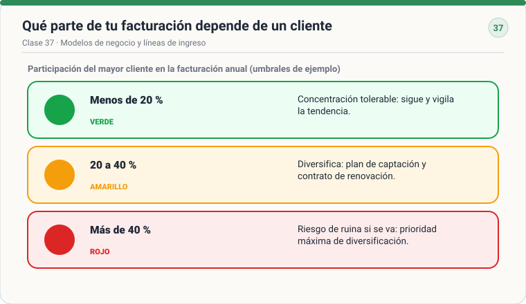

# Clase 037 — Agencia y servicios administrados

> **Parte 03 · Modelos de negocio y líneas de ingreso** — clase 9 de 14

**Estado de evidencia:** `GUIA-PRACTICA` · **Jurisdicción:** Chile-first · **Fecha base normativa:** 07-08-2026 
**Decisión que habilita:** definir la mezcla entre proyecto y retainer y el límite de concentración aceptable 
**Entregable:** modelo de ingresos por cliente con índice de concentración y plan de diversificación

## 🎯 Propósito

Medir la concentración de clientes como riesgo de supervivencia y decidir la mezcla entre proyecto y retainer que estabiliza la caja.

## 📚 Resultados de aprendizaje

Al finalizar esta clase podrás:

1. **Definir** con precisión los cuatro conceptos de la tabla siguiente y usarlos para describir un caso real.
2. **Explicar** por qué esta materia condiciona decisiones de otras partes del programa.
3. **Decidir** —definir la mezcla entre proyecto y retainer y el límite de concentración aceptable— y justificar la decisión por escrito.
4. **Producir** el entregable de la clase y contrastarlo contra su criterio de aceptación.
5. **Distinguir** el dato estable del dato dinámico que exige revalidación en la fuente oficial.

## 🧩 Conceptos centrales

| Concepto | Comprensión verificable |
|---|---|
| **Agencia** | Modelo de proyecto con equipo propio y entrega a medida. |
| **Retainer** | Cuota mensual por disponibilidad y trabajo acordado. |
| **Servicio administrado** | Operación continua de una función del cliente bajo sla. |
| **Concentración de clientes** | Porcentaje de ingresos que depende de pocos clientes. |

## 🗺️ Modelo mental: Qué parte de tu facturación depende de un cliente

> **La idea en una frase:** La agencia crece rápido y se estanca cuando el fundador deja de vender; el riesgo estructural es depender de pocos clientes.

**Qué mirar primero:** Mide cuánto representa tu mayor cliente en la facturación. El semáforo no prohíbe tener un cliente grande; te dice cuánto riesgo asumes y cuándo debes actuar.

**Piénsalo así:** Es una mesa con una sola pata gruesa: aguanta mucho peso, pero si la pata se quiebra todo se cae.

## 📖 Desarrollo

### 1. El fondo del asunto

La agencia crece rápido y se estanca cuando el fundador deja de vender. Migrar de proyecto a retainer estabiliza la caja pero exige capacidad de decir que no al trabajo fuera de alcance. El riesgo estructural es la concentración: perder un cliente que representa el 40% de los ingresos es un evento de supervivencia.

### 2. Cómo se traduce en la práctica

Mide la concentración por cliente cada trimestre y escribe tu límite máximo. Diseña la mezcla entre proyectos y retainers: el retainer da estabilidad, pero exige decir que no al trabajo fuera del alcance. Define quién vende cuando el fundador no puede y cómo transfieres las relaciones a la empresa. El crecimiento de una agencia depende de que las ventas no recaigan solo en su dueño.

### 3. Marco aplicable y quién interviene

- Business Model Canvas y Lean Canvas como instrumentos de diseño
- Ley 19.496 sobre protección de los derechos de los consumidores para modelos B2C
- Ley 20.169 sobre competencia desleal y DL 211 en modelos de plataforma

**Autoridades o contrapartes involucradas:** SERNAC, FNE, SII.
**Profesionales de apoyo:** fundador, abogado comercial, contador de gestión. La participación concreta depende del riesgo, del
tamaño de la empresa y de la actividad económica.

### 4. Caso trabajado

Una agencia de diseño factura $60 millones al año; su mayor cliente aporta $27 millones (45 %). El cliente decide cambiar de proveedor y la agencia pierde casi la mitad de sus ingresos con un contrato pagado a 60 días. Había migrado a retainers para estabilizar la caja, pero no diversificó. Define una política: ningún cliente supera 30 % y se busca un segundo contrato de similar tamaño (caso ilustrativo).

### 5. En qué se apoya

- **The E-Myth Revisited** (HarperBusiness): Gerber sostiene que una empresa debe sostenerse en sistemas y no en la persona fundadora, lo que incluye cómo se venden los servicios.
- **Simple Numbers, Straight Talk, Big Profits!** (Greg Crabtree): Crabtree propone indicadores simples de rentabilidad para pequeñas empresas de servicios, que ayudan a ver si la mezcla de clientes es sana.

*Las lecturas de apoyo ofrecen marcos conceptuales; lo que exige la ley chilena se verifica en las fuentes oficiales de esta clase.*

## 🧪 Taller guiado

Aplica esta clase a **una** de las siguientes líneas de negocio y repite después el ejercicio con
una segunda línea de carga regulatoria distinta:

| Línea | Carga regulatoria |
|---|---|
| SaaS B2B con IA | media |
| Servicios profesionales | baja |
| E-commerce D2C | media |
| Alimentos o foodtech | alta |
| Exportación de servicios | media |
| Fintech regulada | alta |
| Construcción o servicios técnicos | alta |

**Secuencia de trabajo:**

1. Delimita el contexto: actividad económica, escala, comuna y etapa de la empresa.
2. Reúne los antecedentes que la decisión exige y anota la fecha de cada fuente.
3. Identifica las alternativas reales, incluida la de no hacer nada.
4. Evalúa el impacto en mercado, caja, personas, regulación y operación.
5. Toma la decisión y regístrala con sus supuestos.
6. Produce el entregable.
7. Contrástalo contra el criterio de aceptación.
8. Anota lo que requiere validación profesional y programa su revisión.

### 📦 Entregable

Modelo de ingresos por cliente con índice de concentración y plan de diversificación.

Debe incluir decisión, supuestos, fuentes con fecha de consulta, responsable, riesgos
identificados y próximos pasos.

## 🏆 Reto verificable

Resuelve la misma materia para una segunda línea de negocio con distinta carga regulatoria y
explica por escrito **qué cambió, por qué y qué fuente lo determina**.

## ✅ Criterio de aceptación

- [ ] la concentración de clientes está medida y con umbral declarado
- [ ] los servicios continuos tienen SLA y límite de responsabilidad
- [ ] cada afirmación regulatoria está referida a una fuente oficial con fecha de consulta;
- [ ] los datos dinámicos quedan marcados para revalidación;
- [ ] hay un responsable asignado y evidencia reproducible del trabajo.

## ⚠️ Errores frecuentes

**Propios de esta clase:**

- Aceptar un cliente que supera el límite de concentración sin plan de mitigación.
- Operar servicios administrados sin sla ni límite de responsabilidad.

**Característicos de la parte 03:**

- Copiar un modelo extranjero sin verificar su viabilidad regulatoria o logística en chile.
- Sumar líneas de negocio antes de que la primera sea rentable.

## 🇨🇱 Checklist Chile

- [ ] ¿existe norma o autoridad específica para esta materia?
- [ ] ¿la fuente consultada está vigente a la fecha de ejecución?
- [ ] ¿se activa algún trámite ante el SII?
- [ ] ¿se activa algún requisito municipal o sectorial?
- [ ] ¿afecta a consumidores o al tratamiento de datos personales?
- [ ] ¿afecta a trabajadores o a la seguridad y salud en el trabajo?
- [ ] ¿afecta a impuestos, contabilidad o caja?
- [ ] ¿afecta a contratos o a propiedad intelectual?
- [ ] ¿requiere renovación, reporte periódico o revalidación?

## ❓ Preguntas de comprobación

1. ¿Qué porcentaje de tus ingresos depende de tus tres mayores clientes?
2. ¿Qué umbral de concentración has declarado como inaceptable?
3. ¿Tus servicios continuos tienen SLA y tope de responsabilidad por escrito?

## 🔗 Fuentes oficiales

**Servicio Nacional del Consumidor — Ley 19.496, comercio electrónico y garantía legal**  
<https://www.sernac.cl/> · verificado 2026-11-05

- *Qué contiene:* Publica la interpretación aplicada de la Ley del Consumidor: deberes de información en la oferta, reglas del comercio electrónico, garantía legal, contratos de adhesión y el procedimiento de reclamos.
- *Cómo leerla:* Entra por el rubro de tu negocio y revisa las alertas y procedimientos colectivos publicados: muestran qué está fiscalizando el servicio ahora, que es mejor predictor de tu riesgo que la lectura abstracta de la ley.
- *Uso en esta clase:* aporta el marco de «Ley 19.496, comercio electrónico y garantía legal» para definir la mezcla entre proyecto y retainer y el límite de concentración aceptable.

**Servicio de Impuestos Internos — Nuevos contribuyentes, inicio de actividades y DTE**  
<https://www.sii.cl/ayudas/nuevos_contribuyentes/boleta-vys-facturador.html> · verificado 2026-11-05

- *Qué contiene:* Reúne el circuito completo del contribuyente nuevo: obtención de RUT, declaración de inicio de actividades, elección de códigos de actividad económica y habilitación para emitir documentos tributarios electrónicos.
- *Cómo leerla:* Sepáralo en dos actos distintos que la página trata seguidos: el RUT identifica, el inicio de actividades habilita. Lo que te bloquea para facturar casi siempre está en el segundo, no en el primero.
- *Uso en esta clase:* aporta el marco de «Nuevos contribuyentes, inicio de actividades y DTE» para definir la mezcla entre proyecto y retainer y el límite de concentración aceptable.

**Biblioteca del Congreso Nacional · LeyChile — Normativa oficial consolidada**  
<https://www.bcn.cl/leychile/> · verificado 2026-11-05

- *Qué contiene:* Publica el texto oficial y consolidado de leyes, decretos y reglamentos, con la versión vigente a una fecha, el historial de modificaciones y la tramitación que las originó.
- *Cómo leerla:* Usa siempre el selector de versión vigente a la fecha en que ejecutarás el trámite, no la última publicada. Y lee el artículo transitorio: en normas en implantación gradual —jornada, datos personales— ahí está la fecha que realmente te aplica.
- *Uso en esta clase:* aporta el marco de «Normativa oficial consolidada» para definir la mezcla entre proyecto y retainer y el límite de concentración aceptable.

**HarperBusiness — The E-Myth Revisited**  
<https://openlibrary.org/isbn/9780061446788> · verificado 2026-11-25

- *Qué contiene:* Plantea que la empresa debe funcionar por sus sistemas y no depender de la persona fundadora.
- *Cómo leerla:* Úsalo como marco conceptual para entender el porqué de la práctica, nunca como prueba de lo que exige la ley chilena; para eso están las fuentes oficiales de la clase.
- *Uso en esta clase:* aporta el marco de «The E-Myth Revisited» para definir la mezcla entre proyecto y retainer y el límite de concentración aceptable.

**Greg Crabtree — Simple Numbers, Straight Talk, Big Profits!**  
<https://openlibrary.org/isbn/9780989645232> · verificado 2026-11-25

- *Qué contiene:* Propone indicadores simples para pequeñas empresas, como el costo laboral sobre el margen bruto. Se usa como lectura de apoyo conceptual y no como fuente normativa.
- *Cómo leerla:* Úsalo como marco conceptual para entender el porqué de la práctica, nunca como prueba de lo que exige la ley chilena; para eso están las fuentes oficiales de la clase.
- *Uso en esta clase:* aporta el marco de «Simple Numbers, Straight Talk, Big Profits!» para definir la mezcla entre proyecto y retainer y el límite de concentración aceptable.

Complementos del repositorio: [glosario](../../../docs/19_GLOSSARY.md) ·
[ruta de lecturas](../../../docs/15_BOOKS_AND_LEARNING_PATH.md) ·
[catálogo de fuentes](../../../docs/16_OFFICIAL_SOURCE_CATALOG.md).

> [!IMPORTANT]
> Material educativo. Para una decisión real de alto impacto hay que verificar la fuente oficial
> vigente y validar con el profesional competente.

---

| Anterior | Índice | Siguiente |
|---|---|---|
| [← 036 · Licencias, royalties y propiedad intelectual](../class-08-licencias-royalties-y-propiedad-intelectual/README.md) | [Parte 03](../README.md) · [Programa](../../../README.md) | [038 · Manufactura y venta de productos →](../class-10-manufactura-y-venta-de-productos/README.md) |
