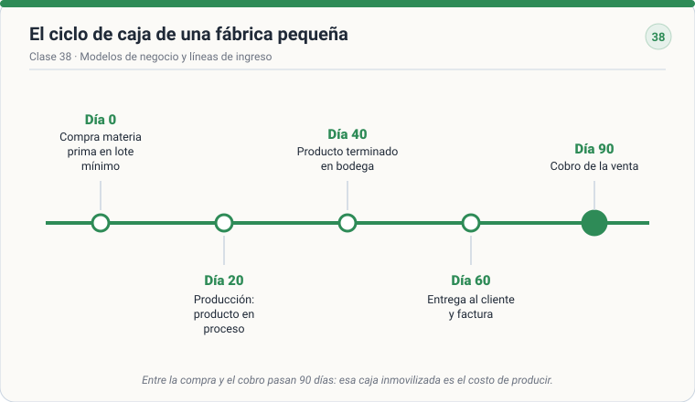

# Clase 038 — Manufactura y venta de productos

> **Parte 03 · Modelos de negocio y líneas de ingreso** — clase 10 de 14

**Estado de evidencia:** `GUIA-PRACTICA` · **Jurisdicción:** Chile-first · **Fecha base normativa:** 07-08-2026 
**Decisión que habilita:** determinar lote, inventario objetivo y capital de trabajo que la producción exige 
**Entregable:** costeo de producto con lote mínimo, punto de reorden y capital inmovilizado

## 🎯 Propósito

Dimensionar el capital que la producción inmoviliza y la responsabilidad que el producto trae, antes de comprometer el primer lote.

## 📚 Resultados de aprendizaje

Al finalizar esta clase podrás:

1. **Definir** con precisión los cuatro conceptos de la tabla siguiente y usarlos para describir un caso real.
2. **Explicar** por qué esta materia condiciona decisiones de otras partes del programa.
3. **Decidir** —determinar lote, inventario objetivo y capital de trabajo que la producción exige— y justificar la decisión por escrito.
4. **Producir** el entregable de la clase y contrastarlo contra su criterio de aceptación.
5. **Distinguir** el dato estable del dato dinámico que exige revalidación en la fuente oficial.

## 🧩 Conceptos centrales

| Concepto | Comprensión verificable |
|---|---|
| **Costo de producción** | Materiales, mano de obra directa y costos indirectos de fabricación. |
| **Lote mínimo** | Cantidad mínima económicamente producible. |
| **Punto de reorden** | Nivel de inventario que gatilla una nueva orden. |
| **Responsabilidad por producto** | Obligación del fabricante por daños derivados del bien. |

## 🗺️ Modelo mental: El ciclo de caja de una fábrica pequeña

> **La idea en una frase:** Manufacturar inmoviliza caja en materia prima, producto en proceso y producto terminado, y suma responsabilidad por la calidad y seguridad frente al consumidor.

**Lectura guiada:** La línea muestra cuánto tarda el dinero en volver. Cada hito inmoviliza capital hasta el cobro. El lote mínimo suele ser la variable que decide cuánto se inmoviliza en el primer tramo.

**Para recordarlo:** Es plantar trigo: siembras hoy, cosechas en meses y entretanto debes alimentar a tu familia con la caja que tienes.

## 📖 Desarrollo

### 1. El fondo del asunto

Manufacturar inmoviliza caja en materia prima, producto en proceso y terminado, y agrega responsabilidad por calidad y seguridad del producto frente al consumidor. El lote mínimo suele ser la variable que decide la viabilidad: obliga a comprometer capital antes de conocer la demanda real.

### 2. Cómo se traduce en la práctica

Calcula el capital de trabajo que exige cada lote: materia prima, producto en proceso, terminado y cuentas por cobrar. Define el lote, el inventario objetivo y el punto de reorden con la demanda real. Y asume la responsabilidad por producto: informar riesgos, advertencias y cambiar o devolver un producto peligroso son obligaciones del proveedor.

### 3. Marco aplicable y quién interviene

- Business Model Canvas y Lean Canvas como instrumentos de diseño
- Ley 19.496 sobre protección de los derechos de los consumidores para modelos B2C
- Ley 20.169 sobre competencia desleal y DL 211 en modelos de plataforma

**Autoridades o contrapartes involucradas:** SERNAC, FNE, SII.
**Profesionales de apoyo:** fundador, abogado comercial, contador de gestión. La participación concreta depende del riesgo, del
tamaño de la empresa y de la actividad económica.

### 4. Los números, paso a paso

Una empresa fabrica velas. Debe comprar cera por 3 millones (lote mínimo) y paga mano de obra y energía por otros 1,5 millones durante 40 días. Vende por 6 millones, pero cobra a los 90 días desde la compra. Necesita financiar 4,5 millones durante tres meses. Si el proveedor aceptara lotes de la mitad, el capital inmovilizado baja a 3 millones y el negocio es financiable sin deuda (cifras ilustrativas).

### 5. En qué se apoya

- **The Goal** (North River Press): Goldratt presenta la teoría de las restricciones y la relación entre inventario, flujo y resultado, que explican por qué más inventario inmoviliza caja sin generar ventas.
- **Ley 19.496 — Protección de los derechos de los consumidores** (Biblioteca del Congreso Nacional): La Ley 19.496 (arts. 45 a 49) obliga a informar los riesgos del producto, a ponerlos en conocimiento de la autoridad y a cambiar el bien o restituir el dinero cuando hay peligrosidad.

*Las lecturas de apoyo ofrecen marcos conceptuales; lo que exige la ley chilena se verifica en las fuentes oficiales de esta clase.*

## 🛡️ Protección del conocimiento: Ejemplos por tipo de empresa

[Guía de inteligencia económica y protección del conocimiento, sección 15](../../../docs/21_INTELIGENCIA_ECONOMICA_Y_PROTECCION_DEL_CONOCIMIENTO.md#15-ejemplos-por-tipo-de-empresa)

**Lente para esta clase:** En manufactura el secreto está en el proceso: la visita de un cliente o proveedor y el personal de planta son los canales de fuga más corrientes.

| Nivel | Medida proporcionada |
|---|---|
| **Emprendedor o microempresa** | Registro de visitas y lista de zonas que no se muestran. |
| **Pyme** | Acuerdo de visita, acompañamiento permanente y fotos prohibidas en planta. |
| **Gran empresa o multinacional** | Zonificación de planta, control de acceso de visitantes y protocolo para auditorías de clientes. |

**Actividad sin crear sistemas:** Recorre tu planta como si fueras un visitante y anota qué podrías ver o fotografiar que no debería ser visible.

**Términos:** Secreto de proceso (*Process Know-How*) · Acuerdo de visita (*Visitor Agreement*)

*Enfoque defensivo: reconocer, prevenir, documentar y escalar. No enseña a obtener información de forma indebida; la calificación jurídica de un hecho concreto corresponde a un abogado.*

## 🧪 Taller guiado

Aplica esta clase a **una** de las siguientes líneas de negocio y repite después el ejercicio con
una segunda línea de carga regulatoria distinta:

| Línea | Carga regulatoria |
|---|---|
| SaaS B2B con IA | media |
| Servicios profesionales | baja |
| E-commerce D2C | media |
| Alimentos o foodtech | alta |
| Exportación de servicios | media |
| Fintech regulada | alta |
| Construcción o servicios técnicos | alta |

**Secuencia de trabajo:**

1. Delimita el contexto: actividad económica, escala, comuna y etapa de la empresa.
2. Reúne los antecedentes que la decisión exige y anota la fecha de cada fuente.
3. Identifica las alternativas reales, incluida la de no hacer nada.
4. Evalúa el impacto en mercado, caja, personas, regulación y operación.
5. Toma la decisión y regístrala con sus supuestos.
6. Produce el entregable.
7. Contrástalo contra el criterio de aceptación.
8. Anota lo que requiere validación profesional y programa su revisión.

### 📦 Entregable

Costeo de producto con lote mínimo, punto de reorden y capital inmovilizado.

Debe incluir decisión, supuestos, fuentes con fecha de consulta, responsable, riesgos
identificados y próximos pasos.

## 🏆 Reto verificable

Resuelve la misma materia para una segunda línea de negocio con distinta carga regulatoria y
explica por escrito **qué cambió, por qué y qué fuente lo determina**.

## ✅ Criterio de aceptación

- [ ] el costeo distribuye costos indirectos con un criterio declarado
- [ ] el capital inmovilizado por inventario está calculado
- [ ] cada afirmación regulatoria está referida a una fuente oficial con fecha de consulta;
- [ ] los datos dinámicos quedan marcados para revalidación;
- [ ] hay un responsable asignado y evidencia reproducible del trabajo.

## ⚠️ Errores frecuentes

**Propios de esta clase:**

- Fijar precio sobre costo de materiales sin distribuir costos indirectos.
- Producir un lote grande por descuento y quedarse sin caja.

**Característicos de la parte 03:**

- Copiar un modelo extranjero sin verificar su viabilidad regulatoria o logística en chile.
- Sumar líneas de negocio antes de que la primera sea rentable.

## 🇨🇱 Checklist Chile

- [ ] ¿existe norma o autoridad específica para esta materia?
- [ ] ¿la fuente consultada está vigente a la fecha de ejecución?
- [ ] ¿se activa algún trámite ante el SII?
- [ ] ¿se activa algún requisito municipal o sectorial?
- [ ] ¿afecta a consumidores o al tratamiento de datos personales?
- [ ] ¿afecta a trabajadores o a la seguridad y salud en el trabajo?
- [ ] ¿afecta a impuestos, contabilidad o caja?
- [ ] ¿afecta a contratos o a propiedad intelectual?
- [ ] ¿requiere renovación, reporte periódico o revalidación?

## ❓ Preguntas de comprobación

1. ¿Cuánto capital inmoviliza tu lote mínimo y por cuántos meses?
2. ¿Tu costeo distribuye los costos indirectos con un criterio que puedas defender?
3. ¿Qué haces si un lote sale defectuoso y ya está en manos de clientes?

## 🔗 Fuentes oficiales

**Servicio Nacional del Consumidor — Ley 19.496, comercio electrónico y garantía legal**  
<https://www.sernac.cl/> · verificado 2026-11-05

- *Qué contiene:* Publica la interpretación aplicada de la Ley del Consumidor: deberes de información en la oferta, reglas del comercio electrónico, garantía legal, contratos de adhesión y el procedimiento de reclamos.
- *Cómo leerla:* Entra por el rubro de tu negocio y revisa las alertas y procedimientos colectivos publicados: muestran qué está fiscalizando el servicio ahora, que es mejor predictor de tu riesgo que la lectura abstracta de la ley.
- *Uso en esta clase:* aporta el marco de «Ley 19.496, comercio electrónico y garantía legal» para determinar lote, inventario objetivo y capital de trabajo que la producción exige.

**North River Press — The Goal**  
<https://openlibrary.org/isbn/9781622313945> · verificado 2026-11-25

- *Qué contiene:* Novela que presenta la teoría de las restricciones: identificar y gestionar el cuello de botella de un sistema.
- *Cómo leerla:* Úsalo como marco conceptual para entender el porqué de la práctica, nunca como prueba de lo que exige la ley chilena; para eso están las fuentes oficiales de la clase.
- *Uso en esta clase:* aporta el marco de «The Goal» para determinar lote, inventario objetivo y capital de trabajo que la producción exige.

**Biblioteca del Congreso Nacional — Ley 19.496 — Protección de los derechos de los consumidores**  
<https://www.bcn.cl/leychile/navegar?idNorma=61438> · verificado 2026-11-25

- *Qué contiene:* Fija los derechos básicos del consumidor, la obligación de cumplir lo ofrecido (art. 12), la publicidad veraz (arts. 28 y 33), la seguridad del producto y el deber de informar a la autoridad los peligros descubiertos después de vender (arts. 45 a 49) y las funciones de fiscalización del SERNAC (art. 58).
- *Cómo leerla:* Úsala para distinguir qué debe hacer un proveedor ante un producto riesgoso o una publicidad cuestionada de lo que solo conviene hacer. Lee el artículo completo en la versión vigente antes de aplicarlo a un caso concreto.
- *Uso en esta clase:* aporta el marco de «Ley 19.496 — Protección de los derechos de los consumidores» para determinar lote, inventario objetivo y capital de trabajo que la producción exige.

Complementos del repositorio: [glosario](../../../docs/19_GLOSSARY.md) ·
[ruta de lecturas](../../../docs/15_BOOKS_AND_LEARNING_PATH.md) ·
[catálogo de fuentes](../../../docs/16_OFFICIAL_SOURCE_CATALOG.md).

> [!IMPORTANT]
> Material educativo. Para una decisión real de alto impacto hay que verificar la fuente oficial
> vigente y validar con el profesional competente.

---

| Anterior | Índice | Siguiente |
|---|---|---|
| [← 037 · Agencia y servicios administrados](../class-09-agencia-y-servicios-administrados/README.md) | [Parte 03](../README.md) · [Programa](../../../README.md) | [039 · Franquicia y licenciamiento de formato →](../class-11-franquicia-y-licenciamiento-de-formato/README.md) |
