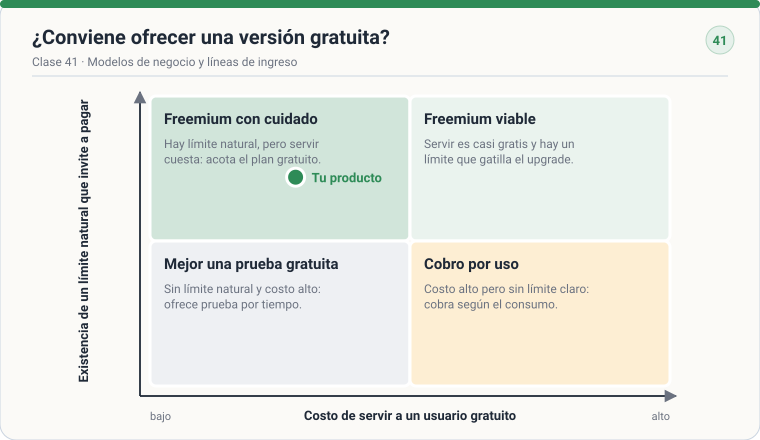

# Clase 041 — Modelos freemium, usage-based y outcome-based

> **Parte 03 · Modelos de negocio y líneas de ingreso** — clase 13 de 14

**Estado de evidencia:** `GUIA-PRACTICA` · **Jurisdicción:** Chile-first · **Fecha base normativa:** 07-08-2026 
**Decisión que habilita:** elegir el mecanismo de cobro coherente con el costo de servir y el riesgo asumido 
**Entregable:** modelo de cobro con costo de servir por nivel y definición contractual del resultado

## 🎯 Propósito

Elegir el mecanismo de cobro según el costo de servir y el riesgo que se asume, y no por lo que hace la competencia internacional.

## 📚 Resultados de aprendizaje

Al finalizar esta clase podrás:

1. **Definir** con precisión los cuatro conceptos de la tabla siguiente y usarlos para describir un caso real.
2. **Explicar** por qué esta materia condiciona decisiones de otras partes del programa.
3. **Decidir** —elegir el mecanismo de cobro coherente con el costo de servir y el riesgo asumido— y justificar la decisión por escrito.
4. **Producir** el entregable de la clase y contrastarlo contra su criterio de aceptación.
5. **Distinguir** el dato estable del dato dinámico que exige revalidación en la fuente oficial.

## 🧩 Conceptos centrales

| Concepto | Comprensión verificable |
|---|---|
| **Freemium** | Nivel gratuito permanente que alimenta la conversión a pago. |
| **Usage-based** | Cobro proporcional al consumo efectivo. |
| **Outcome-based** | Cobro vinculado al resultado obtenido por el cliente. |
| **Costo de servir** | Costo de atender a un usuario, incluido el que no paga. |

## 🗺️ Modelo mental: ¿Conviene ofrecer una versión gratuita?

> **La idea en una frase:** El freemium solo funciona si el costo de servir al usuario gratuito es cercano a cero y existe un límite natural que gatilla el upgrade.

**Lectura guiada:** Ubica tu producto según cuánto cuesta atender a un usuario gratuito y qué tan claro es el momento en que necesita pagar. Cada cuadrante sugiere un modelo de cobro distinto.

**Piénsalo así:** Es regalar muestras en una pastelería: funciona si la muestra es barata y quien la prueba tiene muchas razones para volver a comprar.

## 📖 Desarrollo

### 1. El fondo del asunto

Freemium solo funciona si el costo de servir al usuario gratuito es cercano a cero y existe un límite natural que gatilla el upgrade. El cobro por resultado alinea incentivos pero traslada riesgo operacional a la empresa y exige una definición de resultado medible e inobjetable en el contrato.

### 2. Cómo se traduce en la práctica

Calcula el costo de servir a un usuario gratuito y a uno de pago, incluidos soporte e infraestructura. Define el límite que gatilla el upgrade (volumen, funciones, equipo) y la conversión mínima para que el modelo cierre. Si cobras por uso o por resultado, verifica que el cliente entienda cómo se calcula el cobro y que el riesgo operacional quede repartido en el contrato.

### 3. Marco aplicable y quién interviene

- Business Model Canvas y Lean Canvas como instrumentos de diseño
- Ley 19.496 sobre protección de los derechos de los consumidores para modelos B2C
- Ley 20.169 sobre competencia desleal y DL 211 en modelos de plataforma

**Autoridades o contrapartes involucradas:** SERNAC, FNE, SII.
**Profesionales de apoyo:** fundador, abogado comercial, contador de gestión. La participación concreta depende del riesgo, del
tamaño de la empresa y de la actividad económica.

### 4. Pruébalo tú: mini simulación

Tienes una herramienta de firma de documentos. Escribe el costo mensual de servir a un usuario gratuito (almacenamiento y soporte) y el límite natural que podrías poner, como cinco firmas al mes. Calcula cuántos usuarios gratuitos necesitas para que uno pague, con una conversión de 3 %: 33 gratuitos por cada pagador. Si cada gratuito te cuesta $400 al mes, financiar al grupo cuesta $13.200 y el plan debe superar ese valor. Decide qué modelo conviene y justifícalo (cifras ilustrativas).

### 5. En qué se apoya

- **The Strategy and Tactics of Pricing** (Prentice Hall): Nagle y Holden tratan los modelos de precio y la segmentación por valor, que son la base para decidir qué se regala y qué se cobra.
- **Lean Analytics** (O'Reilly): Croll y Yoskovitz describen métricas de conversión y retención de modelos freemium y de suscripción para saber si el plan gratuito se financia.

*Las lecturas de apoyo ofrecen marcos conceptuales; lo que exige la ley chilena se verifica en las fuentes oficiales de esta clase.*

## 🧪 Taller guiado

Aplica esta clase a **una** de las siguientes líneas de negocio y repite después el ejercicio con
una segunda línea de carga regulatoria distinta:

| Línea | Carga regulatoria |
|---|---|
| SaaS B2B con IA | media |
| Servicios profesionales | baja |
| E-commerce D2C | media |
| Alimentos o foodtech | alta |
| Exportación de servicios | media |
| Fintech regulada | alta |
| Construcción o servicios técnicos | alta |

**Secuencia de trabajo:**

1. Delimita el contexto: actividad económica, escala, comuna y etapa de la empresa.
2. Reúne los antecedentes que la decisión exige y anota la fecha de cada fuente.
3. Identifica las alternativas reales, incluida la de no hacer nada.
4. Evalúa el impacto en mercado, caja, personas, regulación y operación.
5. Toma la decisión y regístrala con sus supuestos.
6. Produce el entregable.
7. Contrástalo contra el criterio de aceptación.
8. Anota lo que requiere validación profesional y programa su revisión.

### 📦 Entregable

Modelo de cobro con costo de servir por nivel y definición contractual del resultado.

Debe incluir decisión, supuestos, fuentes con fecha de consulta, responsable, riesgos
identificados y próximos pasos.

## 🏆 Reto verificable

Resuelve la misma materia para una segunda línea de negocio con distinta carga regulatoria y
explica por escrito **qué cambió, por qué y qué fuente lo determina**.

## ✅ Criterio de aceptación

- [ ] el costo de servir por nivel está estimado
- [ ] si hay cobro por resultado, su definición es medible y está por escrito
- [ ] cada afirmación regulatoria está referida a una fuente oficial con fecha de consulta;
- [ ] los datos dinámicos quedan marcados para revalidación;
- [ ] hay un responsable asignado y evidencia reproducible del trabajo.

## ⚠️ Errores frecuentes

**Propios de esta clase:**

- Freemium con costo de servir alto y tasa de conversión no medida.
- Cobrar por resultado sin definición contractual precisa del resultado.

**Característicos de la parte 03:**

- Copiar un modelo extranjero sin verificar su viabilidad regulatoria o logística en chile.
- Sumar líneas de negocio antes de que la primera sea rentable.

## 🇨🇱 Checklist Chile

- [ ] ¿existe norma o autoridad específica para esta materia?
- [ ] ¿la fuente consultada está vigente a la fecha de ejecución?
- [ ] ¿se activa algún trámite ante el SII?
- [ ] ¿se activa algún requisito municipal o sectorial?
- [ ] ¿afecta a consumidores o al tratamiento de datos personales?
- [ ] ¿afecta a trabajadores o a la seguridad y salud en el trabajo?
- [ ] ¿afecta a impuestos, contabilidad o caja?
- [ ] ¿afecta a contratos o a propiedad intelectual?
- [ ] ¿requiere renovación, reporte periódico o revalidación?

## ❓ Preguntas de comprobación

1. ¿Cuánto te cuesta servir a un usuario que no paga?
2. ¿Qué límite natural del producto gatilla la conversión a pago?
3. Si cobras por resultado, ¿quién mide, con qué método y quién resuelve la discrepancia?

## 🔗 Fuentes oficiales

**Servicio Nacional del Consumidor — Ley 19.496, comercio electrónico y garantía legal**  
<https://www.sernac.cl/> · verificado 2026-11-05

- *Qué contiene:* Publica la interpretación aplicada de la Ley del Consumidor: deberes de información en la oferta, reglas del comercio electrónico, garantía legal, contratos de adhesión y el procedimiento de reclamos.
- *Cómo leerla:* Entra por el rubro de tu negocio y revisa las alertas y procedimientos colectivos publicados: muestran qué está fiscalizando el servicio ahora, que es mejor predictor de tu riesgo que la lectura abstracta de la ley.
- *Uso en esta clase:* aporta el marco de «Ley 19.496, comercio electrónico y garantía legal» para elegir el mecanismo de cobro coherente con el costo de servir y el riesgo asumido.

**Servicio de Impuestos Internos — Nuevos contribuyentes, inicio de actividades y DTE**  
<https://www.sii.cl/ayudas/nuevos_contribuyentes/boleta-vys-facturador.html> · verificado 2026-11-05

- *Qué contiene:* Reúne el circuito completo del contribuyente nuevo: obtención de RUT, declaración de inicio de actividades, elección de códigos de actividad económica y habilitación para emitir documentos tributarios electrónicos.
- *Cómo leerla:* Sepáralo en dos actos distintos que la página trata seguidos: el RUT identifica, el inicio de actividades habilita. Lo que te bloquea para facturar casi siempre está en el segundo, no en el primero.
- *Uso en esta clase:* aporta el marco de «Nuevos contribuyentes, inicio de actividades y DTE» para elegir el mecanismo de cobro coherente con el costo de servir y el riesgo asumido.

**Biblioteca del Congreso Nacional · LeyChile — Normativa oficial consolidada**  
<https://www.bcn.cl/leychile/> · verificado 2026-11-05

- *Qué contiene:* Publica el texto oficial y consolidado de leyes, decretos y reglamentos, con la versión vigente a una fecha, el historial de modificaciones y la tramitación que las originó.
- *Cómo leerla:* Usa siempre el selector de versión vigente a la fecha en que ejecutarás el trámite, no la última publicada. Y lee el artículo transitorio: en normas en implantación gradual —jornada, datos personales— ahí está la fecha que realmente te aplica.
- *Uso en esta clase:* aporta el marco de «Normativa oficial consolidada» para elegir el mecanismo de cobro coherente con el costo de servir y el riesgo asumido.

**Prentice Hall — The Strategy and Tactics of Pricing**  
<https://openlibrary.org/isbn/9780132043588> · verificado 2026-11-25

- *Qué contiene:* Tratado de fijación de precios basada en el valor percibido por el cliente. Se usa como lectura de apoyo conceptual y no como fuente normativa.
- *Cómo leerla:* Úsalo como marco conceptual para entender el porqué de la práctica, nunca como prueba de lo que exige la ley chilena; para eso están las fuentes oficiales de la clase.
- *Uso en esta clase:* aporta el marco de «The Strategy and Tactics of Pricing» para elegir el mecanismo de cobro coherente con el costo de servir y el riesgo asumido.

**O'Reilly — Lean Analytics**  
<https://openlibrary.org/isbn/9781449335717> · verificado 2026-11-25

- *Qué contiene:* Propone métricas por etapa de una startup y cómo elegir la métrica que importa en cada momento.
- *Cómo leerla:* Úsalo como marco conceptual para entender el porqué de la práctica, nunca como prueba de lo que exige la ley chilena; para eso están las fuentes oficiales de la clase.
- *Uso en esta clase:* aporta el marco de «Lean Analytics» para elegir el mecanismo de cobro coherente con el costo de servir y el riesgo asumido.

Complementos del repositorio: [glosario](../../../docs/19_GLOSSARY.md) ·
[ruta de lecturas](../../../docs/15_BOOKS_AND_LEARNING_PATH.md) ·
[catálogo de fuentes](../../../docs/16_OFFICIAL_SOURCE_CATALOG.md).

> [!IMPORTANT]
> Material educativo. Para una decisión real de alto impacto hay que verificar la fuente oficial
> vigente y validar con el profesional competente.

---

| Anterior | Índice | Siguiente |
|---|---|---|
| [← 040 · Publicidad, afiliación y contenido](../class-12-publicidad-afiliacion-y-contenido/README.md) | [Parte 03](../README.md) · [Programa](../../../README.md) | [042 · Portafolio de líneas de negocio y concentración de riesgo →](../class-14-portafolio-de-lineas-de-negocio-y-concentracion-de-riesgo/README.md) |
