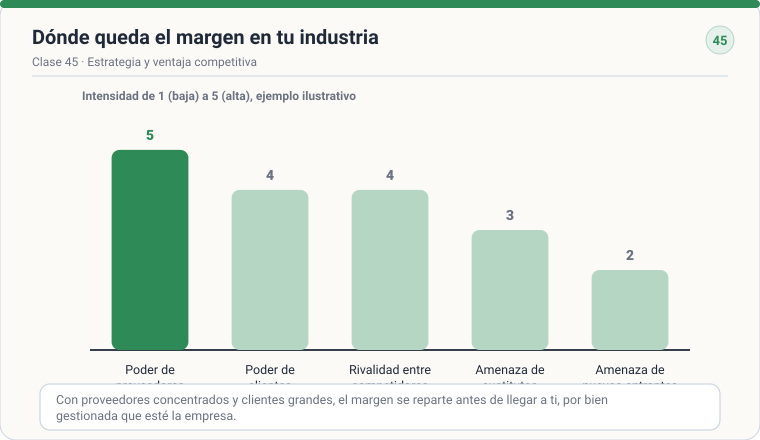

# Clase 045 — Cinco fuerzas y estructura competitiva

> **Parte 04 · Estrategia y ventaja competitiva** — clase 3 de 14

**Estado de evidencia:** `GUIA-PRACTICA` · **Jurisdicción:** Chile-first · **Fecha base normativa:** 07-08-2026 
**Decisión que habilita:** decidir si la estructura de la industria admite el margen que el negocio necesita 
**Entregable:** análisis de cinco fuerzas con evidencia por fuerza y conclusión sobre margen sostenible

## 🎯 Propósito

Diagnosticar si la industria admite estructuralmente el margen que el negocio necesita, antes de intentar compensarlo con esfuerzo.

## 📚 Resultados de aprendizaje

Al finalizar esta clase podrás:

1. **Definir** con precisión los cuatro conceptos de la tabla siguiente y usarlos para describir un caso real.
2. **Explicar** por qué esta materia condiciona decisiones de otras partes del programa.
3. **Decidir** —decidir si la estructura de la industria admite el margen que el negocio necesita— y justificar la decisión por escrito.
4. **Producir** el entregable de la clase y contrastarlo contra su criterio de aceptación.
5. **Distinguir** el dato estable del dato dinámico que exige revalidación en la fuente oficial.

## 🧩 Conceptos centrales

| Concepto | Comprensión verificable |
|---|---|
| **Poder de negociación** | Capacidad de una parte de imponer condiciones. |
| **Barrera de entrada** | Costo o requisito que dificulta el ingreso de nuevos competidores. |
| **Amenaza de sustitutos** | Riesgo de que otra forma de resolver el job desplace a la industria. |
| **Rivalidad** | Intensidad de la competencia entre los actores existentes. |

## 🗺️ Modelo mental: Dónde queda el margen en tu industria

> **La idea en una frase:** El análisis de la estructura de una industria explica dónde queda el margen: con proveedores concentrados, clientes grandes y sin barreras de entrada, el margen es mínimo por bien gestionada que esté la empresa.

**Cómo leerlo:** Cada barra mide la presión de una de las cinco fuerzas. Las más altas son las que se llevan el margen. Antes de apostar a un sector, pregunta quién se queda con la ganancia.

**Piénsalo así:** Es una torta repartida entre varios invitados: no importa cuán bien la cocines si los que se sientan a la mesa se llevan la mayor parte.

## 📖 Desarrollo

### 1. El fondo del asunto

El análisis de estructura explica dónde queda el margen en la cadena. Una industria con proveedores concentrados, clientes grandes y sin barreras de entrada deja margen mínimo, por bien gestionada que esté la empresa. Elegir dónde competir importa más que competir bien en el lugar equivocado.

### 2. Cómo se traduce en la práctica

Para cada fuerza, escribe tres hechos observables, como el número de proveedores, cuánto representa el mayor cliente y qué barreras existen. Puntúa de 1 a 5 y suma tu lectura de dónde queda el margen. Si tres fuerzas están en 4 o 5, la industria admite poco margen: solo entra si tienes una ventaja que cambie la estructura o un nicho protegido.

### 3. Marco aplicable y quién interviene

- PESTEL, cinco fuerzas, cadena de valor y estrategias genéricas
- opciones reales para decisiones bajo incertidumbre
- OKR y métrica norte como sistema de dirección

**Autoridades o contrapartes involucradas:** FNE en materias de competencia, CMF para sociedades supervisadas.
**Profesionales de apoyo:** fundador o directorio, consultor de estrategia, control de gestión. La participación concreta depende del riesgo, del
tamaño de la empresa y de la actividad económica.

### 4. Los números, paso a paso

Una empresa estudia entrar al transporte de carga para una gran cadena de supermercados. Evalúa de 1 a 5: proveedores de combustible y camiones, 5; clientes, 4 (una cadena concentra la demanda); rivalidad, 4; sustitutos, 3; nuevos entrantes, 2. El margen operativo típico del sector es de 5 %, y con una flota nueva el retorno no cubre su costo de capital. Decide no entrar y buscar un nicho de carga especializada con menos presión (cifras ilustrativas).

### 5. En qué se apoya

- **Competitive Strategy** (Free Press): Porter presenta el análisis de las cinco fuerzas como herramienta para entender la rentabilidad estructural de una industria.
- **Blue Ocean Strategy** (Harvard Business School Press): Kim y Mauborgne proponen crear un espacio sin competencia directa cuando la estructura de la industria deja poco margen.

*Las lecturas de apoyo ofrecen marcos conceptuales; lo que exige la ley chilena se verifica en las fuentes oficiales de esta clase.*

## 🧪 Taller guiado

Aplica esta clase a **una** de las siguientes líneas de negocio y repite después el ejercicio con
una segunda línea de carga regulatoria distinta:

| Línea | Carga regulatoria |
|---|---|
| SaaS B2B con IA | media |
| Servicios profesionales | baja |
| E-commerce D2C | media |
| Alimentos o foodtech | alta |
| Exportación de servicios | media |
| Fintech regulada | alta |
| Construcción o servicios técnicos | alta |

**Secuencia de trabajo:**

1. Delimita el contexto: actividad económica, escala, comuna y etapa de la empresa.
2. Reúne los antecedentes que la decisión exige y anota la fecha de cada fuente.
3. Identifica las alternativas reales, incluida la de no hacer nada.
4. Evalúa el impacto en mercado, caja, personas, regulación y operación.
5. Toma la decisión y regístrala con sus supuestos.
6. Produce el entregable.
7. Contrástalo contra el criterio de aceptación.
8. Anota lo que requiere validación profesional y programa su revisión.

### 📦 Entregable

Análisis de cinco fuerzas con evidencia por fuerza y conclusión sobre margen sostenible.

Debe incluir decisión, supuestos, fuentes con fecha de consulta, responsable, riesgos
identificados y próximos pasos.

## 🏆 Reto verificable

Resuelve la misma materia para una segunda línea de negocio con distinta carga regulatoria y
explica por escrito **qué cambió, por qué y qué fuente lo determina**.

## ✅ Criterio de aceptación

- [ ] cada fuerza está sustentada con evidencia concreta
- [ ] la conclusión indica si el margen objetivo es alcanzable
- [ ] cada afirmación regulatoria está referida a una fuente oficial con fecha de consulta;
- [ ] los datos dinámicos quedan marcados para revalidación;
- [ ] hay un responsable asignado y evidencia reproducible del trabajo.

## ⚠️ Errores frecuentes

**Propios de esta clase:**

- Analizar la industria sin datos y con impresiones generales.
- Competir en un segmento estructuralmente sin margen esperando compensarlo con esfuerzo.

**Característicos de la parte 04:**

- Declarar una ventaja competitiva que en realidad es solo precio bajo insostenible.
- Definir okr que miden actividad y no resultado.

## 🇨🇱 Checklist Chile

- [ ] ¿existe norma o autoridad específica para esta materia?
- [ ] ¿la fuente consultada está vigente a la fecha de ejecución?
- [ ] ¿se activa algún trámite ante el SII?
- [ ] ¿se activa algún requisito municipal o sectorial?
- [ ] ¿afecta a consumidores o al tratamiento de datos personales?
- [ ] ¿afecta a trabajadores o a la seguridad y salud en el trabajo?
- [ ] ¿afecta a impuestos, contabilidad o caja?
- [ ] ¿afecta a contratos o a propiedad intelectual?
- [ ] ¿requiere renovación, reporte periódico o revalidación?

## ❓ Preguntas de comprobación

1. ¿Qué fuerza de tu industria captura hoy la mayor parte del margen?
2. ¿Con qué evidencia concreta sustentas cada fuerza, más allá de la impresión?
3. Si la estructura no admite tu margen objetivo, ¿qué cambias: el segmento o el modelo?

## 🔗 Fuentes oficiales

**Biblioteca del Congreso Nacional · LeyChile — Normativa oficial consolidada**  
<https://www.bcn.cl/leychile/> · verificado 2026-11-05

- *Qué contiene:* Publica el texto oficial y consolidado de leyes, decretos y reglamentos, con la versión vigente a una fecha, el historial de modificaciones y la tramitación que las originó.
- *Cómo leerla:* Usa siempre el selector de versión vigente a la fecha en que ejecutarás el trámite, no la última publicada. Y lee el artículo transitorio: en normas en implantación gradual —jornada, datos personales— ahí está la fecha que realmente te aplica.
- *Uso en esta clase:* aporta el marco de «Normativa oficial consolidada» para decidir si la estructura de la industria admite el margen que el negocio necesita.

**Corporación de Fomento de la Producción — Innovación, inversión y garantías**  
<https://www.corfo.cl/> · verificado 2026-11-05

- *Qué contiene:* Reúne los instrumentos de fomento a la innovación y la inversión, incluidos programas de capital semilla, escalamiento, garantías y cobertura de riesgo para el sistema financiero.
- *Cómo leerla:* Filtra por etapa de la empresa antes que por monto. Y verifica el componente de innovación que exige cada instrumento: presentar una expansión comercial como innovación es la causa más común de rechazo.
- *Uso en esta clase:* aporta el marco de «Innovación, inversión y garantías» para decidir si la estructura de la industria admite el margen que el negocio necesita.

**Free Press — Competitive Strategy**  
<https://openlibrary.org/isbn/9780029253601> · verificado 2026-11-25

- *Qué contiene:* Presenta el análisis de las cinco fuerzas y las estrategias genéricas para estudiar una industria.
- *Cómo leerla:* Úsalo como marco conceptual para entender el porqué de la práctica, nunca como prueba de lo que exige la ley chilena; para eso están las fuentes oficiales de la clase.
- *Uso en esta clase:* aporta el marco de «Competitive Strategy» para decidir si la estructura de la industria admite el margen que el negocio necesita.

**Harvard Business School Press — Blue Ocean Strategy**  
<https://openlibrary.org/isbn/9781591396192> · verificado 2026-11-25

- *Qué contiene:* Propone crear espacios de mercado sin competencia redefiniendo el valor ofrecido y la estructura de costos.
- *Cómo leerla:* Úsalo como marco conceptual para entender el porqué de la práctica, nunca como prueba de lo que exige la ley chilena; para eso están las fuentes oficiales de la clase.
- *Uso en esta clase:* aporta el marco de «Blue Ocean Strategy» para decidir si la estructura de la industria admite el margen que el negocio necesita.

Complementos del repositorio: [glosario](../../../docs/19_GLOSSARY.md) ·
[ruta de lecturas](../../../docs/15_BOOKS_AND_LEARNING_PATH.md) ·
[catálogo de fuentes](../../../docs/16_OFFICIAL_SOURCE_CATALOG.md).

> [!IMPORTANT]
> Material educativo. Para una decisión real de alto impacto hay que verificar la fuente oficial
> vigente y validar con el profesional competente.

---

| Anterior | Índice | Siguiente |
|---|---|---|
| [← 044 · Análisis PESTEL](../class-02-analisis-pestel/README.md) | [Parte 04](../README.md) · [Programa](../../../README.md) | [046 · Cadena de valor →](../class-04-cadena-de-valor/README.md) |
