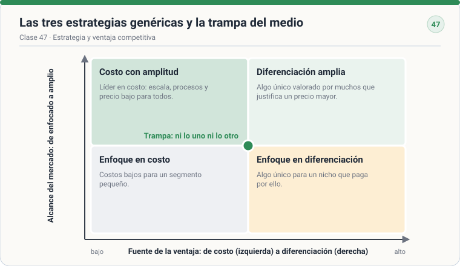

# Clase 047 — Ventaja por costo, diferenciación y enfoque

> **Parte 04 · Estrategia y ventaja competitiva** — clase 5 de 14

**Estado de evidencia:** `GUIA-PRACTICA` · **Jurisdicción:** Chile-first · **Fecha base normativa:** 07-08-2026 
**Decisión que habilita:** elegir una estrategia genérica y aceptar lo que implica renunciar 
**Entregable:** declaración de estrategia genérica con las tres renuncias que implica

## 🎯 Propósito

Elegir una estrategia genérica y aceptar por escrito lo que implica renunciar, para no terminar en posición intermedia sin escala ni precio.

## 📚 Resultados de aprendizaje

Al finalizar esta clase podrás:

1. **Definir** con precisión los cuatro conceptos de la tabla siguiente y usarlos para describir un caso real.
2. **Explicar** por qué esta materia condiciona decisiones de otras partes del programa.
3. **Decidir** —elegir una estrategia genérica y aceptar lo que implica renunciar— y justificar la decisión por escrito.
4. **Producir** el entregable de la clase y contrastarlo contra su criterio de aceptación.
5. **Distinguir** el dato estable del dato dinámico que exige revalidación en la fuente oficial.

## 🧩 Conceptos centrales

| Concepto | Comprensión verificable |
|---|---|
| **Ventaja en costo** | Capacidad estructural de producir más barato que el competidor. |
| **Diferenciación** | Atributo valorado que permite cobrar más. |
| **Enfoque** | Concentración en un segmento donde la empresa es la mejor opción. |
| **Posición intermedia** | Riesgo de no ser ni el más barato ni el más valorado. |

## 🗺️ Modelo mental: Las tres estrategias genéricas y la trampa del medio

> **La idea en una frase:** Las tres estrategias genéricas no son etiquetas: implican estructuras de costo y de organización distintas e incompatibles, y la empresa que intenta todas termina sin ninguna.

**Lectura guiada:** Ubica tu empresa en uno de los cuadrantes y revisa si tu estructura de costos y tu organización lo respaldan. El centro es la trampa: no ser el más barato ni el más distinto.

**Una imagen cotidiana:** Es elegir entre ser el taxi más barato o el chofer privado más exclusivo: ambos ganan, pero con vehículos, tarifas y servicio completamente distintos.

## 📖 Desarrollo

### 1. El fondo del asunto

Las tres estrategias genéricas no son etiquetas: implican estructuras de costo y de organización distintas e incompatibles entre sí. Una empresa que intenta diferenciarse y liderar en costo simultáneamente termina en posición intermedia, sin la escala del líder en costo ni el precio del diferenciado.

### 2. Cómo se traduce en la práctica

Elige una estrategia y escribe lo que aceptas dejar de hacer. Si es costo, define qué procesos y volumen te permiten el precio más bajo. Si es diferenciación, define qué característica valoran tus clientes y cómo la comprobarán. Si es enfoque, nombra el nicho. Verifica que tus decisiones de precio, producto y organización no se contradigan entre sí.

### 3. Marco aplicable y quién interviene

- PESTEL, cinco fuerzas, cadena de valor y estrategias genéricas
- opciones reales para decisiones bajo incertidumbre
- OKR y métrica norte como sistema de dirección

**Autoridades o contrapartes involucradas:** FNE en materias de competencia, CMF para sociedades supervisadas.
**Profesionales de apoyo:** fundador o directorio, consultor de estrategia, control de gestión. La participación concreta depende del riesgo, del
tamaño de la empresa y de la actividad económica.

### 4. Caso trabajado

Una cadena de ferreterías quiere competir al mismo tiempo en precio bajo, atención personalizada y gran surtido. Sus costos de personal suben, sus precios no bajan y los clientes no perciben nada especial. Reconoce que está en el medio y decide diferenciarse en asesoría técnica para constructores pequeños, con precios competitivos pero sin pelear el más bajo del mercado. Su estructura cambia: menos tiendas, más especialistas (caso ilustrativo).

### 5. En qué se apoya

- **Competitive Strategy** (Free Press): Porter describe las estrategias genéricas de liderazgo en costos, diferenciación y enfoque, y advierte sobre quedarse en el medio sin una ventaja clara.
- **Blue Ocean Strategy** (Harvard Business School Press): Kim y Mauborgne discuten cómo algunas empresas combinan diferenciación y costos bajos al redefinir los factores de competencia, un matiz a la regla del medio.

*Las lecturas de apoyo ofrecen marcos conceptuales; lo que exige la ley chilena se verifica en las fuentes oficiales de esta clase.*

## 🧪 Taller guiado

Aplica esta clase a **una** de las siguientes líneas de negocio y repite después el ejercicio con
una segunda línea de carga regulatoria distinta:

| Línea | Carga regulatoria |
|---|---|
| SaaS B2B con IA | media |
| Servicios profesionales | baja |
| E-commerce D2C | media |
| Alimentos o foodtech | alta |
| Exportación de servicios | media |
| Fintech regulada | alta |
| Construcción o servicios técnicos | alta |

**Secuencia de trabajo:**

1. Delimita el contexto: actividad económica, escala, comuna y etapa de la empresa.
2. Reúne los antecedentes que la decisión exige y anota la fecha de cada fuente.
3. Identifica las alternativas reales, incluida la de no hacer nada.
4. Evalúa el impacto en mercado, caja, personas, regulación y operación.
5. Toma la decisión y regístrala con sus supuestos.
6. Produce el entregable.
7. Contrástalo contra el criterio de aceptación.
8. Anota lo que requiere validación profesional y programa su revisión.

### 📦 Entregable

Declaración de estrategia genérica con las tres renuncias que implica.

Debe incluir decisión, supuestos, fuentes con fecha de consulta, responsable, riesgos
identificados y próximos pasos.

## 🏆 Reto verificable

Resuelve la misma materia para una segunda línea de negocio con distinta carga regulatoria y
explica por escrito **qué cambió, por qué y qué fuente lo determina**.

## ✅ Criterio de aceptación

- [ ] la estrategia elegida está declarada con sus renuncias
- [ ] la estructura de costos es coherente con la estrategia elegida
- [ ] cada afirmación regulatoria está referida a una fuente oficial con fecha de consulta;
- [ ] los datos dinámicos quedan marcados para revalidación;
- [ ] hay un responsable asignado y evidencia reproducible del trabajo.

## ⚠️ Errores frecuentes

**Propios de esta clase:**

- Declarar diferenciación y luego competir por precio en cada negociación.
- Perseguir volumen y personalización a la vez sin estructura para ninguna.

**Característicos de la parte 04:**

- Declarar una ventaja competitiva que en realidad es solo precio bajo insostenible.
- Definir okr que miden actividad y no resultado.

## 🇨🇱 Checklist Chile

- [ ] ¿existe norma o autoridad específica para esta materia?
- [ ] ¿la fuente consultada está vigente a la fecha de ejecución?
- [ ] ¿se activa algún trámite ante el SII?
- [ ] ¿se activa algún requisito municipal o sectorial?
- [ ] ¿afecta a consumidores o al tratamiento de datos personales?
- [ ] ¿afecta a trabajadores o a la seguridad y salud en el trabajo?
- [ ] ¿afecta a impuestos, contabilidad o caja?
- [ ] ¿afecta a contratos o a propiedad intelectual?
- [ ] ¿requiere renovación, reporte periódico o revalidación?

## ❓ Preguntas de comprobación

1. ¿Cuál es tu estrategia genérica y qué tres cosas implica renunciar?
2. ¿Tu estructura de costos es coherente con esa elección?
3. ¿Con qué frecuencia terminas descontando para cerrar, y qué dice eso de tu posicionamiento?

## 🔗 Fuentes oficiales

**Biblioteca del Congreso Nacional · LeyChile — Normativa oficial consolidada**  
<https://www.bcn.cl/leychile/> · verificado 2026-11-05

- *Qué contiene:* Publica el texto oficial y consolidado de leyes, decretos y reglamentos, con la versión vigente a una fecha, el historial de modificaciones y la tramitación que las originó.
- *Cómo leerla:* Usa siempre el selector de versión vigente a la fecha en que ejecutarás el trámite, no la última publicada. Y lee el artículo transitorio: en normas en implantación gradual —jornada, datos personales— ahí está la fecha que realmente te aplica.
- *Uso en esta clase:* aporta el marco de «Normativa oficial consolidada» para elegir una estrategia genérica y aceptar lo que implica renunciar.

**Corporación de Fomento de la Producción — Innovación, inversión y garantías**  
<https://www.corfo.cl/> · verificado 2026-11-05

- *Qué contiene:* Reúne los instrumentos de fomento a la innovación y la inversión, incluidos programas de capital semilla, escalamiento, garantías y cobertura de riesgo para el sistema financiero.
- *Cómo leerla:* Filtra por etapa de la empresa antes que por monto. Y verifica el componente de innovación que exige cada instrumento: presentar una expansión comercial como innovación es la causa más común de rechazo.
- *Uso en esta clase:* aporta el marco de «Innovación, inversión y garantías» para elegir una estrategia genérica y aceptar lo que implica renunciar.

**Free Press — Competitive Strategy**  
<https://openlibrary.org/isbn/9780029253601> · verificado 2026-11-25

- *Qué contiene:* Presenta el análisis de las cinco fuerzas y las estrategias genéricas para estudiar una industria.
- *Cómo leerla:* Úsalo como marco conceptual para entender el porqué de la práctica, nunca como prueba de lo que exige la ley chilena; para eso están las fuentes oficiales de la clase.
- *Uso en esta clase:* aporta el marco de «Competitive Strategy» para elegir una estrategia genérica y aceptar lo que implica renunciar.

**Harvard Business School Press — Blue Ocean Strategy**  
<https://openlibrary.org/isbn/9781591396192> · verificado 2026-11-25

- *Qué contiene:* Propone crear espacios de mercado sin competencia redefiniendo el valor ofrecido y la estructura de costos.
- *Cómo leerla:* Úsalo como marco conceptual para entender el porqué de la práctica, nunca como prueba de lo que exige la ley chilena; para eso están las fuentes oficiales de la clase.
- *Uso en esta clase:* aporta el marco de «Blue Ocean Strategy» para elegir una estrategia genérica y aceptar lo que implica renunciar.

Complementos del repositorio: [glosario](../../../docs/19_GLOSSARY.md) ·
[ruta de lecturas](../../../docs/15_BOOKS_AND_LEARNING_PATH.md) ·
[catálogo de fuentes](../../../docs/16_OFFICIAL_SOURCE_CATALOG.md).

> [!IMPORTANT]
> Material educativo. Para una decisión real de alto impacto hay que verificar la fuente oficial
> vigente y validar con el profesional competente.

---

| Anterior | Índice | Siguiente |
|---|---|---|
| [← 046 · Cadena de valor](../class-04-cadena-de-valor/README.md) | [Parte 04](../README.md) · [Programa](../../../README.md) | [048 · Efectos de red y economías de escala →](../class-06-efectos-de-red-y-economias-de-escala/README.md) |
