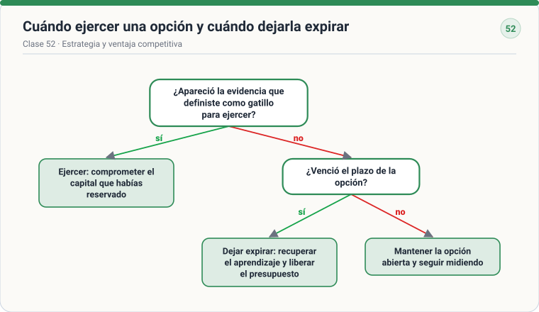

# Clase 052 — Portafolio de apuestas y opciones reales

> **Parte 04 · Estrategia y ventaja competitiva** — clase 10 de 14

**Estado de evidencia:** `GUIA-PRACTICA` · **Jurisdicción:** Chile-first · **Fecha base normativa:** 07-08-2026 
**Decisión que habilita:** decidir qué apuestas se mantienen como opción y cuáles se ejercen 
**Entregable:** portafolio de apuestas con costo de opción, condición de ejercicio y condición de abandono

## 🎯 Propósito

Comprar opciones en vez de comprometer todo el capital cuando la incertidumbre es alta, y definir de antemano qué evidencia gatilla el ejercicio o el abandono.

## 📚 Resultados de aprendizaje

Al finalizar esta clase podrás:

1. **Definir** con precisión los cuatro conceptos de la tabla siguiente y usarlos para describir un caso real.
2. **Explicar** por qué esta materia condiciona decisiones de otras partes del programa.
3. **Decidir** —decidir qué apuestas se mantienen como opción y cuáles se ejercen— y justificar la decisión por escrito.
4. **Producir** el entregable de la clase y contrastarlo contra su criterio de aceptación.
5. **Distinguir** el dato estable del dato dinámico que exige revalidación en la fuente oficial.

## 🧩 Conceptos centrales

| Concepto | Comprensión verificable |
|---|---|
| **Opción real** | Inversión pequeña que compra el derecho a invertir más tarde. |
| **Portafolio de apuestas** | Conjunto de iniciativas con distinto riesgo y horizonte. |
| **Costo de la opción** | Gasto necesario para mantener abierta la posibilidad. |
| **Ejercicio** | Decisión de invertir en serio cuando la incertidumbre bajó. |

## 🗺️ Modelo mental: Cuándo ejercer una opción y cuándo dejarla expirar

> **La idea en una frase:** Ante alta incertidumbre conviene comprar opciones en vez de comprometer todo el capital: un piloto, una alianza o un desarrollo acotado, con la evidencia que gatilla el ejercicio definida de antemano.

**Qué mirar primero:** Recorre el árbol con cada apuesta pequeña. La disciplina está en escribir el gatillo y el plazo antes de empezar, de modo que la decisión no dependa del entusiasmo del momento.

**Una analogía:** Es reservar una mesa en un restaurante: pagas poco por asegurar el lugar y decides luego si vas, según cómo amanezca el día.

## 📖 Desarrollo

### 1. El fondo del asunto

Ante alta incertidumbre conviene comprar opciones en vez de comprometer todo el capital: un piloto, una alianza, un desarrollo acotado. La disciplina está en definir de antemano qué evidencia gatilla el ejercicio y qué evidencia gatilla el abandono de la opción.

### 2. Cómo se traduce en la práctica

Lista tus apuestas con incertidumbre alta y para cada una escribe cuánto cuesta la opción, cuándo vence y qué evidencia gatilla el ejercicio. Reserva un presupuesto total para opciones y cuida que ninguna pueda comprometer la supervivencia de la empresa. Revisa el portafolio cada trimestre y cierra las que vencieron sin gatillo.

### 3. Marco aplicable y quién interviene

- PESTEL, cinco fuerzas, cadena de valor y estrategias genéricas
- opciones reales para decisiones bajo incertidumbre
- OKR y métrica norte como sistema de dirección

**Autoridades o contrapartes involucradas:** FNE en materias de competencia, CMF para sociedades supervisadas.
**Profesionales de apoyo:** fundador o directorio, consultor de estrategia, control de gestión. La participación concreta depende del riesgo, del
tamaño de la empresa y de la actividad económica.

### 4. Cómo se decide, paso a paso

Una empresa de alimentos quiere probar un producto nuevo para exportar. En vez de montar una línea nueva, paga un piloto de 50 millones con un distribuidor en un país. Define el gatillo: pedidos recurrentes por 120 millones en seis meses. Si se cumple, invierte 400 millones en la línea; si no, el piloto vence y el aprendizaje queda registrado. La pérdida máxima fue acotada y el potencial, abierto (cifras ilustrativas).

### 5. En qué se apoya

- **Principles of Corporate Finance** (McGraw-Hill): Brealey y Myers tratan las opciones reales como el valor de la flexibilidad de esperar, ampliar o abandonar un proyecto según cómo evolucione la incertidumbre.
- **Thinking in Bets** (Portfolio): Duke recomienda definir antes de decidir qué información cambiaría la decisión, y tratar las iniciativas como apuestas con costo acotado.

*Las lecturas de apoyo ofrecen marcos conceptuales; lo que exige la ley chilena se verifica en las fuentes oficiales de esta clase.*

## 🧪 Taller guiado

Aplica esta clase a **una** de las siguientes líneas de negocio y repite después el ejercicio con
una segunda línea de carga regulatoria distinta:

| Línea | Carga regulatoria |
|---|---|
| SaaS B2B con IA | media |
| Servicios profesionales | baja |
| E-commerce D2C | media |
| Alimentos o foodtech | alta |
| Exportación de servicios | media |
| Fintech regulada | alta |
| Construcción o servicios técnicos | alta |

**Secuencia de trabajo:**

1. Delimita el contexto: actividad económica, escala, comuna y etapa de la empresa.
2. Reúne los antecedentes que la decisión exige y anota la fecha de cada fuente.
3. Identifica las alternativas reales, incluida la de no hacer nada.
4. Evalúa el impacto en mercado, caja, personas, regulación y operación.
5. Toma la decisión y regístrala con sus supuestos.
6. Produce el entregable.
7. Contrástalo contra el criterio de aceptación.
8. Anota lo que requiere validación profesional y programa su revisión.

### 📦 Entregable

Portafolio de apuestas con costo de opción, condición de ejercicio y condición de abandono.

Debe incluir decisión, supuestos, fuentes con fecha de consulta, responsable, riesgos
identificados y próximos pasos.

## 🏆 Reto verificable

Resuelve la misma materia para una segunda línea de negocio con distinta carga regulatoria y
explica por escrito **qué cambió, por qué y qué fuente lo determina**.

## ✅ Criterio de aceptación

- [ ] cada apuesta tiene condición de ejercicio y de abandono
- [ ] el costo de mantener cada opción está cuantificado
- [ ] cada afirmación regulatoria está referida a una fuente oficial con fecha de consulta;
- [ ] los datos dinámicos quedan marcados para revalidación;
- [ ] hay un responsable asignado y evidencia reproducible del trabajo.

## ⚠️ Errores frecuentes

**Propios de esta clase:**

- Mantener opciones abiertas indefinidamente sin condición de cierre.
- Ejercer una opción por presión interna y no por evidencia.

**Característicos de la parte 04:**

- Declarar una ventaja competitiva que en realidad es solo precio bajo insostenible.
- Definir okr que miden actividad y no resultado.

## 🇨🇱 Checklist Chile

- [ ] ¿existe norma o autoridad específica para esta materia?
- [ ] ¿la fuente consultada está vigente a la fecha de ejecución?
- [ ] ¿se activa algún trámite ante el SII?
- [ ] ¿se activa algún requisito municipal o sectorial?
- [ ] ¿afecta a consumidores o al tratamiento de datos personales?
- [ ] ¿afecta a trabajadores o a la seguridad y salud en el trabajo?
- [ ] ¿afecta a impuestos, contabilidad o caja?
- [ ] ¿afecta a contratos o a propiedad intelectual?
- [ ] ¿requiere renovación, reporte periódico o revalidación?

## ❓ Preguntas de comprobación

1. ¿Qué apuestas mantienes abiertas y cuánto cuesta mantener cada una?
2. ¿Qué evidencia concreta te haría ejercer o abandonar cada opción?
3. ¿Alguna opción sigue viva por inercia y no por criterio?

## 🔗 Fuentes oficiales

**Biblioteca del Congreso Nacional · LeyChile — Normativa oficial consolidada**  
<https://www.bcn.cl/leychile/> · verificado 2026-11-05

- *Qué contiene:* Publica el texto oficial y consolidado de leyes, decretos y reglamentos, con la versión vigente a una fecha, el historial de modificaciones y la tramitación que las originó.
- *Cómo leerla:* Usa siempre el selector de versión vigente a la fecha en que ejecutarás el trámite, no la última publicada. Y lee el artículo transitorio: en normas en implantación gradual —jornada, datos personales— ahí está la fecha que realmente te aplica.
- *Uso en esta clase:* aporta el marco de «Normativa oficial consolidada» para decidir qué apuestas se mantienen como opción y cuáles se ejercen.

**Corporación de Fomento de la Producción — Innovación, inversión y garantías**  
<https://www.corfo.cl/> · verificado 2026-11-05

- *Qué contiene:* Reúne los instrumentos de fomento a la innovación y la inversión, incluidos programas de capital semilla, escalamiento, garantías y cobertura de riesgo para el sistema financiero.
- *Cómo leerla:* Filtra por etapa de la empresa antes que por monto. Y verifica el componente de innovación que exige cada instrumento: presentar una expansión comercial como innovación es la causa más común de rechazo.
- *Uso en esta clase:* aporta el marco de «Innovación, inversión y garantías» para decidir qué apuestas se mantienen como opción y cuáles se ejercen.

**McGraw-Hill — Principles of Corporate Finance**  
<https://openlibrary.org/isbn/9780071140539> · verificado 2026-11-25

- *Qué contiene:* Texto de finanzas corporativas: valor presente, riesgo, costo de capital y decisiones de inversión. Se usa como lectura de apoyo conceptual y no como fuente normativa.
- *Cómo leerla:* Úsalo como marco conceptual para entender el porqué de la práctica, nunca como prueba de lo que exige la ley chilena; para eso están las fuentes oficiales de la clase.
- *Uso en esta clase:* aporta el marco de «Principles of Corporate Finance» para decidir qué apuestas se mantienen como opción y cuáles se ejercen.

**Portfolio — Thinking in Bets**  
<https://openlibrary.org/isbn/9780735216358> · verificado 2026-11-25

- *Qué contiene:* Aplica la lógica de las apuestas a la decisión bajo incertidumbre: separar la calidad de la decisión del resultado.
- *Cómo leerla:* Úsalo como marco conceptual para entender el porqué de la práctica, nunca como prueba de lo que exige la ley chilena; para eso están las fuentes oficiales de la clase.
- *Uso en esta clase:* aporta el marco de «Thinking in Bets» para decidir qué apuestas se mantienen como opción y cuáles se ejercen.

Complementos del repositorio: [glosario](../../../docs/19_GLOSSARY.md) ·
[ruta de lecturas](../../../docs/15_BOOKS_AND_LEARNING_PATH.md) ·
[catálogo de fuentes](../../../docs/16_OFFICIAL_SOURCE_CATALOG.md).

> [!IMPORTANT]
> Material educativo. Para una decisión real de alto impacto hay que verificar la fuente oficial
> vigente y validar con el profesional competente.

---

| Anterior | Índice | Siguiente |
|---|---|---|
| [← 051 · Posicionamiento estratégico](../class-09-posicionamiento-estrategico/README.md) | [Parte 04](../README.md) · [Programa](../../../README.md) | [053 · OKR, KPI y métricas norte →](../class-11-okr-kpi-y-metricas-norte/README.md) |
