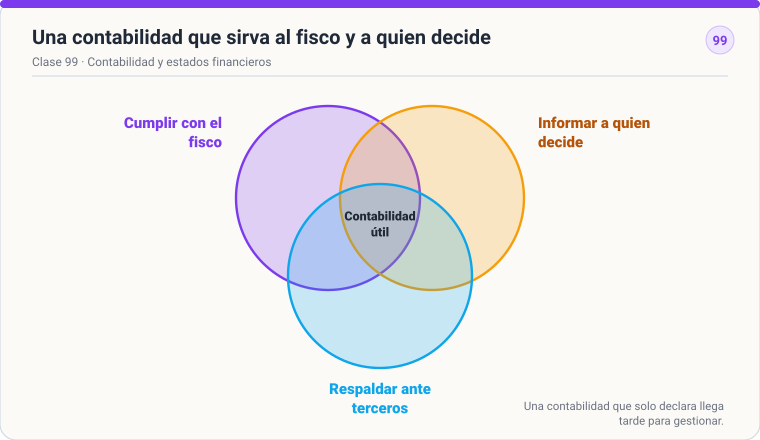

# Clase 099 — Contabilidad como sistema de información

> **Parte 08 · Contabilidad y estados financieros** — clase 1 de 14

**Estado de evidencia:** `GUIA-PRACTICA` · **Jurisdicción:** Chile-first · **Fecha base normativa:** 07-08-2026 
**Decisión que habilita:** definir para qué decisiones debe servir la contabilidad además de cumplir 
**Entregable:** definición de requerimientos de información con reportes, frecuencia y destinatario

## 🎯 Propósito

Diseñar la contabilidad para que sirva a dos clientes distintos —el fisco y quien decide— porque una que solo sirve al primero llega tarde para gestionar.

## 📚 Resultados de aprendizaje

Al finalizar esta clase podrás:

1. **Definir** con precisión los cuatro conceptos de la tabla siguiente y usarlos para describir un caso real.
2. **Explicar** por qué esta materia condiciona decisiones de otras partes del programa.
3. **Decidir** —definir para qué decisiones debe servir la contabilidad además de cumplir— y justificar la decisión por escrito.
4. **Producir** el entregable de la clase y contrastarlo contra su criterio de aceptación.
5. **Distinguir** el dato estable del dato dinámico que exige revalidación en la fuente oficial.

## 🧩 Conceptos centrales

| Concepto | Comprensión verificable |
|---|---|
| **Sistema de información contable** | Proceso que captura, clasifica y reporta hechos económicos. |
| **Hecho económico** | Evento que altera activos, pasivos o patrimonio. |
| **Documento fuente** | Respaldo que origina el registro. |
| **Oportunidad** | Cualidad de que la información esté disponible cuando se decide. |

## 🗺️ Modelo mental: Una contabilidad que sirva al fisco y a quien decide

> **La idea en una frase:** La contabilidad tiene dos clientes, el fisco y quien decide; una que solo sirve para declarar llega tarde para gestionar.

**Cómo leerlo:** Los tres círculos son tres usos de la misma información. Diseña el sistema desde el inicio para que el centro, donde coinciden, sea lo normal y no lo excepcional.

**Una imagen cotidiana:** Es un mapa que sirve para pagar el peaje, para decidir la ruta y para mostrar a la policía por dónde pasaste: el mismo trazado, tres usos.

## 📖 Desarrollo

### 1. El fondo del asunto

La contabilidad tiene dos clientes: el fisco y el que decide. Una contabilidad que solo sirve para declarar llega tarde para gestionar. Diseñarla desde el inicio con centros de costo y clasificaciones útiles cuesta lo mismo que diseñarla mal, y evita rehacer tres años de historia.

### 2. Cómo se traduce en la práctica

Antes de contratar o diseñar la contabilidad, escribe las cinco preguntas que quieres responder con ella: por ejemplo, margen por línea, deuda por cliente y caja de la semana siguiente. Define centros de costo y clasificaciones que las contesten y fija la fecha límite del cierre mensual. La oportunidad importa tanto como la exactitud: un dato exacto pero tardío no ayuda a decidir.

### 3. Marco aplicable y quién interviene

- IFRS e IFRS para Pymes como marco de referencia contable
- Código Tributario en materia de libros, respaldo y plazos de conservación
- normas del SII sobre contabilidad completa, simplificada y registros electrónicos

**Autoridades o contrapartes involucradas:** SII, Colegio de Contadores de Chile.
**Profesionales de apoyo:** contador general, auditor, controller. La participación concreta depende del riesgo, del
tamaño de la empresa y de la actividad económica.

### 4. Caso trabajado

Una pyme de transporte lleva la contabilidad con un solo objetivo: declarar el IVA. Los estados financieros llegan a los dos meses y el dueño no sabe qué ruta deja margen. Al rediseñar, el plan de cuentas separa ingresos y costos por ruta y cliente, y el cierre mensual se hace en cinco días. En tres meses descubre que dos rutas perdían dinero y las ajusta (caso ilustrativo).

### 5. En qué se apoya

- **Nuevos contribuyentes, inicio de actividades y DTE** (Servicio de Impuestos Internos): El SII informa las obligaciones contables y tributarias de los nuevos contribuyentes, que son el piso mínimo de cumplimiento.
- **Financial Intelligence** (Harvard Business Review Press): Berman y Knight enseñan a usar los estados financieros para decidir y no solo para cumplir, que es el segundo cliente de la contabilidad.

*Las lecturas de apoyo ofrecen marcos conceptuales; lo que exige la ley chilena se verifica en las fuentes oficiales de esta clase.*

## 🧪 Taller guiado

Aplica esta clase a **una** de las siguientes líneas de negocio y repite después el ejercicio con
una segunda línea de carga regulatoria distinta:

| Línea | Carga regulatoria |
|---|---|
| SaaS B2B con IA | media |
| Servicios profesionales | baja |
| E-commerce D2C | media |
| Alimentos o foodtech | alta |
| Exportación de servicios | media |
| Fintech regulada | alta |
| Construcción o servicios técnicos | alta |

**Secuencia de trabajo:**

1. Delimita el contexto: actividad económica, escala, comuna y etapa de la empresa.
2. Reúne los antecedentes que la decisión exige y anota la fecha de cada fuente.
3. Identifica las alternativas reales, incluida la de no hacer nada.
4. Evalúa el impacto en mercado, caja, personas, regulación y operación.
5. Toma la decisión y regístrala con sus supuestos.
6. Produce el entregable.
7. Contrástalo contra el criterio de aceptación.
8. Anota lo que requiere validación profesional y programa su revisión.

### 📦 Entregable

Definición de requerimientos de información con reportes, frecuencia y destinatario.

Debe incluir decisión, supuestos, fuentes con fecha de consulta, responsable, riesgos
identificados y próximos pasos.

## 🏆 Reto verificable

Resuelve la misma materia para una segunda línea de negocio con distinta carga regulatoria y
explica por escrito **qué cambió, por qué y qué fuente lo determina**.

## ✅ Criterio de aceptación

- [ ] los reportes requeridos tienen destinatario y frecuencia
- [ ] la información está disponible antes de que caduque su utilidad
- [ ] cada afirmación regulatoria está referida a una fuente oficial con fecha de consulta;
- [ ] los datos dinámicos quedan marcados para revalidación;
- [ ] hay un responsable asignado y evidencia reproducible del trabajo.

## ⚠️ Errores frecuentes

**Propios de esta clase:**

- Diseñar la contabilidad solo para el sii y no poder gestionar con ella.
- Recibir los estados financieros tres meses después del cierre.

**Característicos de la parte 08:**

- Cerrar el mes sin conciliar banco y arrastrar diferencias durante todo el año.
- Reconocer ingreso al firmar y no al devengar el servicio.

## 🇨🇱 Checklist Chile

- [ ] ¿existe norma o autoridad específica para esta materia?
- [ ] ¿la fuente consultada está vigente a la fecha de ejecución?
- [ ] ¿se activa algún trámite ante el SII?
- [ ] ¿se activa algún requisito municipal o sectorial?
- [ ] ¿afecta a consumidores o al tratamiento de datos personales?
- [ ] ¿afecta a trabajadores o a la seguridad y salud en el trabajo?
- [ ] ¿afecta a impuestos, contabilidad o caja?
- [ ] ¿afecta a contratos o a propiedad intelectual?
- [ ] ¿requiere renovación, reporte periódico o revalidación?

## ❓ Preguntas de comprobación

1. ¿Qué tres preguntas de negocio debería responder tu contabilidad y hoy no responde?
2. ¿Cuántos días después del cierre recibes los estados financieros?
3. ¿Quién los lee además del contador y qué decide con ellos?

## 🔗 Fuentes oficiales

**Servicio de Impuestos Internos — Nuevos contribuyentes, inicio de actividades y DTE**  
<https://www.sii.cl/ayudas/nuevos_contribuyentes/boleta-vys-facturador.html> · verificado 2026-11-05

- *Qué contiene:* Reúne el circuito completo del contribuyente nuevo: obtención de RUT, declaración de inicio de actividades, elección de códigos de actividad económica y habilitación para emitir documentos tributarios electrónicos.
- *Cómo leerla:* Sepáralo en dos actos distintos que la página trata seguidos: el RUT identifica, el inicio de actividades habilita. Lo que te bloquea para facturar casi siempre está en el segundo, no en el primero.
- *Uso en esta clase:* aporta el marco de «Nuevos contribuyentes, inicio de actividades y DTE» para definir para qué decisiones debe servir la contabilidad además de cumplir.

**Harvard Business Review Press — Financial Intelligence**  
<https://openlibrary.org/isbn/9781591397649> · verificado 2026-11-25

- *Qué contiene:* Explica a personas no financieras cómo leer estados financieros, márgenes, flujo de caja y capital de trabajo.
- *Cómo leerla:* Úsalo como marco conceptual para entender el porqué de la práctica, nunca como prueba de lo que exige la ley chilena; para eso están las fuentes oficiales de la clase.
- *Uso en esta clase:* aporta el marco de «Financial Intelligence» para definir para qué decisiones debe servir la contabilidad además de cumplir.

Complementos del repositorio: [glosario](../../../docs/19_GLOSSARY.md) ·
[ruta de lecturas](../../../docs/15_BOOKS_AND_LEARNING_PATH.md) ·
[catálogo de fuentes](../../../docs/16_OFFICIAL_SOURCE_CATALOG.md).

> [!IMPORTANT]
> Material educativo. Para una decisión real de alto impacto hay que verificar la fuente oficial
> vigente y validar con el profesional competente.

---

| Anterior | Índice | Siguiente |
|---|---|---|
| **Inicio de la parte** | [Parte 08](../README.md) · [Programa](../../../README.md) | [100 · Plan de cuentas →](../class-02-plan-de-cuentas/README.md) |
