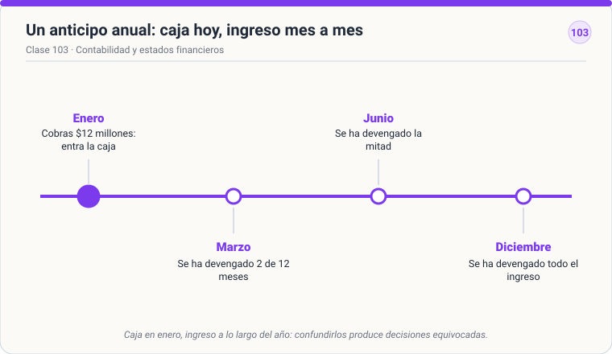

# Clase 103 — Devengo versus caja

> **Parte 08 · Contabilidad y estados financieros** — clase 5 de 14

**Estado de evidencia:** `GUIA-PRACTICA` · **Jurisdicción:** Chile-first · **Fecha base normativa:** 07-08-2026 
**Decisión que habilita:** definir cuándo se reconoce el ingreso y cómo se controla el diferimiento 
**Entregable:** política de reconocimiento de ingresos con tratamiento de anticipos y provisiones

## 🎯 Propósito

Distinguir devengo de caja para no tomar decisiones de gasto sobre dinero que ya está comprometido con servicios aún no prestados.

## 📚 Resultados de aprendizaje

Al finalizar esta clase podrás:

1. **Definir** con precisión los cuatro conceptos de la tabla siguiente y usarlos para describir un caso real.
2. **Explicar** por qué esta materia condiciona decisiones de otras partes del programa.
3. **Decidir** —definir cuándo se reconoce el ingreso y cómo se controla el diferimiento— y justificar la decisión por escrito.
4. **Producir** el entregable de la clase y contrastarlo contra su criterio de aceptación.
5. **Distinguir** el dato estable del dato dinámico que exige revalidación en la fuente oficial.

## 🧩 Conceptos centrales

| Concepto | Comprensión verificable |
|---|---|
| **Devengo** | Reconocimiento del ingreso o gasto cuando ocurre el hecho económico. |
| **Base caja** | Reconocimiento cuando el dinero entra o sale. |
| **Diferimiento** | Ingreso cobrado que aún no se ha devengado. |
| **Provisión** | Gasto devengado que aún no se ha pagado. |

## 🗺️ Modelo mental: Un anticipo anual: caja hoy, ingreso mes a mes

> **La idea en una frase:** La brecha entre devengo y caja explica por qué una empresa con utilidad puede no tener dinero; un anticipo anual cobrado en enero es caja en enero e ingreso a lo largo del año.

**Qué mirar primero:** La línea muestra dos relojes: el de la caja, que marca el cobro, y el del ingreso, que marca el servicio prestado. Gastar el anticipo como si todo fuera ganancia es adelantar un ingreso que aún no se gana.

**Una imagen cotidiana:** Es recibir el sueldo anual por adelantado: lo tienes en la cuenta, pero lo ganas mes a mes trabajando.

## 📖 Desarrollo

### 1. El fondo del asunto

La brecha entre devengo y caja es la que explica por qué una empresa con utilidad no tiene dinero. Un anticipo anual cobrado en enero es caja en enero e ingreso a lo largo del año; confundirlos produce decisiones de gasto basadas en dinero que ya está comprometido.

### 2. Cómo se traduce en la práctica

Define cuándo reconoces cada ingreso: al entregar el servicio o al facturar. Registra los anticipos como pasivo por servicio no prestado y reconoce el ingreso conforme se presta. Controla los diferimientos y las provisiones al cierre y compara siempre la utilidad con el flujo de caja. Una utilidad sin caja suele esconder cobros pendientes o anticipos mal entendidos.

### 3. Marco aplicable y quién interviene

- IFRS e IFRS para Pymes como marco de referencia contable
- Código Tributario en materia de libros, respaldo y plazos de conservación
- normas del SII sobre contabilidad completa, simplificada y registros electrónicos

**Autoridades o contrapartes involucradas:** SII, Colegio de Contadores de Chile.
**Profesionales de apoyo:** contador general, auditor, controller. La participación concreta depende del riesgo, del
tamaño de la empresa y de la actividad económica.

### 4. Los números, paso a paso

Una empresa cobra en enero un contrato anual de 12 millones y lo gasta en comprar equipos y pagar bonos. Al cierre de marzo ha devengado 3 millones de ingresos, pero ya gastó 11. En agosto debe seguir prestando el servicio sin ingresos nuevos y se queda sin caja. Si hubiera separado 1 millón mensual para el servicio, habría tenido recursos hasta diciembre (cifras ilustrativas).

### 5. En qué se apoya

- **Financial Intelligence** (Harvard Business Review Press): Berman y Knight explican la diferencia entre utilidad y flujo de caja y por qué una empresa rentable puede quedarse sin dinero.
- **Nuevos contribuyentes, inicio de actividades y DTE** (Servicio de Impuestos Internos): El SII informa las reglas de reconocimiento de ingresos y costos a efectos tributarios, que pueden diferir del criterio de gestión.

*Las lecturas de apoyo ofrecen marcos conceptuales; lo que exige la ley chilena se verifica en las fuentes oficiales de esta clase.*

## 🧪 Taller guiado

Aplica esta clase a **una** de las siguientes líneas de negocio y repite después el ejercicio con
una segunda línea de carga regulatoria distinta:

| Línea | Carga regulatoria |
|---|---|
| SaaS B2B con IA | media |
| Servicios profesionales | baja |
| E-commerce D2C | media |
| Alimentos o foodtech | alta |
| Exportación de servicios | media |
| Fintech regulada | alta |
| Construcción o servicios técnicos | alta |

**Secuencia de trabajo:**

1. Delimita el contexto: actividad económica, escala, comuna y etapa de la empresa.
2. Reúne los antecedentes que la decisión exige y anota la fecha de cada fuente.
3. Identifica las alternativas reales, incluida la de no hacer nada.
4. Evalúa el impacto en mercado, caja, personas, regulación y operación.
5. Toma la decisión y regístrala con sus supuestos.
6. Produce el entregable.
7. Contrástalo contra el criterio de aceptación.
8. Anota lo que requiere validación profesional y programa su revisión.

### 📦 Entregable

Política de reconocimiento de ingresos con tratamiento de anticipos y provisiones.

Debe incluir decisión, supuestos, fuentes con fecha de consulta, responsable, riesgos
identificados y próximos pasos.

## 🏆 Reto verificable

Resuelve la misma materia para una segunda línea de negocio con distinta carga regulatoria y
explica por escrito **qué cambió, por qué y qué fuente lo determina**.

## ✅ Criterio de aceptación

- [ ] la política define el momento de reconocimiento por tipo de ingreso
- [ ] los anticipos se controlan como pasivo hasta devengarse
- [ ] cada afirmación regulatoria está referida a una fuente oficial con fecha de consulta;
- [ ] los datos dinámicos quedan marcados para revalidación;
- [ ] hay un responsable asignado y evidencia reproducible del trabajo.

## ⚠️ Errores frecuentes

**Propios de esta clase:**

- Reconocer como ingreso del mes un anticipo por servicios de todo el año.
- Gastar la caja de anticipos como si fuera utilidad disponible.

**Característicos de la parte 08:**

- Cerrar el mes sin conciliar banco y arrastrar diferencias durante todo el año.
- Reconocer ingreso al firmar y no al devengar el servicio.

## 🇨🇱 Checklist Chile

- [ ] ¿existe norma o autoridad específica para esta materia?
- [ ] ¿la fuente consultada está vigente a la fecha de ejecución?
- [ ] ¿se activa algún trámite ante el SII?
- [ ] ¿se activa algún requisito municipal o sectorial?
- [ ] ¿afecta a consumidores o al tratamiento de datos personales?
- [ ] ¿afecta a trabajadores o a la seguridad y salud en el trabajo?
- [ ] ¿afecta a impuestos, contabilidad o caja?
- [ ] ¿afecta a contratos o a propiedad intelectual?
- [ ] ¿requiere renovación, reporte periódico o revalidación?

## ❓ Preguntas de comprobación

1. ¿Cuánto de tu caja actual corresponde a servicios que aún no has prestado?
2. ¿En qué momento reconoces ingreso en cada tipo de venta que haces?
3. ¿Están tus anticipos registrados como pasivo o como ingreso del mes?

## 🔗 Fuentes oficiales

**Servicio de Impuestos Internos — Nuevos contribuyentes, inicio de actividades y DTE**  
<https://www.sii.cl/ayudas/nuevos_contribuyentes/boleta-vys-facturador.html> · verificado 2026-11-05

- *Qué contiene:* Reúne el circuito completo del contribuyente nuevo: obtención de RUT, declaración de inicio de actividades, elección de códigos de actividad económica y habilitación para emitir documentos tributarios electrónicos.
- *Cómo leerla:* Sepáralo en dos actos distintos que la página trata seguidos: el RUT identifica, el inicio de actividades habilita. Lo que te bloquea para facturar casi siempre está en el segundo, no en el primero.
- *Uso en esta clase:* aporta el marco de «Nuevos contribuyentes, inicio de actividades y DTE» para definir cuándo se reconoce el ingreso y cómo se controla el diferimiento.

**Servicio de Impuestos Internos — Carpeta Tributaria Electrónica**  
<https://zeus.sii.cl/dii_doc/carpeta_tributaria/html/generar_carpeta.htm> · verificado 2026-11-05

- *Qué contiene:* Permite generar el expediente que acredita la situación tributaria de la empresa: inicio de actividades, régimen, declaraciones presentadas y timbraje.
- *Cómo leerla:* Es el documento que pedirán banco, inversionista y comprador. Genera una hoy aunque no la necesites: lo que muestre es exactamente lo que verá un tercero al evaluarte.
- *Uso en esta clase:* aporta el marco de «Carpeta Tributaria Electrónica» para definir cuándo se reconoce el ingreso y cómo se controla el diferimiento.

**Biblioteca del Congreso Nacional · LeyChile — Normativa oficial consolidada**  
<https://www.bcn.cl/leychile/> · verificado 2026-11-05

- *Qué contiene:* Publica el texto oficial y consolidado de leyes, decretos y reglamentos, con la versión vigente a una fecha, el historial de modificaciones y la tramitación que las originó.
- *Cómo leerla:* Usa siempre el selector de versión vigente a la fecha en que ejecutarás el trámite, no la última publicada. Y lee el artículo transitorio: en normas en implantación gradual —jornada, datos personales— ahí está la fecha que realmente te aplica.
- *Uso en esta clase:* aporta el marco de «Normativa oficial consolidada» para definir cuándo se reconoce el ingreso y cómo se controla el diferimiento.

**Harvard Business Review Press — Financial Intelligence**  
<https://openlibrary.org/isbn/9781591397649> · verificado 2026-11-25

- *Qué contiene:* Explica a personas no financieras cómo leer estados financieros, márgenes, flujo de caja y capital de trabajo.
- *Cómo leerla:* Úsalo como marco conceptual para entender el porqué de la práctica, nunca como prueba de lo que exige la ley chilena; para eso están las fuentes oficiales de la clase.
- *Uso en esta clase:* aporta el marco de «Financial Intelligence» para definir cuándo se reconoce el ingreso y cómo se controla el diferimiento.

Complementos del repositorio: [glosario](../../../docs/19_GLOSSARY.md) ·
[ruta de lecturas](../../../docs/15_BOOKS_AND_LEARNING_PATH.md) ·
[catálogo de fuentes](../../../docs/16_OFFICIAL_SOURCE_CATALOG.md).

> [!IMPORTANT]
> Material educativo. Para una decisión real de alto impacto hay que verificar la fuente oficial
> vigente y validar con el profesional competente.

---

| Anterior | Índice | Siguiente |
|---|---|---|
| [← 102 · Libro diario, mayor y auxiliares](../class-04-libro-diario-mayor-y-auxiliares/README.md) | [Parte 08](../README.md) · [Programa](../../../README.md) | [104 · Balance general →](../class-06-balance-general/README.md) |
