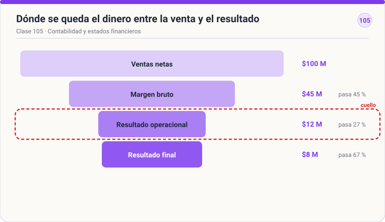

# Clase 105 — Estado de resultados

> **Parte 08 · Contabilidad y estados financieros** — clase 7 de 14

**Estado de evidencia:** `GUIA-PRACTICA` · **Jurisdicción:** Chile-first · **Fecha base normativa:** 07-08-2026 
**Decisión que habilita:** determinar si el problema está en el margen del producto o en la estructura de gastos 
**Entregable:** estado de resultados con apertura por línea de negocio y análisis de margen

## 🎯 Propósito

Separar el problema de margen del problema de estructura, porque la utilidad final no dice cuál de los dos tiene la empresa.

## 📚 Resultados de aprendizaje

Al finalizar esta clase podrás:

1. **Definir** con precisión los cuatro conceptos de la tabla siguiente y usarlos para describir un caso real.
2. **Explicar** por qué esta materia condiciona decisiones de otras partes del programa.
3. **Decidir** —determinar si el problema está en el margen del producto o en la estructura de gastos— y justificar la decisión por escrito.
4. **Producir** el entregable de la clase y contrastarlo contra su criterio de aceptación.
5. **Distinguir** el dato estable del dato dinámico que exige revalidación en la fuente oficial.

## 🧩 Conceptos centrales

| Concepto | Comprensión verificable |
|---|---|
| **Estado de resultados** | Reporte de ingresos, costos y gastos de un período. |
| **Margen bruto** | Ingreso menos costo directo de lo vendido. |
| **Resultado operacional** | Antes de gastos financieros e impuestos. |
| **Gasto no operacional** | Resultado ajeno al giro principal. |

## 🗺️ Modelo mental: Dónde se queda el dinero entre la venta y el resultado

> **La idea en una frase:** El estado de resultados responde si el modelo de negocio funciona: el margen bruto dice si el precio cubre el costo de entregar y el resultado operacional dice si la estructura de gastos es sostenible.

**Cómo leerlo:** Cada barra es lo que queda tras un tipo de costo. La mayor caída señala dónde está el problema: en el costo de entregar o en la estructura (cifras ilustrativas).

**Piénsalo así:** Es una cascada con varias pozas: el agua que llega al final depende de cuánto se queda en cada una.

## 📖 Desarrollo

### 1. El fondo del asunto

El estado de resultados responde si el modelo de negocio funciona. La lectura útil separa margen bruto —que dice si el precio cubre el costo de entregar— de resultado operacional, que dice si la estructura de la empresa cabe dentro de ese margen. Confundirlos oculta cuál de los dos problemas hay.

### 2. Cómo se traduce en la práctica

Separa en tu estado de resultados el margen bruto, el resultado operacional y los gastos no operacionales. Calcula los porcentajes sobre ventas y compáralos mes a mes y con tu sector. Si el margen bruto es bajo, revisa precio y costo directo; si es bueno pero el resultado operacional es bajo, revisa la estructura de gastos. Atiende también los gastos no operacionales y los impuestos.

### 3. Marco aplicable y quién interviene

- IFRS e IFRS para Pymes como marco de referencia contable
- Código Tributario en materia de libros, respaldo y plazos de conservación
- normas del SII sobre contabilidad completa, simplificada y registros electrónicos

**Autoridades o contrapartes involucradas:** SII, Colegio de Contadores de Chile.
**Profesionales de apoyo:** contador general, auditor, controller. La participación concreta depende del riesgo, del
tamaño de la empresa y de la actividad económica.

### 4. Los números, paso a paso

Una empresa de servicios vende 100 millones y tiene un costo directo de 55 millones: margen bruto de 45 %. Sus gastos de administración y ventas suman 33 millones, de modo que el resultado operacional es de 12 millones (12 %). Tras intereses e impuestos, quedan 8 millones. Si el margen bruto fuera 35 %, la estructura de gastos la dejaría en pérdidas: el problema no sería vender más, sino precio o costo (cifras ilustrativas).

### 5. En qué se apoya

- **Financial Intelligence** (Harvard Business Review Press): Berman y Knight explican cómo se leen el margen bruto y el resultado operacional para entender dónde se gana y dónde se pierde dinero.
- **Simple Numbers, Straight Talk, Big Profits!** (Greg Crabtree): Crabtree propone indicadores simples de rentabilidad para pequeñas empresas, como la relación entre costo laboral y margen bruto.

*Las lecturas de apoyo ofrecen marcos conceptuales; lo que exige la ley chilena se verifica en las fuentes oficiales de esta clase.*

## 🧪 Taller guiado

Aplica esta clase a **una** de las siguientes líneas de negocio y repite después el ejercicio con
una segunda línea de carga regulatoria distinta:

| Línea | Carga regulatoria |
|---|---|
| SaaS B2B con IA | media |
| Servicios profesionales | baja |
| E-commerce D2C | media |
| Alimentos o foodtech | alta |
| Exportación de servicios | media |
| Fintech regulada | alta |
| Construcción o servicios técnicos | alta |

**Secuencia de trabajo:**

1. Delimita el contexto: actividad económica, escala, comuna y etapa de la empresa.
2. Reúne los antecedentes que la decisión exige y anota la fecha de cada fuente.
3. Identifica las alternativas reales, incluida la de no hacer nada.
4. Evalúa el impacto en mercado, caja, personas, regulación y operación.
5. Toma la decisión y regístrala con sus supuestos.
6. Produce el entregable.
7. Contrástalo contra el criterio de aceptación.
8. Anota lo que requiere validación profesional y programa su revisión.

### 📦 Entregable

Estado de resultados con apertura por línea de negocio y análisis de margen.

Debe incluir decisión, supuestos, fuentes con fecha de consulta, responsable, riesgos
identificados y próximos pasos.

## 🏆 Reto verificable

Resuelve la misma materia para una segunda línea de negocio con distinta carga regulatoria y
explica por escrito **qué cambió, por qué y qué fuente lo determina**.

## ✅ Criterio de aceptación

- [ ] el margen bruto está calculado por línea de negocio
- [ ] se distingue el problema de margen del problema de estructura
- [ ] cada afirmación regulatoria está referida a una fuente oficial con fecha de consulta;
- [ ] los datos dinámicos quedan marcados para revalidación;
- [ ] hay un responsable asignado y evidencia reproducible del trabajo.

## ⚠️ Errores frecuentes

**Propios de esta clase:**

- Mirar solo la utilidad final sin separar margen y estructura.
- Imputar como costo directo gastos que son de estructura.

**Característicos de la parte 08:**

- Cerrar el mes sin conciliar banco y arrastrar diferencias durante todo el año.
- Reconocer ingreso al firmar y no al devengar el servicio.

## 🇨🇱 Checklist Chile

- [ ] ¿existe norma o autoridad específica para esta materia?
- [ ] ¿la fuente consultada está vigente a la fecha de ejecución?
- [ ] ¿se activa algún trámite ante el SII?
- [ ] ¿se activa algún requisito municipal o sectorial?
- [ ] ¿afecta a consumidores o al tratamiento de datos personales?
- [ ] ¿afecta a trabajadores o a la seguridad y salud en el trabajo?
- [ ] ¿afecta a impuestos, contabilidad o caja?
- [ ] ¿afecta a contratos o a propiedad intelectual?
- [ ] ¿requiere renovación, reporte periódico o revalidación?

## ❓ Preguntas de comprobación

1. ¿Tu problema está en el margen del producto o en el tamaño de la estructura?
2. ¿Cuál es tu margen bruto por línea y cómo evolucionó el último año?
3. ¿Qué gastos estás imputando como costo directo sin serlo?

## 🔗 Fuentes oficiales

**Servicio de Impuestos Internos — Nuevos contribuyentes, inicio de actividades y DTE**  
<https://www.sii.cl/ayudas/nuevos_contribuyentes/boleta-vys-facturador.html> · verificado 2026-11-05

- *Qué contiene:* Reúne el circuito completo del contribuyente nuevo: obtención de RUT, declaración de inicio de actividades, elección de códigos de actividad económica y habilitación para emitir documentos tributarios electrónicos.
- *Cómo leerla:* Sepáralo en dos actos distintos que la página trata seguidos: el RUT identifica, el inicio de actividades habilita. Lo que te bloquea para facturar casi siempre está en el segundo, no en el primero.
- *Uso en esta clase:* aporta el marco de «Nuevos contribuyentes, inicio de actividades y DTE» para determinar si el problema está en el margen del producto o en la estructura de gastos.

**Servicio de Impuestos Internos — Carpeta Tributaria Electrónica**  
<https://zeus.sii.cl/dii_doc/carpeta_tributaria/html/generar_carpeta.htm> · verificado 2026-11-05

- *Qué contiene:* Permite generar el expediente que acredita la situación tributaria de la empresa: inicio de actividades, régimen, declaraciones presentadas y timbraje.
- *Cómo leerla:* Es el documento que pedirán banco, inversionista y comprador. Genera una hoy aunque no la necesites: lo que muestre es exactamente lo que verá un tercero al evaluarte.
- *Uso en esta clase:* aporta el marco de «Carpeta Tributaria Electrónica» para determinar si el problema está en el margen del producto o en la estructura de gastos.

**Biblioteca del Congreso Nacional · LeyChile — Normativa oficial consolidada**  
<https://www.bcn.cl/leychile/> · verificado 2026-11-05

- *Qué contiene:* Publica el texto oficial y consolidado de leyes, decretos y reglamentos, con la versión vigente a una fecha, el historial de modificaciones y la tramitación que las originó.
- *Cómo leerla:* Usa siempre el selector de versión vigente a la fecha en que ejecutarás el trámite, no la última publicada. Y lee el artículo transitorio: en normas en implantación gradual —jornada, datos personales— ahí está la fecha que realmente te aplica.
- *Uso en esta clase:* aporta el marco de «Normativa oficial consolidada» para determinar si el problema está en el margen del producto o en la estructura de gastos.

**Harvard Business Review Press — Financial Intelligence**  
<https://openlibrary.org/isbn/9781591397649> · verificado 2026-11-25

- *Qué contiene:* Explica a personas no financieras cómo leer estados financieros, márgenes, flujo de caja y capital de trabajo.
- *Cómo leerla:* Úsalo como marco conceptual para entender el porqué de la práctica, nunca como prueba de lo que exige la ley chilena; para eso están las fuentes oficiales de la clase.
- *Uso en esta clase:* aporta el marco de «Financial Intelligence» para determinar si el problema está en el margen del producto o en la estructura de gastos.

**Greg Crabtree — Simple Numbers, Straight Talk, Big Profits!**  
<https://openlibrary.org/isbn/9780989645232> · verificado 2026-11-25

- *Qué contiene:* Propone indicadores simples para pequeñas empresas, como el costo laboral sobre el margen bruto. Se usa como lectura de apoyo conceptual y no como fuente normativa.
- *Cómo leerla:* Úsalo como marco conceptual para entender el porqué de la práctica, nunca como prueba de lo que exige la ley chilena; para eso están las fuentes oficiales de la clase.
- *Uso en esta clase:* aporta el marco de «Simple Numbers, Straight Talk, Big Profits!» para determinar si el problema está en el margen del producto o en la estructura de gastos.

Complementos del repositorio: [glosario](../../../docs/19_GLOSSARY.md) ·
[ruta de lecturas](../../../docs/15_BOOKS_AND_LEARNING_PATH.md) ·
[catálogo de fuentes](../../../docs/16_OFFICIAL_SOURCE_CATALOG.md).

> [!IMPORTANT]
> Material educativo. Para una decisión real de alto impacto hay que verificar la fuente oficial
> vigente y validar con el profesional competente.

---

| Anterior | Índice | Siguiente |
|---|---|---|
| [← 104 · Balance general](../class-06-balance-general/README.md) | [Parte 08](../README.md) · [Programa](../../../README.md) | [106 · Estado de flujo de efectivo →](../class-08-estado-de-flujo-de-efectivo/README.md) |
