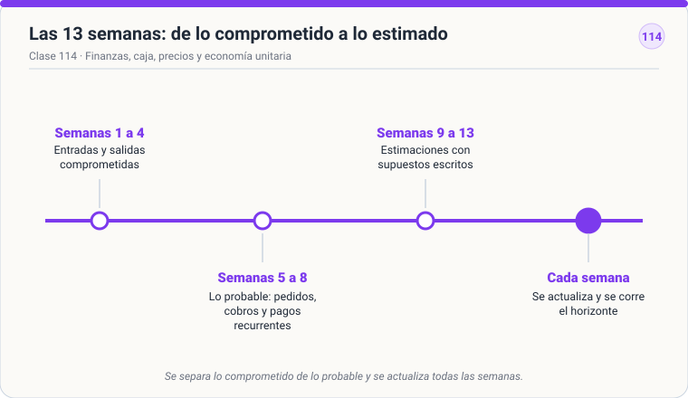

# Clase 114 — Flujo de caja de 13 semanas

> **Parte 09 · Finanzas, caja, precios y economía unitaria** — clase 2 de 14

**Estado de evidencia:** `GUIA-PRACTICA` · **Jurisdicción:** Chile-first · **Fecha base normativa:** 07-08-2026 
**Decisión que habilita:** instalar el flujo de 13 semanas como rutina semanal de gestión 
**Entregable:** flujo de caja de 13 semanas con entradas comprometidas separadas de probables

## 🎯 Propósito

Instalar el flujo de 13 semanas como rutina semanal, con horizonte suficiente para reaccionar y detalle suficiente para actuar.

## 📚 Resultados de aprendizaje

Al finalizar esta clase podrás:

1. **Definir** con precisión los cuatro conceptos de la tabla siguiente y usarlos para describir un caso real.
2. **Explicar** por qué esta materia condiciona decisiones de otras partes del programa.
3. **Decidir** —instalar el flujo de 13 semanas como rutina semanal de gestión— y justificar la decisión por escrito.
4. **Producir** el entregable de la clase y contrastarlo contra su criterio de aceptación.
5. **Distinguir** el dato estable del dato dinámico que exige revalidación en la fuente oficial.

## 🧩 Conceptos centrales

| Concepto | Comprensión verificable |
|---|---|
| **Flujo de 13 semanas** | Proyección semanal de entradas y salidas de efectivo. |
| **Entrada comprometida** | Cobro con documento y fecha acordada. |
| **Salida ineludible** | Pago que no admite postergación: remuneraciones, impuestos, arriendo. |
| **Rolling forecast** | Actualización semanal que desplaza el horizonte. |

## 🗺️ Modelo mental: Las 13 semanas: de lo comprometido a lo estimado

> **La idea en una frase:** El flujo de 13 semanas es la herramienta de supervivencia: horizonte suficiente para reaccionar y detalle suficiente para ser accionable, actualizado cada semana.

**Cómo leerlo:** La línea muestra el horizonte. Las primeras semanas son casi ciertas; las últimas, estimaciones. El hito final es la rutina: cada semana se corre el horizonte y se comparan los supuestos con la realidad.

**Para recordarlo:** Es un pronóstico del tiempo: confías más en el de mañana que en el de la próxima semana, pero lo actualizas todos los días.

## 📖 Desarrollo

### 1. El fondo del asunto

El flujo de 13 semanas es la herramienta de supervivencia: horizonte suficiente para reaccionar y detalle suficiente para ser accionable. Debe separar lo comprometido de lo probable y actualizarse cada semana con lo efectivamente ocurrido, no con lo que se esperaba.

### 2. Cómo se traduce en la práctica

Instala el flujo como rutina semanal: un responsable lo actualiza los lunes con los datos reales de la semana anterior y compara con lo proyectado. Registra las diferencias y ajusta los supuestos. Separa siempre lo comprometido de lo probable y revisa las semanas críticas con anticipación para negociar plazos antes de quedarte sin caja.

### 3. Marco aplicable y quién interviene

- economía unitaria: CAC, LTV, payback, MRR, ARR, churn y NRR
- ciclo de conversión de efectivo y capital de trabajo
- costo de capital y evaluación de deuda

**Autoridades o contrapartes involucradas:** Banco Central de Chile, CMF, SII.
**Profesionales de apoyo:** CFO o controller, contador, asesor financiero. La participación concreta depende del riesgo, del
tamaño de la empresa y de la actividad económica.

### 4. Pruébalo tú: mini simulación

Arma el flujo de tus próximas 13 semanas. Escribe en filas las entradas (cobros comprometidos, ventas probables) y las salidas ineludibles (sueldos, impuestos, arriendos, proveedores). Marca con colores lo comprometido y lo probable. Calcula la caja al final de cada semana. Si en alguna semana el saldo es menor que tu caja mínima, escribe dos acciones para evitarlo. Las cifras del ejercicio son ilustrativas: usa las de tu empresa.

### 5. En qué se apoya

- **Financial Intelligence** (Harvard Business Review Press): Berman y Knight explican la lectura del flujo de efectivo y su proyección como herramienta de gestión de la caja.
- **Simple Numbers, Straight Talk, Big Profits!** (Greg Crabtree): Crabtree propone controlar la caja y los indicadores simples de la empresa con revisiones frecuentes y disciplinadas.

*Las lecturas de apoyo ofrecen marcos conceptuales; lo que exige la ley chilena se verifica en las fuentes oficiales de esta clase.*

## 🧪 Taller guiado

Aplica esta clase a **una** de las siguientes líneas de negocio y repite después el ejercicio con
una segunda línea de carga regulatoria distinta:

| Línea | Carga regulatoria |
|---|---|
| SaaS B2B con IA | media |
| Servicios profesionales | baja |
| E-commerce D2C | media |
| Alimentos o foodtech | alta |
| Exportación de servicios | media |
| Fintech regulada | alta |
| Construcción o servicios técnicos | alta |

**Secuencia de trabajo:**

1. Delimita el contexto: actividad económica, escala, comuna y etapa de la empresa.
2. Reúne los antecedentes que la decisión exige y anota la fecha de cada fuente.
3. Identifica las alternativas reales, incluida la de no hacer nada.
4. Evalúa el impacto en mercado, caja, personas, regulación y operación.
5. Toma la decisión y regístrala con sus supuestos.
6. Produce el entregable.
7. Contrástalo contra el criterio de aceptación.
8. Anota lo que requiere validación profesional y programa su revisión.

### 📦 Entregable

Flujo de caja de 13 semanas con entradas comprometidas separadas de probables.

Debe incluir decisión, supuestos, fuentes con fecha de consulta, responsable, riesgos
identificados y próximos pasos.

## 🏆 Reto verificable

Resuelve la misma materia para una segunda línea de negocio con distinta carga regulatoria y
explica por escrito **qué cambió, por qué y qué fuente lo determina**.

## ✅ Criterio de aceptación

- [ ] las entradas distinguen comprometido de probable
- [ ] el flujo se actualiza semanalmente con datos reales
- [ ] cada afirmación regulatoria está referida a una fuente oficial con fecha de consulta;
- [ ] los datos dinámicos quedan marcados para revalidación;
- [ ] hay un responsable asignado y evidencia reproducible del trabajo.

## ⚠️ Errores frecuentes

**Propios de esta clase:**

- Proyectar cobros según la fecha de factura y no según el comportamiento real del cliente.
- No actualizar el flujo y usarlo como documento estático.

**Característicos de la parte 09:**

- Proyectar ventas sin proyectar el desfase de cobro.
- Fijar precio sobre costo sin considerar el valor percibido ni el mercado.

## 🇨🇱 Checklist Chile

- [ ] ¿existe norma o autoridad específica para esta materia?
- [ ] ¿la fuente consultada está vigente a la fecha de ejecución?
- [ ] ¿se activa algún trámite ante el SII?
- [ ] ¿se activa algún requisito municipal o sectorial?
- [ ] ¿afecta a consumidores o al tratamiento de datos personales?
- [ ] ¿afecta a trabajadores o a la seguridad y salud en el trabajo?
- [ ] ¿afecta a impuestos, contabilidad o caja?
- [ ] ¿afecta a contratos o a propiedad intelectual?
- [ ] ¿requiere renovación, reporte periódico o revalidación?

## ❓ Preguntas de comprobación

1. ¿Proyectas los cobros según la fecha de factura o según cómo paga realmente cada cliente?
2. ¿Cuándo actualizaste tu flujo por última vez con datos reales?
3. ¿Qué salidas de las próximas 13 semanas son ineludibles?

## 🔗 Fuentes oficiales

**Biblioteca del Congreso Nacional · LeyChile — Normativa oficial consolidada**  
<https://www.bcn.cl/leychile/> · verificado 2026-11-05

- *Qué contiene:* Publica el texto oficial y consolidado de leyes, decretos y reglamentos, con la versión vigente a una fecha, el historial de modificaciones y la tramitación que las originó.
- *Cómo leerla:* Usa siempre el selector de versión vigente a la fecha en que ejecutarás el trámite, no la última publicada. Y lee el artículo transitorio: en normas en implantación gradual —jornada, datos personales— ahí está la fecha que realmente te aplica.
- *Uso en esta clase:* aporta el marco de «Normativa oficial consolidada» para instalar el flujo de 13 semanas como rutina semanal de gestión.

**Servicio de Impuestos Internos — Nuevos contribuyentes, inicio de actividades y DTE**  
<https://www.sii.cl/ayudas/nuevos_contribuyentes/boleta-vys-facturador.html> · verificado 2026-11-05

- *Qué contiene:* Reúne el circuito completo del contribuyente nuevo: obtención de RUT, declaración de inicio de actividades, elección de códigos de actividad económica y habilitación para emitir documentos tributarios electrónicos.
- *Cómo leerla:* Sepáralo en dos actos distintos que la página trata seguidos: el RUT identifica, el inicio de actividades habilita. Lo que te bloquea para facturar casi siempre está en el segundo, no en el primero.
- *Uso en esta clase:* aporta el marco de «Nuevos contribuyentes, inicio de actividades y DTE» para instalar el flujo de 13 semanas como rutina semanal de gestión.

**Corporación de Fomento de la Producción — Innovación, inversión y garantías**  
<https://www.corfo.cl/> · verificado 2026-11-05

- *Qué contiene:* Reúne los instrumentos de fomento a la innovación y la inversión, incluidos programas de capital semilla, escalamiento, garantías y cobertura de riesgo para el sistema financiero.
- *Cómo leerla:* Filtra por etapa de la empresa antes que por monto. Y verifica el componente de innovación que exige cada instrumento: presentar una expansión comercial como innovación es la causa más común de rechazo.
- *Uso en esta clase:* aporta el marco de «Innovación, inversión y garantías» para instalar el flujo de 13 semanas como rutina semanal de gestión.

**Harvard Business Review Press — Financial Intelligence**  
<https://openlibrary.org/isbn/9781591397649> · verificado 2026-11-25

- *Qué contiene:* Explica a personas no financieras cómo leer estados financieros, márgenes, flujo de caja y capital de trabajo.
- *Cómo leerla:* Úsalo como marco conceptual para entender el porqué de la práctica, nunca como prueba de lo que exige la ley chilena; para eso están las fuentes oficiales de la clase.
- *Uso en esta clase:* aporta el marco de «Financial Intelligence» para instalar el flujo de 13 semanas como rutina semanal de gestión.

**Greg Crabtree — Simple Numbers, Straight Talk, Big Profits!**  
<https://openlibrary.org/isbn/9780989645232> · verificado 2026-11-25

- *Qué contiene:* Propone indicadores simples para pequeñas empresas, como el costo laboral sobre el margen bruto. Se usa como lectura de apoyo conceptual y no como fuente normativa.
- *Cómo leerla:* Úsalo como marco conceptual para entender el porqué de la práctica, nunca como prueba de lo que exige la ley chilena; para eso están las fuentes oficiales de la clase.
- *Uso en esta clase:* aporta el marco de «Simple Numbers, Straight Talk, Big Profits!» para instalar el flujo de 13 semanas como rutina semanal de gestión.

Complementos del repositorio: [glosario](../../../docs/19_GLOSSARY.md) ·
[ruta de lecturas](../../../docs/15_BOOKS_AND_LEARNING_PATH.md) ·
[catálogo de fuentes](../../../docs/16_OFFICIAL_SOURCE_CATALOG.md).

> [!IMPORTANT]
> Material educativo. Para una decisión real de alto impacto hay que verificar la fuente oficial
> vigente y validar con el profesional competente.

---

| Anterior | Índice | Siguiente |
|---|---|---|
| [← 113 · Presupuesto de arranque](../class-01-presupuesto-de-arranque/README.md) | [Parte 09](../README.md) · [Programa](../../../README.md) | [115 · Capital de trabajo →](../class-03-capital-de-trabajo/README.md) |
