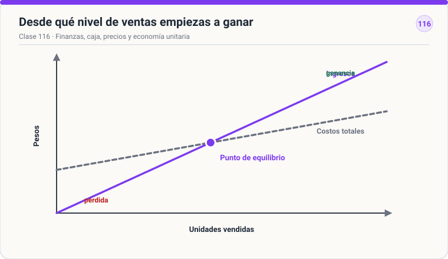

# Clase 116 — Punto de equilibrio

> **Parte 09 · Finanzas, caja, precios y economía unitaria** — clase 4 de 14

**Estado de evidencia:** `GUIA-PRACTICA` · **Jurisdicción:** Chile-first · **Fecha base normativa:** 07-08-2026 
**Decisión que habilita:** conocer el volumen mínimo de ventas y el efecto de costo, capacidad, volumen y precio 
**Entregable:** planilla base de costos y punto de equilibrio con ejemplo numérico, capacidad, utilización y sensibilidad a volumen y precio

## 🎯 Propósito

Construir una planilla base que conecte clasificación de costos, capacidad, utilización, contribución, equilibrio y sensibilidad.

## 📚 Resultados de aprendizaje

Al finalizar esta clase podrás:

1. **Definir** con precisión los cuatro conceptos de la tabla siguiente y usarlos para describir un caso real.
2. **Explicar** por qué esta materia condiciona decisiones de otras partes del programa.
3. **Decidir** —conocer el volumen mínimo de ventas y el efecto de costo, capacidad, volumen y precio— y justificar la decisión por escrito.
4. **Producir** el entregable de la clase y contrastarlo contra su criterio de aceptación.
5. **Distinguir** el dato estable del dato dinámico que exige revalidación en la fuente oficial.

## 🧩 Conceptos centrales

| Concepto | Comprensión verificable |
|---|---|
| **Punto de equilibrio** | Nivel de ventas donde el resultado es cero. |
| **Costo fijo** | Gasto que no varía con el volumen en el rango relevante. |
| **Costo variable** | Costo que varía proporcionalmente al volumen. |
| **Margen de contribución** | Precio menos costo variable unitario. |

## 🗺️ Modelo mental: Desde qué nivel de ventas empiezas a ganar

> **La idea en una frase:** El punto de equilibrio se calcula dividiendo los costos fijos del rango relevante por el margen de contribución unitario, y exige clasificar cada partida en fija, variable o semifija.

**Lectura guiada:** Los costos parten de un nivel fijo y suben con las unidades; los ingresos parten de cero y suben más rápido. Donde se cruzan está el volumen mínimo para no perder dinero.

**Una analogía:** Es una fila de personas llenando una piscina con un hueco: hasta que el flujo de agua supera lo que se pierde por el hueco, el nivel no sube.

## 📖 Desarrollo

### 1. El fondo del asunto

El punto de equilibrio se calcula dividiendo costos fijos y semifijos del rango relevante por margen de contribución unitario. La planilla debe clasificar cada partida en fijo, variable o semifijo; directo o indirecto; y CAPEX u OPEX, sin sumar dos veces categorías que describen dimensiones distintas. El resultado conecta costo unitario, capacidad, utilización y sensibilidad a volumen y precio para mostrar cuándo un salto de capacidad cambia el equilibrio.

### 2. Cómo se traduce en la práctica

Clasifica todos tus costos en fijos, variables y semifijos, y calcula el margen de contribución por unidad o por línea. Divide los costos fijos por ese margen para obtener el equilibrio. Prueba qué ocurre con cambios de precio, costo, arriendo o capacidad. Recuerda que el cálculo vale para un rango de actividad: si cambia la estructura, debes recalcularlo.

### 3. Marco aplicable y quién interviene

- economía unitaria: CAC, LTV, payback, MRR, ARR, churn y NRR
- ciclo de conversión de efectivo y capital de trabajo
- costo de capital y evaluación de deuda

**Autoridades o contrapartes involucradas:** Banco Central de Chile, CMF, SII.
**Profesionales de apoyo:** CFO o controller, contador, asesor financiero. La participación concreta depende del riesgo, del
tamaño de la empresa y de la actividad económica.

### 4. Los números, paso a paso

Una empresa vende un producto a $10.000, con costo variable de $6.000: margen de contribución de $4.000 por unidad. Sus costos fijos mensuales son $2.000.000. El punto de equilibrio es 2.000.000 dividido por 4.000, es decir, 500 unidades al mes. Si sube el arriendo en $400.000, el equilibrio sube a 600 unidades; si logra subir el precio a $11.000, el margen es $5.000 y el equilibrio baja a 400 unidades (cifras ilustrativas).

### 5. En qué se apoya

- **Financial Intelligence** (Harvard Business Review Press): Berman y Knight explican los costos fijos y variables y el cálculo del punto de equilibrio como base de las decisiones de precio y volumen.
- **Simple Numbers, Straight Talk, Big Profits!** (Greg Crabtree): Crabtree propone indicadores simples que ayudan a saber cuánto debe vender una pequeña empresa para sostener su estructura.

*Las lecturas de apoyo ofrecen marcos conceptuales; lo que exige la ley chilena se verifica en las fuentes oficiales de esta clase.*

## 🧪 Taller guiado

Aplica esta clase a **una** de las siguientes líneas de negocio y repite después el ejercicio con
una segunda línea de carga regulatoria distinta:

| Línea | Carga regulatoria |
|---|---|
| SaaS B2B con IA | media |
| Servicios profesionales | baja |
| E-commerce D2C | media |
| Alimentos o foodtech | alta |
| Exportación de servicios | media |
| Fintech regulada | alta |
| Construcción o servicios técnicos | alta |

**Secuencia de trabajo:**

1. Delimita el contexto: actividad económica, escala, comuna y etapa de la empresa.
2. Reúne los antecedentes que la decisión exige y anota la fecha de cada fuente.
3. Identifica las alternativas reales, incluida la de no hacer nada.
4. Evalúa el impacto en mercado, caja, personas, regulación y operación.
5. Toma la decisión y regístrala con sus supuestos.
6. Produce el entregable.
7. Contrástalo contra el criterio de aceptación.
8. Anota lo que requiere validación profesional y programa su revisión.

### 📦 Entregable

Planilla base de costos y punto de equilibrio con ejemplo numérico, capacidad, utilización y sensibilidad a volumen y precio.

Debe incluir decisión, supuestos, fuentes con fecha de consulta, responsable, riesgos
identificados y próximos pasos.

## 🏆 Reto verificable

Resuelve la misma materia para una segunda línea de negocio con distinta carga regulatoria y
explica por escrito **qué cambió, por qué y qué fuente lo determina**.

## ✅ Criterio de aceptación

- [ ] cada partida distingue fijo, variable o semifijo; directo o indirecto; y CAPEX u OPEX
- [ ] el costo unitario, margen de contribución, capacidad, utilización y equilibrio son reproducibles
- [ ] la sensibilidad muestra al menos un cambio de volumen y uno de precio
- [ ] cada afirmación regulatoria está referida a una fuente oficial con fecha de consulta;
- [ ] los datos dinámicos quedan marcados para revalidación;
- [ ] hay un responsable asignado y evidencia reproducible del trabajo.

## ⚠️ Errores frecuentes

**Propios de esta clase:**

- Sumar dos veces un costo por confundir clasificación de comportamiento con trazabilidad o naturaleza.
- Proyectar volumen por encima de la capacidad sin incorporar el salto de costo semifijo.

**Característicos de la parte 09:**

- Proyectar ventas sin proyectar el desfase de cobro.
- Fijar precio sobre costo sin considerar el valor percibido ni el mercado.

## 🇨🇱 Checklist Chile

- [ ] ¿existe norma o autoridad específica para esta materia?
- [ ] ¿la fuente consultada está vigente a la fecha de ejecución?
- [ ] ¿se activa algún trámite ante el SII?
- [ ] ¿se activa algún requisito municipal o sectorial?
- [ ] ¿afecta a consumidores o al tratamiento de datos personales?
- [ ] ¿afecta a trabajadores o a la seguridad y salud en el trabajo?
- [ ] ¿afecta a impuestos, contabilidad o caja?
- [ ] ¿afecta a contratos o a propiedad intelectual?
- [ ] ¿requiere renovación, reporte periódico o revalidación?

## ❓ Preguntas de comprobación

1. ¿Cada costo tiene las tres clasificaciones sin quedar contado dos veces?
2. ¿Qué ocurre con el equilibrio cuando cambia precio, volumen o capacidad?
3. ¿Puedes reproducir costo unitario y margen desde los datos de la planilla?

## 🔗 Fuentes oficiales

**Biblioteca del Congreso Nacional · LeyChile — Normativa oficial consolidada**  
<https://www.bcn.cl/leychile/> · verificado 2026-11-05

- *Qué contiene:* Publica el texto oficial y consolidado de leyes, decretos y reglamentos, con la versión vigente a una fecha, el historial de modificaciones y la tramitación que las originó.
- *Cómo leerla:* Usa siempre el selector de versión vigente a la fecha en que ejecutarás el trámite, no la última publicada. Y lee el artículo transitorio: en normas en implantación gradual —jornada, datos personales— ahí está la fecha que realmente te aplica.
- *Uso en esta clase:* aporta el marco de «Normativa oficial consolidada» para conocer el volumen mínimo de ventas y el efecto de costo, capacidad, volumen y precio.

**Servicio de Impuestos Internos — Nuevos contribuyentes, inicio de actividades y DTE**  
<https://www.sii.cl/ayudas/nuevos_contribuyentes/boleta-vys-facturador.html> · verificado 2026-11-05

- *Qué contiene:* Reúne el circuito completo del contribuyente nuevo: obtención de RUT, declaración de inicio de actividades, elección de códigos de actividad económica y habilitación para emitir documentos tributarios electrónicos.
- *Cómo leerla:* Sepáralo en dos actos distintos que la página trata seguidos: el RUT identifica, el inicio de actividades habilita. Lo que te bloquea para facturar casi siempre está en el segundo, no en el primero.
- *Uso en esta clase:* aporta el marco de «Nuevos contribuyentes, inicio de actividades y DTE» para conocer el volumen mínimo de ventas y el efecto de costo, capacidad, volumen y precio.

**Corporación de Fomento de la Producción — Innovación, inversión y garantías**  
<https://www.corfo.cl/> · verificado 2026-11-05

- *Qué contiene:* Reúne los instrumentos de fomento a la innovación y la inversión, incluidos programas de capital semilla, escalamiento, garantías y cobertura de riesgo para el sistema financiero.
- *Cómo leerla:* Filtra por etapa de la empresa antes que por monto. Y verifica el componente de innovación que exige cada instrumento: presentar una expansión comercial como innovación es la causa más común de rechazo.
- *Uso en esta clase:* aporta el marco de «Innovación, inversión y garantías» para conocer el volumen mínimo de ventas y el efecto de costo, capacidad, volumen y precio.

**Harvard Business Review Press — Financial Intelligence**  
<https://openlibrary.org/isbn/9781591397649> · verificado 2026-11-25

- *Qué contiene:* Explica a personas no financieras cómo leer estados financieros, márgenes, flujo de caja y capital de trabajo.
- *Cómo leerla:* Úsalo como marco conceptual para entender el porqué de la práctica, nunca como prueba de lo que exige la ley chilena; para eso están las fuentes oficiales de la clase.
- *Uso en esta clase:* aporta el marco de «Financial Intelligence» para conocer el volumen mínimo de ventas y el efecto de costo, capacidad, volumen y precio.

**Greg Crabtree — Simple Numbers, Straight Talk, Big Profits!**  
<https://openlibrary.org/isbn/9780989645232> · verificado 2026-11-25

- *Qué contiene:* Propone indicadores simples para pequeñas empresas, como el costo laboral sobre el margen bruto. Se usa como lectura de apoyo conceptual y no como fuente normativa.
- *Cómo leerla:* Úsalo como marco conceptual para entender el porqué de la práctica, nunca como prueba de lo que exige la ley chilena; para eso están las fuentes oficiales de la clase.
- *Uso en esta clase:* aporta el marco de «Simple Numbers, Straight Talk, Big Profits!» para conocer el volumen mínimo de ventas y el efecto de costo, capacidad, volumen y precio.

Complementos del repositorio: [glosario](../../../docs/19_GLOSSARY.md) ·
[ruta de lecturas](../../../docs/15_BOOKS_AND_LEARNING_PATH.md) ·
[catálogo de fuentes](../../../docs/16_OFFICIAL_SOURCE_CATALOG.md).

> [!IMPORTANT]
> Material educativo. Para una decisión real de alto impacto hay que verificar la fuente oficial
> vigente y validar con el profesional competente.

---

| Anterior | Índice | Siguiente |
|---|---|---|
| [← 115 · Capital de trabajo](../class-03-capital-de-trabajo/README.md) | [Parte 09](../README.md) · [Programa](../../../README.md) | [117 · Margen bruto, contribución y EBITDA →](../class-05-margen-bruto-contribucion-y-ebitda/README.md) |
