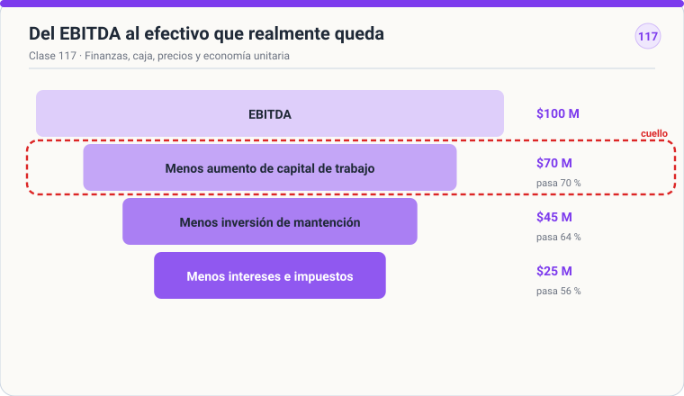

# Clase 117 — Margen bruto, contribución y EBITDA

> **Parte 09 · Finanzas, caja, precios y economía unitaria** — clase 5 de 14

**Estado de evidencia:** `GUIA-PRACTICA` · **Jurisdicción:** Chile-first · **Fecha base normativa:** 07-08-2026 
**Decisión que habilita:** evaluar si el resultado operacional se está convirtiendo en efectivo 
**Entregable:** análisis de margen bruto, contribución y EBITDA con puente hacia el flujo operacional

## 🎯 Propósito

Construir el puente entre EBITDA y flujo operacional, porque un EBITDA positivo con flujo negativo indica utilidades atrapadas en inventario o cuentas por cobrar.

## 📚 Resultados de aprendizaje

Al finalizar esta clase podrás:

1. **Definir** con precisión los cuatro conceptos de la tabla siguiente y usarlos para describir un caso real.
2. **Explicar** por qué esta materia condiciona decisiones de otras partes del programa.
3. **Decidir** —evaluar si el resultado operacional se está convirtiendo en efectivo— y justificar la decisión por escrito.
4. **Producir** el entregable de la clase y contrastarlo contra su criterio de aceptación.
5. **Distinguir** el dato estable del dato dinámico que exige revalidación en la fuente oficial.

## 🧩 Conceptos centrales

| Concepto | Comprensión verificable |
|---|---|
| **Margen bruto** | Porcentaje del ingreso que queda tras el costo directo. |
| **Margen de contribución** | Aporte de cada unidad a cubrir costos fijos. |
| **EBITDA** | Resultado operacional antes de intereses, impuestos, depreciación y amortización. |
| **Calidad del EBITDA** | Grado en que el ebitda se convierte efectivamente en caja. |

## 🗺️ Modelo mental: Del EBITDA al efectivo que realmente queda

> **La idea en una frase:** El EBITDA es útil para comparar operaciones pero engaña cuando el negocio requiere reinversión constante o cuando el crecimiento consume capital de trabajo.

**Cómo leerlo:** Cada barra resta algo que el EBITDA no muestra. La última es el efectivo libre. Si es mucho menor que la primera, el resultado operacional no se está convirtiendo en caja.

**Piénsalo así:** Es el sueldo bruto y el sueldo líquido: el primero impresiona, pero lo que alcanza para vivir es el segundo.

## 📖 Desarrollo

### 1. El fondo del asunto

El EBITDA es útil para comparar operaciones pero engaña cuando el negocio requiere reinversión constante o cuando el crecimiento consume capital de trabajo. Un EBITDA positivo con flujo operacional negativo indica que las utilidades están atrapadas en inventario o cuentas por cobrar.

### 2. Cómo se traduce en la práctica

Calcula, además del EBITDA, el flujo operacional y el flujo libre. Compara la conversión de EBITDA en efectivo cada trimestre. Un EBITDA positivo con flujo operacional negativo sostenido indica que el crecimiento consume más caja de la que produce y que la empresa depende de deuda o aportes de socios. Define metas de conversión por tipo de negocio.

### 3. Marco aplicable y quién interviene

- economía unitaria: CAC, LTV, payback, MRR, ARR, churn y NRR
- ciclo de conversión de efectivo y capital de trabajo
- costo de capital y evaluación de deuda

**Autoridades o contrapartes involucradas:** Banco Central de Chile, CMF, SII.
**Profesionales de apoyo:** CFO o controller, contador, asesor financiero. La participación concreta depende del riesgo, del
tamaño de la empresa y de la actividad económica.

### 4. Cómo se decide, paso a paso

Decide con tres preguntas si tu EBITDA es de buena calidad. Uno: ¿cuánto del EBITDA se va en capital de trabajo? Dos: ¿cuánto hay que reinvertir cada año para mantener la operación? Tres: ¿cuánto se paga en intereses e impuestos? Con los datos ilustrativos del gráfico, solo 25 de cada 100 del EBITDA quedan libres: la empresa debe mirar su capital de trabajo antes de celebrar el EBITDA.

### 5. En qué se apoya

- **Financial Intelligence** (Harvard Business Review Press): Berman y Knight explican por qué las medidas de resultado operacional no equivalen al flujo de efectivo y cómo interpretar ambas.
- **The Little Book of Valuation** (Wiley): Damodaran enseña que el valor de una empresa se apoya en el flujo de efectivo que genera y no solo en sus resultados contables.

*Las lecturas de apoyo ofrecen marcos conceptuales; lo que exige la ley chilena se verifica en las fuentes oficiales de esta clase.*

## 🧪 Taller guiado

Aplica esta clase a **una** de las siguientes líneas de negocio y repite después el ejercicio con
una segunda línea de carga regulatoria distinta:

| Línea | Carga regulatoria |
|---|---|
| SaaS B2B con IA | media |
| Servicios profesionales | baja |
| E-commerce D2C | media |
| Alimentos o foodtech | alta |
| Exportación de servicios | media |
| Fintech regulada | alta |
| Construcción o servicios técnicos | alta |

**Secuencia de trabajo:**

1. Delimita el contexto: actividad económica, escala, comuna y etapa de la empresa.
2. Reúne los antecedentes que la decisión exige y anota la fecha de cada fuente.
3. Identifica las alternativas reales, incluida la de no hacer nada.
4. Evalúa el impacto en mercado, caja, personas, regulación y operación.
5. Toma la decisión y regístrala con sus supuestos.
6. Produce el entregable.
7. Contrástalo contra el criterio de aceptación.
8. Anota lo que requiere validación profesional y programa su revisión.

### 📦 Entregable

Análisis de margen bruto, contribución y ebitda con puente hacia el flujo operacional.

Debe incluir decisión, supuestos, fuentes con fecha de consulta, responsable, riesgos
identificados y próximos pasos.

## 🏆 Reto verificable

Resuelve la misma materia para una segunda línea de negocio con distinta carga regulatoria y
explica por escrito **qué cambió, por qué y qué fuente lo determina**.

## ✅ Criterio de aceptación

- [ ] existe puente explícito entre EBITDA y flujo operacional
- [ ] los márgenes están calculados por línea
- [ ] cada afirmación regulatoria está referida a una fuente oficial con fecha de consulta;
- [ ] los datos dinámicos quedan marcados para revalidación;
- [ ] hay un responsable asignado y evidencia reproducible del trabajo.

## ⚠️ Errores frecuentes

**Propios de esta clase:**

- Usar ebitda como sinónimo de caja generada.
- Comparar ebitda entre negocios con estructuras de capital muy distintas.

**Característicos de la parte 09:**

- Proyectar ventas sin proyectar el desfase de cobro.
- Fijar precio sobre costo sin considerar el valor percibido ni el mercado.

## 🇨🇱 Checklist Chile

- [ ] ¿existe norma o autoridad específica para esta materia?
- [ ] ¿la fuente consultada está vigente a la fecha de ejecución?
- [ ] ¿se activa algún trámite ante el SII?
- [ ] ¿se activa algún requisito municipal o sectorial?
- [ ] ¿afecta a consumidores o al tratamiento de datos personales?
- [ ] ¿afecta a trabajadores o a la seguridad y salud en el trabajo?
- [ ] ¿afecta a impuestos, contabilidad o caja?
- [ ] ¿afecta a contratos o a propiedad intelectual?
- [ ] ¿requiere renovación, reporte periódico o revalidación?

## ❓ Preguntas de comprobación

1. ¿Cuál es la diferencia entre tu EBITDA y tu flujo operacional del último año?
2. ¿Dónde están atrapadas esas utilidades: inventario, cobros o inversión?
3. ¿Cuánta reinversión anual exige tu negocio solo para mantenerse?

## 🔗 Fuentes oficiales

**Biblioteca del Congreso Nacional · LeyChile — Normativa oficial consolidada**  
<https://www.bcn.cl/leychile/> · verificado 2026-11-05

- *Qué contiene:* Publica el texto oficial y consolidado de leyes, decretos y reglamentos, con la versión vigente a una fecha, el historial de modificaciones y la tramitación que las originó.
- *Cómo leerla:* Usa siempre el selector de versión vigente a la fecha en que ejecutarás el trámite, no la última publicada. Y lee el artículo transitorio: en normas en implantación gradual —jornada, datos personales— ahí está la fecha que realmente te aplica.
- *Uso en esta clase:* aporta el marco de «Normativa oficial consolidada» para evaluar si el resultado operacional se está convirtiendo en efectivo.

**Servicio de Impuestos Internos — Nuevos contribuyentes, inicio de actividades y DTE**  
<https://www.sii.cl/ayudas/nuevos_contribuyentes/boleta-vys-facturador.html> · verificado 2026-11-05

- *Qué contiene:* Reúne el circuito completo del contribuyente nuevo: obtención de RUT, declaración de inicio de actividades, elección de códigos de actividad económica y habilitación para emitir documentos tributarios electrónicos.
- *Cómo leerla:* Sepáralo en dos actos distintos que la página trata seguidos: el RUT identifica, el inicio de actividades habilita. Lo que te bloquea para facturar casi siempre está en el segundo, no en el primero.
- *Uso en esta clase:* aporta el marco de «Nuevos contribuyentes, inicio de actividades y DTE» para evaluar si el resultado operacional se está convirtiendo en efectivo.

**Corporación de Fomento de la Producción — Innovación, inversión y garantías**  
<https://www.corfo.cl/> · verificado 2026-11-05

- *Qué contiene:* Reúne los instrumentos de fomento a la innovación y la inversión, incluidos programas de capital semilla, escalamiento, garantías y cobertura de riesgo para el sistema financiero.
- *Cómo leerla:* Filtra por etapa de la empresa antes que por monto. Y verifica el componente de innovación que exige cada instrumento: presentar una expansión comercial como innovación es la causa más común de rechazo.
- *Uso en esta clase:* aporta el marco de «Innovación, inversión y garantías» para evaluar si el resultado operacional se está convirtiendo en efectivo.

**Harvard Business Review Press — Financial Intelligence**  
<https://openlibrary.org/isbn/9781591397649> · verificado 2026-11-25

- *Qué contiene:* Explica a personas no financieras cómo leer estados financieros, márgenes, flujo de caja y capital de trabajo.
- *Cómo leerla:* Úsalo como marco conceptual para entender el porqué de la práctica, nunca como prueba de lo que exige la ley chilena; para eso están las fuentes oficiales de la clase.
- *Uso en esta clase:* aporta el marco de «Financial Intelligence» para evaluar si el resultado operacional se está convirtiendo en efectivo.

**Wiley — The Little Book of Valuation**  
<https://openlibrary.org/isbn/9781118004777> · verificado 2026-11-25

- *Qué contiene:* Introduce la valoración de empresas por flujo descontado y por múltiplos. Se usa como lectura de apoyo conceptual y no como fuente normativa.
- *Cómo leerla:* Úsalo como marco conceptual para entender el porqué de la práctica, nunca como prueba de lo que exige la ley chilena; para eso están las fuentes oficiales de la clase.
- *Uso en esta clase:* aporta el marco de «The Little Book of Valuation» para evaluar si el resultado operacional se está convirtiendo en efectivo.

Complementos del repositorio: [glosario](../../../docs/19_GLOSSARY.md) ·
[ruta de lecturas](../../../docs/15_BOOKS_AND_LEARNING_PATH.md) ·
[catálogo de fuentes](../../../docs/16_OFFICIAL_SOURCE_CATALOG.md).

> [!IMPORTANT]
> Material educativo. Para una decisión real de alto impacto hay que verificar la fuente oficial
> vigente y validar con el profesional competente.

---

| Anterior | Índice | Siguiente |
|---|---|---|
| [← 116 · Punto de equilibrio](../class-04-punto-de-equilibrio/README.md) | [Parte 09](../README.md) · [Programa](../../../README.md) | [118 · Pricing basado en costos, valor y mercado →](../class-06-pricing-basado-en-costos-valor-y-mercado/README.md) |
