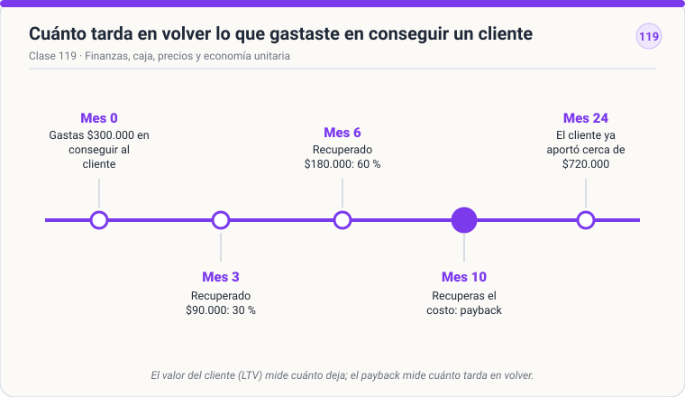

# Clase 119 — CAC, LTV y payback

> **Parte 09 · Finanzas, caja, precios y economía unitaria** — clase 7 de 14

**Estado de evidencia:** `GUIA-PRACTICA` · **Jurisdicción:** Chile-first · **Fecha base normativa:** 07-08-2026 
**Decisión que habilita:** determinar si el costo de adquisición es recuperable en un plazo financiable 
**Entregable:** análisis de CAC, LTV y payback por cohorte con conclusión sobre capacidad de financiamiento

## 🎯 Propósito

Determinar si el costo de adquisición es recuperable en un plazo que la caja de la empresa puede financiar.

## 📚 Resultados de aprendizaje

Al finalizar esta clase podrás:

1. **Definir** con precisión los cuatro conceptos de la tabla siguiente y usarlos para describir un caso real.
2. **Explicar** por qué esta materia condiciona decisiones de otras partes del programa.
3. **Decidir** —determinar si el costo de adquisición es recuperable en un plazo financiable— y justificar la decisión por escrito.
4. **Producir** el entregable de la clase y contrastarlo contra su criterio de aceptación.
5. **Distinguir** el dato estable del dato dinámico que exige revalidación en la fuente oficial.

## 🧩 Conceptos centrales

| Concepto | Comprensión verificable |
|---|---|
| **CAC** | Costo de adquirir un cliente, incluidos marketing y ventas. |
| **LTV** | Valor total esperado de un cliente durante su relación. |
| **Payback** | Meses que tarda el margen en recuperar el cac. |
| **Cohorte** | Grupo de clientes adquiridos en el mismo período. |

## 🗺️ Modelo mental: Cuánto tarda en volver lo que gastaste en conseguir un cliente

> **La idea en una frase:** La relación entre valor del cliente y costo de adquisición indica si el negocio es viable, pero el payback indica si es financiable: un payback largo exige un capital que una pyme rara vez tiene.

**Lectura guiada:** La línea muestra el dinero recuperado mes a mes. El payback es el hito en que vuelve lo gastado. Mientras no llega, la empresa financia al cliente con su propia caja.

**Una imagen cotidiana:** Es comprar una máquina que te devuelve ahorro cada mes: sabes que conviene, pero también debes saber cuándo recuperas lo invertido.

## 📖 Desarrollo

### 1. El fondo del asunto

La relación LTV sobre CAC indica si el negocio es viable, pero el payback indica si es financiable: un payback de 24 meses exige capital que una pyme rara vez tiene. Analizar por cohortes revela si la calidad de los clientes adquiridos se está deteriorando con el crecimiento.

### 2. Cómo se traduce en la práctica

Calcula el costo de adquisición por canal, el margen mensual por cliente y su permanencia esperada. Obtén el LTV, la razón LTV/CAC y el payback. Analiza por cohortes: si los clientes recientes se comportan distinto que los antiguos, el negocio está cambiando. Decide cuánto puedes gastar en captar según el capital que puedes inmovilizar.

### 3. Marco aplicable y quién interviene

- economía unitaria: CAC, LTV, payback, MRR, ARR, churn y NRR
- ciclo de conversión de efectivo y capital de trabajo
- costo de capital y evaluación de deuda

**Autoridades o contrapartes involucradas:** Banco Central de Chile, CMF, SII.
**Profesionales de apoyo:** CFO o controller, contador, asesor financiero. La participación concreta depende del riesgo, del
tamaño de la empresa y de la actividad económica.

### 4. Los números, paso a paso

Un cliente cuesta $300.000 en publicidad y ventas, y aporta un margen de $30.000 al mes. El payback es de 10 meses. Si permanece 24 meses, su valor es de $720.000 (LTV): una razón LTV/CAC de 2,4. El negocio es viable, pero si adquiere 100 clientes al mes debe financiar $30 millones durante 10 meses. Con un plan anual por adelantado, el payback baja a 6 meses y se financia solo (cifras ilustrativas).

### 5. En qué se apoya

- **Lean Analytics** (O'Reilly): Croll y Yoskovitz describen el costo de adquisición, el valor de vida y el análisis por etapas como métricas centrales de un negocio recurrente.
- **The Lean Startup (2011)** (Crown Business): Ries propone el análisis por cohortes para saber si las mejoras realmente cambian el comportamiento de los clientes.

*Las lecturas de apoyo ofrecen marcos conceptuales; lo que exige la ley chilena se verifica en las fuentes oficiales de esta clase.*

## 🧪 Taller guiado

Aplica esta clase a **una** de las siguientes líneas de negocio y repite después el ejercicio con
una segunda línea de carga regulatoria distinta:

| Línea | Carga regulatoria |
|---|---|
| SaaS B2B con IA | media |
| Servicios profesionales | baja |
| E-commerce D2C | media |
| Alimentos o foodtech | alta |
| Exportación de servicios | media |
| Fintech regulada | alta |
| Construcción o servicios técnicos | alta |

**Secuencia de trabajo:**

1. Delimita el contexto: actividad económica, escala, comuna y etapa de la empresa.
2. Reúne los antecedentes que la decisión exige y anota la fecha de cada fuente.
3. Identifica las alternativas reales, incluida la de no hacer nada.
4. Evalúa el impacto en mercado, caja, personas, regulación y operación.
5. Toma la decisión y regístrala con sus supuestos.
6. Produce el entregable.
7. Contrástalo contra el criterio de aceptación.
8. Anota lo que requiere validación profesional y programa su revisión.

### 📦 Entregable

Análisis de cac, ltv y payback por cohorte con conclusión sobre capacidad de financiamiento.

Debe incluir decisión, supuestos, fuentes con fecha de consulta, responsable, riesgos
identificados y próximos pasos.

## 🏆 Reto verificable

Resuelve la misma materia para una segunda línea de negocio con distinta carga regulatoria y
explica por escrito **qué cambió, por qué y qué fuente lo determina**.

## ✅ Criterio de aceptación

- [ ] el CAC incluye todos los costos de marketing y ventas
- [ ] el payback está expresado en meses y contrastado con la caja disponible
- [ ] cada afirmación regulatoria está referida a una fuente oficial con fecha de consulta;
- [ ] los datos dinámicos quedan marcados para revalidación;
- [ ] hay un responsable asignado y evidencia reproducible del trabajo.

## ⚠️ Errores frecuentes

**Propios de esta clase:**

- Calcular cac sin incluir el costo del equipo comercial.
- Usar un ltv con supuestos de retención no verificados.

**Característicos de la parte 09:**

- Proyectar ventas sin proyectar el desfase de cobro.
- Fijar precio sobre costo sin considerar el valor percibido ni el mercado.

## 🇨🇱 Checklist Chile

- [ ] ¿existe norma o autoridad específica para esta materia?
- [ ] ¿la fuente consultada está vigente a la fecha de ejecución?
- [ ] ¿se activa algún trámite ante el SII?
- [ ] ¿se activa algún requisito municipal o sectorial?
- [ ] ¿afecta a consumidores o al tratamiento de datos personales?
- [ ] ¿afecta a trabajadores o a la seguridad y salud en el trabajo?
- [ ] ¿afecta a impuestos, contabilidad o caja?
- [ ] ¿afecta a contratos o a propiedad intelectual?
- [ ] ¿requiere renovación, reporte periódico o revalidación?

## ❓ Preguntas de comprobación

1. ¿Tu CAC incluye el costo del equipo comercial o solo la publicidad?
2. ¿En cuántos meses recuperas el CAC y puedes financiar esa espera?
3. ¿Las cohortes recientes retienen igual que las antiguas?

## 🔗 Fuentes oficiales

**Biblioteca del Congreso Nacional · LeyChile — Normativa oficial consolidada**  
<https://www.bcn.cl/leychile/> · verificado 2026-11-05

- *Qué contiene:* Publica el texto oficial y consolidado de leyes, decretos y reglamentos, con la versión vigente a una fecha, el historial de modificaciones y la tramitación que las originó.
- *Cómo leerla:* Usa siempre el selector de versión vigente a la fecha en que ejecutarás el trámite, no la última publicada. Y lee el artículo transitorio: en normas en implantación gradual —jornada, datos personales— ahí está la fecha que realmente te aplica.
- *Uso en esta clase:* aporta el marco de «Normativa oficial consolidada» para determinar si el costo de adquisición es recuperable en un plazo financiable.

**Servicio de Impuestos Internos — Nuevos contribuyentes, inicio de actividades y DTE**  
<https://www.sii.cl/ayudas/nuevos_contribuyentes/boleta-vys-facturador.html> · verificado 2026-11-05

- *Qué contiene:* Reúne el circuito completo del contribuyente nuevo: obtención de RUT, declaración de inicio de actividades, elección de códigos de actividad económica y habilitación para emitir documentos tributarios electrónicos.
- *Cómo leerla:* Sepáralo en dos actos distintos que la página trata seguidos: el RUT identifica, el inicio de actividades habilita. Lo que te bloquea para facturar casi siempre está en el segundo, no en el primero.
- *Uso en esta clase:* aporta el marco de «Nuevos contribuyentes, inicio de actividades y DTE» para determinar si el costo de adquisición es recuperable en un plazo financiable.

**Corporación de Fomento de la Producción — Innovación, inversión y garantías**  
<https://www.corfo.cl/> · verificado 2026-11-05

- *Qué contiene:* Reúne los instrumentos de fomento a la innovación y la inversión, incluidos programas de capital semilla, escalamiento, garantías y cobertura de riesgo para el sistema financiero.
- *Cómo leerla:* Filtra por etapa de la empresa antes que por monto. Y verifica el componente de innovación que exige cada instrumento: presentar una expansión comercial como innovación es la causa más común de rechazo.
- *Uso en esta clase:* aporta el marco de «Innovación, inversión y garantías» para determinar si el costo de adquisición es recuperable en un plazo financiable.

**O'Reilly — Lean Analytics**  
<https://openlibrary.org/isbn/9781449335717> · verificado 2026-11-25

- *Qué contiene:* Propone métricas por etapa de una startup y cómo elegir la métrica que importa en cada momento.
- *Cómo leerla:* Úsalo como marco conceptual para entender el porqué de la práctica, nunca como prueba de lo que exige la ley chilena; para eso están las fuentes oficiales de la clase.
- *Uso en esta clase:* aporta el marco de «Lean Analytics» para determinar si el costo de adquisición es recuperable en un plazo financiable.

**Crown Business — The Lean Startup (2011)**  
<https://openlibrary.org/isbn/9780307887894> · verificado 2026-11-25

- *Qué contiene:* Propone construir, medir y aprender con ciclos cortos y con indicadores accionables, en lugar de métricas de vanidad.
- *Cómo leerla:* Úsalo como marco conceptual para entender el porqué de la práctica, nunca como prueba de lo que exige la ley chilena; para eso están las fuentes oficiales de la clase.
- *Uso en esta clase:* aporta el marco de «The Lean Startup (2011)» para determinar si el costo de adquisición es recuperable en un plazo financiable.

Complementos del repositorio: [glosario](../../../docs/19_GLOSSARY.md) ·
[ruta de lecturas](../../../docs/15_BOOKS_AND_LEARNING_PATH.md) ·
[catálogo de fuentes](../../../docs/16_OFFICIAL_SOURCE_CATALOG.md).

> [!IMPORTANT]
> Material educativo. Para una decisión real de alto impacto hay que verificar la fuente oficial
> vigente y validar con el profesional competente.

---

| Anterior | Índice | Siguiente |
|---|---|---|
| [← 118 · Pricing basado en costos, valor y mercado](../class-06-pricing-basado-en-costos-valor-y-mercado/README.md) | [Parte 09](../README.md) · [Programa](../../../README.md) | [120 · MRR, ARR, churn y NRR para suscripciones →](../class-08-mrr-arr-churn-y-nrr-para-suscripciones/README.md) |
