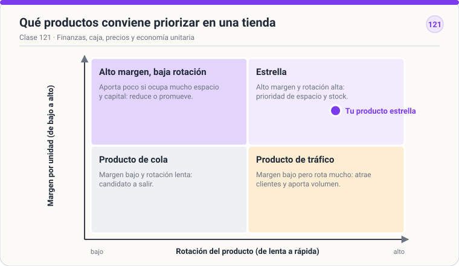

# Clase 121 — Rotación, ticket y merma para comercio

> **Parte 09 · Finanzas, caja, precios y economía unitaria** — clase 9 de 14

**Estado de evidencia:** `GUIA-PRACTICA` · **Jurisdicción:** Chile-first · **Fecha base normativa:** 07-08-2026 
**Decisión que habilita:** decidir la mezcla de productos según rotación y contribución, no solo margen 
**Entregable:** análisis de categorías con rotación, ticket, merma y contribución por metro cuadrado

## 🎯 Propósito

Decidir la mezcla de productos por rotación y contribución, no por margen unitario, que es el error clásico del comercio.

## 📚 Resultados de aprendizaje

Al finalizar esta clase podrás:

1. **Definir** con precisión los cuatro conceptos de la tabla siguiente y usarlos para describir un caso real.
2. **Explicar** por qué esta materia condiciona decisiones de otras partes del programa.
3. **Decidir** —decidir la mezcla de productos según rotación y contribución, no solo margen— y justificar la decisión por escrito.
4. **Producir** el entregable de la clase y contrastarlo contra su criterio de aceptación.
5. **Distinguir** el dato estable del dato dinámico que exige revalidación en la fuente oficial.

## 🧩 Conceptos centrales

| Concepto | Comprensión verificable |
|---|---|
| **Rotación** | Frecuencia con que el inventario se vende y repone. |
| **Ticket promedio** | Venta media por transacción. |
| **Merma** | Pérdida de inventario por daño, vencimiento o hurto. |
| **Margen por metro cuadrado** | Contribución en relación al espacio ocupado. |

## 🗺️ Modelo mental: Qué productos conviene priorizar en una tienda

> **La idea en una frase:** En comercio el resultado se explica por rotación, ticket y merma más que por el margen del producto: uno de alto margen y baja rotación puede aportar menos que uno de margen bajo que gira muchas veces.

**Qué mirar primero:** Ubica cada producto según su rotación y su margen. La contribución depende de ambos, y del espacio y capital que ocupa. Decide la mezcla por contribución, no solo por margen.

**Piénsalo así:** Es un puesto de feria: lo que sirve no es solo el producto caro, sino el que se vende rápido y deja espacio para el siguiente.

## 📖 Desarrollo

### 1. El fondo del asunto

En comercio el resultado se explica por rotación, ticket y merma más que por el margen del producto. Un producto de alto margen y baja rotación puede aportar menos que uno de margen bajo que gira ocho veces. La merma no controlada consume silenciosamente el margen de toda la categoría.

### 2. Cómo se traduce en la práctica

Calcula por producto la rotación, el ticket promedio, la merma y la contribución por metro cuadrado. Clasifícalos en la matriz y fija una regla de mezcla. Revisa cada mes la merma, que revela errores de recepción, vencimientos y robos. Para un punto físico, considera arriendo, patente, personal y rotación por metro cuadrado.

### 3. Marco aplicable y quién interviene

- economía unitaria: CAC, LTV, payback, MRR, ARR, churn y NRR
- ciclo de conversión de efectivo y capital de trabajo
- costo de capital y evaluación de deuda

**Autoridades o contrapartes involucradas:** Banco Central de Chile, CMF, SII.
**Profesionales de apoyo:** CFO o controller, contador, asesor financiero. La participación concreta depende del riesgo, del
tamaño de la empresa y de la actividad económica.

### 4. Caso trabajado

Una ferretería tiene un taladro de alto margen que vende dos unidades al mes y ocupa mucho espacio, y clavos y tornillos de margen bajo que giran cada semana. Al calcular la contribución por metro cuadrado, los tornillos aportan tres veces más. Decide reducir el inventario de taladros, ampliar el espacio de los productos de alta rotación y revisar la merma en los de venta rápida (caso ilustrativo).

### 5. En qué se apoya

- **The Goal** (North River Press): Goldratt muestra cómo el inventario que no rota inmoviliza capital y oculta problemas del sistema, un argumento para priorizar la rotación.
- **Simple Numbers, Straight Talk, Big Profits!** (Greg Crabtree): Crabtree propone indicadores simples de rentabilidad que ayudan a decidir la mezcla de productos y el uso del espacio.

*Las lecturas de apoyo ofrecen marcos conceptuales; lo que exige la ley chilena se verifica en las fuentes oficiales de esta clase.*

## 🧪 Taller guiado

Aplica esta clase a **una** de las siguientes líneas de negocio y repite después el ejercicio con
una segunda línea de carga regulatoria distinta:

| Línea | Carga regulatoria |
|---|---|
| SaaS B2B con IA | media |
| Servicios profesionales | baja |
| E-commerce D2C | media |
| Alimentos o foodtech | alta |
| Exportación de servicios | media |
| Fintech regulada | alta |
| Construcción o servicios técnicos | alta |

**Secuencia de trabajo:**

1. Delimita el contexto: actividad económica, escala, comuna y etapa de la empresa.
2. Reúne los antecedentes que la decisión exige y anota la fecha de cada fuente.
3. Identifica las alternativas reales, incluida la de no hacer nada.
4. Evalúa el impacto en mercado, caja, personas, regulación y operación.
5. Toma la decisión y regístrala con sus supuestos.
6. Produce el entregable.
7. Contrástalo contra el criterio de aceptación.
8. Anota lo que requiere validación profesional y programa su revisión.

### 📦 Entregable

Análisis de categorías con rotación, ticket, merma y contribución por metro cuadrado.

Debe incluir decisión, supuestos, fuentes con fecha de consulta, responsable, riesgos
identificados y próximos pasos.

## 🏆 Reto verificable

Resuelve la misma materia para una segunda línea de negocio con distinta carga regulatoria y
explica por escrito **qué cambió, por qué y qué fuente lo determina**.

## ✅ Criterio de aceptación

- [ ] la rotación está calculada por categoría
- [ ] la merma se mide y se atribuye por categoría
- [ ] cada afirmación regulatoria está referida a una fuente oficial con fecha de consulta;
- [ ] los datos dinámicos quedan marcados para revalidación;
- [ ] hay un responsable asignado y evidencia reproducible del trabajo.

## ⚠️ Errores frecuentes

**Propios de esta clase:**

- Priorizar productos por margen unitario ignorando la rotación.
- No medir la merma por categoría y atribuir el descuadre a error de registro.

**Característicos de la parte 09:**

- Proyectar ventas sin proyectar el desfase de cobro.
- Fijar precio sobre costo sin considerar el valor percibido ni el mercado.

## 🇨🇱 Checklist Chile

- [ ] ¿existe norma o autoridad específica para esta materia?
- [ ] ¿la fuente consultada está vigente a la fecha de ejecución?
- [ ] ¿se activa algún trámite ante el SII?
- [ ] ¿se activa algún requisito municipal o sectorial?
- [ ] ¿afecta a consumidores o al tratamiento de datos personales?
- [ ] ¿afecta a trabajadores o a la seguridad y salud en el trabajo?
- [ ] ¿afecta a impuestos, contabilidad o caja?
- [ ] ¿afecta a contratos o a propiedad intelectual?
- [ ] ¿requiere renovación, reporte periódico o revalidación?

## ❓ Preguntas de comprobación

1. ¿Cuál es la rotación de cada categoría y cuál aporta más contribución total?
2. ¿Mides la merma por categoría o la tienes agregada?
3. ¿Qué productos ocupan espacio y capital sin justificar su rotación?

## 🔗 Fuentes oficiales

**Biblioteca del Congreso Nacional · LeyChile — Normativa oficial consolidada**  
<https://www.bcn.cl/leychile/> · verificado 2026-11-05

- *Qué contiene:* Publica el texto oficial y consolidado de leyes, decretos y reglamentos, con la versión vigente a una fecha, el historial de modificaciones y la tramitación que las originó.
- *Cómo leerla:* Usa siempre el selector de versión vigente a la fecha en que ejecutarás el trámite, no la última publicada. Y lee el artículo transitorio: en normas en implantación gradual —jornada, datos personales— ahí está la fecha que realmente te aplica.
- *Uso en esta clase:* aporta el marco de «Normativa oficial consolidada» para decidir la mezcla de productos según rotación y contribución, no solo margen.

**Servicio de Impuestos Internos — Nuevos contribuyentes, inicio de actividades y DTE**  
<https://www.sii.cl/ayudas/nuevos_contribuyentes/boleta-vys-facturador.html> · verificado 2026-11-05

- *Qué contiene:* Reúne el circuito completo del contribuyente nuevo: obtención de RUT, declaración de inicio de actividades, elección de códigos de actividad económica y habilitación para emitir documentos tributarios electrónicos.
- *Cómo leerla:* Sepáralo en dos actos distintos que la página trata seguidos: el RUT identifica, el inicio de actividades habilita. Lo que te bloquea para facturar casi siempre está en el segundo, no en el primero.
- *Uso en esta clase:* aporta el marco de «Nuevos contribuyentes, inicio de actividades y DTE» para decidir la mezcla de productos según rotación y contribución, no solo margen.

**Corporación de Fomento de la Producción — Innovación, inversión y garantías**  
<https://www.corfo.cl/> · verificado 2026-11-05

- *Qué contiene:* Reúne los instrumentos de fomento a la innovación y la inversión, incluidos programas de capital semilla, escalamiento, garantías y cobertura de riesgo para el sistema financiero.
- *Cómo leerla:* Filtra por etapa de la empresa antes que por monto. Y verifica el componente de innovación que exige cada instrumento: presentar una expansión comercial como innovación es la causa más común de rechazo.
- *Uso en esta clase:* aporta el marco de «Innovación, inversión y garantías» para decidir la mezcla de productos según rotación y contribución, no solo margen.

**North River Press — The Goal**  
<https://openlibrary.org/isbn/9781622313945> · verificado 2026-11-25

- *Qué contiene:* Novela que presenta la teoría de las restricciones: identificar y gestionar el cuello de botella de un sistema.
- *Cómo leerla:* Úsalo como marco conceptual para entender el porqué de la práctica, nunca como prueba de lo que exige la ley chilena; para eso están las fuentes oficiales de la clase.
- *Uso en esta clase:* aporta el marco de «The Goal» para decidir la mezcla de productos según rotación y contribución, no solo margen.

**Greg Crabtree — Simple Numbers, Straight Talk, Big Profits!**  
<https://openlibrary.org/isbn/9780989645232> · verificado 2026-11-25

- *Qué contiene:* Propone indicadores simples para pequeñas empresas, como el costo laboral sobre el margen bruto. Se usa como lectura de apoyo conceptual y no como fuente normativa.
- *Cómo leerla:* Úsalo como marco conceptual para entender el porqué de la práctica, nunca como prueba de lo que exige la ley chilena; para eso están las fuentes oficiales de la clase.
- *Uso en esta clase:* aporta el marco de «Simple Numbers, Straight Talk, Big Profits!» para decidir la mezcla de productos según rotación y contribución, no solo margen.

Complementos del repositorio: [glosario](../../../docs/19_GLOSSARY.md) ·
[ruta de lecturas](../../../docs/15_BOOKS_AND_LEARNING_PATH.md) ·
[catálogo de fuentes](../../../docs/16_OFFICIAL_SOURCE_CATALOG.md).

> [!IMPORTANT]
> Material educativo. Para una decisión real de alto impacto hay que verificar la fuente oficial
> vigente y validar con el profesional competente.

---

| Anterior | Índice | Siguiente |
|---|---|---|
| [← 120 · MRR, ARR, churn y NRR para suscripciones](../class-08-mrr-arr-churn-y-nrr-para-suscripciones/README.md) | [Parte 09](../README.md) · [Programa](../../../README.md) | [122 · Ciclo de conversión de efectivo →](../class-10-ciclo-de-conversion-de-efectivo/README.md) |
