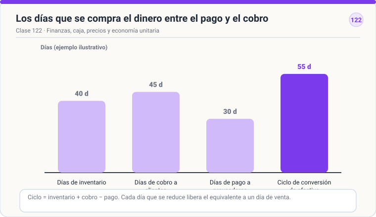

# Clase 122 — Ciclo de conversión de efectivo

> **Parte 09 · Finanzas, caja, precios y economía unitaria** — clase 10 de 14

**Estado de evidencia:** `GUIA-PRACTICA` · **Jurisdicción:** Chile-first · **Fecha base normativa:** 07-08-2026 
**Decisión que habilita:** identificar qué palanca del ciclo se ataca primero y cuánta caja libera 
**Entregable:** cálculo del ciclo actual con plan de reducción y caja liberada estimada por palanca

## 🎯 Propósito

Traducir la operación a días de caja mediante el ciclo de conversión de efectivo, que es la fuente de financiamiento más barata y menos explorada.

## 📚 Resultados de aprendizaje

Al finalizar esta clase podrás:

1. **Definir** con precisión los cuatro conceptos de la tabla siguiente y usarlos para describir un caso real.
2. **Explicar** por qué esta materia condiciona decisiones de otras partes del programa.
3. **Decidir** —identificar qué palanca del ciclo se ataca primero y cuánta caja libera— y justificar la decisión por escrito.
4. **Producir** el entregable de la clase y contrastarlo contra su criterio de aceptación.
5. **Distinguir** el dato estable del dato dinámico que exige revalidación en la fuente oficial.

## 🧩 Conceptos centrales

| Concepto | Comprensión verificable |
|---|---|
| **Ciclo de conversión de efectivo** | Días de inventario más días de cobro menos días de pago. |
| **Ciclo negativo** | Situación donde se cobra antes de pagar, que financia el crecimiento. |
| **Palanca de reducción** | Acción concreta que acorta el ciclo. |
| **Efecto sobre caja** | Dinero liberado por cada día de reducción del ciclo. |

## 🗺️ Modelo mental: Los días que se compra el dinero entre el pago y el cobro

> **La idea en una frase:** El ciclo de conversión de efectivo traduce la operación en días de caja: reducirlo diez días en una empresa que vende 100 millones al año libera aproximadamente diez días de venta, sin costo financiero.

**Lectura guiada:** Las tres primeras barras son las palancas y la cuarta es el resultado. Reducir inventario o cobro y alargar el pago acorta el ciclo. Cada día vale dinero.

**Para recordarlo:** Es el tiempo que tarda un préstamo que te haces a ti mismo: mientras más largo el ciclo, más tiempo tu dinero está prestado a la operación.

## 📖 Desarrollo

### 1. El fondo del asunto

El ciclo de conversión traduce la operación en días de caja. Reducirlo diez días en una empresa que vende 100 millones al año libera aproximadamente el equivalente a diez días de venta, sin costo financiero. Es la fuente de financiamiento más barata y la menos explorada.

### 2. Cómo se traduce en la práctica

Mide tus días de inventario, cobro y pago y calcula el ciclo. Elige la palanca más fácil de mover en el próximo mes: renegociar plazos, ofrecer descuentos por pronto pago, bajar el inventario lento. Calcula cuánta caja libera cada día ganado y fija una meta. Un ciclo negativo, en que cobras antes de pagar, financia el crecimiento.

### 3. Marco aplicable y quién interviene

- economía unitaria: CAC, LTV, payback, MRR, ARR, churn y NRR
- ciclo de conversión de efectivo y capital de trabajo
- costo de capital y evaluación de deuda

**Autoridades o contrapartes involucradas:** Banco Central de Chile, CMF, SII.
**Profesionales de apoyo:** CFO o controller, contador, asesor financiero. La participación concreta depende del riesgo, del
tamaño de la empresa y de la actividad económica.

### 4. Los números, paso a paso

Con los días del gráfico, el ciclo es 40 + 45 − 30 = 55 días. Una empresa que vende 100 millones al año vende cerca de 274.000 pesos al día. Si reduce el cobro de 45 a 35 días, libera 10 días de venta, cerca de 2,7 millones. Si además acuerda pagar a 40 en lugar de 30, libera otros 2,7 millones. Con cambios de gestión se liberan más de 5 millones de caja (cifras ilustrativas).

### 5. En qué se apoya

- **Financial Intelligence** (Harvard Business Review Press): Berman y Knight explican el ciclo de efectivo y cómo cada componente afecta la caja.
- **Principles of Corporate Finance** (McGraw-Hill): Brealey y Myers describen la gestión del capital de trabajo y el ciclo de conversión de efectivo como parte de las decisiones de corto plazo.

*Las lecturas de apoyo ofrecen marcos conceptuales; lo que exige la ley chilena se verifica en las fuentes oficiales de esta clase.*

## 🧪 Taller guiado

Aplica esta clase a **una** de las siguientes líneas de negocio y repite después el ejercicio con
una segunda línea de carga regulatoria distinta:

| Línea | Carga regulatoria |
|---|---|
| SaaS B2B con IA | media |
| Servicios profesionales | baja |
| E-commerce D2C | media |
| Alimentos o foodtech | alta |
| Exportación de servicios | media |
| Fintech regulada | alta |
| Construcción o servicios técnicos | alta |

**Secuencia de trabajo:**

1. Delimita el contexto: actividad económica, escala, comuna y etapa de la empresa.
2. Reúne los antecedentes que la decisión exige y anota la fecha de cada fuente.
3. Identifica las alternativas reales, incluida la de no hacer nada.
4. Evalúa el impacto en mercado, caja, personas, regulación y operación.
5. Toma la decisión y regístrala con sus supuestos.
6. Produce el entregable.
7. Contrástalo contra el criterio de aceptación.
8. Anota lo que requiere validación profesional y programa su revisión.

### 📦 Entregable

Cálculo del ciclo actual con plan de reducción y caja liberada estimada por palanca.

Debe incluir decisión, supuestos, fuentes con fecha de consulta, responsable, riesgos
identificados y próximos pasos.

## 🏆 Reto verificable

Resuelve la misma materia para una segunda línea de negocio con distinta carga regulatoria y
explica por escrito **qué cambió, por qué y qué fuente lo determina**.

## ✅ Criterio de aceptación

- [ ] el ciclo está calculado con datos propios
- [ ] cada palanca tiene caja liberada estimada
- [ ] cada afirmación regulatoria está referida a una fuente oficial con fecha de consulta;
- [ ] los datos dinámicos quedan marcados para revalidación;
- [ ] hay un responsable asignado y evidencia reproducible del trabajo.

## ⚠️ Errores frecuentes

**Propios de esta clase:**

- Intentar reducir el ciclo solo presionando a proveedores.
- No medir el ciclo y desconocer cuánta caja inmoviliza la operación.

**Característicos de la parte 09:**

- Proyectar ventas sin proyectar el desfase de cobro.
- Fijar precio sobre costo sin considerar el valor percibido ni el mercado.

## 🇨🇱 Checklist Chile

- [ ] ¿existe norma o autoridad específica para esta materia?
- [ ] ¿la fuente consultada está vigente a la fecha de ejecución?
- [ ] ¿se activa algún trámite ante el SII?
- [ ] ¿se activa algún requisito municipal o sectorial?
- [ ] ¿afecta a consumidores o al tratamiento de datos personales?
- [ ] ¿afecta a trabajadores o a la seguridad y salud en el trabajo?
- [ ] ¿afecta a impuestos, contabilidad o caja?
- [ ] ¿afecta a contratos o a propiedad intelectual?
- [ ] ¿requiere renovación, reporte periódico o revalidación?

## ❓ Preguntas de comprobación

1. ¿Cuál es tu ciclo de conversión de efectivo hoy, en días?
2. ¿Qué palanca —inventario, cobro o pago— tiene más margen de mejora?
3. ¿Cuánta caja liberarías reduciendo el ciclo en diez días?

## 🔗 Fuentes oficiales

**Biblioteca del Congreso Nacional · LeyChile — Normativa oficial consolidada**  
<https://www.bcn.cl/leychile/> · verificado 2026-11-05

- *Qué contiene:* Publica el texto oficial y consolidado de leyes, decretos y reglamentos, con la versión vigente a una fecha, el historial de modificaciones y la tramitación que las originó.
- *Cómo leerla:* Usa siempre el selector de versión vigente a la fecha en que ejecutarás el trámite, no la última publicada. Y lee el artículo transitorio: en normas en implantación gradual —jornada, datos personales— ahí está la fecha que realmente te aplica.
- *Uso en esta clase:* aporta el marco de «Normativa oficial consolidada» para identificar qué palanca del ciclo se ataca primero y cuánta caja libera.

**Servicio de Impuestos Internos — Nuevos contribuyentes, inicio de actividades y DTE**  
<https://www.sii.cl/ayudas/nuevos_contribuyentes/boleta-vys-facturador.html> · verificado 2026-11-05

- *Qué contiene:* Reúne el circuito completo del contribuyente nuevo: obtención de RUT, declaración de inicio de actividades, elección de códigos de actividad económica y habilitación para emitir documentos tributarios electrónicos.
- *Cómo leerla:* Sepáralo en dos actos distintos que la página trata seguidos: el RUT identifica, el inicio de actividades habilita. Lo que te bloquea para facturar casi siempre está en el segundo, no en el primero.
- *Uso en esta clase:* aporta el marco de «Nuevos contribuyentes, inicio de actividades y DTE» para identificar qué palanca del ciclo se ataca primero y cuánta caja libera.

**Corporación de Fomento de la Producción — Innovación, inversión y garantías**  
<https://www.corfo.cl/> · verificado 2026-11-05

- *Qué contiene:* Reúne los instrumentos de fomento a la innovación y la inversión, incluidos programas de capital semilla, escalamiento, garantías y cobertura de riesgo para el sistema financiero.
- *Cómo leerla:* Filtra por etapa de la empresa antes que por monto. Y verifica el componente de innovación que exige cada instrumento: presentar una expansión comercial como innovación es la causa más común de rechazo.
- *Uso en esta clase:* aporta el marco de «Innovación, inversión y garantías» para identificar qué palanca del ciclo se ataca primero y cuánta caja libera.

**Harvard Business Review Press — Financial Intelligence**  
<https://openlibrary.org/isbn/9781591397649> · verificado 2026-11-25

- *Qué contiene:* Explica a personas no financieras cómo leer estados financieros, márgenes, flujo de caja y capital de trabajo.
- *Cómo leerla:* Úsalo como marco conceptual para entender el porqué de la práctica, nunca como prueba de lo que exige la ley chilena; para eso están las fuentes oficiales de la clase.
- *Uso en esta clase:* aporta el marco de «Financial Intelligence» para identificar qué palanca del ciclo se ataca primero y cuánta caja libera.

**McGraw-Hill — Principles of Corporate Finance**  
<https://openlibrary.org/isbn/9780071140539> · verificado 2026-11-25

- *Qué contiene:* Texto de finanzas corporativas: valor presente, riesgo, costo de capital y decisiones de inversión. Se usa como lectura de apoyo conceptual y no como fuente normativa.
- *Cómo leerla:* Úsalo como marco conceptual para entender el porqué de la práctica, nunca como prueba de lo que exige la ley chilena; para eso están las fuentes oficiales de la clase.
- *Uso en esta clase:* aporta el marco de «Principles of Corporate Finance» para identificar qué palanca del ciclo se ataca primero y cuánta caja libera.

Complementos del repositorio: [glosario](../../../docs/19_GLOSSARY.md) ·
[ruta de lecturas](../../../docs/15_BOOKS_AND_LEARNING_PATH.md) ·
[catálogo de fuentes](../../../docs/16_OFFICIAL_SOURCE_CATALOG.md).

> [!IMPORTANT]
> Material educativo. Para una decisión real de alto impacto hay que verificar la fuente oficial
> vigente y validar con el profesional competente.

---

| Anterior | Índice | Siguiente |
|---|---|---|
| [← 121 · Rotación, ticket y merma para comercio](../class-09-rotacion-ticket-y-merma-para-comercio/README.md) | [Parte 09](../README.md) · [Programa](../../../README.md) | [123 · Deuda buena, deuda mala y costo de capital →](../class-11-deuda-buena-deuda-mala-y-costo-de-capital/README.md) |
