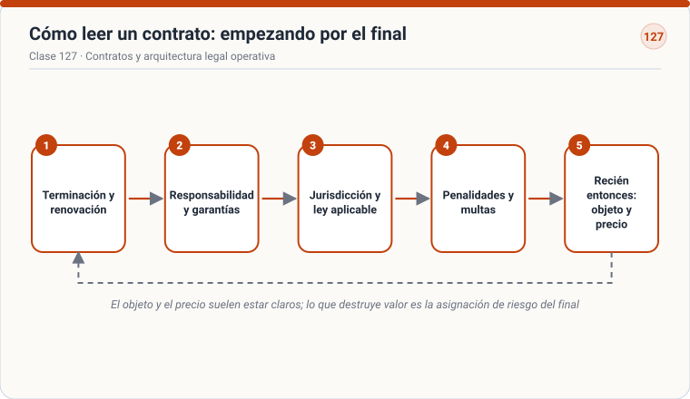

# Clase 127 — Anatomía de un contrato comercial

> **Parte 10 · Contratos y arquitectura legal operativa** — clase 1 de 14

**Estado de evidencia:** `VERIFICADO-FUENTE` · **Jurisdicción:** Chile-first · **Fecha base normativa:** 07-08-2026 
**Decisión que habilita:** identificar dónde queda el riesgo en cada contrato antes de firmar 
**Entregable:** checklist de revisión contractual aplicado a un contrato real del negocio

## 🎯 Propósito

Aprender a leer un contrato empezando por el final, donde están terminación, responsabilidad, penalidades y jurisdicción, que es donde queda el riesgo real.

## 📚 Resultados de aprendizaje

Al finalizar esta clase podrás:

1. **Definir** con precisión los cuatro conceptos de la tabla siguiente y usarlos para describir un caso real.
2. **Explicar** por qué esta materia condiciona decisiones de otras partes del programa.
3. **Decidir** —identificar dónde queda el riesgo en cada contrato antes de firmar— y justificar la decisión por escrito.
4. **Producir** el entregable de la clase y contrastarlo contra su criterio de aceptación.
5. **Distinguir** el dato estable del dato dinámico que exige revalidación en la fuente oficial.

## 🧩 Conceptos centrales

| Concepto | Comprensión verificable |
|---|---|
| **Objeto del contrato** | Descripción precisa de qué se obliga cada parte. |
| **Contraprestación** | Precio, forma y plazo de pago. |
| **Asignación de riesgo** | Cláusulas que definen quién soporta qué contingencia. |
| **Cláusula patológica** | Redacción ambigua que hace inaplicable lo pactado. |

## 🗺️ Modelo mental: Cómo leer un contrato: empezando por el final

> **La idea en una frase:** Un contrato se lee empezando por el final: terminación, responsabilidad, jurisdicción y penalidades, porque ahí está la asignación real del riesgo.

**Qué mirar primero:** Sigue el orden de lectura de izquierda a derecha. El último paso es el que todos leen primero y el que menos importa para saber qué riesgo asumes.

**Una imagen cotidiana:** Es leer un seguro: no miras primero qué cubre, sino qué excluye y cuánto pagan si ocurre el problema.

## 📖 Desarrollo

### 1. El fondo del asunto

Un contrato se lee empezando por el final: terminación, responsabilidad, jurisdicción y penalidades. Ahí está la asignación real del riesgo. El objeto y el precio suelen estar claros; lo que destruye valor son las cláusulas que nadie leyó porque se asumió que el negocio saldría bien.

### 2. Cómo se traduce en la práctica

Antes de firmar, lee las cláusulas de salida y de responsabilidad y marca las que no puedes cumplir o que te exponen a pérdidas mayores que el contrato. Identifica las cláusulas patológicas: ambiguas, contradictorias o desproporcionadas. Pide los cambios por escrito antes de comenzar a trabajar. Guarda la última versión firmada con fecha.

### 3. Marco aplicable y quién interviene

- Código Civil en materia de obligaciones, contratos y responsabilidad
- Código de Comercio para actos mercantiles
- Ley 19.983 sobre mérito ejecutivo de la factura
- Ley 21.131 sobre pago a treinta días

**Autoridades o contrapartes involucradas:** Tribunales ordinarios, Centros de arbitraje (CAM Santiago).
**Profesionales de apoyo:** abogado comercial, responsable de contratos, finanzas. La participación concreta depende del riesgo, del
tamaño de la empresa y de la actividad económica.

### 4. Una conversación que enseña

Gerente: «El contrato ofrece 200 millones por el servicio; ¿lo firmamos?». Abogada: «Empecemos por el final. La responsabilidad no tiene tope, la jurisdicción es en otro país y la terminación exige 12 meses de preaviso». Gerente: «Pero el precio es bueno». Abogada: «El precio es lo que ganas si todo sale bien; las últimas cláusulas dicen cuánto puedes perder si no» (conversación ilustrativa).

### 5. En qué se apoya

- **Normativa oficial consolidada** (Biblioteca del Congreso Nacional · LeyChile): El Código Civil y el Código de Comercio, consultables en la Biblioteca del Congreso Nacional, fijan las reglas supletorias que aplican cuando el contrato no dice nada.
- **Getting to Yes (3.ª ed., 2011)** (Penguin): Fisher y Ury recomiendan negociar sobre intereses y criterios objetivos, lo que ayuda a pedir cambios en cláusulas de riesgo sin convertirlo en una disputa de posiciones.

*Las lecturas de apoyo ofrecen marcos conceptuales; lo que exige la ley chilena se verifica en las fuentes oficiales de esta clase.*

## 🧪 Taller guiado

Aplica esta clase a **una** de las siguientes líneas de negocio y repite después el ejercicio con
una segunda línea de carga regulatoria distinta:

| Línea | Carga regulatoria |
|---|---|
| SaaS B2B con IA | media |
| Servicios profesionales | baja |
| E-commerce D2C | media |
| Alimentos o foodtech | alta |
| Exportación de servicios | media |
| Fintech regulada | alta |
| Construcción o servicios técnicos | alta |

**Secuencia de trabajo:**

1. Delimita el contexto: actividad económica, escala, comuna y etapa de la empresa.
2. Reúne los antecedentes que la decisión exige y anota la fecha de cada fuente.
3. Identifica las alternativas reales, incluida la de no hacer nada.
4. Evalúa el impacto en mercado, caja, personas, regulación y operación.
5. Toma la decisión y regístrala con sus supuestos.
6. Produce el entregable.
7. Contrástalo contra el criterio de aceptación.
8. Anota lo que requiere validación profesional y programa su revisión.

### 📦 Entregable

Checklist de revisión contractual aplicado a un contrato real del negocio.

Debe incluir decisión, supuestos, fuentes con fecha de consulta, responsable, riesgos
identificados y próximos pasos.

## 🏆 Reto verificable

Resuelve la misma materia para una segunda línea de negocio con distinta carga regulatoria y
explica por escrito **qué cambió, por qué y qué fuente lo determina**.

## ✅ Criterio de aceptación

- [ ] la revisión identifica las cláusulas que asignan riesgo
- [ ] cada riesgo identificado tiene mitigación propuesta
- [ ] cada afirmación regulatoria está referida a una fuente oficial con fecha de consulta;
- [ ] los datos dinámicos quedan marcados para revalidación;
- [ ] hay un responsable asignado y evidencia reproducible del trabajo.

## ⚠️ Errores frecuentes

**Propios de esta clase:**

- Revisar solo objeto y precio y firmar el resto sin leer.
- Aceptar cláusulas de responsabilidad ilimitada por costumbre del sector.

**Característicos de la parte 10:**

- Aceptar términos y condiciones de un proveedor crítico sin leer la limitación de responsabilidad.
- Operar con orden de compra sin contrato marco en servicios recurrentes.

## 🇨🇱 Checklist Chile

- [ ] ¿existe norma o autoridad específica para esta materia?
- [ ] ¿la fuente consultada está vigente a la fecha de ejecución?
- [ ] ¿se activa algún trámite ante el SII?
- [ ] ¿se activa algún requisito municipal o sectorial?
- [ ] ¿afecta a consumidores o al tratamiento de datos personales?
- [ ] ¿afecta a trabajadores o a la seguridad y salud en el trabajo?
- [ ] ¿afecta a impuestos, contabilidad o caja?
- [ ] ¿afecta a contratos o a propiedad intelectual?
- [ ] ¿requiere renovación, reporte periódico o revalidación?

## ❓ Preguntas de comprobación

1. ¿Qué cláusula de tu contrato más grande asigna el mayor riesgo y hacia dónde?
2. ¿Cuál es tu exposición máxima si ese contrato sale mal?
3. ¿Qué cláusulas firmaste por costumbre del sector sin negociarlas?

## 🔗 Fuentes oficiales

**Biblioteca del Congreso Nacional · LeyChile — Normativa oficial consolidada**  
<https://www.bcn.cl/leychile/> · verificado 2026-11-05

- *Qué contiene:* Publica el texto oficial y consolidado de leyes, decretos y reglamentos, con la versión vigente a una fecha, el historial de modificaciones y la tramitación que las originó.
- *Cómo leerla:* Usa siempre el selector de versión vigente a la fecha en que ejecutarás el trámite, no la última publicada. Y lee el artículo transitorio: en normas en implantación gradual —jornada, datos personales— ahí está la fecha que realmente te aplica.
- *Uso en esta clase:* aporta el marco de «Normativa oficial consolidada» para identificar dónde queda el riesgo en cada contrato antes de firmar.

**Penguin — Getting to Yes (3.ª ed., 2011)**  
<https://openlibrary.org/isbn/9780143118756> · verificado 2026-11-25

- *Qué contiene:* Expone la negociación basada en intereses: separar a las personas del problema, generar opciones de beneficio mutuo y usar criterios objetivos.
- *Cómo leerla:* Úsalo como marco conceptual para entender el porqué de la práctica, nunca como prueba de lo que exige la ley chilena; para eso están las fuentes oficiales de la clase.
- *Uso en esta clase:* aporta el marco de «Getting to Yes (3.ª ed., 2011)» para identificar dónde queda el riesgo en cada contrato antes de firmar.

Complementos del repositorio: [glosario](../../../docs/19_GLOSSARY.md) ·
[ruta de lecturas](../../../docs/15_BOOKS_AND_LEARNING_PATH.md) ·
[catálogo de fuentes](../../../docs/16_OFFICIAL_SOURCE_CATALOG.md).

> [!IMPORTANT]
> Material educativo. Para una decisión real de alto impacto hay que verificar la fuente oficial
> vigente y validar con el profesional competente.

---

| Anterior | Índice | Siguiente |
|---|---|---|
| **Inicio de la parte** | [Parte 10](../README.md) · [Programa](../../../README.md) | [128 · Cotización, orden de compra y aceptación →](../class-02-cotizacion-orden-de-compra-y-aceptacion/README.md) |
