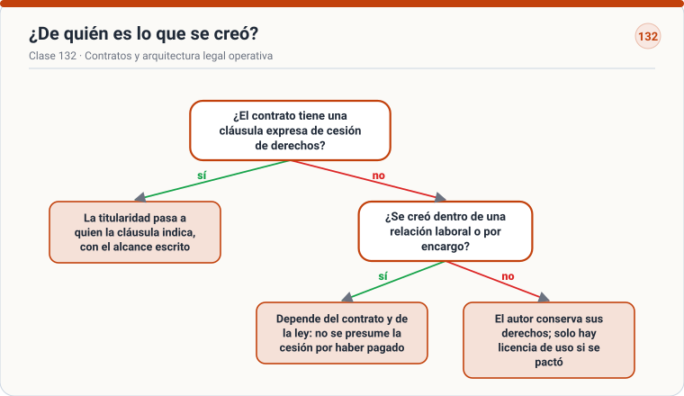

# Clase 132 — Propiedad intelectual en contratos

> **Parte 10 · Contratos y arquitectura legal operativa** — clase 6 de 14

**Estado de evidencia:** `VERIFICADO-FUENTE` · **Jurisdicción:** Chile-first · **Fecha base normativa:** 07-08-2026 
**Decisión que habilita:** definir quién es titular de lo creado y qué se cede o licencia 
**Entregable:** cláusula de propiedad intelectual con alcance de cesión, licencias y derechos preexistentes

## 🎯 Propósito

Pactar expresamente la titularidad de lo creado, porque en Chile no se transfiere sola por haber pagado el desarrollo.

## 📚 Resultados de aprendizaje

Al finalizar esta clase podrás:

1. **Definir** con precisión los cuatro conceptos de la tabla siguiente y usarlos para describir un caso real.
2. **Explicar** por qué esta materia condiciona decisiones de otras partes del programa.
3. **Decidir** —definir quién es titular de lo creado y qué se cede o licencia— y justificar la decisión por escrito.
4. **Producir** el entregable de la clase y contrastarlo contra su criterio de aceptación.
5. **Distinguir** el dato estable del dato dinámico que exige revalidación en la fuente oficial.

## 🧩 Conceptos centrales

| Concepto | Comprensión verificable |
|---|---|
| **Titularidad** | Quién es dueño de lo creado durante la relación. |
| **Cesión de derechos** | Transferencia de la titularidad patrimonial. |
| **Licencia de uso** | Autorización de uso sin transferir titularidad. |
| **Obra por encargo** | Creación desarrollada a petición de un tercero. |

## 🗺️ Modelo mental: ¿De quién es lo que se creó?

> **La idea en una frase:** En Chile la titularidad del software y de las obras por encargo depende del contrato y de la relación laboral: no se transfiere automáticamente por haber pagado.

**Cómo leerlo:** Recorre el árbol con cada entregable. Si la respuesta final es el autor conserva sus derechos, quien pagó solo tiene la licencia que se pactó, que puede ser limitada.

**Una analogía:** Es encargar un retrato: el dueño del cuadro es quien lo compró, pero los derechos sobre la imagen pueden seguir siendo del pintor si nada se pactó.

## 📖 Desarrollo

### 1. El fondo del asunto

En Chile la titularidad del software y de las obras creadas por encargo depende del contrato y de la relación laboral: no se transfiere automáticamente por haber pagado. Sin cláusula expresa de cesión, el proveedor puede conservar derechos sobre lo que el cliente cree haber comprado.

### 2. Cómo se traduce en la práctica

En cada contrato de creación (software, diseño, contenido), define quién es titular, qué se cede, con qué alcance, plazo y territorio, y qué se licencia. Pide la entrega del código fuente y de la documentación. Para empleados y colaboradores, incluye cláusulas de cesión y confidencialidad. Registra lo que se pueda ante INAPI y guarda la evidencia de autoría.

### 3. Marco aplicable y quién interviene

- Código Civil en materia de obligaciones, contratos y responsabilidad
- Código de Comercio para actos mercantiles
- Ley 19.983 sobre mérito ejecutivo de la factura
- Ley 21.131 sobre pago a treinta días

**Autoridades o contrapartes involucradas:** Tribunales ordinarios, Centros de arbitraje (CAM Santiago).
**Profesionales de apoyo:** abogado comercial, responsable de contratos, finanzas. La participación concreta depende del riesgo, del
tamaño de la empresa y de la actividad económica.

### 4. Un error y su corrección

El error: una empresa paga 15 millones a una agencia para desarrollar su plataforma y asume que es dueña del código. Al querer cambiar de proveedor, la agencia le informa que el contrato solo otorgaba una licencia de uso y le cobra por entregar los fuentes. La corrección: pactar desde el inicio la cesión de derechos, la entrega del código y la documentación, y revisar el alcance de cualquier licencia de terceros (caso ilustrativo).

### 5. En qué se apoya

- **Marcas, patentes y diseños industriales** (Instituto Nacional de Propiedad Industrial): INAPI registra marcas, patentes y diseños industriales, derechos que se pueden ceder o licenciar mediante contratos.
- **Normativa oficial consolidada** (Biblioteca del Congreso Nacional · LeyChile): La Ley 17.336 sobre propiedad intelectual regula los derechos de autor, su cesión y licencias; su texto se consulta en la Biblioteca del Congreso Nacional.

*Las lecturas de apoyo ofrecen marcos conceptuales; lo que exige la ley chilena se verifica en las fuentes oficiales de esta clase.*

## 🧪 Taller guiado

Aplica esta clase a **una** de las siguientes líneas de negocio y repite después el ejercicio con
una segunda línea de carga regulatoria distinta:

| Línea | Carga regulatoria |
|---|---|
| SaaS B2B con IA | media |
| Servicios profesionales | baja |
| E-commerce D2C | media |
| Alimentos o foodtech | alta |
| Exportación de servicios | media |
| Fintech regulada | alta |
| Construcción o servicios técnicos | alta |

**Secuencia de trabajo:**

1. Delimita el contexto: actividad económica, escala, comuna y etapa de la empresa.
2. Reúne los antecedentes que la decisión exige y anota la fecha de cada fuente.
3. Identifica las alternativas reales, incluida la de no hacer nada.
4. Evalúa el impacto en mercado, caja, personas, regulación y operación.
5. Toma la decisión y regístrala con sus supuestos.
6. Produce el entregable.
7. Contrástalo contra el criterio de aceptación.
8. Anota lo que requiere validación profesional y programa su revisión.

### 📦 Entregable

Cláusula de propiedad intelectual con alcance de cesión, licencias y derechos preexistentes.

Debe incluir decisión, supuestos, fuentes con fecha de consulta, responsable, riesgos
identificados y próximos pasos.

## 🏆 Reto verificable

Resuelve la misma materia para una segunda línea de negocio con distinta carga regulatoria y
explica por escrito **qué cambió, por qué y qué fuente lo determina**.

## ✅ Criterio de aceptación

- [ ] la titularidad está definida expresamente
- [ ] los derechos preexistentes de cada parte están excluidos de la cesión
- [ ] cada afirmación regulatoria está referida a una fuente oficial con fecha de consulta;
- [ ] los datos dinámicos quedan marcados para revalidación;
- [ ] hay un responsable asignado y evidencia reproducible del trabajo.

## ⚠️ Errores frecuentes

**Propios de esta clase:**

- Pagar un desarrollo sin cláusula de cesión y no ser titular del código.
- Ceder todo el conocimiento previo del proveedor por una redacción demasiado amplia.

**Característicos de la parte 10:**

- Aceptar términos y condiciones de un proveedor crítico sin leer la limitación de responsabilidad.
- Operar con orden de compra sin contrato marco en servicios recurrentes.

## 🇨🇱 Checklist Chile

- [ ] ¿existe norma o autoridad específica para esta materia?
- [ ] ¿la fuente consultada está vigente a la fecha de ejecución?
- [ ] ¿se activa algún trámite ante el SII?
- [ ] ¿se activa algún requisito municipal o sectorial?
- [ ] ¿afecta a consumidores o al tratamiento de datos personales?
- [ ] ¿afecta a trabajadores o a la seguridad y salud en el trabajo?
- [ ] ¿afecta a impuestos, contabilidad o caja?
- [ ] ¿afecta a contratos o a propiedad intelectual?
- [ ] ¿requiere renovación, reporte periódico o revalidación?

## ❓ Preguntas de comprobación

1. ¿Quién es titular del software o material que encargaste y con qué cláusula lo acreditas?
2. ¿Están excluidos los derechos preexistentes de cada parte?
3. ¿Qué pasa con la titularidad si el proveedor desaparece o incumple?

## 🔗 Fuentes oficiales

**Instituto Nacional de Propiedad Industrial — Marcas, patentes y diseños industriales**  
<https://www.inapi.cl/> · verificado 2026-11-05

- *Qué contiene:* Administra el registro de marcas, patentes, diseños e indicaciones geográficas, y ofrece el buscador público de solicitudes y registros vigentes por clase.
- *Cómo leerla:* Empieza siempre por el buscador de anterioridades y por clases, no por el formulario de solicitud. Una marca disponible en tu clase puede estar tomada en la clase donde realmente operas, y eso solo se ve buscando por actividad.
- *Uso en esta clase:* aporta el marco de «Marcas, patentes y diseños industriales» para definir quién es titular de lo creado y qué se cede o licencia.

**Biblioteca del Congreso Nacional · LeyChile — Normativa oficial consolidada**  
<https://www.bcn.cl/leychile/> · verificado 2026-11-05

- *Qué contiene:* Publica el texto oficial y consolidado de leyes, decretos y reglamentos, con la versión vigente a una fecha, el historial de modificaciones y la tramitación que las originó.
- *Cómo leerla:* Usa siempre el selector de versión vigente a la fecha en que ejecutarás el trámite, no la última publicada. Y lee el artículo transitorio: en normas en implantación gradual —jornada, datos personales— ahí está la fecha que realmente te aplica.
- *Uso en esta clase:* aporta el marco de «Normativa oficial consolidada» para definir quién es titular de lo creado y qué se cede o licencia.

Complementos del repositorio: [glosario](../../../docs/19_GLOSSARY.md) ·
[ruta de lecturas](../../../docs/15_BOOKS_AND_LEARNING_PATH.md) ·
[catálogo de fuentes](../../../docs/16_OFFICIAL_SOURCE_CATALOG.md).

> [!IMPORTANT]
> Material educativo. Para una decisión real de alto impacto hay que verificar la fuente oficial
> vigente y validar con el profesional competente.

---

| Anterior | Índice | Siguiente |
|---|---|---|
| [← 131 · NDA y confidencialidad](../class-05-nda-y-confidencialidad/README.md) | [Parte 10](../README.md) · [Programa](../../../README.md) | [133 · SLA, soporte y niveles de servicio →](../class-07-sla-soporte-y-niveles-de-servicio/README.md) |
