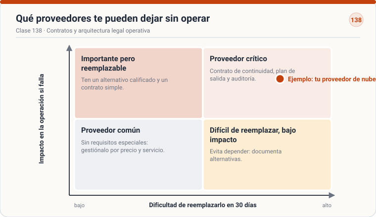

# Clase 138 — Contratos con proveedores críticos

> **Parte 10 · Contratos y arquitectura legal operativa** — clase 12 de 14

**Estado de evidencia:** `VERIFICADO-FUENTE` · **Jurisdicción:** Chile-first · **Fecha base normativa:** 07-08-2026 
**Decisión que habilita:** identificar proveedores críticos y asegurar continuidad contractual 
**Entregable:** mapa de proveedores críticos con cláusulas de continuidad y plan de salida por proveedor

## 🎯 Propósito

Identificar los proveedores cuya falla detiene la operación y asegurar continuidad por contrato antes de que la dependencia se vuelva poder de negociación ajeno.

## 📚 Resultados de aprendizaje

Al finalizar esta clase podrás:

1. **Definir** con precisión los cuatro conceptos de la tabla siguiente y usarlos para describir un caso real.
2. **Explicar** por qué esta materia condiciona decisiones de otras partes del programa.
3. **Decidir** —identificar proveedores críticos y asegurar continuidad contractual— y justificar la decisión por escrito.
4. **Producir** el entregable de la clase y contrastarlo contra su criterio de aceptación.
5. **Distinguir** el dato estable del dato dinámico que exige revalidación en la fuente oficial.

## 🧩 Conceptos centrales

| Concepto | Comprensión verificable |
|---|---|
| **Proveedor crítico** | Aquel cuya falla detiene la operación. |
| **Dependencia** | Grado en que la operación no puede continuar sin él. |
| **Plan de salida** | Procedimiento para reemplazarlo sin interrumpir el servicio. |
| **Auditoría de proveedor** | Derecho contractual de verificar cumplimiento. |

## 🗺️ Modelo mental: Qué proveedores te pueden dejar sin operar

> **La idea en una frase:** Con proveedores críticos el contrato debe incluir continuidad: plazos de aviso extendidos, transición ordenada, entrega de datos en un formato usable y derecho de auditoría.

**Cómo leerlo:** Ubica a cada proveedor según su impacto y cuán difícil es reemplazarlo. El cuadrante crítico exige cláusulas especiales; los demás, solo una gestión razonable.

**Para recordarlo:** Es el pilar de una casa: si falla, el techo cae; por eso se refuerza y se revisa más que cualquier otra pieza.

## 📖 Desarrollo

### 1. El fondo del asunto

Con proveedores críticos el contrato debe incluir continuidad: plazos de aviso extendidos, obligación de transición ordenada, entrega de datos en formato usable y derecho de auditoría. Sin esas cláusulas, la dependencia se convierte en poder de negociación de la contraparte.

### 2. Cómo se traduce en la práctica

Identifica los proveedores críticos y mide tu dependencia: porcentaje de compras, existencia de alternativas y datos que guardan. Incluye en el contrato aviso previo extendido, transición ordenada, devolución de datos en formato usable y derecho de auditoría. Verifica que no existan conductas de competencia desleal ni exclusividades que limiten tu capacidad de cambiar.

### 3. Marco aplicable y quién interviene

- Código Civil en materia de obligaciones, contratos y responsabilidad
- Código de Comercio para actos mercantiles
- Ley 19.983 sobre mérito ejecutivo de la factura
- Ley 21.131 sobre pago a treinta días

**Autoridades o contrapartes involucradas:** Tribunales ordinarios, Centros de arbitraje (CAM Santiago).
**Profesionales de apoyo:** abogado comercial, responsable de contratos, finanzas. La participación concreta depende del riesgo, del
tamaño de la empresa y de la actividad económica.

### 4. Pruébalo tú: mini simulación

Haz una lista de tus diez principales proveedores y ubícalos en la matriz. Para cada uno del cuadrante crítico, escribe qué ocurre si desaparece mañana, cuánto tiempo tardarías en reemplazarlo y qué cláusulas necesitas: aviso de 90 días, transición, entrega de datos y auditoría. Identifica uno cuyo contrato hoy no cubra esos puntos y define la fecha para renegociarlo. El ejercicio es ilustrativo.

### 5. En qué se apoya

- **Ley 20.169 — Regula la competencia desleal** (Biblioteca del Congreso Nacional): La Ley 20.169 regula la competencia desleal, que sirve de referencia para evaluar exclusividades y conductas que limiten la libertad de cambiar de proveedor.
- **Normativa oficial consolidada** (Biblioteca del Congreso Nacional · LeyChile): El Código Civil y el Código de Comercio permiten pactar cláusulas de continuidad, transición y auditoría en contratos entre empresas.

*Las lecturas de apoyo ofrecen marcos conceptuales; lo que exige la ley chilena se verifica en las fuentes oficiales de esta clase.*

## 🛡️ Protección del conocimiento: Riesgos de las relaciones con terceros

[Guía de inteligencia económica y protección del conocimiento, sección 9](../../../docs/21_INTELIGENCIA_ECONOMICA_Y_PROTECCION_DEL_CONOCIMIENTO.md#9-riesgos-de-las-relaciones-con-terceros)

**Lente para esta clase:** Un proveedor crítico accede a información que no controlas: el contrato debe cubrir confidencialidad, subencargados, auditoría y salida, y no inducirlo a incumplir deberes con terceros.

| Nivel | Medida proporcionada |
|---|---|
| **Emprendedor o microempresa** | Contrato escrito con confidencialidad y devolución de la información al terminar, aunque el proveedor sea conocido. |
| **Pyme** | Matriz de proveedores con acceso a información sensible: qué ven, desde cuándo y quién en la empresa responde por ellos. |
| **Gran empresa o multinacional** | Gestión de riesgo de terceros con evaluación inicial, auditoría periódica y cláusula de salida probada. |

**Actividad sin crear sistemas:** Elige un proveedor con acceso a información sensible y completa qué ve, qué obligación escrita lo limita y cómo termina el acceso.

**Términos:** Debida diligencia de terceros (*Third-Party Due Diligence*) · Subencargado (*Sub-processor*)

*Enfoque defensivo: reconocer, prevenir, documentar y escalar. No enseña a obtener información de forma indebida; la calificación jurídica de un hecho concreto corresponde a un abogado.*

## 🧪 Taller guiado

Aplica esta clase a **una** de las siguientes líneas de negocio y repite después el ejercicio con
una segunda línea de carga regulatoria distinta:

| Línea | Carga regulatoria |
|---|---|
| SaaS B2B con IA | media |
| Servicios profesionales | baja |
| E-commerce D2C | media |
| Alimentos o foodtech | alta |
| Exportación de servicios | media |
| Fintech regulada | alta |
| Construcción o servicios técnicos | alta |

**Secuencia de trabajo:**

1. Delimita el contexto: actividad económica, escala, comuna y etapa de la empresa.
2. Reúne los antecedentes que la decisión exige y anota la fecha de cada fuente.
3. Identifica las alternativas reales, incluida la de no hacer nada.
4. Evalúa el impacto en mercado, caja, personas, regulación y operación.
5. Toma la decisión y regístrala con sus supuestos.
6. Produce el entregable.
7. Contrástalo contra el criterio de aceptación.
8. Anota lo que requiere validación profesional y programa su revisión.

### 📦 Entregable

Mapa de proveedores críticos con cláusulas de continuidad y plan de salida por proveedor.

Debe incluir decisión, supuestos, fuentes con fecha de consulta, responsable, riesgos
identificados y próximos pasos.

## 🏆 Reto verificable

Resuelve la misma materia para una segunda línea de negocio con distinta carga regulatoria y
explica por escrito **qué cambió, por qué y qué fuente lo determina**.

## ✅ Criterio de aceptación

- [ ] los proveedores críticos están identificados por impacto
- [ ] cada uno tiene plan de salida con plazo estimado
- [ ] cada afirmación regulatoria está referida a una fuente oficial con fecha de consulta;
- [ ] los datos dinámicos quedan marcados para revalidación;
- [ ] hay un responsable asignado y evidencia reproducible del trabajo.

## ⚠️ Errores frecuentes

**Propios de esta clase:**

- Depender de un proveedor único sin plan de reemplazo.
- Contratar saas crítico sin cláusula de exportación de datos.

**Característicos de la parte 10:**

- Aceptar términos y condiciones de un proveedor crítico sin leer la limitación de responsabilidad.
- Operar con orden de compra sin contrato marco en servicios recurrentes.

## 🇨🇱 Checklist Chile

- [ ] ¿existe norma o autoridad específica para esta materia?
- [ ] ¿la fuente consultada está vigente a la fecha de ejecución?
- [ ] ¿se activa algún trámite ante el SII?
- [ ] ¿se activa algún requisito municipal o sectorial?
- [ ] ¿afecta a consumidores o al tratamiento de datos personales?
- [ ] ¿afecta a trabajadores o a la seguridad y salud en el trabajo?
- [ ] ¿afecta a impuestos, contabilidad o caja?
- [ ] ¿afecta a contratos o a propiedad intelectual?
- [ ] ¿requiere renovación, reporte periódico o revalidación?

## ❓ Preguntas de comprobación

1. ¿Qué proveedor detiene tu operación si falla mañana y en cuánto tiempo?
2. ¿Qué cláusulas de continuidad y salida tiene ese contrato?
3. ¿Probaste alguna vez exportar tus datos de ese proveedor?

## 🔗 Fuentes oficiales

**Biblioteca del Congreso Nacional · LeyChile — Normativa oficial consolidada**  
<https://www.bcn.cl/leychile/> · verificado 2026-11-05

- *Qué contiene:* Publica el texto oficial y consolidado de leyes, decretos y reglamentos, con la versión vigente a una fecha, el historial de modificaciones y la tramitación que las originó.
- *Cómo leerla:* Usa siempre el selector de versión vigente a la fecha en que ejecutarás el trámite, no la última publicada. Y lee el artículo transitorio: en normas en implantación gradual —jornada, datos personales— ahí está la fecha que realmente te aplica.
- *Uso en esta clase:* aporta el marco de «Normativa oficial consolidada» para identificar proveedores críticos y asegurar continuidad contractual.

**Servicio de Impuestos Internos — Nuevos contribuyentes, inicio de actividades y DTE**  
<https://www.sii.cl/ayudas/nuevos_contribuyentes/boleta-vys-facturador.html> · verificado 2026-11-05

- *Qué contiene:* Reúne el circuito completo del contribuyente nuevo: obtención de RUT, declaración de inicio de actividades, elección de códigos de actividad económica y habilitación para emitir documentos tributarios electrónicos.
- *Cómo leerla:* Sepáralo en dos actos distintos que la página trata seguidos: el RUT identifica, el inicio de actividades habilita. Lo que te bloquea para facturar casi siempre está en el segundo, no en el primero.
- *Uso en esta clase:* aporta el marco de «Nuevos contribuyentes, inicio de actividades y DTE» para identificar proveedores críticos y asegurar continuidad contractual.

**Biblioteca del Congreso Nacional — Ley 20.169 — Regula la competencia desleal**  
<https://www.bcn.cl/leychile/navegar?idNorma=258377> · verificado 2026-11-12

- *Qué contiene:* Define el acto de competencia desleal como la conducta contraria a la buena fe o a las buenas costumbres que, por medios ilegítimos, persigue desviar clientela; enumera conductas particulares y las acciones de cesación, declaración, remoción de efectos e indemnización.
- *Cómo leerla:* La enumeración del artículo 4 no es taxativa y no menciona expresamente la obtención de secretos, que se trata en la ley de propiedad industrial y en el Código Penal. Úsala para inducción a incumplir contratos, engaño y denigración, y para ejercer acciones civiles.
- *Uso en esta clase:* aporta el marco de «Ley 20.169 — Regula la competencia desleal» para identificar proveedores críticos y asegurar continuidad contractual.

Complementos del repositorio: [glosario](../../../docs/19_GLOSSARY.md) ·
[ruta de lecturas](../../../docs/15_BOOKS_AND_LEARNING_PATH.md) ·
[catálogo de fuentes](../../../docs/16_OFFICIAL_SOURCE_CATALOG.md).

> [!IMPORTANT]
> Material educativo. Para una decisión real de alto impacto hay que verificar la fuente oficial
> vigente y validar con el profesional competente.

---

| Anterior | Índice | Siguiente |
|---|---|---|
| [← 137 · Cesión, subcontratación y terceros](../class-11-cesion-subcontratacion-y-terceros/README.md) | [Parte 10](../README.md) · [Programa](../../../README.md) | [139 · Gestión y repositorio de contratos →](../class-13-gestion-y-repositorio-de-contratos/README.md) |
