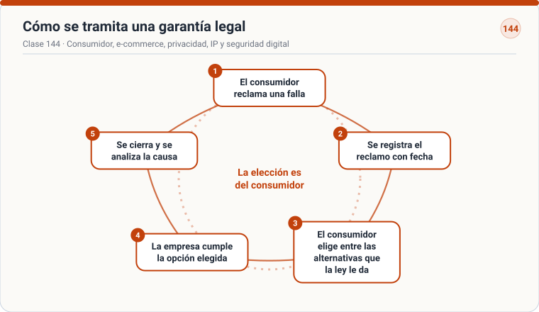

# Clase 144 — Garantía legal y postventa

> **Parte 11 · Consumidor, e-commerce, privacidad, IP y seguridad digital** — clase 4 de 14

**Estado de evidencia:** `DINAMICO` · **Jurisdicción:** Chile-first · **Fecha base normativa:** 07-08-2026 
**Decisión que habilita:** definir el procedimiento de postventa que cumple la garantía legal 
**Entregable:** procedimiento de garantía y postventa con plazos, canal y registro de casos

## 🎯 Propósito

Definir un procedimiento de postventa que respete la elección que la ley entrega al consumidor entre reparación, reposición o devolución.

## 📚 Resultados de aprendizaje

Al finalizar esta clase podrás:

1. **Definir** con precisión los cuatro conceptos de la tabla siguiente y usarlos para describir un caso real.
2. **Explicar** por qué esta materia condiciona decisiones de otras partes del programa.
3. **Decidir** —definir el procedimiento de postventa que cumple la garantía legal— y justificar la decisión por escrito.
4. **Producir** el entregable de la clase y contrastarlo contra su criterio de aceptación.
5. **Distinguir** el dato estable del dato dinámico que exige revalidación en la fuente oficial.

## 🧩 Conceptos centrales

| Concepto | Comprensión verificable |
|---|---|
| **Garantía legal** | Derecho del consumidor a reparación, reposición o devolución. |
| **Garantía voluntaria** | Compromiso adicional ofrecido por el proveedor. |
| **Servicio técnico** | Canal de atención para hacer efectiva la garantía. |
| **Registro de reclamos** | Bitácora de casos y su resolución. |

## 🗺️ Modelo mental: Cómo se tramita una garantía legal

> **La idea en una frase:** La garantía legal opera por el solo ministerio de la ley y es el consumidor quien elige entre las alternativas que la norma establece; una política de postventa que restrinja esa elección es ineficaz.

**Cómo leerlo:** El ciclo muestra que la decisión central no es de la empresa: el consumidor escoge. Después del cumplimiento, la causa de la falla debe volver al área de producto y compras.

**Una analogía:** Es la devolución en una tienda con boleta: no se trata de convencer al cliente, sino de cumplir lo que la ley le permite pedir.

## 📖 Desarrollo

### 1. El fondo del asunto

La garantía legal opera por el solo ministerio de la ley y el consumidor elige entre las alternativas que la norma establece. Una política de postventa que intente restringir esa elección es ineficaz y agrava la exposición. Registrar reclamos y su resolución es la evidencia que protege en una fiscalización.

### 2. Cómo se traduce en la práctica

Redacta el procedimiento de postventa: dónde se recibe el reclamo, quién responde, en qué plazo y cómo se registra. No limites por política lo que la ley garantiza. Distingue la garantía legal de la voluntaria y comunica con claridad el alcance de cada una. Analiza mensualmente las causas de las fallas para corregirlas en origen.

### 3. Marco aplicable y quién interviene

- Ley 19.496 sobre protección de los derechos de los consumidores y su Reglamento de Comercio Electrónico
- Ley 19.628 sobre protección de la vida privada, vigente hasta la entrada en régimen de la Ley 21.719
- Ley 21.719 sobre protección de datos personales, con vigencia el 15 de octubre de 2027
- Ley 19.039 sobre propiedad industrial y Ley 17.336 sobre propiedad intelectual
- Ley 21.663 Marco de Ciberseguridad

**Autoridades o contrapartes involucradas:** SERNAC, Agencia de Protección de Datos Personales (en implementación), INAPI, ANCI.
**Profesionales de apoyo:** abogado de consumo y datos, DPO o responsable de privacidad, responsable de seguridad de la información. La participación concreta depende del riesgo, del
tamaño de la empresa y de la actividad económica.

### 4. Una conversación que enseña

Cliente: «Mi aspiradora falló a los dos meses; quiero que me devuelvan el dinero». Empleada: «Nuestra política es solo reparación». Cliente: «La ley me da elegir entre reparación, cambio o devolución». Encargada: «Tiene razón; registremos el reclamo y gestionemos lo que elija». La empresa evita una denuncia, ajusta su política escrita y aprende que dos de cada diez fallas eran del mismo lote (conversación ilustrativa).

### 5. En qué se apoya

- **Ley 19.496, comercio electrónico y garantía legal** (Servicio Nacional del Consumidor): El SERNAC publica la guía de garantía legal y los derechos del consumidor ante productos defectuosos.
- **Ley 19.496 — Protección de los derechos de los consumidores** (Biblioteca del Congreso Nacional): La Ley 19.496 reconoce el derecho a la reparación e indemnización adecuada (art. 3, letra e) y regula las infracciones por fallas de calidad y seguridad (art. 23).

*Las lecturas de apoyo ofrecen marcos conceptuales; lo que exige la ley chilena se verifica en las fuentes oficiales de esta clase.*

## 🧪 Taller guiado

Aplica esta clase a **una** de las siguientes líneas de negocio y repite después el ejercicio con
una segunda línea de carga regulatoria distinta:

| Línea | Carga regulatoria |
|---|---|
| SaaS B2B con IA | media |
| Servicios profesionales | baja |
| E-commerce D2C | media |
| Alimentos o foodtech | alta |
| Exportación de servicios | media |
| Fintech regulada | alta |
| Construcción o servicios técnicos | alta |

**Secuencia de trabajo:**

1. Delimita el contexto: actividad económica, escala, comuna y etapa de la empresa.
2. Reúne los antecedentes que la decisión exige y anota la fecha de cada fuente.
3. Identifica las alternativas reales, incluida la de no hacer nada.
4. Evalúa el impacto en mercado, caja, personas, regulación y operación.
5. Toma la decisión y regístrala con sus supuestos.
6. Produce el entregable.
7. Contrástalo contra el criterio de aceptación.
8. Anota lo que requiere validación profesional y programa su revisión.

### 📦 Entregable

Procedimiento de garantía y postventa con plazos, canal y registro de casos.

Debe incluir decisión, supuestos, fuentes con fecha de consulta, responsable, riesgos
identificados y próximos pasos.

## 🏆 Reto verificable

Resuelve la misma materia para una segunda línea de negocio con distinta carga regulatoria y
explica por escrito **qué cambió, por qué y qué fuente lo determina**.

## ✅ Criterio de aceptación

- [ ] el procedimiento respeta la elección que la ley entrega al consumidor
- [ ] existe registro de reclamos con resolución y plazo
- [ ] cada afirmación regulatoria está referida a una fuente oficial con fecha de consulta;
- [ ] los datos dinámicos quedan marcados para revalidación;
- [ ] hay un responsable asignado y evidencia reproducible del trabajo.

## ⚠️ Errores frecuentes

**Propios de esta clase:**

- Condicionar la garantía legal a requisitos no previstos en la ley.
- No registrar reclamos y no poder acreditar su atención.

**Característicos de la parte 11:**

- Publicar precio o stock que después no se puede honrar.
- Tratar datos personales sin base de licitud ni registro de actividades de tratamiento.

## 🇨🇱 Checklist Chile

- [ ] ¿existe norma o autoridad específica para esta materia?
- [ ] ¿la fuente consultada está vigente a la fecha de ejecución?
- [ ] ¿se activa algún trámite ante el SII?
- [ ] ¿se activa algún requisito municipal o sectorial?
- [ ] ¿afecta a consumidores o al tratamiento de datos personales?
- [ ] ¿afecta a trabajadores o a la seguridad y salud en el trabajo?
- [ ] ¿afecta a impuestos, contabilidad o caja?
- [ ] ¿afecta a contratos o a propiedad intelectual?
- [ ] ¿requiere renovación, reporte periódico o revalidación?

## ❓ Preguntas de comprobación

1. ¿Tu política de postventa respeta la elección que la ley da al consumidor?
2. ¿Registras los reclamos que resuelves informalmente?
3. ¿Cuál es tu tiempo promedio de resolución y quién lo mide?

## 🔗 Fuentes oficiales

**Servicio Nacional del Consumidor — Ley 19.496, comercio electrónico y garantía legal**  
<https://www.sernac.cl/> · verificado 2026-11-05

- *Qué contiene:* Publica la interpretación aplicada de la Ley del Consumidor: deberes de información en la oferta, reglas del comercio electrónico, garantía legal, contratos de adhesión y el procedimiento de reclamos.
- *Cómo leerla:* Entra por el rubro de tu negocio y revisa las alertas y procedimientos colectivos publicados: muestran qué está fiscalizando el servicio ahora, que es mejor predictor de tu riesgo que la lectura abstracta de la ley.
- *Uso en esta clase:* aporta el marco de «Ley 19.496, comercio electrónico y garantía legal» para definir el procedimiento de postventa que cumple la garantía legal.

**Biblioteca del Congreso Nacional · LeyChile — Normativa oficial consolidada**  
<https://www.bcn.cl/leychile/> · verificado 2026-11-05

- *Qué contiene:* Publica el texto oficial y consolidado de leyes, decretos y reglamentos, con la versión vigente a una fecha, el historial de modificaciones y la tramitación que las originó.
- *Cómo leerla:* Usa siempre el selector de versión vigente a la fecha en que ejecutarás el trámite, no la última publicada. Y lee el artículo transitorio: en normas en implantación gradual —jornada, datos personales— ahí está la fecha que realmente te aplica.
- *Uso en esta clase:* aporta el marco de «Normativa oficial consolidada» para definir el procedimiento de postventa que cumple la garantía legal.

**Biblioteca del Congreso Nacional — Ley 19.496 — Protección de los derechos de los consumidores**  
<https://www.bcn.cl/leychile/navegar?idNorma=61438> · verificado 2026-11-25

- *Qué contiene:* Fija los derechos básicos del consumidor, la obligación de cumplir lo ofrecido (art. 12), la publicidad veraz (arts. 28 y 33), la seguridad del producto y el deber de informar a la autoridad los peligros descubiertos después de vender (arts. 45 a 49) y las funciones de fiscalización del SERNAC (art. 58).
- *Cómo leerla:* Úsala para distinguir qué debe hacer un proveedor ante un producto riesgoso o una publicidad cuestionada de lo que solo conviene hacer. Lee el artículo completo en la versión vigente antes de aplicarlo a un caso concreto.
- *Uso en esta clase:* aporta el marco de «Ley 19.496 — Protección de los derechos de los consumidores» para definir el procedimiento de postventa que cumple la garantía legal.

Complementos del repositorio: [glosario](../../../docs/19_GLOSSARY.md) ·
[ruta de lecturas](../../../docs/15_BOOKS_AND_LEARNING_PATH.md) ·
[catálogo de fuentes](../../../docs/16_OFFICIAL_SOURCE_CATALOG.md).

> [!IMPORTANT]
> Material educativo. Para una decisión real de alto impacto hay que verificar la fuente oficial
> vigente y validar con el profesional competente.

---

| Anterior | Índice | Siguiente |
|---|---|---|
| [← 143 · Información de precio, stock, despacho y retracto](../class-03-informacion-de-precio-stock-despacho-y-retracto/README.md) | [Parte 11](../README.md) · [Programa](../../../README.md) | [145 · Términos y condiciones y contratos de adhesión →](../class-05-terminos-y-condiciones-y-contratos-de-adhesion/README.md) |
